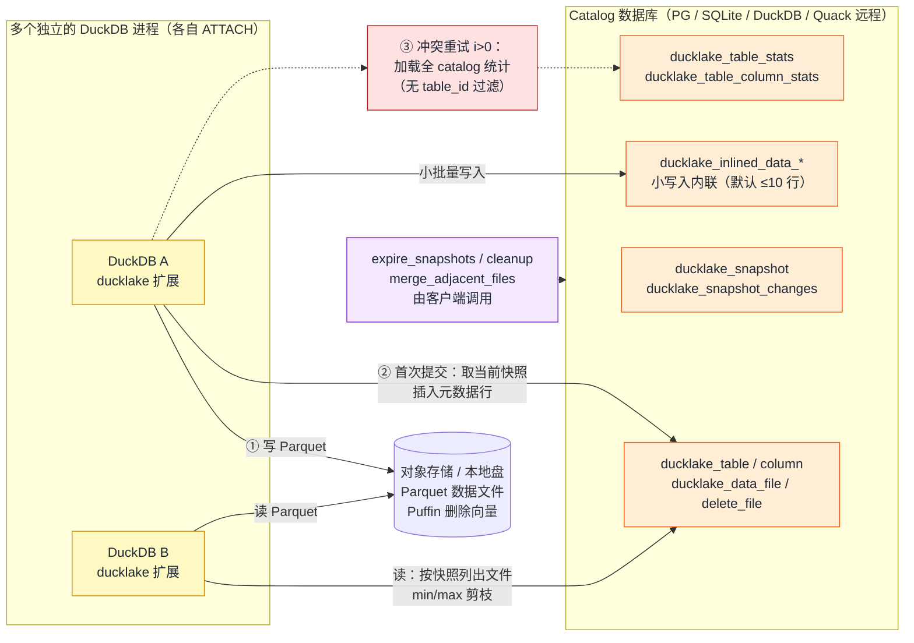

DuckLake 是一种开放的 Lakehouse 格式：表的元数据放在一个普通的 SQL 数据库（catalog）里，数据放在不可变的 Parquet 文件里。这一篇先看它的整体结构，再看一次写、存、读、提交分别发生了什么。

## DuckLake 本体：参考实现 `ducklake` 扩展

图中颜色：🟦 写路径 · 🟩 读路径 · 🟪 维护 · 🟧 元数据 / catalog · 🟨 DuckDB 引擎 · 🟥 限制或坑。

> **成熟度：** 🟢 **正式发布**：规范 1.0 官方称 production-ready（2026-04-13），1.1 于 2026-10-21 发布。`ducklake` 扩展在 DuckDB 扩展列表里属于 **Secondary** 级（best-effort 支持）。删除向量功能为 🟡 experimental。

**定位：** 元数据放在 SQL 数据库里，数据是 Parquet。每个 DuckDB 客户端各自直连 catalog，乐观并发，冲突了重试。

**提交路径（按 DuckLake `c506b268` 源码核实）**
- `DuckLakeTransactionState::Commit`（`src/storage/ducklake_transaction_state.cpp:2727-2733`）：第一次提交只调用 `context.get_snapshot()`；只有 `i > 0`（冲突重试）时，才执行没有 `table_id` 过滤的全 catalog 统计查询（`ducklake_metadata_manager.cpp:4925-4928`）。

**可借鉴**
- **元数据就是普通 SQL 表。** 任何能连 PG 的组件都能直接查快照和文件清单，不必走 DuckDB。
- **Data inlining：** 小写入先放在 catalog 里，之后批量刷成 Parquet，解决小文件问题。
- **冲突代价跟 catalog 规模挂钩。** 建表冲突按"schema + 表名"判定，删表冲突按 table id 判定（`ducklake_transaction_state.cpp:181-205`、`:233`），所以**不同表**的 `CREATE OR REPLACE` 逻辑上不冲突。但只要两个提交有交错，后提交的一方仍要走一次重试，也就要付一次全 catalog 统计加载。

## 数据路径：写 / 存 / 读 / 生命周期

四个容易踩的误区，这张图专门纠正：

1. **写"不总"落 Parquet**：小写入直接 **inline 进 catalog 数据库**，之后再 flush 成 Parquet。所以一次 `COMMIT` 可能只改了元数据库、没碰对象存储。
2. **删除 = 加过滤，不是重写**：`DELETE` 只写一个 **delete file** 记被删 row-id，原数据文件不可变、不动；读时叠加过滤。这也是时间旅行/删除便宜的原因。
3. **扫描前先按 stats 剪文件**：不是在 planning 阶段，而是**扫描所在的 pipeline 被调度时**——`Pipeline::Schedule` → `Reset` → 扫描的 `InitializeGlobalState` 里**单线程**物化文件清单（`ducklake_multi_file_reader.cpp:288`，源码注释说明这是为了避免 worker 一起挤在 `GetFiles()` 的锁上），把过滤条件翻译成对 catalog 列级 min/max 的 SQL，**整文件跳过**不可能匹配的 Parquet；打开文件时还会按运行时过滤器再判一次能否跳过（`DuckLakeMultiFileReader::InitializeReader`）。worker 只拿到存活文件，再拆 morsel。
4. **sink 是屏障 + 超内存 spill**（见）。

**存储真相**：元数据在**事务性 SQL catalog**（PG / DuckDB / SQLite，含 snapshots、文件清单、列级 stats、inlined 小数据）；数据在**不可变 Parquet + delete files**。**维护操作**（`merge_adjacent_files` 合并小文件、`flush_inlined_data`、`expire_snapshots`）都只追加**新 snapshot**，不影响正在读旧快照的查询（**快照隔离**）。

**并发写 = 乐观并发**：多写者竞争把下一个 `snapshot_id` 写进 catalog；`snapshot_id` 单调递增 + catalog PK 冲突检测 → 冲突则按 `ducklake_max_retry_count`(10) / `ducklake_retry_wait_ms`(100) / `ducklake_retry_backoff`(1.5) 重试。

## Parquet 加密

- DuckLake 提供**整库"加密模式"**：`ATTACH 'ducklake:…' (DATA_PATH '…', ENCRYPTED)`，写出的所有 Parquet 用 **Apache Parquet 加密**。
- **密钥自动生成、每文件一把**，存在 catalog 的 `ducklake_data_file.encryption_key`（delete file 同理）；读时自动从 catalog 取 key 解密。
- **信任边界 = catalog**：密钥明文存在元数据库，加密保护的是**不受信任的对象存储**（文档示例 `DATA_PATH 'untrusted_location/'`）。
- **无 BYOK / KMS 接口**（stable 文档未提供）：密钥完全系统托管。
