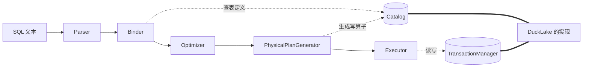
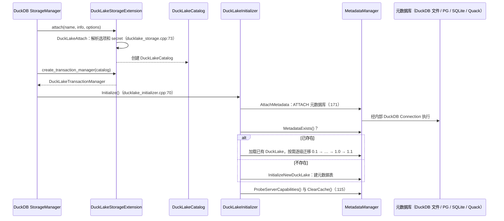
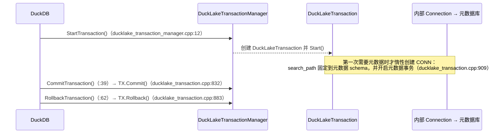
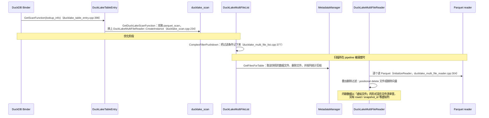
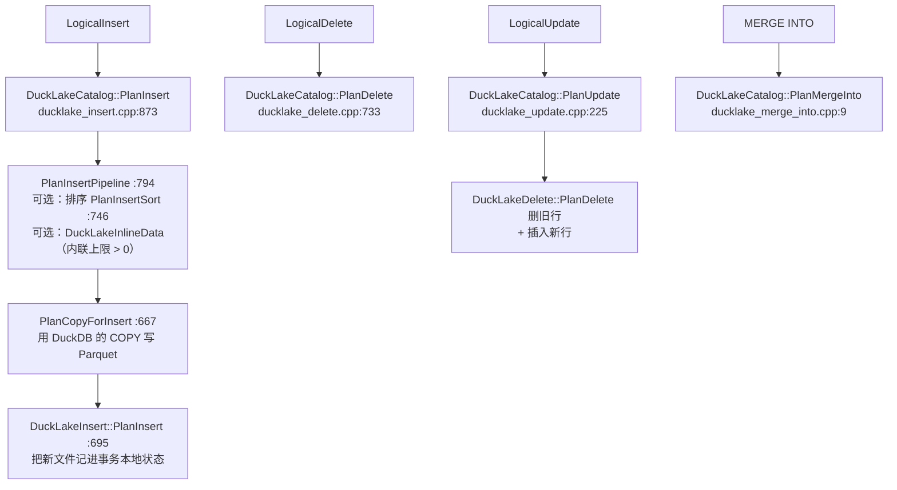
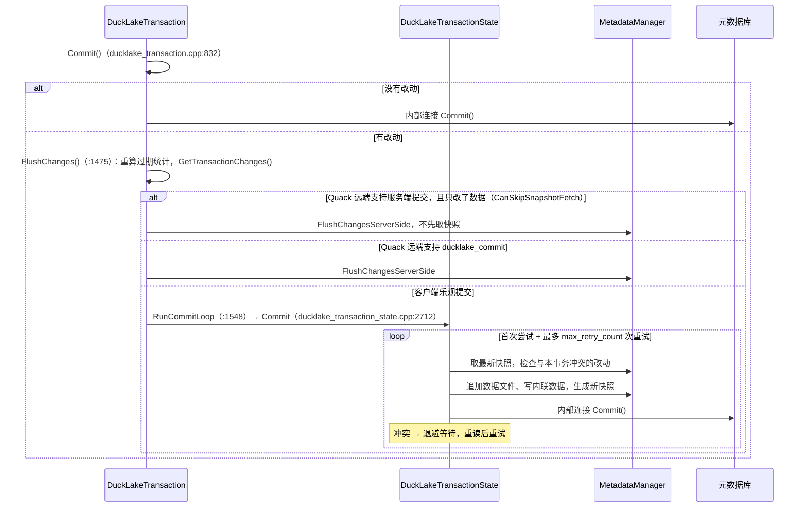
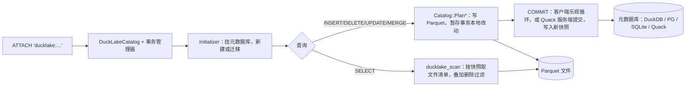

前面几篇讲的是「运行时谁在干活」，这一篇换个角度：一条 SQL 怎样从 DuckDB 引擎走进 DuckLake 扩展，最后落成 Parquet 文件和 catalog 里的一行快照记录。

> **版本**：DuckLake `v2.0-cyanoptera` @ `c506b268`（构建在 DuckDB v2.0.0 上）。文中 `文件:行号` 都相对 DuckLake 仓库的 `src/` 目录，按这个提交核对过；换版本后行号会漂，函数名一般不变。
> **范围**：DuckDB 自己的管线（Parser → Binder → Optimizer → PhysicalPlanGenerator → Executor）只当作 DuckLake 插进去的框架来讲；DuckLake 自己的部分逐个追到源码。

## 0. 两个项目怎么连起来

```
duckdb/     ← 引擎：Parser、Binder、Optimizer、Executor，以及 Catalog / Transaction 等基类
ducklake/   ← 扩展：继承 DuckDB 的存储、catalog、事务接口
               通过 ducklake/duckdb 子模块固定到某个 DuckDB 版本来编译
```

DuckLake 以 **StorageExtension** 的身份加载。它不改 DuckDB 的查询引擎，只实现引擎会回调的一组虚接口。分工很清楚：DuckDB 负责 parse → bind → optimize → plan → execute；DuckLake 负责「一张表是什么、它的字节在哪、一次提交怎样才算持久化」。

## 1. DuckDB 管线与 DuckLake 的接缝



DuckLake 覆盖的每一个接缝：

| DuckDB 基类 / 钩子 | DuckLake 的实现 | 入口 |
|---|---|---|
| `StorageExtension`（`attach`、`create_transaction_manager`） | `DuckLakeStorageExtension` | `storage/ducklake_storage.cpp:143`（构造函数里挂上 `DuckLakeAttach` 和 `DuckLakeCreateTransactionManager`） |
| `Catalog` | `DuckLakeCatalog` | `include/storage/ducklake_catalog.hpp:138` |
| `TransactionManager` | `DuckLakeTransactionManager` | `storage/ducklake_transaction_manager.cpp:12` |
| `Transaction` | `DuckLakeTransaction` | `storage/ducklake_transaction.cpp:832`（`Commit`） |
| `TableCatalogEntry` | `DuckLakeTableEntry`（扫描函数、统计信息） | `storage/ducklake_table_entry.cpp:398`（`GetScanFunction`） |
| `Catalog::PlanInsert` | 生成 INSERT 物理算子 | `storage/ducklake_insert.cpp:873` |
| `Catalog::PlanCreateTableAs` | 生成 CTAS 物理算子 | `storage/ducklake_insert.cpp:899` |
| `Catalog::PlanDelete` | 生成 DELETE 物理算子 | `storage/ducklake_delete.cpp:733` |
| `Catalog::PlanUpdate` | 生成 UPDATE（删旧行 + 插新行） | `storage/ducklake_update.cpp:225` |
| `Catalog::PlanMergeInto` | 生成 MERGE INTO | `storage/ducklake_merge_into.cpp:9` |
| `Catalog::BindCreateIndex` | 建索引的绑定 | `storage/ducklake_catalog.cpp:1166` |
| `MultiFileReader` | `DuckLakeMultiFileReader`（删除过滤、虚拟列） | `storage/ducklake_multi_file_reader.cpp:212` |
| `MultiFileList` | `DuckLakeMultiFileList`（某个快照下有哪些文件） | `storage/ducklake_multi_file_list.cpp:377`（`ComplexFilterPushdown`） |
| `TableFunction` | `ducklake_scan`（从 `parquet_scan` 克隆而来） | `storage/ducklake_scan.cpp:234` |

存储扩展、配置项和所有 SQL 函数都在加载时一次性注册：`ducklake_extension.cpp:21`（`LoadInternal`），其中 `:28` 注册名为 `ducklake` 的存储扩展。

## 2. ATTACH 与初始化

`ATTACH 'ducklake:metadata.db' AS my_lake (DATA_PATH 'files/')`



- **选项解析**：`HandleDuckLakeOption`（`storage/ducklake_storage.cpp:13`），处理 `DATA_PATH`、`METADATA_SCHEMA` / `METADATA_CATALOG`、`ENCRYPTED`、`DATA_INLINING_ROW_LIMIT`、`SNAPSHOT_VERSION` / `SNAPSHOT_TIME`（时间旅行）、`CREATE_IF_NOT_EXISTS`、`AUTOMATIC_MIGRATION` 等。
- **新建时的并发**：两个进程同时 ATTACH 同一个新库，后到的一方建表失败后会重开元数据事务、确认库已初始化，再按「加载已有」走（`ducklake_initializer.cpp:70` 里的 try/catch）。
- **迁移**：catalog 版本低于扩展要求的版本时，**没开 `AUTOMATIC_MIGRATION TRUE` 就直接报错**，开了才逐级执行 `MigrateV01` → `MigrateV02` → `MigrateV03` → `MigrateV04` → `MigrateV10`，最终到 1.1（`ducklake_initializer.cpp:244` 起）。catalog 比扩展还新时也报错，不做向前兼容。
- **能力探测**：`ProbeServerCapabilities` 只有 Quack 后端真正做事：它查远端有没有 `ducklake_commit` 函数，有就打开「服务端提交」（`metadata_manager/quack_metadata_manager.cpp:97`、`:108`），见第 6 节。

## 3. 事务生命周期



- **快照**：`GetSnapshot()`（`ducklake_transaction.cpp:1862`）确定这个事务读哪个快照版本，这是快照隔离和时间旅行的基础。
- **未提交的改动**放在事务本地状态 `DuckLakeTransactionState` 里（`storage/ducklake_transaction_state.cpp`）：新写的文件、删掉的文件、schema 变更、内联行。
- **内部连接**：`GetConnection()` 在 `connection_lock` 下惰性创建一条内部 `Connection`，把 catalog 搜索路径直接设成元数据 schema，并把会影响元数据查询的会话设置固定下来（比如 `default_order` 固定为 ASC，`errors_as_json` 固定关闭）。每个 DuckLake 事务一条，第 6 篇讲过它的串行含义。
- **回滚**：`Rollback()` 先回滚内部连接上的元数据事务，再调用 `state->CleanupFiles()` 删掉已经写出去的 Parquet 文件——这些文件没有任何元数据引用，回滚失败时也照删。

## 4. 读 / 扫描



- **复用 Parquet reader**：扫描直接用 DuckDB 的 Parquet reader，只把 `MultiFileReader` / `MultiFileList` 换成 DuckLake 的版本，于是文件集合按快照划定，删除和内联数据对上层透明。
- **文件清单什么时候取**：不是在 planning 阶段，而是在扫描所在 pipeline 被调度时单线程物化（第 6 篇有详细说明）。
- **优化器钩子**：`DuckLakeStatistics`（`ducklake_scan.cpp:102`）提供列统计；`DuckLakeGetPartitionStats`（`:177`）用 catalog 里的统计直接回答精确的 `COUNT` / `MIN` / `MAX`，事务里有本地改动时会放弃这条捷径。
- **删除**：positional delete Parquet 文件走 `DuckLakeDeleteFilter::ScanDeleteFile`（`storage/ducklake_delete_filter.cpp:139`），Iceberg V3 风格的 puffin 删除向量（roaring bitmap）走 `ScanDeletionVectorFile`（`:69`）。
- **内联数据**：内联表在文件清单里表现为一个特殊条目（`ducklake_multi_file_list.cpp:41` 的 `InlinedDataEntry`），由 `ducklake_inlined_data_reader.cpp` 读。

## 5. 写：INSERT / DELETE / UPDATE / MERGE

所有 DML 都编译成自定义的物理算子，由优化器调用的 `DuckLakeCatalog::Plan*` 生成：



- **INSERT**（`ducklake_insert.cpp:873`）：先拒绝暂不支持的 `RETURNING` 和 `ON CONFLICT`，加一层 NOT NULL 校验，再搭写入管线：需要时按表的排序键排序，内联上限大于 0 时插入 `DuckLakeInlineData` 算子（`:808`），行数没超过上限就直接内联进 catalog，不写 Parquet。
- **写 Parquet**：通过 DuckDB 的 COPY（`PlanCopyForInsert`，`:667`），按分区（`ducklake_partition_data.cpp`）和排序（`ducklake_sort_data.cpp`）规则写。
- **加密**：库开了加密时，每个文件生成一把密钥（`DuckLakeCatalog::GenerateEncryptionKey`，`:703`）。
- **CTAS**（`:899`）：表还不存在，所以先用列定义现场构造分区、排序和表选项，再走同一条写入管线。
- **DELETE** 生成删除文件或删除向量；**UPDATE** 由 `DuckLakeUpdate` 算子把旧行交给 `DuckLakeDelete::PlanDelete` 删掉、再插入新行；**MERGE INTO** 在 `ducklake_merge_into.cpp`。
- **这时还没碰 catalog**：所有写入都只是暂存的事务本地改动。数据文件已经在存储上了，但提交之前谁也看不见。

## 6. 提交（乐观并发）



- **入口**：`Commit()` 先删掉本事务里过期的快照（如果有），再看有没有改动；有就进 `FlushChanges()`。
- **三条路**（`ducklake_transaction.cpp:1475`）：
  1. **Quack 远端支持服务端提交、且这次只改了数据**：`CanSkipSnapshotFetch` 为真（两个条件都要满足，`quack_metadata_manager.cpp:141`），连快照都不先取，直接走服务端提交。
  2. **Quack 远端加载了 DuckLake 扩展**（ATTACH 时探测到 `ducklake_commit` 函数）：走服务端提交。客户端用 `DuckLakeStagedCommit` 把改动写进暂存表，远端的 `ducklake_commit` 表函数（`functions/ducklake_commit.cpp`）调 `DuckLakeServerSideCommit::Run`（`storage/ducklake_server_side_commit.cpp:98`）完成提交，重试也在服务端做。
  3. **其他所有后端**（DuckDB 文件、PostgreSQL、SQLite）：客户端乐观提交循环 `RunCommitLoop`，真正的循环在 `DuckLakeTransactionState::Commit`。
- **重试参数**：`ducklake_max_retry_count` / `ducklake_retry_wait_ms` / `ducklake_retry_backoff`，在 `ducklake_extension.cpp:30`–`:35` 注册。超过次数时报错信息会直接建议你调大 `ducklake_max_retry_count`。
- **原子可见**：只有新的**快照行**写进 catalog，提交才算持久化。读旧快照的查询永远看不到它，这就是快照隔离。

## 7. 元数据管理器与后端

`DuckLakeMetadataManager`（`storage/ducklake_metadata_manager.cpp`，两百多 KB）是生成**全部**元数据 SQL 的抽象层：快照、表、列、数据文件、删除文件、列统计、分区、标签、内联数据。所有查询都经事务的内部 `Connection` 执行。

后端在 ATTACH 时按元数据库的类型选（`ducklake_metadata_manager.cpp:52` 的注册表，`:78` 兜底）：

| 后端 | 实现 | 说明 |
|---|---|---|
| **DuckDB 数据库文件**（默认） | 基类 `DuckLakeMetadataManager` | 类型不在注册表里时用它，最常见的本地用法 |
| **PostgreSQL** | `metadata_manager/postgres_metadata_manager.cpp` | 类型名 `postgres` / `postgres_scanner` |
| **SQLite** | `metadata_manager/sqlite_metadata_manager.cpp` | 类型名 `sqlite` / `sqlite_scanner` |
| **Quack**（远程 DuckDB） | `metadata_manager/quack_metadata_manager.cpp` | 类型名 `quack` / `quack_scanner`；**唯一支持服务端提交的后端** |

另外还有 `ducklake_metadata_manager_v1_1.cpp`，按 catalog 规范版本切换 SQL 写法。

## 8. 维护与自省函数

都在 `ducklake_extension.cpp` 注册，实现在 `functions/` 下：

| SQL 函数 | 作用 | 文件 |
|---|---|---|
| `ducklake_snapshots` / `ducklake_current_snapshot` / `ducklake_last_committed_snapshot` | 快照历史与当前快照 | `ducklake_snapshots.cpp` 等 |
| `ducklake_table_info` / `ducklake_list_files` | 表信息、文件清单 | `ducklake_table_info.cpp`、`ducklake_list_files.cpp` |
| `ducklake_table_changes` / `ducklake_table_insertions` / `ducklake_table_deletions` | 变更数据（CDC） | `ducklake_table_changes.cpp`、`ducklake_table_insertions.cpp` |
| `ducklake_expire_snapshots` | 清理旧快照 | `ducklake_expire_snapshots.cpp` |
| `ducklake_cleanup_old_files` / `ducklake_cleanup_orphaned_files` | 回收不再被引用的 Parquet | `ducklake_cleanup_files.cpp` |
| `ducklake_merge_adjacent_files` / `ducklake_rewrite_data_files` | 合并小文件、重写数据文件 | `ducklake_compaction_functions.cpp` |
| `ducklake_add_data_files` | 把外部 Parquet 登记进表 | `ducklake_add_data_files.cpp` |
| `ducklake_flush_inlined_data` | 把内联行刷成 Parquet | `ducklake_flush_inlined_data.cpp` |
| `ducklake_set_option` / `ducklake_options` / `ducklake_settings` | 库、schema、表级配置 | `ducklake_set_option.cpp`、`ducklake_options.cpp`、`ducklake_settings.cpp` |
| `ducklake_set_commit_message` | 给本次提交加说明 | `ducklake_set_commit_message.cpp` |
| `ducklake_commit` | 服务端提交（Quack 远端调用） | `ducklake_commit.cpp` |
| `murmur3_32` | 兼容 Iceberg 的分桶哈希 | `ducklake_murmur3.cpp` |

## 端到端小结



**一句话心智模型**：DuckDB 驱动查询；DuckLake 回答「这张表在这个快照下由哪些 Parquet 文件组成」，DML 时写新的 Parquet，提交时把一行新快照原子地追加进 catalog 数据库。
