给了生态的成熟度总表，这一篇逐个项目画核心架构图，并写下每个项目值得借鉴的地方。DuckLake 本体的架构见，全部来源汇总在末尾。

**架构图怎么读**
- 图只画到 README 或文档里明确写了的组件。没写的不臆造，在"未核实"里说明。
- 节点颜色：
  - 🟦 写路径
  - 🟩 读路径
  - 🟪 维护
  - 🟧 元数据 / catalog
  - 🟨 DuckDB 引擎
  - 🟥 限制或坑
  - ⬜ 外部系统或存储

## 2.1 MotherDuck（托管 DuckLake + Duckling）

> **成熟度：** MotherDuck 平台 🟢 **GA**（2024-06）。托管 DuckLake 🟡 **Preview**：4 月发布时写的是 public preview，之后的 release notes 都没有 GA 公告。文档列出的限制包括"每个库只允许一个账号写"。

**定位：** 云数仓，每个用户一个 DuckDB 实例（称为 hypertenancy）。客户端和云端可以分工执行一个查询（Dual Execution）。

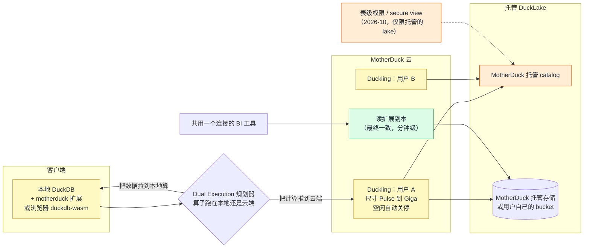

**可借鉴**
- **按用户或租户隔离计算实例。** 吵闹邻居只影响它自己。
- **读扩展副本接受最终一致。** 适合 BI 这类"一个连接、很多用户"的场景。
- **未核实：** 存储内部机制、冷启动时间、副本数上限。

来源：[扩展博客](https://motherduck.com/blog/scaling-duckdb-with-ducklings/)、[release notes](https://motherduck.com/docs/about-motherduck/release-notes/)

---

## 2.2 datafusion-ducklake（Hotdata）

> **成熟度：** 🟠 **0.x**：crates.io 最新 0.9.0（2026-10-07），没有 GitHub release。多 catalog 布局为 🟡 experimental。

**定位：** 用 Rust 原生读写 DuckLake，**完全不依赖 DuckDB**。

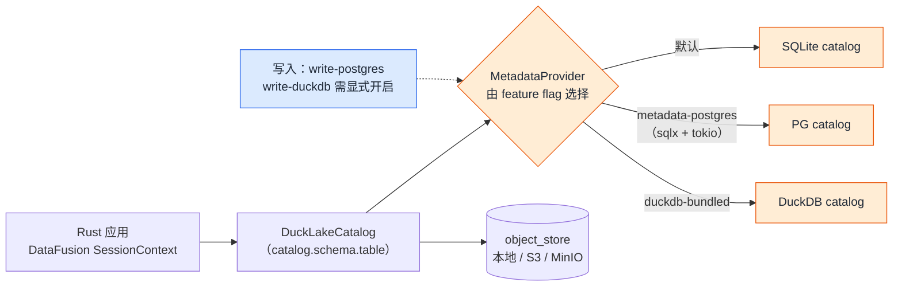

**可借鉴**
- **证明 DuckLake 元数据可以完全脱离 DuckDB 来读。** 只要遵守规范，元数据协议是开放的。
- **读写能力按 feature flag 拆开。** 默认只读，写入要显式开启，这是降低误写风险的好做法。

来源：[GitHub](https://github.com/datafusion-contrib/datafusion-ducklake)

---

## 2.3 ducklake-spark（MotherDuck）

> **成熟度：** 🟠 **0.x**：v0.4.0（2026-10-12），只能写。

**定位：** 基于 Spark DataSource V2 的**只写**连接器，只支持追加。

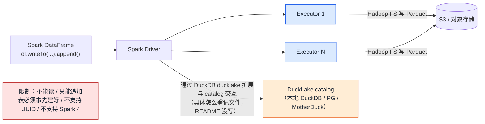

**可借鉴**
- **"数据面"和"元数据提交"分开。** 大量 worker 并行写文件，最后由一个点统一登记和提交。
- **反面教材：** 连接器只能写不能读，说明多引擎生态的成熟度远不如 Iceberg。

来源：[GitHub README](https://github.com/motherduckdb/ducklake-spark)

> **Trino 和 pandas 客户端（不画图，只读了 README 的状态部分）**
> - **`brikk/trino-ducklake`** 🟠 v0.5.4：通过 JDBC 访问 catalog。能读写 DuckLake 1.0 格式，**不能写 1.1 格式**，读 1.1 格式是实验功能，正常构建里没有开启。
> - **`awitten1/trino-ducklake`** 🟠：没有 release。
> - **pandas 版 `ducklake-dataframe`** 🟡：概念验证。README 写明"100% written by Claude Code"，不建议在生产环境使用。

---

## 2.4 pg_ducklake + pg_duckpipe（relytcloud）

> **成熟度：** pg_ducklake 🟢 **v1.0.3**（2026-10-19），升级到 DuckDB 2.0 / DuckLake 1.1 还在 issue 里跟踪。pg_duckpipe 🟠 **没有 GitHub release**，各组件的 Cargo 版本是 0.1.0 和 1.0.0，README 没有声明成熟度。

**定位：** 在 Postgres 里原生建 DuckLake 表；pg_duckpipe 从 WAL 做 CDC，把行存表增量同步成 DuckLake 表。

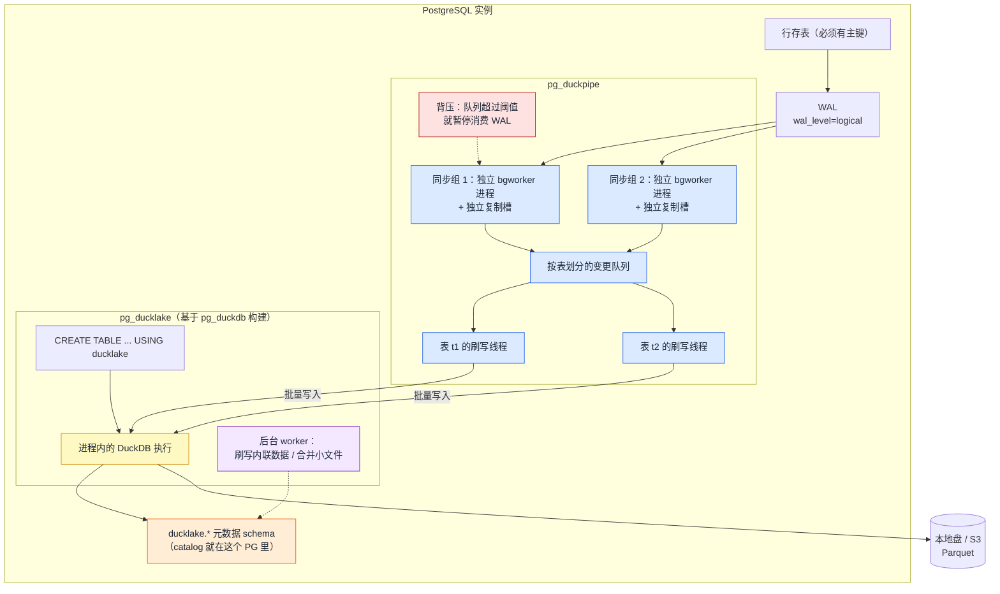

**可借鉴**
- **同步组隔离：** 每个组有自己的进程和复制槽，"一张慢表拖不住别的组"。
- **按表的刷写线程：** 不同表之间并行写入。
- **背压：** 积压超过阈值就暂停消费，内存有上界。
- **缓冲后批量写，加上 inlining 吸收小写入：** 是解决小文件问题的标准做法。

来源：[pg_ducklake](https://github.com/relytcloud/pg_ducklake)、[pg_duckpipe](https://github.com/relytcloud/pg_duckpipe)

---

## 2.5 dlt（dltHub）DuckLake 目的端

> **成熟度：** dlt 🟢 **1.32.0**（PyPI 标为 "Production/Stable"）。DuckLake 目的端的文档没有标阶段：PG catalog 是唯一的生产级选项；SQLite 和 DuckDB catalog 只能串行加载；MotherDuck catalog 为 🟡 experimental；MySQL 未测试。

**定位：** Python 写的 EL 库，原生支持 `destination="ducklake"`。

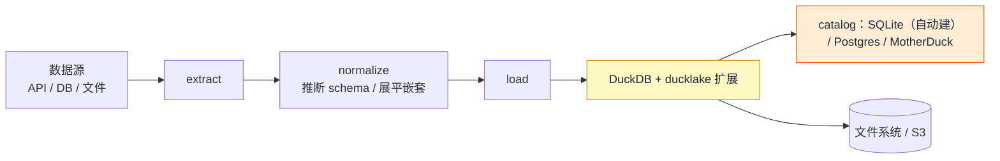

**可借鉴**
- **本地 SQLite catalog 和生产 PG catalog 用同一套代码切换。**
- 来源：[dlt 文档](https://dlthub.com/docs/dlt-ecosystem/destinations/ducklake)（据检索摘要；写入策略的细节没有核实）

---

## 2.6 Quack on Demand（starlake-ai）

> **成熟度：** 🟠 **0.x**：v0.12.2（2026-11-09），依赖的 Quack 还是 🟡 beta。

**定位：** 面向 DuckDB 和 DuckLake 的多租户"服务层"，相当于自托管、只管查询服务的 MotherDuck。

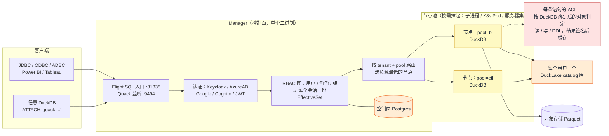

**可借鉴**
- **按 bound plan 而不是 SQL 文本做鉴权：** 判断的是 DuckDB 实际解析出的对象，绕不过去。
- **按工作负载分池（bi / etl）：** 交互查询和批量任务分开。
- **README 里的自我定位很明确：** 每条语句只路由到一个节点，不跨节点做 shuffle。需要分布式就去用 Trino 或 StarRocks。

来源：[GitHub README](https://github.com/starlake-ai/quack-on-demand)

---

## 2.7 PostHog Hoglake（DuckLake 的硬分叉）

> **成熟度：** 🟢 **v1.4.9**（2026-11-10），PostHog 自己在生产环境使用（dev、prod-us、prod-eu）。和 DuckLake 不兼容。

**定位：** 把 catalog 做成一个服务，只用 Postgres 做后端，**由服务端提交**。和 DuckLake 不兼容；已经以 "Gigahog" 的名字部署在 dev、prod-us、prod-eu。

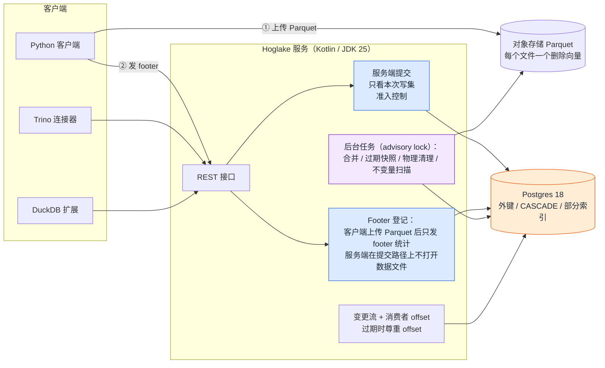

**可借鉴**
- **缺陷清单本身就是最好的借鉴材料。** `docs/ducklake-defect-ledger.md` 记了 6 个他们在 PG catalog 上踩到的 DuckLake 问题：
  - 内联表的回收永远触发不了（一个 catalog 积累了 112,947 张）；
  - 提交时加载全 catalog 统计；
  - schema 缓存不按列计内存，导致无限增长；
  - 等等。
- **维护任务由一个地方统一执行并加锁，而不是各个客户端抢着跑。**
- **提交开销只跟本次写集有关，不随 catalog 规模增长。** 这是 DuckLake 上游还没做到的地方。

来源：[PostHog/hoglake](https://github.com/PostHog/hoglake)

---

## 2.8 其他 DuckLake 社区项目

**boilstream**：Rust 写的多租户 DuckDB 服务，原生集成 DuckLake。 🟠 **0.x**：GitHub release 0.10.7（2026-04），tag 到 v0.10.29。

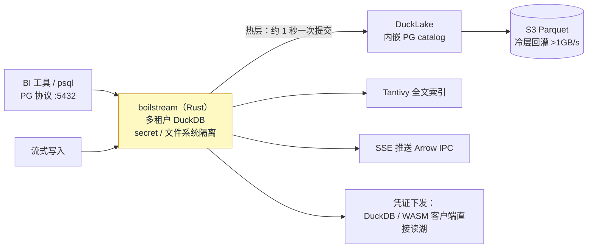

- **可借鉴：** "凭证下发"。服务端只负责鉴权和发放临时凭证，客户端自己的 DuckDB（包括浏览器里的 WASM）直接读 Parquet，计算下放到客户端。

**SwanLake**：Arrow Flight SQL 服务端，后面是 DuckDB 和 DuckLake（PG catalog 加 S3）。 🟠 **0.x**：v0.1.0（2025-11），之后没有新版本。

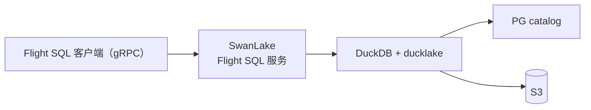

**featherman**：DuckLake 的 Kubernetes Operator。 🟡 **Alpha**：v0.3.0 标为 prerelease，README 写"early development"，CRD 是 `v1alpha1`。

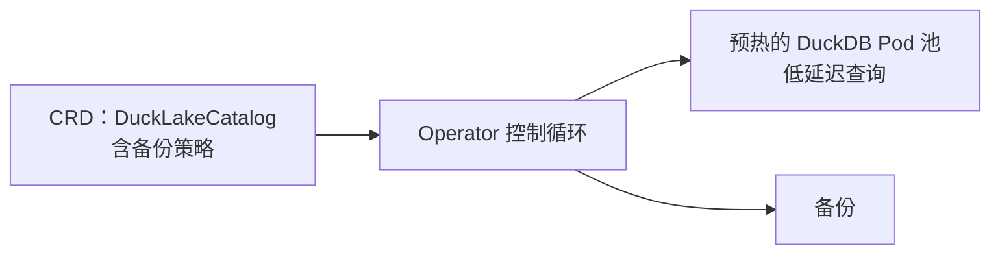

- **可借鉴：** 预热 Pod 池。冷启动开销（加载扩展、ATTACH、读元数据缓存）放在请求之前付掉。

**ducklake-guard**：给 DuckLake 加按表的访问控制（实验性）。 🟡 **Experimental**：v0.1.0，README 标注 Experimental。

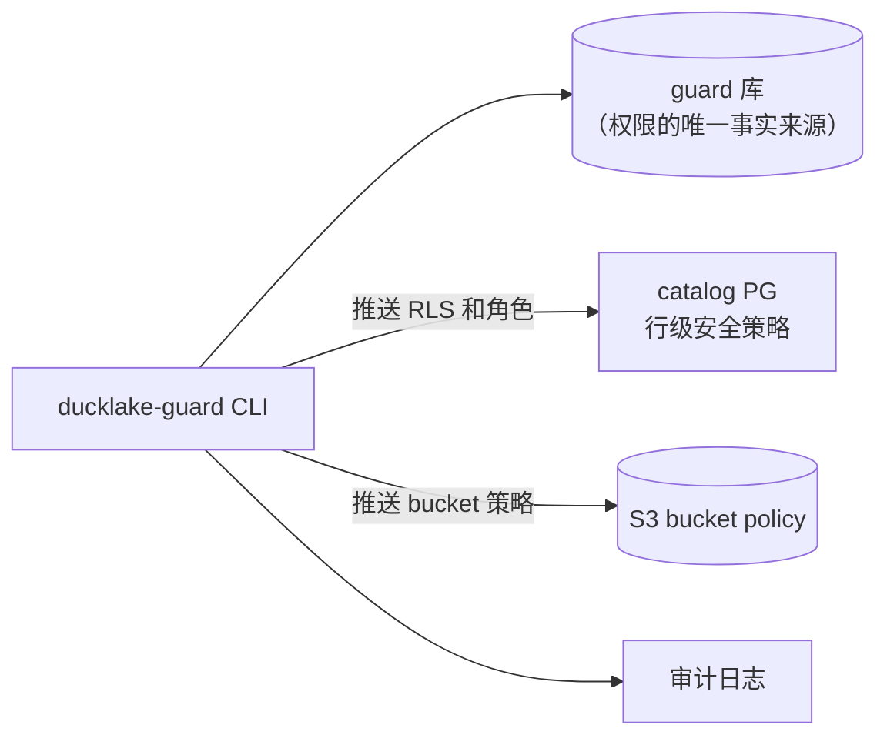

- **可借鉴：** 权限同时落在两层，用 PG 行级安全控制 catalog 里能看到哪些行，用 bucket 策略控制能读哪些文件。一处漏了，另一处兜底。

**cloudflare-ducklake**：DuckDB 跑在 Cloudflare Containers 上，用 Hono.js 包成 HTTP API。 🟡 **演示项目**：没有 release，README 提示需要 Cloudflare Containers beta 权限。

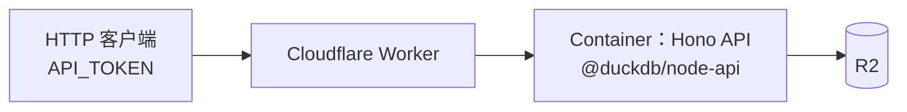

- **可借鉴：** 把扩展预先打进镜像，容器启动时不用联网下载。
