DuckDB 被别的系统引入，大致有五种形态：嵌进数据库内核、旁路进程、独立服务、嵌在应用里、大量短命实例。这一篇逐类看代表项目的架构和可借鉴点，篇末是没画图的项目、局限和全部来源。

**架构图怎么读**
- 图只画到 README 或文档里明确写了的组件。没写的不臆造，在"未核实"里说明。
- 节点颜色：
  - 🟦 写路径
  - 🟩 读路径
  - 🟪 维护
  - 🟧 元数据 / catalog
  - 🟨 DuckDB 引擎
  - 🟥 限制或坑
  - ⬜ 外部系统或存储

## 3.1 A 类：嵌进数据库内核

### pg_duckdb（duckdb 组织；正式版 v1.1.1，最新 v1.2.0 为 Experimental）

> **成熟度：** 🟢 **v1.1.1 是正式版**（2025-12-18，内置 DuckDB 1.4.3）。1.0.0（2025-09-04）发布时官方宣布"ready for production"。
> ⚠️ **版本空档：** v1.1.x 内置的 DuckDB 1.4 系列，官方只支持到 2026-11-17（见 DuckDB 2.0 公告）。而能用上 DuckDB 2.0 的 v1.2.0 又还没稳定，见下一条。
> ⚠️ **最新的 v1.2.0（2026-11-03，内置 DuckDB 2.0.0）在 release notes 里自己标了 "Experimental"**："not ready for production use because there is a number of user-reported serious issues that are still unresolved"。GitHub 上没有勾选 prerelease。

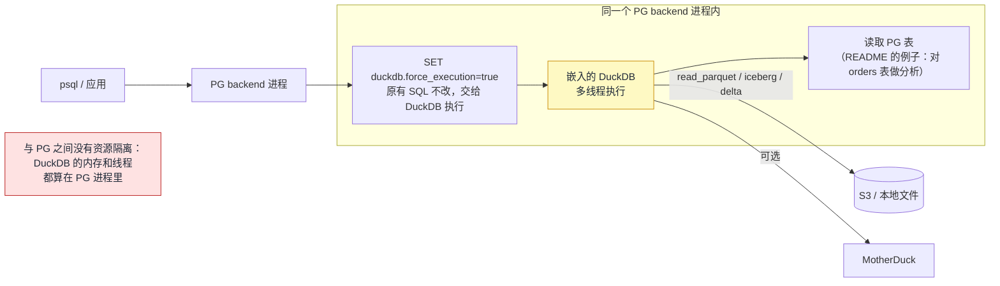

**可借鉴**
- **"一个开关切换执行引擎，SQL 不用改"：** 用户感知不到执行引擎换了。
- 由 Hydra 和 MotherDuck 合作开发；README 里没有描述内部的接管机制，图里也没画。
- **反例：** 同进程嵌入就没有资源隔离。把 DuckDB 嵌在 JVM 里也是同样的问题：DuckDB 用的内存在 JVM 堆外，native crash 会把 JVM 一起带走。

来源：[GitHub](https://github.com/duckdb/pg_duckdb)

### pg_mooncake + moonlink（Mooncake Labs，已被 Databricks 收购）

> **成熟度：** pg_mooncake ⚫ **停更**：v0.1.2（2025-02），默认分支最后一次提交在 2025-10。moonlink 🟡 **Preview**：README 写"Moonlink is in preview. Expect changes."，没有 release。

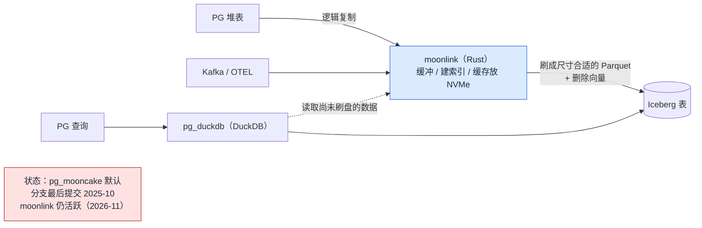

**可借鉴**
- **写放大治理：** 先缓冲再提交大文件。思路和 DuckLake inlining、pg_duckpipe 的批量写一致。
- **未核实：** 读路径如何合并"未刷盘缓冲 + Iceberg"，只看到 README 的示意图。

来源：[pg_mooncake](https://github.com/Mooncake-Labs/pg_mooncake)、[moonlink](https://github.com/Mooncake-Labs/moonlink)

### 阿里云 RDS MySQL DuckDB 分析只读实例

> **成熟度：** 🟢 **正式上线**：分析只读实例在 2025-08-06 "正式上线"，按只读实例计费。分析主实例 ⚪ 公告没写阶段，可以免费试用。

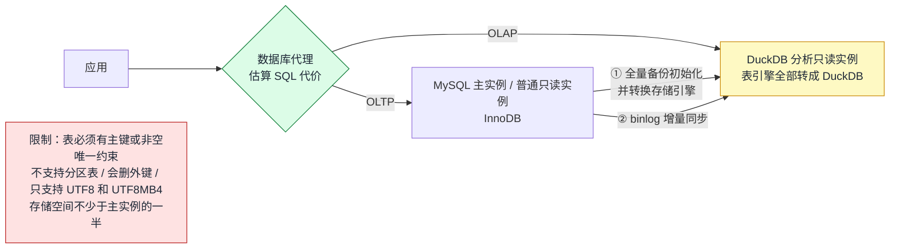

**可借鉴**
- **按代价分流：** OLAP 走 DuckDB，OLTP 走 InnoDB；也提供直连地址给只跑分析的场景。
- **"全量初始化 + 增量同步"两段式：** 区别于每次整表 `CREATE OR REPLACE` 重建。增量要求有主键，这正是阿里云把"无主键表"排除在外的原因。

来源：[阿里云文档](https://help.aliyun.com/zh/rds/apsaradb-rds-for-mysql/duckdb-based-analytical-instance/)

### 阿里云 PolarDB DuckDB 列存表

> **成熟度：** ⚪ **文档没标阶段**（要求 Oracle 语法兼容 2.0，版本 2.0.14.22.49.0 及以上）。开源的 DuckDB-paimon 扩展 🟠 v0.1.3（2026-10-23）。

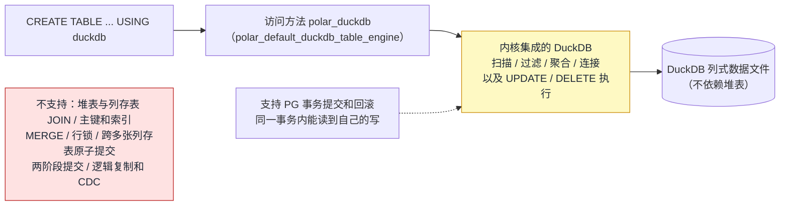

**可借鉴**
- **限制清单写得很诚实，可以当作"DuckDB 塞进事务型数据库的边界"参考：** 跨表原子提交、行锁、和行存表 JOIN 都没做。
- 另有 IMCI 列存索引方案（行存加 DuckDB 列存，宣称秒级同步、复杂查询快 60 到 100 倍）。原文正文没能抓到，**不画图**。

来源：[PolarDB 文档](https://help.aliyun.com/en/polardb/polardb-for-oracle/what-is-a-cloud-native-duckdb-column-store-table)

---

## 3.2 B 类：旁路进程

### pg_lake（Snowflake-Labs，v3.6.0）

> **成熟度：** 🟢 **正式发布**：v3.6.0（2026-11-04）。

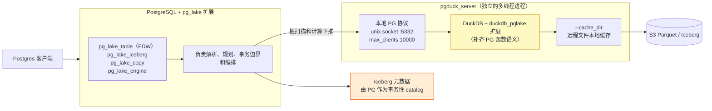

**可借鉴**
- **用进程隔离解决宿主和 DuckDB 的不兼容。** README 原话说这样避免了把 DuckDB 嵌进 PG 进程带来的"threading and memory-safety limitations"。
- **旁路进程讲标准协议，就能用标准客户端调试：** 用 psql 直接连 5332 端口查看引擎状态。
- **`duckdb_pglake` 扩展补齐方言差异。**
- **远程文件本地缓存（`--cache_dir`）。**

来源：[GitHub README](https://github.com/Snowflake-Labs/pg_lake)

---

## 3.3 C 类：独立服务

### Quack（DuckDB 官方客户端/服务端协议，beta）

> **成熟度：** 🟡 **Beta**：官方 FAQ 原话"currently in a beta state"，"protocol is not yet stable"。扩展属于 Secondary 级。社区的 ADBC 驱动是 🟡 public preview（2026-05-21）。

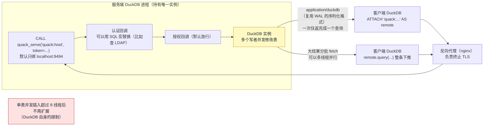

官方基准（同可用区两台 m8g.2xlarge）：6000 万行传输 Quack 4.94s，Arrow Flight 17.40s，PG 158.37s；8 线程小写入 5434 tx/s。

**可借鉴**
- **"写集中到一个 server"天然消除了多进程写同一份数据的冲突。**
- **认证和授权都是可替换的回调，还能直接写成 SQL 宏。**

来源：[Quack 公告](https://duckdb.org/2026/05/12/quack-remote-protocol.html)、[FAQ](https://duckdb.org/quack/faq.html)

### GizmoSQL（v1.42.3）

> **成熟度：** 🟢 **v1.42.3**（stable 渠道基于 DuckDB 1.5.6）。DuckDB 2.0 的 edge 渠道为 🟡 experimental，官方写"not for production"。

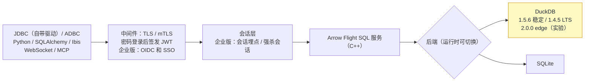

**可借鉴**
- **按 DuckDB 版本分发布渠道（stable / LTS / edge）。**
- **"强杀会话"和会话埋点。**

来源：[GitHub README](https://github.com/gizmodata/gizmosql)

### MyDuck Server（apecloud）

> **成熟度：** 🟠 **未正式发布**：没有 GitHub release，Docker 镜像标签是 `v0.3.1-dev`（2026-09-19），路线图里认证功能还没完成。

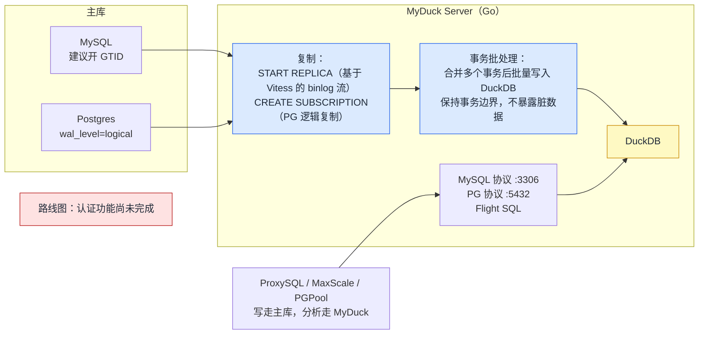

**可借鉴**
- **事务批处理：** 把多个源事务合并成一次 DuckDB 写入，但对外只在事务边界上可见。这是 DuckDB 不擅长高频小写入时的标准对策。

来源：[GitHub README](https://github.com/apecloud/myduckserver)

---

## 3.4 D 类：嵌在应用里（BI 和嵌入式分析）

### Rill

> **成熟度：** 🟠 **版本号 0.x**（v0.91.1，2026-11-03），但 Rill Cloud 是商用服务。

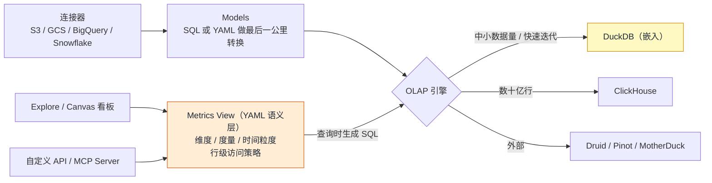

**可借鉴**
- **"语义层生成 SQL，引擎可以换"。**
- **行级访问策略挂在语义层上统一注入：** 不是每个查询自己拼条件。
- **Rill 自己的分工：** DuckDB 管中小数据，ClickHouse 管数十亿行。这是给 DuckDB 定规模边界时可以参考的业界判断。

来源：[GitHub README](https://github.com/rilldata/rill)

### Cube

> **成熟度：** 🟢 **v1.8.21**。DuckDB 数据源的文档没标阶段。

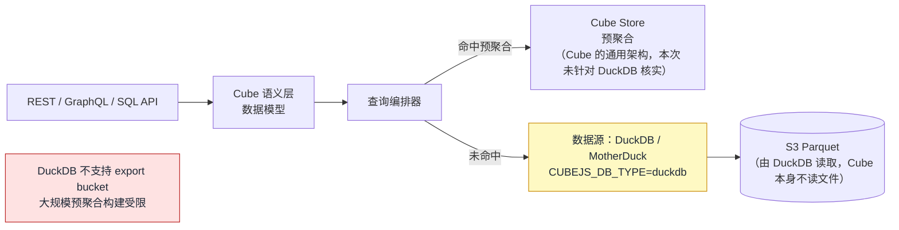

**可借鉴**
- **预聚合层放在引擎之前。** 命中 rollup 就不用扫明细。

来源：[Cube 文档](https://docs.cube.dev/docs/configuration/data-sources/duckdb)（据检索摘要）

### Metabase DuckDB 驱动 / Superset duckdb_engine

> **成熟度：** Metabase 驱动 🟢 **1.5.6.0**（版本号跟随 DuckDB；第三方插件，由 MotherDuck 维护，不是 Metabase 官方）。duckdb_engine 🟠 **v0.17.0**（2025-03），其中预加载扩展功能为 🟡 experimental。

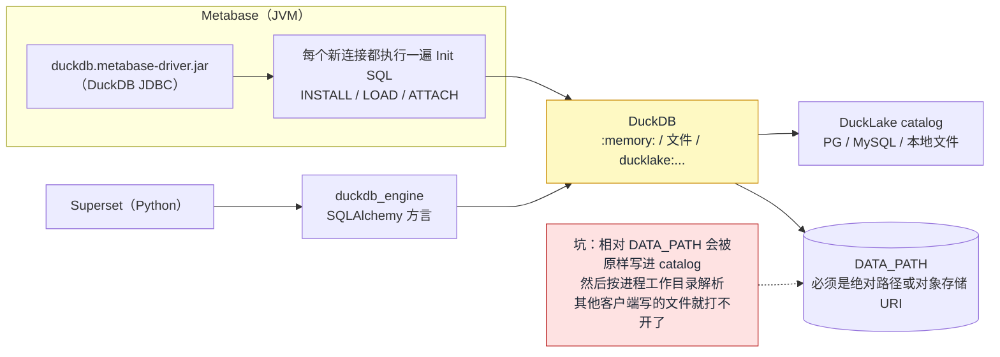

**可借鉴**
- **`DATA_PATH` 的坑可以直接防住。**
- **"每个新连接执行 Init SQL"** 是 JDBC 场景下最简单的连接初始化方式。如果是在一个 base 实例上 `duplicate()` 出连接，ATTACH 是共享的，比这个更省。

来源：[Metabase 驱动 README](https://github.com/motherduckdb/metabase_duckdb_driver)、[duckdb_engine](https://github.com/Mause/duckdb_engine)

### Omni（DuckDB 当可再查询的缓存，2022 年的文章）

> **成熟度：** ⚪ 商用产品，DuckDB 是内部组件，没有单独的发布阶段。

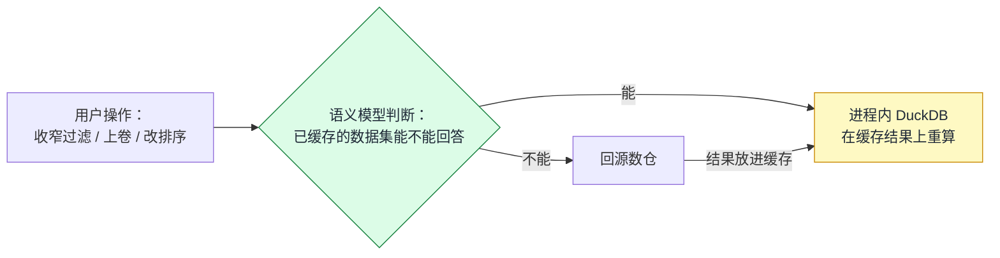

**可借鉴**
- **透视表上的"收窄过滤、上卷到更粗的粒度、改排序"都可以在上一次的结果上完成，不用再查引擎。**
- **未核实：** 缓存失效策略（文章没写）。

来源：[Omni 博客](https://omni.co/blog/DuckDB-complements-BI)

### Mosaic（UW 交互数据实验室）

> **成熟度：** 🟠 **0.x**：v0.35.0（2026-11-03），学术研究项目。

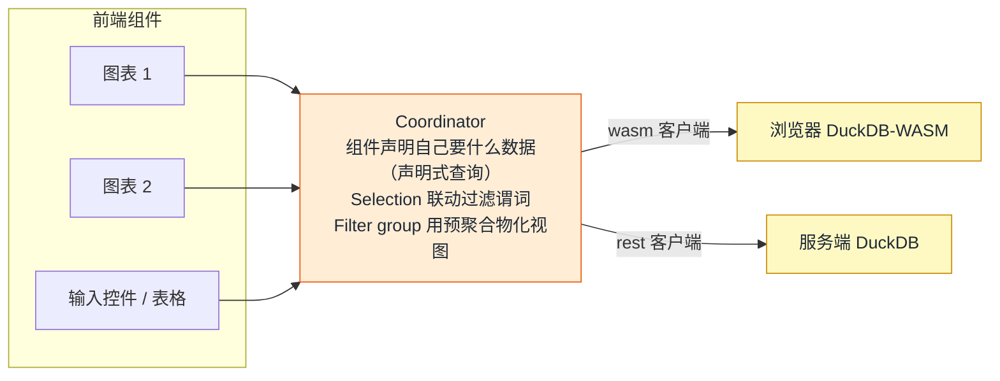

**可借鉴**
- **一个协调器统一管理看板上所有组件的查询，** 可以合并、去重，并为交叉过滤建预聚合。

来源：[GitHub README](https://github.com/uwdata/mosaic)

### Hex / Mode / Count / Observable（notebook 和浏览器嵌入，合并成一张图）

> **成熟度：** ⚪ 都是商用产品，DuckDB 是内部组件。

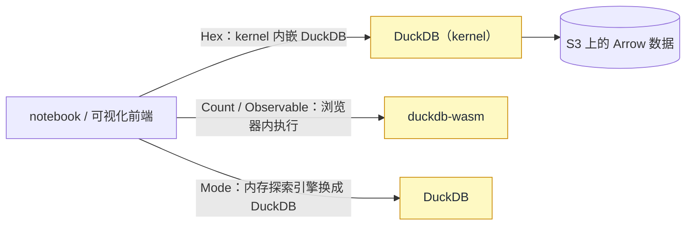

- **可借鉴：** 把"二次探索"（排序、筛选、小范围聚合）放到离用户最近的地方执行，服务端只负责首次取数。
- 来源：MotherDuck "15+ companies"（厂商汇编，只有一句话级别的描述）。

### Evidence（⚠️ 已经不再以 DuckDB 为核心）

> **成熟度：** 🟠 **过渡期**：最后一个正式发布是旧架构的 `@evidence-dev/universal-sql@3.0.1`（2026-02-06，基于 DuckDB）。main 分支上的重写版 `@evidence/core` 和 `@evidence/cli` 还是 0.0.1，没有发布。

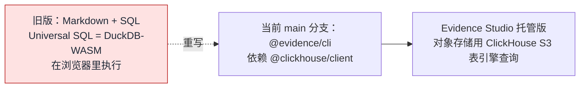

- **事实：** 当前 `evidence-dev/evidence` 的 `cli/package.json` 依赖 `@clickhouse/client`。仓库文件树里已经没有含 "duckdb" 的路径，根目录、`core/` 和 `cli/` 三个 package.json 里也没有 DuckDB 依赖。托管版文档写的是用 ClickHouse 的 S3 表引擎。
- **可借鉴（反面）：** 一个以"浏览器 DuckDB"起家的 BI 工具，做托管多租户时换成了服务端 ClickHouse。说明 DuckDB 在"多租户、集中托管"场景下有天花板。**换引擎的原因官方没说，这里是推断。**

### Watershed

> **成熟度：** ⚪ 公司内部方案。

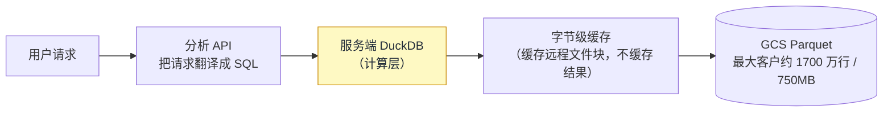

- **可借鉴：** "请求翻译成 SQL，DuckDB 直接读 Parquet"是嵌入式分析最常见的形态。他们的结论是**字节级缓存比结果缓存更划算**（加上后快了约 10 倍，每天 7.5 万次查询）。
- 来源：MotherDuck "15+ companies"（厂商汇编）。

### Definite（Snowflake 迁到 DuckDB，再迁到 DuckLake）

> **成熟度：** ⚪ 商用产品，也是公司内部方案。

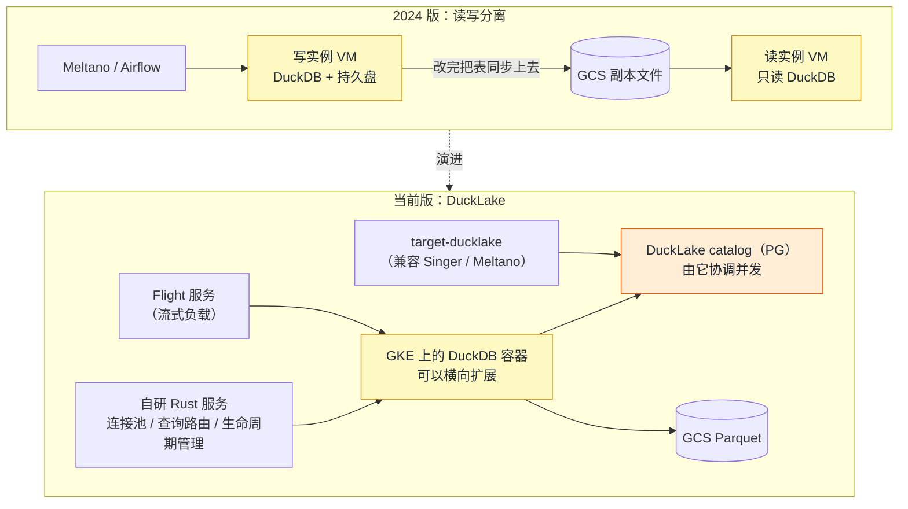

**可借鉴**
- **演进路线：** 读写分离 → 交给 DuckLake 协调并发 → 前面加一个专门的服务做连接池、路由和生命周期管理。
- 他们说单写者限制是**最大的工程挑战**。
- **注意：** 文中数字（对 1000 万行做聚合 200 到 400ms 等）是厂商自述。

来源：[商业论证](https://www.definite.app/blog/duckdb-ducklake-business-case)、[2024 架构](https://www.definite.app/blog/duckdb-datawarehouse)（据检索摘要）

---

## 3.5 E 类：大量短命实例和分布式

### Okta（数千个 serverless DuckDB）

> **成熟度：** ⚪ 公司内部方案。

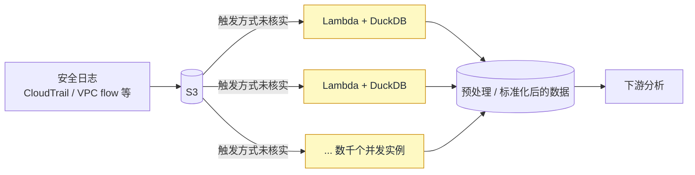

- **规模：** 6 个月处理 7.5 万亿条记录、1.3 亿个文件；单日数据量从 1.5TB 到 50TB 波动，不需要改基础设施。
- **可借鉴：** 每个任务一个"用完即弃"的 DuckDB，彻底避开共享实例的并发问题。
- **未核实：** 文件如何分配给各实例、输出格式（只读到演讲摘要）。Atlan 的做法类似（用 DuckDB 替换 Spark，由 ArgoCD 编排），没有画图。

### DeepSeek smallpond

> **成熟度：** 🟠 **0.x**：PyPI 0.15.0，2025-03 之后没有更新。

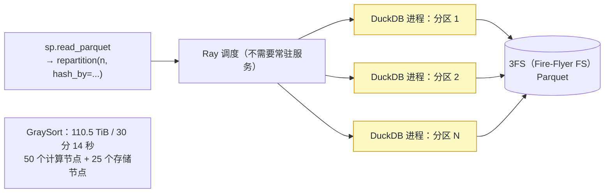

- **可借鉴：** 手动分区，每个分区一个 DuckDB，就绕开了"分布式查询引擎"的复杂度。前提是能找到天然的分区键。
- **状态：** 2025-03 之后没有更新。

---

## 3.6 云厂商：DuckDB 当 Iceberg 客户端（合并一张图）

> **成熟度：** DuckDB `iceberg` 扩展 🟢 随 DuckDB 2.0 LTS 发布（Secondary 级），其中 S3 Tables 支持为 🟡 experimental。Cloudflare R2 Data Catalog 🟢 **GA**（已改名 Basin Catalog）。Databricks Unity Catalog 的 Iceberg REST 和 Microsoft Fabric 的状态 ⚪ 没有核实。

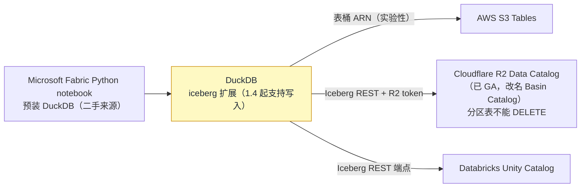

- **可借鉴：** 如果将来需要和外部平台交换湖数据，Iceberg 的跨引擎支持远比 DuckLake 广。DuckLake 1.1 有一些向 Iceberg 兼容的设计（epoch 分区变换、Puffin 删除向量），但**还没有 DuckLake 导出成 Iceberg 的官方路径**（第三方文章说法，截至 2026-07）。

## 3.7 已停止或低活跃（不画图）

| 项目 | 状态 | 依据 |
|---|---|---|
| ParadeDB pg_analytics | 已归档（2025-03） | `gh api` 显示 archived |
| BemiDB | 仓库已重定向到另一个产品 PgStack，推断已转型或停止 | `gh api` 显示的仓库名 |
| Hydra columnar | 最后推送 2025-02 | `gh api` |
| pg_mooncake | 默认分支最后提交 2025-10，母公司被 Databricks 收购 | `gh api` |

## 附录 A：没有画图的项目和其他调研结论

### A.1 没有画图的项目及原因

| 项目 | 没画图的原因 | 已知信息 |
|---|---|---|
| Trino DuckLake 客户端 ×2（awitten1、brikk） | 只读了 README 的状态部分，没读架构 | brikk 版 v0.5.4，能读写 1.0 格式，不能写 1.1；awitten1 版没有 release |
| pandas `ducklake-dataframe` | 没读仓库 | 1.0 文章说它主要由 agentic coding 生成 |
| PolarDB IMCI 列存索引 | 文章正文没抓到 | 宣称秒级同步、复杂查询快 60 到 100 倍 |
| Hugging Face 数据集查看器 | 只有第三方（MotherDuck）的说法 | 据称用 DuckDB 做全文搜索和过滤；HF 官方只确认了 `hf://` 访问 |
| Atlan | 只有一句话描述 | 用 DuckDB 替换 Spark，由 ArgoCD 编排，pod 级别约快 2.3 倍 |
| airport（Query-farm） | 没读 README 的架构部分 | 通过 Arrow Flight 读写远端数据的 DuckDB 扩展，活跃（2026-11） |
| ducklake-sdk / ducklake-ruby / ducklake-r | 语言绑定，没有独立架构 | 都活跃 |
| Xebia 的 Unity Catalog 集成 | 只有一句话描述 | DuckLake 与 Unity Catalog 打通，只读 |
| GoodData | 只是评估，没有上线 | 用 700 多个测试用例评估过 MotherDuck |
| Basedash | 只有一句话描述 | BI 仓库底层改用 DuckDB |
| ParadeDB / BemiDB / Hydra columnar | 已停止或低活跃 | 见 3.7 |

### A.2 DuckLake 公开的生产用户（ducklake.select 首页的 logo，直接读过）

Altertable、Ascend.io、Austrian Supply Chain Intelligence Institute、Decision Computing、Irion、locals.com、Media Cluster Norway、PostHog（已分叉成 Hoglake）、Sliplane、Summation、Summer Forever、Windmill。

另外还有：MotherDuck（托管服务）、Definite（自述）、Hotdata（维护 DataFusion 客户端）。官方的说法是"dozens of companies"在生产使用，一周下载超过 150 万次。

### A.3 数据接入工具对 DuckLake 的支持

| 工具 | DuckLake 目的端 |
|---|---|
| dlt | ✅ 原生支持 |
| dbt-duckdb、SQLMesh、lea、Sling | 通过 DuckDB 间接支持（据 awesome-ducklake；SQLMesh 有官方教程） |
| Fivetran / Airbyte / Estuary | ❌ 没找到，只有 DuckDB 或 MotherDuck 目的端 |

### A.4 国内厂商

| 厂商 | DuckDB 集成 |
|---|---|
| 阿里云 | ✅ RDS MySQL DuckDB 分析实例、PolarDB DuckDB 列存表和 IMCI、开源的 DuckDB-paimon |
| DeepSeek | ✅ smallpond（2025-03 后没有更新） |
| 腾讯云 | ❌ TDSQL-C 的分析引擎是自研的 LibraDB，没找到 DuckDB 的证据 |
| 火山引擎 / 华为云 | 没检索到（只做了中文检索，没有逐个查官网） |

### A.5 生产案例数字（均为厂商或咨询公司自述）

| 公司 | 迁移 | 数字 |
|---|---|---|
| FinQore | Postgres → DuckDB | 流水线从 8 小时降到 8 分钟 |
| ATM.com | SingleStore → MotherDuck | 成本降 65% |
| Watershed | PG → MotherDuck / DuckDB | 每天 7.5 万次查询，快约 10 倍 |
| Okta | Snowflake → serverless DuckDB | 6 个月处理 7.5 万亿条记录；原来在 Snowflake 上每天 2000 美元 |
| Definite | Snowflake → DuckDB → DuckLake | 基础设施成本降 70% 以上（据检索摘要） |
| 某物流客户 | Redshift → 单台 VM | 每月约 2200 美元降到 70 美元；为此限制了每个会话的线程数，并加了队列 |

### A.6 MotherDuck 托管 DuckLake 的状态

4 月份的博客写的是 public preview。之后的 release notes（04-16、09-24、10-23）都没有标注 GA，以官方后续公告为准。

## 没覆盖到的和局限

- **画图依据：** 只画了 README 和文档里明确写到的组件。下面几处原文没写，图里已经标成"未核实"或"推断"，没有臆造：
  - MotherDuck 的存储内部机制；
  - moonlink 的读路径怎么合并；
  - Okta 的触发方式和文件分配；
  - Omni 的缓存失效策略；
  - Cube Store；
  - Spark 连接器怎么登记文件。
- **没画图的：** 见附录 A.1。
- **渲染校验：** 34 张图都用 `@mermaid-js/mermaid-cli 11.4.2` 实际渲染通过，抽查了 3 张的 PNG。
- **国内厂商：** 腾讯云、火山引擎、华为云只做了中文检索，没有逐个查官网文档。
- **数字：** 生产案例里的数字都是厂商自述。

## 来源

- **官方一手：** [DuckLake 1.0](https://ducklake.select/2026/04/13/ducklake-10/) · [DuckLake 1.1](https://ducklake.select/2026/10/21/ducklake-11/) · [ducklake.select 首页](https://ducklake.select/) · [DuckDB 2.0](https://duckdb.org/2026/10/21/announcing-duckdb-200) · [Quack 公告](https://duckdb.org/2026/05/12/quack-remote-protocol.html) · [Quack FAQ](https://duckdb.org/quack/faq.html) · [MotherDuck release notes](https://motherduck.com/docs/about-motherduck/release-notes/) · [MotherDuck 扩展博客](https://motherduck.com/blog/scaling-duckdb-with-ducklings/)
- **仓库：** [datafusion-ducklake](https://github.com/datafusion-contrib/datafusion-ducklake) · [ducklake-spark](https://github.com/motherduckdb/ducklake-spark) · [pg_ducklake](https://github.com/relytcloud/pg_ducklake) · [pg_duckpipe](https://github.com/relytcloud/pg_duckpipe) · [quack-on-demand](https://github.com/starlake-ai/quack-on-demand) · [PostHog/hoglake](https://github.com/PostHog/hoglake) · [boilstream](https://github.com/boilingdata/boilstream) · [swanlake](https://github.com/swanlake-io/swanlake) · [featherman](https://github.com/TFMV/featherman) · [ducklake-guard](https://github.com/berndsen-io/ducklake-guard) · [cloudflare-ducklake](https://github.com/tobilg/cloudflare-ducklake) · [pg_duckdb](https://github.com/duckdb/pg_duckdb) · [pg_mooncake](https://github.com/Mooncake-Labs/pg_mooncake) · [moonlink](https://github.com/Mooncake-Labs/moonlink) · [pg_lake](https://github.com/Snowflake-Labs/pg_lake) · [GizmoSQL](https://github.com/gizmodata/gizmosql) · [MyDuck](https://github.com/apecloud/myduckserver) · [Rill](https://github.com/rilldata/rill) · [Evidence](https://github.com/evidence-dev/evidence) · [Mosaic](https://github.com/uwdata/mosaic) · [Metabase 驱动](https://github.com/motherduckdb/metabase_duckdb_driver) · [duckdb_engine](https://github.com/Mause/duckdb_engine) · [smallpond](https://github.com/deepseek-ai/smallpond) · [awesome-ducklake](https://github.com/esadek/awesome-ducklake)
- **厂商文档：** [阿里云 RDS DuckDB](https://help.aliyun.com/zh/rds/apsaradb-rds-for-mysql/duckdb-based-analytical-instance/) · [PolarDB DuckDB 列存表](https://help.aliyun.com/en/polardb/polardb-for-oracle/what-is-a-cloud-native-duckdb-column-store-table) · [Cube DuckDB](https://docs.cube.dev/docs/configuration/data-sources/duckdb) · [dlt DuckLake](https://dlthub.com/docs/dlt-ecosystem/destinations/ducklake) · [Evidence 数据源文档](https://docs.evidence.dev/core-concepts/data-sources/) · [DuckDB S3 Tables](https://duckdb.org/docs/lts/core_extensions/iceberg/amazon_s3_tables)
- **厂商自述或汇编：** [MotherDuck 15+ companies](https://motherduck.com/blog/15-companies-duckdb-in-prod/) · [Definite 商业论证](https://www.definite.app/blog/duckdb-ducklake-business-case) · [Definite 2024 架构](https://www.definite.app/blog/duckdb-datawarehouse) · [Omni](https://omni.co/blog/DuckDB-complements-BI) · [Okta 演讲](https://duckdb.org/library/processing-trillions-of-records-at-okta-with-mini-serverless-databases/) · [Databricks × Mooncake](https://www.databricks.com/blog/mooncake-labs-joins-databricks-accelerate-vision-lakebase) · [Snowflake pg_lake](https://www.snowflake.com/en/blog/engineering/pg-lake-postgres-lakehouse-integration/)
- **第三方：** [ClickHouse 写的 PG 扩展盘点（竞品发布）](https://clickhouse.com/resources/engineering/best-postgres-extensions-for-analytics-2026) · [The Register](https://www.theregister.com/2025/11/05/snowflake_postgresql_push/) · [Analytics Vidhya smallpond](https://www.analyticsvidhya.com/blog/2025/02/deepseek-3fs-and-smallpond-framework/)
