> **参考**：James D. Bloom 的《JVM Internals》（2013，<https://blog.jamesdbloom.com/JVMInternals.html>）。原文版权归作者所有，本文**不是译文**。阅读原文后，我按 JVM 规范和 HotSpot 的实际行为重新组织并改写了内容：
> - 示例代码、`javap` 输出和线程列表都来自本机 JDK 21（21.0.9），源码可以直接下载：[Greeter.java](Greeter.java)、[Probe.java](Probe.java)、[Threads.java](Threads.java)、[Priv.java](Priv.java)；
> - 图都是我自己用 PlantUML 画的，不是照着原文配图描的；
> - 原文以 Java SE 7 为准，本文在各节标出到 JDK 21 为止的变化，末尾另有一张汇总表；
> - 英文术语以「中文（English）」的形式标出，文末附术语对照表。

## 0. 全景

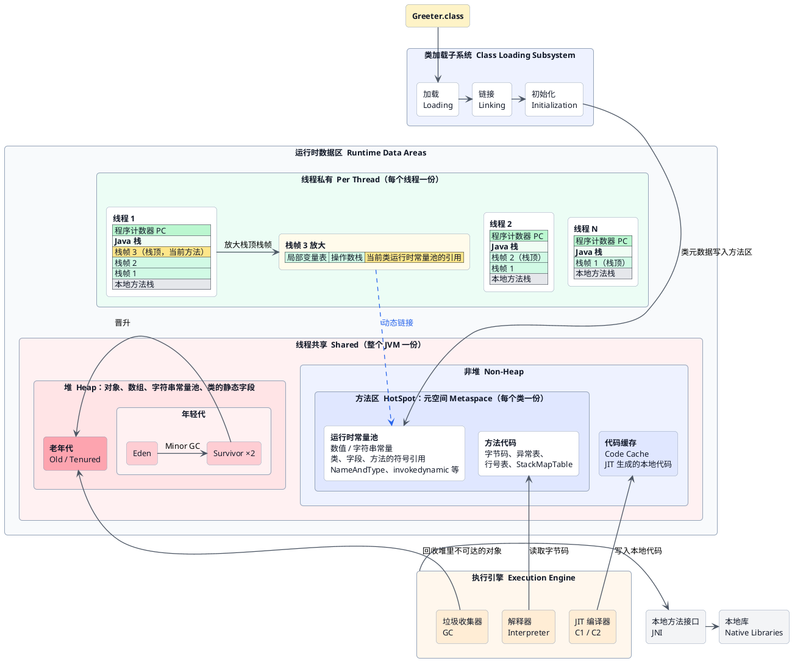

运行时数据区可以按「谁能看见」分成两类：

- **线程私有**：随线程创建、随线程销毁，不需要同步。包括 PC、Java 栈和本地方法栈。
- **线程共享**：整个 JVM 只有一份，并发访问时要么由 JVM 内部加锁，要么交给程序员同步。包括堆、方法区和代码缓存。

## 1. 线程

### 1.1 Java 线程与操作系统线程

HotSpot 的**平台线程（platform thread）**和操作系统线程一一对应。调用 `Thread.start()` 时，JVM 会创建一个 OS 线程（macOS 和 Linux 上是 pthread），之后什么时候运行、在哪个核上运行，都由操作系统调度。这层对应关系可以直接看到：`jcmd <pid> Thread.print` 输出的每个线程都带一个 `nid`，它就是 OS 线程的 ID。下面是本机 JDK 21 的输出：

```text
"main" #1 [6403] prio=5 os_prio=31 tid=0x00000001032c1810 nid=6403 waiting on condition
"VM Thread" os_prio=31 tid=0x0000000b6a84d800 nid=17411 runnable
```

- `#1` 是 Java 层的线程编号；
- `tid` 是 JVM 内部线程对象的地址；
- `nid` 是 OS 线程 ID。

`VM Thread` 没有 `#` 编号，因为它是 JVM 自己的线程，没有对应的 `java.lang.Thread` 对象。

`run()` 结束后，不管是正常返回还是抛出了异常，对应的 OS 线程都会被回收。进程什么时候退出，取决于**非守护线程（non-daemon thread）**：最后一个非守护线程结束时，JVM 就开始关闭。

> **JDK 21 变化**：虚拟线程（virtual thread，JEP 444）不再一对一绑定 OS 线程。大量虚拟线程轮流挂载（mount）到少量载体线程（carrier thread）上运行，阻塞时卸载，所以「一个 Java 线程 = 一个 OS 线程」只对平台线程成立。

### 1.2 JVM 自己的后台线程

`main` 之外，JVM 进程里还有一批自己的线程。下面这张表来自 JDK 21 + 默认的 G1 收集器，用 `jcmd <pid> Thread.print` 实际列出：

| 线程名 | 职责 |
|---|---|
| `VM Thread` | 执行必须在**安全点（safepoint）**进行的 VM 操作，例如 Stop-the-World 阶段的 GC、线程转储和去优化。安全点上所有 Java 线程都已停下，不会有人同时修改堆。 |
| `GC Thread#N`、`G1 Conc#N`、`G1 Main Marker`、`G1 Refine#N`、`G1 Service` | G1 的工作线程，依次负责：并行回收、并发标记、标记的协调、记忆集（remembered set）维护和 G1 的周期性任务。 |
| `C1 CompilerThread0`、`C2 CompilerThread0` | JIT 编译线程，在运行时把热点字节码编译成本地代码（见 §3.4）。 |
| `VM Periodic Task Thread` | 定时器线程，驱动采样等周期性任务。 |
| `Signal Dispatcher` | 接收发给 JVM 进程的信号并转成 JVM 内部的处理。比如 `kill -3` 会触发线程转储。 |
| `Reference Handler`、`Finalizer`、`Common-Cleaner` | 分别负责：把被回收的软 / 弱 / 虚引用放进引用队列；执行 `finalize()`（JDK 18 起已弃用）；执行 `Cleaner` 注册的清理动作。 |
| `Service Thread`、`Notification Thread`、`Monitor Deflation Thread` | VM 的杂项后台工作，依次是：内部维护、JMX 等诊断通知、回收空闲的重量级锁（monitor）。 |
| `Attach Listener` | 处理 `jcmd`、`jstack` 这类 attach 请求；第一次有工具 attach 时才出现。 |

> **变化**：2013 年的资料会说 VM Thread 负责「撤销偏向锁（biased locking revocation）」。偏向锁从 JDK 15 起默认关闭并被弃用（JEP 374），后来被移除。

## 2. 线程私有的区域

### 2.1 程序计数器（Program Counter, PC）

PC 记录当前线程**正在执行的那条字节码在方法代码中的位置**，而方法代码本身存放在方法区里。在执行本地（native）方法时，PC 的值没有定义。

CPU 也有 PC，所以这个概念并不新鲜。JVM 规范为各个运行时数据区规定了可能抛出的错误，只有 PC 一条都没有。它只存一个位置，大小固定，不会出现内存不够的情况。

### 2.2 Java 栈与栈帧（Stack, Frame）

每个线程有一个**后进先出（LIFO）**的栈：

- 每调用一个方法，就压入（push）一个新的**栈帧**，栈顶的栈帧就是当前正在执行的方法；
- 方法正常返回，或者抛出了本方法内没有处理的异常时，弹出（pop）这个栈帧。

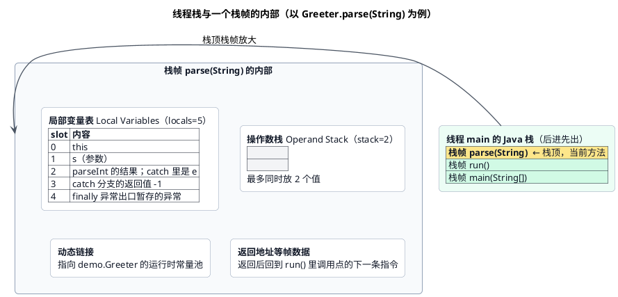

**栈的大小限制**：

- 调用层次太深、栈用尽时，抛 `StackOverflowError`；
- 栈允许动态扩展但内存不够，或者连新线程的栈都分配不出来时，抛 `OutOfMemoryError`。常见的报错是 `unable to create native thread`。

HotSpot 的线程栈大小固定，用 `-Xss` 设置。JVM 规范只要求栈能压入和弹出栈帧，没有要求它是连续内存。HotSpot 的做法则很直接：Java 栈帧就放在 OS 线程的原生栈上。

### 2.3 本地方法栈（Native Method Stack）

调用 `native` 方法（通过 JNI）需要按 C 的调用约定传参和返回，所以规范允许为本地方法单独准备一个栈。本地代码也可以通过 JNI 回调 Java 方法，这时会重新在 Java 栈上压一个栈帧。

**HotSpot 没有把两者分开**：Java 栈帧和本地栈帧交替排在同一个原生线程栈上，`-Xss` 同时限制它们。

### 2.4 局部变量表（Local Variables Array）

局部变量表是一个按**槽（slot）**编号的数组，存放：

- `this`：只有实例方法有，固定在 slot 0；
- 方法参数：静态方法从 slot 0 开始，实例方法从 slot 1 开始；
- 方法体里声明的局部变量。

能放进去的类型有 `boolean`、`byte`、`char`、`short`、`int`、`float`、`reference`、`returnAddress`，各占 1 个槽；**`long` 和 `double` 各占 2 个相邻的槽**。

用 `demo/Greeter.java` 里的静态方法验证一下：

```java
static long add(int a, long b) {
    long sum = a + b;
    return sum;
}
```

`javap -v` 显示 `locals=5`：`a` 占 slot 0，`b` 占 slot 1–2，`sum` 占 slot 3–4。下一节的逐步图里能看到每个槽的值怎么变化。

### 2.5 操作数栈（Operand Stack）

x86、ARM 是寄存器架构，指令里要写明操作数在哪个寄存器。JVM 字节码是**栈式**指令集，指令默认从操作数栈顶取操作数，结果也压回栈顶，所以大多数指令只有 1 个字节，而且不受任何一种 CPU 寄存器数量的约束。代价是要频繁在局部变量表和操作数栈之间搬运数据。`add` 编译出的字节码：

```text
0: iload_0      // 把 slot 0 的 int（a）压栈
1: i2l          // 栈顶 int 扩展成 long
2: lload_1      // 把 slot 1–2 的 long（b）压栈
3: ladd         // 弹出两个 long，相加后压回
4: lstore_3     // 弹出结果，存进 slot 3–4（sum）
5: lload_3      // 再把 sum 压栈
6: lreturn      // 弹出 long 返回给调用者
```

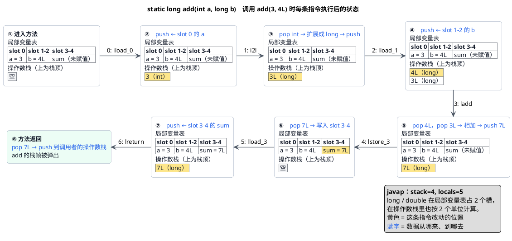

`javap` 里的 `stack=4` 是操作数栈的最大深度。这个方法最深的时候栈里有两个 long，每个 long 算 2 个单位，所以是 4。

### 2.6 动态链接（Dynamic Linking）

栈帧里那个指向运行时常量池的指针有什么用，看 `greet()` 里的 `invokevirtual #15` 就清楚了。这条指令只带一个常量池下标，而 `#15` 里存的是三段字符串：类 `java/io/PrintStream`、方法名 `println`、描述符 `(Ljava/lang/String;)V`（§4.4 有它的引用关系图）。这种用名字描述的目标叫**符号引用（symbolic reference）**，class 文件里所有对其他类、字段、方法的引用都是这种形式，没有一个是内存地址。

HotSpot 在这条指令**第一次执行**时才去**解析（resolve）**它：

1. 找到 `PrintStream` 类，如果还没加载就先加载；
2. 在类里查找名字和描述符都匹配的 `println`，并检查访问权限；
3. 得到可以直接使用的**直接引用（direct reference）**，比如这个方法在虚方法表（vtable）里的下标；
4. 把结果写进常量池缓存（ConstantPoolCache）。以后这条指令再执行，直接用缓存的结果，不再查名字。

JVM 规范允许实现自己决定什么时候解析：类加载后立刻解析，或者像 HotSpot 这样用到时才解析，都可以。但规范要求解析出错时，**表现必须像是在第一次使用时才出错**。这就解释了一个常见现象：编译时存在、运行时 jar 里却被删掉的方法，类照样能加载成功，直到第一次调用它时才抛 `NoSuchMethodError`。

## 3. 线程共享的区域

### 3.1 堆（Heap）

一个对象的寿命常常比创建它的方法更长：比如 `make()` 刚 `new` 出来就把它返回了，又比如对象被放进了集合。栈帧在方法返回时就整个丢掉了，所以对象不能放在里面。按规范，**对象实例和数组都放在堆上**，局部变量里只存它们的引用。对象占的内存什么时候回收，看它还能不能从 GC Roots 到达，由垃圾收集器决定，Java 里没有 `free`。

> 准确地说，这是**语义上**的规则。C2 的逃逸分析（escape analysis）如果证明一个对象不会逃出当前方法，可以把它拆成若干标量放进寄存器（标量替换，scalar replacement），这样它就根本不在堆上分配。

### 3.2 分代与垃圾回收（Generations, GC）

大多数对象很快就会死，活得久的对象往往会一直活下去。基于这个经验，HotSpot 的经典收集器把堆分成几代：

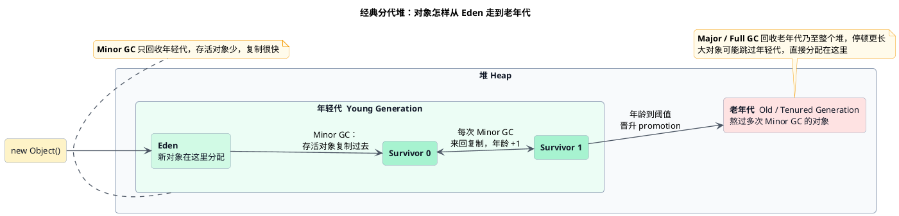

- **Minor GC** 只回收年轻代：把 Eden 和其中一个 Survivor 里还活着的对象复制到另一个 Survivor；
- 对象熬过的 GC 次数足够多，或者 Survivor 放不下时，**晋升**到老年代；
- **Major / Full GC** 会回收老年代乃至整个堆。在老式收集器上它往往要停下所有应用线程（Stop-the-World），停顿也更长。

> **变化**：
> - JDK 9 起默认收集器是 **G1**（JEP 248）。G1 的堆不再是几块连续的大分区，而是切成大小相等的 Region，每个 Region 临时扮演 Eden、Survivor、Old 或 Humongous（存放大对象）的角色，分代仍然保留，只是逻辑上的；
> - JDK 21 的 ZGC 也有了分代模式（JEP 439）。

### 3.3 非堆内存：方法区、代码缓存

有些数据属于 JVM 自身的运行机制，不是 Java 对象，就不放在堆里。这里 2013 年和现在差别最大：

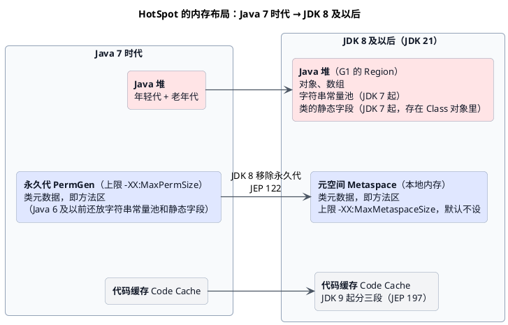

- **方法区在哪**：JVM 规范说方法区「逻辑上属于堆」，但允许实现不对它做 GC 或压缩。HotSpot：
  - Java 7 用堆旁边单独管理的**永久代**来实现，大小受 `-XX:MaxPermSize` 限制，类加载得多了容易 `OutOfMemoryError: PermGen space`；
  - JDK 8 起改成**元空间**，直接用本地内存，上限用 `-XX:MaxMetaspaceSize` 设置，默认不设上限；
  - 所以 jconsole 这类工具把方法区和代码缓存都算作「非堆（non-heap）」。
- **字符串常量池**：JDK 7 已经从永久代搬到了堆里。**类的静态字段**也从 JDK 7 起存放在该类的 `java.lang.Class` 对象里，也就是在堆上。
- **代码缓存**：存放 JIT 编译出的本地代码，用 `-XX:ReservedCodeCacheSize` 设置大小。JDK 9 起分成非方法代码、带 profile 的代码、不带 profile 的代码三段（JEP 197）。

### 3.4 即时编译（Just-In-Time Compilation, JIT）

解释执行字节码比直接跑本地代码慢得多，但把每个方法都先编译成本地代码，启动又会很慢。HotSpot 的折中办法是：先解释执行，同时统计每个方法的调用次数和循环回边次数，**只编译真正热的代码**。

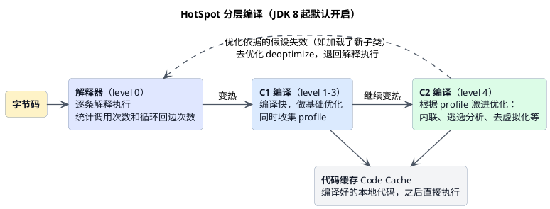

JDK 8 起默认开启**分层编译（tiered compilation）**：先用 C1 尽快拿到能跑的本地代码，再由 C2 根据运行时收集的 profile 做激进优化。C2 的优化建立在一些假设上，例如「这个虚方法目前只有一个实现」。某个假设被推翻时，比如后来加载了新的子类，JVM 会**去优化（deoptimize）**，退回解释执行。

## 4. 方法区与 class 文件

### 4.1 方法区里存放的每个类的信息

在 HotSpot 里，一个类加载后，在元空间中对应一个 `Klass` 结构（普通类是 `InstanceKlass`）。它大致连着这些数据：

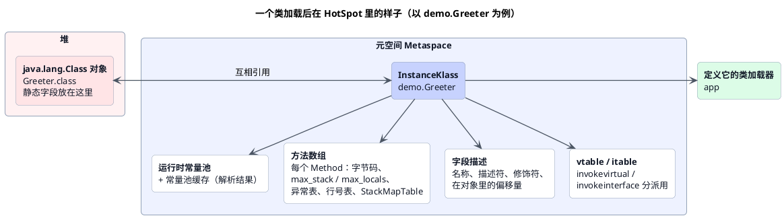

方法区被所有线程共享，所以类的加载、链接和初始化必须线程安全。两个线程同时首次用到同一个类时，这个类**只会被加载、初始化一次**，后到的线程会等它完成后才继续（规范 §5.5 用每个类的初始化锁保证这一点）。

### 4.2 class 文件结构（ClassFile Structure）

class 文件的顶层结构由 JVM 规范 §4.1 定义，`u2`、`u4` 分别是 2 字节、4 字节的无符号数，按大端序存放：

```c
ClassFile {
    u4             magic;                 // 固定为 0xCAFEBABE
    u2             minor_version;
    u2             major_version;         // 51 = Java 7，65 = Java 21
    u2             constant_pool_count;
    cp_info        constant_pool[constant_pool_count-1]; // 下标从 1 开始；long/double 占两个下标
    u2             access_flags;          // public、final、interface、abstract 等
    u2             this_class;            // 常量池下标，指向 Class 项，即本类名
    u2             super_class;           // 常量池下标，指向父类；只有 Object 是 0
    u2             interfaces_count;
    u2             interfaces[interfaces_count];
    u2             fields_count;
    field_info     fields[fields_count];
    u2             methods_count;
    method_info    methods[methods_count];   // 非 abstract、非 native 的方法带 Code 属性
    u2             attributes_count;
    attribute_info attributes[attributes_count]; // SourceFile、注解、BootstrapMethods 等
}
```

### 4.3 用 javap 读 class 文件

```bash
javac -g -d out demo/Greeter.java
javap -v -p out/demo/Greeter.class
```

`greet()` 这个方法的源码是 `System.out.println("Hi");`，`javap` 输出中对应的部分如下：

```text
  public void greet();
    descriptor: ()V
    flags: (0x0001) ACC_PUBLIC
    Code:
      stack=2, locals=1, args_size=1
         0: getstatic     #7    // Field java/lang/System.out:Ljava/io/PrintStream;
         3: ldc           #13   // String Hi
         5: invokevirtual #15   // Method java/io/PrintStream.println:(Ljava/lang/String;)V
         8: return
      LineNumberTable:
        line 5: 0
        line 6: 8
      LocalVariableTable:
        Start  Length  Slot  Name   Signature
            0       9     0  this   Ldemo/Greeter;
```

几个字段的含义：

- **`descriptor`**：方法描述符，`()V` 表示无参数、返回 void。类型的写法是：`I` 表示 int，`J` 表示 long，`L类名;` 表示引用类型，`[` 表示数组。
- **`stack` / `locals` / `args_size`**：依次是操作数栈的最大深度、局部变量表的槽数、参数个数（实例方法把 `this` 也算进去）。
- **`LineNumberTable`**：字节码偏移量到源码行号的映射，调试器和异常堆栈都用它。这里偏移 0 对应第 5 行，偏移 8 对应第 6 行。
- **`LocalVariableTable`**：每个局部变量的作用范围、槽号和类型。只有用 `-g` 编译才会生成。
- **`StackMapTable`**（`parse` 方法里有）：记录每个分支汇合点上局部变量和操作数栈的类型。有了它，验证器只需逐个核对类型，不必再做类型推导。Java 6（class 版本 50）引入，Java 7（版本 51）起成为必需。

字节码在执行时，就是在局部变量表、操作数栈和运行时常量池三者之间来回操作：

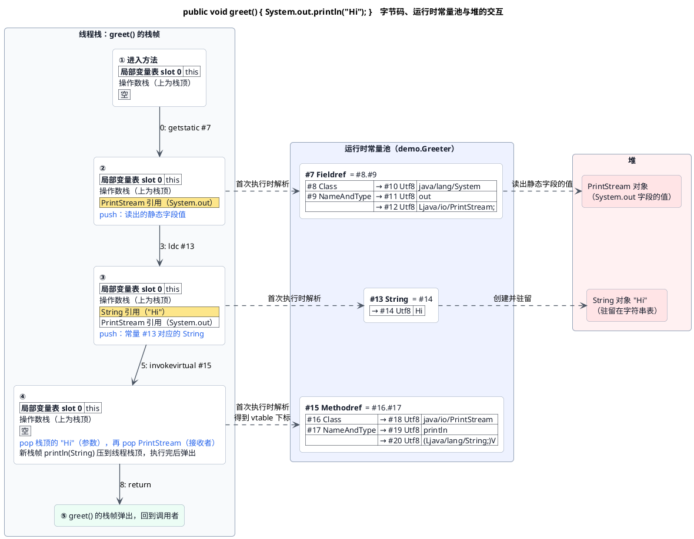

常用指令速查：

| 指令 | 作用 |
|---|---|
| `aload_<n>`、`iload_<n>`、`lload_<n>`、`fload_<n>`、`dload_<n>` | 把局部变量表第 n 个槽（n 只能是 0–3）里的引用 / int / long / float / double 压入操作数栈；n 大于 3 时，改用带一个操作数的 `aload n` 等形式 |
| `astore`、`istore`、`lstore` 等 | 方向相反：弹出栈顶，存入局部变量 |
| `ldc` / `ldc2_w` | 把运行时常量池里的常量（int、float、String、Class 等；long/double 用 `ldc2_w`）压栈 |
| `getstatic` / `putstatic`、`getfield` / `putfield` | 读写静态字段 / 实例字段，具体字段由常量池中的 Fieldref 指定 |
| `new` | 分配一个尚未初始化的对象，把引用压栈 |
| `dup` | 复制栈顶的值 |
| `invokevirtual` | 按接收者的**实际类型**分派，调用普通实例方法。JDK 11 起，同一个类内部调用 private 方法也用它（见下文） |
| `invokespecial` | 不做虚分派：调用构造器 `<init>` 和 `super.xxx()` |
| `invokestatic` / `invokeinterface` | 调用静态方法 / 接口方法 |
| `invokedynamic` | 第一次执行时先调用引导方法（bootstrap method）确定调用目标。lambda 和 JDK 9 起的字符串拼接都用它 |
| `ireturn`、`lreturn`、`freturn`、`dreturn`、`areturn`、`return` | 按返回值类型区分；`return` 用于 void 方法 |

> 用 JDK 21 编译验证：
> - 类内部调用自己的 private 方法 `f()`，生成的是 `invokevirtual`，这是 JDK 11 嵌套访问控制（nestmates，JEP 181）带来的变化，旧资料会写 `invokespecial`；
> - `s + n` 这样的拼接生成 `invokedynamic … makeConcatWithConstants`。

### 4.4 运行时常量池（Run-Time Constant Pool）

§4.3 的 `javap` 输出里，`invokevirtual #15` 在偏移 5，下一条指令在偏移 8，可见它一共只有 3 个字节：1 个字节的操作码，加 2 个字节的常量池下标。描述目标方法要用的类名、方法名、描述符都在常量池里。类加载时，class 文件里的常量池会转换成**运行时常量池**，每个类一份。§2.6 里解析的就是它。

常量项之间互相引用。以 `#15` 为例：

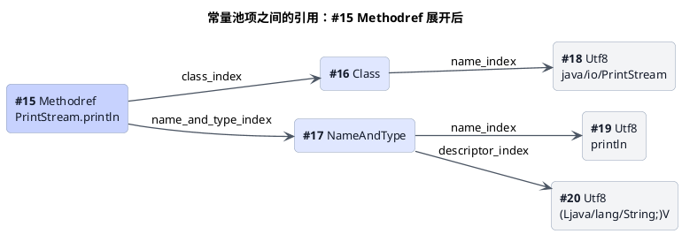

常量池项的类型（JVM 规范 §4.4）：

| 类型 | 内容 |
|---|---|
| `Utf8` | 字符串的字节（修改版 UTF-8），其他各种项最终都指向它 |
| `Integer` / `Float` | 4 字节常量 |
| `Long` / `Double` | 8 字节常量，占两个常量池下标 |
| `String` | 指向一个 `Utf8`，表示字符串字面量 |
| `Class` | 指向一个 `Utf8`，内容是 JVM 内部格式的全限定名，如 `java/lang/Object` |
| `NameAndType` | 「名称:描述符」，两部分各指向一个 `Utf8` |
| `Fieldref`、`Methodref`、`InterfaceMethodref` | 「Class.NameAndType」，前一部分指向 `Class` 项，后一部分指向 `NameAndType` 项 |
| `MethodHandle`、`MethodType`、`InvokeDynamic` | Java 7 加入，供 `invokedynamic` 和方法句柄使用 |
| `Dynamic` | Java 11 加入，动态计算的常量 |
| `Module`、`Package` | Java 9 加入，只出现在 `module-info.class` 中 |

**对象创建的例子**：`Greeter.make()` 方法里写的是 `return new Object();`，它编译出的字节码是：

```text
0: new           #2    // class java/lang/Object
3: dup
4: invokespecial #1    // Method java/lang/Object."<init>":()V
7: areturn
```

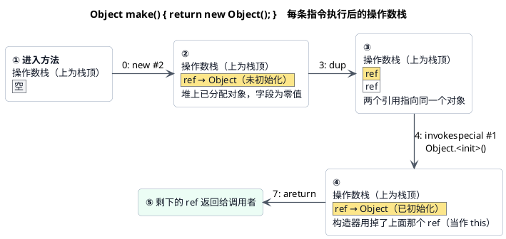

需要 `dup` 是因为构造器调用会从栈上消耗掉一个引用（作为 `this`），而方法最后还要把这个引用返回出去，所以要先复制一份。左边的数字是字节码偏移量，`new` 带 2 字节操作数，所以下一条指令从 3 开始。

## 5. 类加载

### 5.1 加载、链接、初始化

JVM 启动时，用启动类加载器创建初始类，对它做链接和初始化，然后调用 `public static void main(String[])`。之后执行代码时遇到别的类，再按需加载、链接、初始化。

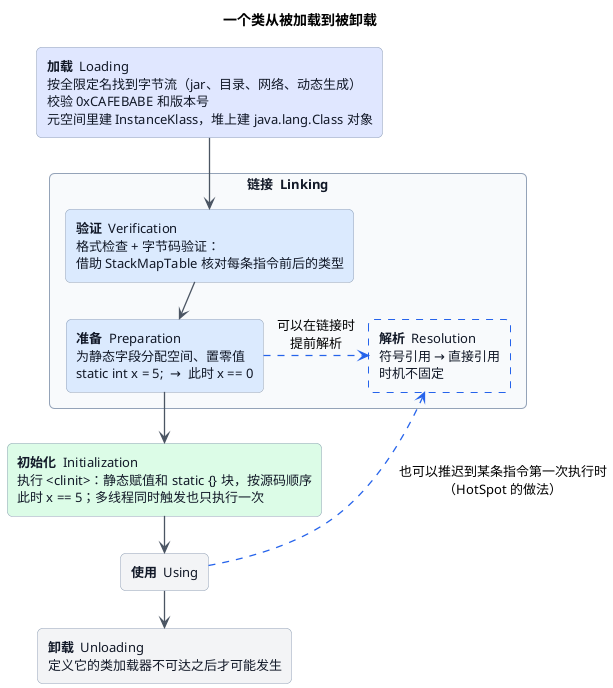

- **加载（Loading）**：按全限定名找到 class 文件的字节流，校验魔数和版本号，解析成方法区里的内部结构，并生成对应的 `java.lang.Class` 对象。直接父类和直接实现的接口会先被加载。
- **验证（Verification）**：class 文件可能来自网络，也可能是手工构造的，JVM 不能默认它是 javac 的正确产物。字节码验证器借助 §4.3 的 `StackMapTable`，逐条核对指令执行前后局部变量表和操作数栈里的类型。它要拦下的情况包括：把 int 当成引用来用、弹空操作数栈、跳到一条指令的中间、读取一个还没赋值的局部变量。验证通过后，解释器执行时就能放心地省掉这些检查。
- **准备（Preparation）**：为静态字段分配内存并置为**零值**，同时建立方法表等 JVM 内部结构。`static int x = 5;` 在这一步之后 `x` 还是 0。
- **解析（Resolution）**：把常量池中的符号引用换成直接引用（见 §2.6）。规范允许把这一步推迟到第一次使用时。
- **初始化（Initialization）**：执行类构造器 `<clinit>`，也就是静态字段的赋值语句和 `static {}` 块，按源码顺序执行，这时 `x` 才变成 5。触发初始化的是类的「首次主动使用」，包括：`new` 一个实例、读写静态字段（编译期常量除外）、调用静态方法、反射调用、初始化它的子类，以及它是启动时的主类。

### 5.2 类加载器的层级与双亲委派

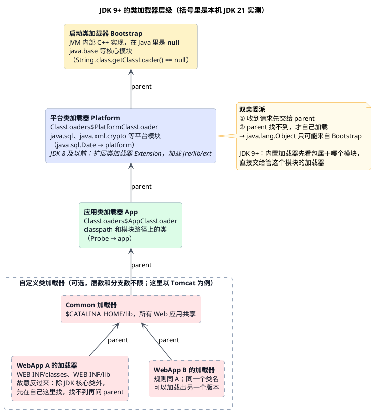

**双亲委派（parent delegation）**：类加载器收到加载请求时，先交给父加载器处理，父加载器找不到，自己才去加载。这保证了 `java.lang.Object` 这类核心类只能由启动类加载器加载，应用无法用同名的类冒充。

在 JDK 21 上实测（`demo/Probe.java`）：

```text
loader: app jdk.internal.loader.ClassLoaders$AppClassLoader
loader: platform jdk.internal.loader.ClassLoaders$PlatformClassLoader
String loader: null                // 启动类加载器
java.sql.Date loader: platform
```

| 加载器 | 在 Java 代码里看到的 | JDK 21 中负责的范围 | Java 8 时的对应 |
|---|---|---|---|
| 启动 Bootstrap | `null` | `java.base` 等核心模块（JEP 220 去掉了 `rt.jar`） | 加载 `rt.jar` |
| 平台 Platform | 名为 `platform`，`ClassLoaders$PlatformClassLoader` | `java.sql`、`java.xml.crypto` 等平台模块 | 扩展类加载器，加载 `jre/lib/ext`（JDK 9 移除） |
| 应用 App | 名为 `app`，`ClassLoaders$AppClassLoader` | classpath 和模块路径上的应用类 | 名称相同 |
| 自定义 | `ClassLoader` 的子类 | 热替换、多版本隔离 | 名称相同 |

自定义类加载器不一定遵守双亲委派。Tomcat 给每个 Web 应用一个独立的加载器，**除 JDK 核心类仍先交给上层外，先在应用自己的 `WEB-INF` 里找，找不到再交给父加载器**，这样不同应用可以各自带不同版本的同名 jar。

> JDK 9 起，内置加载器在委派之前会先看要加载的包属于哪个命名模块；如果这个模块归某个加载器管，就直接交给那个加载器，不再一层层往上问。

### 5.3 更快的类加载：类数据共享（Class Data Sharing, CDS）

启动一个空的 `main` 方法也要加载几百个 JDK 类，每个类都要读文件、解析、验证。CDS 的思路是一次做完、结果落盘：把这些类加载后的内部结构写成归档文件，以后启动时用 mmap 直接映射进内存。这样既省掉了重复的解析和验证，同一台机器上的多个 JVM 进程还能共享这部分只读页。

- JDK 5 首次加入；
- JDK 10 起应用类也能放进归档（AppCDS，JEP 310）；
- JDK 12 起 JDK 自带一份默认归档（JEP 341），默认就会用上；
- JDK 13 起可以用 `-XX:ArchiveClassesAtExit` 在程序退出时自动生成归档（JEP 350）。

在 JDK 21 上实测，核心类确实来自归档：

```text
$ java -Xlog:class+load=info -cp out2 Probe
[info][class,load] java.lang.Object source: shared objects file
[info][class,load] java.lang.String source: shared objects file
[info][class,load] Probe source: file:/.../out2/
```

### 5.4 类与类加载器互相引用

- 每个类都记着定义它的类加载器（`Class.getClassLoader()`）；
- 每个类加载器也持有它加载过的所有类的引用。

结果是：**只要类加载器还可达，它加载的类就一个都卸载不掉**。如果热部署时旧的类加载器被某个地方意外引用住，比如一个 `ThreadLocal`、一个没注销的 JDBC 驱动，或者一个还在运行的线程，那么每重新部署一次，元空间就多占一批类，最后抛出 `OutOfMemoryError: Metaspace`。

## 6. 异常表（Exception Table）

方法里有 `try-catch` 或 `try-finally` 时，它的 Code 属性里会有一张异常表。表的每一行描述一个处理器：在 `[from, to)` 这段字节码范围内，如果抛出 `type` 类型的异常，就跳到 `target` 去执行。用 `Greeter.parse()` 举例：

```java
int parse(String s) {
    try {
        return Integer.parseInt(s);
    } catch (NumberFormatException e) {
        return -1;
    } finally {
        System.out.println("done");
    }
}
```

```text
      Exception table:
         from    to  target type
             0     5    15   Class java/lang/NumberFormatException
             0     5    28   any
            15    18    28   any
            28    30    28   any
```

逐行解读：

1. `try` 块（偏移 0–4）里抛出 `NumberFormatException` 时，跳到 15，也就是 catch 块；
2. `try` 块里抛出任何其他异常时，跳到 28。这是 finally 的「异常出口」：先执行 finally 的代码，再把异常重新抛出（`athrow`）；
3. catch 块（15–17）自己又抛出异常时，同样跳到 28；
4. 最后一行覆盖的是 28 处的 `astore` 本身，属于 javac 生成的兜底条目。

**finally 是怎么实现的**：从 JDK 21 的字节码可以看到，`System.out.println("done")` 一共出现了**三次**，分别在 try 正常返回前（偏移 5–10）、catch 返回前（18–23）和异常出口里（30–35）。现代 javac 会把 finally 块**复制到每一条出口路径上**，再用 `any` 类型的处理器兜住其余情况。早年的 `jsr`/`ret` 子程序跳转方案已经淘汰，规范规定版本号 51（Java 7）及以上的 class 文件不得再包含 `jsr` 指令。

抛出异常后，JVM 按下面的流程查找处理器：

```plantuml
@startuml
skinparam shadowing false
skinparam defaultFontSize 13
skinparam roundCorner 10
skinparam ArrowColor #4B5563
skinparam ArrowThickness 1.3
skinparam rectangle {
  BorderColor #94A3B8
  FontColor #111827
}
skinparam note {
  BackgroundColor #FFFBEB
  BorderColor #F59E0B
}
skinparam ActivityBackgroundColor #EEF2FF
skinparam ActivityBorderColor #94A3B8
skinparam ActivityDiamondBackgroundColor #FEF3C7
skinparam ActivityDiamondBorderColor #F59E0B
title 抛出异常后，JVM 怎样找处理器

start
:抛出异常
athrow 或运行时错误;
repeat
  if (当前方法的异常表里，有范围覆盖当前 PC
且类型匹配的行吗？（按表中顺序查找）) then (有)
    :清空操作数栈，压入异常引用
跳到 target 继续执行; <<#DCFCE7>>
    stop
  else (没有)
    :方法异常结束，弹出当前栈帧
在调用者那里重新抛出;
  endif
repeat while (线程栈里还有栈帧？) is (有) not (空了)
:交给未捕获异常处理器，打印堆栈
线程结束; <<#FFE4E6>>
if (它是最后一个非守护线程？) then (是)
  :JVM 退出; <<#FFE4E6>>
else (否)
  :其他线程继续运行;
endif
stop
@enduml
```

## 7. 符号表与字符串表（Symbol Table, String Table）

除了每个类各自的运行时常量池，HotSpot 还有两张全局哈希表：

- **符号表（SymbolTable）**：`Greeter` 常量池里的 `java/lang/Object`，和其他成千上万个类常量池里的 `java/lang/Object`，在 HotSpot 内部指向同一个 `Symbol`。类名、方法名、描述符这些 UTF-8 串在整个 JVM 里只存一份，放在本地内存，不再被引用时清理。
- **字符串表（StringTable）**：存放被**驻留（intern）**的 `String` 对象，用来实现 JLS §3.10.5 的规定：内容相同的字符串字面量必须是同一个对象，`intern()` 也返回这个唯一的实例。

```java
String a = new String("jvm");
a == "jvm"            // false：new 出来的是一个新对象
a.intern() == "jvm"   // true：intern() 返回字符串表里的唯一实例
```

上面的结果在 JDK 21 上实测过（`demo/Probe.java`）。另外，`"j" + "v" + "m"` 这种全部由常量组成的表达式，**在编译期就被折叠成 `"jvm"`**，不调 `intern()` 也会和 `"jvm"` 相等。

- 字符串字面量**不是**在类加载时就进入字符串表的。HotSpot 采用懒解析，某条 `ldc` 指令第一次执行时，才会创建或查找对应的 `String`，并把它驻留到表里。
- JDK 7 起，被驻留的 `String` 对象放在**堆**上，可以被 GC 回收。表的桶数可以用 `-XX:StringTableSize` 调整。

## 8. 从 2013 年到 JDK 21：变化一览

| 主题 | Java 7 时代（2013） | JDK 21 |
|---|---|---|
| 方法区的实现 | 永久代 PermGen | 元空间 Metaspace，本地内存（JDK 8，JEP 122） |
| 字符串常量池 | 旧资料常写「在永久代」 | 堆（JDK 7 已经迁移） |
| 默认 GC | Parallel | G1（JDK 9，JEP 248）；另有分代 ZGC（JEP 439） |
| JIT | C1 / C2，可选分层编译 | 分层编译默认开启（JDK 8）；代码缓存分段（JDK 9，JEP 197） |
| 线程模型 | Java 线程与 OS 线程 1:1 | 平台线程仍是 1:1，另有虚拟线程 M:N（JEP 444） |
| 偏向锁 | 默认开启 | 默认关闭并弃用（JDK 15，JEP 374），之后被移除 |
| 核心类库的存放形式 | `rt.jar` | 模块化运行时镜像（JDK 9，JEP 220） |
| 扩展类加载器 | Extension ClassLoader | Platform ClassLoader |
| CDS | 只覆盖 JDK 自带类，需要手动生成归档 | AppCDS（JEP 310）、默认归档（JEP 341）、动态归档（JEP 350） |
| 类内部调用 private 方法 | `invokespecial` | `invokevirtual`（nestmates，JEP 181） |
| 字符串拼接 | 编译成 `StringBuilder` 调用链 | `invokedynamic`（JDK 9，JEP 280） |
| class 文件主版本号 | 51 | 65 |

## 9. 术语对照

| 中文 | English |
|---|---|
| 程序计数器 | Program Counter (PC) |
| 栈帧 | Frame |
| 局部变量表 / 槽 | Local Variables Array / Slot |
| 操作数栈 | Operand Stack |
| 本地方法栈 | Native Method Stack |
| 动态链接 | Dynamic Linking |
| 符号引用 / 直接引用 | Symbolic Reference / Direct Reference |
| 解析 | Resolution |
| 堆 / 年轻代 / 老年代 | Heap / Young Generation / Old (Tenured) Generation |
| 晋升 | Promotion |
| 永久代 / 元空间 | Permanent Generation / Metaspace |
| 方法区 | Method Area |
| 代码缓存 | Code Cache |
| 即时编译 / 去优化 | Just-In-Time Compilation / Deoptimization |
| 运行时常量池 | Run-Time Constant Pool |
| 类加载器 / 双亲委派 | Classloader / Parent Delegation |
| 加载 / 链接 / 验证 / 准备 / 初始化 | Loading / Linking / Verification / Preparation / Initialization |
| 类数据共享 | Class Data Sharing (CDS) |
| 异常表 | Exception Table |
| 符号表 / 字符串表 / 驻留 | Symbol Table / String Table / Intern |
| 安全点 | Safepoint |
| 守护线程 | Daemon Thread |

## 10. 自己动手

```bash
# 把上面四个 .java 文件下载到同一个目录，在该目录下执行
javac -g -d out Greeter.java && javap -v -p out/demo/Greeter.class   # 常量池、字节码、异常表
javac -d out2 Probe.java Threads.java
java -cp out2 Probe                                                   # 类加载器层级、intern
java -Xlog:class+load=info -cp out2 Probe | head                      # 看哪些类来自 CDS 归档
java -cp out2 Threads | grep '^"'                                     # 列出 JVM 自己的线程
javac -d out3 Priv.java && javap -c -p out3/Priv.class | grep invoke  # private 调用、字符串拼接用的指令
```
