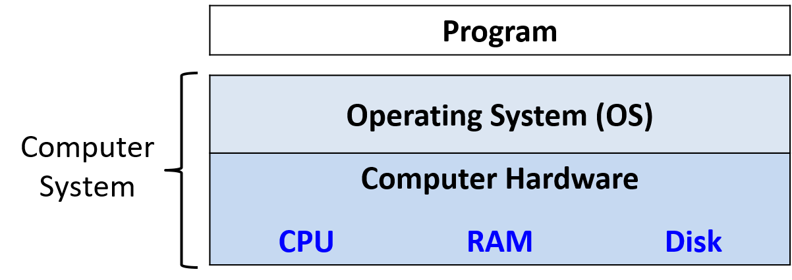
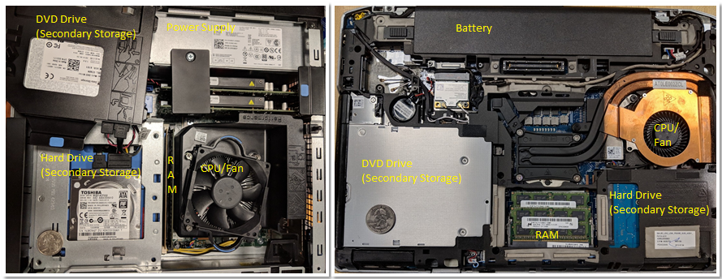
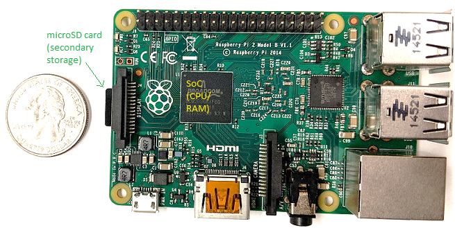

> [!WARNING] 说明
> 本文是个人学习用的**非官方**中英对照译文，原文：<https://diveintosystems.org/book/introduction.html>。
> 原书采用 CC BY-NC-ND 4.0 许可（禁止演绎），**请勿公开传播本译文**。
> 标为「译注」「现代更新」的内容是译者补充，不代表原书作者观点；代码与原文逐字一致，未作改动。


*0. Introduction*

潜入计算机系统这个奇妙的世界吧！理解计算机系统是什么、它如何运行你的程序，能帮助你设计出运行高效、能充分利用底层系统能力的代码。在本书中，我们将带你畅游计算机系统。你将了解用高级编程语言（我们使用 C）写成的程序如何在计算机上执行；了解程序指令如何被翻译成二进制，以及电路如何执行这些二进制编码；了解操作系统如何管理系统上运行的程序；了解如何编写能利用多核计算机的程序。在整个过程中，你将学会评估程序代码带来的系统开销，并学会设计能高效运行的程序。

> Dive into the fabulous world of computer systems! Understanding what a computer system is and how it runs your programs can help you to design code that runs efficiently and that can make the best use of the power of the underlying system. In this book, we take you on a journey through computer systems. You will learn how your program written in a high-level programming language (we use C) executes on a computer. You will learn how program instructions translate into binary and how circuits execute their binary encoding. You will learn how an operating system manages programs running on the system. You will learn how to write programs that can make use of multicore computers. Throughout, you will learn how to evaluate the systems costs associated with program code and how to design programs to run efficiently.

## 什么是计算机系统？

*What Is a Computer System?*

**计算机系统**（computer system）由计算机硬件和专门的系统软件组成，两者共同使计算机能够被用户和程序使用。具体来说，计算机系统包含以下组成部分（见[图 1](0.0-introduction.html)）：

> A **computer system** combines the computer hardware and special system software that together make the computer usable by users and programs. Specifically, a computer system has the following components (see [Figure 1](0.0-introduction.html)):

- **输入/输出（IO）端口**使计算机能够从外部环境获取信息，并以某种有意义的方式把信息展示给用户。

> - **Input/output (IO) ports** enable the computer to take information from its environment and display it back to the user in some meaningful way.

- **中央处理器（CPU）**执行指令，计算数据和内存地址。

> - A **central processing unit (CPU)** runs instructions and computes data and memory addresses.

- **随机存取存储器（RAM）**存储正在运行的程序的数据和指令。计算机系统断电时，RAM 中的数据和指令通常会丢失。

> - **Random access memory (RAM)** stores the data and instructions of running programs. The data and instructions in RAM are typically lost when the computer system loses power.

- 硬盘等**辅助存储设备**（secondary storage device）即使在计算机没有供电时也能保存程序和数据。

> - **Secondary storage devices** like hard disks store programs and data even when power is not actively being provided to the computer.

- **操作系统（OS）**是位于计算机硬件和用户在计算机上运行的软件之间的一层软件。操作系统实现了各种编程抽象和接口，让用户能方便地在系统上运行程序并与之交互。它还管理底层硬件资源，控制程序如何执行、何时执行。操作系统通过实现各种抽象、策略和机制，确保多个程序能够以高效、受保护且无缝的方式在系统上同时运行。

> - An **operating system (OS)** software layer lies between the hardware of the computer and the software that a user runs on the computer. The OS implements programming abstractions and interfaces that enable users to easily run and interact with programs on the system. It also manages the underlying hardware resources and controls how and when programs execute. The OS implements abstractions, policies, and mechanisms to ensure that multiple programs can simultaneously run on the system in an efficient, protected, and seamless manner.

前四项构成了计算机系统中的**计算机硬件**部分。最后一项（操作系统）代表计算机系统中主要的软件部分。在操作系统之上可能还有其他软件层，为系统用户提供别的接口（例如库）。不过，操作系统是本书重点关注的核心系统软件。

> The first four of these define the **computer hardware** component of a computer system. The last item (the operating system) represents the main software part of the computer system. There may be additional software layers on top of an OS that provide other interfaces to users of the system (e.g., libraries). However, the OS is the core system software that we focus on in this book.



**图 1.** 计算机系统的分层组成

*Figure 1. The layered components of a computer system*

我们特别关注具有以下特性的计算机系统：

> We focus specifically on computer systems that have the following qualities:

- 它们是**通用的**（general purpose），即其功能并非为某个特定应用量身定制。

> - They are **general purpose**, meaning that their function is not tailored to any specific application.

- 它们是**可重新编程的**（reprogrammable），即无需修改计算机硬件或系统软件就能运行不同的程序。

> - They are **reprogrammable**, meaning that they support running a different program without modifying the computer hardware or system software.

因此，许多能以某种形式进行"计算"的设备并不属于计算机系统。例如，计算器通常有处理器、少量内存和 I/O 能力，但计算器通常没有操作系统（TI-89 这样的高级图形计算器是个明显的例外），没有辅助存储，也不是通用的。

> To this end, many devices that may "compute" in some form do not fall into the category of a computer system. Calculators, for example, typically have a processor, limited amounts of memory, and I/O capability. However, calculators typically do not have an operating system (advanced graphing calculators like the TI-89 are a notable exception to this rule), do not have secondary storage, and are not general purpose.

另一个值得一提的例子是微控制器（microcontroller），它是一种集成电路，具备计算机的许多能力。微控制器常被嵌入到其他设备中（如玩具、医疗设备、汽车和家电），控制某项特定的自动化功能。尽管微控制器是通用的、可重新编程的，含有处理器、内部存储器和辅助存储，并具备 I/O 能力，但它没有操作系统。微控制器被设计为上电启动后一直运行某个特定程序，直到断电为止。因此，微控制器不符合我们对计算机系统的定义。

> Another example that bears mentioning is the microcontroller, a type of integrated circuit that has many of the same capabilities as a computer. Microcontrollers are often embedded in other devices (such as toys, medical devices, cars, and appliances), where they control a specific automatic function. Although microcontrollers are general purpose, reprogrammable, contain a processor, internal memory, secondary storage, and are I/O capable, they lack an operating system. A microcontroller is designed to boot and run a single specific program until it loses power. For this reason, a microcontroller does not fit our definition of a computer system.

## 现代计算机系统是什么样的？

*What Do Modern Computer Systems Look Like?*

明确了什么是（以及什么不是）计算机系统之后，我们来看看计算机系统通常是什么样子。[图 2](0.0-introduction.html) 展示了两种计算机硬件系统（不含外设）：台式机（左）和笔记本电脑（右）。每台设备上都放了一枚美国 25 美分硬币，让读者对各部件的大小有个概念。

> Now that we have established what a computer system is (and isn’t), let’s discuss what computer systems typically look like. [Figure 2](0.0-introduction.html) depicts two types of computer hardware systems (excluding peripherals): a desktop computer (left) and a laptop computer (right). A U.S. quarter on each device gives the reader an idea of the size of each unit.



**图 2.** 常见的计算机系统：台式机（左）和笔记本电脑（右）

*Figure 2. Common computer systems: a desktop (left) and a laptop (right) computer*

注意，两者包含相同的硬件组件，只是有些组件的外形更小或更紧凑。台式机的 DVD/CD 光驱被移到了一边，以露出下方的硬盘——这两个部件原本是叠放在一起的。台式机由一个专用电源供电。

> Notice that both contain the same hardware components, though some of the components may have a smaller form factor or be more compact. The DVD/CD bay of the desktop was moved to the side to show the hard drive underneath — the two units are stacked on top of each other. A dedicated power supply helps provide the desktop power.

相比之下，笔记本电脑更扁平、更紧凑（注意这张图中的硬币看上去要大一些）。笔记本电脑有电池，组件也往往更小。在台式机和笔记本电脑中，CPU 都被一个笨重的 CPU 风扇挡住了，风扇的作用是让 CPU 保持在合理的工作温度。组件过热可能会被永久损坏。两者的 RAM 都采用双列直插内存模组（DIMM）。注意，笔记本电脑的内存条比台式机的小得多。

> In contrast, the laptop is flatter and more compact (note that the quarter in this picture appears a bit bigger). The laptop has a battery and its components tend to be smaller. In both the desktop and the laptop, the CPU is obscured by a heavyweight CPU fan, which helps keep the CPU at a reasonable operating temperature. If the components overheat, they can become permanently damaged. Both units have dual inline memory modules (DIMM) for their RAM units. Notice that laptop memory modules are significantly smaller than desktop modules.

在重量和功耗方面，台式机通常功耗为 100–400 W，重量一般在 5 到 20 磅（约 2.3–9 千克）之间。笔记本电脑的功耗通常为 50–100 W，并按需使用外部充电器为电池补充电量。

> In terms of weight and power consumption, desktop computers typically consume 100 - 400 W of power and typically weigh anywhere from 5 to 20 pounds. A laptop typically consumes 50 - 100 W of power and uses an external charger to supplement the battery as needed.

计算机硬件设计的趋势是设备越来越小、越来越紧凑。[图 3](0.0-introduction.html) 展示了一台树莓派（Raspberry Pi）单板计算机。单板计算机（single-board computer，SBC）是一种把整台计算机都做在一块电路板上的设备。

> The trend in computer hardware design is toward smaller and more compact devices. [Figure 3](0.0-introduction.html) depicts a Raspberry Pi single-board computer. A single-board computer (SBC) is a device in which the entirety of the computer is printed on a single circuit board.



**图 3.** 一台树莓派单板计算机

*Figure 3. A Raspberry Pi single-board computer*

树莓派单板计算机含有一颗集成了 RAM 和 CPU 的**片上系统**（system-on-a-chip，SoC）处理器，它涵盖了[图 2](0.0-introduction.html) 中笔记本电脑和台式机的大部分硬件。与笔记本电脑和台式机不同，树莓派大约只有信用卡大小，重 1.5 盎司（约 43 克，相当于一片面包），功耗约 5 W。树莓派上使用的 SoC 技术在智能手机中也很常见。事实上，智能手机也是计算机系统的一个例子！

> The Raspberry Pi SBC contains a **system-on-a-chip** (SoC) processor with integrated RAM and CPU, which encompasses much of the laptop and desktop hardware shown in [Figure 2](0.0-introduction.html). Unlike laptop and desktop systems, the Raspberry Pi is roughly the size of a credit card, weighs 1.5 ounces (about a slice of bread), and consumes about 5 W of power. The SoC technology found on the Raspberry Pi is also commonly found in smartphones. In fact, the smartphone is another example of a computer system!

> [!TIP] 现代更新（截至 2026-11）· 树莓派 5
> 书中图片是较早的树莓派型号。2023 年推出的树莓派 5 采用 Broadcom BCM2712 四核 Arm Cortex-A76 处理器（2.4 GHz），内存最高 16 GB，官方说比上一代快至多 3 倍；它通过 USB-C 接口以 5V/5A 供电，官方配套的是 27 W 电源，比原书说的约 5 W 功耗高不少。[树莓派 5 产品页](https://www.raspberrypi.com/products/raspberry-pi-5/)

最后，上面提到的所有计算机系统（包括树莓派和智能手机）都配有**多核**（multicore）处理器。换句话说，它们的 CPU 能够同时执行多个程序。我们把这种同时执行称为**并行执行**（parallel execution）。本书第 14 章介绍基本的多核编程。

> Lastly, all of the aforementioned computer systems (Raspberry Pi and smartphones included) have **multicore** processors. In other words, their CPUs are capable of executing multiple programs simultaneously. We refer to this simultaneous execution as **parallel execution**. Basic multicore programming is covered in Chapter 14 of this book.

所有这些不同类型的计算机硬件系统都可以运行一个或多个通用操作系统，例如 macOS、Windows 或 Unix。通用操作系统管理底层计算机硬件，并为用户提供在计算机上运行任意程序的接口。这些不同类型的计算机硬件，加上在其上运行的不同通用操作系统，共同构成了计算机系统。

> All of these different types of computer hardware systems can run one or more general purpose operating systems, such as macOS, Windows, or Unix. A general-purpose operating system manages the underlying computer hardware and provides an interface for users to run any program on the computer. Together these different types of computer hardware running different general-purpose operating systems make up a computer system.

## 你将在本书中学到什么

*What You Will Learn In This Book*

读完本书，你将掌握以下内容：

> By the end of this book, you will know the following:

**计算机如何运行程序**：你将能够详细描述，用高级编程语言表达的程序是如何由计算机硬件的底层电路执行的。具体来说，你将了解：

> **How a computer runs a program**: You will be able to describe, in detail, how a program expressed in a high-level programming language gets executed by the low-level circuitry of the computer hardware. Specifically, you will know:

- 程序数据如何被编码为二进制，以及硬件如何对其进行算术运算

> - how program data gets encoded into binary and how the hardware performs arithmetic on it

- 编译器如何把 C 程序翻译为汇编和二进制机器码（汇编是二进制机器码的人类可读形式）

> - how a compiler translates C programs into assembly and binary machine code (assembly is the human-readable form of binary machine code)

- CPU 如何在二进制程序数据上执行二进制指令——从基本的逻辑门，到能存储数值、执行算术运算和控制程序执行的复杂电路

> - how a CPU executes binary instructions on binary program data, from basic logic gates to complex circuits that store values, perform arithmetic, and control program execution

- 操作系统如何实现让用户在系统上运行程序的接口，以及它如何在管理系统资源的同时控制程序的执行。

> - how the OS implements the interface for users to run programs on the system and how it controls program execution on the system while managing the system’s resources.

**如何评估与程序性能相关的系统开销**：程序运行缓慢的原因有很多，可能是算法选得不好，也可能只是程序使用系统资源的方式不当。你将理解[存储器层次结构](../C11-MemHierarchy/11.1-mem_hierarchy.html)及其对程序性能的影响，以及与程序性能相关的操作系统开销。你还将学到一些有价值的代码优化技巧。最终，你将能够设计出高效利用系统资源的程序，并懂得如何评估程序执行带来的系统开销。

> **How to evaluate systems costs associated with a program’s performance**: A program runs slowly for a number of reasons. It could be a bad algorithm choice or simply bad choices on how your program uses system resources. You will understand the [Memory Hierarchy](../C11-MemHierarchy/11.1-mem_hierarchy.html) and its effects on program performance, and the operating systems costs associated with program performance. You will also learn some valuable tips for code optimization. Ultimately, you will be able to design programs that use system resources efficiently, and you will know how to evaluate the systems costs associated with program execution.

**如何通过并行编程发挥并行计算机的威力**：在当今这个多核的世界里，利用并行计算非常重要。你将学会利用 CPU 上的多个核心让程序跑得更快。你将了解多核硬件的基础知识、操作系统的线程抽象，以及与多线程并行程序执行相关的问题。你将获得设计并行程序、使用 POSIX 线程库（Pthreads）编写多线程并行程序的经验。你还将初步了解其他类型的并行系统和并行编程模型。

> **How to leverage the power of parallel computers with parallel programming**: Taking advantage of parallel computing is important in today’s multicore world. You will learn to exploit the multiple cores on your CPU to make your program run faster. You will know the basics of multicore hardware, the OS’s thread abstraction, and issues related to multithreaded parallel program execution. You will have experience with parallel program design and writing multithreaded parallel programs using the POSIX thread library (Pthreads). You will also have an introduction to other types of parallel systems and parallel programming models.

在这一过程中，你还将学到关于计算机系统的许多其他重要细节，包括它们是如何设计的、如何工作的。你将学习系统设计中的重要主题，以及评估系统和程序性能的技术。你还将掌握一些重要技能，包括 C 语言和汇编语言的编程与调试。

> Along the way, you will also learn many other important details about computer systems, including how they are designed and how they work. You will learn important themes in systems design and techniques for evaluating the performance of systems and programs. You’ll also master important skills, including C and assembly programming and debugging.

## 开始阅读本书

*Getting Started with This Book*

下面是关于编程语言、本书记号的一些说明，以及开始阅读本书的一些建议：

> A few notes about languages, book notation, and recommendations for getting started reading this book:

### Linux、C 与 GNU 编译器

*Linux, C, and the GNU Compiler*

本书的示例全部使用 C 语言。C 和 Java、Python 一样是高级编程语言，但与许多其他高级语言相比，它对底层计算机系统的抽象程度更低。因此，想要更多地掌控程序在计算机系统上如何执行的程序员，往往会选择 C 语言。

> We use the C programming language in examples throughout the book. C is a high-level programming language like Java and Python, but it is less abstracted from the underlying computer system than many other high-level languages. As a result, C is the language of choice for programmers who want more control over how their program executes on the computer system.

本书中的代码和示例使用 GNU C 编译器（GCC）编译，并在 Linux 操作系统上运行。Linux 虽然不是最常见的主流操作系统，但它是超级计算机上占主导地位的操作系统，也可以说是计算机科学家最常用的操作系统。

> The code and examples in this book are compiled using the GNU C Compiler (GCC) and run on the Linux operating system. Although not the most common mainstream OS, Linux is the dominant OS on supercomputing systems and is arguably the most commonly used OS by computer scientists.

> [!TIP] 现代更新（截至 2026-11）· 超算上的 Linux
> 原书说 Linux 在超算上「占主导地位」，如今更准确的说法是「独占」：从 2017 年 11 月的 TOP500 榜单起，全部 500 台超级计算机运行的都是 Linux 家族操作系统，直到 2026 年 6 月的榜单仍是 500/500。[TOP500：操作系统家族 Linux](https://www.top500.org/statistics/details/osfam/1/)

Linux 还是自由开源的，这也是它在这些场合广受欢迎的原因之一。掌握 Linux 的实用知识对所有计算机专业的学生都是一笔财富。同样，GCC 可以说是当今使用最广泛的 C 编译器。因此，我们在示例中使用 Linux 和 GCC。不过，其他 Unix 系统和编译器也有类似的接口和功能。

> Linux is also free and open source, which contributes to its popular use in these settings. A working knowledge of Linux is an asset to all students in computing. Similarly, GCC is arguably the most common C compiler in use today. As a result, we use Linux and GCC in our examples. However, other Unix systems and compilers have similar interfaces and functionality.

在本书中，我们鼓励你一边读一边跟着输入书中列出的示例。Linux 命令会出现在如下所示的方框中：

> In this book, we encourage you to type along with the listed examples. Linux commands appear in blocks like the following:

```
$
```

`$` 代表命令提示符。如果你看到一个这样的方框

> The `$` represents the command prompt. If you see a box that looks like

```
$ uname -a
```

这表示要在命令行中输入 `uname -a`。注意不要输入 `$` 符号！

> this is an indication to type `uname -a` on the command line. Make sure that you don’t type the `$` sign!

命令的输出通常紧跟在命令行清单中的命令之后。举个例子，试着输入 `uname -a`。这个命令的输出因系统而异。下面给出一个 64 位系统上的示例输出。

> The output of a command is usually shown directly after the command in a command line listing. As an example, try typing in `uname -a`. The output of this command varies from system to system. Sample output for a 64-bit system is shown here.

```
$ uname -a
Linux Fawkes 4.4.0-171-generic #200-Ubuntu SMP Tue Dec 3 11:04:55 UTC 2019
x86_64 x86_64 x86_64 GNU/Linux
```

`uname` 命令打印出特定系统的相关信息。`-a` 标志按以下顺序打印出与系统相关的全部信息：

> The `uname` command prints out information about a particular system. The `-a` flag prints out all relevant information associated with the system in the following order:

> [!NOTE] 译注 · 在 Mac 上试一试
> 上面的示例输出来自 2019 年的一台 Ubuntu 机器（Linux 内核 4.4）。如果你在 Apple Silicon（M 系列芯片）的 Mac 上运行 `uname -a`，得到的会是类似这样的一行：`Darwin <主机名> 25.6.0 Darwin Kernel Version 25.6.0: ... RELEASE_ARM64_T6000 arm64`。其中内核名是 Darwin（macOS 的内核），机器硬件是 `arm64` 而不是 `x86_64`。macOS 的 `uname` 不支持 GNU 版的 `-i`、`-o` 等选项，所以字段比 Linux 少。书中的示例默认在 x86_64 Linux 上运行；在 Mac 上跟着做时，可以用 Docker、虚拟机或远程 Linux 服务器获得一致的环境（汇编相关的第 7、8 章尤其需要 x86 环境）。

- 系统的内核名（这里是 Linux）

> - The kernel name of the system (in this case Linux)

- 机器的主机名（例如 Fawkes）

> - The hostname of the machine (e.g., Fawkes)

- 内核发行号（例如 4.4.0-171-generic）

> - The kernel release (e.g., 4.4.0-171-generic)

- 内核版本（例如 \#200-Ubuntu SMP Tue Dec 3 11:04:55 UTC 2019）

> - The kernel version (e.g., \#200-Ubuntu SMP Tue Dec 3 11:04:55 UTC 2019)

- 机器硬件名（例如 x86_64）

> - The machine hardware (e.g., x86_64)

- 处理器类型（例如 x86_64）

> - The type of processor (e.g., x86_64)

- 硬件平台（例如 x86_64）

> - The hardware platform (e.g., x86_64)

- 操作系统名（例如 GNU/Linux）

> - The operating system name (e.g., GNU/Linux)

要进一步了解 `uname` 命令或其他任何 Linux 命令，可以在命令前加上 `man`，如下所示：

> You can learn more about the `uname` command or any other Linux command by prefacing the command with `man`, as shown here:

```
$ man uname
```

这条命令会打开 `uname` 命令的手册页（manual page）。按 `q` 键可以退出这个界面。

> This command brings up the manual page associated with the `uname` command. To quit out of this interface, press the `q` key.

详细介绍 Linux 超出了本书的范围，读者可以阅读在线的[附录 2——使用 UNIX](../Appendix2/17.0-index.html)获得不错的入门介绍。网上也有一些资源可以让读者对 Linux 有个很好的总体了解，推荐其中的《The Linux Command Line》<sup>1</sup>。

> While a detailed coverage of Linux is beyond the scope of this book, readers can get a good introduction in the online [Appendix 2 - Using UNIX](../Appendix2/17.0-index.html). There are also several online resources that can give readers a good overview. One recommendation is "The Linux Command Line"<sup>1</sup>.

### 其他记号与提示框

*Other Types of Notation and Callouts*

除了命令行和代码片段，本书还使用另外几种"提示框"（callout）来呈现内容。

> Aside from the command line and code snippets, we use several other types of "callouts" to represent content in this book.

第一种是**旁注**（aside）。旁注用来为正文提供额外的背景，通常是历史背景。下面是一个旁注示例：

> The first is the **aside**. Asides are meant to provide additional context to the text, usually historical. Here’s a sample aside:

> [!NOTE] 原书旁注 · Linux、GNU 与自由开源软件（FOSS）运动的起源（The origins of Linux, GNU, and the Free Open Source Software (FOSS) movement）
> 1969 年，AT&T 贝尔实验室开发了 UNIX 操作系统供内部使用。它最初用汇编语言编写，1973 年用 C 重写。由于一桩反垄断案禁止 AT&T 贝尔实验室进入计算机行业，AT&T 贝尔实验室向大学免费授权 UNIX 操作系统，使其得到了广泛采用。然而到了 1984 年，AT&T 与贝尔实验室分家，（摆脱了之前的限制后）开始把 UNIX 作为商业产品出售，这让学术界的一些人十分愤怒和沮丧。
>
> 作为直接回应，Richard Stallman（当时是 MIT 的一名学生）于 1984 年发起了 GNU（"GNU is not UNIX"，GNU 不是 UNIX）计划，目标是创建一个完全由自由软件组成的类 UNIX 系统。GNU 计划催生了多个成功的自由软件产品，包括 GNU C 编译器（GCC）、GNU Emacs（一个流行的开发环境），以及 GNU 公共许可证（GPL，"copyleft"原则的起源）。
>
> 1992 年，当时还是赫尔辛基大学学生的 Linus Torvalds 在 GPL 下发布了他编写的一个类 UNIX 操作系统。Linux 操作系统（读作"Lin-nux"或"Lee-nux"，因为 Linus Torvalds 的名字读作"Lee-nus"）是用 GNU 工具开发的。如今，GNU 工具通常随 Linux 发行版一起打包。Linux 操作系统的吉祥物是一只名叫 Tux 的企鹅。据说 Torvalds 在参观动物园时被企鹅咬过，后来他对这种动物产生了好感（他自称染上了"企鹅病"），于是选了企鹅作为他的操作系统的吉祥物。
>
> > In 1969, AT&T Bell Labs developed the UNIX operating system for internal use. Although it was initially written in assembly, it was rewritten in C in 1973. Due to an antitrust case that barred AT&T Bell Labs from entering the computing industry, AT&T Bell Labs freely licensed the UNIX operating system to universities, leading to its widespread adoption. By 1984, however, AT&T separated itself from Bell Labs, and (now free from its earlier restrictions) began selling UNIX as a commercial product, much to the anger and dismay of several individuals in academia.
> >
> > In direct response, Richard Stallman (then a student at MIT) developed the GNU ("GNU is not UNIX") Project in 1984, with the goal of creating a UNIX-like system composed entirely of free software. The GNU project has spawned several successful free software products, including the GNU C Compiler (GCC), GNU Emacs (a popular development environment), and the GNU Public License (GPL, the origin of the "copyleft" principle).
> >
> > In 1992, Linus Torvalds, then a student at the University of Helsinki, released a UNIX-like operating system that he wrote under the GPL. The Linux operating system (pronounced "Lin-nux" or "Lee-nux" as Linus Torvald’s first name is pronounced "Lee-nus") was developed using GNU tools. Today, GNU tools are typically packaged with Linux distributions. The mascot for the Linux operating system is Tux, a penguin. Torvalds was apparently bitten by a penguin while visiting the zoo, and chose the penguin for the mascot of his operating system after developing a fondness for the creatures, which he dubbed as contracting "penguinitis".

> [!NOTE] 译注 · 几处说法的补充
> - GCC 最初确实是「GNU C Compiler」的缩写；由于它早已支持 C 以外的多种语言，现在代表「GNU Compiler Collection」（GNU 编译器套件）。1999 年 4 月 GCC 与 EGCS 重新合并，同年 7 月发布的 GCC 2.95 的发布说明里写明了这一点。[GCC 2.95 发布说明](https://gcc.gnu.org/gcc-2.95/)
> - GPL 的正式名称是「GNU General Public License」（GNU 通用公共许可证），原文写作「GNU Public License」是一种常见的简称。[SPDX：GPL-2.0-only](https://spdx.org/licenses/GPL-2.0-only.html)
> - Linux 起初用的是 Torvalds 自拟的、禁止收费分发的许可证；在 0.12 版的发布说明里，他宣布应用户请求把许可证改为与 GNU copyleft 兼容。原文说的「1992 年在 GPL 下发布」指的就是这次改换许可证。[Linux 0.12 发布说明](https://www.kernel.org/pub/linux/kernel/Historic/old-versions/RELNOTES-0.12)

本书使用的第二种提示框是**注**（note）。注用来强调重要信息，比如某种记号的用法，或者如何消化某些内容的建议。下面是一个注的示例：

> The second type of callout we use in this text is the **note**. Notes are used to highlight important information, such as the use of certain types of notation or suggestions on how to digest certain information. A sample note is shown below:

> [!NOTE] 原书注 · 如何"做"本书的阅读（How to do the readings in this book）
> 作为学生，完成教材中的阅读很重要。注意，我们说的是"做"阅读，而不只是"读"。"读"一篇文字通常意味着被动地从书页上吸收文字。我们鼓励学生采取更主动的方式。看到代码示例时，试着把它敲进去！敲错了或者报错了都没关系，那正是最好的学习方式！在计算领域，错误不是失败——它们只是经验。
>
> > As a student, it is important to do the readings in the textbook. Notice that we say "do" the readings, not simply "read" the readings. To "read" a text typically implies passively imbibing words off a page. We encourage students to take a more active approach. If you see a code example, try typing it in! It’s OK if you type in something wrong, or get errors; that’s the best way to learn! In computing, errors are not failures — they are simply experience.

学生应当特别注意的最后一种提示框是**警示**（warning）。作者用警示来强调一些常见的"坑"，或者我们自己的学生常常为之苦恼的问题。虽然并非每条警示对每个学生都同样有用，但我们建议你尽可能看一看这些警示，以避开常见的陷阱。下面是一个警示的示例：

> The last type of callout that students should pay specific attention to is the **warning**. The authors use warnings to highlight things that are common "gotchas" or a common cause of consternation among our own students. Although all warnings may not be equally valuable to all students, we recommend that you review warnings to avoid common pitfalls whenever possible. A sample warning is shown here:

> [!WARNING] 原书警示 · 本书含有双关语（This book contains puns）
> 作者们（尤其是第一作者）喜欢与计算相关的双关语和音乐恶搞（而且不一定是好笑的那种）。对作者幽默感的不良反应可能包括（但不限于）翻白眼、无奈叹气和拍脑门。
>
> > The authors (especially the first author) are fond of puns and musical parodies related to computing (and not necessarily good ones). Adverse reactions to the authors' sense of humor may include (but are not limited to) eye-rolling, exasperated sighs, and forehead slapping.

如果你已经准备好开始，请继续阅读第一章，我们将潜入 C 语言的奇妙世界。如果你已经会一些 C 语言编程，也可以从第 4 章的二进制表示开始，或者继续阅读第 2 章中更深入的 C 语言编程内容。

> If you are ready to get started, please continue on to the first chapter as we dive into the wonderful world of C. If you already know some C programming, you may want to start with Chapter 4 on binary representation, or continue with more advanced C programming in Chapter 2.

希望你享受与我们同行的这段旅程！

> We hope you enjoy your journey with us!

## 参考文献

*References*

1.  William Shotts. "The Linux Command Line", LinuxCommand.org, <https://linuxcommand.org/>
