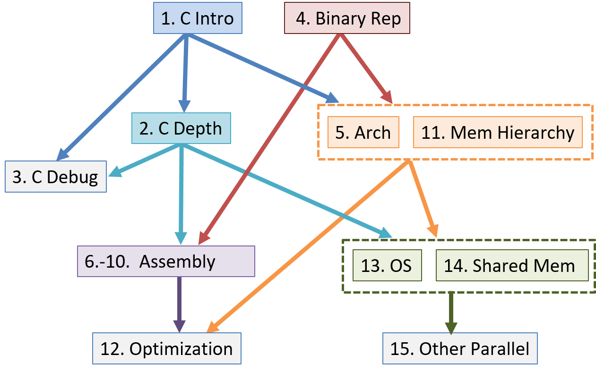

> [!WARNING] 说明
> 本文是个人学习用的**非官方**中英对照译文，原文：<https://diveintosystems.org/book/preface.html>。
> 原书采用 CC BY-NC-ND 4.0 许可（禁止演绎），**请勿公开传播本译文**。
> 标为「译注」「现代更新」的内容是译者补充，不代表原书作者观点；代码与原文逐字一致，未作改动。

*Preface*

在当今世界，学编程备受重视，编程被吹捧为通往成功人生的金钥匙。然而，尽管有各种编程训练营，小学里也开始教编程，计算机本身却常常被当作次要的东西——在培养下一代计算机科学人才的讨论中，它正变得越来越"隐形"。

> In today’s world, much emphasis is placed on learning to code, and programming is touted as a golden ticket to a successful life. Despite all the code boot camps and programming being taught in elementary schools, the computer itself is often treated as an afterthought — it’s increasingly becoming invisible in the discussions of raising the next generations of computer scientists.

本书的目的是为读者提供一本平易近人、易于入门的计算机系统导论。要写出高效的程序，程序员必须理解计算机底层的各个子系统和体系结构。然而，现代教科书价格高昂，往往只有买得起的学生才能用上。这本免费的在线教材希望让每个人都能接触到计算机系统的概念。它面向已经学过计算机科学入门课程、对 Python 有一定了解的学生。如果你想找一本用 Python 介绍基本计算原理的免费书，我们建议你先读 [*How To Think Like a Computer Scientist with Python*（像计算机科学家一样思考：Python 版）](https://runestone.academy/ns/books/published/thinkcspy/index.html)。

> The purpose of this book is to give readers a gentle yet accessible introduction to computer systems. To write effective programs, programmers must understand a computer’s underlying subsystems and architecture. However, the expense of modern textbooks often limits their availability to the set of students that can afford them. This free online textbook seeks to make computer systems concepts accessible to everyone. It is targeted toward students with an introductory knowledge of computer science who have some familiarity with Python. If you’re looking for a free book to introduce you to basic computing principles in Python, we encourage you to read [*How To Think Like a Computer Scientist with Python*](https://runestone.academy/ns/books/published/thinkcspy/index.html) first.

如果你已经准备好了，请下水吧——水温正好！

> If you’re ready to proceed, please come in — the water is warm!

## 本书讲什么

*What This Book Is About*

本书名为 *Dive into Systems*（潜入系统），意在以平易的方式介绍计算机系统的各个主题，包括 C 语言编程、体系结构基础、汇编语言和多线程。用海洋来比喻计算机系统再合适不过。正如人们认为现代生命起源于原始海洋的深处，现代编程也起源于早期计算机体系结构的设计与构造。最早的程序员正是研究了最早那批计算机的硬件图纸，才写出了最早的程序。

> Our book is titled *Dive into Systems* and is meant to be a gentle introduction to topics in computer systems, including C programming, architecture fundamentals, assembly language, and multithreading. The ocean metaphor is very fitting for computer systems. As modern life is thought to have risen from the depths of the primordial ocean, so has modern programming risen from the design and construction of early computer architecture. The first programmers studied the hardware diagrams of the first computers to create the first programs.

然而，当生命（和计算）渐渐远离孕育它们的海洋之后，海洋开始被视为一个阴森危险、怪物出没的地方。古代航海家常在海图上未经探索的水域画上海怪和其他神话生物，并配上警告：*此处有龙*（Here be dragons）。同样，随着计算离它的机器级起源越来越远，计算机系统方面的内容也常常成了许多计算机专业学生心中的那条"龙"。

> Yet as life (and computing) began to wander away from the oceans from which they emerged, the ocean began to be perceived as a foreboding and dangerous place, inhabited by monsters. Ancient navigators used to place pictures of sea monsters and other mythical creatures in the uncharted waters. *Here be dragons*, the text would warn. Likewise, as computing has wandered ever further away from its machine-level origins, computer systems topics have often emerged as personal dragons for many computing students.

写这本书，我们希望鼓励学生轻松地潜入计算机系统的世界。尽管从上面看，大海也许黑暗而危险，但只要愿意往水面下望一眼，就能发现一个美丽而奇妙的世界。同样，学生如果愿意看看代码之下，探究底层的体系结构"珊瑚礁"，也能对计算有更深的领悟。

> In writing this book, we hope to encourage students to take a gentle dive into computer systems topics. Even though the sea may look like a dark and dangerous place from above, there is a beautiful and remarkable world to be discovered for those who choose to peer just below the surface. So too can a student gain a greater appreciation for computing by looking below the code and examining the architectural reef below.

我们并不打算把你直接扔进大洋深处。本书只假定读者具备 CS1（计算机科学入门课）的知识，旨在作为许多计算机系统主题的初次接触。我们涵盖的主题包括 C 语言编程、逻辑门、二进制、汇编、存储器层次结构、多线程和并行。各章尽量写得相互独立，目标是能广泛适用于各种课程。

> We are not trying to throw you into the open ocean here. Our book assumes only a CS1 knowledge and is designed to be a first exposure to many computer systems topics. We cover topics such as C programming, logic gates, binary, assembly, the memory hierarchy, threading, and parallelism. Our chapters are written to be as independent as possible, with the goal of being widely applicable to a broad range of courses.

最后，我们写这本书的一个主要目标是让它免费可得。我们希望这本书成为一份"活的文档"，由计算机界同行评审，并随着这个领域的发展而不断演进。如果你有任何反馈，请给我们留言。我们很乐意听到你的声音！

> Lastly, a major goal for us writing this book is for it to be freely available. We want our book to be a living document, peer reviewed by the computing community, and evolving as our field continues to evolve. If you have feedback for us, please drop us a line. We would love to hear from you!

## 本书的使用方式

*Ways to Use This Book*

本教材涵盖与计算机系统相关的广泛主题，主要面向中级课程，例如计算机系统导论或计算机组成。它也可以为操作系统、编译原理、并行与分布式计算、计算机体系结构等高年级课程提供背景阅读材料。

> Our textbook covers a broad range of topics related to computer systems, specifically targeting intermediate-level courses such as introduction to computer systems or computer organization. It can also be used to provide background reading for upper-level courses such as operating systems, compilers, parallel and distributed computing, and computer architecture.

本教材并不打算完整覆盖所有系统主题。它不包含对操作系统、计算机体系结构或并行与分布式计算的深入或完整论述，也不是为了替代高年级课程中专门深入讲解这些主题的教材。它的重点是介绍计算机系统，在"理解计算机如何运行程序"这一背景下讲解系统中的共同主题，以及如何设计能在系统上高效运行的程序。这些内容为日后深入学习系统方面的主题打下共同的知识基础和技能基础。

> This textbook is not designed to provide complete coverage of all systems topics. It does not include advanced or full coverage of operating systems, computer architecture, or parallel and distributed computing topics, nor is it designed to be used in place of textbooks devoted to advanced coverage of these topics in upper-level courses. Instead, it focuses on introducing computer systems, common themes in systems in the context of understanding how a computer runs a program, and how to design programs to run efficiently on systems. The topic coverage provides a common knowledge base and skill set for more advanced study in systems topics.

本书的主题可以看作是对计算机的一次纵向剖切。在最底层，我们讨论程序的二进制表示，以及用来存储和执行程序的电路，从基本的门电路出发，搭建出一个能执行程序指令的简单 CPU。在中间一层，我们介绍操作系统，重点是它如何支持程序运行和管理计算机硬件，尤其是实现多道程序设计（multiprogramming）和虚拟内存的机制。在最高层，我们介绍 C 语言及其与底层代码的对应关系、如何设计高效的代码、编译器优化以及并行计算。读完全书的读者，将对用 C（和 Pthreads）编写的程序如何在计算机上执行有一个基本的理解，并在此基础上，知道可以通过哪些方式改变程序结构来提升性能。

> Our book’s topics can be viewed as a vertical slice through a computer. At the lowest layer we discuss binary representation of programs and circuits designed to store and execute programs, building up a simple CPU from basic gates that can execute program instructions. At the next layer we introduce the operating system, focusing on its support for running programs and for managing computer hardware, particularly on the mechanisms of implementing multiprogramming and virtual memory support. At the highest layer, we present the C programming language and how it maps to low-level code, how to design efficient code, compiler optimizations, and parallel computing. A reader of the entire book will gain a basic understanding of how a program written in C (and Pthreads) executes on a computer and, based on this understanding, will know some ways in which they can change the structure of their program to improve its performance.

虽然整本书构成对计算机的一次纵向剖切，但各章都尽量写得相互独立，以便教师根据自己的需要自由组合章节。下面给出各章之间的依赖关系图；不过，章内的单个小节未必有整章那么深的依赖层次。

> Although as a whole the book provides a vertical slice through the computer, the book chapters are written as independently as possible so that an instructor can mix and match chapters for their particular needs. The chapter dependency graph is shown below, though individual sections within chapters may not have as deep a dependency hierarchy as the entire chapter.

*图示：第 1 章和第 4 章不依赖其他章节。第 2、3、5 章以及第 6–10 章依赖第 1 章。第 5 章和第 13 章还依赖第 4 章。其余各章依赖上述章节的某种组合。*

### 各章主题概览

*Summary of Chapter Topics*

- 第 0 章，*引言*：介绍计算机系统，并给出阅读本书的一些建议。

> - Chapter 0, *Introduction*: Introduction to computer systems and some tips for reading this book.

- 第 1 章，*C 语言编程入门*：介绍 C 语言编程基础，包括编译和运行 C 程序。我们假定本书读者已经通过某种编程语言学过编程入门。我们把 C 的语法示例与 Python 语法对照，方便熟悉 Python 的读者理解两者如何相互转换。不过，阅读和理解这一章并不需要 Python 编程经验。

> - Chapter 1, *Introduction to C Programming*: Covers C programming basics, including compiling and running C programs. We assume readers of this book have had an introduction to programming in some programming language. We compare example C syntax to Python syntax so that readers familiar with Python can see how they may translate. However, Python programming experience is not necessary for reading or understanding this chapter.

- 第 2 章，*深入 C 语言*：介绍 C 语言的大部分内容，尤其是指针和动态内存。我们还会更详细地展开第 1 章中的话题，并讨论 C 的一些高级特性。

> - Chapter 2, *A Deeper Dive into C*: Covers most of the C language, notably pointers and dynamic memory. We also elaborate on topics from Chapter 1 in more detail and discuss some advanced C features.

- 第 3 章，*C 调试工具*：介绍常用的 C 调试工具（GDB 和 Valgrind），并演示如何用它们调试各种应用程序。

> - Chapter 3, *C Debugging Tools*: Covers common C debugging tools (GDB and Valgrind) and illustrates how they can be used to debug a variety of applications.

- 第 4 章，*二进制与数据表示*：介绍如何把数据编码为二进制、C 类型的二进制表示、二进制数据上的算术运算以及算术溢出。

> - Chapter 4, *Binary and Data Representation*: Covers encoding data into binary, binary representation of C types, arithmetic operations on binary data, and arithmetic overflow.

- 第 5 章，*门、电路与计算机体系结构*：从逻辑门讲到基本 CPU 的构造，介绍冯·诺依曼体系结构。我们通过算术电路、存储电路和控制电路，刻画时钟驱动的执行方式和指令执行的各个阶段。我们还简要介绍流水线、现代体系结构的一些特性，以及计算机体系结构的简史。

> - Chapter 5, *Gates, Circuits, and Computer Architecture*: Covers the von Neumann architecture from logic gates to the construction of a basic CPU. We characterize clock-driven execution and the stages of instruction execution though arithmetic, storage, and control circuits. We also briefly introduce pipelining, some modern architecture features, and a short history of computer architecture.

- 第 6–10 章，*汇编语言编程*：介绍如何把 C 翻译为汇编代码，从基本的算术表达式讲到函数、栈，以及数组和 `struct` 的访问。我们用三个独立的章节讲解三种不同指令集架构的汇编：32 位 x86、64 位 x86 和 64 位 ARM。

> - Chapters 6-10, *Assembly Programming*: Covers translating C into assembly code from basic arithmetic expressions to functions, the stack, and array and `struct` access. In three separate chapters we cover assembly from three different instruction set architectures: 32-bit x86, 64-bit x86, and 64-bit ARM.

- 第 11 章，*存储与存储器层次结构*：介绍存储设备、存储器层次结构及其对程序性能的影响、局部性、缓存，以及 Cachegrind 性能分析工具。

> - Chapter 11, *Storage and the Memory Hierarchy*: Covers storage devices, the memory hierarchy and its effects on program performance, locality, caching, and the Cachegrind profiling tool.

- 第 12 章，*代码优化*：介绍编译器优化、以性能为导向的程序设计、代码优化技巧，以及如何定量测量程序的性能。

> - Chapter 12, *Code Optimization*: Covers compiler optimizations, designing programs with performance in mind, tips for code optimization, and quantitatively measuring a program’s performance.

- 第 13 章，*操作系统*：介绍操作系统的核心抽象及其背后的机制，主要关注进程、虚拟内存和进程间通信（IPC）。

> - Chapter 13, *Operating Systems*: Covers core operating system abstractions and the mechanisms behind them. We primarily focus on processes, virtual memory, and interprocess communication (IPC).

- 第 14 章，*共享内存并行*：介绍多核处理器、线程与 Pthreads 编程、同步、竞态条件和死锁。本章还包含一些进阶话题：并行性能的度量（加速比、效率、阿姆达尔定律）、线程安全和缓存一致性。

> - Chapter 14, *Shared Memory Parallelism*: Covers multicore processors, threads and Pthreads programming, synchronization, race conditions, and deadlock. This chapter includes some advanced topics on measuring parallel performance (speed-up, efficiency, Amdahl’s law), thread safety, and cache coherence.

- 第 15 章，*高级并行系统与编程模型*：介绍分布式内存系统与消息传递接口（MPI）、硬件加速器与 CUDA，以及云计算与 MapReduce 的基础知识。

> - Chapter 15, *Advanced Parallel Systems and Programming Models*: Introduces the basics of distributed memory systems and the Message Passing Interface (MPI), hardware accelerators and CUDA, and cloud computing and MapReduce.

> [!NOTE] 译注
> 本书网页版还有两个附录：附录 1「面向 Java 程序员的第 1 章」（Chapter 1 for Java Programmers），附录 2「使用 Unix」（Using Unix），本译本一并翻译。

### 本书的使用示例

*Example Uses of This Book*

*Dive into Systems* 可以用作介绍计算机系统主题的课程的主教材，也可以挑选其中的单独章节，为深入讲解相关主题的课程提供背景知识。

> *Dive into Systems* can be used as a primary textbook for courses that introduce computer systems topics, or individual chapters can be used to provide background information in courses that cover topics in more depth.

以作者所在的两所学校为例，我们已将它用作两门不同中级课程的主教材：

> As examples from the authors' two institutions, we have been using it as the primary textbook for two different intermediate-level courses:

- 斯沃斯莫尔学院（Swarthmore College）的*计算机系统导论*。章节顺序：4、1（部分 3）、5、6、7、10、2（更多 3）、11、13、14。

> - *Introduction To Computer Systems* at Swarthmore College. Chapter ordering: 4, 1 (some 3), 5, 6, 7, 10, 2 (more 3), 11, 13, 14.

- 西点军校（West Point）的*计算机组成*。章节顺序：1、4、2（部分 3）、6、7、10、11、12、13、14、15。

> - *Computer Organization* at West Point. Chapter ordering: 1, 4, 2 (some 3), 6, 7, 10, 11, 12, 13, 14, 15.

此外，我们在许多高年级课程中把单独的章节用作背景阅读，包括：

> Additionally, we use individual chapters as background reading in many of our upper-level courses, including:

| 高年级课程主题 | 背景阅读章节 |
|---|---|
| 体系结构 | 5、11 |
| 编译原理 | 6、7、8、9、10、11、12 |
| 数据库系统 | 11、14、15 |
| 计算机网络 | 4、13、14 |
| 操作系统 | 11、13、14 |
| 并行与分布式系统 | 11、13、14、15 |

> | Upper-level Course Topic         | Chapters for Background Readings |
> |----------------------------------|----------------------------------|
> | Architecture                     | 5, 11                            |
> | Compilers                        | 6, 7, 8, 9, 10, 11, 12           |
> | Database Systems                 | 11, 14, 15                       |
> | Networking                       | 4, 13, 14                        |
> | Operating Systems                | 11, 13, 14                       |
> | Parallel and Distributed Systems | 11, 13, 14, 15                   |

最后，第 2 章和第 3 章在我们的许多课程中被用作 C 语言编程和调试的参考资料。

> Finally, Chapters 2 and 3 are used as C programming and debugging references in many of our courses.

### 在线版本

*Available Online*

本教材的免费在线版本地址为 <https://diveintosystems.org/>。

> The free online version of our textbook is available at <https://diveintosystems.org/>.
