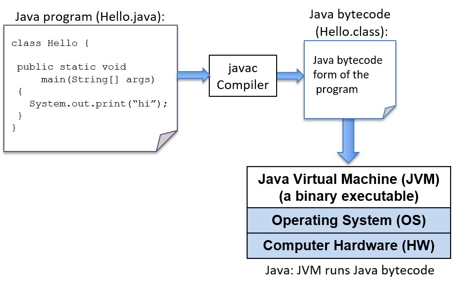
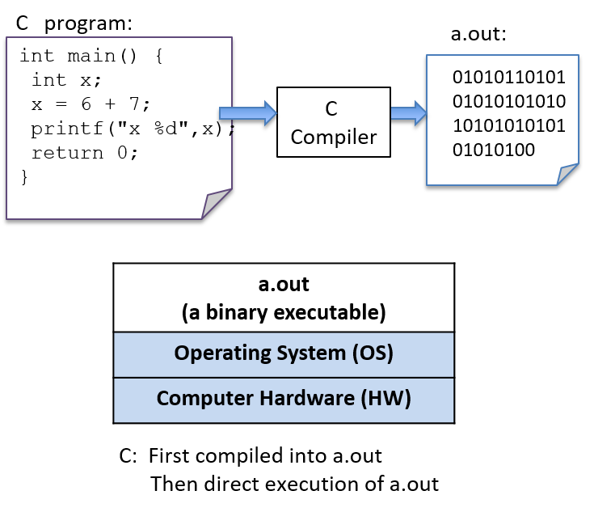

> **说明**
> 本文是个人学习用的**非官方**中英对照译文，原文：<https://diveintosystems.org/book/Appendix1/getting_started.html>。
> 原书采用 CC BY-NC-ND 4.0 许可（禁止演绎），**请勿公开传播本译文**。
> 标为「译注」「现代更新」的内容是译者补充，不代表原书作者观点；代码与原文逐字一致，未作改动。

## 16.1. C 语言编程入门

*16.1. Getting Started Programming in C*

我们先来看一个「hello world」程序，其中包含一个调用数学库函数的例子。在[表 1](16.1-getting_started.html) 中，我们把这个程序的 C 版本与 Java 版本进行比较。C 版本可以放在一个名为 `hello.c` 的文件中（`.c` 是 C 源代码文件的后缀惯例），而 Java 版本可以放在一个名为 `HelloWorld.java` 的文件中。

> Let’s start by looking at a "hello world" program that includes an example of calling a function from the math library. In [Table 1](16.1-getting_started.html) we compare the C version of this program to the Java version. The C version might be put in a file named `hello.c` (`.c` is the suffix convention for C source code files), whereas the Java version might be in a file named `HelloWorld.java`.

**表 1.** 一个小程序在 Java 和 C 中的语法比较。[C 版本](https://diveintosystems.org/book/Appendix1/_attachments/hello.c)和 [Java 版本](https://diveintosystems.org/book/Appendix1/_attachments/HelloWorld.java)都可以下载。

*Table 1. Syntax Comparison of a Small Program in Java and C. Both the [C version](https://diveintosystems.org/book/Appendix1/_attachments/hello.c) and [Java version](https://diveintosystems.org/book/Appendix1/_attachments/HelloWorld.java) are available for download.*

**Java 版本（HelloWorld.java）**

> **Java version (HelloWorld.java)**

```
/*
    The Hello World Program in Java
 */

/* Java Math library */
import java.lang.Math;

/* define a HelloWorld class */
class HelloWorld {

  /* main method definition: */
  public static void main(String[] args){

   System.out.println("Hello World");
   System.out.println("sqrt(4) is "
         + Math.sqrt(4));
  }
}
```

**C 版本（hello.c）**

> **C version (hello.c)**

```
/*
    The Hello World Program in C
 */

/* C math and I/O libraries */
#include <math.h>
#include <stdio.h>


/* main function definition: */
int main(void) {

    printf("Hello World\n");
    printf("sqrt(4) is %f\n", sqrt(4));

    return 0;  // main returns value 0
}
```

注意，这个程序的两个版本具有相似的结构和语言结构，只是语言的语法不同。

> Notice that both versions of this program have similar structure and language constructs, albeit with different language syntax.

语法上的几点相似之处包括：

> A few syntactic similarities include:

**注释：**

> **Comments:**

- Java 和 C 中的多行注释都以 `/*` 开头、以 `*/` 结尾，单行注释以 `//` 开头。

> - Multi-line comments in Java and C begin with `/*` and end with `*/`, and single-line comments begin with `//`.

**语句：**

> **Statements:**

- C 和 Java 中的语句都以 `;` 结尾。

> - Statements in C and Java end in `;`.

**代码块：**

> **Blocks:**

- Java 和 C 都用 `{` 和 `}` 把相关的代码块（例如函数体和循环体）括起来。良好的编程风格包括把代码块中的语句缩进。

> - Both Java and C use `{` and `}` around blocks of related code (for example, function bodies and loop bodies). Good programming style includes indenting statements inside a block.

几点关键的不同之处包括：

> A few key differences include:

**导入库代码：**

> **Importing library code:**

- 在 Java 中，用 `import` 来包含（导入）库。

> - In Java, libraries are included (imported) using `import`.

- 在 C 中，用 `#include` 引入（导入）库。所有 `#include` 语句都出现在程序的开头，位于函数体之外。

> - In C, libraries are included (imported) using `#include`. All `#include` statements appear at the top of the program, outside of function bodies.

**main 函数：**

> **The main function:**

- Java 和 C 都定义了 `main` 函数，它是程序运行时第一个执行的函数。在 C 中，只定义一个 `main` 函数，C 程序执行时会自动调用它。在 Java 中，执行的是在 JVM 上运行的那个类的 `public static void main` 方法。

> - Both Java and C define `main` functions that are the first functions executed when a program is run. In C, there is only one `main` function defined, and it is automatically called when the C program executes. In Java, the `public static void main` method of the class run on the JVM is executed.

- Java 是纯粹的面向对象语言，因此所有代码都必须属于某个类（本例中是 `HelloWorld`）。`main` 函数被定义为 `HelloWorld` 类中的一个 `public static` 方法（`public static void main(String[] args)`）。按照惯例，`main` 在 Java 中是一个 `void` 函数，传给它的是一个命令行参数字符串数组。

> - Java is a purely object oriented language, thus all code must be part of a class (`HelloWorld` in this example). The `main` function is defined as a `public static` method in the class `HelloWorld` (`public static void main(String[] args)`). By convention `main` is a `void` function in Java and is passed an array of command line argument strings.

- C 是纯粹的命令式、过程式语言，因此 C 中没有类。所以，所有函数都定义在类定义之外（C 中根本没有类定义）。在 C 中，`int main(void){ }` 定义了 main 函数。`void` 表示它不接收参数。后面的小节会展示 `main` 如何接收参数来获取命令行参数。

> - C is a purely imperative and procedural language, and thus there are no classes in C. As a result, all functions are defined outside of class definitions (there are no class definitions in C). In C, `int main(void){ }` defines the main function. The `void` means it doesn’t expect to receive a parameter. Future sections show how `main` can take parameters to receive command line arguments.

- C 程序必须有一个名为 `main` 的函数，并且它的返回类型必须是 `int`。C 中的 `main` 函数可以选择接收一个字符串列表作为参数，每个命令行参数一个字符串（类似于 Java），但最简单的形式是 `main` 没有参数。在第 2 章中，我们会展示定义为接收命令行参数的 `main`。

> - A C program must have a function named `main`, and its return type must be `int`. The `main` function in C can optionally take a parameter that is a list of strings, one per command line argument (similar to Java), but in its simplest form, `main` has no parameters. In Chapter 2 we show `main` defined to take command line arguments.

- C 的 `main` 函数有一条显式的 `return` 语句，返回一个 `int` 值（按照惯例，如果 main 函数成功执行、没有错误，就返回 `0`）。

> - The C `main` function has an explicit `return` statement to return an `int` value (by convention, `main` returns `0` if the main function is successfully executed without errors).

**输出：**

> **Output:**

- 在 Java 中，可以用 `System.out` 的 `print` 和 `println` 方法打印字符串。可以用 `+` 运算符把多个值拼接在一起，构成一个更复杂的字符串（例如 `"sqrt(4) is " + Math.sqrt(4)`）。`System.out` 还有一个 `printf` 方法，用来打印带参数的格式字符串。格式字符串中各占位符对应的值，以逗号分隔的参数值列表的形式跟在后面。例如，[表 1](16.1-getting_started.html) 中对 `System.out.println` 的第二次调用可以换成等价的调用 `System.out.printf("sqrt(4) is %f%n", Math.sqrt(4)`)，其中 `Math.sqrt(4)` 的值会被打印在格式字符串中 `%f` 占位符的位置上，`%n`（或 `\n`）用来指定一个换行符。Java 还有一些可以用来格式化不同类型值的类。

> - In Java, the `print` and `println` methods of `System.out` can be used to print a string. The `+` operator can be used to concatenate values together to create a more complex string (for example, `"sqrt(4) is " + Math.sqrt(4)`). `System.out` also has a `printf` method to print out a format string with arguments. Values for the placeholders in the format string follow as a comma-separated list of argument values. For example, the second call to `System.out.println` in [Table 1](16.1-getting_started.html) could be replaced with the equivalent call `System.out.printf("sqrt(4) is %f%n", Math.sqrt(4)`), where the value of `Math.sqrt(4)` will be printed in place of the `%f` placeholder in the format string and `%n` (or `\n`) is used to specify a newline character. Java additionally has classes that can be used to format different types of values.

- 在 C 中，`printf` 函数像 Java 的 `System.out.printf` 方法一样打印格式化字符串（例如，`sqrt(4)` 的值会被打印在格式字符串参数中 `%f` 占位符的位置上，`\n` 表示一个换行符）。

  `printf` 函数既用来打印格式字符串，也用来打印简单的字符串值（C 没有类似于 Java 的 `System.out.println` 的单独函数）。C 的 `printf` 函数也不会自动在末尾打印换行符。因此，当希望输出换行时，C 程序员需要在格式字符串中显式地指定换行符（`\n`）。

> - In C, the `printf` function prints a formatted string like Java’s `System.out.printf` method (for example, the value of `sqrt(4)` will be printed in place of the `%f` placeholder in the format string argument, and `\n` specifies a newline character).
>
>   The `printf` function is used to print both format strings and simple string values (C does not have an separate function similar to Java’s `System.out.println`). C’s `printf` function also doesn’t automatically print a newline character at the end. As a result, C programmers need to explicitly specify a newline character (`\n`) in the format string when a newline is desired in the output.

### 16.1.1. 编译与运行 C 程序

*16.1.1. Compiling and Running C Programs*

Java 程序运行在 Java 虚拟机（JVM）上。JVM 是一个直接在底层计算机系统上运行的程序。要运行一个 Java 程序，首先要用 Java 编译器（`javac`）把它从源代码形式（`HelloWorld.java`）编译（翻译）成 Java 字节码形式。例如（`$` 是 Linux shell 提示符）：

> Java programs run on the Java virtual machine (JVM). The JVM is a program that runs directly on the underlying computer system. To run a Java program, it is first compiled (translated) by the Java compiler (`javac`) from its source code (`HelloWorld.java`) form into Java bytecode form. For example (`$` is the Linux shell prompt):

```
$ javac HelloWorld.java
```

如果编译成功，`javac` 会创建一个新文件 `HelloWorld.class`，其中包含该程序翻译成的、JVM 可以运行的 Java 字节码。例如：

> If successful, `javac` creates a new file, `HelloWorld.class`, that contains the Java bytecode translation of the program that the JVM can run. For example:

```
$ java HelloWorld
```

JVM 是一个以可以直接在底层系统上运行的形式存在的程序（这种形式称为**二进制可执行文件**，binary executable），它以要运行的 Java 类作为输入（[图 1](16.1-getting_started.html)）。Java 字节码的可移植性很好，它可以在任何有 JVM 的计算机系统上运行。然而，由于 Java 字节码不是直接在底层计算机系统上运行的，Java 程序的运行效率可能不如直接在底层系统上运行的程序。

> The JVM is a program that is in a form that can be run directly on the underlying system (this form is called **binary executable**) and takes as input the Java class that it runs ([Figure 1](16.1-getting_started.html)). Java bytecode is very portable in the sense that it can run on any computer system with a JVM. However, because Java bytecode does not run directly on the underlying computer system, a Java program may not run as efficiently as programs that run directly on the underlying system.



**图 1.** Java 程序被编译成 Java 字节码，由 JVM 执行，而 JVM 是一个在底层系统（操作系统和硬件）上运行的二进制可执行程序

*Figure 1. A Java program is compiled to Java bytecode that is executed by the JVM, which is a binary executable program that is run on the underlying system (OS and hardware)*

要运行一个 C 程序，必须先把它翻译成计算机系统可以直接执行的形式。C **编译器**（compiler）与 Java 编译器类似，是一个把 C 源代码翻译成计算机系统可以直接执行的**二进制可执行文件**形式的程序。二进制可执行文件由一串计算机能运行的、格式明确的 0 和 1 组成；与需要 JVM 才能运行的 Java 字节码不同，二进制可执行文件直接在底层系统上运行。

> To run a C program, it must first be translated into a form that a computer system can directly execute. The C **compiler**, similar to the Java compiler, is a program that translates C source code into a **binary executable** form that the computer system can directly execute. A binary executable consists of a series of 0’s and 1’s in a well-defined format that a computer can run; unlike Java bytecode that requires the JVM to run, the binary executable runs directly on the underlying system.

例如，要在 Unix 系统上运行 C 程序 `hello.c`，必须先用 C 编译器（例如 [GNU C 编译器](https://gcc.gnu.org)，即 GCC）编译 C 代码，生成一个二进制可执行文件（默认名为 `a.out`）。然后就可以在系统上直接运行这个程序的二进制可执行版本了（[图 2](16.1-getting_started.html)）：

> For example, to run the C program `hello.c` on a Unix system, the C code must first be compiled by a C compiler (for example, the [GNU C compiler](https://gcc.gnu.org), GCC) that produces a binary executable (by default named `a.out`). The binary executable version of the program can then be run directly on the system ([Figure 2](16.1-getting_started.html)):

```
$ gcc hello.c
$ ./a.out
```

（注意，有些 C 编译器可能需要显式告诉它链接数学库：`-lm`）：

> (Note that some C compilers might need to be explicitly told to link in the math library: `-lm`):

```
$ gcc hello.c -lm
```



**图 2.** C 编译器（gcc）把 C 源代码构建成二进制可执行文件（a.out）。底层系统（操作系统和硬件）直接执行 a.out 文件来运行程序。

*Figure 2. The C compiler (gcc) builds C source code into a binary executable file (a.out). The underlying system (OS and hardware) directly executes the a.out file to run the program.*

#### 详细步骤

*Detailed Steps*

一般来说，在 Unix 系统上编辑、编译和运行 C 程序需要以下步骤：

> In general, the following sequence describes the necessary steps for editing, compiling, and running a C program on a Unix system:

1. 用[文本编辑器](https://www.cs.swarthmore.edu/help/editors.html)（例如 `vim`）编写 C 源程序，并把它保存到一个文件中（例如 `hello.c`）：

    ```
    $ vim hello.c
    ```

> 1.  Using a [text editor](https://www.cs.swarthmore.edu/help/editors.html) (for example, `vim`), write and save your C source code program in a file (e.g., `hello.c`):
>
>     ```
>     $ vim hello.c
>     ```

2. 把源代码编译成可执行形式，然后运行它。用 `gcc` 编译的最基本语法是：

    ```
    $ gcc <input_source_file>
    ```

> 2.  Compile the source to an executable form, and then run it. The most basic syntax for compiling with `gcc` is:
>
>     ```
>     $ gcc <input_source_file>
>     ```

如果编译没有出错，编译器会生成一个名为 `a.out` 的二进制可执行文件。编译器也允许你用 `-o` 标志指定要生成的二进制可执行文件的名字：

> If compilation yields no errors, the compiler creates a binary executable file named `a.out`. The compiler also allows you to specify the name of the binary executable file to generate using the `-o` flag:

```
$ gcc -o <output_executable_file> <input_source_file>
```

例如，下面这条命令让 `gcc` 把 `hello.c` 编译成名为 `hello` 的可执行文件：

> For example, this command instructs `gcc` to compile `hello.c` into an executable file named `hello`:

```
$ gcc -o hello hello.c
```

我们可以用 `./hello` 来运行这个可执行程序：

> We can invoke the executable program using `./hello`:

```
$ ./hello
```

对 C 源代码（`hello.c` 文件）的任何修改，都必须用 `gcc` 重新编译，才能生成新版本的 `hello`。如果编译器在编译过程中发现任何错误，就不会创建（或重新创建）`./hello` 文件（但要当心：之前某次成功编译生成的旧版本文件可能还在）。

> Any changes made to the C source code (the `hello.c` file) must be recompiled with `gcc` to produce a new version of `hello`. If the compiler detects any errors during compilation, the `./hello` file won’t be created/re-created (but beware, an older version of the file from a previous successful compilation might still exist).

用 `gcc` 编译时，常常需要加上几个命令行选项。例如，下面这些选项会启用更多的编译器警告，并生成带有额外调试信息的二进制可执行文件：

> Often when compiling with `gcc`, you want to include several command line options. For example, these options enable more compiler warnings and build a binary executable with extra debugging information:

```
$ gcc -Wall -g -o hello hello.c
```

由于 `gcc` 命令行可能很长，人们常用 `make` 工具来简化 C 程序的编译，并清理 `gcc` 生成的文件。随着 C 语言编程经验的积累，[使用 make 和编写 Makefile](https://www.cs.swarthmore.edu/~newhall/unixhelp/howto_makefiles.html) 会成为你掌握的重要技能。

> Because the `gcc` command line can be long, frequently the `make` utility is used to simplify compiling C programs and for cleaning up files created by `gcc`. [Using make and writing Makefiles](https://www.cs.swarthmore.edu/~newhall/unixhelp/howto_makefiles.html) are important skills that you will develop as you build up experience with C programming.

我们会在[第 2 章](../C2-C_depth/2.9.5-advanced_libraries.html)末尾更详细地介绍编译以及与 C 库代码的链接。

> We cover compiling and linking with C library code in more detail at the end of [Chapter 2](../C2-C_depth/2.9.5-advanced_libraries.html).

### 16.1.2. 变量与 C 的数值类型

*16.1.2. Variables and C Numeric Types*

与 Java 一样，C 也用变量作为存放数据的具名存储位置。思考程序变量的**作用域**（scope）和**类型**（type），对理解程序运行时会做什么的语义很重要。变量的**作用域**定义了变量何时有意义（即在程序的什么地方、什么时候可以使用它）以及它的生命期（即它可能在程序的整个运行期间一直存在，也可能只在函数的一次活动期间存在）。变量的**类型**定义了它能表示的值的范围，以及对其数据进行运算时如何解释这些值。

> Like Java, C uses variables as named storage locations for holding data. Thinking about the **scope** and **type** of program variables is important to understand the semantics of what your program will do when you run it. A variable’s **scope** defines when the variable has meaning (that is, where and when in your program it can be used) and its lifetime (that is, it could persist for the entire run of a program or only during a function activation). A variable’s **type** defines the range of values that it can represent and how those values will be interpreted when performing operations on its data.

在 Java 和 C 中，所有变量都必须先声明后使用。在 C 中声明变量，使用下面的语法：

> In both Java and C, all variables must be declared before they can be used. To declare a variable in C, use the following syntax:

```
type_name variable_name;
```

一个变量只能有一种**类型**。C 的基本类型包括 `char`、`int`、`float` 和 `double`。按照惯例，C 变量应当在其作用域的开头（即 `{ }` 代码块的顶部）声明，位于该作用域中的所有 C 语句之前。

> A variable can have only a single **type**. The basic C types include `char`, `int`, `float`, and `double`. By convention, C variables should be declared at the beginning of their scope (at the top of a `{ }` block), before any C statements in that scope.

下面的 C 代码片段示范了几种不同类型变量的声明和使用。示例之后我们会更详细地讨论类型和运算符。

> Below is an example C code snippet that shows declarations and uses of variables of some different types. We discuss types and operators in more detail after the example.

*varsin.c*

> *varsin.c*

```
{
    /* 1. Define variables in this block's scope at the top of the block. */

    int x; // declares x to be an int type variable and allocates space for it

    int i, j, k;  // can define multiple variables of the same type like this

    char letter;  // a char stores a single-byte integer value
                  // it is often used to store a single ASCII character
                  // value (the ASCII numeric encoding of a character)
                  // a char in C is a different type than a string in C

    float winpct; // winpct is declared to be a float type
    double pi;    // the double type is more precise than float

    /* 2. After defining all variables, you can use them in C statements. */

    x = 7;        // x stores 7 (initialize variables before using their value)
    k = x + 2;    // use x's value in an expression

    letter = 'A';        // a single quote is used for single character value
    letter = letter + 1; // letter stores 'B' (ASCII value one more than 'A')

    pi = 3.1415926;

    winpct = 11 / 2.0; // winpct gets 5.5, winpct is a float type
    j = 11 / 2;        // j gets 5: int division truncates after the decimal
    x = k % 2;         // % is C's mod operator, so x gets 9 mod 2 (1)
}
```

### 16.1.3. C 的类型

*16.1.3. C Types*

与 Java 不同，C 没有定义复杂数据类型的大量类库。C 只支持一小组内置数据类型，并提供了几种让程序员构造基本类型集合的方式（数组和结构体）。C 程序员可以用这些基本的构件来构建复杂的数据结构。

> Unlike Java, C does not have an extensive set of class libraries defining complex data types. Instead, C supports a small set of built-in data types, and it provides a few ways in which programmers can construct basic collections of types (arrays and structs). From these basic building blocks, a C programmer can build complex data structures.

C 定义了一组用于存储数值的基本类型。下面是几种不同 C 类型的数值字面量示例：

> C defines a set of basic types for storing numeric values. Here are some examples of numeric literal values of different C types:

```
8     // the int value 8
3.4   // the double value 3.4
'h'   // the char value 'h' (its value is 104, the ASCII value of h)
```

C 的 `char` 类型存储的是一个数值，但程序员常用它来存储一个 ASCII 字符的值。在 C 中，字符字面量写作单引号括起来的单个字符。

> The C `char` type stores a numeric value. However, it’s often used by programmers to store the value of an ASCII character. A character literal value is specified in C as a single character between single quotes.

C 不支持字符串类型，但程序员可以利用 `char` 类型和 C 对构造数组的支持来创建字符串，我们会在后面的小节中讨论。不过，C 确实支持在程序中表示字符串字面量：字符串字面量就是双引号括起来的任意字符序列。C 程序员经常把字符串字面量作为格式字符串参数传给 `printf`：

> C doesn’t support a string type, but programmers can create strings from the `char` type and C’s support for constructing arrays of values, which we discuss in later sections. C does, however, support a way of expressing string literal values in programs: a string literal is any sequence of characters between double quotes. C programmers often pass string literals as the format string argument to `printf`:

```
printf("this is a C string\n");
```

Java 和 C 都支持字符串和 char 类型的值。通常，Java 的 char 值是 16 位的 Unicode 值，而 C 的是 8 位的 ASCII 值。

> Java and C both support string and char type values. Typically, Java char values are 16-bit unicode values and C’s are 8-bit ascii values.

在 Java 和 C 中，字符串和 `char` 都是两种截然不同的类型，求值结果也不同。对比只含一个字符的 C 字符串字面量和 C 的 `char` 字面量，就能看出这种区别。例如：

> In both Java and C a string and a `char` are two very different types, and they evaluate differently. This difference is illustrated by contrasting a C string literal that contains one character with a C `char` literal. For example:

```
'h'  // this is a char literal value   (its value is 104, the ASCII value of h)
"h"  // this is a string literal value (its value is NOT 104, it is not a char)
```

我们会在本章后面的[字符串](../C2-C_depth/2.6-strings.html)一节中更详细地讨论 C 字符串和 `char` 变量。这里主要关注 C 的数值类型。

> We discuss C strings and `char` variables in more detail in the [Strings](../C2-C_depth/2.6-strings.html) section later in this chapter. Here, we’ll mainly focus on C’s numeric types.

#### C 的数值类型

*C Numeric Types*

C 支持多种不同的类型来存储数值，它们的区别在于所表示数值的格式。例如，`float` 和 `double` 类型可以表示实数，`int` 表示有符号整数，`unsigned int` 表示无符号整数。实数是带小数点的正值或负值，例如 `-1.23` 或 `0.0056`。有符号整数存储正整数、负整数或零，例如 `-333`、`0` 或 `3456`。无符号整数只存储非负整数，例如 `0` 或 `1234`。

> C supports several different types for storing numeric values. The types differ in the format of the numeric values they represent. For example, the `float` and `double` types can represent real values, `int` represents signed integer values, and `unsigned int` represents unsigned integer values. Real values are positive or negative values with a decimal point, such as `-1.23` or `0.0056`. Signed integers store positive, negative, or zero integer values, such as `-333`, `0`, or `3456`. Unsigned integers store strictly nonnegative integer values, such as `0` or `1234`.

C 的各种数值类型能表示的值的范围和精度也不同。一个值的范围或精度取决于其类型所占的字节数。字节数多的类型，比字节数少的类型能表示更大范围的值（对整数类型而言）或更高精度的值（对实数类型而言）。

> C’s numeric types also differ in the range and precision of the values they can represent. The range or precision of a value depends on the number of bytes associated with its type. Types with more bytes can represent a larger range of values (for integer types), or higher-precision values (for real types), than types with fewer bytes.

[表 2](16.1-getting_started.html) 列出了多种常见 C 数值类型的存储字节数、所存数值的种类，以及如何声明该类型的变量（注意这些是典型大小——确切的字节数取决于硬件体系结构）。

> [Table 2](16.1-getting_started.html) shows the number of storage bytes, the kind of numeric values stored, and how to declare a variable for a variety of common C numeric types (note that these are typical sizes — the exact number of bytes depends on the hardware architecture).

**表 2.** C 的数值类型

*Table 2. C Numeric Types*

| 类型名 | 通常大小 | 存储的值 | 声明方式 |
|---|---|---|---|
| `char` | 1 字节 | 整数 | `char x;` |
| `short` | 2 字节 | 有符号整数 | `short x;` |
| `int` | 4 字节 | 有符号整数 | `int x;` |
| `long` | 4 或 8 字节 | 有符号整数 | `long x;` |
| `long long` | 8 字节 | 有符号整数 | `long long x;` |
| `float` | 4 字节 | 有符号实数 | `float x;` |
| `double` | 8 字节 | 有符号实数 | `double x;` |

> | Type name   | Usual size   | Values stored       | How to declare |
> |-------------|--------------|---------------------|----------------|
> | `char`      | 1 byte       | integers            | `char x;`      |
> | `short`     | 2 bytes      | signed integers     | `short x;`     |
> | `int`       | 4 bytes      | signed integers     | `int x;`       |
> | `long`      | 4 or 8 bytes | signed integers     | `long x;`      |
> | `long long` | 8 bytes      | signed integers     | `long long x;` |
> | `float`     | 4 bytes      | signed real numbers | `float x;`     |
> | `double`    | 8 bytes      | signed real numbers | `double x;`    |

C 还为整数类型（`char`、`short`、`int`、`long` 和 `long long`）提供了*无符号*版本。要把变量声明为无符号的，在类型名前加上关键字 `unsigned` 即可。例如：

> C also provides *unsigned* versions of the integer numeric types (`char`, `short`, `int`, `long`, and `long long`). To declare a variable as unsigned, add the keyword `unsigned` before the type name. For example:

```
int x;           // x is a signed int variable
unsigned int y;  // y is an unsigned int variable
```

C 标准并没有规定 `char` 类型是有符号还是无符号的。因此，有些实现可能把 `char` 实现为有符号整数，有些则实现为无符号整数。如果你想使用无符号的 `char` 变量，好的编程习惯是显式声明为 `unsigned char`。

> The C standard doesn’t specify whether the `char` type is signed or unsigned. As a result, some implementations might implement `char` as signed integer values and others as unsigned. It’s good programming practice to explicitly declare `unsigned char` if you want to use the unsigned version of a `char` variable.

各个 C 类型的确切字节数可能因体系结构而异。[表 2](16.1-getting_started.html) 中的大小是各类型的最小（也是常见）大小。你可以用 C 的 `sizeof` 运算符打印出某台机器上的确切大小：`sizeof` 以类型名为参数，求值结果是存储该类型所用的字节数。例如：

> The exact number of bytes for each of the C types might vary from one architecture to the next. The sizes in [Table 2](16.1-getting_started.html) are minimum (and common) sizes for each type. You can print the exact size on a given machine using C’s `sizeof` operator, which takes the name of a type as an argument and evaluates to the number of bytes used to store that type. For example:

```
printf("number of bytes in an int: %lu\n", sizeof(int));
printf("number of bytes in a short: %lu\n", sizeof(short));
```

`sizeof` 运算符的求值结果是一个 unsigned long 值，所以在调用 `printf` 时要用占位符 `%lu` 来打印它。在大多数体系结构上，这些语句的输出是：

> The `sizeof` operator evaluates to an unsigned long value, so in the call to `printf`, use the placeholder `%lu` to print its value. On most architectures the output of these statements will be:

```
number of bytes in an int: 4
number of bytes in a short: 2
```

#### 算术运算符

*Arithmetic Operators*

算术运算符把数值类型的值组合起来。运算结果的类型取决于操作数的类型。例如，如果用算术运算符组合两个 `int` 值，结果的类型也是整数。

> Arithmetic operators combine values of numeric types. The resulting type of the operation is based on the types of the operands. For example, if two `int` values are combined with an arithmetic operator, the resulting type is also an integer.

当运算符组合两种不同类型的操作数时，C 会进行自动类型转换。例如，如果把一个 `int` 操作数与一个 `float` 操作数组合，整数操作数会先被转换为等价的浮点值，然后再执行运算，运算结果的类型是 `float`。

> C performs automatic type conversion when an operator combines operands of two different types. For example, if an `int` operand is combined with a `float` operand, the integer operand is first converted to its floating-point equivalent before the operator is applied, and the type of the operation’s result is `float`.

以下算术运算符可用于大多数数值类型的操作数：

> The following arithmetic operators can be used on most numeric type operands:

- 加（`+`）和减（`-`）

> - add (`+`) and subtract (`-`)

- 乘（`*`）、除（`/`）和取模（`%`）：

  取模运算符（`%`）只能用于整数类型的操作数（`int`、`unsigned int`、`short` 等）。

  如果两个操作数都是 `int` 类型，除法运算符（`/`）执行整数除法（结果是 `int`，除法结果中小数点之后的部分被截断）。例如 `8/3` 的结果是 `2`。

  如果有一个或两个操作数是 `float`（或 `double`），`/` 执行实数除法，结果为 `float`（或 `double`）。例如，`8 / 3.0` 的结果约为 `2.666667`。

> - multiply (`*`), divide (`/`), and mod (`%`):
>
>   The mod operator (`%`) can only take integer-type operands (`int`, `unsigned int`, `short`, and so on).
>
>   If both operands are `int` types, the divide operator (`/`) performs integer division (the resulting value is an `int`, truncating anything beyond the decimal point from the division operation). For example `8/3` evaluates to `2`.
>
>   If one or both of the operands are `float` (or `double`), `/` performs real division and evaluates to a `float` (or `double`) result. For example, `8 / 3.0` evaluates to approximately `2.666667`.

- 赋值（`=`）：

  ```
  variable = value of expression;  // e.g., x = 3 + 4;
  ```

> - assignment (`=`):
>
>   ```
>   variable = value of expression;  // e.g., x = 3 + 4;
>   ```

- 复合赋值（`+=`、`-=`、`*=`、`/=` 和 `%=`）：

  ```
  variable op= expression;  // e.g., x += 3; is shorthand for x = x + 3;
  ```

> - assignment with update (`+=`, `-=`, `*=`, `/=`, and `%=`):
>
>   ```
>   variable op= expression;  // e.g., x += 3; is shorthand for x = x + 3;
>   ```

- 自增（`++`）和自减（`--`）：

  ```
  variable++;  // e.g., x++; assigns to x the value of x + 1
  ```

> - increment (`++`) and decrement (`--`):
>
>   ```
>   variable++;  // e.g., x++; assigns to x the value of x + 1
>   ```

> **原书警示 · 前置自增与后置自增（Pre- vs. Post-increment）**
> 运算符 `++variable` 和 `variable++` 都是合法的，但它们的求值方式略有不同：
>
> - `++x`：先让 `x` 自增，再使用它的值。
>
> - `x++`：先使用 `x` 的值，再让它自增。
>
> 很多情况下用哪一种都无所谓，因为语句中并没有用到自增或自减后的变量值。例如，下面两条语句是等价的（不过第一种是最常用的写法）：
>
> ```
> x++;
> ++x;
> ```
>
> 有些情况下，上下文会影响结果（当语句中*用到了*自增或自减变量的值时）。例如：
>
> ```
> x = 6;
> y = ++x + 2;  // y is assigned 9: increment x first, then evaluate x + 2 (9)
>
> x = 6;
> y = x++ + 2;  // y is assigned 8: evaluate x + 2 first (8), then increment x
> ```
>
> 像上面这样在算术表达式中使用自增运算符的代码往往难以阅读，也很容易写错。因此，一般最好避免写这样的代码，而是按你想要的确切顺序拆成单独的语句。例如，如果你想先让 `x` 自增，再把 `x + 1` 赋给 `y`，就直接写成两条单独的语句。
>
> 不要这样写：
>
> ```
> y = ++x + 1;
> ```
>
> 而要写成两条单独的语句：
>
> ```
> x++;
> y = x + 1;
> ```
>
> > The operators `++variable` and `variable++` are both valid, but they’re evaluated slightly differently:
> >
> > - `++x`: increment `x` first, then use its value.
> >
> > - `x++`: use \`x’s value first, then increment it.
> >
> > In many cases, it doesn’t matter which you use because the value of the incremented or decremented variable isn’t being used in the statement. For example, these two statements are equivalent (although the first is the most commonly used syntax for this statement):
> >
> > ```
> > x++;
> > ++x;
> > ```
> >
> > In some cases, the context affects the outcome (when the value of the incremented or decremented variable *is* being used in the statement). For example:
> >
> > ```
> > x = 6;
> > y = ++x + 2;  // y is assigned 9: increment x first, then evaluate x + 2 (9)
> >
> > x = 6;
> > y = x++ + 2;  // y is assigned 8: evaluate x + 2 first (8), then increment x
> > ```
> >
> > Code like the preceding example that uses an arithmetic expression with an increment operator is often hard to read, and it’s easy to get wrong. As a result, it’s generally best to avoid writing code like this; instead, write separate statements for exactly the order you want. For example, if you want to first increment `x` and then assign `x + 1` to `y`, just write it as two separate statements.
> >
> > Instead of writing this:
> >
> > ```
> > y = ++x + 1;
> > ```
> >
> > write it as two separate statements:
> >
> > ```
> > x++;
> > y = x + 1;
> > ```
