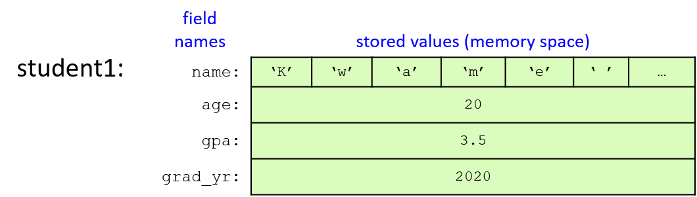
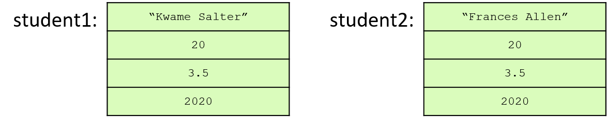
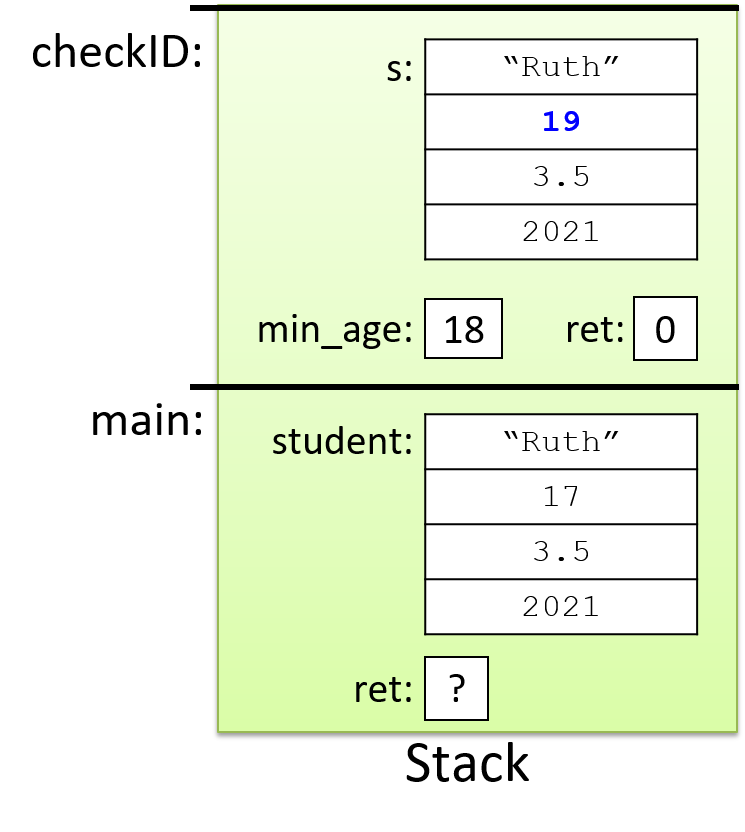

> [!WARNING] 说明
> 本文是个人学习用的**非官方**中英对照译文，原文：<https://diveintosystems.org/book/Appendix1/structs.html>。
> 原书采用 CC BY-NC-ND 4.0 许可（禁止演绎），**请勿公开传播本译文**。
> 标为「译注」「现代更新」的内容是译者补充，不代表原书作者观点；代码与原文逐字一致，未作改动。


*16.6. Structs*

数组和结构体是 C 支持创建数据元素集合的两种方式。数组用来创建相同类型数据元素的有序集合，而**结构体**（struct）用来创建*不同类型*数据元素的集合。C 程序员可以用许多不同的方式把数组和结构体这两种构件组合起来，创建更复杂的数据类型和结构。本节介绍结构体，在第 2 章中，我们会[更详细地描述结构体](../C2-C_depth/2.7-structs.html)，并[展示如何把它们与数组组合起来](../C2-C_depth/2.7-structs.html)。

> Arrays and structs are the two ways in which C supports creating collections of data elements. Arrays are used to create an ordered collection of data elements of the same type, whereas **structs** are used to create a collection of data elements of *different types*. A C programmer can combine array and struct building blocks in many different ways to create more complex data types and structures. This section introduces structs, and in Chapter 2 we [characterize structs in more detail](../C2-C_depth/2.7-structs.html) and [show how you can combine them with arrays](../C2-C_depth/2.7-structs.html).

C 不是面向对象的语言，因此它不支持类。不过，它确实支持定义结构化类型，这种类型就像类中公有的数据部分。`struct` 是一种用来表示异构数据集合的类型；它是把一组不同类型当作单一的、连贯的整体来对待的机制。C 的结构体在单个数据值之上提供了一层抽象，把它们当作单一的类型。例如，一个学生有姓名、年龄、平均绩点（GPA）和毕业年份。程序员可以定义一个新的 `struct` 类型，把这四个数据元素组合成单个 `struct student` 变量，其中包含一个姓名值（类型为 `char []`，用来存放字符串）、一个年龄值（类型为 `int`）、一个 GPA 值（类型为 `float`）和一个毕业年份值（类型为 `int`）。这种结构体类型的单个变量就能存放某个特定学生的全部四项数据，例如（"Freya", 19, 3.7, 2021）。

> C is not an object-oriented language; thus, it doesn’t support classes. It does, however, support defining structured types, which are like the public data part of classes. A `struct` is a type used to represent a heterogeneous collection of data; it’s a mechanism for treating a set of different types as a single, coherent unit. C structs provide a level of abstraction on top of individual data values, treating them as a single type. For example, a student has a name, age, grade point average (GPA), and graduation year. A programmer could define a new `struct` type to combine those four data elements into a single `struct student` variable that contains a name value (type `char []`, to hold a string), an age value (type `int`), a GPA value (type `float`), and a graduation year value (type `int`). A single variable of this struct type can store all four pieces of data for a particular student; for example, ("Freya", 19, 3.7, 2021).

在 C 程序中定义和使用 `struct` 类型分为三步：

> There are three steps to defining and using `struct` types in C programs:

1. 定义一个表示该结构的新 `struct` 类型。

> 1.  Define a new `struct` type that represents the structure.

2. 声明这个新 `struct` 类型的变量。

> 2.  Declare variables of the new `struct` type.

3. 用点（`.`）记法访问变量的各个字段值。

> 3.  Use dot (`.`) notation to access individual field values of the variable.

### 16.6.1. 定义结构体类型

*16.6.1. Defining a Struct Type*

结构体类型的定义应当出现在*任何函数之外*，通常位于程序 `.c` 文件的开头附近。定义新结构体类型的语法如下（`struct` 是保留关键字）：

> A struct type definition should appear *outside of any function*, typically near the top of the program’s `.c` file. The syntax for defining a new struct type is the following (`struct` is a reserved keyword):

```
struct <struct_name> {
    <field 1 type> <field 1 name>;
    <field 2 type> <field 2 name>;
    <field 3 type> <field 3 name>;
    ...
};
```

下面是一个定义新的 `struct studentT` 类型来存储学生数据的例子：

> Here’s an example of defining a new `struct studentT` type for storing student data:

```
struct studentT {
    char name[64];
    int age;
    float gpa;
    int grad_yr;
};
```

这个结构体定义为 C 的类型系统添加了一个新类型，类型的名字是 `struct studentT`。这个结构体定义了四个字段，每个字段定义都包括字段的类型和名字。注意，在这个例子中，`name` 字段的类型是字符数组，[用作字符串](16.5-arrays_strings.html)。

> This struct definition adds a new type to C’s type system, and the type’s name is `struct studentT`. This struct defines four fields, and each field definition includes the type and name of the field. Note that in this example, the `name` field’s type is a character array, for [use as a string](16.5-arrays_strings.html).

### 16.6.2. 声明结构体类型的变量

*16.6.2. Declaring Variables of Struct Types*

定义好类型之后，就可以声明这个新类型 `struct studentT` 的变量了。注意，与我们之前见过的只由一个单词构成的类型（例如 `int`、`char` 和 `float`）不同，我们这个新结构体类型的名字由两个单词组成：`struct studentT`。

> Once the type has been defined, you can declare variables of the new type, `struct studentT`. Note that unlike the other types we’ve encountered so far that consist of just a single word (for example, `int`, `char`, and `float`), the name of our new struct type is two words, `struct studentT`.

```
struct studentT student1, student2; // student1, student2 are struct studentT
```

### 16.6.3. 访问字段的值

*16.6.3. Accessing Field Values*

要访问结构体变量中的字段值，使用*点记法*：

> To access field values in a struct variable, use *dot notation*:

```
<variable name>.<field name>
```

访问结构体及其字段时，要仔细考虑所用变量的类型。C 新手常常因为没有考虑到结构体字段的类型而在程序中引入缺陷。[表 1](16.6-structs.html) 列出了与我们的 `struct studentT` 类型相关的几个表达式的类型。

> When accessing structs and their fields, carefully consider the types of the variables you’re using. Novice C programmers often introduce bugs into their programs by failing to account for the types of struct fields. [Table 1](16.6-structs.html) shows the types of several expressions surrounding our `struct studentT` type.

**表 1.** 与各种 struct studentT 表达式相关的类型

*Table 1. The Types Associated with Various Struct studentT Expressions*

| 表达式 | C 类型 |
|----|----|
| `student1` | `struct studentT` |
| `student1.age` | 整数（`int`） |
| `student1.name` | 字符数组（`char []`） |
| `student1.name[3]` | 字符（`char`），即 name 数组每个位置上存放的类型 |

> | Expression | C type |
> |----|----|
> | `student1` | `struct studentT` |
> | `student1.age` | integer (`int`) |
> | `student1.name` | array of characters (`char []`) |
> | `student1.name[3]` | character (`char`), the type stored in each position of the name array |

下面是给 `struct studentT` 变量的字段赋值的一些例子：

> Here are some examples of assigning a `struct studentT` variable’s fields:

```
// The 'name' field is an array of characters, so we can use the 'strcpy'
// string library function to fill in the array with a string value.
strcpy(student1.name, "Kwame Salter");

// The 'age' field is an integer.
student1.age = 18 + 2;

// The 'gpa' field is a float.
student1.gpa = 3.5;

// The 'grad_yr' field is an int
student1.grad_yr = 2020;
student2.grad_yr = student1.grad_yr;
```

[图 1](16.6-structs.html) 展示了执行完前面例子中的字段赋值之后，`student1` 变量在内存中的布局。只有结构体变量的各个字段（方框中的区域）存放在内存中。为了清楚起见，图中标出了字段名，但对 C 编译器来说，字段只是存储位置，或者说是距结构体变量内存起始处的**偏移**（offset）。例如，根据 `struct studentT` 的定义，编译器知道要访问名为 `gpa` 的字段，必须跳过一个 64 字符的数组（`name`）和一个整数（`age`）。注意，图中的 `name` 字段只画出了这个 64 字符数组的前六个字符。

> [Figure 1](16.6-structs.html) illustrates the layout of the `student1` variable in memory after the field assignments in the preceding example. Only the struct variable’s fields (the areas in boxes) are stored in memory. The field names are labeled on the figure for clarity, but to the C compiler, fields are simply storage locations or **offsets** from the start of the struct variable’s memory. For example, based on the definition of a `struct studentT`, the compiler knows that to access the field named `gpa`, it must skip past an array of 64 characters (`name`) and one integer (`age`). Note that in the figure, the `name` field only depicts the first six characters of the 64-character array.



**图 1.** 为各字段赋值之后 student1 变量的内存

*Figure 1. The student1 variable’s memory after assigning each of its fields*

C 的结构体类型是**左值**（lvalue），也就是说它们可以出现在赋值语句的左边。因此，用一条简单的赋值语句就可以把一个结构体变量的值赋给另一个结构体变量。赋值语句右边结构体的各字段值会被*复制*到左边结构体的对应字段中。换句话说，一个结构体的内存内容被复制到另一个结构体的内存中。下面是以这种方式给结构体赋值的例子：

> C struct types are **lvalues**, meaning they can appear on the left side of an assignment statement. Thus, a struct variable can be assigned the value of another struct variable using a simple assignment statement. The field values of the struct on the right side of the assignment statement are *copied* to the field values of the struct on the left side of the assignment statement. In other words, the contents of memory of one struct are copied to the memory of the other. Here’s an example of assigning a struct’s values in this way:

```
student2 = student1;  // student2 gets the value of student1
                      // (student1's field values are copied to
                      //  corresponding field values of student2)

strcpy(student2.name, "Frances Allen");  // change one field value
```

[图 2](16.6-structs.html) 展示了执行完这条赋值语句和 `strcpy` 调用之后两个学生变量的值。注意，图中把 `name` 字段画成了其中存放的字符串值，而不是完整的 64 字符数组。

> [Figure 2](16.6-structs.html) shows the values of the two student variables after the assignment statement and call to `strcpy` have executed. Note that the figure depicts the `name` fields as the string values they contain rather than the full array of 64 characters.



**图 2.** 执行结构体赋值和 strcpy 调用之后 student1 和 student2 结构体的布局

*Figure 2. Layout of the student1 and student2 structs after executing the struct assignment and strcpy call*

C 提供了 `sizeof` 运算符，它接收一个类型，返回该类型所占的字节数。`sizeof` 运算符可以用于任何 C 类型，包括结构体类型，以查看该类型的变量需要多少内存空间。例如，我们可以打印 `struct studentT` 类型的大小：

> C provides a `sizeof` operator that takes a type and returns the number of bytes used by the type. The `sizeof` operator can be used on any C type, including struct types, to see how much memory space a variable of that type needs. For example, we can print the size of a `struct studentT` type:

```
// Note: the `%lu` format placeholder specifies an unsigned long value.
printf("number of bytes in student struct: %lu\n", sizeof(struct studentT));
```

运行时，这行代码打印出的值应当*至少*为 76 字节，因为 `name` 数组中有 64 个字符（每个 `char` 占 1 字节），`int` 类型的 `age` 字段占 4 字节，`float` 类型的 `gpa` 字段占 4 字节，`int` 类型的 `grad_yr` 字段占 4 字节。在某些机器上，确切的字节数可能大于 76。

> When run, this line should print out a value of *at least* 76 bytes, because 64 characters are in the `name` array (1 byte for each `char`), 4 bytes for the `int` `age` field, 4 bytes for the `float` `gpa` field, and 4 bytes for the `int` `grad_yr` field. The exact number of bytes might be larger than 76 on some machines.

下面是一个定义并演示 `struct studentT` 类型用法的[完整示例程序](https://diveintosystems.org/book/Appendix1/_attachments/studentTstruct.c)：

> Here’s a [full example program](https://diveintosystems.org/book/Appendix1/_attachments/studentTstruct.c) that defines and demonstrates the use of our `struct studentT` type:

```
#include <stdio.h>
#include <string.h>

// Define a new type: struct studentT
// Note that struct definitions should be outside function bodies.
struct studentT {
    char name[64];
    int age;
    float gpa;
    int grad_yr;
};

int main(void) {
    struct studentT student1, student2;

    strcpy(student1.name, "Kwame Salter");  // name field is a char array
    student1.age = 18 + 2;                  // age field is an int
    student1.gpa = 3.5;                     // gpa field is a float
    student1.grad_yr = 2020;                // grad_yr field is an int

    /* Note: printf doesn't have a format placeholder for printing a
     * struct studentT (a type we defined).  Instead, we'll need to
     * individually pass each field to printf. */
    printf("name: %s age: %d gpa: %g, year: %d\n",
           student1.name, student1.age, student1.gpa, student1.grad_yr);

    /* Copy all the field values of student1 into student2. */
    student2 = student1;

    /* Make a few changes to the student2 variable. */
    strcpy(student2.name, "Frances Allen");
    student2.grad_yr = student1.grad_yr + 1;

    /* Print the fields of student2. */
    printf("name: %s age: %d gpa: %g, year: %d\n",
           student2.name, student2.age, student2.gpa, student2.grad_yr);

    /* Print the size of the struct studentT type. */
    printf("number of bytes in student struct: %lu\n", sizeof(struct studentT));

    return 0;
}
```

运行时，这个程序输出如下内容：

> When run, this program outputs the following:

```
name: Kwame Salter age: 20 gpa: 3.5, year: 2020
name: Frances Allen age: 20 gpa: 3.5, year: 2021
number of bytes in student struct: 76
```

> [!NOTE] 原书旁注 · 左值（structs are lvalues）
> **左值**（lvalue）是可以出现在赋值语句左边的表达式，它代表一个内存存储位置。随着我们介绍 C 的指针类型，以及把数组、结构体和指针组合起来创建更复杂结构的例子，仔细思考类型、记住哪些 C 表达式是合法的左值（可以用在赋值语句左边）就变得很重要。
>
> 就我们目前对 C 的了解，基本类型的单个变量、数组元素和结构体都是左值。静态声明的数组的名字*不是*左值（你不能改变静态声明的数组在内存中的基地址）。下面的示例代码片段根据不同类型的左值属性，说明了哪些 C 赋值语句合法、哪些不合法：
>
> ```
> struct studentT {
>     char name[32];
>     int  age;
>     float gpa;
>     int  grad_yr;
> };
>
> int main(void) {
>     struct studentT  student1, student2;
>     int x;
>     char arr[10], ch;
>
>     x = 10;                 // Valid C: x is an lvalue
>     ch = 'm';               // Valid C: ch is an lvalue
>     student1.age = 18;      // Valid C: age field is an lvalue
>     student2 = student1;    // Valid C: student2 is an lvalue
>     arr[3] = ch;            // Valid C: arr[3] is an lvalue
>
>     x + 1 = 8;       // Invalid C: x+1 is not an lvalue
>     arr = "hello";   // Invalid C: arr is not an lvalue
>                      //  cannot change base addr of statically declared array
>                      //  (use strcpy to copy the string value "hello" to arr)
>
>     student1.name = student2.name;  // Invalid C: name field is not an lvalue
>                                     // (the base address of a statically
>                                     //  declared array cannot be changed)
> ```
>
> > An **lvalue** is an expression that can appear on the left side of an assignment statement. It’s an expression that represents a memory storage location. As we introduce C pointer types and examples of creating more complicated structures that combine C arrays, structs, and pointers, it’s important to think carefully about types and to keep in mind which C expressions are valid lvalues (which can be used on the left side of an assignment statement).
> >
> > From what we know about C so far, single variables of base types, array elements, and structs are all lvalues. The name of a statically declared array is *not* an lvalue (you cannot change the base address of a statically declared array in memory). The following example code snippet illustrates valid and invalid C assignment statements based on the lvalue status of different types:
> >
> > ```
> > struct studentT {
> >     char name[32];
> >     int  age;
> >     float gpa;
> >     int  grad_yr;
> > };
> >
> > int main(void) {
> >     struct studentT  student1, student2;
> >     int x;
> >     char arr[10], ch;
> >
> >     x = 10;                 // Valid C: x is an lvalue
> >     ch = 'm';               // Valid C: ch is an lvalue
> >     student1.age = 18;      // Valid C: age field is an lvalue
> >     student2 = student1;    // Valid C: student2 is an lvalue
> >     arr[3] = ch;            // Valid C: arr[3] is an lvalue
> >
> >     x + 1 = 8;       // Invalid C: x+1 is not an lvalue
> >     arr = "hello";   // Invalid C: arr is not an lvalue
> >                      //  cannot change base addr of statically declared array
> >                      //  (use strcpy to copy the string value "hello" to arr)
> >
> >     student1.name = student2.name;  // Invalid C: name field is not an lvalue
> >                                     // (the base address of a statically
> >                                     //  declared array cannot be changed)
> > ```

> [!NOTE] 译注
> 这段示例只为说明左值规则，省略了 `main` 函数结尾的 `return 0;` 和 `}`，而且其中标为 Invalid 的语句本来就无法通过编译。

### 16.6.4. 把结构体传给函数

*16.6.4. Passing Structs to Functions*

在 C 中，所有类型的实参都是*按值传递*给函数的。因此，如果函数有一个结构体类型的形参，那么用结构体实参调用它时，实参的**值**会被传给形参，也就是说形参得到的是实参值的一份副本。结构体变量的值就是它的内存内容，这正是我们可以用一条赋值语句把一个结构体的各字段赋成与另一个结构体相同的原因：

> In C, arguments of all types are *passed by value* to functions. Thus, if a function has a struct type parameter, then when called with a struct argument, the argument’s **value** is passed to its parameter, meaning that the parameter gets a copy of its argument’s value. The value of a struct variable is the contents of its memory, which is why we can assign the fields of one struct to be the same as another struct in a single assignment statement like this:

```
student2 = student1;
```

由于结构体变量的值代表其内存的全部内容，把结构体作为实参传给函数，形参得到的是实参结构体全部字段值的一份**副本**。如果函数修改了结构体形参的字段值，这些修改对实参的对应字段值*没有影响*。也就是说，对形参字段的修改只改变形参中这些字段所在内存位置的值，而不会改变实参中这些字段所在内存位置的值。

> Because the value of a struct variable represents the full contents of its memory, passing a struct as an argument to a function gives the parameter a **copy** of all the argument struct’s field values. If the function changes the field values of a struct parameter, the changes to the parameter’s field values have *no effect* on the corresponding field values of the argument. That is, changes to the parameter’s fields only modify values in the parameter’s memory locations for those fields, not in the argument’s memory locations for those fields.

下面是一个使用 `checkID` 函数（它接收一个结构体参数）的[完整示例程序](https://diveintosystems.org/book/Appendix1/_attachments/structfunc.c)：

> Here’s a [full example program](https://diveintosystems.org/book/Appendix1/_attachments/structfunc.c) using the `checkID` function that takes a struct parameter:

```
#include <stdio.h>
#include <string.h>

/* struct type definition: */
struct studentT {
    char name[64];
    int  age;
    float gpa;
    int  grad_yr;
};

/* function prototype (prototype: a declaration of the
 *    checkID function so that main can call it, its full
 *    definition is listed after main function in the file):
 */
int checkID(struct studentT s1, int min_age);

int main(void) {
    int can_vote;
    struct studentT student;

    strcpy(student.name, "Ruth");
    student.age = 17;
    student.gpa = 3.5;
    student.grad_yr = 2021;

    can_vote = checkID(student, 18);
    if (can_vote) {
        printf("%s is %d years old and can vote.\n",
                student.name, student.age);
    } else {
        printf("%s is only %d years old and cannot vote.\n",
                student.name, student.age);
    }

    return 0;
}

/*  check if a student is at least the min age
 *    s: a student
 *    min_age: a minimum age value to test
 *    returns: 1 if the student is min_age or older, 0 otherwise
 */
int checkID(struct studentT s, int min_age) {
    int ret = 1;  // initialize the return value to 1 (true)

    if (s.age < min_age) {
        ret = 0;  // update the return value to 0 (false)

        // let's try changing the student's age
        s.age = min_age + 1;
    }

    printf("%s is %d years old\n", s.name, s.age);

    return ret;
}
```

当 `main` 调用 `checkID` 时，`student` 结构体的值（其所有字段内存内容的一份副本）被传给形参 `s`。当函数修改其形参的 `age` 字段值时，*不会*影响实参（`student`）的 `age` 字段。运行这个程序就能看到这一行为，它的输出如下：

> When `main` calls `checkID`, the value of the `student` struct (a copy of the memory contents of all its fields) is passed to the `s` parameter. When the function changes the value of its parameter’s `age` field, it *doesn’t* affect the `age` field of its argument (`student`). This behavior can be seen by running the program, which outputs the following:

```
Ruth is 19 years old
Ruth is only 17 years old and cannot vote.
```

输出表明，`checkID` 打印 `age` 字段时，反映了函数对形参 `s` 的 `age` 字段所做的修改。然而，函数调用返回之后，`main` 打印的 `student` 的 `age` 字段，仍是调用 `checkID` 之前的值。[图 3](16.6-structs.html) 展示了 `checkID` 函数返回之前那一刻调用栈中的内容。

> The output shows that when `checkID` prints the `age` field, it reflects the function’s change to the `age` field of the parameter `s`. However, after the function call returns, `main` prints the `age` field of `student` with the same value it had prior to the `checkID` call. [Figure 3](16.6-structs.html) illustrates the contents of the call stack just before the `checkID` function returns.



**图 3.** 从 checkID 函数返回之前调用栈的内容

*Figure 3. The contents of the call stack before returning from the checkID function*

当结构体包含一个静态声明的数组字段（例如 `struct studentT` 中的 `name` 字段）时，理解结构体参数的按值传递语义就尤其重要。把这样的结构体传给函数时，结构体实参的全部内存内容，包括数组字段中的每一个数组元素，都会被复制到形参中。如果函数修改了形参结构体中数组的内容，这些修改在函数返回后*不会*保留下来。鉴于我们所知道的[数组传给函数的方式](16.5-arrays_strings.html)，这种行为可能显得有些奇怪，但它与前面描述的结构体复制行为是一致的。

> Understanding the pass-by-value semantics of struct parameters is particularly important when a struct contains a statically declared array field (like the `name` field in `struct studentT`). When such a struct is passed to a function, the struct argument’s entire memory contents, including every array element in the array field, is copied to its parameter. If the parameter struct’s array contents are changed by the function, those changes will *not* persist after the function returns. This behavior might seem odd given what we know about [how arrays are passed to functions](16.5-arrays_strings.html), but it’s consistent with the struct-copying behavior described earlier.
