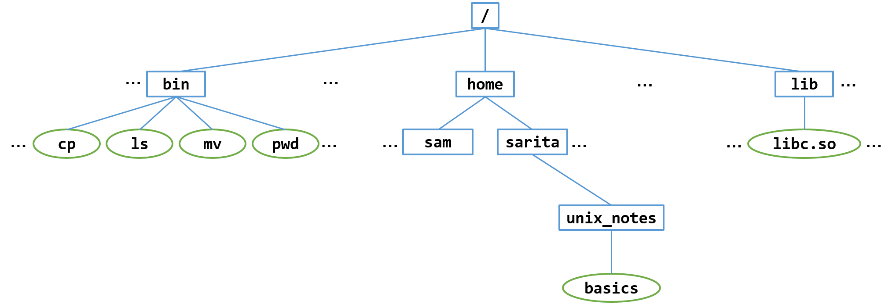
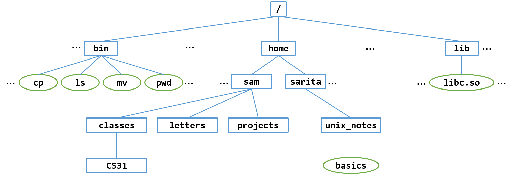

> [!WARNING] 说明
> 本文是个人学习用的**非官方**中英对照译文，原文：<https://diveintosystems.org/book/Appendix2/cmdln_basics.html>。
> 原书采用 CC BY-NC-ND 4.0 许可（禁止演绎），**请勿公开传播本译文**。
> 标为「译注」「现代更新」的内容是译者补充，不代表原书作者观点；代码与原文逐字一致，未作改动。


*17.1. Unix Command Line and the Unix File System*

Unix 系统为用户提供了与系统交互的**命令行界面**（command line interface）。当用户登录到 Unix 系统时，他们与一个在终端窗口中运行的 Unix **shell 程序**交互。shell 读入用户输入的命令，并执行所请求的动作。shell 程序的例子有 `bash` 和 `zsh`。shell 显示一个 shell 提示符（例如 `$`），用户输入一条命令，由 shell 程序执行。读者（尤其是懂 Python 的读者）可能熟悉读取-求值-打印循环（read-eval-print loop，REPL），它是在某种编程语言的语境中实现的一种类似 shell 的环境。与 REPL 一样，shell 的命令行界面循环往复地读入一条命令、求值、打印出结果，然后回到 shell 提示符。与 REPL 不同的是，shell 的命令行界面让用户能够访问操作系统接口，并运行各种不同的程序。例如，`whoami` 命令会告诉你你的用户名：

> Unix systems provide a **command line interface** for users to interact with the system. When a user logs into a Unix system, they interact with a Unix **shell program** that runs in a terminal window. The shell reads in commands entered by the user and performs the requested action. Example shell programs are `bash` and `zsh`. The shell displays a shell prompt (e.g., `$`) and the user types in a command that the shell program executes. Readers (especially those who know Python) may be familiar with a read-eval-print loop (or REPL), which is a shell-like environment that is implemented in the context of a programming language. Like a REPL, the shell’s command line interface reads a command, evaluates it, prints out the results, and then returns to the shell prompt, in a loop. Unlike a REPL, the shell’s command line interface allows users to access the operating system interface and to run a variety of different programs. For example, the `whoami` command will tell you your user name:

> [!TIP] 现代更新（截至 2026-11）· Mac 的默认 shell 是 zsh
> 本附录以 Linux 和 Bash 为例。如果你在 Mac 上练习，要知道按 Apple 官方说明，从 **macOS 10.15** 开始，新建用户账户的默认登录 shell 和交互式 shell 是 **zsh**（10.14 及更早版本默认是 bash）。zsh 与 Bourne shell（sh）高度兼容，与 bash 也大部分兼容，本附录的大多数命令都能直接使用；但 17.6 节讲的 Bash 配置文件 `.bashrc` 在 zsh 中对应的是 `~/.zshrc`。如果想改用 bash，可以用 `chsh -s /bin/bash` 修改默认 shell。[Apple 支持：Use zsh as the default shell on Mac](https://support.apple.com/en-us/102360)

```
$ whoami
myusername
```

Unix 文件系统存放程序和其他文件。用户在 shell 提示符下输入命令来运行程序、在 Unix 文件系统中导航以及操作文件。

> The Unix file system stores programs and other files. Users type commands at the shell prompt to run programs, navigate the Unix file system, and manipulate files.

许多命令都有**命令行选项**（command line option），用来指定命令的不同选项或特定行为。许多命令还接收**命令行参数**（command line argument），用来指定操作的对象。例如，`cp` 是把一个文件复制到另一个文件的复制命令。它接收两个命令行参数：要复制的源文件的名字，以及将存放副本的目标文件的名字。

> Many commands have **command line options**, that specify different options or specific behaviors of a command. Many commands also take **command line arguments** that are used to specify the target of the operation. For example, `cp` is the copy command that copies one file to another. It takes two command line arguments, the name of the file source to copy and the name of the destination file that will contain the copy.

### 17.1.1. Unix 文件系统

*17.1.1. Unix File System*

Unix 文件系统由文件和目录组成。文件存放数据，例如程序源代码、程序的输入数据、课堂笔记和二进制可执行代码。目录存放文件和子目录，用来组织存放在文件系统中的文件集合。

> The Unix file system consists of files and directories. A file stores data such as program source code, program input data, class notes, and binary executable code. Directories store files and subdirectories and are used to organize the set of files stored in the file system.

Unix 文件系统组织成一种层次化的树形结构，顶端只有一个目录（`/`），称为根目录。它下面是存放系统内容的一些主要目录。例如，`bin` 存放可以从 Unix 命令行运行的系统程序，`lib` 存放系统库代码，`home` 存放每个用户的主目录，用户可以在自己的主目录中存放自己的文件。[图 1](17.1-cmdln_basics.html) 展示了一个 Unix 文件系统目录结构的例子，其中有用户 `sam` 和 `sarita` 的两个 `home` 目录。

> The Unix file system is organized in a hierarchical tree structure, with a single directory at the top (`/`) called the root directory. Under it are some main directories holding system content. Some examples are `bin` that stores system programs that can be run from the Unix command line, `lib` that stores system library code, and `home` that stores every user’s home directory into which they can store their own files. [Figure 1](17.1-cmdln_basics.html) shows an example Unix file system directory structure, with two `home` directories for users `sam` and `sarita`.



**图 1.** Unix 文件系统组织成一个层次结构，根目录在顶端，子目录和文件排列在它的下面。

*Figure 1. The Unix File System is organized as a hierarchy with the root directory at the top, and subdirectories and files arranged underneath.*

注意，`/` 是顶层目录，它有几个**子**（child）目录，包括 `bin`、`lib` 和 `home`。除根目录外，每个目录都有唯一的一个**父**（parent）目录；根目录是唯一没有父目录的目录。

> Note that `/` is the top-level directory, it has several **child** subdirectories, including `bin`, `lib`, and `home`. Every directory except the root directory has a unique **parent** directory; the root directory is the only one without a parent directory.

系统中的每个用户都有自己的主目录，它是 `/home` 下的一个子目录。每个用户主目录的名字与其用户名相同。我们在图中展示了几个主目录的例子。除 `/` 之外，每个目录都恰好有一个父目录。例如，`home` 是 `sarita` 的父目录，`/` 是 `home` 的父目录。每个目录都由一个从根目录开始的唯一**路径名**（pathname）标识。例如，`/home/sarita` 是用户 `sarita` 的主目录的路径名：这个路径名从根目录 `/` 开始，接着是 `/` 的子目录 `home`，最后是 `home` 的子目录 `sarita`。

> Every user in the system has their own home directory, which is a subdirectory in `/home`. Each user’s home directory is the same name as their username. In Figure we show a few example home directories. Every directory except `/` has exactly one parent directory. For example, `home` is the parent directory of `sarita`, and `/` is the parent directory of `home`. Every directory is identified by a unique **pathname** starting from the root directory. For example, `/home/sarita` is the pathname of the `sarita` user’s home directory: the pathname starts at the root directory, `/`, then follows the `home` sub-directory of `/`, and finally the `sarita` sub-directory of `home`.

当你第一次登录到 Unix 系统或者启动一个新的 shell 程序时，你会从自己的主目录开始。`pwd`（print working directory，打印工作目录）命令打印你当前所在的目录，显示它从根目录 `/` 开始的完整路径名。例如，下面是用户 `sarita` 登录并输入 `pwd` 时的输出：

> When you first log into a Unix system or start a new shell program, you start out in your home directory. The `pwd` (print working directory) command prints the directory you are currently in, showing its full pathname starting from the root directory `/`. For example, here is the output when the user `sarita` logs in and types, `pwd`:

```
$ pwd
/home/sarita
```

当用户 `sam` 登录并输入 `pwd` 时，输出如下：

> When the user `sam` logs in and types `pwd`, here is the output:

```
$ pwd
/home/sam
```

### 17.1.2. 文件系统命令

*17.1.2. File System Commands*

Unix 命令让用户能在目录结构中移动、创建和删除文件与目录、列出目录的内容，以及查看自己当前在哪个目录中。所有动作都是相对于当前工作目录的。例如，如果用户创建一个新文件，这个文件就创建在用户的当前工作目录中。

> Unix commands allow users to move around its directory structure, create and delete files and directories, list the contents of a directory, and to see which directory they are currently in. All actions are relative to the current working directory. For example, if a user creates a new file, the file is created in the user’s current working directory.

`cd`（change directory，切换目录）命令改变当前工作目录（即移到另一个目录中）。`ls`（list，列出）命令列出当前目录的内容。`mkdir` 命令用来创建新目录。

> The `cd` (change directory) command changes the current working directory (or to moves into a different directory). The `ls` (list) command lists the contents of the current directory. The `mkdir` command is used to create a new directory.

例如，要在她的主目录中创建一个名为 `unix_notes` 的子目录并进入这个目录，`sarita` 会输入下面的命令：

> For example, to create a subdirectory named `unix_notes` in her home directory, and to move into that directory, `sarita` would enter the following:

```
$ mkdir unix_notes  # make a new directory named unix_notes
$ ls                # list contents of current directory
 unix_notes/
$ cd unix_notes     # move into the new directory
$ pwd               # print current working directory
/home/sarita/unix_notes
```

创建新文件的方法有很多。用户常常通过编辑器程序来创建新文件。一种不太常见的创建空的新文件的方法是使用 `touch` 命令：

> There are many ways to create new files. Often users create new files through using an editor program. A less common way to create an empty new file is using the `touch` command:

```
$ touch basics
$ ls
 basics
```

由于我们还不了解编辑器程序，可以用 `echo` 命令并把它的输出追加到 `basics` 文件中，来给这个文件添加一些内容（`>>` 把 echo 的输出追加到指定的文件，本例中是 `basics`）。例如：

> Since we don’t yet know an editor program, we can add some content to the file using the `echo` command and appending its output to the `basics` file (`>>` appends echo’s output to the specified file, `basics` in this example). For example:

```
$ echo "ls: list directory contents" >> basics
$ echo "cd: change directory" >> basics
$ echo "pwd: print working directory" >> basics
```

`cat` 命令把文件的内容倾倒到终端上。要在运行上面的 `echo` 命令之后查看 `basic` 的内容：

> The `cat` command dumps the contents of a file to the terminal. To see the contents of `basic` after running the `echo` commands above:

```
$ cat basics
ls: list directory contents
cd: change directory
pwd: print working directory
```

> [!NOTE] 原书注 · Unix 中的文件名（File names in Unix）
> 注意，Unix 中的文件名和目录名是区分大小写的，例如 `basics` 和 `Basics` 是两个不同的文件名。
>
> 另外，尽管文件名可以包含空格字符，但必须在空格字符之前加转义字符来指定（例如，`hello\ there` 就是命名文件「hello there」的方式）。因此，Unix 用户通常不创建名字中带空格字符的文件，而是在想在名字中放空格的地方使用 `_` 或 `-`（例如 `hello_there`）。
>
> > Note that file and directory names in Unix are case sensitive, `basics` and `Basics` are two different file names, for example.
> >
> > Also, although file names can contain space characters, they have to be specified using the escape character before the space character (e.g., `hello\ there` is the way to name the file "hello there"). As a result, Unix user’s typically do not create files with space characters in their names. Instead, users use `_` or `-` in places where they would want a space in a name (e.g., `hello_there`).

`wc` 命令统计文件中的字数、行数和字节数。例如，要查看我们刚刚创建的文件的这些信息，运行：

> The `wc` command counts the number of words, lines, and bytes in a file. For example, to see this information for the file we just created, run:

```
$ wc basics
 3      11      78 basics
```

Unix 用户通常把自己的主目录组织成一组目录，相关的子目录和文件存放在这些目录下。例如，用户 `sam` 会用 `mkdir` 命令在他的主目录中创建三个子目录，一个用于课程作业，一个用于项目，一个用于私人信件：

> Unix users typically organize their their home directory as a set of directories under which related subdirectories and files are stored. For example, user `sam` would use the `mkdir` command to create three subdirectories in his home directory, one for class work, one for projects, and one for personal correspondence:

```
$ mkdir classes
$ mkdir projects
$ mkdir letters

$ ls
classes/    letters/   projects/
```

由于这个用户正在上 CS31 这门课，他想在 `classes` 子目录下为这门课的所有作业创建一个子目录。为此，他会这样做：

> Because this user is taking CS31, they want to create a subdirectory under their `classes` subdirectory for all their work in this class. To do this they would do the following:

```
$ cd classes
$ pwd
/home/sam/classes
$ mkdir CS31
$ ls
CS31/
$ cd CS31
$ pwd
/home/sam/classes/CS31
```

[图 2](17.1-cmdln_basics.html) 展示了 `sam` 运行完所有 `mkdir` 命令之后文件系统的样子。

> [Figure 2](17.1-cmdln_basics.html) shows what the filesystem looks like after `sam` runs all of the `mkdir` commands.



**图 2.** 用户 sam 创建了一些子目录之后的 Unix 文件系统组织结构。

*Figure 2. The Unix File System Organization after user sam creates some subdirectories.*

现在，`sam` 在做 CS31 的课程作业时，可以进入他的 CS31 目录，并在这个目录中创建更多的子目录和文件：

> Now the `sam` can move into his CS31 directory when he is working on CS31 course work, and create more subdirectories and files in this directory:

```
$ cd CS31
$ pwd
/home/sam/classes/CS31
```

#### 文件路径名与在文件系统中导航

*File Pathnames and Navigating the File System*

正如我们所见，`cd` 命令用来在文件系统中导航，`ls` 列出目录的内容。

> As we have seen, the `cd` command is used to navigate in the file system, and `ls` lists the contents of a directory.

`cd` 和 `ls` 都接收一个命令行参数，分别指定要切换到的目录，或要列出其内容的目录。为 `cd` 指定要切换到的目录位置有两种方式。一种是用**绝对路径名**（absolute path name），即从根目录（`/`）开始的名字；另一种是用**相对路径名**（relative path name），即从当前工作目录开始的名字。

> Both `cd` and `ls` take one command line argument that specifies which directory to change into or list the contents of, respectively. There are two ways to name to a directory location for `cd` to change to. One is to list the directory as its **absolute path name**, its name starting from the root directory (`/`), and the other is to list it as a **relative path name**, its name from the current working directory.

也可以不带路径名参数运行 `cd` 和 `ls`。单独运行 `cd` 会带你回家（回到你的主目录），单独运行 `ls` 会列出当前工作目录的内容。下面是用户 `sam` 尝试的一些例子：

> You can also run both `cd` and `ls` with no path name argument. Running `cd` alone will take you home (to your home directory), and running `ls` alone lists the contents of the current working directory. Here are a some examples that the user `sam` tried:

```
$ cd /home/sam/classes/CS31   # cd with absolute path name
$ pwd
/home/sam/classes/CS31

$ cd                          # cd with no path name  (go home)
$ pwd
/home/sam/

$ ls                          # ls with no path name (list in current directory)
classes/    letters/   projects/

$ cd classes/CS31        # cd with relative path name
$ pwd
/home/sam/classes/CS31

$ ls classes/            # ls with relative path name
CS31/

$ cd /                   # cd with absolute path name (go to root directory)
$ pwd
/
```

用户常常使用相对路径，因为它们通常输入起来更短（用户往往只是在当前位置附近移动）。

> Often users use relative path because they are typically shorter to type (they often are just moving near where they currently are).

每个目录都包含两个隐藏的条目，帮助用 cd 命令在目录之间导航：`.` 是当前目录的另一个名字，`..` 是当前目录的父目录的另一个名字。如果给 `ls` 加上 `-a` 命令行选项，就能看到列出的这些文件：

> Every directory contains two hidden entries that help to navigate directories with the cd command: `.` is another name for the current directory, and `..` is another name for the parent directory of the current directory. You can see these files listed if you use the `-a` command line option to `ls`:

```
$ pwd
/home/sam/classes/CS31
$ ls -a
.   ..
```

它们既可以用在相对路径名中，也可以用在绝对路径名中，用来指定当前目录或父目录。在路径名中使用 `..` 表示上移一级目录。

> These can be used in both relative and absolute path names, to specify the current directory or the parent’s. Using `..` in a path name means go up one directory.

```
$ pwd
/home/sam/classes/CS31

$ cd ..                 # move up one directory to parent directory
$ pwd
/home/sam/classes

$ cd /bin/../home/sam   # go to sam's home directory in an unusual way
$ pwd
/home/sam

$ cd ./classes/./..     # a wacky example of not going anywhere
$ pwd
/home/sam
```

最后，`~` 是 `/home` 中各目录的简写。单独使用时，`~` 是用户自己主目录的简写。与另一个用户的用户名结合使用时，`~` 指的是那个用户的主目录。下面是用户 `sam` 运行的一些例子：

> Finally, `~` is shorthand for directories in `/home`. When used alone, `~` is shorthand for the user’s home directory. When when combined with another’s user name `~` refers to the other user’s home directory. Here are some examples run by user `sam`:

```
$ cd ~/       # cd into home directory
$ pwd
/home/sam/

$ ls ~/
classes/    letters/   projects/

$ ls ~sarita/
unix_notes/

$ cd ~sartita/
$ pwd
/home/sarita
```

> [!NOTE] 原书注 · 关于前面的例子（About the previous example）
> 系统管理员常常会在 `home/` 上设置默认的文件和目录权限，防止用户查看彼此的主目录和文件。在这样的系统上，Sam 可能无法像这个例子中那样 `cd` 进入 Sarita 的主目录，或者用 `ls` 列出她的文件。
>
> > Often times the system administrator sets up default file and directory permissions on `home/` that prevent users from viewing each others home directories and files. On such a system, it may not be possible for Sam to `cd` into Sarita’s home directory, or list her files with `ls` as he does in this example.

#### 复制与移动文件

*Copying and Moving Files*

`cp` 命令把一个文件（或目录）复制到另一个文件（或目录），`mv` 命令把一个文件（或目录）从一个目录移到另一个目录中，或者给文件重命名。这两个命令都接收两个命令行参数：源和目标。

> The `cp` command copies one file (or directory) to another, and the `mv` command moves a file (or directory) from one directory into another one, or it renames a file. Both of these commands take two command line arguments, the source and the destination.

下面是一些例子：

> Here are some examples;

```
$ cd unix_notes
$ cp basics test   # copy the basics file to a new file named test
$ ls
basics test

$ mv test ../blah  # move the test file one directory up and renames it to blah
$ ls
basics

$ cd ../
$ ls
blah   unix_notes/

$ cp -r unix_notes notes_copy  # recursively copy all contents of
                               # of unix_notes directory to new directory
                               # named notes_copy
$ cd notes_copy
$ pwd
/home/sarita/notes_copy
$ls
basics

$ cp basics ../.    # copy basics up a directory to file with same name (/.)
$ cd
$ pwd
/home/sarita/
$ ls
basics unix_notes
```

#### 删除文件与目录

*Removing Files and Directories*

有时你想删除文件和目录。`rm` 命令用来删除文件，`rmdir` 用来删除目录。两者都接收要删除的文件或目录的名字。两者都有用来指定删除行为的命令行选项。

> Sometimes you want to remove files and directories. The `rm` command is used to remove a file, and the `rmdir` is used to remove a directory. Both take the name of the file or directory to remove. Both have command line options to specific behavior of removing.

> [!WARNING] 原书警示 · 不带 `-i` 命令行选项删除文件（Removing files without the `-i` command line option）
> 默认情况下，`rm` 命令会永久删除文件。它不会像某些其他操作系统删除文件时那样，把文件移到回收站里。因此，使用 `rm` 时应当谨慎。有时系统管理员会把 `rm` 配置为默认自动使用它的 `-i` 命令选项，这样 `rm` 在删除文件之前会先打印一个提示，让用户有机会输入 `n`（如果用户对提示输入 `y` 或 `Y`，文件就会被删除；输入其他任何内容则不会删除）。
>
> 在 `rm` 没有被设置为默认运行 `rm -i` 的系统上，用户常常把这个功能加到自己的 shell 配置文件中。我们会在第 17.6 节中更多地讨论 Bash 配置文件。
>
> > By default, the `rm` command permanently deletes a file. It does not move it to a recycle bin like deleting files on some other operating systems may do. Therefore, `rm` should be used with caution. Sometimes a system administrator configures `rm` to automatically use its `-i` command option by default, so that `rm` first prints a prompt to give the user a chance to enter `n` before removing the file (if the user enters `y` or `Y` to the prompt the file will be removed, and any other response it will not).
> >
> > On systems where `rm` isn’t set up to by default run `rm -i`, users often add this feature to their shell configuration file. We discuss Bash configuration files more in Section 17.6.

例如（注意，如果你的系统没有设置让 `rm` 默认使用 `-i`，你需要输入 `rm -i` 才能看到同样的行为）：

> For example (note that if your system isn’t set up with `rm` using `-i` by default, you would type `rm -i` to see this same behavior).

```
$ ls
 basics
$ rm basics
  rm: remove regular file basics? y
$ ls
```

默认情况下，`rmdir` 只删除空目录，这个特性迫使用户在删除目录之前先显式地删除目录的全部内容，防止用户意外删除本不想删除的内容。下面是用户 `sam` 的一些调用示例：

> By default, `rmdir` only removes empty directories, a feature that prevents the user from accidentally removing content that they did not intend, by forcing them to explicitly remove all directory contents before removing the directory. Here are some example calls from user `sam`:

```
$ cd
$ pwd
/home/sam
$ ls
classes/    letters/   projects/
$ rmdir letters
$ ls
classes/    projects/

$ rmdir classes
rmdir: failed to remove classes: Directory not empty
$ ls
classes/    projects/
```

用户可以用 `rm -r` 递归地删除一个目录的内容，还可以再加上 `-f` 选项强制删除文件（删除文件之前不再有任何提示）：`rm -rf`。

> A user can recursively remove the contents of a directory using `rm -r`, and can also forcefully remove files (git rid of all prompting before removing files) by adding the `-f` option too: `rm -rf`.

> [!WARNING] 原书警示 · 使用 `-f` 和 `-r` 命令行选项时要非常小心（Be very careful with the `-f` and `-r` command line options）
> 对 `rm` 使用 `-f` 时要格外小心，因为 `rm -i` 的提示行为常常能防止意外删除文件；如果运行 `rm -rf`，你可能会意外地递归删除整整一个目录的文件。因此，最好避免使用这些命令行选项。不过，在删除大量文件和子目录时，它们很有用。在你确实想使用这些选项的情况下，好的做法是在运行 `rm -rf` 之前，先确认自己在正确的目录中（运行 `ls` 和 `pwd`）。
>
> > Great care should be taken when using `-f` with `rm`, as the prompting behavior of `rm -i` often prevents accidental removal of files; if you run `rm -rf` you can accidentally recursively remove a full directory of files. Because of this, it is best to avoid using these command line options. However, when deleting a large number of files and subdirectories, they are useful. In cases when you do want to use these options, it is good practice to first ensure that you are in the right directory (by running `ls` and `pwd`) before running `rm -rf`.

### 17.1.3. 基本命令小结

*17.1.3. Basic Commands Summary*

下面是本节讨论过的一些 UNIX 命令的小结，附有示例：

> Here is a summary of some of the UNIX commands discussed in this section, with examples:

- `pwd`：打印工作目录，打印出当前目录（cwd）的完整路径名。

> - `pwd` — Print working directory: prints out the full pathname of the current directory (cwd).

- `cd <pathname>`：切换目录，把当前目录改为 `<pathname>` 指定的目录。路径名可以是相对于 cwd 的，也可以是从 `/` 开始的绝对路径名。
  - 从当前目录进入 `sub1` 目录：
    ```
    cd sub1
    ```
  - 无论当前在哪个目录，都进入 `/home/sam` 目录：
    ```
    cd /home/
    ```
  - 切换到当前目录的父目录（即在文件系统层次结构中上移一级）：
    ```
    cd ..
    ```
  - 切换到你的「主」目录：
    ```
    cd
    ```

> - `cd <pathname>` — Change directory: changes the current directory to be the directory specified by `<pathname>`. The pathname can be relative to the cwd or an absolute pathname from `/`.
>
>   - Move into the `sub1` directory from the current directory:
>
>     ```
>     cd sub1
>     ```
>
>   - Move into the `/home/sam` directory, regardless of the current directory:
>
>     ```
>     cd /home/
>     ```
>
>   - Change to the parent directory of the current directory (i.e., move up one level in the filesystem hierarchy):
>
>     ```
>     cd ..
>     ```
>
>   - Change to your "home" directory:
>
>     ```
>     cd
>     ```

> [!NOTE] 译注
> 第二个例子的说明是进入 `/home/sam`，但代码写的是 `cd /home/`，应为 `cd /home/sam`。

- `ls`：列出，列出当前目录中的文件和目录。

> - `ls` — List: list files and directories in the current directory.

- `ls <pathname>`：列出，列出 `<pathname>` 指定的目录中的文件和目录。
  - 列出用户 `sam` 的主目录的内容：
    ```
    ls /home/sam
    ```

> - `ls <pathname` — List: list files and directories in the directory specified by `<pathname>`.
>
>   - List the contents of user `sam`'s home directory:
>
>     ```
>     ls /home/sam
>     ```

- `mv <p1> <p2>`：移动，把路径名 `<p1>` 指定的文件移动/重命名为 `<p2>`。
  - 把 `oldfile` 重命名为 `newfile`：
    ```
    mv oldfile newfile
    ```
  - 把 `newfile` 移到子目录 `sub1` 中：
    ```
    mv newfile sub1/
    ```
  - 把 `sub1` 目录重命名为 `sub2`：
    ```
    mv sub1 sub2
    ```

> - `mv <p1> <p2>` — Move: move/rename file specified by pathname `<p1>` to `<p2>`.
>
>   - Rename `oldfile` to be `newfile`
>
>     ```
>     mv oldfile newfile
>     ```
>
>   - Move `newfile` into subdirectory `sub1`:
>
>     ```
>     mv newfile sub1/
>     ```
>
>   - Rename `sub1` directory to `sub2`:
>
>     ```
>     mv sub1 sub2
>     ```

- `cp <p1> <p2>`：复制，为路径名 `<p1>` 指定的文件创建一个新副本，并把新副本命名为 `<p2>`。
  - 把 `oldfile` 复制为 `newfile`（`oldfile` 仍然存在）：
    ```
    cp oldfile newfile
    ```
  - 把 `oldfile` 复制到上一级目录中，副本也叫 `oldfile`（当前目录和父目录中都有一个名为 `oldfile` 的文件，在其中一个文件被修改之前，它们的内容完全相同）：
    ```
    cp oldfile ../.
    ```

> - `cp <p1> <p2>` — Copy: make a new copy of the file specified by pathname `<p1>` and name the new copy `<p2>`.
>
>   - Copy `oldfile` to `newfile` (`oldfile` still exists):
>
>     ```
>     cp oldfile newfile
>     ```
>
>   - Copy `oldfile` up one directory to a file also named `oldfile` (current directory and parent directory both have a file named `oldfile`, whose contents are identical until one of the files is modified):
>
>     ```
>     cp oldfile ../.
>     ```

- `rm <pathname>`：删除，删除 `<pathname>` 指定的文件。
  - 删除我的主目录中名为 `temp` 的文件：
    ```
    rm ~/temp
    ```

> - `rm <pathname>` — Remove: delete the file specified by `<pathname>`.
>
>   - Delete file named `temp` in my home directory:
>
>     ```
>     rm ~/temp
>     ```

- `mkdir <dir>`：创建目录，创建一个名为 `<dir>` 的新目录。
  - 在当前目录中创建一个名为 `test` 的新目录：
    ```
    mkdir test
    ```
  - 在我的主目录中创建一个名为 `private` 的新目录：
    ```
    mkdir ~/private
    ```

> - `mkdir <dir>` — Make directory: create a new directory named `<dir>`.
>
>   - Create a new directory named `test` in the current directory:
>
>     ```
>     mkdir test
>     ```
>
>   - Create a new directory named `private` in my home directory:
>
>     ```
>     mkdir ~/private
>     ```

- `rmdir <dir>`：删除目录，删除路径名 `<dir>` 指定的目录（必须为空）。
  - 删除我的主目录中名为 `private` 的目录：
    ```
    rmdir ~/private
    ```

> - `rmdir <dir>` — Remove directory: delete the directory specified by pathname `<dir>` (must be empty).
>
>   - Remove directory named `private` in my home directory:
>
>     ```
>     rmdir ~/private
>     ```

- `wc <file>`：字数统计，列出文件中的字节数、字数和行数。

> - `wc <file>` — Word count: list the number of bytes, words, and lines in a file.

- `touch <file>`：创建一个名为 `<file>` 的新的空文件。
  - 在当前目录中创建一个名为 `my_notes` 的新的空文件：
    ```
    touch my_notes
    ```

> - `touch <file>` — Create a new empty file with name `<file>`.
>
>   - Create a new empty file named `my_notes` in the current directory:
>
>     ```
>     touch my_notes
>     ```

- `cat <file>`：把 `<file>` 的内容打印到终端上。
  - 打印 `basics` 文件的内容：
    ```
    cat basics
    ```

> - `cat <file>` — Print out contents of `<file>` to the terminal.
>
>   - Print the contents of the `basics` file:
>
>     ```
>     cat basics
>     ```

- `less <file>`：把 `<file>` 的内容打印到终端上，一次一页，每页都会暂停。按空格键前进到下一页。
  - 一次一页地打印 `basics` 文件的内容：
    ```
    less basics
    ```

> - `less <file>` — Print out the contents of `<file>` to the terminal, one page at a time, pausing at each page. The space bar key advances to the next page.
>
>   - Print the contents of the `basics` file one page at a time:
>
>     ```
>     less basics
>     ```

- `more <file>`：另一个分页程序（与 `less` 类似），用来一次一页地查看文件。

> - `more <file>` — Another pager (like `less`) for viewing files one page at at time.

### 17.1.4. 参考资料

*17.1.4. References*

更多信息参见：

> For more information see:

- cheat-sheets.org 上的[最常用的 Unix 命令](https://www.cheat-sheets.org/project/tldr/command/special-most-used-linux-commands/)

> - [most used Unix commands](https://www.cheat-sheets.org/project/tldr/command/special-most-used-linux-commands/) from cheat-sheets.org

- gnu.org 上的 [Bash 参考手册](https://www.gnu.org/software/bash/manual/html_node/index.html)。

> - [Bash Reference Manual](https://www.gnu.org/software/bash/manual/html_node/index.html) from gnu.org.
