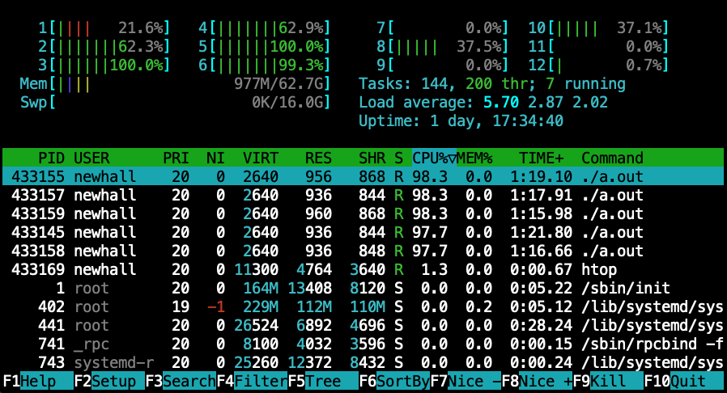

> **说明**
> 本文是个人学习用的**非官方**中英对照译文，原文：<https://diveintosystems.org/book/Appendix2/sysinfo.html>。
> 原书采用 CC BY-NC-ND 4.0 许可（禁止演绎），**请勿公开传播本译文**。
> 标为「译注」「现代更新」的内容是译者补充，不代表原书作者观点；代码与原文逐字一致，未作改动。

## 17.16. 获取系统信息

*17.16. Getting System Information*

有许多工具可以获取系统状态信息：`top` 和 `htop` 动态地提供系统资源及其使用情况（例如 CPU 和内存使用）的摘要信息；`/proc` 和 `/sys` 伪文件系统包含系统当前状态的详细信息（还有 `lscpu`、`lsmem` 和 `lsgpu` 这样的命令，以更易读的形式显示 `/proc` 和 `/sys` 中的部分信息）。

> There are many tools available for obtaining information about the system’s state: `top` and `htop` provide dynamic summary information about system resources and resource use, such as CPU and memory use; and the `/proc` and `/sys` pseudo file systems contain detailed information about the current state of the system (there are also commands like `lscpu`, `lsmem`, and `lsgpu` that display some information from `/proc` and `/sys` in an easier to read form).

> **译注 · macOS**
> `/proc`、`/sys` 和 `lscpu` 都是 Linux 特有的。译者在 macOS 上验证，这两个目录都不存在，系统也没有 `lscpu`。在 Mac 上可以用 `sysctl`（参见第 11 章、第 14 章的译注）、`top` 或「活动监视器」查看类似信息。

### 17.16.1. top 与 htop

*17.16.1. top and htop*

在命令行上运行 `top` 或 `htop`，可以动态查看系统状态的摘要信息。按 `q` 退出 `top` 和 `htop`。两者都显示内存和 CPU 使用信息，但 `htop` 比 `top` 更多地用图形显示某些使用统计数据，尤其是用图表显示内存使用情况和每个核心的 CPU 利用率。两者默认都会列出当前占用 CPU 时间最多的任务的信息。任务（task）是 Linux 对进程或线程的统称。这些工具运行时每秒更新一次，显示系统使用摘要数据的变化。注意，由于显示每秒更新一次，进程的排列顺序会随着它们的执行、根据各自占用的 CPU 时间而变化。两者也都高度可配置，可以显示关于进程和系统状态的不同信息。

> Running `top` or `htop` at the command line provides dynamic summary information about the state of the system. Typing `q` quits `top` and `htop`. Both show memory and CPU usage information, but `htop` displays some of the usage statistics more graphically than `top` does, particularly showing memory usage and each core’s CPU utilization as a graph. Both also, by default, list information about the tasks currently using the most CPU time. A task is the Linux generic term for either a process or a thread, These tools update every second as they run, showing changes in summary system use data. Note that as the display updates every second, the ordering of processes will change as they execute according to how much CPU time they are using. Both are also very configurable to display different information about processes and system state.

[图 1](17.16-sysinfo.html) 是 `htop` 的一张截图示例。

> [Figure 1](17.16-sysinfo.html) shows an example screenshot from `htop`.



**图 1.** htop 截图示例

*Figure 1. Example htop screenshot).*

在最顶部，`htop` 以带百分比标注的使用率图表显示这个系统上 12 个核心各自当前的 CPU 使用率，接着是当前的内存使用情况（`Mem`）、平均 CPU 负载的摘要信息（`Load average`）、系统中运行的任务总数（`Tasks`）和线程总数（`thr`），以及交换分区的使用信息（`Swp`）。它们下面是系统中占用 CPU 时间最多的任务列表。注意，在[图 1](17.16-sysinfo.html) 中，排在前五位的任务都是运行 `a.out` 无限循环程序的进程，所以它们占用大量 CPU 时间也就不足为奇了。显示界面的底部是一排功能键，用来以不同方式调整所显示的数据。

> At the very top, `htop` displays the current CPU usage of each of the 12 cores on this system as a usage graph annotated with percentages, followed the current memory usage (`Mem`), summary information about the average CPU load (`Load average`), the total number of tasks (`Tasks`) and threads (`thr`) running in the system, and information about swap partition usage (`Swp`). Under these is a listing of the tasks using the most CPU time in the systems. Note that in [Figure 1](17.16-sysinfo.html) the top five tasks listed are processes running the `a.out` infinite loop program, and thus they are unsurprisingly using up a lot of CPU time. At the bottom of the display are function keys for changing the data presented in different ways.

`top` 程序显示的数据与 `htop` 非常相似（只是顶部没有图形显示），它同样提供了一个界面，可以在运行时以不同方式调整所显示的数据。例如，用户在 `top` 中按「1」键，就可以查看每个核心的 CPU 使用率。

> The `top` program displays very similar data to `htop` (but without the graphical displays at the top), and it similarly provides an interface to change the data presented in different ways as it runs. For example, users can view the CPU usage per core in `top` by hitting the “1” key.

除了运行时高度可配置之外，`top` 和 `htop` 都有大量命令行选项，用来配置显示什么以及怎样显示。例如，`top` 默认不显示每个线程的统计数据（只显示每个进程的），但用 `-H` 命令行选项运行时就会显示。

> In addition to being very configurable when running, both `top` and `htop` have a large number of command line options to configure what they show and how they show it. For example, by default `top` does not show per-thread statistics (only per-process), but by running with the `-H` command line option it will.

### 17.16.2. /proc 与 /sys

*17.16.2. /proc and /sys*

`/proc` 和 `/sys` 是伪文件系统，通过它们可以获取操作系统关于系统中运行的进程的信息，以及关于系统状态和资源（例如设备、总线、内存、CPU）的信息。**伪文件系统**（pseudo file system）看起来像一个文件系统，可以通过文件系统接口与之交互，但它实际上并不存储文件数据。相反，用户通过 `/proc` 和 `/sys` 中的伪文件与操作系统交互；读取 `/proc` 和 `/sys` 中的伪文件（例如 `cat /proc/filename`）是从操作系统获取系统状态信息的一种方式。`/proc` 和 `/sys` 中的某些文件也可以写入，这可以触发操作系统改变某项策略，或改变与系统中某个特定进程或资源相关的状态。例如，像 GDB 这样的调试器可能会写入与被调试进程相关的某个 `/proc` 文件来设置断点，或者读取某个 `/proc` 文件来检查其栈内存的当前内容。

> `/proc` and `/sys` are pseudo file systems that provide access to operating system information about process running in the system and to information about system state and resources (e.g., devices, buses, memory, cpu). A **pseudo file system** looks like a file system and can be interacted with via the filesystem interface, but it doesn’t actually store file data. Instead, through pseudo files in `/proc` and `/sys` a user can interact with the operating system; reading from pseudo files in `/proc` and `/sys` (e.g., `cat /proc/filename`) is a way to obtain information about system state from the OS. Some files in `/proc` and `/sys` can also be written to, which can trigger the OS to change a policy or change the state associated with a particular process or resource in the system. For example, a debugger like GDB may write into a `/proc` file associated with the process it is debugging to set a breakpoint, or it may read from a `/proc` file to examine the current contents of its stack memory.

下面是读取 `/proc` 中的文件可以获得的几类信息的例子。在关于[多核处理器上的缓存](../C11-MemHierarchy/11.6-coherency.html)的那一节中，我们展示了一些从 `/sys` 中的文件获取 CPU 缓存信息的例子。

> Below are a few examples of the type of information that can be obtained from reading files in `/proc`. In our section on [caching on multicore processors](../C11-MemHierarchy/11.6-coherency.html) we show some examples of how to get information about CPU caches from files in `/sys`.

系统中运行的每个进程在 `/proc` 中都有一个以其进程 ID 命名的子目录，里面有许多伪文件，作为访问该进程状态的接口。例如，假设我们想从 `/proc` 中获取像下面这样在后台运行的 `a.out` 进程的一些信息：

> Each process running in the system has a subdirectory in `/proc` named with its process ID that contains many pseudo files that are interfaces to the process’s state and status. For example, suppose we want to get some information from `/proc` about the `a.out` process running in the background like this:

```
$ ./a.out &
```

我们先运行 `ps` 命令得到它的进程 ID：

> We first get its process ID by running the `ps` command:

```
$ ps
    PID TTY          TIME CMD
 246477 pts/0    00:00:00 bash
 246541 pts/0    00:01:59 a.out
 246879 pts/0    00:00:00 ps
```

然后就可以用文件系统命令，通过进程 ID `246541` 获取正在运行的 `a.out` 程序的信息（注意，你只能访问 `/proc` 中属于你自己拥有的进程的子目录）。例如：

> We can then use file system commands to get information about the running `a.out` program using its process ID `246541` (and note that you can only access subdirectories in `/proc` associated with processes that you own). For example:

```
$ ls /proc/246541/         # list all pseudo files for this process

$ cat /proc/246541/comm    # list its executable file name
$ cat /proc/246541/status  # list its status information
```

`status` 伪文件列出了大量信息，其中包括：

> The `status` pseudo file lists a lot of information, including the following:

```
State: R (running)  # its state: running, blocked, exited, ...
VmStk: 132 kB       # size of its stack (in its virtual memory (Vm))
nonvoluntary_ctxt_switches:  59593   # context switches due to OS CPU scheduling
```

这个示例 `a.out` 程序包含一个无限循环；随着它持续运行，上下文切换的次数不断增加，它的状态始终是 `R`（表示运行），直到用 `CTRL-C` 把它杀死为止。

> This example `a.out` program contains an infinite loop; as it continues to run, the number of context switches increases, and its state will always be `R` (for running), until it is killed with `CTRL-C`.

`/proc`（以及 `/sys`）中的伪文件也可以用来从操作系统获取全系统范围资源的信息。下面是从 `/proc` 获取信息的一些例子（在存储器层次结构一章中，我们展示了一个从 `/sys` 获取[多核处理器上的缓存](../C11-MemHierarchy/11.6-coherency.html)信息的例子）：

> Pseudo files in `/proc` (and in `/sys`) can also be used to get information from the OS about system-wide resources. Here are some examples of getting information from `/proc` (in the Memory Hierarchy chapter we show an example of getting [caching on multicore processors](../C11-MemHierarchy/11.6-coherency.html) from `/sys`):

```
cat /proc/meminfo    # info about system memory and its current use
cat /proc/cpuinfo    # info about each hyperthreaded core
cat /proc/swaps      # info about swap partitions and their use
cat /proc/stat       # lots of system statistics
```

Linux 提供了一些实用工具，把 `/proc` 和 `/sys` 中的部分信息汇总成一种通常比直接读取 `/proc` 和 `/sys` 中的文件更易读的形式。`lshw`、`lscpu` 和 `lsgpu` 就是这类命令的例子，它们分别列出机器上的系统硬件、CPU 和 GPU 设备的信息。

> Linux provides utilities that summarize some information in `/proc` and `/sys` in a form that is often easier to read than the output from directly reading files in `/proc` and `/sys`. The `lshw`, `lscpu`, and `lsgpu` are example commands that list information about the system hardware, the CPU, and GPU devices on a machine.

例如，要知道一台机器上物理核心的数量，用户可以运行 `lscpu`：

> For example, to find the number of physical cores on a machine a user cat run `lscpu`:

```
CPU(s):                          32
On-line CPU(s) list:             0-31
Thread(s) per core:              2
Core(s) per socket:              8
Socket(s):                       2
```

输出表明这台机器上总共有 16 个物理核心（2 个插槽/芯片，每个插槽/芯片 8 个核心）。它还表明每个核心都是双超线程的（`Thread(s) per core` 为 2），使这台 16 核机器在操作系统看来是一台 32 核机器。请注意，较新的 Intel 架构引入了 P 核（性能核）和 E 核（能效核）。对于这些架构，列出的 CPU 总数可能大于物理核心数乘以插槽数再乘以硬件线程数。更多信息请参见[第 14 章](../C14-SharedMemory/14.0-index.html)。

> The output shows that there are a total of 16 physical cores on the machine (2 Sockets/chips, and 8 cores per socket/chip). It also shows that each core is dual-hyperthreaded (2 `Thread(s) per core`), to make the 16-core machine appear to the operating system a 32-core machine. Please note that newer Intel architectures introduce P-cores and E-cores. For these architectures, the total listed CPU(s) may be higher than the number of physical cores multiplied by the number of sockets and hardware threads. See [Chapter 14](../C14-SharedMemory/14.0-index.html) for more information.

### 17.16.3. 参考资料

*17.16.3. References*

更多信息参见：

> For more information see:

- 手册页：`man 5 proc`、`man 5 sysfs`、`man lscpu`、man `lsmem`

> - The man pages: `man 5 proc`, `man 5 sysfs`, `man lscpu`, man `lsmem`

- [查看系统状态的工具](https://www.cs.swarthmore.edu/~newhall/unixhelp/os_stats.php)

> - [tools for examining system state](https://www.cs.swarthmore.edu/~newhall/unixhelp/os_stats.php)

- The Linux Documentation Project 的[关于 /proc 的一些信息](https://tldp.org/LDP/Linux-Filesystem-Hierarchy/html/proc.html)

> - [some information about /proc](https://tldp.org/LDP/Linux-Filesystem-Hierarchy/html/proc.html) from The Linux Documentation Project

- linuxhowtos.org 的 [/proc/stat 详解](https://www.linuxhowtos.org/System/procstat.htm)

> - [/proc/stat explained](https://www.linuxhowtos.org/System/procstat.htm) from linuxhowtos.org
