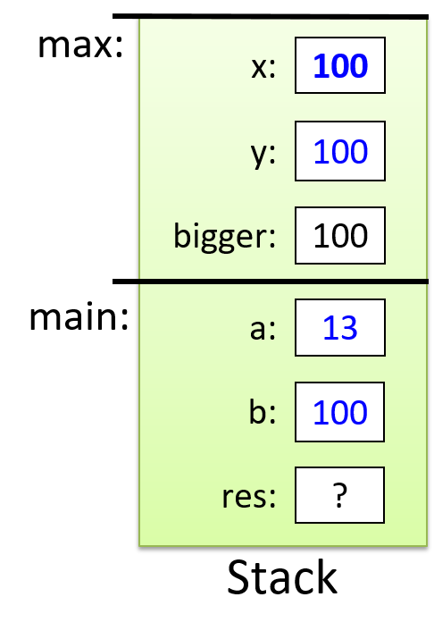

> **说明**
> 本文是个人学习用的**非官方**中英对照译文，原文：<https://diveintosystems.org/book/C1-C_intro/functions.html>。
> 原书采用 CC BY-NC-ND 4.0 许可（禁止演绎），**请勿公开传播本译文**。
> 标为「译注」「现代更新」的内容是译者补充，不代表原书作者观点；代码与原文逐字一致，未作改动。

## 1.4. 函数

*1.4. Functions*

函数把代码拆分成便于管理的小块，并减少代码重复。函数可以接收零个或多个**参数**（parameter）作为输入，并**返回**（return）一个特定类型的值。函数的**声明**（declaration）或**原型**（prototype）指明函数的名字、返回类型和参数列表（所有参数的个数和类型）。函数的**定义**（definition）包含调用该函数时要执行的代码。C 中的所有函数都必须先声明后调用。可以通过声明函数原型来做到这一点，也可以在调用之前就给出函数的完整定义：

> Functions break code into manageable pieces and reduce code duplication. Functions might take zero or more **parameters** as input and they **return** a single value of a specific type. A function **declaration** or **prototype** specifies the function’s name, its return type, and its parameter list (the number and types of all the parameters). A function **definition** includes the code to be executed when the function is called. All functions in C must be declared before they’re called. This can be done by declaring a function prototype or by fully defining the function before calling it:

```
// function definition format:
// ---------------------------
<return type> <function name> (<parameter list>)
{
    <function body>
}

// parameter list format:
// ---------------------
<type> <param1 name>, <type> <param2 name>, ...,  <type> <last param name>
```

下面是一个函数定义的例子。注意注释描述了函数做什么、每个参数的细节（它的用途以及应该传入什么），以及函数返回什么：

> Here’s an example function definition. Note that the comments describe what the function does, the details of each parameter (what it’s used for and what it should be passed), and what the function returns:

```
/* This program computes the larger of two
 * values entered by the user.
 */
#include <stdio.h>

/* max: computes the larger of two integer values
 *   x: one integer value
 *   y: the other integer value
 *   returns: the larger of x and y
 */
int max(int x, int y) {
    int bigger;

    bigger = x;
    if (y > x) {
        bigger = y;
    }
    printf("  in max, before return x: %d y: %d\n", x, y);
    return bigger;
}
```

不返回值的函数应当把返回类型指定为 `void`。下面是一个 `void` 函数的例子：

> Functions that don’t return a value should specify the `void` return type. Here’s an example of a `void` function:

```
/* prints out the squares from start to stop
 *   start: the beginning of the range
 *   stop: the end of the range
 */
void print_table(int start, int stop) {
    int i;

    for (i = start; i <= stop; i++) {
        printf("%d\t", i*i);
    }
    printf("\n");
}
```

和任何支持函数或过程的编程语言一样，**函数调用**（function call）会执行一个函数，并为这次调用传入具体的实参值。调用函数时写出函数名并传入实参，每个函数形参对应一个实参。在 C 中，函数调用的写法如下：

> As in any programming language that supports functions or procedures, a **function call** invokes a function, passing specific argument values for the particular call. A function is called by its name and is passed arguments, with one argument for each corresponding function parameter. In C, calling a function looks like this:

```
// function call format:
// ---------------------
function_name(<argument list>);


// argument list format:
// ---------------------
<argument 1 expression>, <argument 2 expression>, ...,  <last argument expression>
```

C 函数的实参是**按值传递**（passed by value）的：每个函数形参被赋予调用者在函数调用中传给它的对应实参的*值*。按值传递的语义意味着，在函数内对形参值的任何修改（即在函数中给形参赋新值）对调用者都是*不可见*的。

> Arguments to C functions are **passed by value**: each function parameter is assigned the *value* of the corresponding argument passed to it in the function call by the caller. Pass by value semantics mean that any change to a parameter’s value in the function (that is, assigning a parameter a new value in the function) is *not visible* to the caller.

下面是调用前面列出的 `max` 和 `print_table` 函数的一些例子：

> Here are some example function calls to the `max` and `print_table` functions listed earlier:

```
int val1, val2, result;

val1 = 6;
val2 = 10;

/* to call max, pass in two int values, and because max returns an
   int value, assign its return value to a local variable (result)
 */
result = max(val1, val2);     /* call max with argument values 6 and 10 */
printf("%d\n", result);       /* prints out 10 */

result = max(11, 3);          /* call max with argument values 11 and 3 */
printf("%d\n", result);       /* prints out 11 */

result = max(val1 * 2, val2); /* call max with argument values 12 and 10 */
printf("%d\n", result);       /* prints out 12 */

/* print_table does not return a value, but takes two arguments */
print_table(1, 20);           /* prints a table of values from 1 to 20 */
print_table(val1, val2);      /* prints a table of values from 6 to 10 */
```

下面是另一个完整程序的例子，它调用的 `max` 函数实现略有不同：多了一条修改其形参值的语句（`x = y`）：

> Here is another example of a full program that shows a call to a slightly different implementation of the `max` function that has an additional statement to change the value of its parameter (`x = y`):

```
/* max: computes the larger of two int values
 *   x: one value
 *   y: the other value
 *   returns: the larger of x and y
 */
int max(int x, int y) {
    int bigger;

    bigger = x;
    if (y > x) {
        bigger = y;
        // note: changing the parameter x's value here will not
        //       change the value of its corresponding argument
        x = y;
    }
    printf("  in max, before return x: %d y: %d\n", x, y);

    return bigger;
}

/* main: shows a call to max */
int main(void) {
    int a, b, res;

    printf("Enter two integer values: ");
    scanf("%d%d", &a, &b);

    res = max(a, b);
    printf("The larger value of %d and %d is %d\n", a, b, res);

    return 0;
}
```

下面的输出展示了这个程序两次运行可能的样子。注意两次运行中形参 `x` 的值（在 `max` 函数内部打印）有何不同。尤其要注意，在第二次运行中修改形参 `x` 的值，*不会*影响调用返回后作为实参传给 `max` 的那个变量：

> The following output shows what two runs of this program might look like. Note the difference in the parameter `` x’s value (printed from inside the `max `` function) in the two runs. Specifically, notice that changing the value of parameter `x` in the second run does *not* affect the variable that was passed in as an argument to `max` after the call returns:

```
$ ./a.out
Enter two integer values: 11  7
  in max, before return x: 11 y: 7
The larger value of 11 and 7 is 11

$ ./a.out
Enter two integer values: 13  100
  in max, before return x: 100 y: 100
The larger value of 13 and 100 is 100
```

由于实参是*按值传递*给函数的，前面这个会修改某个形参值的 `max` 版本，与不修改形参的原始版本行为完全相同。

> Because arguments are *passed by value* to functions, the preceding version of the `max` function that changes one of its parameter values behaves identically to the original version of `max` that does not.

### 1.4.1. 栈

*1.4.1. The Stack*

**执行栈**（execution stack）记录程序中处于活动状态的函数的状态。每次函数调用都会创建一个新的**栈帧**（stack frame，有时也称**活动帧**或**活动记录**，activation frame / activation record），其中包含该次调用的形参和局部变量的值。栈顶的帧是活动帧，它代表当前正在执行的函数调用，只有它的局部变量和形参在作用域内。调用一个函数时，会为它创建一个新的栈帧（*压入*栈顶），并在新帧中为它的局部变量和形参分配空间。函数返回时，它的栈帧被从栈中移除（从栈顶*弹出*），调用者的栈帧重新回到栈顶。

> The **execution stack** keeps track of the state of active functions in a program. Each function call creates a new **stack frame** (sometimes called an **activation frame** or **activation record**) containing its parameter and local variable values. The frame on the top of the stack is the active frame; it represents the function activation that is currently executing, and only its local variables and parameters are in scope. When a function is called, a new stack frame is created for it (*pushed* on the top of the stack), and space for its local variables and parameters is allocated in the new frame. When a function returns, its stack frame is removed from the stack (*popped* from the top of the stack), leaving the caller’s stack frame on the top of the stack.

对于前面的示例程序，在执行到 `max` 即将执行 `return` 语句的那一刻，执行栈的样子如[图 1](1.4-functions.html) 所示。回想一下，`main` 传给 `max` 的实参值是*按值传递*的，也就是说 `max` 的形参 `x` 和 `y` 被赋予了 `main` 中调用时对应实参 `a` 和 `b` 的值。尽管 `max` 函数修改了 `x` 的值，这一修改并不会影响 `main` 中 `a` 的值。

> For the example preceding program, at the point in its execution right before `max` executes the `return` statement, the execution stack will look like [Figure 1](1.4-functions.html). Recall that the argument values to `max` passed by `main` are *passed by value*, meaning that the parameters to `max`, `x` and `y`, are assigned the values of their corresponding arguments, `a` and `b` from the call in `main`. Despite the `max` function changing the value of `x`, the change doesn’t affect the value of `a` in `main`.



**图 1.** 从 max 函数返回之前执行栈中的内容

*Figure 1. The execution stack contents just before returning from the max function*

> **译注 · 图中内容**
> 栈中有两个帧：`main` 在下，`max` 在上。`main` 的栈帧里有三个变量：a（11）、b（7）和 res（此时尚未定义）；`max` 的栈帧里也有三个变量：x（11）、y（7）和 bigger（11）。

下面的完整程序包含两个函数，并展示了在 `main` 函数中调用它们的例子。在这个程序中，我们在 `main` 函数之前声明了 `max` 和 `print_table` 的函数原型，这样即使 `main` 先定义，也能调用它们。`main` 函数包含了整个程序的高层步骤，先定义它体现了程序自顶向下的设计。这个例子中的注释说明了程序中与函数及函数调用相关的重要部分。你也可以下载并运行这个[完整程序](https://diveintosystems.org/book/C1-C_intro/_attachments/function.c)。

> The following full program includes two functions and shows examples of calling them from the `main` function. In this program, we declare function prototypes for `max` and `print_table` above the `main` function so that `main` can access them despite being defined first. The `main` function contains the high-level steps of the full program, and defining it first echoes the top-down design of the program. This example includes comments describing the parts of the program that are important to functions and function calls. You can also download and run the [full program](https://diveintosystems.org/book/C1-C_intro/_attachments/function.c).

```
/* This file shows examples of defining and calling C functions.
 * It also demonstrates using scanf().
 */

#include <stdio.h>

/* This is an example of a FUNCTION PROTOTYPE.  It declares just the type
 * information for a function (the function's name, return type, and parameter
 * list). A prototype is used when code in main wants to call the function
 * before its full definition appears in the file.
 */
int max(int n1, int n2);

/* A prototype for another function.  void is the return type of a function
 * that does not return a value
 */
void print_table(int start, int stop);

/* All C programs must have a main function.  This function defines what the
 * program does when it begins executing, and it's typically used to organize
 * the big-picture behavior of the program.
 */
int main(void) {
    int x, y, larger;

    printf("This program will operate over two int values.\n");

    printf("Enter the first value: ");
    scanf("%d", &x);

    printf("Enter the second value: ");
    scanf("%d", &y);

    larger = max(x, y);

    printf("The larger of %d and %d is %d\n", x, y, larger);

    print_table(x, larger);

    return 0;
}

/* This is an example of a FUNCTION DEFINITION.  It specifies not only the
 * function name and type, but it also fully defines the code of its body.
 * (Notice, and emulate, the complete function comment!)
 */
/* Computes the max of two integer values.
 *   n1: the first value
 *   n2: the other value
 *   returns: the larger of n1 and n2
 */
int max(int n1, int n2)  {
    int result;

    result = n1;

    if (n2 > n1) {
        result = n2;
    }

    return result;
}

/* prints out the squares from start to stop
 *   start: the beginning of the range
 *   stop: the end of the range
 */
void print_table(int start, int stop) {
    int i;

    for (i = start; i <= stop; i++) {
        printf("%d\t", i*i);
    }

    printf("\n");
}
```
