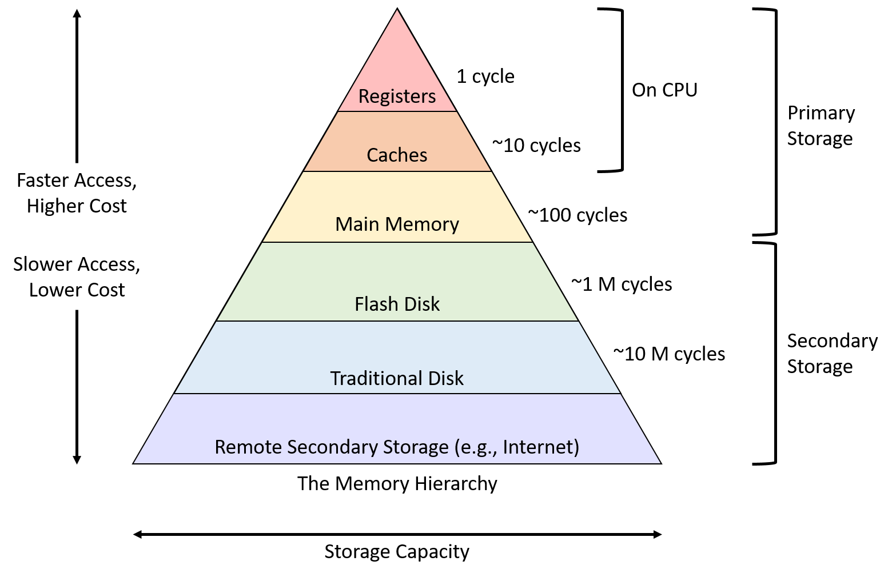

> **说明**
> 本文是个人学习用的**非官方**中英对照译文，原文：<https://diveintosystems.org/book/C11-MemHierarchy/mem_hierarchy.html>。
> 原书采用 CC BY-NC-ND 4.0 许可（禁止演绎），**请勿公开传播本译文**。
> 标为「译注」「现代更新」的内容是译者补充，不代表原书作者观点；代码与原文逐字一致，未作改动。

## 11.1. 存储器层次结构

*11.1. The Memory Hierarchy*

在探索现代计算机存储时，会出现一个共同的规律：容量越大的设备，性能越低。换句话说，系统中既有速度快的设备，也有能存储大量数据的设备，但没有哪一种设备能两者兼得。这种性能与容量之间的权衡称为**存储器层次结构**（memory hierarchy），[图 1](11.1-mem_hierarchy.html) 直观地描绘了这一层次结构。

> As we explore modern computer storage, a common pattern emerges: devices with higher capacities offer lower performance. Said another way, systems use devices that are fast and devices that store a large amount of data, but no single device does both. This trade-off between performance and capacity is known as the **memory hierarchy**, and [Figure 1](11.1-mem_hierarchy.html) depicts the hierarchy visually.

存储设备同样要在成本和存储密度之间权衡：速度越快的设备越昂贵，无论是按每美元能买到的字节数，还是按运行成本（例如能耗）来算。例如，尽管缓存的性能很好，但要造一颗缓存大到可以不要主存的 CPU，其成本（以及制造上的挑战）使这种设计并不可行。实际的系统必须组合使用多种设备，来满足程序对性能和容量的要求；如今典型的系统包含[图 1](11.1-mem_hierarchy.html) 中描述的大部分（如果不是全部）设备。

> Storage devices similarly trade cost and storage density: faster devices are more expensive, both in terms of bytes per dollar and operational costs (e.g., energy usage). For example, even though caches provide great performance, the cost (and manufacturing challenges) of building a CPU with a large enough cache to forego main memory makes such a design infeasible. Practical systems must utilize a combination of devices to meet the performance and capacity requirements of programs, and a typical system today incorporates most, if not all, of the devices described in [Figure 1](11.1-mem_hierarchy.html).

**图 1.** 存储器层次结构

*Figure 1. The memory hierarchy*

存储器层次结构的现实对程序员来说是不幸的，他们宁愿不去操心数据存放在哪里会对性能产生什么影响。例如，*在大多数应用程序中*声明一个整数时，程序员最好不需要为数据是存放在缓存还是主存中的区别而苦恼。要求程序员精细管理每个变量占用哪种存储器会是一种负担，尽管对于某些小的、对性能至关重要的代码段来说，偶尔也值得这样做。

> The reality of the memory hierarchy is unfortunate for programmers, who would prefer to not worry about the performance implications of where their data resides. For example, when declaring an integer *in most applications*, a programmer ideally wouldn’t need to agonize over the differences between data stored in a cache or main memory. Requiring a programmer to micromanage which type of memory each variable occupies would be burdensome, although it may occasionally be worth the effort for certain small, performance-critical sections of code.

注意，[图 1](11.1-mem_hierarchy.html) 把*缓存*归为单一的实体，但大多数系统都包含多级缓存，它们自己又构成一个较小的层次结构。例如，CPU 通常包含一个非常小而快的*一级*（L1）缓存，它离 ALU 相对较近；还有一个较大、较慢的*二级*（L2）缓存，位置更远一些。许多多核 CPU 还在一个更大的*三级*（L3）缓存中让各个核心共享数据。尽管各级缓存之间的差异对注重性能的应用程序可能很重要，但为简单起见，本书只考虑单级缓存。

> Note that [Figure 1](11.1-mem_hierarchy.html) categorizes *cache* as single entity, but most systems contain multiple levels of caches that form their own smaller hierarchy. For example, CPUs commonly incorporate a very small and fast *level one* (L1) cache, which sits relatively close to the ALU, and a larger and slower *level two* (L2) cache that resides farther away. Many multicore CPUs also share data between cores in a larger *level three* (L3) cache. While the differences between the cache levels may matter to performance-conscious applications, this book considers just a single level of caching for simplicity.

尽管本章主要关注数据在寄存器、CPU 缓存和主存之间的移动，[下一节](11.2-devices.html)将描述存储器层次结构中各种常见的存储设备。我们会在后面第 13 章讨论[虚拟内存](../C13-OS/13.3-vm.html)时，考察磁盘及其在更大范围的内存管理中所起的作用。

> Though this chapter primarily focuses on data movement between registers, CPU caches, and main memory, the [next section](11.2-devices.html) characterizes common storage devices across the memory hierarchy. We examine disks and their role in the bigger picture of memory management later, in Chapter 13’s discussion of [virtual memory](../C13-OS/13.3-vm.html).
