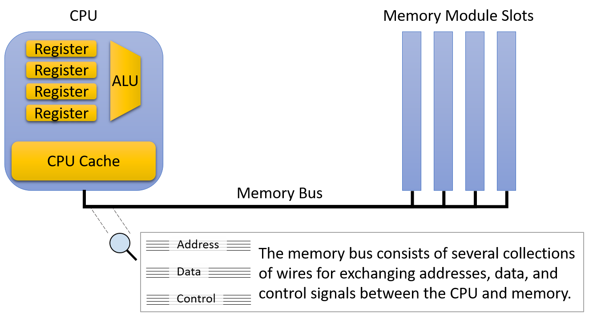
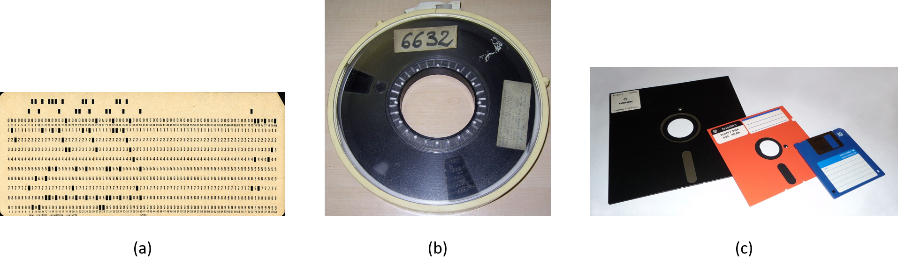
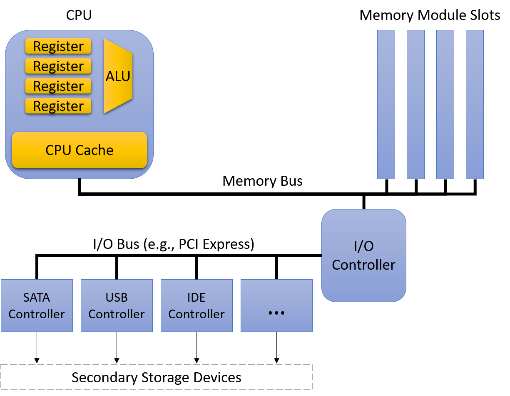
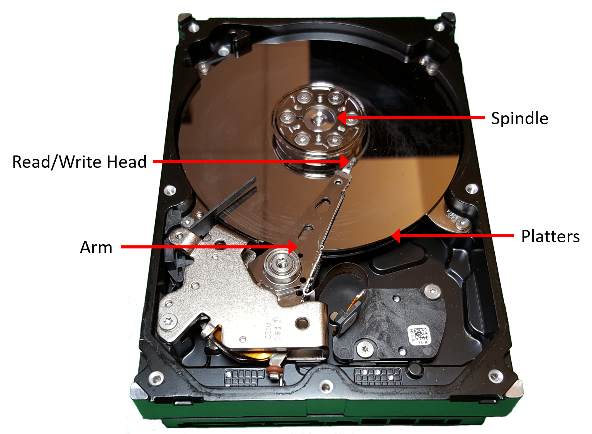

> **说明**
> 本文是个人学习用的**非官方**中英对照译文，原文：<https://diveintosystems.org/book/C11-MemHierarchy/devices.html>。
> 原书采用 CC BY-NC-ND 4.0 许可（禁止演绎），**请勿公开传播本译文**。
> 标为「译注」「现代更新」的内容是译者补充，不代表原书作者观点；代码与原文逐字一致，未作改动。

## 11.2. 存储设备

*11.2. Storage Devices*

系统设计者根据程序访问数据的方式，对[存储器层次结构](11.1-mem_hierarchy.html)中的设备进行分类。CPU 上的程序可以直接访问**主存储**（primary storage）设备。也就是说，CPU 的汇编指令编码了指令要取的数据的确切位置。主存储的例子包括 CPU 寄存器和主存（RAM），汇编指令直接引用它们（例如在 IA32 汇编中分别写作 `%reg` 和 `(%reg)`）。

> Systems designers classify devices in the [memory hierarchy](11.1-mem_hierarchy.html) according to how programs access their data. **Primary storage** devices can be accessed directly by a program on the CPU. That is, the CPU’s assembly instructions encode the exact location of the data that the instructions should retrieve. Examples of primary storage include CPU registers and main memory (RAM), which assembly instructions reference directly (for example, in IA32 assembly as `%reg` and `(%reg)`, respectively).

与之不同，CPU 指令不能直接引用**辅助存储**（secondary storage）设备。要访问辅助存储设备的内容，程序必须先请求该设备把数据复制到主存储（通常是内存）中。最常见的辅助存储设备是硬盘驱动器和固态硬盘这样的磁盘设备，它们持久地存储文件数据。其他例子还有软盘、磁带盒，甚至远程文件服务器。

> In contrast, CPU instructions cannot directly refer to **secondary storage** devices. To access the contents of a secondary storage device, a program must first request that the device copy its data into primary storage (typically memory). The most familiar types of secondary storage devices are disk devices such as hard disk drives and solid-state drives, which persistently store file data. Other examples include floppy disks, magnetic tape cartridges, or even remote file servers.

尽管你以前可能没有用这些术语思考过主存储和辅助存储的区别，但很可能已经在程序中遇到过它们的差异。例如，声明并赋值普通变量（主存储）之后，程序可以立即在算术运算中使用它们。而处理文件数据（辅助存储）时，程序必须先[把文件中的值读到内存变量中](../C2-C_depth/2.8-IO.html)，才能访问它们。

> Even though you may not have considered the distinction between primary and secondary storage in these terms before, it’s likely that you have encountered their differences in programs already. For example, after declaring and assigning ordinary variables (primary storage), a program can immediately use them in arithmetic operations. When working with file data (secondary storage), the program must [read values from the file into memory variables](../C2-C_depth/2.8-IO.html) before it can access them.

对存储设备进行分类的其他几个重要标准，来自它们的性能和容量特征。最值得关注的三个度量是：

> Several other important criteria for classifying memory devices arise from their performance and capacity characteristics. The three most interesting measures are:

- **容量**（capacity）：设备能存储的数据量。容量通常以字节为单位度量。

> - **Capacity**: The amount of data a device can store. Capacity is typically measured in bytes.

- **延迟**（latency）：设备在接到执行数据读取操作的指令后，到给出数据所需的时间。延迟通常以秒的若干分之一（例如毫秒或纳秒）或 CPU 周期数来度量。

> - **Latency**: The amount of time it takes for a device to respond with data after it has been instructed to perform a data retrieval operation. Latency is typically measured in either fractions of a second (for example, milliseconds or nanoseconds) or CPU cycles.

- **传输速率**（transfer rate）：在某段时间内，能在设备和主存之间移动的数据量。传输速率也称为**吞吐量**（throughput），通常以每秒字节数来度量。

> - **Transfer rate**: The amount of data that can be moved between the device and main memory over some interval of time. Transfer rate is also known as **throughput** and is typically measured in bytes per second.

考察现代计算机中的各种设备就会发现，它们在这三个度量上的性能都相差悬殊。性能差异主要来自两个因素：*距离*，以及实现设备所用的*技术不同*。

> Exploring the variety of devices in a modern computer reveals a huge disparity in device performance across all three of these measures. The performance variance primarily arises from two factors: *distance* and *variations in the technologies* used to implement the devices.

距离之所以有影响，是因为归根结底，程序想用的任何数据都必须送到 CPU 的运算部件 ALU 那里处理。CPU 设计者把寄存器放在离 ALU 很近的地方，以尽量缩短信号在两者之间传播的时间。因此，尽管寄存器只能存几个字节、数量也不多，但其中存放的值几乎可以立即供 ALU 使用！与之不同，磁盘这样的辅助存储设备要通过各种控制器设备把数据传到内存，这些控制器之间用更长的导线相连。额外的距离和中间处理大大拖慢了辅助存储。

> Distance contributes because, ultimately, any data that a program wants to use must be available to the CPU’s arithmetic components, the ALU, for processing. CPU designers place registers close to the ALU to minimize the time it takes for a signal to propagate between the two. Thus, while registers can store only a few bytes and there aren’t many of them, the values stored are available to the ALU almost immediately! In contrast, secondary storage devices like disks transfer data to memory through various controller devices that are connected by longer wires. The extra distance and intermediate processing slows down secondary storage considerably.

> **原书旁注 · 格蕾丝·霍珀的「纳秒」（Grace Hopper’s "Nanoseconds"）**
> 计算机先驱、美国海军少将格蕾丝·霍珀（Grace Hopper）在演讲时，经常给听众分发 11.8 英寸（约 30 厘米）长的电线。这些电线代表电信号在一纳秒内传播的最大距离，被称为「格蕾丝·霍珀纳秒」。她用它们来说明卫星通信的延迟局限，并演示为什么计算设备必须做得小才能快。霍珀讲解她的纳秒的录像[可以在 YouTube 上找到](https://www.youtube.com/watch?v=9eyFDBPk4Yw)。
>
> > When speaking to an audience, computing pioneer and U.S. Navy Admiral Grace Hopper frequently handed out 11.8-inch strands of wire to audience members. These strands represented the maximum distance that an electrical signal travels in one nanosecond and were called "Grace Hopper nanoseconds". She used them to describe the latency limitations of satellite communication and to demonstrate why computing devices need to be small in order to be fast. Recordings of Grace Hopper presenting her nanoseconds are [available on YouTube](https://www.youtube.com/watch?v=9eyFDBPk4Yw).

底层技术也会显著影响设备的性能。寄存器和缓存由相对简单的电路构成，只包含少量逻辑门。它们体积小、复杂度低，保证了电信号能快速地通过，从而降低了延迟。另一个极端是传统硬盘，它包含能存储数百 GB 数据的旋转磁盘片。尽管它们的存储密度高，但由于需要通过机械方式把部件对准并旋转到正确的位置，访问延迟相对较高。

> The underlying technology also significantly affects device performance. Registers and caches are built from relatively simple circuits, consisting of just a few logic gates. Their small size and minimal complexity ensures that electrical signals can propagate through them quickly, reducing their latencies. On the opposite end of the spectrum, traditional hard disks contain spinning magnetic platters that store hundreds of gigabytes. Although they offer dense storage, their access latency is relatively high due to the requirements of mechanically aligning and rotating components into the correct positions.

本节余下的部分考察主存储和辅助存储设备的细节，并分析它们的性能特征。

> The remainder of this section examines the details of primary and secondary storage devices and analyzes their performance characteristics.

### 11.2.1. 主存储

*11.2.1. Primary Storage*

主存储设备由**随机存取存储器**（random access memory，RAM）构成，这意味着访问数据所需的时间不受数据在设备中位置的影响。也就是说，RAM 不需要操心把部件移到正确位置或倒带之类的事情。有两种广泛使用的 RAM：**静态 RAM**（SRAM）和**动态 RAM**（DRAM），两者在现代计算机中都起着重要作用。[表 1](11.2-devices.html) 描述了常见主存储设备的性能度量以及它们使用的 RAM 类型。

> Primary storage devices consist of **random access memory** (RAM), which means the time it takes to access data is not affected by the data’s location in the device. That is, RAM doesn’t need to worry about things like moving parts into the correct position or rewinding tape spools. There are two widely used types of RAM, **static RAM** (SRAM) and **dynamic RAM** (DRAM), and both play an important role in modern computers. [Table 1](11.2-devices.html) characterizes the performance measures of common primary storage devices and the types of RAM they use.

**表 1.** 2020 年典型工作站的主存储设备特征

*Table 1. Primary Storage Device Characteristics of a Typical 2020 Workstation*

| 设备 | 容量 | 大致延迟 | RAM 类型 |
|---|---|---|---|
| 寄存器 | 4–8 字节 | \< 1 ns | SRAM |
| CPU 缓存 | 1–32 MB | 5 ns | SRAM |
| 主存 | 4–64 GB | 100 ns | DRAM |

> | Device      | Capacity         | Approx. latency | RAM type |
> |-------------|------------------|-----------------|----------|
> | Register    | 4 - 8 bytes      | \< 1 ns         | SRAM     |
> | CPU cache   | 1 - 32 megabytes | 5 ns            | SRAM     |
> | Main memory | 4 - 64 gigabytes | 100 ns          | DRAM     |

SRAM 把数据存储在小型电路（例如[锁存器](../C5-Arch/5.4.3-storagecircs.html)）中。SRAM 通常是最快的存储器类型，设计者把它直接集成到 CPU 中，用来构建[寄存器](../C5-Arch/5.4.3-storagecircs.html)和缓存。SRAM 的制造成本、运行成本（功耗）和占用的面积都相对较高。这些成本合在一起，限制了 CPU 能包含的 SRAM 存储量。

> SRAM stores data in small electrical circuits (for example, [latches](../C5-Arch/5.4.3-storagecircs.html)). SRAM is typically the fastest type of memory, and designers integrate it directly into a CPU to build [registers](../C5-Arch/5.4.3-storagecircs.html) and caches. SRAM is relatively expensive in its cost to build, cost to operate (power consumption), and in the amount of space it occupies. Collectively, those costs limit the amount of SRAM storage that a CPU can include.

DRAM 使用一种叫作*电容*的、能保持电荷的电子元件来存储数据。它之所以被称为「动态」的，是因为 DRAM 系统必须频繁地刷新电容中的电荷，才能保持所存储的值。现代系统用 DRAM 在内存条上实现主存，内存条通过一种称为**内存总线**（memory bus）的高速互连与 CPU 相连。

> DRAM stores data using electrical components called *capacitors* that hold an electrical charge. It’s called "dynamic" because a DRAM system must frequently refresh the charge of its capacitors to maintain a stored value. Modern systems use DRAM to implement main memory on modules that connect to the CPU via a high-speed interconnect called the **memory bus**.

[图 1](11.2-devices.html) 展示了主存储设备相对于内存总线的位置。要从内存中取一个值，CPU 把它想取的数据的地址放到内存总线上，并发出信号让内存模块执行一次读操作。经过短暂的延迟后，内存模块通过总线把存放在所请求地址处的值发送给 CPU。

> [Figure 1](11.2-devices.html) illustrates the positions of primary storage devices relative to the memory bus. To retrieve a value from memory, the CPU puts the address of the data it would like to retrieve on the memory bus and signals that the memory modules should perform a read. After a short delay, the memory module sends the value stored at the requested address across the bus to the CPU.

**图 1.** 主存储与内存总线体系结构

*Figure 1. Primary storage and memory bus architecture*

尽管 CPU 和主存在物理上只相距几英寸，但数据在 CPU 和主存之间移动时必须经过内存总线。它们之间额外的距离和电路，使主存的延迟比 CPU 上的存储更高、传输速率更低。因此，内存总线有时被称为**冯·诺依曼瓶颈**（von Neumann bottleneck）。当然，尽管性能较低，主存仍然是必不可少的部件，因为它能存储的数据比 CPU 上能放下的多出几个数量级。与其他形式的存储一样，容量和速度之间存在明显的权衡。

> Even though the CPU and main memory are physically just a few inches away from each other, data must travel through the memory bus when it moves between the CPU and main memory. The extra distance and circuitry between them increases the latency and reduces the transfer rate of main memory relative to on-CPU storage. As a result, the memory bus is sometimes referred to as the **von Neumann bottleneck**. Of course, despite its lower performance, main memory remains an essential component because it stores several orders of magnitude more data than can fit on the CPU. Consistent with other forms of storage, there’s a clear trade-off between capacity and speed.

**CPU 缓存**（cache，读音同「cash」）无论在物理位置上，还是在性能和容量特征上，都介于寄存器和主存之间。CPU 缓存通常直接在 CPU 上存储几 KB 到几 MB 的数据，但在物理上，缓存离 ALU 不像寄存器那么近。因此，访问缓存比访问主存快，但要让数据可用于计算，它比寄存器多需要几个周期。

> **CPU cache** (pronounced "cash") occupies the middle ground between registers and main memory, both physically and in terms of its performance and capacity characteristics. A CPU cache typically stores a few kilobytes to megabytes of data directly on the CPU, but physically, caches are not quite as close to the ALU as registers. Thus, caches are faster to access than main memory, but they require a few more cycles than registers to make data available for computation.

缓存中的内容不需要程序员显式地加载，CPU 内部的控制电路会自动把主存内容的一个子集存放到缓存中。CPU 会有策略地控制把主存的哪个子集存放到缓存中，以便尽可能多的内存请求能由（性能高得多的）缓存来满足。本章后面的小节会介绍构建缓存时的设计决策，以及决定缓存中存放哪些数据的算法。

> Rather than the programmer explicitly loading values into the cache, control circuitry within the CPU automatically stores a subset of the main memory’s contents in the cache. CPUs strategically control which subset of main memory they store in caches so that as many memory requests as possible can be serviced by the (much higher performance) cache. Later sections of this chapter describe the design decisions that go into cache construction and the algorithms that should govern which data they store.

真实的系统包含多级缓存，它们表现得就像一个微型的存储器层次结构。也就是说，CPU 可能有一个非常小而快的 **L1 缓存**，它存放稍大稍慢的 **L2 缓存**内容的一个子集，而 L2 缓存又存放更大更慢的 **L3 缓存**内容的一个子集。本节余下的部分描述只有一级缓存的系统，但真实系统中各级缓存之间的交互，与后面详细介绍的单级缓存和主存之间的交互非常相似。

> Real systems incorporate multiple levels of caches that behave like their own miniature version of the memory hierarchy. That is, a CPU might have a very small and fast **L1 cache** that stores a subset of a slightly larger and slower **L2 cache**, which in turns stores a subset of a larger and slower **L3 cache**. The remainder of this section describes a system with just a single cache, but the interaction between caches on a real system behaves much like the interaction between a single cache and main memory detailed later.

> **原书注**
> 如果你好奇自己系统上缓存和主存的大小，`lscpu` 命令会打印 CPU 的信息（包括缓存容量），运行 `free -m` 则会以 MB 为单位显示系统的主存容量。
>
> > If you’re curious about the sizes of the caches and main memory on your system, the `lscpu` command prints information about the CPU (including its cache capacities). Running `free -m` shows the system’s main memory capacity in megabytes.

> **译注 · 在 macOS 上**
> macOS 没有 `lscpu` 和 `free`，可以用 `sysctl` 查询。译者在 Apple M1 Pro 上运行 `sysctl hw.memsize hw.l1dcachesize hw.l2cachesize hw.cachelinesize hw.perflevel0.l2cachesize hw.perflevel1.l2cachesize`，得到主存 17179869184 字节（16 GB）、L1 数据缓存 65536 字节、L2 缓存 4194304 字节、缓存行 128 字节；`hw.perflevel0` 和 `hw.perflevel1` 分别报告两类核心簇的 L2（12 MB 与 4 MB）。注意这台机器报告的缓存行（`hw.cachelinesize`）是 128 字节；缓存行大小会影响本章后面讨论的空间局部性，以及第 14 章的伪共享。

### 11.2.2. 辅助存储

*11.2.2. Secondary Storage*

在物理上，辅助存储设备接入系统的位置离 CPU 比主存还要远。与大多数其他计算机设备相比，辅助存储设备多年来经历了翻天覆地的变化，而且它们的设计仍然比其他部件更加多样。标志性的[穿孔卡片](https://en.wikipedia.org/wiki/Punched_card)让人工操作员通过在一张类似索引卡的厚纸上打小孔来存储数据。穿孔卡片的设计可以追溯到 1890 年的美国人口普查，它忠实地存储着用户数据（通常是程序），一直用到 20 世纪 60 年代，乃至 70 年代。

> Physically, secondary storage devices connect to a system even farther away from the CPU than main memory. Compared to most other computer equipment, secondary storage devices have evolved dramatically over the years, and they continue to exhibit more diverse designs than other components. The iconic [punch card](https://en.wikipedia.org/wiki/Punched_card) allowed a human operator to store data by making small holes in a thick piece of paper, similar to an index card. Punch cards, whose design dates back to the U.S. census of 1890, faithfully stored user data (often programs) through the 1960s and into the 1970s.

[磁带机](https://en.wikipedia.org/wiki/Magnetic_tape_data_storage)把数据存储在一卷磁带上。尽管磁带机通常以低廉的成本提供很高的存储密度（在很小的体积中存储大量信息），但由于必须把磁带卷到正确的位置，它的访问速度很慢。尽管大多数计算机用户如今已不常接触磁带机，但它仍常用于批量存储操作（例如大型数据备份），在这类场景中，预计很少需要把数据读回来。现代磁带机把磁带卷装进小盒子里，以方便使用。

> A [tape drive](https://en.wikipedia.org/wiki/Magnetic_tape_data_storage) stores data on a spool of magnetic tape. Although they generally offer good storage density (lots of information in a small size) for a low cost, tape drives are slow to access because they must wind the spool to the correct location. Although most computer users don’t encounter them often anymore, tape drives are still frequently used for bulk storage operations (for example, large data backups) in which reading the data back is expected to be rare. Modern tape drives arrange the magnetic tape spool into small cartridges for ease of use.

**图 2.** （a）穿孔卡片、（b）磁带卷和（c）各种尺寸软盘的示例照片。图片来自[维基百科](https://www.wikipedia.org)。

*Figure 2. Example photos of (a) a punch card, (b) a magnetic tape spool, and (c) a variety of floppy disk sizes. Images from [Wikipedia](https://www.wikipedia.org).*

[软盘](https://en.wikipedia.org/wiki/Floppy_disk)和[光盘](https://en.wikipedia.org/wiki/Optical_disc)等可移动介质是另一种流行的辅助存储形式。软盘包含一片磁性记录介质，它在读写内容的磁头上方旋转。[图 2](11.2-devices.html) 展示了穿孔卡片、磁带机和软盘的照片。CD、DVD 和蓝光光盘等光盘通过盘面上的微小凹坑来存储信息。光驱用激光照射光盘来读取它，凹坑的有无决定光束是否被反射，以此编码 0 和 1。

> Removable media like [floppy disks](https://en.wikipedia.org/wiki/Floppy_disk) and [optical discs](https://en.wikipedia.org/wiki/Optical_disc) are another popular form of secondary storage. Floppy disks contain a spindle of magnetic recording media that rotates over a disk head that reads and writes its contents. [Figure 2](11.2-devices.html) shows photos of a punch card, a tape drive, and a floppy disk. Optical discs such as CD, DVD, and Blu-ray store information via small indentations on the disc. The drive reads a disc by shining a laser at it, and the presence or absence of indentations causes the beam to reflect (or not), encoding zeros and ones.

#### 现代辅助存储

*Modern Secondary Storage*

**表 2.** 2020 年典型工作站的辅助存储设备特征

*Table 2. Secondary Storage Device Characteristics of a Typical 2020 Workstation*

| 设备 | 容量 | 延迟 | 传输速率 |
|----|----|----|----|
| 闪存盘 | 0.5–2 TB | 0.1–1 ms | 200–3,000 MB/s |
| 传统硬盘 | 0.5–10 TB | 5–10 ms | 100–200 MB/s |
| 远程网络服务器 | 差别很大 | 20–200 ms | 差别很大 |

> | Device | Capacity | Latency | Transfer rate |
> |----|----|----|----|
> | Flash disk | 0.5 - 2 terabytes | 0.1 - 1 ms | 200 - 3,000 megabytes / second |
> | Traditional hard disk | 0.5 - 10 terabytes | 5 - 10 ms | 100 - 200 megabytes / second |
> | Remote network server | Varies considerably | 20 - 200 ms | Varies considerably |

> **现代更新（截至 2026-11）· 表 2 的数字已经过时**
> - **SSD**：表中闪存盘的传输速率上限是 3,000 MB/s。采用 PCIe 5.0 接口的消费级 NVMe 固态硬盘已远超这个数：三星 2025 年发布的 9100 PRO 顺序读/写可达 14,800/13,400 MB/s（4TB、8TB 型号；1TB、2TB 型号读取为 14,700 MB/s），容量最高 8TB。[Samsung Newsroom：Samsung Announces the 9100 PRO Series SSDs](https://news.samsung.com/us/samsung-announces-9100-pro-series-ssds-with-breakthrough-pcie-5-0-performance/)
> - **HDD**：表中硬盘容量上限是 10TB。2024 年 1 月，希捷推出采用热辅助磁记录（HAMR）技术的 Mozaic 3+ 平台，单张盘片面密度超过 3TB，Exos 系列硬盘容量达到 30TB 以上，并计划在未来几年提高到每盘片 4TB、5TB 以上。容量涨了，但机械结构决定的寻道和旋转延迟（毫秒级）这一点并没有改变。[Seagate：Seagate’s Breakthrough 30TB+ Hard Drives Ramp Volume](https://www.seagate.com/stories/articles/seagates-breakthrough-30tb-plus-hard-drives-ramp-volume-marking-an-inflection-point-in-the-storage-industry-pr/)

[表 2](11.2-devices.html) 描述了当今工作站上常见的辅助存储设备。[图 3](11.2-devices.html) 展示了从辅助存储到主存的路径通常要经过几个中间设备控制器。例如，典型的硬盘连接到串行 ATA（SATA）控制器，后者连接到系统 I/O 控制器，再由 I/O 控制器连接到内存总线。这些中间设备向操作系统和程序员屏蔽了与磁盘通信的细节，使磁盘更易于使用。但是，数据流经这些额外的设备时，也会引入传输延迟。

> [Table 2](11.2-devices.html) characterizes the secondary storage devices commonly available to workstations today. [Figure 3](11.2-devices.html) displays how the path from secondary storage to main memory generally passes through several intermediate device controllers. For example, a typical hard disk connects to a Serial ATA controller, which connects to the system I/O controller, which in turn connects to the memory bus. These intermediate devices make disks easier to use by abstracting the disk communication details from the OS and programmer. However, they also introduce transfer delays as data flows through the additional devices.

**图 3.** 辅助存储与 I/O 总线体系结构

*Figure 3. Secondary storage and I/O bus architecture*

当今最常见的两种辅助存储设备是**硬盘驱动器**（HDD）和基于闪存的**固态硬盘**（SSD）。硬盘由几张用可磁记录材料制成的扁平圆形盘片组成。盘片高速旋转，转速通常在每分钟 5,000 到 15,000 转之间。盘片旋转时，一根末端带有磁头的小机械臂在盘片上移动，在同心的磁道（盘片上处于同一直径的区域）上读写数据。

> The two most common secondary storage devices today are **hard disk drives** (HDDs) and flash-based **solid-state drives** (SSDs). A hard disk consists of a few flat, circular platters made from a material that allows for magnetic recording. The platters rotate quickly, typically at speeds between 5,000 and 15,000 revolutions per minute. As the platters spin, a small mechanical arm with a disk head at the tip moves across the platter to read or write data on concentric tracks (regions of the platter located at the same diameter).

[图 4](11.2-devices.html) 展示了[硬盘](https://en.wikipedia.org/wiki/Hard_disk_drive)的主要部件。访问数据之前，磁盘必须让磁头对准包含所需数据的磁道。对准需要伸出或收回磁臂，直到磁头位于该磁道上方。移动磁臂称为**寻道**（seeking），由于需要机械运动，寻道会给数据访问带来一小段**寻道时间**（seek time）延迟（几毫秒）。磁臂到位后，磁盘还必须等待盘片转动，直到磁头正好位于存放所需数据的位置上方。这又引入了另一段短暂的延迟（再几毫秒），称为**旋转延迟**（rotational latency）。因此，由于其机械特性，硬盘的访问延迟比前面介绍的主存储设备高得多。

> [Figure 4](11.2-devices.html) illustrates the major components of a [hard disk](https://en.wikipedia.org/wiki/Hard_disk_drive). Before accessing data, the disk must align the disk head with the track that contains the desired data. Alignment requires extending or retracting the arm until the head sits above the track. Moving the disk arm is called **seeking**, and because it requires mechanical motion, seeking introduces a small **seek time** delay to accessing data (a few milliseconds). When the arm is in the correct position, the disk must wait for the platter to rotate until the disk head is directly above the location that stores the desired data. This introduces another short delay (a few more milliseconds), known as **rotational latency**. Thus, due to their mechanical characteristics, hard disks exhibit significantly higher access latencies than the primary storage devices described earlier.

**图 4.** 硬盘驱动器的主要部件

*Figure 4. The major components of a hard disk drive*

在过去几年里，没有活动部件（因而延迟更低）的 SSD 迅速崛起。它们之所以被称为固态硬盘，是因为不依赖机械运动。尽管存在多种固态技术，但[闪存](https://en.wikipedia.org/wiki/Flash_memory)在商用 SSD 设备中占据绝对主导地位。闪存的技术细节超出了本书的范围，只需知道基于闪存的设备读、写和擦除数据的速度都比传统硬盘快。尽管它们的存储密度还比不上机械硬盘，但在笔记本电脑等大多数消费类设备中，它们已基本取代了旋转磁盘。

> In the past few years, SSDs, which have no moving parts (and thus lower latency) have quickly risen to prominence. They are known as solid-state drives because they don’t rely on mechanical movement. Although several solid-state technologies exist, [flash memory](https://en.wikipedia.org/wiki/Flash_memory) reigns supreme in commercial SSD devices. The technical details of flash memory are beyond the scope of this book, but it suffices to say that flash-based devices allow for reading, writing, and erasing data at speeds faster than traditional hard disks. Though they don’t yet store data as densely as their mechanical counterparts, they’ve largely replaced spinning disks in most consumer devices like laptops.
