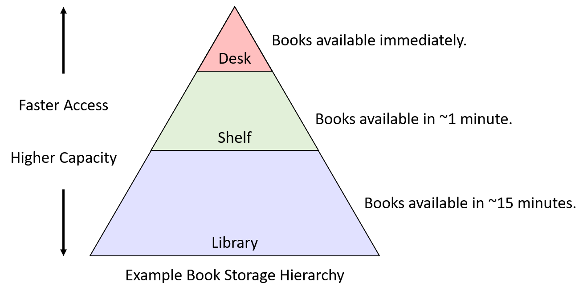

> **说明**
> 本文是个人学习用的**非官方**中英对照译文，原文：<https://diveintosystems.org/book/C11-MemHierarchy/locality.html>。
> 原书采用 CC BY-NC-ND 4.0 许可（禁止演绎），**请勿公开传播本译文**。
> 标为「译注」「现代更新」的内容是译者补充，不代表原书作者观点；代码与原文逐字一致，未作改动。

## 11.3. 局部性

*11.3. Locality*

由于[存储设备](11.1-mem_hierarchy.html)在性能特征和存储容量上差别很大，现代系统集成了多种形式的存储。幸运的是，大多数程序都表现出一些共同的内存访问模式，称为**局部性**（locality），设计者据此构建硬件，利用良好的局部性自动把数据移到合适的存储位置。具体来说，系统把程序正在使用的那部分数据移到靠近 CPU 计算电路的存储中（例如寄存器或 CPU 缓存），以此提高性能。随着需要的数据沿层次结构向上移向 CPU，暂时不用的数据就被移到更远、更慢的存储中，直到程序需要它时为止。

> Because [memory devices vary considerably](11.1-mem_hierarchy.html) in their performance characteristics and storage capacities, modern systems integrate several forms of storage. Luckily, most programs exhibit common memory access patterns, known as **locality**, and designers build hardware that exploits good locality to automatically move data into an appropriate storage location. Specifically, a system improves performance by moving the subset of data that a program is actively using into storage that lives close to the CPU’s computation circuitry (for example, in a register or CPU cache). As necessary data moves up the hierarchy toward the CPU, unused data moves farther away to slower storage until the program needs it.

对系统设计者来说，构建一个利用局部性的系统是一个抽象问题。系统为存储设备提供一种抽象的视图，让程序员看起来仿佛拥有所有存储器容量的总和，同时又具有片上快速存储的性能。当然，这种美好的幻象不可能完美地实现，但通过利用程序的局部性，现代系统对大多数写得好的程序都能获得良好的性能。

> To a system designer, building a system that exploits locality represents an abstraction problem. The system provides an abstract view of memory devices such that it appears to programmers as if they have the sum of all memory capacities with the performance characteristics of fast on-chip storage. Of course, providing this rosy illusion to users can’t be accomplished perfectly, but by exploiting program locality, modern systems achieve good performance for most well-written programs.

系统主要利用两种形式的局部性：

> Systems primarily exploit two forms of locality:

1. **时间局部性**（temporal locality）：程序倾向于在一段时间内反复访问同一数据。也就是说，如果程序最近用过某个变量，它很可能很快会再次使用这个变量。

> 1.  **Temporal locality:** Programs tend to access the same data repeatedly over time. That is, if a program has used a variable recently, it’s likely to use that variable again soon.

2. **空间局部性**（spatial locality）：程序倾向于访问与之前访问过的数据相邻的数据。这里的「相邻」指的是数据的内存地址。例如，如果程序访问了地址 *N* 和 *N+4* 处的数据，它很可能很快就会访问 *N+8*。

> 2.  **Spatial locality:** Programs tend to access data that is nearby other, previously accessed data. "Nearby" here refers to the data’s memory address. For example, if a program accesses data at addresses *N* and *N+4*, it’s likely to access *N+8* soon.

### 11.3.1. 代码中的局部性示例

*11.3.1. Locality Examples in Code*

幸运的是，常见的编程模式经常同时表现出这两种局部性。以下面这个函数为例：

> Fortunately, common programming patterns exhibit both forms of locality quite frequently. Take the following function, for example:

```
/* Sum up the elements in an integer array of length len. */
int sum_array(int *array, int len) {
    int i;
    int sum = 0;

    for (i = 0; i < len; i++) {
        sum += array[i];
    }

    return sum;
}
```

在这段代码中，`for` 循环的重复性为 `i`、`len`、`sum` 和 `array`（数组的基地址）带来了时间局部性，因为程序在每次循环迭代中都会访问这些变量。利用这种时间局部性，系统只需把每个变量从主存加载到 CPU 缓存一次，后续的每次访问都可以由快得多的缓存来满足。

> In this code, the repetitive nature of the `for` loop introduces temporal locality for `i`, `len`, `sum`, and `array` (the base address of the array), as the program accesses each of these variables within every loop iteration. Exploiting this temporal locality allows a system to load each variable from main memory into the CPU cache only once. Every subsequent access can be serviced out of the significantly faster cache.

对数组内容的访问也受益于空间局部性。尽管程序只访问每个数组元素一次，但现代系统每次从内存向 CPU 缓存加载的不止一个 `int`。也就是说，访问数组的第一个元素时，缓存中填入的不仅是第一个整数，还有它后面的几个整数。到底有*多少*个额外的整数被移入缓存，取决于缓存的*块大小*（block size），即一次传入缓存的数据量。

> Accesses to the array’s contents also benefit from spatial locality. Even though the program accesses each array element only once, a modern system loads more than one `int` at a time from memory to the CPU cache. That is, accessing the first array index fills the cache with not only the first integer, but also the next few integers after it, too. Exactly *how many* additional integers get moved into the cache depends on the cache’s *block size* — the amount of data transferred into the cache at once.

例如，在块大小为 16 字节时，系统每次从内存向缓存复制四个整数。因此，访问第一个整数要付出访问主存的相对较高的代价，但接下来三个整数的访问都由缓存满足，即使程序以前从未访问过它们。

> For example, with a 16-byte block size, a system copies four integers from memory to the cache at a time. Thus, accessing the first integer incurs the relatively high cost of accessing main memory, but the accesses to the next three are served out of cache, even if the program has never accessed them previously.

在许多情况下，程序员可以有意编写具有良好局部性模式的代码来帮助系统。例如，考虑访问 *N*×*N* 矩阵每个元素的嵌套循环（本章引言中出现过同一个例子）：

> In many cases, a programmer can help a system by intentionally writing code that exhibits good locality patterns. For example, consider the nested loops that access every element of an *N*×*N* matrix (this same example appeared in this chapter’s introduction):

**表 1.** 访问 *N*x*N* 矩阵每个元素的函数的两个版本。它们的唯一区别是对矩阵的下标顺序，但版本 1（左）的执行速度大约快五倍。

*Table 1. Two versions of a function that accesses every element of an *N*x*N* matrix. They only differ in their memory indexing into the matrix, but version 1 (left) executes approximately five times faster.*

```
float averageMat_v1(int **mat, int n) {
    int i, j, total = 0;

    for (i = 0; i < n; i++) {
        for (j = 0; j < n; j++) {
            // Note indexing: [i][j]
            total += mat[i][j];
        }
    }

    return (float) total / (n * n);
}
```

```
float averageMat_v2(int **mat, int n) {
    int i, j, total = 0;

    for (i = 0; i < n; i++) {
        for (j = 0; j < n; j++) {
            // Note indexing: [j][i]
            total += mat[j][i];
        }
    }

    return (float) total / (n * n);
}
```

在两个版本中，循环变量（`i` 和 `j`）和累加变量（`total`）都表现出良好的时间局部性，因为循环在每次迭代中都会反复使用它们。因此，执行这段代码时，系统会把这些变量存放在 CPU 上的快速存储位置中，以提供良好的性能。

> In both versions, the loop variables (`i` and `j`) and the accumulator variable (`total`) exhibit good temporal locality because the loops repeatedly use them in every iteration. Thus, when executing this code, a system would store those variables in fast on-CPU storage locations to provide good performance.

然而，由于[矩阵在内存中按*行优先顺序*组织](../C2-C_depth/2.5-arrays.html)，第一个版本的代码（左）的执行速度大约是第二个版本（右）的五倍。这种差距来自空间局部性的差异：第一个版本按内存中的顺序（即按连续的内存地址）访问矩阵的值。因此，它能受益于系统把大块数据从内存加载到缓存的做法，因为每个块的值只需付出一次访问内存的代价。

> However, due to the [*row-major order* organization of a matrix in memory](../C2-C_depth/2.5-arrays.html), the first version of the code (left) executes about five times faster than the second version (right). The disparity arises from the difference in spatial locality — the first version accesses the matrix’s values sequentially in memory (that is, in order of consecutive memory addresses). Thus, it benefits from a system that loads large blocks from memory into the cache because it pays the cost of going to memory only once for every block of values.

> **译注**
> 严格说来，这两个函数的参数是 `int **`（数组的数组），各行是分别 `malloc` 出来的，行与行之间不一定相邻；但每一行内部是连续的，所以 v1 逐行访问时同样具有良好的空间局部性。本章引言的译注中，译者在 Apple M1 Pro 上测得 v2 约慢 7 倍。

第二个版本访问矩阵的值时，在不连续的内存地址之间反复跨行跳跃。它在相继的内存访问中*从不*读取同一个缓存块，因此在缓存看来，这个块似乎不再需要了。于是，它每读一个矩阵值都要付出访问内存的代价。

> The second version accesses the matrix’s values by repeatedly jumping between rows across nonsequential memory addresses. It *never* reads from the same cache block in subsequent memory accesses, so it looks to the cache like the block isn’t needed. Thus, it pays the cost of going to memory for every matrix value it reads.

这个例子说明了程序员如何能影响程序执行的系统级开销。编写高性能应用程序时，尤其是以规则模式访问数组的程序，要牢记这些原则。

> This example illustrates how a programmer can affect the system-level costs of a program’s execution. Keep these principles in mind when writing high-performance applications, particularly those that access arrays in a regular pattern.

### 11.3.2. 从局部性到缓存

*11.3.2. From Locality to Caches*

为了帮助说明时间局部性和空间局部性的概念如何促成缓存的设计，我们来看一个用现实生活中熟悉的物品——书——构成的示例场景。假设菲奥娜（Fiona）在宿舍的书桌上完成所有作业，书桌空间很小，只能放三本书。她的房间外面有一个书架，空间比书桌大得多。最后，校园的另一头有一座藏书极其丰富的图书馆。这个例子中的「图书存储层次结构」大致如[图 1](11.3-locality.html) 所示。在这个场景下，我们来探讨局部性如何帮助指导菲奥娜决定把书放在哪个存储位置。

> To help illustrate how the concepts of temporal and spatial locality enable cache designs, we’ll adopt an example scenario with familiar real-world objects: books. Suppose that Fiona does all of her homework at a desk in her dorm room, and the desk has a small amount of space that can store only three books. Just outside her room she keeps a bookshelf, which has much more space than the desk. Finally, across campus her college has a library with a huge variety of books. The "book storage hierarchy" in this example might look something like [Figure 1](11.3-locality.html). Given this scenario, we’ll explore how locality can help guide which storage location Fiona should use to store her books.



**图 1.** 一个假想的图书存储层次结构

*Figure 1. A hypothetical book storage hierarchy*

### 11.3.3. 时间局部性

*11.3.3. Temporal Locality*

时间局部性表明，如果有一本书菲奥娜经常用，她就应该把它放得离书桌越近越好。如果她偶尔需要把它挪到书架上，腾出临时的工作空间，代价也不算太高；但如果第二天还要用，却把书还回图书馆，那就太傻了。反过来也成立：如果有一本书占着书桌或书架上的宝贵空间，而她已经很久没用过它了，那么这本书看来就很适合还回图书馆。

> Temporal locality suggests that, if there’s a book Fiona uses frequently, she should keep it as close to her desk as possible. If she occasionally needs to move it to the shelf to clear up temporary work space, the cost isn’t too high, but it would be silly to take a book back to the library if she’s just going to need it again the next day. The inverse is also true: if there’s a book taking up valuable space on her desk or shelf, and she hasn’t used it for quite a while, that book seems like a good candidate for returning to the library.

那么，菲奥娜应该把哪些书放到她宝贵的书桌上呢？在这个例子中，真实的学生可能会看看接下来的作业，挑出他们预计最有用的那些书。换句话说，为了做出最好的存储决策，他们最好能掌握关于*未来使用情况*的信息。

> So, which books should Fiona move to her precious desk space? In this example, real students would probably look at their upcoming assignments and select the books that they expect to be most useful. In other words, to make the best storage decision, they would ideally need information about *future usage*.

遗憾的是，硬件设计者还没有找到构建能预测未来的电路的方法。作为预测的替代方案，可以设想一个系统，要求程序员或用户事先告诉系统程序将如何使用数据，以便优化数据的放置。这种策略在访问模式*非常*规则的专门应用（例如大型数据库）中可能很有效。然而，在个人计算机这样的通用系统中，要求用户事先告知负担太重：许多用户不愿意（或者没有能力）提供足够的细节来帮助系统做出好的决策。

> Unfortunately, hardware designers haven’t discovered how to build circuits that can predict the future. As an alternative to prediction, one could instead imagine a system that asks the programmer or user to inform the system in advance how a program will use data so that it’s placement could be optimized. Such a strategy may work well in specialized applications (for example, large databases), that exhibit *very* regular access patterns. However, in a general-purpose system like a personal computer, requiring advance notice from the user is too large a burden — many users would not want to (or would be unable to) provide enough detail to help the system make good decisions.

因此，系统不依赖未来的访问信息，而是把过去当作预测未来*可能*发生什么的依据。把这个思路应用到书的例子上，就得到一种管理图书存放空间的相对简单（但仍然很有效）的策略：

> Thus, instead of relying on future access information, systems look to the past as a predictor of what will *likely* happen in the future. Applying this idea to the book example suggests a relatively simple (but still quite effective) strategy for governing book storage spaces:

- 当菲奥娜需要用一本书时，她把这本书从它当前所在的地方取来，放到书桌上。

> - When Fiona needs to use a book, she retrieves it from wherever it currently is and moves it to her desk.

- 如果书桌已经放满了，她就把*最近最少使用*（least recently）的那本书（即在书桌上放着、最长时间没碰过的那本）挪到书架上。

> - If the desk is already full, she moves the book that she used *least recently* (that is, the book that has been sitting on the desk untouched for the longest amount of time) to her shelf.

- 如果书架也满了，她就把书架上最近最少使用的那本书还回图书馆，腾出空间。

> - If the shelf is full, she returns the shelf’s least recently used book to the library to free up space.

尽管这个方案可能并不完美，但它的简单性很有吸引力。它只需要能在各存储位置之间移动书，以及少量关于这些书之前被使用的先后顺序的元信息。此外，这个方案很好地实现了时间局部性最初的两个目标：

> Even though this scheme may not be perfect, the simplicity makes it attractive. All it requires is the ability to move books between storage locations and a small amount of metainformation regarding the order in which books were previously used. Furthermore, this scheme captures the two initial temporal locality objectives well:

1. 经常使用的书很可能一直留在书桌或书架上，避免了不必要的图书馆往返。

> 1.  Frequently used books are likely to remain on the desk or shelf, preventing unnecessary trips to the library.

2. 不常用的书最终会成为最近最少使用的那本，到那时把它还回图书馆就是合理的。

> 2.  Infrequently used books eventually become the least recently used book, at which point returning them to the library makes sense.

把这一策略应用到主存储设备上，看起来与书的例子惊人地相似：当数据从主存加载到 CPU 寄存器时，在 CPU 缓存中为它腾出空间。如果缓存已满，就把最近最少使用的缓存数据**驱逐**（evict）回主存，以腾出缓存空间。在[接下来关于缓存的小节](11.4-caching.html)中，我们会探讨现代缓存系统中是如何构建这类机制的。

> Applying this strategy to primary storage devices looks remarkably similar to the book example: as data is loaded into CPU registers from main memory, make room for it in the CPU cache. If the cache is already full, make room in the cache by **evicting** the least recently used cache data to main memory. In the [following caching section](11.4-caching.html), we’ll explore the details of how such mechanisms are built in to modern caching systems.

### 11.3.4. 空间局部性

*11.3.4. Spatial Locality*

空间局部性表明，菲奥娜去图书馆时，应该多借几本书，以减少以后再去图书馆的可能性。具体来说，她应该把所需那本书「附近」的其他书也借回来，因为附近的书看来很可能就是以后会让她再跑一趟图书馆的那些书。

> Spatial locality suggests that, when making a trip to the library, Fiona should retrieve more than one book to reduce the likelihood of future library trips. Specifically, she should retrieve additional books that are "nearby" the one she needs, because those that are nearby seem like good candidates for books that might otherwise turn into additional library visits.

假设她正在上一门关于莎士比亚历史剧的文学课。如果课程第一周布置她读《亨利六世》上篇，那么当她到图书馆去借这本书时，很可能会在书架上附近找到中篇和下篇。即使她还不知道课程是否会布置另外两篇，认为她*可能*需要它们也并非没有道理。也就是说，正因为它们就在她需要的那本书旁边，需要它们的可能性要比图书馆里随便哪本书高得多。

> Suppose that she’s taking a literature course on the topic of Shakespeare’s histories. If in the first week of the course she’s assigned to read *Henry VI, Part I*, when she finds herself in the library to retrieve it, she’s likely to also find Parts II and III close by on the shelves. Even if she doesn’t yet know whether the course will assign those other two parts, it’s not unreasonable to think that she *might* need them. That is, the likelihood of needing them is much higher than a random book in the library, specifically because they are nearby the book she does need.

在这个场景中，可能性之所以提高，是因为图书馆在书架上摆放书的方式；程序在内存中组织数据的方式也与之类似。例如，数组或 `struct` 这样的编程结构把一组相关的数据存放在一块连续的内存区域中。依次遍历数组中的连续元素时，所访问的内存地址显然具有空间上的规律。把这些空间局部性的经验应用到主存储设备上，意味着系统从主存取数据时，也应当把紧挨着它的周边数据一起取回来。

> In this scenario, the likelihood increases due to the way libraries arrange books on shelves, and programs similarly organize data in memory. For example, a programming construct like an array or a `struct` stores a collection of related data in a contiguous region of memory. When iterating over consecutive elements in an array, there is clearly a spatial pattern in the accessed memory addresses. Applying these spatial locality lessons to primary storage devices implies that, when retrieving data from main memory, the system should also retrieve the data immediately surrounding it.

在下一节中，我们会描述缓存的特征，并介绍硬件自动识别和利用局部性的机制。

> In the next section, we’ll characterize cache characteristics and describe mechanisms for the hardware to make identifying and exploiting locality happen automatically.
