> [!WARNING] 说明
> 本文是个人学习用的**非官方**中英对照译文，原文：<https://diveintosystems.org/book/C11-MemHierarchy/caching.html>。
> 原书采用 CC BY-NC-ND 4.0 许可（禁止演绎），**请勿公开传播本译文**。
> 标为「译注」「现代更新」的内容是译者补充，不代表原书作者观点；代码与原文逐字一致，未作改动。

*11.4. CPU Caches*

在[描述了存储设备](11.2-devices.html)、认识了[时间局部性和空间局部性](11.3-locality.html)这两种重要模式之后，我们就可以来探讨 CPU 缓存是如何设计和实现的了。**缓存**（cache）是 CPU 上一种小而快的存储设备，存放主存的有限子集。缓存面临几个重要的设计问题：

> Having [characterized storage devices](11.2-devices.html) and recognized the important patterns of [temporal and spatial locality](11.3-locality.html), we’re ready to explore how CPU caches are designed and implemented. A **cache** is a small, fast storage device on a CPU that holds limited subsets of main memory. Caches face several important design questions:

- 缓存应当存放程序内存的*哪些*子集？

> - *Which* subsets of a program’s memory should the cache hold?

- 缓存应当在*何时*把程序数据的某个子集从主存复制到缓存，或者反过来？

> - *When* should the cache copy a subset of a program’s data from main memory to the cache, or vice versa?

- 系统*如何*判断程序的数据是否在缓存中？

> - *How* can a system determine whether a program’s data is present in the cache?

在探讨这些棘手的问题之前，我们需要先介绍一些缓存的行为和术语。回想一下，访问内存中的数据时，程序首先[计算数据的内存地址](../C8-IA32/8.1-basics.html)。理想情况下，所需地址处的数据已经在缓存中了，程序就可以完全跳过对主存的访问。为了使性能最大化，硬件会把所需的地址*同时*发送给缓存和主存。由于缓存更快、离 ALU 更近，它的响应比内存快得多。如果数据在缓存中（**缓存命中**，cache hit），缓存硬件就会取消挂起的内存访问，因为缓存提供数据比内存快。

> Before exploring these challenging questions, we need to introduce some cache behavior and terminology. Recall that when accessing data in memory, a program first [computes the data’s memory address](../C8-IA32/8.1-basics.html). Ideally, the data at the desired address already resides in the cache, allowing the program to skip accessing main memory altogether. To maximize performance, the hardware simultaneously sends the desired address to *both* the cache and main memory. Because the cache is faster and closer to the ALU, the cache responds much more quickly than memory. If the data is present in the cache (a **cache hit**), the cache hardware cancels the pending memory access because the cache can serve the data faster than memory.

否则，如果数据不在缓存中（**缓存未命中**，cache miss），CPU 别无选择，只能等待内存取回数据。但关键的是，对主存的请求完成后，CPU 会把取回的数据加载到缓存中，以便后续对同一地址的请求（得益于时间局部性，这很可能发生）能由缓存快速满足。即使未命中的内存访问是*写*内存，CPU 在未命中时仍然会把值加载到缓存中，因为程序将来很可能会再次访问同一位置。

> Otherwise, if the data isn’t in the cache (a **cache miss**), the CPU has no choice but to wait for memory to retrieve it. Critically though, when the request to main memory completes, the CPU loads the retrieved data into the cache so that subsequent requests for the same address (which are likely thanks to temporal locality) can be serviced quickly from the cache. Even if the memory access that misses is *writing* to memory, the CPU still loads the value into the cache on a miss because it’s likely that the program will attempt to access the same location again in the future.

在未命中后把数据加载到缓存时，CPU 常常会发现缓存没有足够的空闲空间。在这种情况下，缓存必须先**驱逐**（evict）一些驻留的数据，为要加载的新数据腾出空间。由于缓存存放的是从主存复制来的数据子集，驱逐已被修改过的缓存数据时，缓存必须先更新主存的内容，然后才能把数据从缓存中驱逐出去。

> When loading data into a cache after a miss, a CPU often finds that the cache doesn’t have enough free space available. In such cases, the cache must first **evict** some resident data to make room for the new data that it’s loading in. Because a cache stores subsets of data copied from main memory, evicting cached data that has been modified requires the cache to update the contents of main memory prior to evicting data from the cache.

为了提供上述所有功能，缓存设计者采用三种设计之一。本节首先考察*直接映射缓存*，它比其他设计更简单。

> To provide all the aforementioned functionality, cache designers employ one of three designs. This section begins by examining *direct-mapped caches*, which are less complex than the other designs.

### 11.4.1. 直接映射缓存

*11.4.1. Direct-Mapped Caches*

直接映射缓存把它的存储空间划分成称为**缓存行**（cache line）的单元。根据缓存的大小，它可能有几十、几百甚至几千个缓存行。在直接映射缓存中，每个缓存行都独立于其他所有缓存行，并包含两类重要的信息：*缓存数据块*和*元数据*。

> A direct-mapped cache divides its storage space into units called **cache lines**. Depending on the size of a cache, it might hold dozens, hundreds, or even thousands of cache lines. In a direct-mapped cache, each cache line is independent of all the others and contains two important types of information: a *cache data block* and *metadata*.

1. **缓存数据块**（cache data block，常简称为**缓存块**，cache block）存放来自主存的程序数据的一个子集。缓存块存放多字节的程序数据块，以利用[空间局部性](11.3-locality.html)。缓存块的大小决定了缓存与主存之间数据传输的单位。也就是说，从内存向缓存加载数据时，缓存每次收到的都是一个缓存块大小的数据块。

    缓存设计者在选择缓存的块大小时需要权衡。在存储预算固定的情况下，缓存可以存放较多的小块，或者较少的大块。使用较大的块能提高空间局部性好的程序的性能，而块数较多则让缓存有机会存放更多样化的内存子集。归根结底，哪种策略性能最好取决于应用程序的工作负载。由于通用 CPU 无法对系统上的应用程序做太多假设，如今典型的 CPU 缓存使用 16 到 64 字节之间的折中块大小。

> 1.  A **cache data block** (often shortened to **cache block**) stores a subset of program data from main memory. Cache blocks store multibyte chunks of program data to take advantage of [spatial locality](11.3-locality.html). The size of a cache block determines the unit of data transfer between the cache and main memory. That is, when loading a cache with data from memory, the cache always receives a chunk of data the size of a cache block.
>
>     Cache designers balance a trade-off in choosing a cache’s block size. Given a fixed storage budget, a cache can store more smaller blocks or fewer larger blocks. Using larger blocks improves performance for programs that exhibit good spatial locality, whereas having more blocks gives a cache the opportunity to store a more diverse subset of memory. Ultimately, which strategy provides the best performance depends on the workload of applications. Because general-purpose CPUs can’t assume much about a system’s applications, a typical CPU cache today uses middle-of-the-road block sizes ranging from 16 to 64 bytes.

> [!NOTE] 译注
> Apple Silicon 是一个例外：译者在 Apple M1 Pro 上用 `sysctl hw.cachelinesize` 查到的缓存行大小是 128 字节。

2. **元数据**（metadata）存放关于缓存行数据块内容的信息。缓存行的元数据*不*包含程序数据，而是维护缓存行的簿记信息（例如，帮助识别缓存行的数据块存放的是内存的哪个子集）。

> 2.  **Metadata** stores information about the contents of the cache line’s data block. A cache line’s metadata does *not* contain program data. Instead, it maintains bookkeeping information for the cache line (for example, to help identify which subset of memory the cache line’s data block holds).

当程序试图访问一个内存地址时，缓存必须知道到哪里去找对应的数据，检查所需的数据在那个缓存位置上是否可用，如果可用，就把所存缓存块的一部分取给发出请求的程序。下面的步骤详细介绍在缓存中查找并取出数据的过程。

> When a program attempts to access a memory address, a cache must know where to look to find the corresponding data, check whether the desired data is available at that cache location, and if so, retrieve a portion of the stored cache block to the requesting application. The following steps walk through the details of this process for finding data in a cache and retrieving it.

#### 定位缓存中的数据

*Locating Cached Data*

缓存必须能够快速判断与所请求地址对应的内存子集当前是否在缓存中。要回答这个问题，缓存首先必须确定要检查哪一个（或哪些）缓存行。在直接映射缓存中，内存中的每个地址都对应于*恰好*一个缓存行。这一限制正是*直接映射*这个名字的由来：它把每个内存地址直接映射到一个缓存行。

> A cache must be able to quickly determine whether the subset of memory corresponding to a requested address currently resides in the cache. To answer that question, a cache must first determine which cache line(s) to check. In a direct-mapped cache, each address in memory corresponds to *exactly* one cache line. This restriction explains the *direct-mapped* name — it maps every memory address directly to one cache line.

[图 1](11.4-caching.html) 展示了在一个有四个缓存行、缓存块大小为 32 字节的小型直接映射缓存中，内存地址是如何映射到缓存行的。回想一下，缓存的块大小代表缓存与主存之间数据传输的最小单位。因此，每个内存地址都落在某个 32 字节的范围内，而每个范围映射到一个缓存行。

> [Figure 1](11.4-caching.html) shows how memory addresses map to cache lines in a small direct-mapped cache with four cache lines and a 32-byte cache block size. Recall that a cache’s block size represents the smallest unit of data transfer between a cache and main memory. Thus, every memory address falls within one 32-byte range, and each range maps to one cache line.

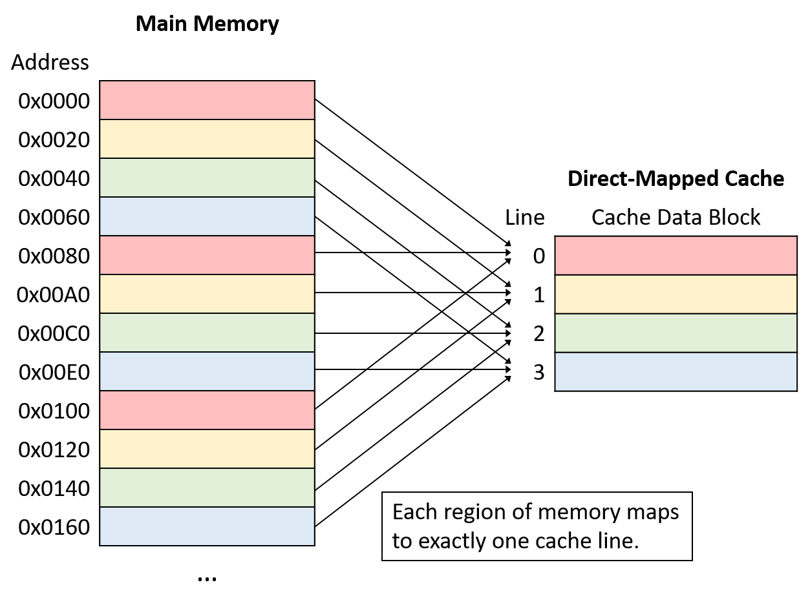

**图 1.** 在一个有四个缓存行、缓存块为 32 字节的直接映射缓存中，内存地址到缓存行的映射示例

*Figure 1. An example mapping of memory addresses to cache lines in a four-line direct-mapped cache with 32-byte cache blocks*

注意，尽管每个内存区域只映射到一个缓存行，但许多内存范围会映射到*同一个*缓存行。映射到同一缓存行的所有内存区域（即[图 1](11.4-caching.html) 中颜色相同的块）争夺同一个缓存行的空间，所以每种颜色的区域一次只能有一个驻留在缓存中。

> Note that although each region of memory maps to only one cache line, many memory ranges map to the *same* cache line. All of the memory regions that map the same cache line (that is, chunks of the same color in [Figure 1](11.4-caching.html)) compete for space in the same cache line, so only one region of each color can reside in the cache at a time.

缓存使用内存地址中的一部分位，把内存地址映射到缓存行。为了把数据更均匀地分散到各个缓存行中，缓存使用取自内存地址*中间*的位来确定地址映射到哪一行，这部分称为地址的**索引**（index）部分。用作索引的位数（各不相同）决定了缓存有多少行。[图 2](11.4-caching.html) 展示了内存地址的索引部分指向一个缓存行。

> A cache maps a memory address to a cache line using a portion of the bits in the memory address. To spread data more evenly among cache lines, caches use bits taken from the *middle* of the memory address, known as the **index** portion of the address, to determine which line the address maps to. The number of bits used as the index (which varies) determines how many lines a cache will hold. [Figure 2](11.4-caching.html) shows the index portion of a memory address referring to a cache line.

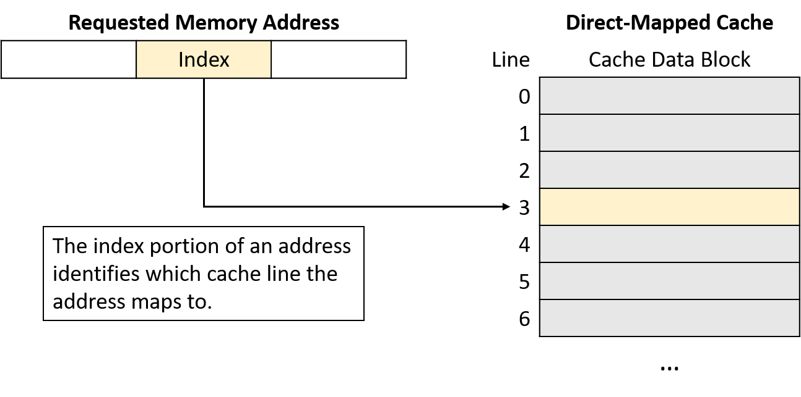

**图 2.** 内存地址中间的*索引*部分确定一个缓存行。

*Figure 2. The middle *index* portion of a memory address identifies a cache line.*

当程序数据聚集在一起时（局部性好的程序常常如此），使用地址的中间部分可以减少对同一缓存行的争夺。也就是说，程序倾向于把变量彼此相邻地存放在少数几个位置（例如栈上或堆上）。这些聚集在一起的变量具有相同的高位地址位。因此，如果用高位来做索引，这些聚集的变量就会全都映射到同一些缓存行上，让缓存的其余部分闲置。通过使用地址中间的位，缓存能把数据更均匀地分散到可用的缓存行中。

> Using the middle of the address reduces competition for the same cache line when program data is clustered together, which is often the case for programs that exhibit good locality. That is, programs tend to store variables nearby one another in one of a few locations (for example, on the stack or heap). Such clustered variables share the same high-order address bits. Thus, indexing with the high-order bits would cause the clustered variables to all map to the same cache lines, leaving the rest of the cache unused. By using bits from the middle of the address, caches spread data more evenly among the available cache lines.

#### 识别缓存中的内容

*Identifying Cache Contents*

接下来，找到合适的缓存行后，缓存必须判断该行是否存有所请求的地址。由于多个内存范围映射到同一个缓存行，缓存要检查该行的元数据来回答两个重要问题：*这个缓存行存放的是不是有效的内存子集？* *如果是，它当前存放的是映射到这个缓存行的众多内存子集中的哪一个？*

> Next, having located the appropriate cache line, the cache must determine whether that line holds the requested address. Because multiple memory ranges map to the same cache line, the cache examines the line’s metadata to answer two important questions: *Does this cache line hold a valid subset of memory?* *If so, which of the many subsets of memory that map to this cache line does it currently hold?*

为了回答这些问题，每个缓存行的元数据都包含一个有效位和一个标记。**有效位**（valid bit）是一个单独的位，表示该行当前是否存放着有效的内存子集（有效位为 1 时）。无效的行（有效位为 0）永远不会产生缓存命中，因为还没有数据被加载进去。无效的行实际上代表缓存中的空闲空间。

> To answer these questions, each cache line’s metadata includes a valid bit and a tag. The **valid bit** is a single bit that indicates whether a line is currently storing a valid subset of memory (if valid is set to 1). An invalid line (if valid is set to 0) never produces a cache hit because no data has been loaded into it. Invalid lines effectively represent free space in the cache.

除了有效位之外，每个缓存行的元数据还存有一个**标记**（tag），它唯一地标识该行的缓存块存放的是内存的哪个子集。标记字段存放缓存行中所存地址范围的高位，让缓存行能够记录它的数据块来自内存中的哪个位置。换句话说，由于许多内存子集映射到同一个缓存行（那些索引位相同的子集），标记记录的是其中哪一个子集当前存在于缓存行中。

> In addition to a valid bit, each cache line’s metadata stores a **tag** that uniquely identifies which subset of memory the line’s cache block holds. The tag field stores the high-order bits of the address range stored in the cache line and allows a cache line to track where in memory its data block came from. In other words, because many memory subsets map to the same cache line (those with the same index bits), the tag records which of those subsets is currently present in the cache line.

要让缓存查找产生命中，缓存行中存放的标记字段必须与程序所请求内存地址的标记部分（高位）完全匹配。标记不匹配表示缓存行的数据块不包含所请求的内存，即使该行存放的是有效数据。[图 3](11.4-caching.html) 展示了缓存如何把内存地址划分为标记和索引，用索引位选出目标缓存行，验证该行的有效位，并检查该行的标记是否匹配。

> For a cache lookup to produce a hit, the tag field stored in the cache line must exactly match the tag portion (upper bits) of the program’s requested memory address. A tag mismatch indicates that a cache line’s data block does not contain the requested memory, even if the line stores valid data. [Figure 3](11.4-caching.html) illustrates how a cache divides a memory address into a tag and an index, uses the index bits to select a target cache line, verifies a line’s valid bit, and checks the line’s tag for a match.

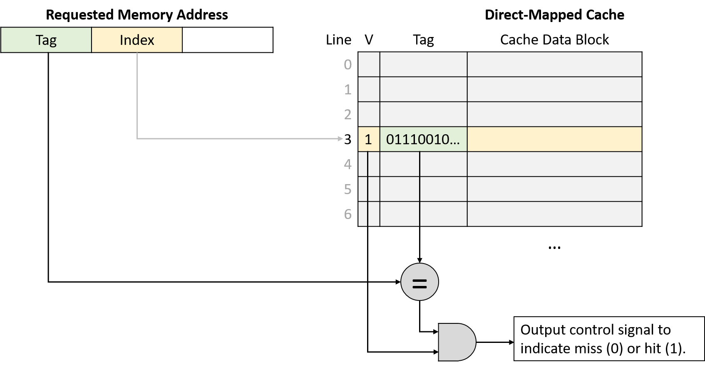

**图 3.** 用所请求内存地址的索引位找到合适的缓存行后，缓存同时验证该行的有效位，并把它的标记与所请求地址的标记进行比较。如果该行有效且标记匹配，查找就以命中告终。

*Figure 3. After using the requested memory address’s index bits to locate the proper cache line, the cache simultaneously verifies the line’s valid bit and checks its tag against the requested address’s tag. If the line is valid with a matching tag, the lookup succeeds as a hit.*

#### 取出缓存中的数据

*Retrieving Cached Data*

最后，用程序所请求的内存地址找到合适的缓存行，并验证该行存放着包含该地址的有效内存子集之后，缓存把所请求的数据发送给 CPU 中需要它的部件。由于缓存行数据块的大小（例如 64 字节）通常比程序请求的数据量（例如 4 字节）大得多，缓存把所请求地址的低位用作缓存数据块内的**偏移**（offset）。[图 4](11.4-caching.html) 描绘了地址的偏移部分如何确定程序想取的是缓存块中的哪些字节。

> Finally, after using the program’s requested memory address to find the appropriate cache line and verifying that the line holds a valid subset of memory containing that address, the cache sends the requested data to the CPU’s components that need it. Because a cache line’s data block size (for example, 64 bytes) is typically much larger than the amount of data that programs request (for example, 4 bytes), caches use the low-order bits of the requested address as an **offset** into the cached data block. [Figure 4](11.4-caching.html) depicts how the offset portion of an address identifies which bytes of a cache block the program expects to retrieve.

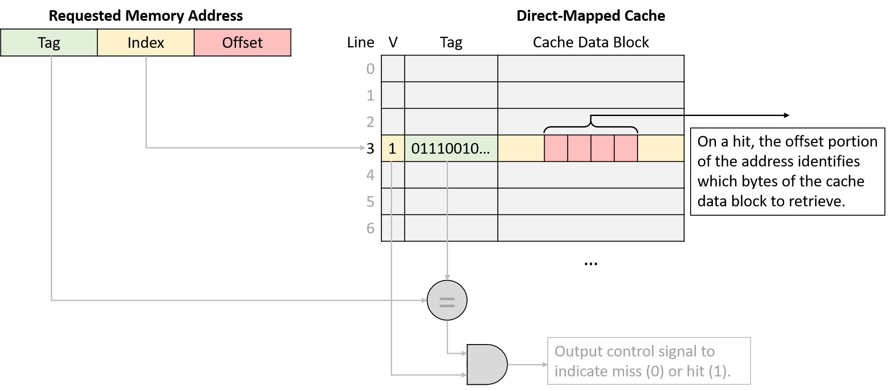

**图 4.** 给定一个缓存数据块，地址的偏移部分确定程序想取的是哪些字节。

*Figure 4. Given a cache data block, the offset portion of an address identifies which bytes the program wants to retrieve.*

#### 内存地址的划分

*Memory Address Division*

缓存的*尺寸参数*决定了内存地址中有多少位被解释为偏移、索引和标记部分。等价地，地址中每一部分的位数也意味着缓存必须具有怎样的尺寸参数。在确定地址的哪些位属于哪一部分时，从右往左（即从最低有效位到最高有效位）考虑地址会很有帮助。

> The *dimensions* of a cache dictate how many bits to interpret as the offset, index, and tag portions of a memory address. Equivalently, the number of bits in each portion of an address imply what the dimensions of a cache must be. In determining which bits belong to each portion of an address, it’s helpful to consider the address from right to left (that is, from least to most significant bit).

地址最右边的部分是*偏移*，它的长度取决于缓存的块大小。地址的偏移部分必须有足够的位，以便指向缓存数据块中每一个可能的字节。例如，假设缓存存放 32 字节的数据块。由于程序可能来要这 32 个字节中的任何一个，缓存需要足够的偏移位来准确描述程序想要的是 32 个可能位置中的哪一个。在这种情况下，偏移需要五位，因为表示 32 个不同的值需要五位（log232 = 5）。反过来，偏移使用四位的缓存，必定存放 16 字节的数据块（24 = 16）。

> The rightmost portion of the address is the *offset*, and its length depends on a cache’s block size dimension. The offset portion of an address must contain enough bits to refer to every possible byte within a cache data block. For example, suppose that a cache stores 32-byte data blocks. Because a program might come along asking for any of those 32 bytes, the cache needs enough offset bits to describe exactly which of the 32 possible positions the program might want. In this case, it would need five bits for the offset because five bits are necessary to represent 32 unique values (log232 = 5). In the reverse direction, a cache that uses four bits for the offset must store 16-byte data blocks (24 = 16).

地址的*索引*部分紧挨在偏移的左边。要确定索引的位数，就要考虑缓存的行数，因为索引需要足够的位来唯一地标识每一个缓存行。用与偏移类似的逻辑，有 1,024 行的缓存需要 10 位索引（log2 1,024 = 10）。同样，索引使用 12 位的缓存必定有 4,096 行（212 = 4,096）。

> The *index* portion of the address begins immediately to the left of the offset. To determine the number of index bits, consider the number of lines in the cache, given that the index needs enough bits to uniquely identify every cache line. Using similar logic to the offset, a cache with 1,024 lines needs 10 bits for the index (log2 1,024 = 10). Likewise, a cache that uses 12 bits for the index must have 4,096 lines (212 = 4,096).

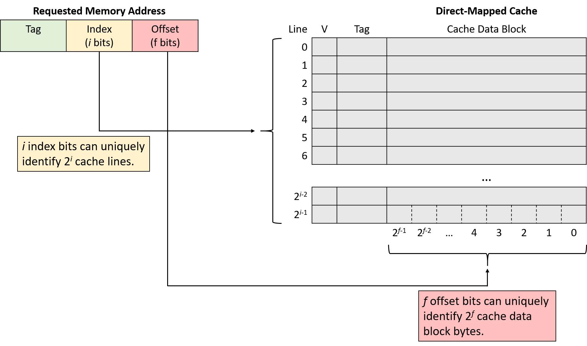

**图 5.** 地址的索引部分唯一地标识一个缓存行，偏移部分唯一地标识该行数据块中的一个位置。

*Figure 5. The index portion of an address uniquely identifies a cache line, and the offset portion uniquely identifies a position in the line’s data block.*

地址中剩下的位构成标记。由于标记必须唯一地标识缓存行中所含的内存子集，标记必须使用地址中*所有*剩余的、未被占用的位。例如，如果机器使用 32 位地址，一个有 5 个偏移位和 10 个索引位的缓存，就用地址中剩下的 32 - 15 = 17 位来表示标记。

> The remaining address bits form the tag. Because the tag must uniquely identify the subset of memory contained within a cache line, the tag must use *all* of the remaining, unclaimed bits of the address. For example, if a machine uses 32-bit addresses, a cache with 5 offset bits and 10 index bits uses the remaining 32 - 15 = 17 bits of the address to represent the tag.

#### 直接映射的读取示例

*Direct-Mapped Read Examples*

考虑一个具有以下特征的 CPU：

> Consider a CPU with the following characteristics:

- 16 位内存地址

> - 16-bit memory addresses

- 一个有 128 个缓存行的直接映射缓存

> - a direct-mapped cache with 128 cache lines

- 32 字节的缓存数据块。

> - 32-byte cache data blocks.

缓存开始时是空的（所有行都无效），如[图 6](11.4-caching.html) 所示。

> The cache starts empty (all lines are invalid), as shown in [Figure 6](11.4-caching.html).

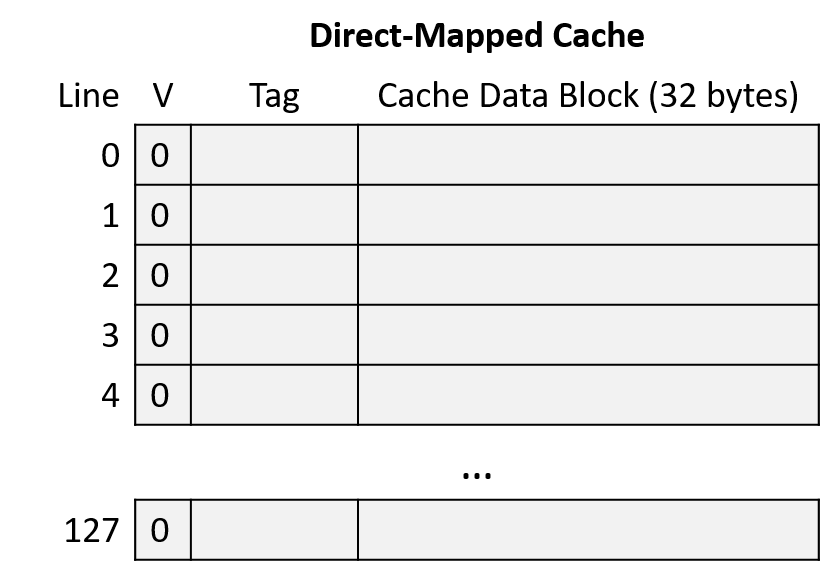

**图 6.** 一个空的直接映射示例缓存

*Figure 6. An empty direct-mapped example cache*

假设在这个 CPU 上运行的程序访问下面这些内存位置：

> Suppose that a program running on this CPU accesses the following memory locations:

1. 读地址 1010000001100100

> 1.  Read from address 1010000001100100

2. 读地址 1010000001100111

> 2.  Read from address 1010000001100111

3. 读地址 1001000000100000

> 3.  Read from address 1001000000100000

4. 读地址 1111000001100101

> 4.  Read from address 1111000001100101

把整个序列串起来，跟踪缓存的行为时按照下面的步骤：

> To put the entire sequence together, follow these steps when tracing the behavior of a cache:

1. 把所请求的地址从右（低位）到左（高位）划分为三部分：缓存数据块内的偏移、指向相应缓存行的索引，以及标识该行存放的是哪个内存子集的标记。

> 1.  Divide the requested address into three portions, from right (low-order bits) to left (high-order bits): an offset within the cache data block, an index into the appropriate cache line, and a tag to identify which subset of memory the line stores.

2. 用所请求地址的中间部分索引缓存，找到该地址映射到的缓存行。

> 2.  Index into the cache using the middle portion of the requested address to find the cache line to which the address maps.

3. 检查缓存行的有效位。有效位无效时，无论标记是什么，程序都不能使用该缓存行的内容（缓存未命中）。

> 3.  Check the cache line’s valid bit. When invalid, the program can’t use a cache line’s contents (cache miss), regardless of what the tag might be.

4. 检查缓存行的标记。如果地址的标记与缓存行的标记匹配并且该行有效，那么缓存行的数据块中就存有程序要找的数据（缓存命中）。否则，缓存必须从主存中把数据加载到所确定的索引处（缓存未命中）。

> 4.  Check the cache line’s tag. If the address’s tag matches the cache line’s tag and the line is valid, the cache line’s data block holds the data the program is looking for (cache hit). Otherwise, the cache must load the data from main memory at the identified index (cache miss).

5. 命中时，用地址的低位偏移从所存的块中取出程序想要的数据。（示例中未展示。）

> 5.  On a hit, use the low-order offset bits of the address to extract the program’s desired data from the stored block. (Not shown in example.)

##### 地址划分

*Address Division*

首先确定如何把内存地址划分为*偏移*、*索引*和*标记*部分。从低位到高位（从右到左）考虑地址的各个部分：

> Begin by determining how to divide the memory addresses into their *offset*, *index*, and *tag* portions. Consider the address portions from low-order to high-order bits (right to left):

- *偏移*：块大小为 32 字节，意味着地址最右边的五位（log2 32 = 5）构成偏移部分。有了五位，偏移就能唯一地标识块中 32 个字节中的任何一个。

> - *Offset*: A 32-byte block size implies that the rightmost five bits of the address (log2 32 = 5) comprise the offset portion. With five bits, the offset can uniquely identify any of the 32 bytes in block.

- *索引*：缓存有 128 行，意味着地址接下来的七位（log2 128 = 7）构成索引部分。有了七位，索引就能唯一地标识每一个缓存行。

> - *Index*: A cache with 128 lines implies that the next seven bits of the address (log2 128 = 7) comprise the index portion. With seven bits, the index can uniquely identify each cache line.

- *标记*：标记由不属于偏移或索引的所有剩余地址位组成。在这里，地址还剩下四位构成标记（16 - (5 + 7) = 4）。

> - *Tag*: The tag consists of any remaining address bits that don’t belong to the offset or index. Here, the address has four remaining bits left that form the tag (16 - (5 + 7) = 4).

------------------------------------------------------------------------

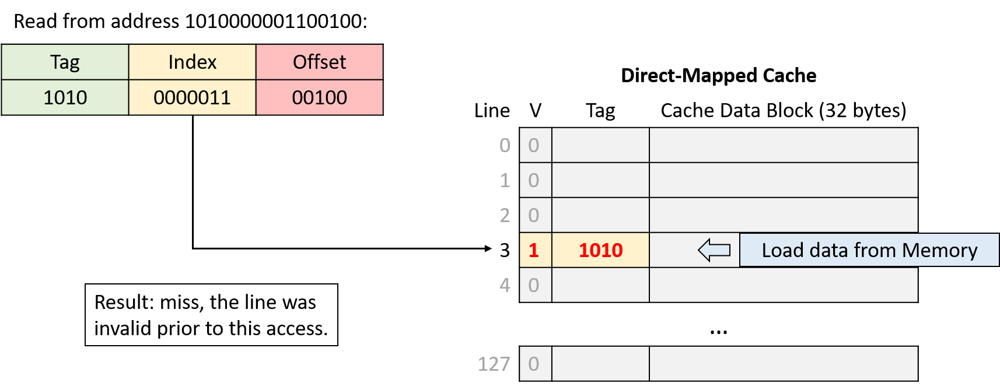

**图 7.** 读地址 1010000001100100。索引 0000011（第 3 行）无效，所以请求未命中，缓存从主存加载数据。

*Figure 7. Read from address 1010000001100100. Index 0000011 (line 3) is invalid, so the request misses and the cache loads data from main memory.*

------------------------------------------------------------------------

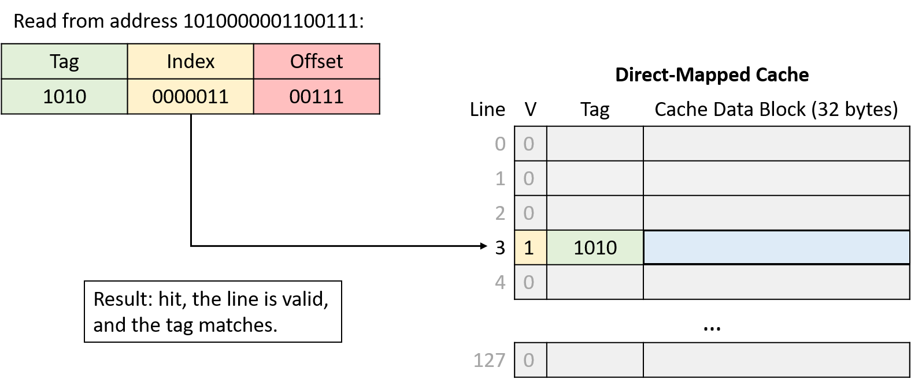

**图 8.** 读地址 1010000001100111。索引 0000011（第 3 行）有效，并且标记（1010）匹配，所以请求命中。缓存给出其数据块中从第 7 个字节（偏移 0b00111）开始的数据。

*Figure 8. Read from address 1010000001100111. Index 0000011 (line 3) is valid, and the tag (1010) matches, so the request hits. The cache yields data beginning at byte 7 (offset 0b00111) of its data block.*

------------------------------------------------------------------------

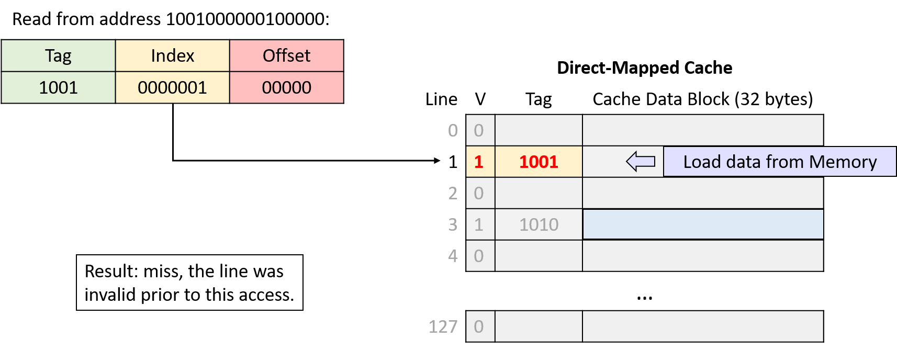

**图 9.** 读地址 1001000000100000。索引 0000001（第 1 行）无效，所以请求未命中，缓存从主存加载数据。

*Figure 9. Read from address 1001000000100000. Index 0000001 (line 1) is invalid, so the request misses and the cache loads data from main memory.*

------------------------------------------------------------------------

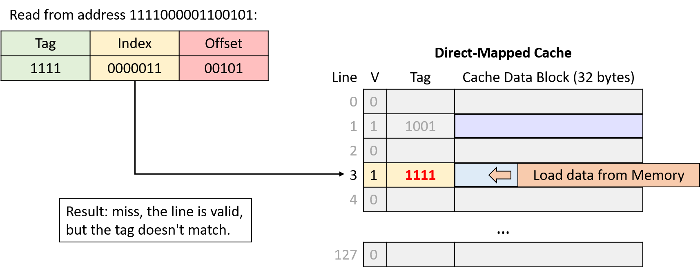

**图 10.** 读地址 1111000001100101。索引 0000011（第 3 行）有效，但标记不匹配，所以请求未命中，缓存从主存加载数据。

*Figure 10. Read from address 1111000001100101. Index 0000011 (line 3) is valid, but the tag doesn’t match, so the request misses and the cache loads data from main memory.*

#### 写缓存中的数据

*Writing to Cached Data*

到目前为止，本节主要考虑的是 CPU 在缓存中执行查找的读内存操作。缓存还必须允许程序存储值，它们用以下两种策略之一来支持存储操作。

> So far, this section has primarily considered memory read operations for which a CPU performs lookups in the cache. Caches must also allow programs to store values, and they support store operations with one of two strategies.

1. 在**写直达缓存**（write-through cache）中，写内存操作修改缓存中的值，同时更新主存的内容。也就是说，写操作*总是*立即同步缓存和主存的内容。

> 1.  In a **write-through cache**, a memory write operation modifies the value in the cache and simultaneously updates the contents of main memory. That is, a write operation *always* synchronizes the contents of the cache and main memory immediately.

2. 在**写回缓存**（write-back cache）中，写内存操作修改缓存数据块中存放的值，但*不*更新主存。因此，更新缓存中的数据之后，写回缓存的内容就与主存中对应的数据不同了。

> 2.  In a **write-back cache**, a memory write operation modifies the value stored in the cache’s data block, but it does *not* update main memory. Thus, after updating the cache’s data, a write-back cache’s contents differ from the corresponding data in main memory.

为了识别那些内容与主存中对应数据不同的缓存块，写回缓存中的每一行都额外存放一位元数据，称为**脏位**（dirty bit）。从脏的缓存行驱逐数据块时，必须先把缓存块的数据写回主存，使两者的内容同步。[图 11](11.4-caching.html) 展示了一个包含脏位的直接映射缓存，脏位标出了在驱逐时必须写回内存的那些行。

> To identify cache blocks whose contents differ from their main memory counterparts, each line in a write-back cache stores an additional bit of metadata, known as a **dirty bit**. When evicting the data block from a dirty cache line, the cache block’s data must first be written back to main memory to synchronize their contents. [Figure 11](11.4-caching.html) shows a direct-mapped cache that includes a dirty bit to mark lines that must be written to memory upon eviction.

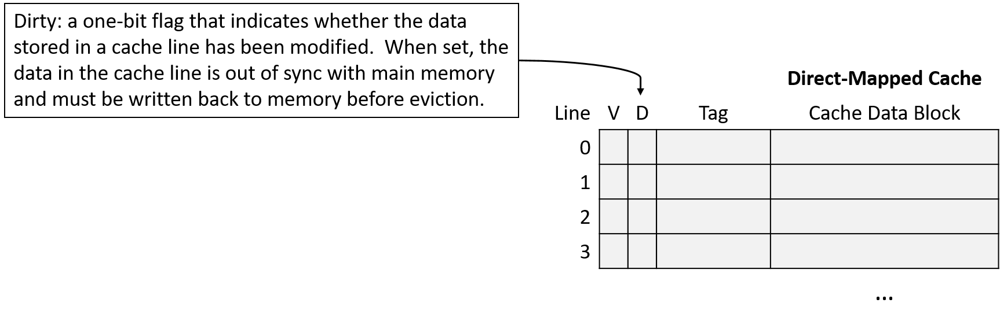

**图 11.** 扩展了脏位的缓存

*Figure 11. Cache extended with a dirty bit*

照例，不同设计之间的差异体现了一种权衡。写直达缓存比写回缓存简单，而且不必为每一行额外存放脏位这种元数据。另一方面，写回缓存能降低反复写同一内存位置的代价。

> As usual, the difference between the designs reveals a trade-off. Write-through caches are less complex than write-back caches, and they avoid storing extra metadata in the form of a dirty bit for each line. On the other hand, write-back caches reduce the cost of repeated writes to the same location in memory.

例如，假设程序频繁地更新同一个变量，而该变量所在的内存从未被驱逐出缓存。写直达缓存在每次更新时都要写主存，尽管后一次更新只是覆盖前一次；而写回缓存只在最终驱逐缓存块时才写内存。由于把一次内存访问的代价分摊到多次写操作上能显著提高性能，大多数现代缓存都选择写回设计。

> For example, suppose that a program frequently updates the same variable without that variable’s memory ever being evicted from the cache. A write-through cache writes to main memory on every update, even though each subsequent update is just going to overwrite the previous one, whereas a write-back cache writes to memory only when eventually evicting the cache block. Because amortizing the cost of a memory access across many writes significantly improves performance, most modern caches opt for a write-back design.

#### 直接映射的写入示例（写回）

*Direct-Mapped Write Examples (Write-Back)*

对缓存的写操作与读操作类似，只是还要设置被修改缓存行的脏位。驱逐一个脏的缓存行时，缓存必须先把修改过的数据块写回内存，然后才能丢弃它。

> Writes to the cache behave like reads, except they also set the modified cache line’s dirty bit. When evicting a dirty cache line, the cache must write the modified data block to memory before discarding it.

假设上面描述的示例场景继续进行另外两次内存访问：

> Suppose that the example scenario described above continues with two additional memory accesses:

5. 写地址：1111000001100000

> 5.  Write to address: 1111000001100000

6. 写地址：1010000001100100

> 6.  Write to address: 1010000001100100

------------------------------------------------------------------------

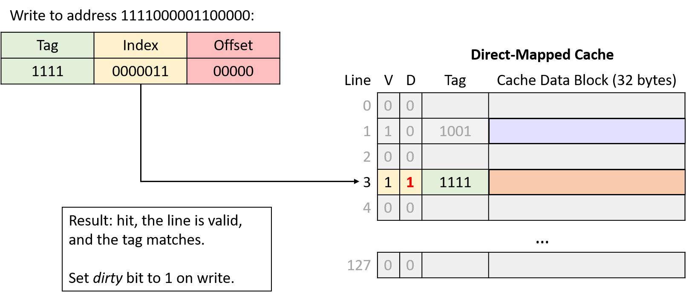

**图 12.** 写地址 1111000001100000。索引 0000011（第 3 行）有效，并且标记（1111）匹配，所以请求命中。由于这次访问是写操作，缓存把该行的脏位设为 1。

*Figure 12. Write to address 1111000001100000. Index 0000011 (line 3) is valid, and the tag (1111) matches, so the request hits. Because this access is a write, the cache sets the line’s dirty bit to 1.*

------------------------------------------------------------------------

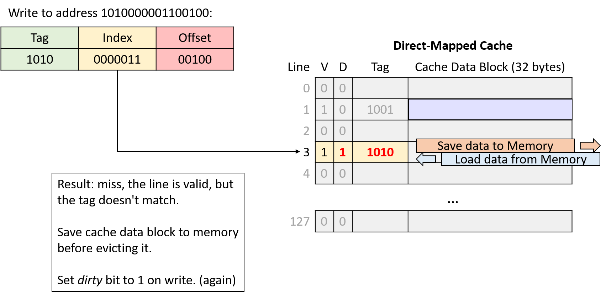

**图 13.** 写地址 1010000001100100。索引 0000011（第 3 行）有效，但标记不匹配，所以请求未命中。由于目标行既有效又是脏的，缓存必须先把现有的数据块保存到主存，然后才能加载新的数据块。这次访问是写操作，所以缓存把新加载的行的脏位设为 1。

*Figure 13. Write to address 1010000001100100. Index 0000011 (line 3) is valid, but the tag doesn’t match, so the request misses. Because the target line is both valid and dirty, the cache must save the existing data block to main memory before loading the new one. This access is a write, so the cache sets the newly loaded line’s dirty bit to 1.*

在本例的第四次和第六次内存访问中，缓存驱逐了数据，因为两个内存区域在争夺同一个缓存行。接下来，我们将探讨一种旨在减少这类争夺的不同缓存设计。

> In the fourth and sixth memory accesses of the example, the cache evicts data because two memory regions are competing for the same cache line. Next, we’ll explore a different cache design that aims to reduce this type of competition.

### 11.4.2. 缓存未命中与相联设计

*11.4.2. Cache Misses and Associative Designs*

缓存设计者的目标是使缓存的命中率最大化，以确保尽可能多的内存请求不必访问主存。尽管局部性为获得良好的命中率带来了希望，但由于多种原因，真实的缓存不可能指望每次访问都命中：

> Cache designers aim to maximize a cache’s hit rate to ensure that as many memory requests as possible can avoid going to main memory. Even though locality provides hope for achieving a good hit rate, real caches can’t expect to hit on every access for a variety of reasons:

- **强制性未命中**（compulsory miss）或**冷启动未命中**（cold-start miss）：如果程序从未访问过某个内存位置（或它附近的任何位置），它就几乎不可能在缓存中找到该位置的数据。因此，程序首次访问新的内存地址时，常常无法避免缓存未命中。

> - **Compulsory misses** or **cold-start misses**: If a program has never accessed a memory location (or any location near it), it has little hope of finding that location’s data in the cache. Thus, programs often cannot avoid cache misses when first accessing new memory addresses.

- **容量未命中**（capacity miss）：缓存存放主存的一个子集，理想情况下，它*恰好*存放程序正在使用的那部分内存。然而，如果程序正在使用的内存超过了缓存能容纳的量，它就不可能在缓存中找到想要的*所有*数据，从而导致未命中。

> - **Capacity misses**: A cache stores a subset of main memory, and ideally, it stores *exactly* the subset of memory that a program is actively using. However, if a program is actively using more memory than fits in the cache, it can’t possibly find *all* of the data it wants in the cache, leading to misses.

- **冲突未命中**（conflict miss）：为了降低查找数据的复杂度，有些缓存设计限制了数据在缓存中可以存放的位置，这些限制可能导致未命中。例如，即使直接映射缓存没有 100% 装满，程序也可能碰巧有两个常用变量的地址映射到同一个缓存位置。在这种情况下，由于它们争夺同一个缓存行，对其中一个变量的每次访问都会把另一个驱逐出缓存。

> - **Conflict misses**: To reduce the complexity of finding data, some cache designs limit where in the cache data can reside, and those restrictions can lead to misses. For example, even if a direct-mapped cache is not 100% full, a program might end up with the addresses of two frequently used variables mapping to the same cache location. In such cases, each access to one of those variables evicts the other from the cache as they compete for the same cache line.

每种未命中的相对频率取决于程序的内存访问模式。不过一般来说，在不增大缓存的前提下，缓存的设计主要影响的是冲突未命中率。尽管直接映射缓存比其他设计简单，但它受冲突的影响最大。

> The relative frequency of each miss type depends on a program’s memory access pattern. In general though, without increasing the cache size, a cache’s design mainly affects its conflict miss rate. Although direct-mapped caches are less complex than other designs, they suffer the most from conflicts.

直接映射缓存的替代方案是*相联*（associative）缓存。相联设计让缓存能灵活地在多个位置中选择一个来存放某个内存区域。直观地说，可选的存放位置越多，冲突的可能性就越小，但每次访问需要检查的位置也越多，复杂度随之增加。

> The alternative to a direct-mapped cache is an *associative* cache. An associative design gives a cache the flexibility to choose among more than one location to store a region of memory. Intuitively, having more storage location options reduces the likelihood of conflicts but also increases complexity due to more locations needing to be checked on every access.

**全相联**（fully associative）缓存允许任何内存区域占据任何缓存位置。全相联缓存提供了最大的灵活性，但它的查找和驱逐复杂度也最高，因为任何操作都要同时考虑每一个位置。尽管全相联缓存在一些小型的专门应用（例如 [TLB](../C13-OS/13.3-vm.html)）中很有价值，但其高复杂度使它一般不适合用作通用 CPU 的缓存。

> A **fully associative** cache allows any memory region to occupy any cache location. Fully associative caches offer the most flexibility, but they also have the highest lookup and eviction complexity because every location needs to be simultaneously considered during any operation. Although fully associative caches are valuable in some small, specialized applications (for example, [TLBs](../C13-OS/13.3-vm.html)), their high complexity makes them generally unfit for a general-purpose CPU cache.

**组相联**（set associative）缓存介于直接映射和全相联设计之间，因而很适合通用 CPU。在组相联缓存中，每个内存区域恰好映射到一个**缓存组**（cache set），但每个组存放多个缓存行。一个组中允许的行数是缓存的一个固定尺寸参数，组相联缓存通常每组存放二到八行。

> **Set associative** caches occupy the middle ground between direct-mapped and fully associative designs, which makes them well suited for general-purpose CPUs. In a set associative cache, every memory region maps to exactly one **cache set**, but each set stores multiple cache lines. The number of lines allowed in a set is a fixed dimension of a cache, and set associative caches typically store two to eight lines per set.

### 11.4.3. 组相联缓存

*11.4.3. Set Associative Caches*

组相联设计在复杂度与冲突之间提供了很好的折中。组中的行数限制了缓存在一次查找中需要检查的位置数，而映射到同一组的多个内存区域，除非整个组都满了，否则不会引发冲突未命中。

> A set associative design offers a good compromise between complexity and conflicts. The number of lines in a set limits how many places a cache needs to check during a lookup, and multiple memory regions that map to the same set don’t trigger conflict misses unless the entire set fills.

在组相联缓存中，内存地址的*索引*部分把地址映射到一组缓存行。执行地址查找时，缓存同时检查组中的每一行。[图 14](11.4-caching.html) 展示了二路组相联缓存中的标记和有效位检查。

> In a set associative cache, the *index* portion of a memory address maps the address to one set of cache lines. When performing an address lookup, the cache simultaneously checks every line in the set. [Figure 14](11.4-caching.html) illustrates the tag and valid bit checks in a two-way set associative cache.

如果组中某个有效行的标记与地址的标记部分匹配，这个匹配的行就完成了查找。当查找把范围缩小到只有一个缓存行时，接下来的过程就和直接映射缓存一样：缓存用地址的*偏移*把所需的字节从该行的缓存块发送给 CPU 的运算部件。

> If any of a set’s valid lines contains a tag that matches the address’s tag portion, the matching line completes the lookup. When the lookup narrows the search to just one cache line, it proceeds like a direct-mapped cache: the cache uses the address’s *offset* to send the desired bytes from the line’s cache block to the CPU’s arithmetic components.

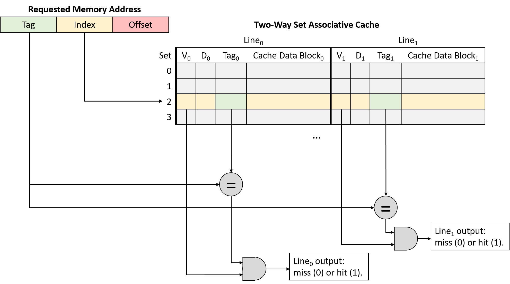

**图 14.** 二路组相联缓存中的有效位验证与标记匹配

*Figure 14. Valid bit verification and tag matching in a two-way set associative cache*

一个组中有多个缓存行带来的额外灵活性减少了冲突，但也引入了一个新的麻烦：把值加载到缓存中时（以及驱逐已驻留在缓存中的数据时），缓存必须决定使用候选行中的*哪一行*。

> The additional flexibility of multiple cache lines in a set reduces conflicts, but it also introduces a new wrinkle: when loading a value into a cache (and when evicting data already resident in the cache), the cache must decide *which* of the line options to use.

为了帮助解决这个选择问题，缓存求助于局部性的思想。具体来说，时间局部性表明最近使用过的数据很可能会被再次使用。因此，缓存采用了上一节[管理示例书架](11.3-locality.html)时用过的同一策略：在决定驱逐组中的哪一行时，选择最近最少使用（least recently used，LRU）的那一行。LRU 被称为一种**缓存替换策略**（cache replacement policy），因为它支配着缓存的驱逐机制。

> To help solve this selection problem, caches turn to the idea of locality. Specifically, temporal locality suggests that recently used data is likely to be used again. Therefore, caches adopt the same strategy that the previous section used to [manage our example bookcase](11.3-locality.html): when deciding which line in a set to evict, choose the least recently used (LRU) line. LRU is known as a **cache replacement policy** because it governs the cache’s eviction mechanism.

LRU 策略要求每个组额外存放几位元数据，用来标识组中哪一行是最近最少使用的。随着组中行数的增加，编码组的 LRU 状态所需的位数也随之增加。这些额外的元数据位，正是组相联设计相比简单的直接映射设计「复杂度更高」的原因之一。

> The LRU policy requires each set to store additional bits of metadata to identify which line of the set was used least recently. As the number of lines in a set increases, so does the number of bits required to encode the LRU status of the set. These extra metadata bits contribute to the "higher complexity" of set associative designs compared to simpler direct-mapped variants.

[图 15](11.4-caching.html) 展示了一个二路组相联缓存，即每个组包含两行。只有两行时，每个组只需一位 LRU 元数据来记录哪一行是最近最少使用的。在图中，LRU 值为零表示左边的行最近最少使用，值为一则表示右边的行最近最少使用。

> [Figure 15](11.4-caching.html) illustrates a two-way set associative cache, meaning each set contains two lines. With just two lines, each set requires one LRU metadata bit to keep track of which line was least recently used. In the figure, an LRU value of zero indicates the leftmost line was least recently used, and a value of one means the rightmost line was least recently used.

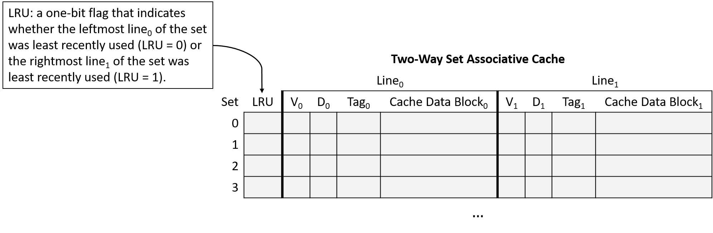

**图 15.** 一个二路组相联缓存，每个组存放一位 LRU 元数据，为驱逐决策提供依据

*Figure 15. A two-way set associative cache in which each set stores one bit of LRU metadata to inform eviction decisions*

> [!WARNING] 原书警示
> [图 15](11.4-caching.html) 中用零表示「左」、用一表示「右」的选择是任意的。不同缓存对 LRU 位的解释各不相同。如果作业中要求你处理缓存，不要想当然地认为作业使用的是同样的 LRU 编码方案！
>
> > [Figure 15](11.4-caching.html)'s choice that zero means "left" and one means "right" is arbitrary. The interpretation of LRU bits varies across caches. If you’re asked to work with caches on an assignment, don’t assume the assignment is using the same LRU encoding scheme!

#### 组相联缓存示例

*Set Associative Cache Examples*

考虑一个具有以下特征的 CPU：

> Consider a CPU with the following characteristics:

- 16 位内存地址。

> - 16-bit memory addresses.

- 一个有 64 个组的二路组相联缓存。注意，把缓存做成二路组相联会使它的存储容量翻倍（每组两行），所以这个例子把组数减半，使它存放的行数与前面的直接映射示例相同。

> - A two-way set associative cache with 64 sets. Note that making a cache two-way set associative doubles its storage capacity (two lines per set), so this example halves the number of sets so that it stores the same number of lines as the earlier direct-mapped example.

- 32 字节的缓存块。

> - 32-byte cache blocks.

- LRU 缓存替换策略，用 LRU 位表示组中左边的行最近最少使用（LRU = 0），还是右边的行最近最少使用（LRU = 1）。

> - An LRU cache replacement policy that indicates whether the leftmost line of the set was least recently used (LRU = 0) or the rightmost line of the set was least recently used (LRU = 1).

最初，缓存是空的（所有行都无效，LRU 位都为 0），如[图 16](11.4-caching.html) 所示。

> Initially, the cache is empty (all lines invalid and LRU bits 0), as shown in [Figure 16](11.4-caching.html).

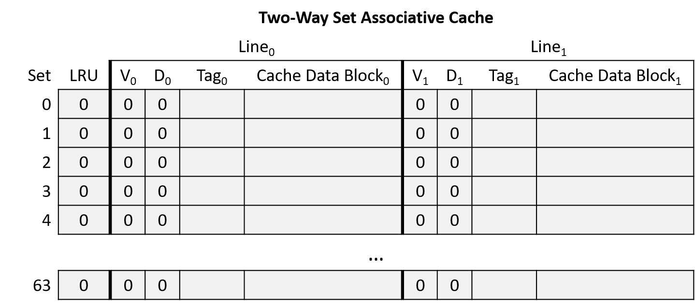

**图 16.** 一个空的二路组相联示例缓存

*Figure 16. An empty two-way set associative example cache*

假设在这个 CPU 上运行的程序访问下面这些内存位置（与直接映射示例相同）：

> Suppose that a program running on this CPU accesses the following memory locations (same as the direct-mapped example):

1. 读地址 1010000001100100

> 1.  Read from address 1010000001100100

2. 读地址 1010000001100111

> 2.  Read from address 1010000001100111

3. 读地址 1001000000100000

> 3.  Read from address 1001000000100000

4. 读地址 1111000001100101

> 4.  Read from address 1111000001100101

5. 写地址 1111000001100000

> 5.  Write to address 1111000001100000

6. 写地址 1010000001100100

> 6.  Write to address 1010000001100100

##### 地址划分

*Address Division*

首先确定如何把内存地址划分为*偏移*、*索引*和*标记*部分。从低位到高位（从右到左）考虑地址的各个部分：

> Begin by determining how to divide the memory addresses into their *offset*, *index*, and *tag* portions. Consider the address portions from low-order to high-order bits (right to left):

- *偏移*：块大小为 32 字节，意味着地址最右边的五位（log2 32 = 5）构成偏移部分。五位让偏移能唯一地标识块中的任何一个字节。

> - *Offset*: A 32-byte block size implies that the rightmost five bits of the address (log2 32 = 5) comprise the offset portion. Five bits allows the offset to uniquely identify any of the bytes in a block.

- *索引*：缓存有 64 个组，意味着地址接下来的六位（log2 64 = 6）构成索引部分。六位让索引能唯一地标识缓存中的每一个组。

> - *Index*: A 64-set cache implies that the next six bits of the address (log2 64 = 6) comprise the index portion. Six bits allows the index to uniquely identify each set in the cache.

- *标记*：标记由不属于偏移或索引的所有剩余地址位组成。在这里，地址还剩下五位用作标记（16 - (5 + 6) = 5）。

> - *Tag*: The tag consists of any remaining bits of the address that don’t belong to the offset or index. Here, the address has five remaining bits left over for the tag (16 - (5 + 6) = 5).

------------------------------------------------------------------------

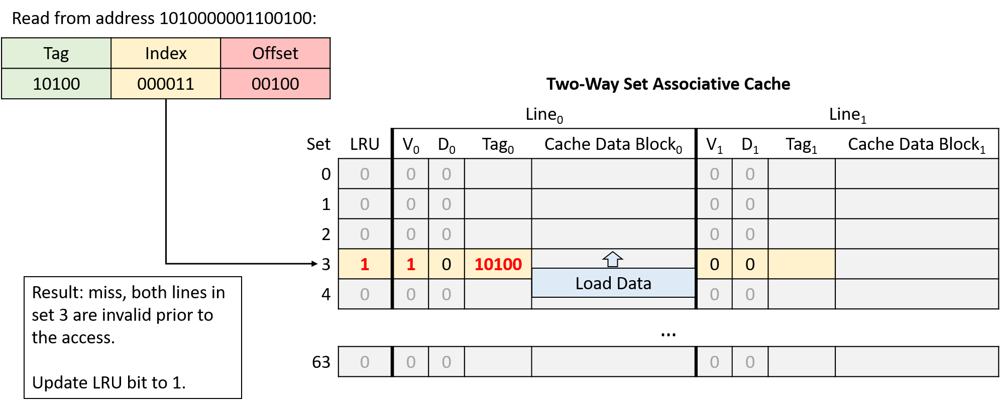

**图 17.** 读地址 1010000001100100。索引 000011（第 3 组）处的两行都无效，所以请求未命中，缓存从主存加载数据。该组的 LRU 位为 0，所以缓存把数据加载到左边的行，并把 LRU 位更新为 1。

*Figure 17. Read from address 1010000001100100. Both lines at index 000011 (set 3) are invalid, so the request misses, and the cache loads data from main memory. The set’s LRU bit is 0, so the cache loads data into the left line and updates the LRU bit to 1.*

------------------------------------------------------------------------

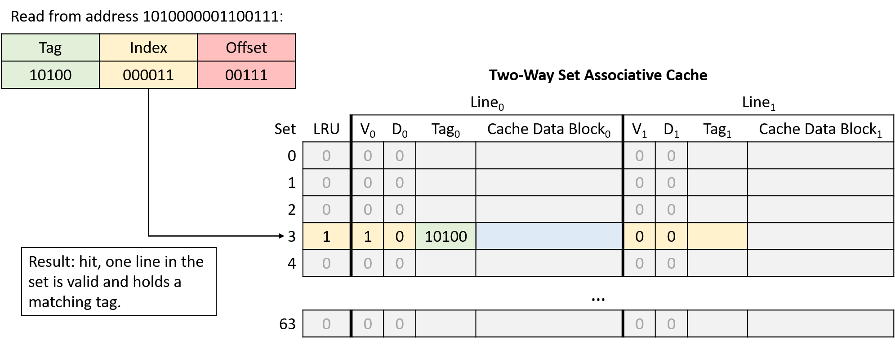

**图 18.** 读地址 1010000001100111。索引 000011（第 3 组）处左边的行存有匹配的标记，所以请求命中。

*Figure 18. Read from address 1010000001100111. The left line at index 000011 (set 3) holds a matching tag, so the request hits.*

------------------------------------------------------------------------

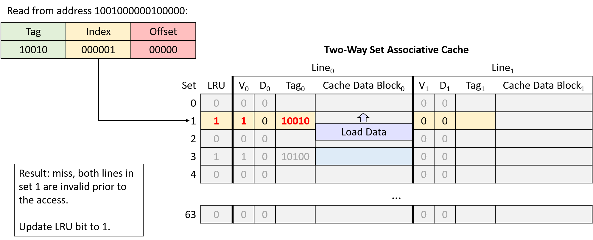

**图 19.** 读地址 1001000000100000。索引 000001（第 1 组）处的两行都无效，所以请求未命中，缓存从主存加载数据。该组的 LRU 位为 0，所以缓存把数据加载到左边的行，并把 LRU 位更新为 1。

*Figure 19. Read from address 1001000000100000. Both lines at index 000001 (set 1) are invalid, so the request misses, and the cache loads data from main memory. The set’s LRU bit is 0, so the cache loads data into the left line and updates the LRU bit to 1.*

------------------------------------------------------------------------

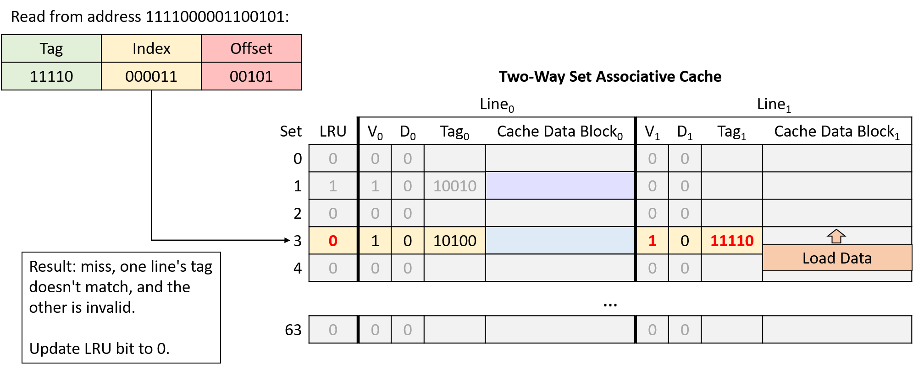

**图 20.** 读地址 1111000001100101。在索引 000011（第 3 组）处，一行的标记不匹配，另一行无效，所以请求未命中。该组的 LRU 位为 1，所以缓存把数据加载到右边的行，并把 LRU 位更新为 0。

*Figure 20. Read from address 1111000001100101. At index 000011 (set 3), one line’s tag doesn’t match, and the other line is invalid, so the request misses. The set’s LRU bit is 1, so the cache loads data into the right line and updates the LRU bit to 0.*

------------------------------------------------------------------------

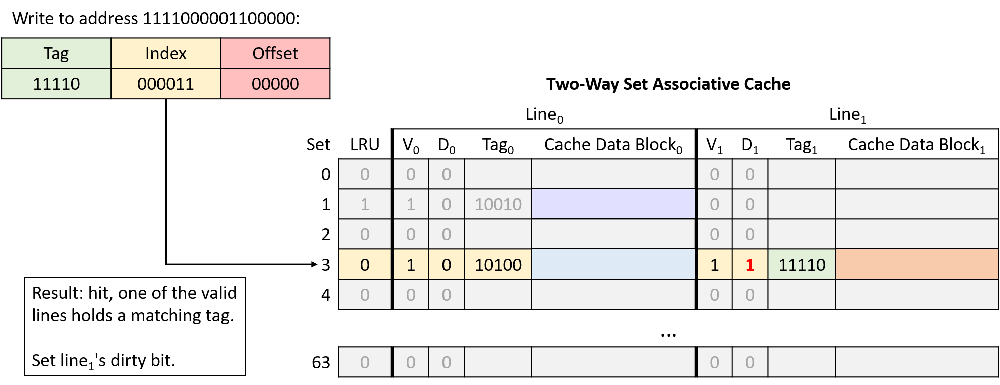

**图 21.** 写地址 1111000001100000。索引 000011（第 3 组）处右边的行有效并存有匹配的标记，所以请求命中。由于这次访问是写操作，缓存把该行的脏位设为 1。LRU 位保持为 0，表示左边的行仍然是最近最少使用的。

*Figure 21. Write to address 1111000001100000. The right line at index 000011 (set 3) is valid and holds a matching tag, so the request hits. Because this access is a write, the cache sets the line’s dirty bit to 1. The LRU bit remains 0 to indicate that the left line remains least recently used.*

------------------------------------------------------------------------

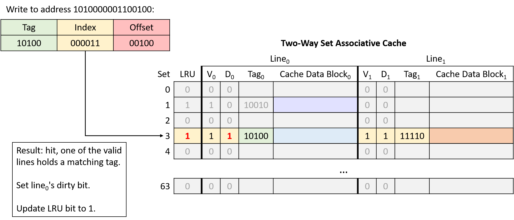

**图 22.** 写地址 1010000001100100。索引 000011（第 3 组）处左边的行有效并存有匹配的标记，所以请求命中。由于这次访问是写操作，缓存把该行的脏位设为 1。访问了左边的行之后，缓存把该组的 LRU 位设为 1。

*Figure 22. Write to address 1010000001100100. The left line at index 000011 (set 3) is valid and holds a matching tag, so the request hits. Because this access is a write, the cache sets the line’s dirty bit to 1. After accessing the left line, the cache sets the line’s LRU bit to 1.*

在这个例子中，同样的内存访问序列在直接映射缓存中产生了两次冲突未命中，而在二路组相联缓存中则完全没有冲突。

> In this example, the same memory access sequence that produced two conflict misses with a direct-mapped cache suffers from no conflicts with a two-way set associative cache.
