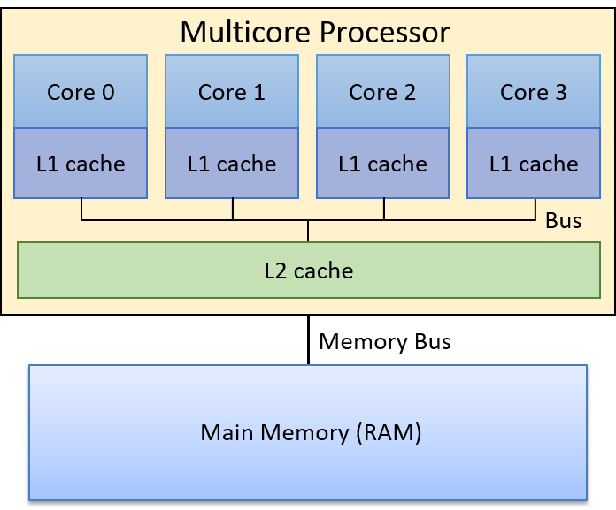
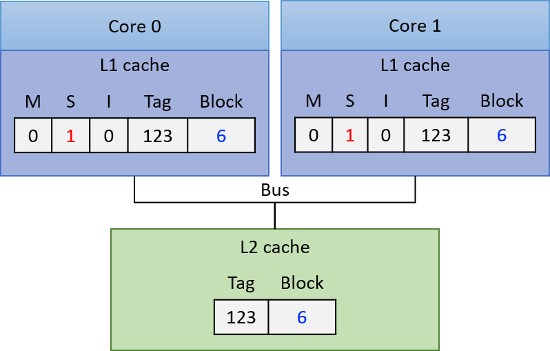
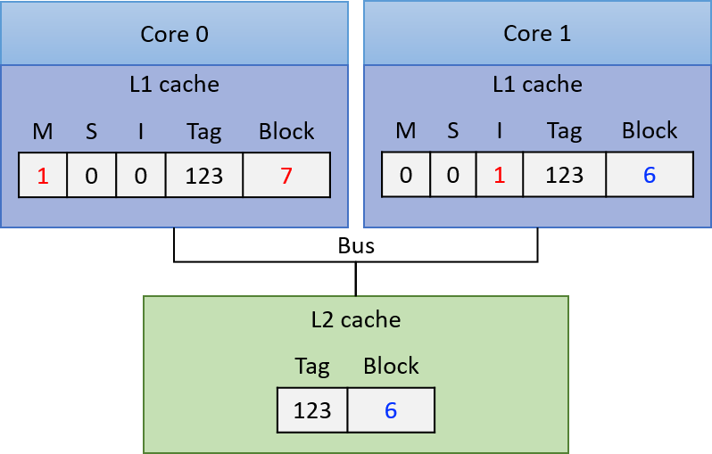
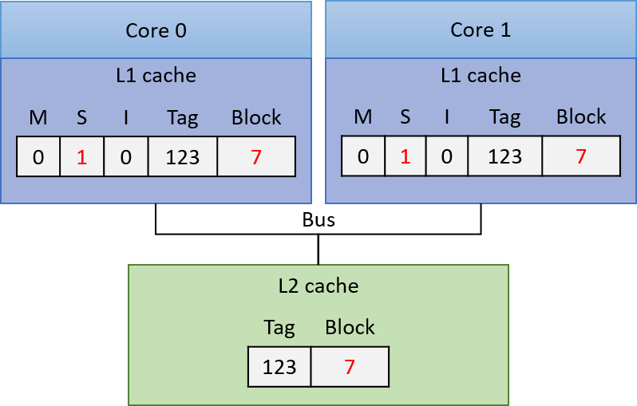

> **说明**
> 本文是个人学习用的**非官方**中英对照译文，原文：<https://diveintosystems.org/book/C11-MemHierarchy/coherency.html>。
> 原书采用 CC BY-NC-ND 4.0 许可（禁止演绎），**请勿公开传播本译文**。
> 标为「译注」「现代更新」的内容是译者补充，不代表原书作者观点；代码与原文逐字一致，未作改动。

## 11.6. 展望：多核处理器上的缓存

*11.6. Looking Ahead: Caching on Multicore Processors*

到目前为止，我们对缓存的讨论集中在单核处理器上的单级缓存。然而，现代处理器是多核的，并且有多级缓存。通常，在存储器层次结构较高的一级（或几级），每个核心都维护自己私有的缓存，而在较低的级别，所有核心共享一个缓存。[图 1](11.6-coherency.html) 展示了一个四核处理器上存储器层次结构的例子，其中每个核心都有私有的一级（L1）缓存，而二级（L2）缓存由四个核心共享。

> So far our discussion of caching has focused on a single level of cache memory on a single-core processor. Modern processors, however, are multicore with several levels of cache memory. Typically, each core maintains its own private cache memory at the highest level(s) of the memory hierarchy and shares a single cache with all cores at lower levels. [Figure 1](11.6-coherency.html) shows an example of the memory hierarchy on a four-core processor in which each core contains a private level 1 (L1) cache, and the level 2 (L2) cache is shared by all four cores.



**图 1.** 多核处理器上的存储器层次结构示例。四个核心各有私有的 L1 缓存，它们通过一条共享总线访问一个共享的 L2 缓存。多核处理器通过内存总线连接到 RAM。

*Figure 1. An example memory hierarchy on a multicore processor. Each of the four cores has its own private L1 cache, and all four cores share a single L2 cache that they access through a shared bus. The multicore processor connects to RAM via the memory bus.*

回想一下，存储器层次结构中较高的级别比较低的级别访问更快、容量更小。因此，L1 缓存比 L2 缓存更小、更快，而 L2 缓存又比 RAM 更小、更快。还要回想一下，缓存存储的是存储器层次结构中较低一级的值的副本；存放在 L1 缓存中的值，是存放在 L2 缓存中同一个值的副本，而后者又是存放在 RAM 中同一个值的副本。因此，存储器层次结构中较高的级别充当较低级别的缓存。于是，对于[图 1](11.6-coherency.html) 中的例子，L2 缓存是 RAM 内容的缓存，而每个核心的 L1 缓存是 L2 缓存内容的缓存。

> Recall that higher levels of the memory hierarchy are faster to access and smaller in capacity than lower levels of the memory hierarchy. Thus, an L1 cache is smaller and faster than an L2 cache, which in turn is smaller and faster than RAM. Also recall that cache memory stores a copy of a value from a lower level in the memory hierarchy; a value stored in a L1 cache is a copy of the same value stored in the L2 cache, which is a copy of the same value stored in RAM. Thus, higher levels of the memory hierarchy serve as caches for lower levels. As a result, for the example in [Figure 1](11.6-coherency.html), the L2 cache is a cache of RAM contents, and each core’s L1 cache is a cache of the L2 cache contents.

多核处理器中的每个核心同时执行一个独立的指令流，这些指令流常常来自不同的程序。给每个核心配一个私有的 L1 缓存，让核心能在它最快的缓存中只存放它正在执行的指令流的数据和指令的副本。换句话说，每个核心的 L1 缓存只存放来自它自己执行流的那些内存块的副本，而不必在所有核心共享的单个 L1 缓存中争夺空间。与所有核心共享一个 L1 缓存的设计相比，这种设计让每个核心私有的 L1 缓存（即它最快的缓存）获得更高的命中率。

> Each core in a multicore processor simultaneously executes an independent stream of instructions, often from separate programs. Providing each core a private L1 cache allows the core to store copies of the data and instructions exclusively from the instruction stream it’s executing in its fastest cache memory. In other words, each core’s L1 cache stores a copy of only those blocks of memory that are from its execution stream as opposed to competing for space in a single L1 cache shared by all cores. This design yields a higher hit rate in each core’s private L1 cache (in its fastest cache memory) than one in which all cores share a single L1 cache.

如今的处理器常常有不止两级缓存。台式机系统中常见的是三级缓存，其中最高一级（L1）通常分成两个独立的 L1 缓存，一个用于程序指令，另一个用于程序数据。较低级别的缓存通常是**统一缓存**（unified cache），即同时存放程序数据和指令。每个核心通常维护一个私有的 L1 缓存，并与所有核心共享一个 L3 缓存。位于每个核心私有的 L1 缓存与共享的 L3 缓存之间的 L2 缓存层，在现代 CPU 设计中差异很大。L2 可能是私有的，可能由所有核心共享，也可能是一种混合组织：有多个 L2 缓存，每个由一部分核心共享。

> Today’s processors often include more than two levels of cache. Three levels are common in desktop systems, with the highest level (L1) typically split into two separate L1 caches, one for program instructions and the other for program data. Lower-level caches are usually **unified caches**, meaning that they store both program data and instructions. Each core usually maintains a private L1 cache and shares a single L3 cache with all cores. The L2 cache layer, which sits between each core’s private L1 cache and the shared L3 cache, varies substantially in modern CPU designs. The L2 may be a private L2 cache, may be shared by all cores, or may be a hybrid organization with multiple L2 caches, each shared by a subset of cores.

> **原书旁注 · Linux 系统上的处理器与缓存信息（Processor and Cache Information on Linux systems）**
> 如果你好奇自己 CPU 的设计，有几种方法可以获取系统上处理器及其缓存组织的信息。例如，`lscpu` 命令显示处理器的信息，包括它的核心数以及各级缓存的级别和大小：
>
> ```
> $ lscpu
> ...
> CPU(s):                          12
> Thread(s) per core:              2
> Core(s) per socket:              6
> Socket(s):                       1
> ...
> L1d cache:                       192 KiB
> L1i cache:                       384 KiB
> L2 cache:                        3 MiB
> L3 cache:                        16 MiB
> ```
>
> 这个输出显示共有六个核心（`Socket(s)` 的数目乘以 `Core(s) per socket`），每个核心都是双路超线程的（`Thread(s) per core`），使六个物理核心在操作系统看来是 12 个 CPU（关于硬件多线程的更多信息，见[第 5.9.2 节](../C5-Arch/5.9-modern.html)）。此外，输出还显示有三级缓存（`L1`、`L2` 和 `L3`），并且有两个独立的 L1 缓存，一个缓存数据（`L1d`），另一个缓存指令（`L1i`）。
>
> 除了 `lscpu`，`/proc` 和 `/sys` 文件系统中的文件也包含关于处理器的信息。例如，命令 `cat /proc/cpuinfo` 输出关于处理器的信息，而下面的命令列出某个特定处理器核心的缓存信息（注意，这些文件是按核心的超线程 CPU 命名的，在这个例子中，`cpu0` 和 `cpu6` 是核心 0 上的两个超线程 CPU）：
>
> ```
> $ ls /sys/devices/system/cpu/cpu0/cache
> index0/  index1/  index2/  index3/
> ```
>
> 这个输出表明核心 0 有四个缓存（`index0` 到 `index3`）。要查看每个缓存的详细信息，查看 index 目录下的 `type`、`level` 和 `shared_cpu_list` 文件：
>
> ```
> $ cat /sys/devices/system/cpu/cpu0/cache/index*/type
> Data
> Instruction
> Unified
> Unified
> $ cat /sys/devices/system/cpu/cpu0/cache/index*/level
> 1
> 1
> 2
> 3
> $ cat /sys/devices/system/cpu/cpu0/cache/index*/shared_cpu_list
> 0,6
> 0,6
> 0,6
> 0-11
> ```
>
> `type` 的输出表明核心 0 有独立的数据缓存和指令缓存，以及另外两个统一缓存。把 `level` 的输出与 `type` 的输出对照起来可以看出，数据缓存和指令缓存都是 L1 缓存，而两个统一缓存分别是 L2 和 L3 缓存。`shared_cpu_list` 进一步表明，L1 和 L2 缓存是核心 0 私有的（只由核心 0 上的两个超线程 CPU `0` 和 `6` 共享），而 L3 缓存由所有六个核心共享（由所有 12 个超线程 CPU `0-11` 共享）。
>
> > If you’re curious about your CPU’s design, there are several ways to obtain information about a processor and its cache organization on your system. For example, the `lscpu` command displays information about the processor, including its number of cores and the levels and sizes of its caches:
> >
> > ```
> > $ lscpu
> > ...
> > CPU(s):                          12
> > Thread(s) per core:              2
> > Core(s) per socket:              6
> > Socket(s):                       1
> > ...
> > L1d cache:                       192 KiB
> > L1i cache:                       384 KiB
> > L2 cache:                        3 MiB
> > L3 cache:                        16 MiB
> > ```
> >
> > This output shows that there are six total cores (the number of `Socket(s)` multiplied by the `Core(s) per socket`), and that each core is two-way hyperthreaded (`Thread(s) per core`) to make the six physical cores appear as 12 CPUs to the operating system (see [Chapter 5.9.2](../C5-Arch/5.9-modern.html) for more information on hardware multithreading). Additionally, the output shows that there are three levels of cache (`L1`, `L2`, and `L3`), and that there are two separate L1 caches, one for caching data (`L1d`) and another for caching instructions (`L1i`).
> >
> > In addition to `lscpu`, files in the `/proc` and `/sys` filesystems contain information about the processor. For example, the command `cat /proc/cpuinfo` outputs information about the processor, and the following command lists information about the caches for a specific processor core (note that these files are named in terms of a core’s hyperthreaded CPUs, and in this example `cpu0` and `cpu6` are the two hyperthreaded CPUs on core 0):
> >
> > ```
> > $ ls /sys/devices/system/cpu/cpu0/cache
> > index0/  index1/  index2/  index3/
> > ```
> >
> > This output indicates that core 0 has four caches (`index0` to `index3`). To see the details of each cache, examine the index directory’s `type`, `level`, and `shared_cpu_list` files:
> >
> > ```
> > $ cat /sys/devices/system/cpu/cpu0/cache/index*/type
> > Data
> > Instruction
> > Unified
> > Unified
> > $ cat /sys/devices/system/cpu/cpu0/cache/index*/level
> > 1
> > 1
> > 2
> > 3
> > $ cat /sys/devices/system/cpu/cpu0/cache/index*/shared_cpu_list
> > 0,6
> > 0,6
> > 0,6
> > 0-11
> > ```
> >
> > The `type` output indicates that core 0 has separate data and instruction caches as well as two other unified caches. Correlating the `level` output with the `type` output reveals that the data and instruction caches are both L1 caches, whereas the unified caches are L2 and L3 caches, respectively. The `shared_cpu_list` further shows that the L1 and L2 caches are private to core 0 (shared only by CPU `0` and `6`, the two hyperthread CPUs on core 0), and that the L3 cache is shared by all six cores (by all 12 hyperthreaded CPUs, `0-11`).

> **译注 · 在 Apple Silicon Mac 上**
> macOS 没有 `lscpu`、`/proc` 和 `/sys`，相应的信息可以用 `sysctl` 查询（见 11.2 节的译注）。例如在 Apple M1 Pro 上，`sysctl hw.physicalcpu hw.logicalcpu` 都是 8（没有超线程），`hw.perflevel0.physicalcpu` 为 6、`hw.perflevel1.physicalcpu` 为 2，即 6 个性能核加 2 个能效核；两类核心簇各有自己的 L2（12 MB 和 4 MB）。可见 L2「由一部分核心共享」的混合组织确实存在。

### 11.6.1. 缓存一致性

*11.6.1. Cache Coherency*

由于程序通常表现出很高的访问局部性，让每个核心拥有自己的 L1 缓存，来存放它所执行的指令流中的数据和指令副本，是很有好处的。然而，多个 L1 缓存可能导致**缓存一致性**（cache coherency）问题。当存放在一个核心 L1 缓存中的某个内存块副本的值，与存放在另一个核心 L1 缓存中同一个块的副本的值不同时，就会出现缓存一致性问题。当一个核心写入它 L1 缓存中缓存的某个块，而这个块也缓存在其他核心的 L1 缓存中时，就会发生这种情况。由于缓存块包含的是内存内容的副本，系统需要在该缓存块的所有副本之间维持内存内容一致的单一值。

> Because programs typically exhibit a high degree of locality of reference, it is advantageous for each core to have its own L1 cache to store copies of the data and instructions from the instruction stream it executes. However, multiple L1 caches can result in **cache coherency** problems. Problems with cache coherency arise when the value of a copy of a block of memory stored in one core’s L1 cache is different than the value of a copy of the same block stored in another core’s L1 cache. This situation occurs when one core writes to a block cached in its L1 cache that is also cached in other core’s L1 caches. Because a cache block contains a copy of memory contents, the system needs to maintain a coherent single value of the memory contents across all copies of the cached block.

多核处理器实现了一种**缓存一致性协议**（cache-coherence protocol），来确保可以被多个核心缓存和访问的内存具有一致的视图。缓存一致性协议确保任何访问某个内存位置的核心，看到的都是该内存位置最近被修改的值，而不是它的 L1 缓存中可能存放的一个较旧（过时）的副本。

> Multicore processors implement a **cache-coherence protocol** to ensure a coherent view of memory that can be cached and accessed by multiple cores. A cache coherency protocol ensures that any core accessing a memory location sees the most recently modified value of that memory location rather than seeing an older (stale) copy of the value that may be stored in its L1 cache.

### 11.6.2. MSI 协议

*11.6.2. The MSI Protocol*

缓存一致性协议有很多种。这里我们讨论其中一个例子 MSI 协议的细节。**MSI 协议**（Modified、Shared、Invalid，即已修改、共享、无效）给每个缓存行添加三个标志（或位）。标志的值要么是清除（0），要么是置位（1）。这三个标志的值编码了缓存行数据块相对于该块其他缓存副本的一致性状态，它们的值会在对缓存行中的数据块进行读或写访问时触发缓存一致性动作。MSI 协议使用的三个标志是：

> There are many different cache coherency protocols. Here, we discuss the details of one example, the MSI protocol. The **MSI protocol** (Modified, Shared, Invalid) adds three flags (or bits) to each cache line. A flag’s value is either clear (0) or set (1). The values of the three flags encode the state of its data block with respect to cache coherency with other cached copies of the block, and their values trigger cache coherency actions on read or write accesses to the data block in the cache line. The three flags used by the MSI protocol are:

- **M** 标志：置位时表示该块已被修改，即这个核心写过它缓存的值副本。

> - The **M** flag that, if set, indicates the block has been modified, meaning that this core has written to its copy of the cached value.

- **S** 标志：置位时表示该块未被修改，可以安全地共享，即多个 L1 缓存可以安全地存放该块的副本并从各自的副本中读取。

> - The **S** flag that, if set, indicates that the block is unmodified and can be safely shared, meaning that multiple L1 caches may safely store a copy of the block and read from their copy.

- **I** 标志：置位时表示缓存的块无效或包含过时的数据（是数据的一个较旧的副本，不反映该内存块的当前值）。

> - The **I** flag that, if set, indicates if the cached block is invalid or contains stale data (is an older copy of the data that does not reflect the current value of the block of memory).

对缓存项的读访问和写访问都会触发 MSI 协议。

> The MSI protocol is triggered on read and write accesses to cache entries.

读访问时：

> On a read access:

- 如果缓存块处于 M 或 S 状态，就用缓存的值来满足读请求（它的副本的值就是该内存块的最新值）。

> - If the cache block is in the M or S state, the cached value is used to satisfy the read (its copy’s value is the most current value of the block of memory).

- 如果缓存块处于 I 状态，说明缓存的副本相对于该块的较新版本已经过时，必须先把该块的新值加载到缓存行中，才能满足读请求。

  如果另一个核心的 L1 缓存中存有新值（它存放该值时 M 标志置位，表示它存的是一个修改过的副本），那么那个核心必须先把它的值写回较低的级别（例如写到 L2 缓存）。完成写回之后，它清除该缓存行的 M 标志（它的副本和较低级别中的副本现在一致了），并置位 S 位，表示这个缓存行中的块处于可以被其他核心安全缓存的状态（这个 L1 块与它在 L2 缓存中的副本一致，并且核心是从这个 L1 副本中读到该块的当前值的）。

  然后，在 I 标志置位的行上发起读访问的那个核心，就可以把该块的新值加载到它的缓存行中。它清除 I 标志，表示该块现在有效，并存入该块的新值；置位 S 标志，表示该块可以安全地共享（它存的是最新的值，并且与其他缓存副本一致）；清除 M 标志，表示这个 L1 块的值与存放在 L2 缓存中的副本相同（读操作不会修改 L1 中缓存的内存副本）。

> - If the cache block is in the I state, the cached copy is out of date with a newer version of the block, and the block’s new value needs to be loaded into the cache line before the read can be satisfied.
>
>   If another core’s L1 cache stores the new value (it stores the value with the M flag set indicating that it stores a modified copy of the value), that other core must first write its value back to the lower level (for example, to the L2 cache). After performing the write-back, it clears the M flag with the cache line (its copy and the copy in the lower-level are now consistent) and sets the S bit to indicate that the block in this cache line is in a state that can be safely cached by other cores (the L1 block is consistent with its copy in the L2 cache and the core read the current value of the block from this L1 copy).
>
>   The core that initiated the read access on an line with the I flag set can then load the new value of the block into its cache line. It clears the I flag indicating that the block is now valid and stores the new value of the block, sets the S flag indicating that the block can be safely shared (it stores the latest value and is consistent with other cached copies), and clears the M flag indicating that the L1 block’s value matches that of the copy stored in the L2 cache (a read does not modify the L1 cached copy of the memory).

写访问时：

> On a write access:

- 如果该块处于 M 状态，就写入该块的缓存副本。标志无需改变（该块仍处于 M 状态）。

> - If the block is in the M state, write to the cached copy of the block. No changes to the flags are needed (the block remains in the M state).

- 如果该块处于 I 或 S 状态，就通知其他核心该块正在被写入（修改）。其他以 S 状态存放该块的 L1 缓存需要清除它们的块的 S 位并置位 I 位（它们的副本相对于另一个核心正在写入的副本已经过时了）。如果另一个 L1 缓存以 M 状态存放该块，它会把它的块写回较低的级别，并把它的副本设为 I。然后，执行写操作的核心把该块的新值加载到它的 L1 缓存中，置位 M 标志（它的副本将被这次写操作修改），清除 I 标志（它的副本现在有效），并写入缓存的块。

> - If the block is in the I or the S state, notify other cores that the block is being written to (modified). Other L1 caches that have the block stored in the S state, need to clear the S bit and set the I bit on their block (their copies of the block are now out of date with the copy that is being written to by the other core). If another L1 cache has the block in the M state, it will write its block back to the lower level, and set its copy to I. The core writing will then load the new value of the block into its L1 cache, set the M flag (its copy will be modified by the write), and clear the I flags (its copy is now valid), and write to the cached block.

[图 2](11.6-coherency.html) 到[图 4](11.6-coherency.html) 逐步演示了一个例子：一个内存块缓存在两个核心各自私有的 L1 缓存中，MSI 协议如何确保对它的读写访问保持一致。在[图 2](11.6-coherency.html) 中，例子一开始，共享的数据块被复制到两个核心的 L1 缓存中，并且 S 标志都已置位，这意味着 L1 中缓存的副本与 L2 缓存中该块的值相同（所有副本都存放着该块的当前值 6）。此时，核心 0 和核心 1 都可以安全地读取各自 L1 缓存中的副本，而不会触发一致性动作（S 标志表明它们的共享副本是最新的）。

> [Figure 2](11.6-coherency.html) through [Figure 4](11.6-coherency.html) step through an example of the MSI protocol applied to ensure coherency of read and write accesses to a block of memory that is cached in two core’s private L1 caches. In [Figure 2](11.6-coherency.html) our example starts with the shared data block copied into both core’s L1 cache with the S flag set, meaning that the L1 cached copies are the same as the value of the block in the L2 cache (all copies store the current value of the block, 6). At this point, both core 0 and core 1 can safely read from the copy stored in their L1 caches without triggering coherency actions (the S flag indicates that their shared copy is up to date).



**图 2.** 开始时，两个核心的私有 L1 缓存中都有该块的副本，并且 S 标志置位（处于共享状态）

*Figure 2. At the start, both cores have a copy of the block in their private L1 caches with the S flag set (in Shared mode)*

如果核心 0 接下来写入它 L1 缓存中存放的该块副本，它的 L1 缓存控制器会通知其他 L1 缓存使它们的该块副本失效。于是核心 1 的 L1 缓存控制器清除它的副本的 S 标志并置位 I 标志，表示它的块副本已经过时。核心 0 写入它 L1 缓存中的块副本（在我们的例子中把值改为 7），并在该缓存行上置位 M 标志、清除 S 标志，表示它的副本已被修改，存放的是该块的当前值。此时，L2 缓存中和核心 1 的 L1 缓存中的副本都已过时。得到的缓存状态如[图 3](11.6-coherency.html) 所示。

> If core 0 next writes to the copy of the block stored in its L1 cache, its L1 cache controller notifies the other L1 caches to invalidate their copy of the block. Core 1’s L1 cache controller then clears the S flag and sets the I flag on its copy, indicating that its copy of the block is stale. Core 0 writes to its copy of the block in its L1 cache (changing its value to 7 in our example), and sets the M flag and clears the S flag on the cache line to indicate that its copy has been modified and stores the current value of the block. At this point, the copy in the L2 cache and in core 1’s L1 cache are stale. The resulting cache state is shown in [Figure 3](11.6-coherency.html).



**图 3.** 核心 0 写入它的块副本之后各缓存的状态

*Figure 3. The resulting state of the caches after Core 0 writes to its copy of the block*

此时，核心 0 可以安全地读取它缓存的块副本，因为它的副本处于 M 状态，即存放着该块最近写入的值。

> At this point, core 0 can safely read from its copy of the cached block because its copy is in the M state, meaning that it stores the most recently written value of the block.

如果核心 1 接下来读取这个内存块，它 L1 中缓存副本上的 I 标志表明它的 L1 块副本已经过时，不能用来满足读请求。核心 1 的 L1 缓存控制器必须先把该块的新值加载到 L1 缓存中，才能满足读请求。为此，核心 0 的 L1 缓存控制器必须先把它修改过的块值写回 L2 缓存，以便核心 1 的 L1 缓存能把该块的新值读入它的 L1 缓存。这些动作的结果（如[图 4](11.6-coherency.html) 所示）是，核心 0 和核心 1 的 L1 中缓存的块副本现在都处于 S 状态，表明每个核心的 L1 副本都是最新的，可以安全地用来满足之后对该块的读请求。

> If core 1 next reads from the memory block, the I flag on its L1 cached copy indicates that its L1 copy of the block is stale and cannot be used to satisfy the read. Core 1’s L1 cache controller must first load the new value of the block into the L1 cache before the read can be satisfied. To achieve this, core 0’s L1 cache controller must first write its modified value of the block back to the L2 cache, so that core 1’s L1 cache can read the new value of the block into its L1 cache. The result of these actions, (shown in [Figure 4](11.6-coherency.html)), is that core 0 and core 1’s L1 cached copies of the block are now both stored in the S state, indicating that each core’s L1 copy is up to data and can be safely used to satisfy subsequent reads to the block.



**图 4.** 核心 1 接下来读取该块之后各缓存的状态

*Figure 4. The resulting state of the caches after Core 1 next reads the block*

### 11.6.3. 缓存一致性协议的实现

*11.6.3. Implementing Cache Coherency Protocols*

为了实现缓存一致性协议，处理器需要某种机制来识别：对一个核心的 L1 缓存内容的访问，何时需要改变涉及其他核心 L1 缓存内容的一致性状态。实现这种机制的一种方法，是在所有 L1 缓存共享的一条总线上进行**监听**（snooping）。监听式缓存控制器在总线上监听（或窥探）对它所缓存的块的读或写。由于每个读写请求都是以内存地址的形式发出的，监听式 L1 缓存控制器能识别出另一个 L1 缓存对它所存块的任何读写，然后根据一致性协议作出相应的响应。例如，当它监听到另一个 L1 缓存对同一地址的写操作时，可以在对应的缓存行上置位 I 标志。这个例子就是用监听实现**写失效协议**（write-invalidate protocol）的方式。

> To implement a cache coherency protocol, a processor needs some mechanism to identify when accesses to one core’s L1 cache contents require coherency state changes involving the other cores' L1 cache contents. One way this mechanism is implemented is through **snooping** on a bus that is shared by all L1 caches. A snooping cache controller listens (or snoops) on the bus for reads or writes to blocks that it caches. Because every read and write request is in terms of a memory address, a snooping L1 cache controller can identify any read or write from another L1 cache for a block it stores, and can then respond appropriately based on the coherency protocol. For example, it can set the I flag on a cache line when it snoops a write to the same address by another L1 cache. This example is how a **write-invalidate protocol** would be implemented with snooping.

MSI 以及 MESI、MOESI 等其他类似的协议都是写失效协议，即在写操作时使缓存项的其他副本失效的协议。监听也可以用于写更新（write-update）的缓存一致性协议：从总线上监听到数据的新值，并用它更新其他 L1 缓存中存放的所有副本。

> MSI and other similar protocols such as MESI and MOESI are write-invalidate protocols; that is, protocols that invalidate copies of cached entries on writes. Snooping can also be used by write-update cache coherency protocols, where the new value of a data is snooped from the bus and applied to update all copies stored in other L1 caches.

除了监听之外，还可以用基于目录（directory-based）的缓存一致性机制来触发缓存一致性协议。由于多个核心共享一条总线会带来性能限制，这种方法比监听的可扩展性更好。不过，基于目录的机制需要更多的状态来检测内存块何时被共享，而且比监听慢。

> Instead of snooping, a directory-based cache coherence mechanism can be used to trigger cache coherency protocols. This method scales better than snooping due to performance limitations of multiple cores sharing a single bus. However, directory-based mechanisms require more state to detect when memory blocks are shared, and are slower than snooping.

### 11.6.4. 关于多核缓存的更多内容

*11.6.4. More about Multicore Caching*

多核处理器的每个核心在存储器层次结构的最高几级拥有各自独立的缓存，只用来存放它所执行的程序数据和指令的副本，由此带来的性能收益，值得处理器为实现缓存一致性协议而付出额外的复杂度。

> The benefits to performance of each core of a multicore processor having its own separate cache(s) at the highest levels of the memory hierarchy, which are used to store copies of only the program data and instructions that it executes, is worth the added extra complexity of the processor needing to implement a cache coherency protocol.

尽管缓存一致性解决了有独立 L1 缓存的多核处理器上的内存一致性问题，但多核处理器上的缓存一致性协议还会引发另一个问题。这个问题称为**伪共享**（false sharing），当一个多线程并行程序的多个线程同时运行在多个核心上，并且访问的内存位置与其他线程访问的位置相邻时，就可能发生伪共享。在[第 14.5 节](../C14-SharedMemory/14.5-cache_coherence.html)中，我们会讨论伪共享问题以及一些解决办法。

> Although cache coherency solves the memory coherency problem on multicore processors with separate L1 caches, there is another problem that can occur as a result of cache coherency protocols on multicore processors. This problem, called **false sharing**, may occur when multiple threads of a single multithreaded parallel program are running simultaneously across the multiple cores and are accessing memory locations that are near to those accessed by other threads. In section [Chapter 14.5](../C14-SharedMemory/14.5-cache_coherence.html), we discuss the false sharing problem and some solutions to it.

关于多核处理器上硬件缓存的更多信息和细节，包括不同的协议及其实现方式，请参阅计算机体系结构教科书<sup>1</sup>。

> For more information and details about hardware caching on multicore processors, including different protocols and how they are implemented, refer to a computer architecture textbook<sup>1</sup>.

### 脚注

*Footnotes*

1. 推荐一本：David A. Patterson 和 John L. Hennessy 合著的《Computer Organization and Design: The Hardware and Software Interface》（中译本《计算机组成与设计：硬件/软件接口》）。

> 1.  One suggestion is "Computer Organization and Design: The Hardware and Software Interface", by David A. Patterson and John L. Hennessy.
