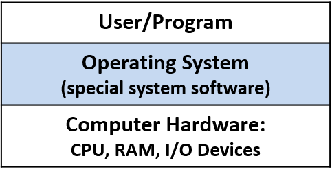
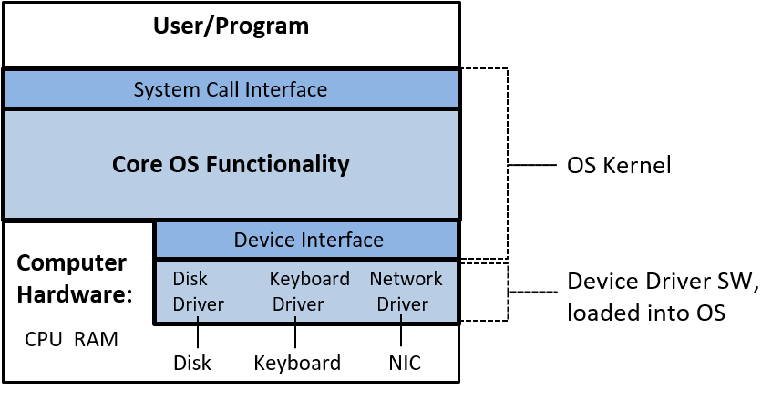

> [!WARNING] 说明
> 本文是个人学习用的**非官方**中英对照译文，原文：<https://diveintosystems.org/book/C13-OS/index.html>。
> 原书采用 CC BY-NC-ND 4.0 许可（禁止演绎），**请勿公开传播本译文**。
> 标为「译注」「现代更新」的内容是译者补充，不代表原书作者观点；代码与原文逐字一致，未作改动。

*13. The Operating System*

**操作系统**（operating system，OS）是一个特殊的系统软件层，它位于计算机硬件和在计算机上运行的应用程序之间（见[图 1](13.0-index.html)）。从开机到关机，操作系统软件一直驻留在计算机上。它的主要目的是*管理*底层的硬件部件，以便高效地运行程序工作负载，并让计算机*易于使用*。

> The **operating system** (OS) is a special system software layer that sits between the computer hardware and application programs running on the computer (see [Figure 1](13.0-index.html)). The OS software is persistent on the computer, from power-on to power-off. Its primary purpose is to *manage* the underlying hardware components to efficiently run program workloads and to make the computer *easy to use*.

**图 1.** 操作系统是位于用户和硬件之间的特殊系统软件。它管理计算机的硬件，并实现各种抽象，让硬件更易于使用。

*Figure 1. The OS is special system software between the user and the hardware. It manages the computer’s hardware and implements abstractions to make the hardware easier to use.*

操作系统让计算机硬件易于使用的方式之一，是支持在计算机上启动程序运行。考虑用户双击一个图标，或者在 shell 提示符下输入程序可执行文件的名字（例如 `./a.out`），以便在底层系统上启动一个程序时会发生什么。操作系统处理这个操作的所有细节，例如把程序从磁盘加载到 RAM 中，以及初始化 CPU 以开始执行程序的指令；操作系统向用户隐藏了在计算机上运行用户程序所必需的这类底层动作。

> One of the ways in which the OS makes the computer hardware easy to use is in its support for initiating programs to run on the computer. Consider what happens when a user double-clicks an icon or types the name of a program executable at a shell prompt (e.g., `./a.out`) to start a program running on the underlying system. The OS handles all the details of this operation, such as loading the program from disk into RAM and initializing the CPU to start running the program instructions; the OS hides from users these types of low-level actions that are necessary to run the user’s program on the computer.

操作系统高效利用系统资源的一个例子是实现**多道程序设计**（multiprogramming），即允许计算机上同时运行不止一个程序。多道程序设计并不一定意味着所有程序都在计算机硬件上同时执行。事实上，系统中正在运行的程序集合通常远远多于 CPU 核心的数量。它的意思是，操作系统在系统上运行的多个程序之间共享包括 CPU 在内的硬件资源。例如，当一个程序需要当前在磁盘上的数据时，操作系统可以在第一个程序等待数据就绪期间，把另一个程序放到 CPU 上运行。如果没有多道程序设计，每当计算机上运行的程序访问较慢的硬件设备时，CPU 就会闲置。为了支持多道程序设计，操作系统需要实现一种对正在运行的程序的抽象，称为**进程**（process）。进程抽象让操作系统能够管理任一时刻在系统中运行的多个程序。

> One example of how the OS makes efficient use of system resources is by implementing **multiprogramming**, which means allowing more than a single program to run on the computer at a time. Multiprogramming does not necessarily mean that all the programs are running simultaneously on the computer hardware. In fact, the set of running programs in the system is typically much larger than the number of CPU cores. Instead, it means that the OS shares hardware resources, including the CPU, among several programs running on the system. For example, when one program needs data that are currently on disk, the OS can put another program on the CPU while the first program waits for the data to become available. Without multiprogramming, the CPU would sit idle whenever the program running on the computer accesses slower hardware devices. To support multiprogramming, the OS needs to implement an abstraction of a running program, called a **process**. The process abstraction enables the OS to manage the set of multiple programs that are running in the system at any given time.

操作系统的例子包括微软的 Windows、苹果的 macOS 和 iOS、甲骨文的 Solaris，以及 OpenBSD 和 Linux 等开源的类 Unix 系统。本书使用 Linux 的例子。不过，其他这些通用操作系统都实现了类似的功能，尽管实现方式有时不同。

> Some example operating systems include Microsoft’s Windows, Apple’s macOS and iOS, Oracle’s Solaris, and open-source Unix variants such as OpenBSD and Linux. We use Linux examples in this book. However, all of these other general-purpose operating systems implement similar functionality, albeit sometimes in different ways.

> [!NOTE] 译注
> 在 Mac 上跟做本章时，`fork`、`exec`、`wait`、信号、管道等 POSIX 接口都可以直接使用；但 macOS 没有 Linux 的 `/proc` 文件系统，书中涉及 `/proc` 的例子需要在 Linux 中运行。

### 内核

*The Kernel*

**操作系统**这个术语常用来指一大套系统级软件，它们执行某种资源管理，并实现底层系统的「易用」抽象。在本章中，我们关注的是操作系统**内核**（kernel）；因此，当我们单独使用「操作系统」这个术语时，指的是操作系统内核。

> The term **operating system** is often used to refer to a large set of system-level software that performs some kind of resource management and that implements "easy-to-use" abstractions of the underlying system. In this chapter, we focus on the operating system **kernel**; thus, when we use the term OS alone, we mean the OS kernel.

操作系统内核实现了操作系统的核心功能，即使用系统所必需的功能。这些功能包括：管理计算机硬件层以运行程序，实现并管理向系统用户提供的操作系统抽象（例如，文件就是建立在所存储数据之上的一种操作系统抽象），以及实现面向用户应用层和硬件设备层的接口。内核实现了**机制**（mechanism），使硬件能够运行程序，并实现进程等抽象。机制是操作系统功能中「如何做」的部分。内核还实现了**策略**（policy），用于高效地管理计算机硬件和支配各种抽象。策略决定了操作系统功能中「做什么」「何时做」以及「为谁做」的部分。例如，机制负责初始化 CPU 以执行某个特定进程的指令，而策略决定下一个在 CPU 上运行的是哪个进程。

> The OS kernel implements core OS functionality — the functionality necessary for any use of the system. This functionality includes managing the computer hardware layer to run programs, implementing and managing OS abstractions exported to users of the system (e.g., files are an OS abstraction on top of stored data), and implementing interfaces to the user applications layer and to the hardware device layer. The kernel implements **mechanisms** to enable the hardware to run programs and to implement its abstractions such as processes. Mechanisms are the "how" part of OS functionality. The kernel also implements **policies** for efficiently managing the computer hardware and for governing its abstractions. Policies dictate the "what," "when," and "to whom" part of OS functionality. For example, a mechanism implements initializing the CPU to run instructions from a particular process, and a policy decides which process gets to run next on the CPU.

内核为系统的用户实现了一个编程接口：**系统调用接口**（system call interface）。用户和程序通过系统调用接口与操作系统交互。例如，如果程序想知道当前的时间，它可以通过调用 `gettimeofday` 系统调用从操作系统获取这个信息。

> The kernel implements a programming interface for users of the system: the **system call interface**. Users and programs interact with the OS through its system call interface. For example, if a program wants to know the current time of day, it can obtain that information from the OS by invoking the `gettimeofday` system call.

内核还提供了一个与硬件设备交互的接口（**设备接口**，device interface）。通常，硬盘驱动器（HDD）、键盘和固态硬盘（SSD）等 I/O 设备通过这个接口与内核交互。这些设备带有特殊的设备驱动程序软件，它们在操作系统中运行，负责与特定设备之间的数据传输。设备驱动程序软件通过操作系统的设备接口与操作系统交互；只要把按照操作系统设备接口编写的设备驱动程序代码加载到操作系统中，就可以给计算机系统添加一个新设备。CPU 和 RAM 等其他硬件设备则由内核直接管理。[图 2](13.0-index.html) 展示了位于用户应用程序和计算机硬件之间的操作系统内核层，包括它面向用户的编程接口和它的硬件设备接口。

> The kernel also provides an interface for interacting with hardware devices (the **device interface**). Typically, I/O devices such as hard disk drives (HDDs), keyboards, and solid-state drives (SSDs) interact with the kernel through this interface. These devices come with special device driver software that runs in the OS and handles transferring data to or from a specific device. The device driver software interacts with the OS through the OS’s device interface; a new device can be added to a computer system by loading its device driver code, written to conform to the OS’s device interface, into the OS. The kernel directly manages other hardware devices, such as the CPU and RAM. [Figure 2](13.0-index.html) shows the OS kernel layer between the user applications and the computer hardware, including its programming interface to users and its hardware device interface.

**图 2.** 操作系统内核：使用系统所必需的核心操作系统功能，并促成 I/O 设备与系统用户之间的协作

*Figure 2. The OS kernel: core OS functionality necessary to use the system and facilitate cooperation between I/O devices and users of the system*

在本章余下的部分，我们考察操作系统在运行程序和高效管理系统资源方面所起的作用。我们的讨论主要集中在操作系统功能的机制（「如何做」）上，以及两个主要操作系统抽象的实现：**进程**（正在运行的程序）和**虚拟内存**（一种进程内存空间的视图，它从底层 RAM 或辅助存储中的物理存储中抽象出来）。

> In the rest of this chapter, we examine the role the operating system plays in running programs and in efficiently managing system resources. Our discussion is primarily focused on the mechanism (the "how") of the OS functionality and the implementation of two primary OS abstractions: a **process** (a running program) and **virtual memory** (a view of process memory space that is abstracted from its underlying physical storage in RAM or secondary storage).
