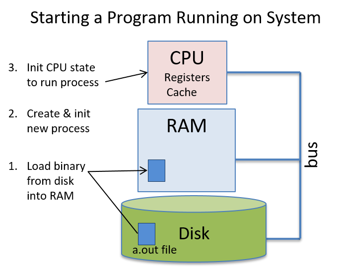
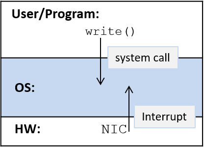
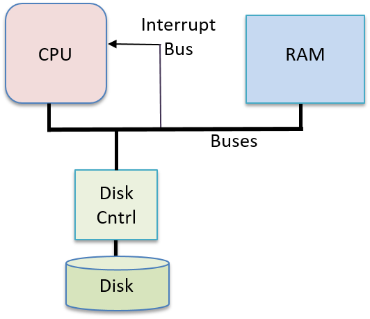
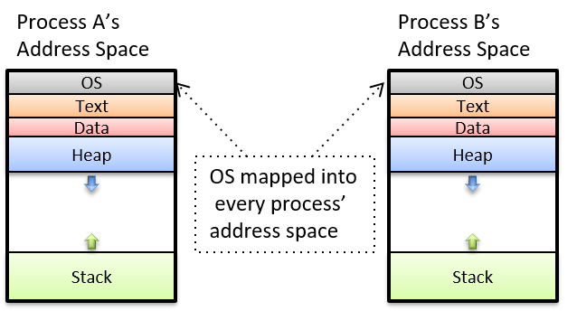

> **说明**
> 本文是个人学习用的**非官方**中英对照译文，原文：<https://diveintosystems.org/book/C13-OS/impl.html>。
> 原书采用 CC BY-NC-ND 4.0 许可（禁止演绎），**请勿公开传播本译文**。
> 标为「译注」「现代更新」的内容是译者补充，不代表原书作者观点；代码与原文逐字一致，未作改动。

## 13.1. 操作系统如何工作、如何运行

*13.1. How the OS Works and How It Runs*

操作系统的一部分工作，是支持在系统上运行程序。要在计算机上启动一个程序，操作系统要为这个正在运行的程序分配一部分 RAM，把程序的二进制可执行文件从磁盘加载到 RAM 中，为与这个正在运行的程序相关的进程创建并初始化操作系统状态，并初始化 CPU 以开始执行该进程的指令（例如，操作系统需要初始化 CPU 寄存器，以便取出并执行进程的指令）。[图 1](13.1-impl.html) 展示了这些步骤。

> Part of the job of the OS is to support programs running on the system. To start a program running on a computer, the OS allocates a portion of RAM for the running program, loads the program’s binary executable from disk into RAM, creates and initializes OS state for the process associated with this running program, and initializes the CPU to start executing the process’s instructions (e.g., the CPU registers need to be initialized by the OS to fetch and execute the process’s instructions). [Figure 1](13.1-impl.html) illustrates these steps.



**图 1.** 操作系统为在底层硬件上启动一个新程序而采取的步骤

*Figure 1. Steps the OS takes to start a new program running on the underlying hardware*

与用户程序一样，操作系统也是在计算机硬件上运行的软件。不过，操作系统是一种特殊的系统软件，它管理所有系统资源，并为计算机系统的用户实现接口；要使用计算机系统，就离不开它。由于操作系统是软件，它的二进制可执行代码与其他程序一样在硬件上运行：它的数据和指令存放在 RAM 中，它的指令与用户程序的指令一样，由 CPU 取出并执行。因此，要让操作系统运行起来，就需要把它的二进制可执行文件加载到 RAM 中，并初始化 CPU 以开始运行操作系统代码。然而，由于操作系统本身就负责在硬件上运行代码这项任务，它需要一些帮助才能开始运行。

> Like user programs, the OS is also software that runs on the computer hardware. The OS, however, is special system software that manages all system resources and implements the interface for users of the computer system; it is necessary for using the computer system. Because the OS is software, its binary executable code runs on the hardware just like any other program: its data and instructions are stored in RAM and its instructions are fetched and executed by the CPU just like user’s program instructions are. As a result, for the OS to run, its binary executable needs to be loaded into RAM and the CPU initialized to start running OS code. However, because the OS is responsible for the task of running code on the hardware, it needs some help to get started running.

### 13.1.1. 操作系统的引导

*13.1.1. OS Booting*

操作系统在计算机上加载并初始化自身的过程称为**引导**（booting）：操作系统「拽着自己的靴带把自己提起来」，即在计算机上*引导*自己。操作系统最初需要一点帮助才能被加载到计算机上并开始运行它的引导代码。为了让操作系统代码开始运行，计算机刚加电时，会运行存放在计算机固件（硬件中的非易失性存储器）中的代码；**BIOS**（Basic Input/Output System，基本输入/输出系统）和 **UEFI**（Unified Extensible Firmware Interface，统一可扩展固件接口）就是这类固件的两个例子。加电时，BIOS 或 UEFI 运行，只做足够的硬件初始化，把操作系统的第一块内容（它的引导块）从磁盘加载到 RAM 中，并开始在 CPU 上运行引导块中的指令。一旦操作系统开始运行，它就会从磁盘加载自身的其余部分，发现并初始化硬件资源，并初始化它的数据结构和抽象，使系统为用户做好准备。

> The process of the OS loading and initializing itself on the computer is known as **booting** — the OS "pulls itself up by its bootstraps", or *boots* itself on the computer. The OS needs a little help to initially get loaded onto the computer and to begin running its boot code. To initiate the OS code to start running, code stored in computer firmware (nonvolatile memory in the hardware) runs when the computer first powers up; **BIOS** (Basic Input/Output System) and **UEFI** (Unified Extensible Firmware Interface) are two examples of this type of firmware. On power-up, BIOS or UEFI runs and does just enough hardware initialization to load the first chunk of the OS (its boot block) from disk into RAM and to start running boot block instructions on the CPU. Once the OS starts running, it loads the rest of itself from disk, discovers and initializes hardware resources, and initializes its data structures and abstractions to make the system ready for users.

### 13.1.2. 让操作系统做事：中断与陷阱

*13.1.2. Getting the OS to Do Something: Interrupts and Traps*

操作系统完成引导、把系统初始化为可用状态之后，就只是等着有事可做。大多数操作系统都实现为**中断驱动的系统**（interrupt-driven system），即直到某个实体需要它做什么事情，操作系统才会运行：操作系统被唤醒（从睡眠中被中断）来处理一个请求。

> After the OS finishes booting and initializing the system for use, it then just waits for something to do. Most operating systems are implemented as **interrupt-driven systems**, meaning that the OS doesn’t run until some entity needs it to do something — the OS is woken up (interrupted from its sleep) to handle a request.

硬件层中的设备可能需要操作系统为它们做些事情。例如，**网络接口卡**（network interface card，NIC）是计算机与网络之间的硬件接口。当 NIC 通过它的网络连接收到数据时，它会中断（即唤醒）操作系统来处理收到的数据（见[图 2](13.1-impl.html)）。例如，操作系统可能判断出 NIC 收到的数据是 Web 浏览器请求的某个网页的一部分；然后它把数据从 NIC 交给正在等待的 Web 浏览器进程。

> Devices in the hardware layer may need the OS to do something for them. For example, a **network interface card** (NIC) is a hardware interface between a computer and a network. When the NIC receives data over its network connection, it interrupts (or wakes up) the OS to handle the received data (see [Figure 2](13.1-impl.html)). For example, the OS may determine that the data received by the NIC is part of a web page that was requested by a web browser; it then delivers the data from the NIC to the waiting web browser process.

当用户应用程序需要访问受保护的资源时，也会向操作系统发出请求。例如，当应用程序想写一个文件时，它会向操作系统发出一个**系统调用**（system call），唤醒操作系统来代表它执行写操作（见[图 2](13.1-impl.html)）。操作系统通过把数据写入存放在磁盘上的文件来处理这个系统调用。

> Requests to the OS also come from user applications when they need access to protected resources. For example, when an application wants to write to a file, it makes a **system call** to the OS, which wakes up the OS to perform the write on its behalf (see [Figure 2](13.1-impl.html)). The OS handles the system call by writing the data to a file stored on disk.



**图 2.** 在中断驱动的系统中，用户级程序发出系统调用，硬件设备发出中断，以触发操作系统的动作。

*Figure 2. In an interrupt-driven system, user-level programs make system calls, and hardware devices issue interrupts to initiate OS actions.*

来自硬件层的中断，例如 NIC 从网络收到数据时产生的中断，通常称为硬件中断，或简称**中断**（interrupt）。来自软件层、由指令执行引起的中断，例如应用程序发出系统调用时产生的中断，通常称为**陷阱**（trap）。也就是说，系统调用「陷入操作系统」，由操作系统代表用户级程序处理请求。来自任一层的异常也可能中断操作系统。例如，如果因为磁盘块损坏而读取失败，硬盘驱动器可能会中断操作系统；如果应用程序执行了一条除以零的除法指令，它可能会触发一个陷入操作系统的陷阱。

> Interrupts that come from the hardware layer, such as when a NIC receives data from the network, are typically referred to as hardware interrupts, or just **interrupts**. Interrupts that come from the software layer as the result of instruction execution, such as when an application makes a system call, are typically referred to as **traps**. That is, a system call "traps into the OS", which handles the request on behalf of the user-level program. Exceptions from either layer may also interrupt the OS. For example, a hard disk drive may interrupt the OS if a read fails due to a bad disk block, and an application program may trigger a trap to the OS if it executes a divide instruction that divides by zero.

系统调用是用 CPU 指令集架构（ISA）中定义的特殊陷阱指令实现的。操作系统给它的每个系统调用分配一个唯一的标识号。当应用程序想调用某个系统调用时，它把所需调用的编号放到一个已知的位置（具体位置因 ISA 而异），然后发出一条陷阱指令来中断操作系统。陷阱指令让 CPU 停止执行应用程序的指令，开始执行处理该陷阱的操作系统指令（运行操作系统的陷阱处理程序代码）。陷阱处理程序读取用户提供的系统调用号，并执行相应的系统调用实现。

> System calls are implemented using special trap instructions that are defined as part of the CPU’s instruction set architecture (ISA). The OS associates each of its system calls with a unique identification number. When an application wants to invoke a system call, it places the desired call’s number in a known location (the location varies according to the ISA) and issues a trap instruction to interrupt the OS. The trap instruction triggers the CPU to stop executing instructions from the application program and to start executing OS instructions that handle the trap (run the OS trap handler code). The trap handler reads the user-provided system call number and executes the corresponding system call implementation.

下面是在 IA32 Linux 系统上，一个 `write` 系统调用大致的样子：

> Here’s an example of what a `write` system call might look like on an IA32 Linux system:

```
/* C code */
ret = write(fd, buff, size);

# IA32 translation
write:

...            # set up state and parameters for OS to perform write
movl $4, %eax  # load 4 (unique ID for write) into register eax
int  $0x80     # trap instruction: interrupt the CPU and transition to the OS
addl $8, %ebx  # an example instruction after the trap instruction
```

第一条指令（`movl $4, %eax`）把 `write` 的系统调用号（4）放到寄存器 `eax` 中。第二条指令（`int $0x80`）触发陷阱。操作系统的陷阱处理程序代码运行时，它用寄存器 `eax` 中的值（4）来判断调用的是哪个系统调用，并运行相应的处理程序代码（在这里运行的是 `write` 的处理代码）。操作系统处理程序运行完之后，操作系统从紧跟在陷阱指令之后的那条指令（本例中是 `addl`）继续执行程序。

> The first instruction (`movl $4, %eax`) puts the system call number for `write` (4) into register `eax`. The second instruction (`int $0x80`) triggers the trap. When the OS trap handler code runs, it uses the value in register `eax` (4) to determine which system call is being invoked and runs the appropriate trap handler code (in this case it runs the `write` handler code). After the OS handler runs, the OS continues the program’s execution at the instruction right after the trap instruction (`addl` in this example).

> **译注 · 其他体系结构上的系统调用指令**
> `int $0x80` 是 32 位 x86 的做法。按 Linux 的 [syscall(2)](https://man7.org/linux/man-pages/man2/syscall.2.html) 手册中的调用约定表：x86-64 使用专门的 `syscall` 指令，系统调用号放在 `eax`，参数依次放在 `rdi`、`rsi`、`rdx`、`r10`、`r8`、`r9`；arm64 使用 `svc #0` 指令，系统调用号放在 `w8`，参数放在 `x0`–`x5`。不同体系结构上同一个系统调用的编号也可能不同。

与来自程序指令执行的系统调用不同，硬件中断是通过中断总线传递给 CPU 的。设备把一个信号（通常是一个表示中断类型的编号）放到 CPU 的中断总线上（见[图 3](13.1-impl.html)）。当 CPU 在中断总线上检测到这个信号时，它停止执行当前进程的指令，开始执行操作系统的中断处理程序代码。操作系统处理程序代码运行完之后，操作系统从中断发生时正在执行的那条应用程序指令处继续执行该进程。

> Unlike system calls, which come from executing program instructions, hardware interrupts are delivered to the CPU on an interrupt bus. A device places a signal, typically a number indicating the type of interrupt, on the CPU’s interrupt bus (see [Figure 3](13.1-impl.html)). When the CPU detects the signal on its interrupt bus, it stops executing the current process’s instructions and starts executing OS interrupt handler code. After the OS handler code runs, the OS continues the process’s execution at the application instruction that was being executed when the interrupt occurred.



**图 3.** 一个硬件设备（磁盘）通过中断总线向 CPU 发送信号，触发操作系统为它执行代码。

*Figure 3. A hardware device (disk) sends a signal to the CPU on the interrupt bus to trigger OS execution on its behalf.*

如果中断（或陷阱）发生时 CPU 上正在运行一个用户程序，CPU 就会运行操作系统的中断（或陷阱）处理程序代码。操作系统处理完中断后，从被中断的地方恢复执行该用户程序。

> If a user program is running on the CPU when an interrupt (or trap) occurs, the CPU runs the OS’s interrupt (or trap) handler code. When the OS is done handling an interrupt, it resumes executing the interrupted user program at the point it was interrupted.

由于操作系统是软件，它的代码与用户程序代码一样被加载到 RAM 中并在 CPU 上运行，所以操作系统必须保护自己的代码和状态，不受系统中运行的普通进程的影响。CPU 通过定义两种执行模式来提供帮助：

> Because the OS is software, and its code is loaded into RAM and run on the CPU just like user program code, the OS must protect its code and state from regular processes running in the system. The CPU helps by defining two execution modes:

1. 在**用户态**（user mode）下，CPU 只执行用户级指令，并且只访问操作系统允许它访问的内存位置。操作系统通常会阻止处于用户态的 CPU 访问操作系统的指令和数据。用户态还限制了 CPU 可以直接访问哪些硬件部件。

> 1.  In **user mode** a CPU executes only user-level instructions and accesses only the memory locations that the operating system makes available to it. The OS typically prevents a CPU in user mode from accessing the OS’s instructions and data. User mode also restricts which hardware components the CPU can directly access.

2. 在**内核态**（kernel mode）下，CPU 可以执行任何指令，访问任何内存位置（包括存放操作系统指令和数据的位置）。它还可以直接访问硬件部件，执行特殊指令。

> 2.  In **kernel mode**, a CPU executes any instructions and accesses any memory location (including those that store OS instructions and data). It can also directly access hardware components and execute special instructions.

在 CPU 上运行操作系统代码时，系统运行在内核态；在 CPU 上运行用户级程序时，系统运行在用户态。如果 CPU 处于用户态时收到一个中断，CPU 就切换到内核态，取出中断处理例程，开始执行操作系统的处理程序代码。在内核态下，操作系统可以访问用户态下不允许访问的硬件和内存位置。操作系统处理完中断后，它恢复 CPU 的状态，以便从程序被中断时停下的地方继续执行用户级代码，并把 CPU 切回用户态（见[图 4](13.1-impl.html)）。

> When OS code is run on the CPU, the system runs in kernel mode, and when user-level programs run on the CPU, the system runs in user mode. If the CPU is in user mode and receives an interrupt, the CPU switches to kernel mode, fetches the interrupt handler routine, and starts executing the OS handler code. In kernel mode, the OS can access hardware and memory locations that are not allowed in user mode. When the OS is done handling the interrupt, it restores the CPU state to continue executing user-level code at the point at which the program left off when interrupted and returns the CPU back to user mode (see [Figure 4](13.1-impl.html)).


**图 4.** CPU 与中断。在 CPU 上运行的用户代码被中断（在时间线上的时刻 X），操作系统的中断处理程序代码开始运行。操作系统处理完中断后，用户代码恢复执行（在时间线上的时刻 Y）。

*Figure 4. The CPU and interrupts. User code running on the CPU is interrupted (at time X on the time line), and OS interrupt handler code runs. After the OS is done handling the interrupt, user code execution is resumed (at time Y on the time line).*

在中断驱动的系统中，中断随时可能发生，这意味着操作系统可能在任何一个机器周期从运行用户代码切换到运行中断处理程序代码。高效地支持这种从用户态到内核态的执行上下文切换的一种方法，是让内核在系统中每个进程的执行上下文中运行。在引导时，操作系统把它的代码加载到 RAM 中的一个固定位置，该位置被映射到每个进程地址空间的顶部（见[图 5](13.1-impl.html)），并用操作系统处理函数的起始地址初始化一个 CPU 寄存器。发生中断时，CPU 切换到内核态，执行操作系统的中断处理程序代码指令，这些指令在每个进程地址空间的顶部地址处都可以访问到。由于每个进程都把操作系统映射在其地址空间顶部的同一位置，无论中断发生时 CPU 上正在运行哪个进程，操作系统的中断处理程序代码都能在该进程的上下文中快速执行。这些操作系统代码只能在内核态下访问，从而保护操作系统不受用户态访问的影响；在常规执行期间，进程运行在用户态，不能读写映射在其地址空间顶部的操作系统地址。

> In an interrupt-driven system, interrupts can happen at any time, meaning that the OS can switch from running user code to interrupt handler code at any machine cycle. One way to efficiently support this execution context switch from user mode to kernel mode, is to allow the kernel to run within the execution context of every process in the system. At boot time, the OS loads its code at a fixed location in RAM that is mapped into the top of the address space of every process (see [Figure 5](13.1-impl.html)), and initializes a CPU register with the starting address of the OS handler function. On an interrupt, the CPU switches to kernel mode and executes OS interrupt handler code instructions that are accessible at the top addresses in every process’s address space. Because every process has the OS mapped to the same location at the top of its address space, the OS interrupt handler code is able to execute quickly in the context of any process that is running on the CPU when an interrupt occurs. This OS code can be accessed only in kernel mode, protecting the OS from user-mode accesses; during regular execution a process runs in user mode and cannot read or write to the OS addresses mapped into the top of its address space.



**图 5.** 进程地址空间：操作系统内核被映射到每个进程地址空间的顶部。

*Figure 5. Process address space: the OS kernel is mapped into the top of every process’s address space.*

尽管把操作系统代码映射到每个进程的地址空间中，能让内核代码在中断时快速执行，但当操作系统像这样映射到每个进程中时，许多现代处理器的某些特性会暴露出破坏内核保护的漏洞。自 2018 年 1 月 Meltdown 硬件漏洞<sup>1</sup>公布以来，操作系统开始以能够防御这种攻击的方式，把内核内存和用户级程序内存分离开来，但这也使得切换到内核态处理中断的效率降低了。

> Although mapping the OS code into the address space of every process results in fast kernel code execution on an interrupt, many modern processors have features that expose vulnerabilities to kernel protections when the OS is mapped into every process like this. As of the January 2018 announcement of the Meltdown hardware exploit<sup>1</sup>, operating systems are separating kernel memory and user-level program memory in ways that protect against this exploit, but that also result in less efficient switching to kernel mode to handle interrupts.

> **现代更新（截至 2026-11）· Linux 的页表隔离（PTI）**
> 原文说的「把内核内存和用户程序内存分离」，在 Linux 中就是**页表隔离**（Page Table Isolation，PTI，早期称为 KAISER），它是针对 Meltdown 这类利用共享用户/内核地址空间的攻击的对策：内核为每个进程维护两套页表，运行用户程序时使用一套专门为此创建的独立页表，通过系统调用、中断或异常进入内核时再切换到完整的「内核」页表。内核文档指出，这会带来一些开销（例如上下文切换后更多的 TLB 未命中），而支持进程上下文标识符（PCID）的 CPU 可以避免切换页表时刷新整个 TLB；PTI 可以在编译时开启，并能用 `nopti` 或 `pti=` 启动参数关闭。[Linux 内核文档：Page Table Isolation (PTI)](https://docs.kernel.org/arch/x86/pti.html)

### 13.1.3. 参考文献

*13.1.3. References*

1.  Meltdown and Spectre. <https://meltdownattack.com/>
