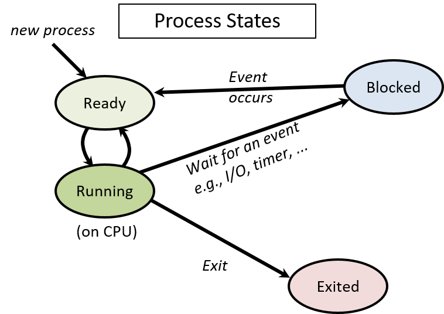
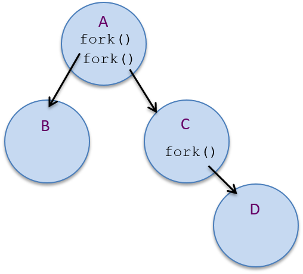
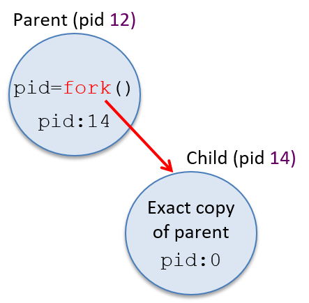
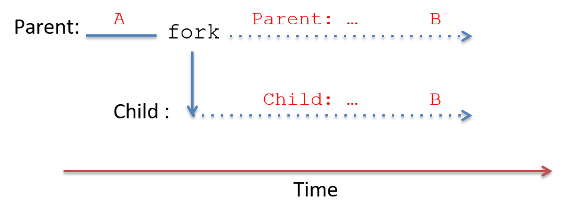
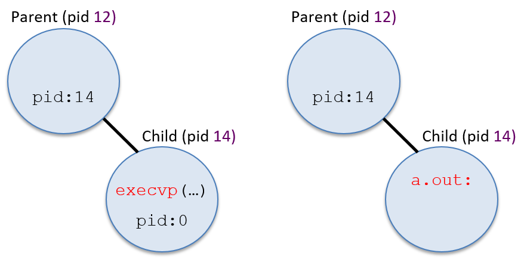
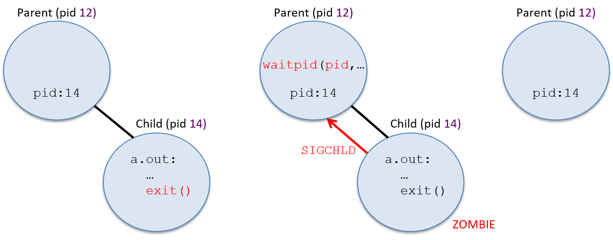
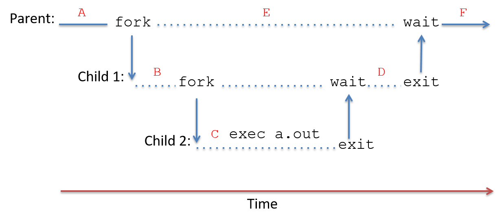

> **说明**
> 本文是个人学习用的**非官方**中英对照译文，原文：<https://diveintosystems.org/book/C13-OS/processes.html>。
> 原书采用 CC BY-NC-ND 4.0 许可（禁止演绎），**请勿公开传播本译文**。
> 标为「译注」「现代更新」的内容是译者补充，不代表原书作者观点；代码与原文逐字一致，未作改动。

## 13.2. 进程

*13.2. Processes*

操作系统实现的主要抽象之一是**进程**（process）。进程代表在系统中运行的一个程序实例，它包括程序的二进制可执行代码、数据和执行**上下文**（context）。上下文通过维护程序的寄存器值、栈的位置以及当前正在执行的指令，来跟踪程序的执行。

> One of the main abstractions implemented by the operating system is a **process**. A process represents an instance of a program running in the system, which includes the program’s binary executable code, data, and execution **context**. The context tracks the program’s execution by maintaining its register values, stack location, and the instruction it is currently executing.

在支持多个进程同时存在于系统中的**多道程序设计**系统中，进程是必不可少的抽象。操作系统用进程抽象来跟踪系统中运行的各个程序实例，并管理它们对系统资源的使用。

> Processes are necessary abstractions in **multiprogramming** systems, which support multiple processes existing in the system at the same time. The process abstraction is used by the OS to keep track of individual instances of programs running in the system, and to manage their use of system resources.

操作系统为每个进程提供一种「独占视图」的系统抽象。也就是说，操作系统把进程彼此隔离开来，给每个进程一种它在控制整台机器的错觉。实际上，操作系统支持许多活动的进程，并管理它们之间的资源共享。操作系统向用户隐藏了共享和访问系统资源的细节，并保护进程不受系统中其他运行进程行为的影响。

> The OS provides each process with a "lone view" abstraction of the system. That is, the OS isolates processes from one another and gives each process the illusion that it’s controlling the entire machine. In reality, the OS supports many active processes and manages resource sharing among them. The OS hides the details of sharing and accessing system resources from the user, and the OS protects processes from the actions of other processes running in the system.

例如，用户可能在一个计算机系统上同时运行两个 Unix shell 程序实例和一个 Web 浏览器。操作系统为这三个正在运行的程序创建三个相应的进程：Unix shell 程序的每次单独执行各一个进程，Web 浏览器一个进程。操作系统负责在 CPU 上运行的这三个进程之间切换，并确保一个进程在 CPU 上运行时，只能访问分配给该进程的执行状态和系统资源。

> For example, a user may simultaneously run two instances of a Unix shell program along with a web browser on a computer system. The OS creates three processes associated with these three running programs: one process for each separate execution of the Unix shell program, and one process for the web browser. The OS handles switching between these three processes running on the CPU, and it ensures that as a process runs on the CPU, only the execution state and system resources allocated to the process can be accessed.

### 13.2.1. 多道程序设计与上下文切换

*13.2.1. Multiprogramming and Context Switching*

多道程序设计让操作系统能够高效地利用硬件资源。例如，当在 CPU 上运行的进程需要访问当前在磁盘上的数据时，操作系统不必让 CPU 闲着等数据读入内存，而是可以把 CPU 交给另一个进程运行，同时由磁盘处理原进程的读操作。通过多道程序设计，操作系统可以在一些进程等待访问存储器层次结构较低层中的数据时，让 CPU 忙于执行另一些进程，从而缓解存储器层次结构对其程序工作负载的一些影响。

> Multiprogramming enables the OS to make efficient use of hardware resources. For example, when a process running on the CPU needs to access data that are currently on disk, rather than have the CPU sit idle waiting for the data to be read into memory, the OS can give the CPU to another process and let it run while the read operation for the original process is being handled by the disk. By using multiprogramming, the OS can mitigate some of the effects of the memory hierarchy on its program workload by keeping the CPU busy executing some processes while other processes are waiting to access data in the lower levels of the memory hierarchy.

通用操作系统常常实现**分时**（timesharing），这是一种多道程序设计，操作系统调度各个进程轮流在 CPU 上执行一小段时间（称为**时间片**，time slice 或 quantum）。当一个进程用完它在 CPU 上的时间片时，操作系统把它从 CPU 上移下来，让另一个进程运行。大多数系统把时间片定为几毫秒（10<sup>-3</sup> 秒），以 CPU 周期计这是很长的时间，但人察觉不到。

> General-purpose operating systems often implement **timesharing**, which is multiprogramming wherein the OS schedules each process to take turns executing on the CPU for short time durations (known as a **time slice** or **quantum**). When a process completes its time slice on the CPU, the OS removes the process from the CPU and lets another run. Most systems define time slices to be a few milliseconds (10<sup>-3</sup> seconds), which is a long time in terms of CPU cycles but is not noticeable to a human.

分时系统进一步支持了计算机系统对用户的「独占视图」；由于每个进程都频繁地在 CPU 上执行一小段时间，用户通常察觉不到它们在共享 CPU。只有在系统负载非常重时，用户才可能注意到系统中其他进程的影响。Unix 命令 `ps -A` 列出系统中运行的所有进程，你可能会对进程之多感到吃惊。`top` 命令也很有用，它显示当前使用系统资源（例如 CPU 时间和内存空间）最多的那些进程，让你在系统运行时查看其状态。

> Timesharing systems further support the "lone view" of the computer system to the user; because each process frequently executes on the CPU for short bursts of time, the fact that they are all sharing the CPU is usually imperceptible to the user. Only when the system is very heavily loaded might a user notice the effects of other processes in the system. The Unix command `ps -A` lists all the processes running in the system — you may be surprised by how many there are. The `top` command is also useful for seeing the state of the system as it runs by displaying the set of processes that currently use the most system resources (such as CPU time and memory space).

在多道程序设计和分时系统中，进程是**并发**（concurrently）运行的，即它们的执行在时间上有重叠。例如，操作系统可能先在 CPU 上运行进程 A，然后切换去运行进程 B 一段时间，之后再切换回来继续运行进程 A。在这种情况下，进程 A 和 B 是并发运行的，因为操作系统在两者之间切换，使它们在 CPU 上的执行有重叠。

> In multiprogrammed and timeshared systems, processes run **concurrently**, meaning that their executions overlap in time. For example, the OS may start running process A on the CPU, and then switch to running process B for a while, and later switch back to running process A some more. In this scenario, processes A and B run concurrently because their execution on the CPU overlaps due to the OS switching between the two.

#### 上下文切换

*Context Switching*

多道程序设计背后的**机制**决定了操作系统如何把在 CPU 上运行的一个进程换成另一个。多道程序设计的**策略**方面则支配着 CPU 调度，即从一组候选进程中挑选哪个进程下一个使用 CPU，以及使用多长时间。我们主要关注实现多道程序设计的机制。操作系统教材会更详细地介绍调度策略。

> The **mechanism** behind multiprogramming determines how the OS swaps one process running on the CPU with another. The **policy** aspect of multiprogramming governs scheduling the CPU, or picking which process from a set of candidate processes gets to use the CPU next and for how long. We focus primarily on the mechanism of implementing multiprogramming. Operating systems textbooks cover scheduling policies in more detail.

> **现代更新（截至 2026-11）· Linux 换了新的进程调度器**
> 本书只讲调度的机制，不讲策略。值得一提的是，2023 年 10 月 29 日发布的 **Linux 6.6** 用一个名为 **EEVDF**（Earliest Eligible Virtual Deadline First，最早合格虚拟截止时间优先）的新调度器取代了自 2.6.23 版起使用多年的 CFS（完全公平调度器），Kernel Newbies 的版本说明称它总体上应能提供更好的延迟。[Kernel Newbies：Linux 6.6](https://kernelnewbies.org/Linux_6.6)

操作系统执行**上下文切换**（context switching），即在 CPU 上交换进程状态，这是多道程序设计（以及分时）背后的主要机制。执行一次 CPU 上下文切换有两个主要步骤：

> The OS performs **context switching**, or swapping process state on the CPU, as the primary mechanism behind multiprogramming (and timesharing). There are two main steps to performing a CPU context switch:

1. 操作系统保存当前在 CPU 上运行的进程的上下文，包括它所有的寄存器值（PC、栈指针、通用寄存器、条件码等）、它的内存状态，以及其他一些状态（例如它所使用的系统资源的状态，比如打开的文件）。

> 1.  The OS saves the context of the current process running on the CPU, including all of its register values (PC, stack pointers, general-purpose register, condition codes, etc.), its memory state, and some other state (for example the state of system resources it uses, like open files).

2. 操作系统在 CPU 上恢复另一个进程已保存的上下文，并让 CPU 开始运行这个进程，从它上次停下的那条指令继续执行。

> 2.  The OS restores the saved context from another process on the CPU and starts the CPU running this other process, continuing its execution from the instruction where it left off.

上下文切换中有一部分看起来似乎不可能做到：实现上下文切换的操作系统代码，必须在把进程的执行上下文从 CPU 保存出来（或恢复到 CPU 上）的同时，在 CPU 上运行；上下文切换代码的指令需要用 CPU 硬件寄存器来执行，但被换下 CPU 的那个进程的寄存器值又需要由上下文切换代码来保存。计算机硬件提供了一些帮助，使这成为可能。

> One part of context switching that may seem impossible to accomplish is that the OS’s code that implements context switching must run on the CPU while it saves (restores) a process’s execution contexts from (to) the CPU; the instructions of the context switching code need to use CPU hardware registers to execute, but the register values from the process being context switched off the CPU need to be saved by the context switching code. Computer hardware provides some help to make this possible.

在引导时，操作系统初始化了硬件，包括初始化 CPU 状态，使得 CPU 在中断时切换到内核态后，操作系统的中断处理程序代码开始执行，而被中断进程的执行状态不受这次执行的影响。计算机硬件和操作系统一起完成对用户级执行上下文最初的一部分保存工作，足以让操作系统代码在 CPU 上运行而不会丢失被中断进程的执行状态。例如，被中断进程的寄存器值需要保存下来，这样当该进程再次在 CPU 上运行时，就能用它的寄存器值从它停下的地方继续执行。根据硬件支持的不同，保存用户级进程寄存器值的工作可能完全由硬件完成，也可能几乎完全由软件完成，作为内核中断处理代码的第一部分。至少，进程的程序计数器（PC）的值需要保存下来，这样在把内核中断处理程序的地址加载到 PC 时，它的值才不会丢失。

> At boot time, the OS initialized the hardware, including initializing the CPU state, so that when the CPU switches to kernel mode on an interrupt, the OS interrupt handler code starts executing and the interrupted process’s execution state is protected from this execution. Together, the computer hardware and OS perform some of the initial saving of the user-level execution context, enough that the OS code can run on the CPU without losing the execution state of the interrupted process. For example, register values of the interrupted process need to be saved so that when the process runs again on the CPU, the process can continue from the point at which it left off, using its register values. Depending on the hardware support, saving the user-level process’s register values may be done entirely by the hardware or may be done almost entirely in software as the first part of the kernel’s interrupt handling code. At a minimum, the process’s program counter (PC) value needs to be saved so that its value is not lost when the kernel interrupt handler address is loaded into the PC.

一旦操作系统开始运行，它就执行完整的进程上下文切换代码，保存正在 CPU 上运行的进程的完整执行状态，并把另一个进程已保存的执行状态恢复到 CPU 上。由于操作系统运行在内核态，它能访问计算机内存的任何部分，能执行特权指令，能访问任何硬件寄存器。因此，它的上下文切换代码能够访问任何进程的 CPU 执行状态并把它保存到内存中，也能把任何进程的执行状态从内存恢复到 CPU 上。操作系统的上下文切换代码最后设置好 CPU，以执行恢复后的进程的执行状态，并把 CPU 切换到用户态。切换到用户态后，CPU 执行的指令和使用的执行状态，就都来自操作系统切换到 CPU 上的那个进程了。

> Once the OS starts running, it executes its full process context switching code, saving the full execution state of the process running on the CPU and restoring the saved execution state of another process onto the CPU. Because the OS runs in kernel mode it is able to access any parts of computer memory and can execute privileged instructions and access any hardware registers. As a result, its context switching code is able to access and save the CPU execution state of any process to memory, and it is able to restore from memory the execution state of any process to the CPU. OS context switching code completes by setting up the CPU to execute the restored process’s execution state and by switching the CPU to user mode. Once switched to user mode, the CPU executes instructions, and uses execution state, from the process that the OS context switched onto the CPU.

### 13.2.2. 进程状态

*13.2.2. Process State*

在多道程序设计系统中，操作系统必须跟踪和管理任一时刻存在于系统中的多个进程。操作系统为每个进程维护的信息包括：

> In multiprogrammed systems, the OS must track and manage the multiple processes existing in the system at any given time. The OS maintains information about each process, including:

- **进程 ID**（process id，PID），即进程的唯一标识符。`ps` 命令列出系统中进程的信息，包括它们的 PID 值。

> - A **process id** (PID), which is a unique identifier for a process. The `ps` command lists information about processes in the system, including their PID values.

- 进程的地址空间信息。

> - The address space information for the process.

- 进程的执行状态（例如 CPU 寄存器值、栈的位置）。

> - The execution state of the process (e.g., CPU register values, stack location).

- 分配给进程的资源集合（例如打开的文件）。

> - The set of resources allocated to the process (e.g., open files).

- 当前的**进程状态**（process state），这个值决定了它是否有资格在 CPU 上执行。

> - The current **process state**, which is a value that determines its eligibility for execution on the CPU.

在生命周期中，进程会经历几种状态，这些状态对应于进程执行资格的不同类别。操作系统使用进程状态的一种方式，是确定哪些进程是可以被调度到 CPU 上的候选者。

> Over the course of its lifetime, a process moves through several states, which correspond to different categories of process execution eligibility. One way that the OS uses process state is to identify the set of processes that are candidates for being scheduled on the CPU.

进程的执行状态包括：

> The set of process execution states are:

- **就绪**（Ready）：进程可以在 CPU 上运行，但当前没有被调度（它是被上下文切换到 CPU 上的候选者）。新进程被操作系统创建并初始化后，就进入就绪状态（它已准备好让 CPU 开始执行它的第一条指令）。在分时系统中，如果一个进程因为时间片用完而被上下文切换下 CPU，它也会被置于*就绪*状态（它已准备好让 CPU 执行它的下一条指令，但它用完了时间片，必须等待轮到它再次被调度到 CPU 上）。

> - **Ready**: The process could run on the CPU but is not currently scheduled (it is a candidate for being context switched on to the CPU). Once a new process is created and initialized by the OS, it enters the ready state (it is ready for the CPU to start executing its first instruction). In a timesharing system, if a process is context switched off the CPU because its time slice is up, it is also placed in the *ready* state (it is ready for the CPU to execute its next instruction, but it used up its time slice and has to wait its turn to get scheduled again on the CPU).

- **运行**（Running）：进程被调度到 CPU 上，正在执行指令。

> - **Running**: The process is scheduled on the CPU and is actively executing instructions.

- **阻塞**（Blocked）：进程在等待某个事件，然后才能继续执行。例如，进程在等待从磁盘读入一些数据。阻塞的进程不是被调度到 CPU 上的候选者。等到使进程阻塞的事件发生后，进程就转到*就绪*状态（它已准备好再次运行）。

> - **Blocked**: The process is waiting for some event before it can continue being executed. For example, the process is waiting for some data to be read in from disk. Blocked processes are not candidates for being scheduled on the CPU. After the event on which the process is blocked occurs, the process moves to the *ready* state (it is ready to run again).

- **退出**（Exited）：进程已经退出，但仍需要从系统中彻底清除。进程退出的原因可能是它执行完了程序的指令，也可能是因错误而退出（例如它试图除以零），还可能是收到了来自另一个进程的终止请求。退出的进程永远不会再运行，但在与其执行状态相关的最后清理工作完成之前，它仍然留在系统中。

> - **Exited**: The process has exited but still needs to be completely removed from the system. A process exits due to its completing the execution of its program instructions, or by exiting with an error (e.g., it tries to divide by zero), or by receiving a termination request from another process. An exited process will never run again, but it remains in the system until final clean-up associated with its execution state is complete.

[图 1](13.2-processes.html) 展示了一个进程在系统中的生命周期，说明了它如何在不同状态之间转换。注意从一个状态到另一个状态的转换（箭头）。例如，进程可以通过三种方式之一进入*就绪*状态：第一，它是操作系统新创建的；第二，它原本因等待某个事件而阻塞，而该事件发生了；第三，它原本在 CPU 上运行，时间片用完了，操作系统把它上下文切换下来，让另一个*就绪*进程轮到使用 CPU。

> [Figure 1](13.2-processes.html) shows the lifetime of a process in the system, illustrating how it moves between different states. Note the transitions (arrows) from one state to another. For example, a process can enter the *Ready* state in one of three ways: first, if it is newly created by the OS; second, if it was blocked waiting for some event and the event occurs; and third, if it was running on the CPU and its time slice is over and the OS context switches it off to give another *Ready* process its turn on the CPU.



**图 1.** 进程在其生命周期中的各种状态

*Figure 1. The states of a process during its lifetime*

> **原书旁注 · 进程运行时间（Process Runtime）**
> 程序员常常用进程的完成时间作为评估其性能的指标。对于非交互式程序，运行时间越短，通常表示实现越好、越优化。例如，比较两个计算大数质因数的程序时，能更快地正确完成任务的那个更可取。
>
> 进程的运行时间有两种不同的度量。第一种是总的**挂钟时间**（wall time 或 wall-clock time）。挂钟时间是进程从开始到完成之间的时长，即用挂在墙上的钟测得的、从进程开始到结束所经过的时间。挂钟时间包括进程处于运行状态、在 CPU 上执行的时间，也包括进程处于阻塞状态、等待 I/O 等事件的时间，还包括进程处于就绪状态、等待轮到它被调度到 CPU 上运行的时间。在多道程序设计和分时系统中，进程的挂钟时间可能会因为系统上并发运行、共享系统资源的其他进程而变长。
>
> 进程运行时间的第二种度量是总的 **CPU 时间**（CPU time，或进程时间）。CPU 时间只度量进程处于运行状态、在 CPU 上执行其指令的时间。CPU 时间不包括进程处于阻塞或就绪状态的时间。因此，进程的总 CPU 时间不受系统上并发运行的其他进程的影响。
>
> > Programmers often use a process’s completion time as a metric to evaluate its performance. For noninteractive programs, a faster runtime typically indicates a better, or more optimal, implementation. For example, in comparing two programs that compute the prime factors of a large number, the one that correctly completes the task faster is preferable.
> >
> > There are two different measures of the runtime of a process. The first is total **wall time** (or wall-clock time). Wall time is the duration between the start and completion of a process it is the elapsed time from the process’s start to finish as measured by a clock hanging on a wall. Wall time includes the time that the process is in the Running state executing on the CPU, as well as time that the process is in the Blocked state waiting for an event like I/O, as well as time that the process spends in the Ready state waiting for its turn to be scheduled to run on the CPU. In multiprogrammed and timeshared systems, the wall time of a process can slow down due to other processes running concurrently on the system and sharing system resources.
> >
> > The second measure of process runtime is total **CPU time** (or process time). CPU time measures just the amount of time the process spends in the Running state executing its instructions on the CPU. CPU time does not include the time the process spends in the Blocked or Ready states. As a result, a process’s total CPU time is not affected by other processes concurrently running on the system.

> **译注**
> 在 shell 中用 `time ./a.out` 运行程序，可以同时看到这两种时间：`real` 是挂钟时间，`user` 和 `sys` 分别是在用户态和内核态下消耗的 CPU 时间。

### 13.2.3. 进程的创建（与销毁）

*13.2.3. Creating (and Destroying) Processes*

当一个现有进程发出系统调用请求操作系统创建新进程时，操作系统就创建一个新进程。在 Unix 中，**fork** 系统调用创建一个新进程。调用 `fork` 的进程是**父**进程，它创建的新进程是它的**子**进程。例如，如果你在 shell 中运行 `a.out`，shell 进程就会调用 `fork` 系统调用，请求操作系统创建一个新的子进程，用来运行 `a.out` 程序。另一个例子是 Web 浏览器进程，它调用 `fork` 创建子进程来处理不同的浏览事件。当用户加载一个网页时，Web 浏览器可能会创建一个子进程来处理与 Web 服务器的通信。它可能再创建一个进程来处理用户的鼠标输入，还会创建其他进程来处理单独的浏览器窗口或标签页。像这样的多进程 Web 浏览器，能够通过它的一些子进程继续处理用户请求，同时它的另一些子进程可能正因等待远程 Web 服务器的响应或用户的鼠标点击而阻塞。

> An OS creates a new process when an existing process makes a system call requesting it to do so. In Unix, the **fork** system call creates a new process. The process calling `fork` is the **parent** process and the new process it creates is its **child** process. For example, if you run `a.out` in a shell, the shell process calls the `fork` system call to request that the OS create a new child process that will be used to run the `a.out` program. Another example is a web browser process that calls `fork` to create child processes to handle different browsing events. A web browser may create a child process to handle communication with a web server when a user loads a web page. It may create another process to handle user mouse input, and other processes to handle separate browser windows or tabs. A multiple-process web browser like this is able to continue handling user requests through some of its child browser processes, while at the same time some of its other child browser processes may be blocked waiting for remote web server responses or for user mouse clicks.

系统中活动的进程之间存在由父子关系构成的**进程层次结构**（process hierarchy）。例如，如果进程 *A* 调用两次 `fork`，就会创建两个新的子进程 *B* 和 *C*。如果进程 *C* 接着调用 `fork`，就会再创建一个新进程 *D*。进程 *C* 是 *A* 的子进程，也是 *D* 的父进程。进程 *B* 和 *C* 是兄弟（它们有共同的父进程 *A*）。进程 *A* 是 *B*、*C* 和 *D* 的祖先。[图 2](13.2-processes.html) 展示了这个例子。

> A **process hierarchy** of parent-child relationships exists between the set of processes active in the system. For example, if process *A* makes two calls to `fork`, two new child processes are created, *B* and C_. If process *C* then calls `fork`, another new process, *D*, will be created. Process *C* is the child of *A*, and the parent of *D*. Processes *B* and *C* are siblings (they share a common parent process, process *A*). Process *A* is the ancestor of *B*, *C*, and *D*. This example is illustrated in [Figure 2](13.2-processes.html).



**图 2.** 一个进程层次结构的例子：父进程（A）调用两次 fork，创建两个子进程（B 和 C）。C 调用 fork 创建它的子进程 D。在 Linux 系统上，要列出进程层次结构，可以运行 `pstree` 或 `ps -Aef --forest`。

*Figure 2. An example process hierarchy created by a parent process (A) calling fork twice to create two child processes (B and C). C’s call to fork creates its child process, D. To list the process hierarchy on Linux systems, run `pstree`, or `ps -Aef --forest`.*

由于是现有进程触发进程的创建，系统至少需要一个进程才能创建任何新进程。在引导时，操作系统创建系统中第一个用户级进程。这个特殊的进程名为 `init`，它位于进程层次结构的最顶端，是系统中所有其他进程的祖先。

> Since existing processes trigger process creation, a system needs at least one process to create any new processes. At boot time, the OS creates the first user-level process in the system. This special process, named `init`, sits at the very top of the process hierarchy as the ancestor of all other processes in the system.

> **译注**
> 如今大多数 Linux 发行版中，作为第一个进程（PID 1）运行的 init 程序是 systemd：按其手册，systemd 作为引导时的第一个进程运行时，充当 init 系统，负责启动和维护用户空间的各项服务（[systemd(1)](https://man7.org/linux/man-pages/man1/systemd.1.html)）。在 macOS 上，PID 1 是 `launchd`，译者在 Mac 上运行 `ps -p 1 -o pid=,comm=` 得到的正是 `/sbin/launchd`。

#### fork

*fork*

`fork` 系统调用用于创建进程。在 fork 的那一刻，子进程从父进程那里继承执行状态。操作系统为调用者（父）进程在调用 `fork` 那一刻的执行状态创建一个*副本*。这个执行状态包括父进程地址空间的内容、CPU 寄存器的值，以及它已分配的任何系统资源（例如打开的文件）。操作系统还会创建一个新的**进程控制结构**（process control struct），即用来管理子进程的操作系统数据结构，并给子进程分配一个唯一的 PID。操作系统创建并初始化新进程之后，子进程和父进程就是并发的：它们都继续运行，随着操作系统把它们上下文切换上、下 CPU，它们的执行在时间上相互重叠。

> The `fork` system call is used to create a process. At the time of the fork, the child inherits its execution state from its parent. The OS creates a *copy* of the calling (parent) process’s execution state at the point when the parent calls `fork`. This execution state includes the parent’s address space contents, CPU register values, and any system resources it has allocated (e.g., open files). The OS also creates a new **process control struct**, an OS data structure for managing the child process, and it assigns the child process a unique PID. After the OS creates and initializes the new process, the child and parent are concurrent — they both continue running and their executions overlap as the OS context switches them on and off the CPU.

当子进程第一次被操作系统调度到 CPU 上运行时，它从父进程停下的地方开始执行，也就是从 `fork` 调用返回处开始。这是因为 `fork` 给了子进程一份父进程执行状态的副本（子进程开始运行时，使用的是它自己的这份状态副本）。从程序员的角度看，*一次 `fork` 调用会返回两次*：一次在运行中的父进程的上下文中，一次在运行中的子进程的上下文中。

> When the child process is first scheduled by the OS to run on the CPU, it starts executing at the point at which its parent left off — at the return from the `fork` call. This is because `fork` gives the child a copy of its parent’s execution state (the child executes using its own copy of this state when it starts running). From the programmer’s point of view, *a call to `fork` returns twice*: once in the context of the running parent process, and once in the context of the running child process.

为了在程序中区分子进程和父进程，`fork` 调用会向父进程和子进程返回不同的值。子进程总是得到返回值 0，而父进程得到子进程的 PID 值（如果 `fork` 失败，则得到 -1）。

> In order to differentiate the child and parent processes in a program, a call to `fork` returns different values to the parent and child. The child process always receives a return value of 0, whereas the parent receives the child’s PID value (or -1 if `fork` fails).

例如，下面的代码片段展示了一次 `fork` 系统调用，它为调用进程创建一个新的子进程：

> For example, the following code snippet shows a call to the `fork` system call that creates a new child process of the calling process:

```
pid_t pid;

pid = fork();   /* create a new child process */

print("pid = %d\n", pid);  /* both parent and child execute this */
```

`fork` 调用创建新的子进程之后，父进程和子进程都在各自独立的执行上下文中，从 `fork` 调用的返回点继续执行。两个进程都把 `fork` 的返回值赋给各自的 `pid` 变量，并且都调用 `printf`。子进程的调用打印出 0，父进程则打印出子进程的 PID 值。

> After the call to `fork` creates a new child process, the parent and child processes both continue executing, in their separate execution contexts, at the return point of the `fork` call. Both processes assign the return value of `fork` to their `pid` variable and both call `printf`. The child process’s call prints out 0 and the parent process prints out the child’s PID value.

[图 3](13.2-processes.html) 展示了这段代码执行后进程层次结构的样子。子进程得到父进程在 fork 那一刻执行上下文的一份精确副本，但它的变量 `pid` 中存放的值与父进程不同，因为 `fork` 向父进程返回子进程的 PID 值（本例中为 14），而向子进程返回 0。

> [Figure 3](13.2-processes.html) shows an example of what the process hierarchy looks like after this code’s execution. The child process gets an exact copy of the parent process’s execution context at the point of the fork, but the value stored in its variable `pid` differs from its parent because `fork` returns the child’s PID value (14 in this example) to the parent process, and 0 to the child.



**图 3.** 一个进程（PID 12）调用 fork 创建一个新的子进程。新的子进程得到父进程地址空间和执行状态的一份精确副本，但有自己的进程标识符（PID 14）。fork 向子进程返回 0，向父进程返回子进程的 PID 值（14）。

*Figure 3. A process (PID 12) calls fork to create a new child process. The new child process gets an exact copy of its parent’s address and execution state, but gets its own process identifier (PID 14). fork returns 0 to the child process and the child’s PID value (14) to the parent.*

程序员常常希望子进程和父进程在 `fork` 调用之后执行不同的任务。程序员可以利用 `fork` 的不同返回值，让父进程和子进程执行不同的代码分支。例如，下面的代码片段创建一个新的子进程，并用 `fork` 的返回值让子进程和父进程在调用之后执行不同的代码分支：

> Often, the programmer wants the child and parent processes to perform different tasks after the `fork` call. A programmer can use the different return values from `fork` to trigger the parent and child processes to execute different code branches. For example, the following code snippet creates a new child process and uses the return value from `fork` to have the child and parent processes execute different code branches after the call:

```
pid_t pid;

pid = fork();   /* create a new child process */

if (pid == 0) {
    /* only the child process executes this code */
    ...
} else if (pid != -1)  {
    /* only the parent process executes this code */
    ...
}
```

重要的是要记住，子进程和父进程一旦被创建，就各自在自己的执行上下文中并发运行，修改各自的程序变量副本，并且可能执行代码中不同的分支。

> It is important to remember that as soon as they are created, the child and parent processes run concurrently in their own execution contexts, modifying their separate copies of program variables and possibly executing different branches in the code.

考虑[下面这个程序](https://diveintosystems.org/book/C13-OS/_attachments/fork.c)，它包含一次 `fork` 调用，并根据 `pid` 的值进行分支，让父进程和子进程执行不同的代码（这个例子还展示了对 `getpid` 的调用，它返回调用进程的 PID）：

> Consider the [following program](https://diveintosystems.org/book/C13-OS/_attachments/fork.c) that contains a call to `fork` with branching on the value of `pid` to trigger the parent and child processes to execute different code (this example also shows a call to `getpid` that returns the PID of the calling process):

```
#include <stdio.h>
#include <stdlib.h>
#include <unistd.h>

int main(void) {

    pid_t pid, mypid;

    printf("A\n");

    pid = fork();   /* create a new child process */

    if(pid == -1) {  /* check and handle error return value */
        printf("fork failed!\n");
        exit(pid);
    }

    if (pid == 0) { /* the child process */
        mypid = getpid();
        printf("Child: fork returned %d, my pid %d\n", pid, mypid);

    } else  {  /* the parent process */
        mypid = getpid();
        printf("Parent: fork returned %d, my pid %d\n", pid, mypid);
    }

    printf("B:%d\n", mypid);

    return 0;
}
```

运行时，这个程序的输出可能如下所示（假设父进程的 PID 是 12，子进程的是 14）：

> When run, this program’s output might look like the following (assume that the parent’s PID is 12 and the child’s is 14):

```
A
Parent: fork returned 14, my pid 12
B:12
Child: fork returned 0, my pid 14
B:14
```

事实上，程序的输出可能是[表 1](13.2-processes.html) 中所示的任何一种可能（如果多次运行这个程序，你常常会看到不止一种输出顺序）。在[表 1](13.2-processes.html) 中，本例的父进程打印 B:12，子进程打印 B:14，但确切的 PID 值每次运行都会不同。

> In fact, the program’s output could look like any of the possible options shown in [Table 1](13.2-processes.html) (and you will often see more than one possible ordering of output if you run the program multiple times). In [Table 1](13.2-processes.html), the parent prints B:12 and the child B:14 in this example, but the exact PID values will vary from run to run.

**表 1.** 示例程序输出的全部六种可能顺序

*Table 1. All Six Possible Orderings of Example Program Output*

| 情况 1 | 情况 2 | 情况 3 | 情况 4 | 情况 5 | 情况 6 |
|---|---|---|---|---|---|
| `A` | `A` | `A` | `A` | `A` | `A` |
| `Parent…​` | `Parent…​` | `Parent…​` | `Child…​` | `Child…​` | `Child…​` |
| `Child…​` | `Child…​` | `B:12` | `Parent…​` | `Parent…​` | `B:14` |
| `B:12` | `B:14` | `Child…​` | `B:12` | `B:14` | `Parent…​` |
| `B:14` | `B:12` | `B:14` | `B:14` | `B:12` | `B:12` |

> | Option 1  | Option 2  | Option 3  | Option 4  | Option 5  | Option 6  |
> |-----------|-----------|-----------|-----------|-----------|-----------|
> | `A`       | `A`       | `A`       | `A`       | `A`       | `A`       |
> | `Parent…​` | `Parent…​` | `Parent…​` | `Child…​`  | `Child…​`  | `Child…​`  |
> | `Child…​`  | `Child…​`  | `B:12`    | `Parent…​` | `Parent…​` | `B:14`    |
> | `B:12`    | `B:14`    | `Child…​`  | `B:12`    | `B:14`    | `Parent…​` |
> | `B:14`    | `B:12`    | `B:14`    | `B:14`    | `B:12`    | `B:12`    |

之所以可能出现这六种不同的输出顺序，是因为 `fork` 系统调用返回后，父进程和子进程是并发的，可以按许多不同的顺序被调度到 CPU 上运行，从而使它们的指令序列以任何可能的方式交错。考虑这个程序的执行时间线，如[图 4](13.2-processes.html) 所示。虚线表示两个进程的并发执行。取决于每个进程何时被调度到 CPU 上运行，其中一个可能在另一个之前执行完它的两条 `printf` 语句，也可能两者的 `printf` 语句交错执行，从而得到上表所示的任何一种结果。由于在调用 `fork` 之前只存在一个进程，即父进程，所以 A 总是由父进程在 `fork` 调用之后的任何输出之前打印出来。

> These six different output orderings are possible because after the `fork` system call returns, the parent and child processes are concurrent and can be scheduled to run on the CPU in many different orderings, resulting in any possible interleaving of their instruction sequences. Consider the execution time line of this program, shown in [Figure 4](13.2-processes.html). The dotted line represents concurrent execution of the two processes. Depending on when each is scheduled to run on the CPU, one could execute both its `printf` statements before the other, or the execution of their two `printf` statements could be interleaved, resulting in any of the possible outcomes shown in the table above. Because only one process, the parent, exists before the call to `fork`, A is always printed by the parent before any of the output after the call to `fork`.



**图 4.** 程序的执行时间线。在调用 `fork` 之前只存在父进程。`fork` 返回后，两个进程并发运行（以虚线表示）。

*Figure 4. The execution time line of the program. Only the parent process exists before the call to `fork`. After `fork` returns, both run concurrently (shown in the dotted lines).*

### 13.2.4. exec

*13.2.4. exec*

通常，创建新进程是为了执行一个与父进程不同的程序。这意味着调用 `fork` 创建进程，往往是为了从头开始运行一个新程序（即从它的第一条指令开始执行）。例如，如果用户在 shell 中输入 `./a.out`，shell 进程就 fork 一个新的子进程来运行 `a.out`。作为两个独立的进程，shell 和 `a.out` 进程彼此受到保护；它们不能干扰对方的执行状态。

> Usually a new process is created to execute a program that is different from that of its parent process. This means that `fork` is often called to create a process with the intention of running a new program from its starting point (that is starting its execution from its first instruction). For example, if a user types `./a.out` in a shell, the shell process forks a new child process to run `a.out`. As two separate processes, the shell and the `a.out` process are protected from each other; they cannot interfere with each other’s execution state.

尽管 `fork` 创建了新的子进程，但它并不会让子进程运行 `a.out`。为了初始化子进程以运行一个新程序，子进程要调用某个 **exec** 系统调用。Unix 提供了一族 exec 系统调用，它们让操作系统用来自某个二进制可执行文件的新映像覆盖调用进程的映像。换句话说，exec 系统调用告诉操作系统，用指定的 `a.out` 覆盖调用进程地址空间的内容，并重新初始化其执行状态，从 `a.out` 程序的第一条指令开始执行。

> While `fork` creates the new child process, it does not cause the child to run `a.out`. To initialize the child process to run a new program, the child process calls one of the **exec** system calls. Unix provides a family of exec system calls that trigger the OS to overlay the calling process’s image with a new image from a binary executable file. In other words, an exec system call tells the OS to overwrite the calling process’s address space contents with the specified `a.out` and to reinitialize its execution state to start executing the very first instruction in the `a.out` program.

exec 系统调用的一个例子是 `execvp`，它的函数原型如下：

> One example of an exec system call is `execvp`, whose function prototype is as follows:

```
int execvp(char *filename, char *argv[]);
```

`filename` 参数指定用来初始化进程映像的二进制可执行程序的名字，`argv` 包含程序开始执行时要传给其 `main` 函数的命令行参数。

> The `filename` parameter specifies the name of a binary executable program to initialize the process’s image, and `argv` contains the command line arguments to pass into the `main` function of the program when it starts executing.

下面是一个代码片段的例子，执行时它会创建一个新的子进程来运行 `a.out`：

> Here’s an example code snippet that, when executed, creates a new child process to run `a.out`:

```
pid_t pid;
int  ret;
char *argv[2];

argv[0] = "a.out";  // initialize command line arguments for main
argv[1] = NULL;

pid = fork();
if (pid == 0) { /* child process */
    ret = execvp("a.out", argv);
    if (ret < 0) {
        printf("Error: execvp returned!!!\n");
        exit(ret);
    }
}
```

`argv` 变量被初始化为要传给 `a.out` 的 `main` 函数的 `argv` 参数值：

> The `argv` variable is initialized to the value of the `argv` argument that is passed to the `main` function of `a.out`:

```
int main(int argc, char *argv) { ...
```

`execvp` 会根据这个 `argv` 的值算出要传给 `argc` 的值（这里是 1）。

> `execvp` will figure out the value to pass to `argc` based on this `argv` value (in this case 1).

[图 5](13.2-processes.html) 展示了执行这段代码后进程层次结构的样子：

> [Figure 5](13.2-processes.html) shows what the process hierarchy would look like after executing this code:



**图 5.** 当子进程调用 execvp 时（左），操作系统用 a.out 替换它的映像（右），并初始化子进程，让它从头开始运行 a.out 程序。

*Figure 5. When the child process calls execvp (left), the OS replaces its image with a.out (right) and initializes the child process to start running the a.out program from its beginning.*

上面示例代码中值得注意的一点，是 `execvp` 调用之后那个看起来有些奇怪的错误信息：为什么从 exec 系统调用返回会是一个错误？如果 exec 系统调用成功，紧随其后的错误检测和处理代码永远不会被执行，因为进程此时执行的是 `a.out` 程序中的代码，而不是这段代码（进程地址空间的内容已经被 exec 改变了）。也就是说，exec 函数调用成功时，进程不会从 exec 调用的返回处继续执行。由于这种行为，下面的代码片段与上面那段是等价的（不过上面那段通常更容易理解）：

> Something to note in the example code shown above is its seemingly odd error message after the call to `execvp`: why would returning from an exec system call be an error? If the exec system call is successful, then the error detection and handling code immediately following it will never be executed because the process will now be executing code in the `a.out` program instead of this code (the process’s address space contents have been changed by exec). That is, when a call to an exec function is successful, the process doesn’t continue its execution at the return of the exec call. Because of this behavior, the following code snippet is equivalent to the one shown above (however, the one above is typically easier to understand):

```
pid_t pid;
int ret;

pid = fork();
if (pid == 0) { /* child process */
    ret = execvp("a.out", argv);
    printf("Error: execvp returned!!!\n");  /* only executed if execvp fails */
    exit(ret);
}
```

### 13.2.5. exit 与 wait

*13.2.5. exit and wait*

为了终止，进程调用 `exit` 系统调用，让操作系统清理该进程的大部分状态。运行完 exit 代码后，进程通知它的父进程自己已经退出。父进程负责从系统中清理已退出子进程的剩余状态。

> To terminate, a process calls the `exit` system call, which triggers the OS to clean up most of the process’s state. After running the exit code, a process notifies its parent process that it has exited. The parent is responsible for cleaning up the exited child’s remaining state from the system.

有几种方式会使进程退出。第一，进程可能执行完了它所有的应用代码。从 `main` 函数返回会使进程调用 `exit` 系统调用。第二，进程可能执行了非法操作，例如除以零或对空指针解引用，从而导致它退出。最后，进程可能收到来自操作系统或另一个进程的**信号**（signal），让它退出（事实上，除以零和对 NULL 指针解引用会使操作系统向进程发送 `SIGFPE` 和 `SIGSEGV` 信号，让它退出）。

> Processes can be triggered to exit in several ways. First, a process may complete all of its application code. Returning from its `main` function leads to a process invoking the `exit` system call. Second, a process can perform an invalid action, such as dividing by zero or dereferencing a null pointer, that results in its exiting. Finally, a process can receive a **signal** from the OS or another process, telling it to exit (in fact, dividing by zero and NULL pointer dereferences result in the OS sending the process `SIGFPE` and `SIGSEGV` signals telling it to exit).

> **原书旁注 · 信号（Signals）**
> **信号**（signal）是操作系统传递给进程的一种软件中断。信号是相关进程之间相互通信的一种方式。操作系统提供了一个接口，让一个进程可以向另一个进程发送信号，也让操作系统自己与进程通信（例如，在进程对空指针解引用时向它发送 `SIGSEGV` 信号）。
>
> 当进程收到一个信号时，它会被中断，转而运行特殊的信号处理程序代码。系统定义了固定数量的信号来传达各种含义，每个信号都由一个唯一的信号编号来区分。操作系统为每种信号类型实现了默认的信号处理程序，但程序员可以为自己的应用程序注册用户级的信号处理程序代码，以覆盖大多数信号的默认动作。
>
> [信号](13.4.1-ipc_signals.html)一节包含更多关于信号和信号处理的信息。
>
> > A **signal** is a software interrupt that the OS delivers to a process. Signals are a method by which related processes can communicate with one another. The OS provides an interface for one process to send a signal to another, and for it to communicate with processes (to send a process a `SIGSEGV` signal when it dereferences a null pointer, for example).
> >
> > When a process receives a signal, it is interrupted to run special signal handler code. A system defines a fixed number of signals to communicate various meanings, each differentiated by a unique signal number. The OS implements default signal handlers for each signal type, but programmers can register their own user-level signal handler code to override the default actions of most signals for their application.
> >
> > The [Signals](13.4.1-ipc_signals.html) section contains more information about signals and signal handling.

如果 shell 进程想终止它正在运行 `a.out` 的子进程，它可以向子进程发送一个 `SIGKILL` 信号。子进程收到该信号时，会运行 `SIGKILL` 的信号处理程序代码，这段代码调用 `exit`，终止子进程。如果用户在一个正在运行某个程序的 Unix shell 中按下 CTRL-C，子进程就会收到一个 `SIGINT` 信号。`SIGINT` 的默认信号处理程序也会调用 `exit`，使子进程退出。

> If a shell process wants to terminate its child process running `a.out`, it can send the child a `SIGKILL` signal. When the child process receives the signal, it runs signal handler code for `SIGKILL` that calls `exit`, terminating the child process. If a user types CTRL-C in a Unix shell that is currently running a program, the child process receives a `SIGINT` signal. The default signal handler for `SIGINT` also calls `exit`, resulting in the child process exiting.

> **译注**
> 严格说来，`SIGKILL` 并没有可以运行的「处理程序」：按 [signal(7)](https://man7.org/linux/man-pages/man7/signal.7.html) 手册，`SIGKILL` 和 `SIGSTOP` 不能被捕获、阻塞或忽略，收到 `SIGKILL` 的进程由内核直接终止，程序自己的任何代码都没有机会运行。`SIGINT` 则可以被程序捕获，从而覆盖默认的终止动作。

执行 `exit` 系统调用之后，操作系统向该进程的父进程传递一个 `SIGCHLD` 信号，通知它子进程已经退出。子进程成为一个**僵尸**（zombie）进程；它转到退出状态，再也不能在 CPU 上运行。僵尸进程的执行状态已被部分清理，但操作系统仍保留着关于它的少量信息，包括它是如何终止的。

> After executing the `exit` system call, the OS delivers a `SIGCHLD` signal to the process’s parent process to notify it that its child has exited. The child becomes a **zombie** process; it moves to the Exited state and can no longer run on the CPU. The execution state of a zombie process is partially cleaned up, but the OS still maintains a little information about it, including about how it terminated.

父进程通过调用 `wait` 系统调用来**回收**（reap）它的僵尸子进程（从系统中清理掉其余的状态）。如果父进程在子进程退出之前调用 `wait`，父进程就会阻塞，直到它收到来自子进程的 `SIGCHLD` 信号。`waitpid` 系统调用是 `wait` 的一个版本，它接受一个 PID 参数，让父进程能阻塞等待某个特定子进程的终止。

> A parent process **reaps** its zombie child (cleans up the rest of its state from the system) by calling the `wait` system call. If the parent process calls `wait` before its child process exits, the parent process blocks until it receives a `SIGCHLD` signal from the child. The `waitpid` system call is a version of `wait` that takes a PID argument, allowing a parent to block while waiting for the termination of a specific child process.

[图 6](13.2-processes.html) 展示了进程退出时发生的事件序列。

> [Figure 6](13.2-processes.html) shows the sequence of events that occur when a process exits.



**图 6.** 进程退出。左：子进程调用 exit 系统调用，清理其大部分执行状态。中：运行完 exit 后，子进程成为僵尸（它处于退出状态，不能再运行），其父进程收到一个 SIGCHLD 信号，通知它子进程已经退出。右：父进程调用 waitpid 回收它的僵尸子进程（从系统中清理掉子进程的其余状态）。

*Figure 6. Process exit. Left: The child process calls the exit system call to clean up most of its execution state. Middle: After running exit, the child process becomes a zombie (it is in the Exited state and cannot run again), and its parent process is sent a SIGCHLD signal, notifying it that its child is exited. Right: The parent calls waitpid to reap its zombie child (cleans up the rest of the child’s state from the system).*

由于父进程和子进程并发执行，父进程可能在子进程退出之前调用 `wait`，子进程也可能在父进程调用 `wait` 之前就退出了。如果父进程调用 `wait` 时子进程仍在执行，父进程就会阻塞，直到子进程退出（父进程进入阻塞状态，等待 `SIGCHLD` 信号事件发生）。如果你在 shell 的前台运行一个程序（`a.out`），就能看到父进程的这种阻塞行为：直到 `a.out` 终止，shell 程序才会打印出 shell 提示符，这表明 shell 父进程阻塞在 `wait` 调用上，等待收到来自运行 `a.out` 的子进程的 `SIGCHLD`。

> Because the parent and child processes execute concurrently, the parent may call `wait` before its child exits, or the child can exit before the parent calls `wait`. If the child is still executing when the parent process calls `wait`, the parent blocks until the child exits (the parent enters the Blocked state waiting for the `SIGCHLD` signal event to happen). The blocking behavior of the parent can be seen if you run a program (`a.out`) in the foreground of a shell — the shell program doesn’t print out a shell prompt until `a.out` terminates, indicating that the shell parent process is blocked on a call to `wait`, waiting until it receives a `SIGCHLD` from its child process running `a.out`.

程序员也可以把父进程的代码设计成永远不会阻塞等待子进程退出。如果父进程实现了一个包含 `wait` 调用的 `SIGCHLD` 信号处理程序，那么父进程只在有已退出的子进程需要回收时才调用 `wait`，因此不会阻塞在 `wait` 调用上。在 shell 中以后台方式运行一个程序（`a.out &`），就能看到这种行为。shell 程序会继续执行，打印出提示符，并在子进程运行 `a.out` 的同时执行另一条命令。下面这个例子展示了你可能如何看出阻塞在 `wait` 上的父进程，与只在 `SIGCHLD` 信号处理程序中调用 `wait` 的非阻塞父进程之间的区别（务必运行一个运行时间足够长的程序，以便注意到这种区别）：

> A programmer can also design the parent process code so that it will never block waiting for a child process to exit. If the parent implements a `SIGCHLD` signal handler that contains the call to `wait`, then the parent only calls `wait` when there is an exited child process to reap, and thus it doesn’t block on a `wait` call. This behavior can be seen by running a program in the background in a shell (`a.out &`). The shell program will continue executing, print out a prompt, and execute another command as its child runs `a.out`. Here’s an example of how you might see the difference between a parent blocking on `wait` vs. a nonblocking parent that only calls `wait` inside a `SIGCHLD` signal handler (make sure you execute a program that runs for long enough to notice the difference):

```
$  a.out        # shell process forks child and calls wait

$  a.out &      # shell process forks child but does not call wait
$  ps           # (the shell can run ps and a.out concurrently)
```

下面是一个包含 `fork`、`exec`、`exit` 和 `wait` 系统调用的示例代码片段（为了可读性去掉了错误处理）。这个例子旨在检验你对这些系统调用及其对进程执行的影响的理解。在这个例子中，父进程创建一个子进程并等待它退出。这个子进程接着 fork 另一个子进程来运行 `a.out` 程序（第一个子进程是第二个子进程的父进程）。然后它等待自己的子进程退出。

> Below is an example code snippet containing `fork`, `exec`, `exit`, and `wait` system calls (with error handling removed for readability). This example is designed to test your understanding of these system calls and their effects on the execution of the processes. In this example, the parent process creates a child process and waits for it to exit. The child then forks another child to run the `a.out` program (the first child is the parent of the second child). It then waits for its child to exit.

```
pid_t pid1, pid2, ret;
int status;

printf("A\n");

pid1 = fork();
if (pid1 == 0 ) {       /* child 1 */
    printf("B\n");

    pid2 = fork();
    if (pid2 == 0 ){    /* child 2 */
        printf("C\n");
        execvp("a.out", NULL);
    } else {            /* child 1 (parent of child 2) */
        ret = wait(&status);
        printf("D\n");
        exit(0);
    }
} else {                /* original parent */
    printf("E\n");
    ret = wait(&status);
    printf("F\n");
}
```

[图 7](13.2-processes.html) 展示了执行上面这个例子时，进程创建、运行、阻塞、退出等事件的执行时间线。虚线表示一个进程的执行与其子进程或后代进程相重叠的时间：这些进程是并发的，可以按任何顺序被调度到 CPU 上。实线表示进程执行之间的依赖关系。例如，子进程 1 必须先回收已退出的子进程 2，然后才能调用 `exit`。当一个进程调用 `wait` 时，它会阻塞，直到其子进程退出。当一个进程调用 `exit` 时，它就再也不会运行了。程序的输出被标注在每个进程的执行时间线上，标出对应的 `printf` 语句可能发生的执行时刻。

> [Figure 7](13.2-processes.html) illustrates the execution time line of process create/running/blocked/exit events from executing the above example. The dotted lines represent times when a process’s execution overlaps with its child or descendants: the processes are concurrent and can be scheduled on the CPU in any order. Solid lines represent dependencies on the execution of the processes. For example, Child 1 cannot call `exit` until it has reaped its exited child process, Child 2. When a process calls `wait`, it blocks until its child exits. When a process calls `exit`, it never runs again. The program’s output is annotated along each process’s execution time line at points in its execution when the corresponding `printf` statement can occur.



**图 7.** 示例程序的执行时间线，展示了三个进程的 fork、exec、wait 和 exit 调用的一种可能顺序。实线表示进程之间执行顺序上的依赖关系，虚线表示并发执行的时段。父进程（Parent）是子进程 1（Child 1）的父进程，子进程 1 是子进程 2（Child 2）的父进程。

*Figure 7. The execution time line for the example program, showing a possible sequence of fork, exec, wait, and exit calls from the three processes. Solid lines represent dependencies in the order of execution between processes, and dotted line concurrent execution points. Parent is the parent process of Child 1, and Child 1 is the parent of Child 2.*

在这个程序中调用 `fork` 之后，父进程和第一个子进程并发运行，因此父进程中的 `wait` 调用可能与其子进程的任何一条指令交错。例如，父进程可能在它的子进程调用 `fork` 创建自己的子进程之前，就调用 `wait` 并阻塞了。[表 2](13.2-processes.html) 列出了运行这个示例程序所有可能的输出。

> After the calls to `fork` are made in this program, the parent process and first child process run concurrently, thus the call to `wait` in the parent could be interleaved with any instruction of its child. For example, the parent process could call `wait` and block before its child process calls `fork` to create its child process. [Table 2](13.2-processes.html) lists all possible outputs from running the example program.

**表 2.** 这个程序所有可能的输出顺序

*Table 2. All Possible Output Orderings from the Program*

| 情况 1 | 情况 2 | 情况 3 | 情况 4 |
|---|---|---|---|
| `A` | `A` | `A` | `A` |
| `B` | `B` | `B` | `E` |
| `C` | `C` | `E` | `B` |
| `D` | `E` | `C` | `C` |
| `E` | `D` | `D` | `D` |
| `F` | `F` | `F` | `F` |

> | Option 1 | Option 2 | Option 3 | Option 4 |
> |----------|----------|----------|----------|
> | `A`      | `A`      | `A`      | `A`      |
> | `B`      | `B`      | `B`      | `E`      |
> | `C`      | `C`      | `E`      | `B`      |
> | `D`      | `E`      | `C`      | `C`      |
> | `E`      | `D`      | `D`      | `D`      |
> | `F`      | `F`      | `F`      | `F`      |

[表 2](13.2-processes.html) 中的程序输出都是可能的，因为父进程在调用 `wait` 之前与它的后代进程并发运行。因此，父进程对 `printf("E\n")` 的调用可以在其后代进程开始到退出之间的任何时刻交错进来。

> The program outputs in [Table 2](13.2-processes.html) are all possible because the parent runs concurrently with its descendant processes until it calls `wait`. Thus, the parent’s call to `printf("E\n")` can be interleaved at any point between the start and the exit of its descendant processes.
