> [!WARNING] 说明
> 本文是个人学习用的**非官方**中英对照译文，原文：<https://diveintosystems.org/book/C13-OS/vm.html>。
> 原书采用 CC BY-NC-ND 4.0 许可（禁止演绎），**请勿公开传播本译文**。
> 标为「译注」「现代更新」的内容是译者补充，不代表原书作者观点；代码与原文逐字一致，未作改动。


*13.3. Virtual Memory*

操作系统的进程抽象为每个进程提供了一个虚拟内存空间。**虚拟内存**（virtual memory）是一种抽象，它给每个进程一个私有的逻辑地址空间，用来存放进程的指令和数据。每个进程的虚拟地址空间可以看作一个可寻址字节的数组，地址从 0 一直到某个最大地址。例如，在 32 位系统上，最大地址是 2<sup>32</sup> -1。进程不能访问彼此地址空间中的内容。进程虚拟地址空间中的某些部分来自它所运行的二进制可执行文件（例如，*代码段*（text）包含来自 `a.out` 文件的程序指令）。进程虚拟地址空间的其他部分则是在运行时创建的（例如*栈*）。

> The OS’s process abstraction provides each process with a virtual memory space. **Virtual memory** is an abstraction that gives each process its own private, logical address space in which its instructions and data are stored. Each process’s virtual address space can be thought of as an array of addressable bytes, from address 0 up to some maximum address. For example, on 32-bit systems the maximum address is 2<sup>32</sup> -1. Processes cannot access the contents of one another’s address spaces. Some parts of a process’s virtual address space come from the binary executable file it’s running (e.g., the *text* portion contains program instructions from the `a.out` file). Other parts of a process’s virtual address space are created at runtime (e.g., the *stack*).

操作系统把虚拟内存作为进程**独占视图**抽象的一部分来实现。也就是说，每个进程只以自己的虚拟地址空间的形式与内存交互，而不必面对许多进程同时共享计算机物理内存（RAM）这一现实。操作系统还利用其虚拟内存实现，保护进程不能访问彼此的内存空间。举个例子，考虑下面这个简单的 C 程序：

> Operating systems implement virtual memory as part of the **lone view** abstraction of processes. That is, each process only interacts with memory in terms of its own virtual address space rather than the reality of many processes simultaneously sharing the computer’s physical memory (RAM). The OS also uses its virtual memory implementation to protect processes from accessing one another’s memory spaces. As an example, consider the following simple C program:

```
/* a simple program */
#include <stdio.h>

int main(int argc, char* argv[]) {
    int x, y;

    printf("enter a value: ");
    scanf("%d", &y);

    if (y > 10) {
        x = y;
    } else {
        x = 6;
    }
    printf("x is %d\n", x);

    return 0;
}
```

如果两个进程同时执行这个程序，它们各自都会得到一份栈内存的副本，作为各自独立的虚拟地址空间的一部分。因此，如果一个进程执行 `x = 6`，对另一个进程中 `x` 的值不会有任何影响：每个进程在自己私有的虚拟地址空间中都有一份 `x` 的副本，如[图 1](13.3-vm.html) 所示。

> If two processes simultaneously execute this program, they each get their own copy of stack memory as part of their separate virtual address spaces. As a result, if one process executes `x = 6` it will have no effect on the value of `x` in the other process — each process has its own copy of `x`, in its private virtual address space, as shown in [Figure 1](13.3-vm.html).

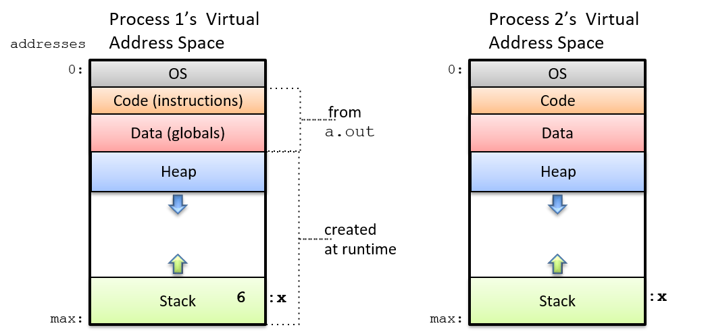

**图 1.** 执行两次 a.out 会产生两个进程，各自运行 a.out 程序的一个相互隔离的实例。每个进程都有自己私有的虚拟地址空间，其中包含它自己的程序指令、全局变量以及栈和堆内存空间的副本。例如，每个进程在其虚拟地址空间的栈部分中都可能有一个局部变量 x。

*Figure 1. Two executions of a.out results in two processes, each running isolated instances of the a.out program. Each process has its own private virtual address space, containing its copies of program instructions, global variables, and stack and heap memory space. For example, each may have a local variable x in the stack portion of their virtual address spaces.*

进程的虚拟地址空间被划分为几个区段，每个区段存放进程内存的不同部分。顶部（位于最低地址处）保留给操作系统，只能在内核态下访问。进程虚拟地址空间中的代码段和数据段由程序的可执行文件（`a.out`）初始化。代码段包含程序指令，数据段包含全局变量（数据部分实际上又分为两部分，一部分用于已初始化的全局变量，另一部分用于未初始化的全局变量）。

> A process’s virtual address space is divided into several sections, each of which stores a different part of the process’s memory. The top part (at the lowest addresses) is reserved for the OS and can only be accessed in kernel mode. The text and data parts of a process’s virtual address space are initialized from the program executable file (`a.out`). The text section contains the program instructions, and the data section contains global variables (the data portion is actually divided into two parts, one for initialized global variables and the other for uninitialized globals).

> [!NOTE] 译注
> 本书的地址空间示意图把低地址画在上方、高地址画在下方，所以文中说操作系统在「顶部（最低地址处）」，栈在「底部（接近最大地址处）」并「向上」朝低地址增长。这与 13.1 节图 5 一致，但有些教材的画法正好上下颠倒，读图时注意方向。

进程虚拟地址空间中的栈和堆区段会随着进程的运行而改变大小。栈空间随着进程进行函数调用而增长，随着它从函数返回而收缩。堆空间在进程动态分配内存空间时（通过调用 `malloc`）增长，在进程释放动态分配的内存空间时（通过调用 `free`）收缩。进程内存中的堆和栈部分在其地址空间中通常相距很远，以使两者能使用的空间都尽可能大。通常，栈位于进程地址空间的底部（接近最大地址处），随着函数调用把栈帧加到栈顶，栈向上朝较低的地址增长。

> The stack and heap sections of a process’s virtual address space vary in size as the process runs. Stack space grows in response to the process making function calls, and shrinks as it returns from functions. Heap space grows when the process dynamically allocates memory space (via calls to `malloc`), and shrinks when the process frees dynamically allocated memory space (via calls to `free`). The heap and stack portions of a process’s memory are typically located far apart in its address space to maximize the amount of space either can use. Typically, the stack is located at the bottom of a process’s address space (near the maximum address), and grows upward into lower addresses as stack frames are added to the top of the stack in response to a function call.

> [!NOTE] 原书旁注 · 关于堆内存和栈内存（About Heap and Stack Memory）
> 堆内存和栈内存空间的实际总容量，通常并不会在每次调用 `malloc` 和 `free` 时改变，也不会在每次函数调用和返回时改变。这些动作常常只改变进程正在使用的、当前已分配的那部分堆和栈虚拟内存空间的多少。不过，有时这些动作确实会导致堆或栈空间总容量的变化。
>
> 操作系统负责管理进程的虚拟地址空间，包括改变堆和栈空间的总容量。可以用 `brk`、`sbrk` 或 `mmap` 系统调用请求操作系统改变堆内存的总容量。C 程序员通常不直接调用这些系统调用，而是调用标准 C 库函数 `malloc`（和 `free`）来分配（和释放）堆内存空间。在内部，标准 C 库的用户级堆管理器可能会调用这些系统调用之一，请求操作系统改变堆内存空间的大小，以满足 `malloc` 请求。
>
> > The actual total capacity of heap and stack memory space does not typically change on every call to `malloc` and `free`, nor on every function call and return. Instead, these actions often only make changes to how much of the currently allocated heap and stack parts of the virtual memory space are actively being used by the process. Sometimes, however, these actions do result in changes to the total capacity of the heap or stack space.
> >
> > The operating system is responsible for managing a process’s virtual address space, including changing the total capacity of heap and stack space. The system calls `brk`, `sbrk`, or `mmap` can be used to request that the OS change the total capacity of heap memory. C programmers do not usually invoke these system calls directly. Instead, C programmers call the standard C library function `malloc` (and `free`) to allocate (and free) heap memory space. Internally, the standard C library’s user-level heap manager may invoke one of these system calls to request that the OS change the size of heap memory space to satisfy a `malloc` request.

### 13.3.1. 内存地址

*13.3.1. Memory Addresses*

由于进程在各自的虚拟地址空间中运行，操作系统必须对两种内存地址做出重要的区分。**虚拟地址**（virtual address）指进程虚拟地址空间中的存储位置，**物理地址**（physical address）指物理内存（RAM）中的存储位置。

> Because processes operate within their own virtual address spaces, operating systems must make an important distinction between two types of memory addresses. **Virtual addresses** refer to storage locations in a process’s virtual address space, and **physical addresses** refer to storage locations in physical memory (RAM).

#### 物理内存（RAM）与物理内存地址

*Physical Memory (RAM) and Physical Memory Addresses*

从[存储与存储器层次结构一章](../C11-MemHierarchy/11.0-index.html)我们知道，物理内存（RAM）可以看作一个可寻址字节的数组，地址范围从 0 到某个由 RAM 总大小决定的最大地址值。例如，在有 2 GB RAM 的系统中，物理内存地址的范围是 0 到 2<sup>31</sup> -1（1 GB 是 2<sup>30</sup> 字节，所以 2 GB 是 2<sup>31</sup> 字节）。

> From the [Storage and Memory Hierarchy Chapter](../C11-MemHierarchy/11.0-index.html), we know that physical memory (RAM) can be viewed as an array of addressable bytes in which addresses range from 0 to a maximum address value based on the total size of RAM. For example, in a system with 2 gigabytes (GB) of RAM, physical memory addresses range from 0 to 2<sup>31</sup> -1 (1 GB is 2<sup>30</sup> bytes, so 2 GB is 2<sup>31</sup> bytes).

要让 CPU 运行一个程序，程序的指令和数据必须由操作系统加载到 RAM 中；CPU 不能直接访问其他存储设备（例如磁盘）。操作系统管理 RAM，并决定 RAM 中的哪些位置用来存放进程虚拟地址空间的内容。例如，如果两个进程 P1 和 P2 运行上面列出的[示例程序](13.3-vm.html)，那么 P1 和 P2 各有一份独立的 `x` 变量副本，分别存放在 RAM 中的不同位置。也就是说，P1 的 `x` 和 P2 的 `x` 有不同的物理地址。如果操作系统给 P1 和 P2 的 `x` 变量分配同一个物理地址，那么 P1 把 `x` 设为 6 也会修改 P2 的 `x` 值，从而违背了每个进程拥有私有虚拟地址空间的原则。

> In order for the CPU to run a program, the program’s instructions and data must be loaded into RAM by the OS; the CPU cannot directly access other storage devices (e.g., disks). The OS manages RAM and determines which locations in RAM should store the virtual address space contents of a process. For example, if two processes, P1 and P2, run the [example program](13.3-vm.html) listed above, then P1 and P2 have separate copies of the `x` variable, each stored at a different location in RAM. That is, P1’s `x` and P2’s `x` have different physical addresses. If the OS gave P1 and P2 the same physical address for their `x` variables, then P1 setting `x` to 6 would also modify P2’s value of `x`, violating the per-process private virtual address space.

在任一时刻，操作系统都在 RAM 中存放着许多进程的地址空间内容，以及它可能映射到每个进程虚拟地址空间中的操作系统代码（操作系统代码通常从 RAM 的地址 0x0 处开始加载）。[图 2](13.3-vm.html) 展示了操作系统和三个进程（P1、P2 和 P3）被加载到 RAM 中的一个例子。每个进程的地址空间内容都有自己独立的物理存储位置（例如，即使 P1 和 P2 运行的是同一个程序，它们的变量 `x` 也有各自独立的物理存储位置）。

> At any point in time, the OS stores in RAM the address space contents from many processes as well as OS code that it may map into every process’s virtual address space (OS code is typically loaded starting at address 0x0 of RAM). [Figure 2](13.3-vm.html) shows an example of the OS and three processes (P1, P2, and P3) loaded into RAM. Each process gets its own separate physical storage locations for its address space contents (e.g., even if P1 and P2 run the same program, they get separate physical storage locations for their variable `x`).

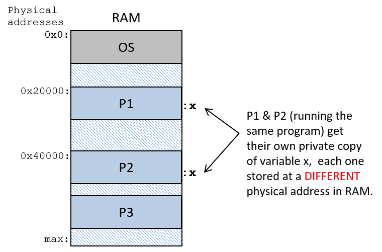

**图 2.** RAM 内容示例：操作系统加载在地址 0x0 处，各进程加载在 RAM 中不同的物理内存地址处。如果 P1 和 P2 运行的是同一个 a.out，P1 中 x 的物理地址也与 P2 中 x 的物理地址不同。

*Figure 2. Example RAM contents showing OS loaded at address 0x0, and processes loaded at different physical memory addresses in RAM. If P1 and P2 are running the same a.out, P1’s physical address for x is different from P2’s physical address for x.*

#### 虚拟内存与虚拟地址

*Virtual Memory and Virtual Addresses*

虚拟内存是每个进程对自己内存空间的视图，**虚拟地址**是进程视图中的内存地址。如果两个进程运行同一个二进制可执行文件，它们地址空间中函数代码和全局变量的虚拟地址完全相同（堆内存中动态分配空间的虚拟地址和栈上局部变量的虚拟地址，可能由于两次独立执行在运行时的差异而在两个进程之间略有不同）。换句话说，两个进程中 `main` 函数所在位置的虚拟地址相同，全局变量 `x` 在它们地址空间中所在位置的虚拟地址也相同，如[图 3](13.3-vm.html) 所示。

> Virtual memory is the per-process view of its memory space, and **virtual addresses** are addresses in the process’s view of its memory. If two process run the same binary executable, they have exactly the same virtual addresses for function code and for global variables in their address spaces (the virtual addresses of dynamically allocated space in heap memory and of local variables on the stack may vary slightly between the two processes due to runtime differences in their two separate executions). In other words, both processes will have the same virtual addresses for the location of their `main` function, and the same virtual address for the location of a global variable `x` in their address spaces, as shown in [Figure 3](13.3-vm.html).

> [!NOTE] 译注
> 这是在不考虑地址空间布局随机化（ASLR）的情况下说的。现代系统默认启用 ASLR，若程序编译为位置无关可执行文件（PIE），同一程序两次运行时代码和全局变量的虚拟地址通常也不同（参见第 7 章缓冲区溢出一节的译注）；不过「两个进程的虚拟地址各自独立、互不相干」这一要点不变。

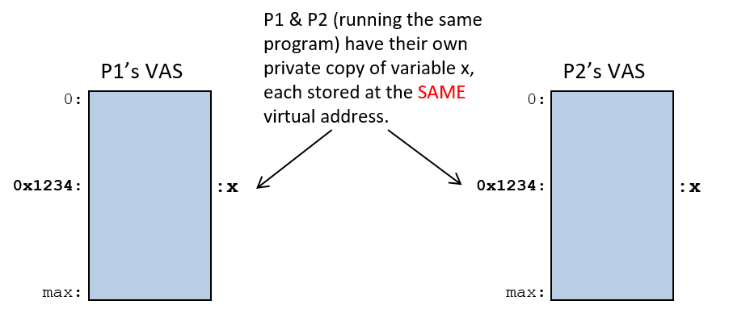

**图 3.** 运行同一个 a.out 文件的两个进程的虚拟内存内容示例。P1 和 P2 中全局变量 x 的虚拟地址相同。

*Figure 3. Example virtual memory contents for two processes running the same a.out file. P1 and P2 have the same virtual address for global variable x.*

### 13.3.2. 虚拟地址到物理地址的转换

*13.3.2. Virtual Address to Physical Address Translation*

程序的汇编指令和机器码指令引用的是虚拟地址。因此，如果两个进程执行同一个 `a.out` 程序，CPU 就会执行带有相同虚拟地址的指令，去访问它们两个独立虚拟地址空间中的对应部分。例如，假设 `x` 位于虚拟地址 0x24100，那么把 `x` 设为 6 的汇编指令可能是这样的：

> A program’s assembly and machine code instructions refer to virtual addresses. As a result, if two processes execute the same `a.out` program, the CPU executes instructions with identical virtual addresses to access corresponding parts of their two separate virtual address spaces. For example, suppose that `x` is at virtual address 0x24100, then assembly instructions to set `x` to 6 might look like this:

```
movl $0x24100, %eax    # load 0x24100 into register eax
movl $6, (%eax)        # store 6 at memory address 0x24100
```

在运行时，操作系统把每个进程的 `x` 变量加载到不同的物理内存地址（RAM 中的不同位置）。这意味着，每当 CPU 执行一条指定了虚拟地址的内存加载或存储指令时，都必须先把来自 CPU 的虚拟地址转换为 RAM 中对应的物理地址，然后才能从 RAM 中读写字节。

> At runtime the OS loads each of the processes' `x` variables at different physical memory addresses (at different locations in RAM). This means that whenever the CPU executes a load or store instruction to memory that specify virtual addresses, the virtual address from the CPU must be translated to its corresponding physical address in RAM before reading or writing the bytes from RAM.

由于虚拟内存是操作系统实现的一个重要的核心抽象，处理器通常会为虚拟内存提供一些硬件支持。操作系统可以利用这种硬件级的虚拟内存支持来快速完成虚拟地址到物理地址的转换，避免每次地址转换都要陷入操作系统处理。具体的操作系统自行选择在实现虚拟内存时使用多少分页方面的硬件支持。在选择用硬件实现还是用软件实现某个功能时，常常要在速度和灵活性之间权衡。

> Because virtual memory is an important and core abstraction implemented by operating systems, processors generally provide some hardware support for virtual memory. An OS can make use of this hardware-level virtual memory support to perform virtual to physical address translations quickly, avoiding having to trap to the OS to handle every address translation. A particular OS chooses how much of the hardware support for paging it uses in its implementation of virtual memory. There is often a trade-off in speed versus flexibility when choosing a hardware-implemented feature versus a software-implemented feature.

**内存管理单元**（memory management unit，MMU）是计算机硬件中实现地址转换的部分。当应用程序访问内存时，MMU 硬件和操作系统一起把虚拟地址转换为物理地址。硬件和软件之间具体如何分工，取决于硬件和操作系统的具体组合。在最完备的情况下，MMU 硬件完成全部转换：它从 CPU 获取虚拟地址，把它转换为用来寻址 RAM 的物理地址（如[图 4](13.3-vm.html) 所示）。无论硬件对虚拟内存的支持程度如何，总会有一些虚拟到物理的转换需要由操作系统来处理。在讨论虚拟内存时，我们假设 MMU 比较完备，使地址转换所需的操作系统参与降到最低。

> The **memory management unit** (MMU) is the part of the computer hardware that implements address translation. Together, the MMU hardware and the OS translate virtual to physical addresses when applications access memory. The particular hardware/software split depends on the specific combination of hardware and OS. At its most complete, MMU hardware performs the full translation: it takes a virtual address from the CPU and translates it to a physical address that is used to address RAM (as shown in [Figure 4](13.3-vm.html)). Regardless of the extent of hardware support for virtual memory, there will be some virtual-to-physical translations that the OS has to handle. In our discussion of virtual memory, we assume a more complete MMU that minimizes the amount of OS involvement required for address translation.

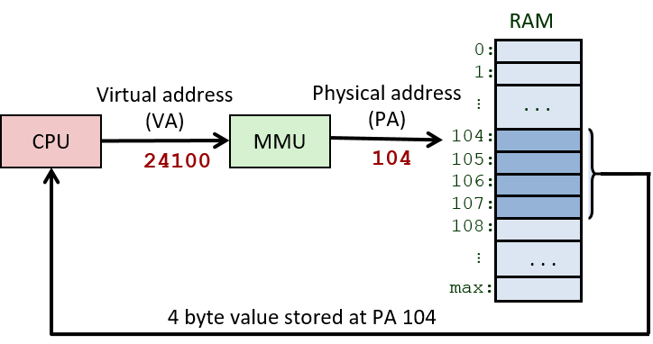

**图 4.** 内存管理单元（MMU）把虚拟地址映射为物理地址。CPU 执行的指令中使用的是虚拟地址。当 CPU 需要从物理内存中取数据时，虚拟地址先由 MMU 转换为用来寻址 RAM 的物理地址。

*Figure 4. The memory management unit (MMU) maps virtual to physical addresses. Virtual addresses are used in instructions executed by the CPU. When the CPU needs to fetch data from physical memory, the virtual address is first translated by the MMU to a physical addresses that is used to address RAM.*

操作系统为每个进程维护虚拟内存映射，以确保对于在 CPU 上运行的任何进程，都能正确地把虚拟地址转换为物理地址。在上下文切换期间，操作系统更新 MMU 硬件，使其指向被换上 CPU 的那个进程的虚拟到物理内存映射。操作系统通过在上下文切换时更换每个进程的地址映射状态，来保护进程不能访问彼此的内存空间：在上下文切换时更换映射，确保一个进程的虚拟地址不会映射到存放另一个进程虚拟地址空间内容的物理地址上。

> The OS maintains virtual memory mappings for each process to ensure that it can correctly translate virtual to physical addresses for any process that runs on the CPU. During a context switch, the OS updates the MMU hardware to refer to the swapped-on process’s virtual to physical memory mappings. The OS protects processes from accessing one another’s memory spaces by swapping the per-process address mapping state on a context switch — swapping the mappings on a context switch ensures that one process’s virtual addresses will not map to physical addresses storing another process’s virtual address space.

### 13.3.3. 分页

*13.3.3. Paging*

尽管多年来人们提出过许多种虚拟内存系统，但分页（paging）如今是最广泛使用的虚拟内存实现。在**分页虚拟内存**（paged virtual memory）系统中，操作系统把每个进程的虚拟地址空间划分为称为**页**（page）的固定大小的块。操作系统定义系统的页大小。如今的通用操作系统普遍使用几 KB 大小的页，4 KB（4,096 字节）是许多系统上的默认页大小。

> Although many virtual memory systems have been proposed over the years, paging is now the most widely used implementation of virtual memory. In a **paged virtual memory** system, the OS divides the virtual address space of each process into fixed-sized chunks called **pages**. The OS defines the page size for the system. Page sizes of a few kilobytes are commonly used in general-purpose operating systems today — 4 KB (4,096 bytes) is the default page size on many systems.

> [!NOTE] 译注
> Apple Silicon Mac 是一个常见的例外：译者在 M1 Pro 上运行 `pagesize`（或 `sysctl -n hw.pagesize`）得到的是 16384，即 16 KB 的页。

操作系统同样把物理内存划分为与页大小相同的块，称为**页框**（frame）。由于页和页框被定义为大小相同，进程虚拟内存的任何一页都可以存放在物理 RAM 的任何一个页框中。

> Physical memory is similarly divided by the OS into page-sized chunks called **frames**. Because pages and frames are defined to be the same size, any page of a process’s virtual memory can be stored in any frame of physical RAM.

在分页系统中：

> In a paging system:

- 页和页框大小相同，所以虚拟内存的任何一页都可以加载到（存放在）RAM 的任何一个物理页框中。

> - Pages and frames are the same size, so any page of virtual memory can be loaded into (stored) in any physical frame of RAM.

- 一个进程的各页不需要存放在连续的 RAM 页框中（即 RAM 中一串彼此相邻的地址处）。

> - A process’s pages do not need to be stored in contiguous RAM frames (at a sequence of addresses all next to one another in RAM).

- 进程运行时，并不需要把虚拟地址空间的每一页都加载到 RAM 中。

> - Not every page of virtual address space needs to be loaded into RAM for a process to run.

[图 5](13.3-vm.html) 展示了进程虚拟地址空间中的页如何映射到物理 RAM 的页框的一个例子。

> [Figure 5](13.3-vm.html) shows an example of how pages from a process’s virtual address space may map to frames of physical RAM.

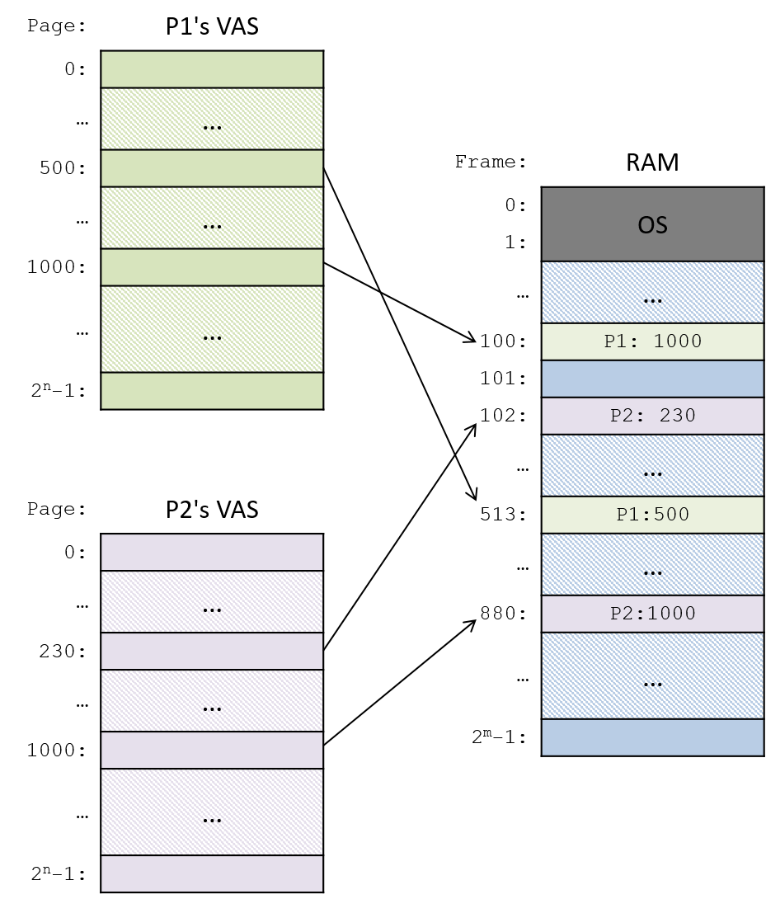

**图 5.** 分页虚拟内存。进程虚拟地址空间中的各个页存放在 RAM 页框中。虚拟地址空间的任何一页都可以加载到（存放在）物理内存的任何一个页框中。在这个例子中，P1 的虚拟页 1000 存放在物理页框 100 中，它的页 500 位于页框 513 中。P2 的虚拟页 1000 存放在物理页框 880 中，它的页 230 位于页框 102 中。

*Figure 5. Paged virtual memory. Individual pages of a process’s virtual address space are stored in RAM frames. Any page of virtual address space can be loaded into (stored at) any frame of physical memory. In this example, P1’s virtual page 1000 is stored in physical frame 100, and its page 500 resides in frame 513. P2’s virtual page 1000 is stored in physical frame 880, and its page 230 resides in frame 102.*

#### 分页系统中的虚拟地址与物理地址

*Virtual and Physical Addresses in Paged Systems*

分页虚拟内存系统把虚拟地址的各位分成两部分：高位指定虚拟地址所在的**页号**（page number），低位对应页内的**字节偏移**（byte offset，即该地址对应于从页顶部算起的哪个字节）。

> Paged virtual memory systems divide the bits of a virtual address into two parts: the high-order bits specify the **page number** on which the virtual address is stored, and the low-order bits correspond to the **byte offset** within the page (which byte from the top of the page corresponds to the address).

同样，分页系统把物理地址分成两部分：高位指定物理内存的**页框号**（frame number），低位指定页框内的**字节偏移**。由于页框和页的大小相同，虚拟地址中的字节偏移位与转换后的物理地址中的字节偏移位完全相同。虚拟地址与转换后的物理地址的区别在于高位，即分别指定虚拟页号和物理页框号的那些位。

> Similarly, paging systems divide physical addresses into two parts: the high-order bits specify the **frame number** of physical memory, and the low-order bits specify the **byte offset** within the frame. Because frames and pages are the same size, the byte offset bits in a virtual address are identical to the byte offset bits in its translated physical address. Virtual addresses differ from their translated physical addresses in their high-order bits, which specify the virtual page number and physical frame number.

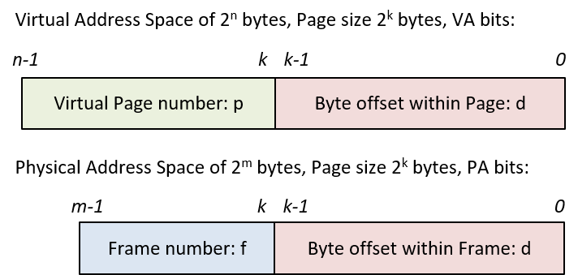

**图 6.** 虚拟地址和物理地址中的地址位

*Figure 6. The address bits in virtual and physical addresses*

例如，考虑一个（非常小的）系统，它的虚拟地址为 16 位，物理地址为 14 位，页大小为 8 字节。由于页大小是八个字节，物理地址和虚拟地址的低三位定义页或页框内的字节偏移：三位可以编码八个不同的字节偏移值 0–7（2<sup>3</sup> 等于 8）。这样，虚拟地址剩下的高 13 位用来指定页号，物理地址剩下的高 11 位用来指定页框号，如[图 7](13.3-vm.html) 中的例子所示。

> For example, consider a (very tiny) system with 16-bit virtual addresses, 14-bit physical addresses, and 8-byte pages. Because the page size is eight bytes, the low-order three bits of physical and virtual addresses define the byte offset into a page or frame — three bits can encode eight distinct byte offset values, 0-7 (2<sup>3</sup> is 8). This leaves the high-order 13 bits of the virtual address for specifying the page number and the high-order 11 bits of the physical address for specifying frame number, as shown in the example in [Figure 7](13.3-vm.html).

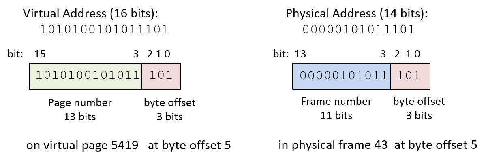

**图 7.** 在一个虚拟地址为 16 位、物理地址为 14 位、页大小为 8 字节的示例系统中，虚拟地址和物理地址的位划分。

*Figure 7. Virtual and physical address bit divisions in an example system with 16-bit virtual addresses, 14-bit physical addresses, and a page size of 8 bytes.*

在[图 7](13.3-vm.html) 的例子中，虚拟地址 43357（十进制）的字节偏移为 5（二进制 0b101），即地址的低 3 位；页号为 5419（0b1010100101011），即地址的高 13 位。这意味着该虚拟地址位于第 5419 页从顶部算起的第 5 个字节处。

> In the example in [Figure 7](13.3-vm.html), virtual address 43357 (in decimal) has a byte offset of 5 (0b101 in binary), the low-order 3 bits of the address, and a page number of 5419 (0b1010100101011), the high-order 13 bits of the address. This means that the virtual address is at byte 5 from the top of page 5419.

如果这一页虚拟内存被加载到物理内存的页框 43（0b00000101011）中，那么它的物理地址就是 349（0b00000101011101），其中低 3 位（0b101）指定字节偏移，高 11 位（0b00000101011）指定页框号。这意味着该物理地址位于 RAM 第 43 号页框从顶部算起的第 5 个字节处。

> If this page of virtual memory is loaded into frame 43 (0b00000101011) of physical memory, then its physical address is 349 (0b00000101011101), where the low-order 3 bits (0b101) specify the byte offset, and the high-order 11 bits (0b00000101011) specify the frame number. This means that the physical address is at byte 5 from the top of frame 43 of RAM.

#### 用页表进行虚拟页到物理页框的映射

*Page Tables for Virtual-to-Physical Page Mapping*

由于进程虚拟内存空间中的每一页都可能映射到 RAM 的不同页框，操作系统必须为进程地址空间中的每一个虚拟页维护映射。操作系统为每个进程维护一个**页表**（page table），用来存放该进程的虚拟页号到物理页框号的映射。页表是操作系统实现的一种数据结构，存放在 RAM 中。[图 8](13.3-vm.html) 展示了操作系统可能如何在 RAM 中存放两个进程的页表的一个例子。每个进程的页表存放其虚拟页到 RAM 中物理页框的映射，使虚拟内存的任何一页都可以存放在 RAM 的任何一个物理页框中。

> Because every page of a process’s virtual memory space can map to a different frame of RAM, the OS must maintain mappings for every virtual page in the process’s address space. The OS keeps a per-process **page table** that it uses to store the process’s virtual page number to physical frame number mappings. The page table is a data structure implemented by the OS that is stored in RAM. [Figure 8](13.3-vm.html) shows an example of how the OS may store two process’s page tables in RAM. The page table of each process stores the mappings of its virtual pages to their physical frames in RAM such that any pages of virtual memory can be stored in any physical frame of RAM.

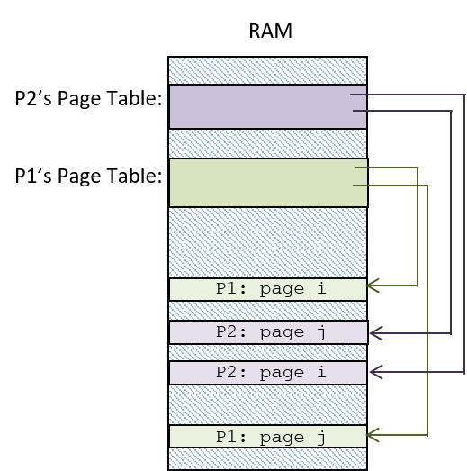

**图 8.** 每个进程都有一个页表，存放它的虚拟页到物理页框的映射。系统用存放在 RAM 中的页表，把进程的虚拟地址转换为用来寻址 RAM 中各位置的物理地址。这个例子展示了 RAM 中为进程 P1 和 P2 分别存放的页表，每个页表都有自己的虚拟页到物理页框的映射。

*Figure 8. Every process has a page table containing its virtual page to physical frame mappings. Page tables, stored in RAM, are used by the system to translate process’s virtual addresses to physical addresses that are used to address locations in RAM. This example shows the separate page tables stored in RAM for processes P1 and P2, each page table with its own virtual page to physical frame mappings.*

对于虚拟内存的每一页，页表都存放一个**页表项**（page table entry，PTE），其中包含存放该虚拟页的物理内存（RAM）页框号。PTE 还可能包含关于该虚拟页的其他信息，包括一个**有效位**（valid bit），用来表示该 PTE 是否存有有效的映射。如果某一页的有效位为零，那么进程虚拟地址空间的这一页当前没有被加载到物理内存中。

> For each page of virtual memory, the page table stores one **page table entry** (PTE) that contains the frame number of physical memory (RAM) storing the virtual page. A PTE may also contain other information about the virtual page, including a **valid bit** that is used to indicate whether the PTE stores a valid mapping. If a page’s valid bit is zero, then the page of the process’s virtual address space is not currently loaded into physical memory.

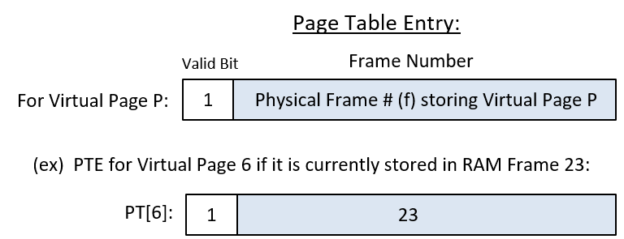

**图 9.** 页表项（PTE）存放加载该虚拟页的 RAM 页框的页框号（23）。我们用十进制列出页框号（23），但在 PTE 中它实际上是以二进制编码的（0…​010111）。有效位为 1 表示这个页表项存有有效的映射。

*Figure 9. A page table entry (PTE) stores the frame number (23) of the frame of RAM in which the virtual page is loaded. We list the frame number (23) in decimal, although it is really encoded in binary in the PTE entry (0…​010111). A valid bit of 1 indicates that this entry stores a valid mapping.*

#### 用页表把虚拟地址映射为物理地址

*Using a Page Table to Map Virtual to Physical Addresses*

把虚拟地址转换为物理地址有四个步骤（如[图 10](13.3-vm.html) 所示）。具体的操作系统/硬件组合决定了每一步的全部或部分由操作系统还是由硬件来完成。在描述这些步骤时，我们假设有一个功能完备的 MMU，它尽可能多地用硬件完成地址转换，但在某些系统上，这些步骤中的部分工作可能由操作系统完成。

> There are four steps to translating a virtual address to a physical address (shown in [Figure 10](13.3-vm.html)). The particular C13-OS/hardware combination determines which of the OS or the hardware performs all or part of each step. We assume a full-featured MMU that performs as much of the address translation as possible in hardware in describing these steps, but on some systems the OS may perform parts of these steps.

1. 首先，MMU 把虚拟地址的各位分成两部分：对于 2<sup>k</sup> 字节的页大小，低 k 位（虚拟地址的第 (k-1) 到第 0 位）编码页内的字节偏移（d），高 n-k 位（虚拟地址的第 (n-1) 到第 k 位）编码虚拟页号（p）。

> 1.  First, the MMU divides the bits of the virtual address into two parts: for a page size of 2<sup>k</sup> bytes, the low-order k bits (VA bits (k-1) to 0) encode the byte offset (d) into the page, and the high-order n-k bits (VA bits (n-1) to k) encode the virtual page number (p).

2. 接着，MMU 把页号值（p）用作页表的索引，访问第 p 页的 PTE。大多数体系结构都有一个**页表基址寄存器**（page table base register，PTBR），存放当前运行进程的页表在 RAM 中的地址。PTBR 中的值与页号值（p）结合起来，算出第 p 页的 PTE 的地址。

> 2.  Next, the page number value (p) is used by the MMU as an index into the page table to access the PTE for page p. Most architectures have a **page table base register** (PTBR) that stores the RAM address of the running process’s page table. The value in the PTBR is combined with the page number value (p) to compute the address of the PTE for page p.

3. 如果 PTE 中的有效位已置位（为 1），那么 PTE 中的页框号就代表一个有效的虚拟地址到物理地址的映射。如果有效位为 0，就会发生缺页（page fault），触发操作系统来处理这次地址转换（我们稍后讨论操作系统对缺页的处理）。

> 3.  If the valid bit in the PTE is set (is 1), then the frame number in the PTE represents a valid VA to PA mapping. If the valid bit is 0, then a page fault occurs, triggering the OS to handle this address translation (we discuss the OS page fault handling later).

4. MMU 用 PTE 项中的页框号（f）的各位作为物理地址的高位，用虚拟地址中的页内偏移（d）的各位作为物理地址的低位，构造出物理地址。

> 4.  The MMU constructs the physical address using the frame number (f) bits from the PTE entry as the high-order bits, and the page offset (d) bits from the VA as the low-order bits of the physical address.

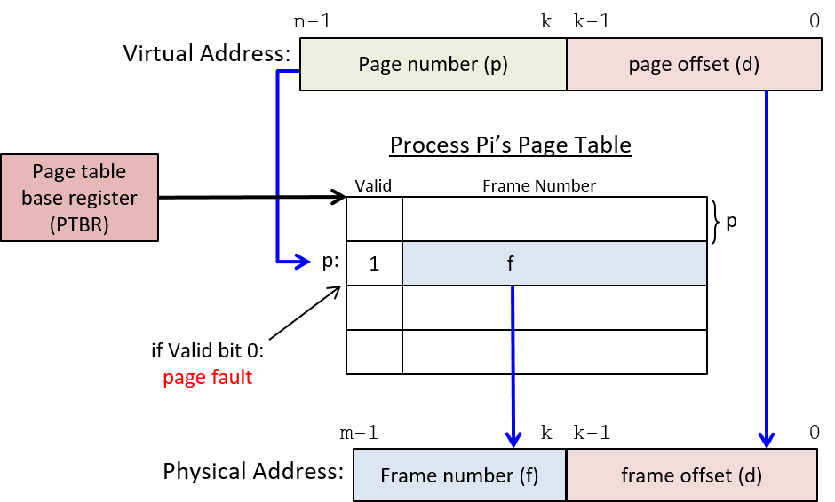

**图 10.** 用进程的页表完成虚拟地址到物理地址的转换。PTBR 存放当前运行进程的页表的基地址。

*Figure 10. A process’s page table is used to perform virtual to physical address translations. The PTBR stores the base address of the currently running process’s page table.*

#### 一个例子：用页表把虚拟地址映射为物理地址

*An Example: Mapping VA to PA with a Page Table*

考虑一个（很小的）分页系统的例子，其中：

> Consider an example (tiny) paging system where:

- 页大小为 4 字节

> - the page size is 4 bytes

- 虚拟地址为 6 位（高 4 位是页号，低 2 位是字节偏移）

> - the virtual addresses are 6 bits (the high-order 4 bits are the page number and the low-order 2 bits are the byte offset)

- 物理地址为 7 位

> - the physical addresses are 7 bits

假设这个系统中进程 P1 的页表如[表 1](13.3-vm.html) 所示（数值同时以十进制和二进制列出）。

> Assume that the page table for process P1 in this system looks like [Table 1](13.3-vm.html) (values are listed in both decimal and binary).

**表 1.** 进程 P1 的页表

*Table 1. Process P1’s Page Table*

| 表项 | 有效位 | 页框号 |
|---|---|---|
| 0 (0b0000) | 1 | 23 (0b10111) |
| 1 (0b0001) | 0 | 17 (0b10001) |
| 2 (0b0010) | 1 | 11 (0b01011) |
| 3 (0b0011) | 1 | 16 (0b10000) |
| 4 (0b0100) | 0 | 08 (0b01000) |
| 5 (0b0101) | 1 | 14 (0b01110) |
| …​ | …​ | …​ |
| 15 (0b1111) | 1 | 30 (0b11110) |

> | Entry       | Valid | Frame \#     |
> |-------------|-------|--------------|
> | 0 (0b0000)  | 1     | 23 (0b10111) |
> | 1 (0b0001)  | 0     | 17 (0b10001) |
> | 2 (0b0010)  | 1     | 11 (0b01011) |
> | 3 (0b0011)  | 1     | 16 (0b10000) |
> | 4 (0b0100)  | 0     | 08 (0b01000) |
> | 5 (0b0101)  | 1     | 14 (0b01110) |
> | …​           | …​     | …​            |
> | 15 (0b1111) | 1     | 30 (0b11110) |

利用这个例子中提供的信息，可以看出关于地址大小、地址的组成部分和地址转换的几件重要的事情，包括：

> Using the information provided in this example suggests several important things about address sizes, parts of addresses, and address translation, including:

- 页表的大小（表项的数目）由虚拟地址的位数和系统的页大小决定。每个 6 位虚拟地址的高 4 位指定页号，所以虚拟内存总共有 16（2<sup>4</sup>）页。由于页表为每个虚拟页设一个表项，每个进程的页表总共有 16 个页表项。

> - The size of (number of entries in) the page table is determined by the number of bits in the virtual address and the page size in the system. The high-order 4 bits of each 6-bit virtual address specifies the page number, so there are 16 (2<sup>4</sup>) total pages of virtual memory. Since the page table has one entry for each virtual page, there are a total of 16 page table entries in each process’s page table.

- 每个页表项（PTE）的大小取决于物理地址的位数和系统的页大小。每个 PTE 存放一个有效位和一个物理页框号。有效位需要一位。页框号需要 5 位，因为物理地址是 7 位，而页内偏移占低 2 位（用来寻址每页中的 4 个字节），剩下高 5 位用于页框号。因此，每个 PTE 表项需要 6 位：1 位有效位，5 位页框号。

> - The size of each page table entry (PTE) depends on the number of bits in the physical address and the page size in the system. Each PTE stores a valid bit and a physical frame number. The valid bit requires a single bit. The frame number requires 5 bits because physical addresses are 7 bits and the page offset is the low-order 2 bits (to address the 4 bytes on each page), which leaves the 5 high-order bits for the frame number. Thus, each PTE entry requires 6 bits: 1 for the valid bit, and 5 for the frame number.

- 虚拟内存和物理内存的最大大小由地址的位数决定。由于虚拟地址是 6 位，可以寻址 2<sup>6</sup> 字节的内存，所以每个进程的虚拟地址空间是 2<sup>6</sup>（即 64）字节。同样，物理内存的最大大小是 2<sup>7</sup>（即 128）字节。

> - The maximum sizes of virtual and physical memory are determined by the number of bits in the addresses. Because virtual addresses are 6 bits, 2<sup>6</sup> bytes of memory can be addressed, so each process’s virtual address space is 2<sup>6</sup> (or 64) bytes. Similarly, the maximum size of physical memory is 2<sup>7</sup> (or 128) bytes.

- 页大小、虚拟地址和物理地址的位数，以及页表，共同决定了虚拟地址到物理地址的映射。例如，如果进程 P1 执行一条从其虚拟地址 0b001110 加载值的指令，就会用它的页表把这个虚拟地址转换为物理地址 0b1000010，然后用这个物理地址访问 RAM 中的值。

> - The page size, the number of bits in virtual and physical addresses, and the page table determine the mapping of virtual to physical addresses. For example, if process P1 executes an instruction to load a value from its virtual address 0b001110, its page table is used to convert the virtual address to physical address 0b1000010, which is then used to access the value in RAM.

虚拟地址（VA）到物理地址（PA）的转换步骤如下：

> The virtual address (VA) to physical address (PA) translation steps are:

1. 把虚拟地址的各位分成页号（p）和字节偏移（d）：高四位是页号（0b0011，即第 3 页），低两位是页内的字节偏移（0b10，即第 2 个字节）。

> 1.  Separate the VA bits into the page number (p) and byte offset (d) bits: the high-order four bits are the page number (0b0011 or page 3) and the lower-order two bits are the byte offset into the page (0b10 or byte 2).

2. 用页号（3）作为页表的索引，读取虚拟页 3 的 PTE（PT[3]：有效位：1，页框号：16）。

> 2.  Use the page number (3) as an index into the page table to read the PTE for virtual page 3 (PT[3]: valid:1 frame#:16).

3. 检查有效位，看 PTE 映射是否有效。在这个例子中，有效位为 1，所以 PTE 存有有效的映射，这意味着虚拟内存页 3 存放在物理内存页框 16 中。

> 3.  Check the valid bit for a valid PTE mapping. In this case, the valid bit is 1, so the PTE contains a valid mapping, meaning that virtual memory page 3 is stored in physical memory frame 16.

4. 用 PTE 中的五位页框号作为地址的高位（0b10000），用虚拟地址中的低两位偏移（0b10）作为低两位，构造物理地址：物理地址为 0b1000010（位于 RAM 页框 16 中偏移为 2 的字节处）。

> 4.  Construct the physical address using the five-bit frame number from the PTE as the high-order address bits (0b10000), and the low-order two-bit offset from the virtual address (0b10) as the lower-order two bits: the physical address is 0b1000010 (in RAM frame 16 at byte offset 2).

#### 分页的实现

*Paging Implementation*

大多数计算机硬件都为分页虚拟内存提供了一些支持，在一个具体的系统上，操作系统和硬件一起实现分页。至少，大多数体系结构都提供了一个页表基址寄存器（PTBR），存放当前运行进程的页表的基地址。为了完成虚拟地址到物理地址的转换，把虚拟地址中的虚拟页号部分与 PTBR 中存放的值结合起来，找到该虚拟页的 PTE 表项。换句话说，虚拟页号是进程页表的索引，它的值与 PTBR 的值结合起来，就得到第 p 页的 PTE 在 RAM 中的地址（例如，PTBR + p × (PTE 大小) 就是第 p 页的 PTE 在 RAM 中的地址）。有些体系结构可能支持用硬件操作 PTE 的各位来完成整个页表查找。如果不支持，就需要中断操作系统，由它来处理页表查找的某些部分，并访问 PTE 的各位，把虚拟地址转换为物理地址。

> Most computer hardware provides some support for paged virtual memory, and together the OS and hardware implement paging on a given system. At a minimum, most architectures provide a page table base register (PTBR) that stores the base address of the currently running process’s page table. To perform virtual-to-physical address translations, the virtual page number part of a virtual address is combined with the value stored in the PTBR to find the PTE entry for the virtual page. In other words, the virtual page number is an index into the process’s page table, and its value combined with the PTBR value gives the RAM address of the PTE for page p (e.g., PTBR + p × (PTE size) is the RAM address of the PTE for page p). Some architectures may support the full page table lookup by manipulating PTE bits in hardware. If not, then the OS needs to be interrupted to handle some parts of page table lookup and accessing the PTE bits to translate a virtual address to a physical address.

在上下文切换时，操作系统*保存和恢复*各进程的 PTBR 值，以确保进程在 CPU 上运行时，访问的是它自己在 RAM 中的页表里的虚拟到物理地址映射。这是操作系统保护各进程的虚拟地址空间彼此隔离的机制之一：在上下文切换时改变 PTBR 的值，确保一个进程无法访问另一个进程的虚拟地址到物理地址映射，因而也就无法读写存放其他任何进程虚拟地址空间内容的物理地址处的值。

> On a context switch, the OS *saves and restores* the PTBR values of processes to ensure that when a process runs on the CPU it accesses its own virtual-to-physical address mappings from its own page table in RAM. This is one mechanism through which the OS protects processes' virtual address spaces from one another; changing the PTBR value on context switch ensures that a process cannot access the VA-PA mappings of another process, and thus it cannot read or write values at physical addresses that store the virtual address space contents of any other processes.

#### 一个例子：两个进程的虚拟地址到物理地址映射

*An Example: Virtual-to-Physical Address Mappings of Two Processes*

作为例子，考虑一个页大小为八字节、虚拟地址为七位、物理地址为六位的示例系统。

> As an example, consider an example system with eight-byte pages, seven-bit virtual addresses, and six-bit physical addresses.

**表 2.** 示例进程的页表

*Table 2. Example Process Page Tables*

| P1 的页表 | | | | P2 的页表 | | |
|---|---|---|---|---|---|---|
| 表项 | 有效位 | 页框号 | | 表项 | 有效位 | 页框号 |
| 0 | 1 | 3 | | 0 | 1 | 1 |
| 1 | 1 | 2 | | 1 | 1 | 4 |
| 2 | 1 | 6 | | 2 | 1 | 5 |
| …​ | | | | …​ | | |
| 11 | 1 | 7 | | 11 | 0 | 3 |
| …​ | | | | …​ | | |

> | P1’s Page Table |       |          |     | P2’s Page Table |       |          |
> |-----------------|-------|----------|-----|-----------------|-------|----------|
> | Entry           | Valid | Frame \# |     | Entry           | Valid | Frame \# |
> | 0               | 1     | 3        |     | 0               | 1     | 1        |
> | 1               | 1     | 2        |     | 1               | 1     | 4        |
> | 2               | 1     | 6        |     | 2               | 1     | 5        |
> | …​               |       |          |     | …​               |       |          |
> | 11              | 1     | 7        |     | 11              | 0     | 3        |
> | …​               |       |          |     | …​               |       |          |

给定[表 2](13.3-vm.html) 中两个进程（P1 和 P2）页表的当前状态（部分显示），我们来计算 CPU 产生的下面这串虚拟内存地址对应的物理地址（每个地址前标出了当时在 CPU 上运行的进程）：

> Given the following current state of the (partially shown) page tables of two processes (P1 and P2) in [Table 2](13.3-vm.html), let’s compute the physical addresses for the following sequence of virtual memory addresses generated from the CPU (each address is prefixed by the process that is running on the CPU):

```
P1: 0000100
P1: 0000000
P1: 0010000
              <---- context switch
P2: 0010000
P2: 0001010
P2: 1011001
              <---- context switch
P1: 1011001
```

首先，确定虚拟地址和物理地址中各位的划分。由于页大小是八字节，每个地址的低三位编码页内偏移（d）。虚拟地址是七位的。因此，除去三位页内偏移，剩下的高四位用来指定页号（p）。由于物理地址长六位，低三位用于页内偏移，所以高三位指定页框号。

> First, determine the division of bits in virtual and physical addresses. Since the page size is eight bytes, the three low-order bits of every address encodes the page offset (d). Virtual addresses are seven bits. Thus, with three bits for the page offset, this leaves the four high-order bits for specifying the page number (p). Since physical addresses are six bits long and the low-order three are for the page offset, the high-order three bits specify the frame number.

接下来，对每个虚拟地址，用它的页号位（p）在进程的页表中查找第 p 页的 PTE。如果 PTE 中的有效位已置位，就用页框号（f）作为物理地址的高位。物理地址的低位来自虚拟地址的字节偏移位（d）。

> Next, for each virtual address, use its page number bits (p) to look up in the process’s page table the PTE for page p. If the valid bit in the PTE is set, then use the frame number (f) for the high-order bits of the PA. The low-order bits of the PA come from the byte-offset bits (d) of the VA.

结果见[表 3](13.3-vm.html)（注意每个地址的转换使用的是哪个页表）。

> The results are shown in [Table 3](13.3-vm.html) (note which page table is being used for the translation of each address).

**表 3.** 进程 P1 和 P2 示例内存访问序列的地址映射。注意，上下文切换会改变地址转换所使用的页表。

*Table 3. Address Mappings for the Example Sequence of Memory Accesses from Processes P1 and P2. Note that a Context Switch Changes which Page Table is used for Address Translation.*

| 进程 | 虚拟地址 | p | d | PTE | f | d | 物理地址 |
|----|----|----|----|----|----|----|----|
| P1 | 0000100 | 0000 | 100 | PT[0]: 1(v),3(f) | 011 | 100 | 011100 |
| P1 | 0000000 | 0000 | 000 | PT[0]: 1(v),3(f) | 011 | 000 | 011000 |
| P1 | 0010000 | 0010 | 000 | PT[2]: 1(v),6(f) | 110 | 000 | 110000 |
| **上下文切换：P1 到 P2** | | | | | | | |
| P2 | 0010000 | 0010 | 000 | PT[2]: 1(v),5(f) | 101 | 000 | 101000 |
| P2 | 0001010 | 0001 | 010 | PT[1]: 1(v),4(f) | 100 | 010 | 100010 |
| P2 | 1011001 | 1011 | 001 | PT[11]: 0(v),3(f) | **缺页（有效位为 0）** | | |
| **上下文切换：P2 到 P1** | | | | | | | |
| P1 | 1011001 | 1011 | 001 | PT[11]: 1(v),7(f) | 111 | 001 | 111001 |

> | Process | VirtAddr | p | d | PTE | f | d | PhysAddr |
> |----|----|----|----|----|----|----|----|
> | P1 | 0000100 | 0000 | 100 | PT[0]: 1(v),3(f) | 011 | 100 | 011100 |
> | P1 | 0000000 | 0000 | 000 | PT[0]: 1(v),3(f) | 011 | 000 | 011000 |
> | P1 | 0010000 | 0010 | 000 | PT[2]: 1(v),6(f) | 110 | 000 | 110000 |
> | **Context Switch P1 to P2** |  |  |  |  |  |  |  |
> | P2 | 0010000 | 0010 | 000 | PT[2]: 1(v),5(f) | 101 | 000 | 101000 |
> | P2 | 0001010 | 0001 | 010 | PT[1]: 1(v),4(f) | 100 | 010 | 100010 |
> | P2 | 1011001 | 1011 | 001 | PT[11]: 0(v),3(f) | **page fault (valid bit 0)** |  |  |
> | **Context Switch P2 to P1** |  |  |  |  |  |  |  |
> | P1 | 1011001 | 1011 | 001 | PT[11]: 1(v),7(f) | 111 | 001 | 111001 |

举一个例子，考虑进程 P1 的第一次地址访问。当 P1 访问它的虚拟地址 8（0b0000100）时，这个地址被分成页号 0（0b0000）和字节偏移 4（0b100）。用页号 0 查找第 0 个 PTE 表项，它的有效位为 1，表示这是一个有效的页映射项，它的页框号是 3（0b011）。用页框号（0b011）作为高位、页内偏移（0b100）作为低位，构造出物理地址（0b011100）。

> As one example, consider the first address accesses by process P1. When P1 accesses its virtual address 8 (0b0000100), the address is divided into its page number 0 (0b0000) and its byte offset 4 (0b100). The page number, 0, is used to look up PTE entry 0, whose valid bit is 1, indicating a valid page mapping entry, and whose frame number is 3 (0b011). The physical address (0b011100) is constructed using the frame number (0b011) as the high-order bits and the page offset (0b100) as the low-order bits.

> [!NOTE] 译注
> 0b0000100 的十进制值是 4，不是 8，原文笔误。

当进程 P2 被上下文切换到 CPU 上时，使用的就是它的页表映射（注意 P1 和 P2 访问同一个虚拟地址 0b0010000 时得到的物理地址不同）。当 P2 访问一个有效位为 0 的 PTE 表项时，就会触发缺页，交给操作系统处理。

> When process P2 is context switched on the CPU, its page table mappings are used (note the different physical addresses when P1 and P2 access the same virtual address 0b0010000). When P2 accesses a PTE entry with a 0 valid bit, it triggers a page fault to the OS to handle.

### 13.3.4. 内存效率

*13.3.4. Memory Efficiency*

操作系统的主要目标之一是高效地管理硬件资源。系统性能尤其取决于操作系统如何管理存储器层次结构。例如，如果进程访问的数据存放在 RAM 中，它的运行速度会比这些数据在磁盘上时快得多。

> One of the primary goals of the operating system is to efficiently manage hardware resources. System performance is particularly dependent on how the OS manages the memory hierarchy. For example, if a process accesses data that are stored in RAM, the process will run much faster than if those data are on disk.

操作系统力求提高系统中多道程序设计的程度，以便在一些进程因等待磁盘 I/O 等事件而阻塞时，让 CPU 一直忙于做实际的工作。然而，由于 RAM 是固定大小的存储，操作系统必须决定在任一时刻把哪些进程加载到 RAM 中，这可能会限制系统中多道程序设计的程度。即使是拥有大量 RAM（几十或几百 GB）的系统，也常常无法同时存下系统中每个进程的完整地址空间。因此，只把进程虚拟地址空间的一部分加载到 RAM 中来运行进程，能让操作系统更高效地利用系统资源。

> The OS strives to increase the degree of multiprogramming in the system in order to keep the CPU busy doing real work while some processes are blocked waiting for an event like disk I/O. However, because RAM is fixed-size storage, the OS must make decisions about which process to load in RAM at any point in time, possibly limiting the degree of multiprogramming in the system. Even systems with a large amount of RAM (10s or 100s of gigabytes) often cannot simultaneously store the full address space of every process in the system. As a result, an OS can make more efficient use of system resources by running processes with only parts of their virtual address spaces loaded in RAM.

#### 用 RAM、磁盘和页面置换实现虚拟内存

*Implementing Virtual Memory Using RAM, Disk, and Page Replacement*

从[存储器层次结构一章](../C11-MemHierarchy/11.1-mem_hierarchy.html)我们知道，内存访问通常表现出很高的局部性。就分页而言，这意味着进程倾向于以很高的时间局部性或空间局部性访问其内存空间中的页。这还意味着，在执行的任一时刻，进程通常不会访问其地址空间中的大片区域。事实上，进程通常从不访问其完整地址空间中的大片区域。例如，进程通常不会用满它的栈或堆内存空间。

> From the [Memory Hierarchy Chapter](../C11-MemHierarchy/11.1-mem_hierarchy.html), we know that memory references usually exhibit a very high degree of locality. In terms of paging, this means that processes tend to access pages of their memory space with a high degree of temporal or spatial locality. It also means that at any point in its execution, a process is not typically accessing large extents of its address space. In fact, processes typically never access large extents of their full address spaces. For example, processes typically do not use the full extent of their stack or heap memory space.

操作系统同时高效利用 RAM 和 CPU 的一种方式，是把 RAM 当作磁盘的缓存。这样做时，操作系统允许进程在只有部分虚拟内存页被加载到 RAM 物理页框中的情况下运行。它们的其他虚拟内存页留在磁盘等辅助存储设备上，只有当进程访问这些页上的地址时，操作系统才把它们调入 RAM。这是操作系统**虚拟内存**抽象的另一部分：操作系统实现了一个单一的大型物理「内存」视图，它是用 RAM 存储结合磁盘或其他辅助存储设备实现的。程序员不需要显式地管理程序的内存，也不需要在程序需要时负责把各部分移入移出 RAM。

> One way in which the OS can make efficient use of both RAM and CPU is to treat RAM as a cache for disk. In doing so, the OS allows processes to run in the system only having some of their virtual memory pages loaded into physical frames of RAM. Their other virtual memory pages remain on secondary storage devices, such as disk, and the OS only brings them into RAM when the process accesses addresses on these pages. This is another part of the OS’s **virtual memory** abstraction — the OS implements a view of a single large physical "memory" that is implemented using RAM storage in combination with disk or other secondary storage devices. Programmers do not need to explicitly manage their program’s memory, nor do they need to handle moving parts in and out of RAM as their program needs it.

通过把 RAM 当作磁盘的缓存，操作系统只在 RAM 中保留进程虚拟地址空间中正在被访问或最近被访问过的那些页。因此，进程往往把正在访问的那组页存放在快速的 RAM 中，而把不常访问（或根本不访问）的那组页存放在较慢的磁盘上。这样能更高效地利用 RAM，因为操作系统用 RAM 存放运行中的进程实际在用的页，而不会浪费 RAM 空间去存放很长时间都不会被访问（或永远不会被访问）的页。这也能更高效地利用 CPU，因为它让更多进程能同时共享 RAM 空间来存放各自的活跃页，从而可以增加系统中就绪进程的数量，减少由于所有进程都在等待磁盘 I/O 之类的事件而使 CPU 闲置的时间。

> By treating RAM as a cache for disk, the OS keeps in RAM only those pages from processes' virtual address spaces that are being accessed or have been accessed recently. As a result, processes tend to have the set of pages that they are accessing stored in fast RAM and the set of pages that they do not access frequently (or at all) stored on slower disk. This leads to more efficient use of RAM because the OS uses RAM to store pages that are actually being used by running processes, and doesn’t waste RAM space to store pages that will not be accessed for a long time or ever. It also results in more efficient use of the CPU by allowing more processes to simultaneously share RAM space to store their active pages, which can result in an increase in the number of ready processes in the system, reducing times when the CPU is idle due to all the processes waiting for some event like disk I/O.

然而，在虚拟内存系统中，进程有时会试图访问当前不在 RAM 中的页（引发**缺页**，page fault）。发生缺页时，操作系统需要先把该页从磁盘读入 RAM，进程才能继续执行。MMU 读取 PTE 的有效位，以确定是否需要触发缺页异常。当它遇到有效位为零的 PTE 时，就陷入操作系统，由操作系统采取以下步骤：

> In virtual memory systems, however, processes sometimes try to access a page that is currently not stored in RAM (causing a **page fault**). When a page fault occurs, the OS needs to read the page from disk into RAM before the process can continue executing. The MMU reads a PTE’s valid bit to determine whether it needs to trigger a page fault exception. When it encounters a PTE whose valid bit is zero, it traps to the OS, which takes the following steps:

1. 操作系统找到 RAM 中的一个空闲页框（例如页框 j），准备把缺失的页加载到其中。

> 1.  The OS finds a free frame (e.g., frame j) of RAM into which it will load the faulted page.

2. 接着，它向磁盘发出读请求，把该页从磁盘加载到 RAM 的页框 j 中。

> 2.  It next issues a read to the disk to load the page from disk into frame j of RAM.

3. 从磁盘读取完成后，操作系统更新 PTE 表项，把页框号设为 j，把有效位设为 1（这个缺失页的 PTE 现在有了一个指向页框 j 的有效映射）。

> 3.  When the read from disk has completed, the OS updates the PTE entry, setting the frame number to j and the valid bit to 1 (this PTE for the faulted page now has a valid mapping to frame j).

4. 最后，操作系统从引起缺页的那条指令处重新启动进程。现在页表中已经有了缺失页的有效映射，进程就可以访问映射到物理页框 j 中某个偏移处的那个虚拟内存地址了。

> 4.  Finally, the OS restarts the process at the instruction that caused the page fault. Now that the page table holds a valid mapping for the page that faulted, the process can access the virtual memory address that maps to an offset in physical frame j.

为了处理缺页，操作系统需要跟踪哪些 RAM 页框是空闲的，以便找到一个空闲的 RAM 页框来存放从磁盘读入的页。操作系统常常维护一个空闲页框列表，供发生缺页时分配。如果没有可用的空闲 RAM 页框，操作系统就选择一个页框，用缺失的页替换其中存放的页。被替换页的 PTE 会被更新，有效位被设为 0（这一页的 PTE 映射不再有效）。如果被替换页在 RAM 中的内容与磁盘上的版本不同，就要把它写回磁盘；如果所属进程在该页被加载到 RAM 期间写过它，那么在替换之前就需要把该页在 RAM 中的版本写回磁盘，这样对这一页虚拟内存所做的修改才不会丢失。PTE 常常包含一个**脏位**（dirty bit），用来表示该页在 RAM 中的副本是否被修改（写过）。进行页面置换时，如果被替换页的脏位已置位，那么在用缺失的页替换它之前，需要先把它写回磁盘。如果脏位为 0，说明被替换页在磁盘上的副本与内存中的副本一致，替换时就不需要把它写回磁盘。

> To handle a page fault, the OS needs to keep track of which RAM frames are free so that it can find a free frame of RAM into which the page read from disk can be stored. Operating systems often keep a list of free frames that are available for allocating on a page fault. If there are no available free RAM frames, then the OS picks a frame and replaces the page it stores with the faulted page. The PTE of the replaced page is updated, setting its valid bit to 0 (this page’s PTE mapping is no longer valid). The replaced page is written back to disk if its in-RAM contents differ from its on-disk version; if the owning process wrote to the page while it was loaded in RAM, then the RAM version of the page needs to be written to disk before being replaced so that the modifications to the page of virtual memory are not lost. PTEs often include a **dirty bit** that is used to indicate if the in-RAM copy of the page has been modified (written to). During page replacement, if the dirty bit of the replaced page is set, then the page needs to be written to disk before being replaced with the faulted page. If the dirty bit is 0, then the on-disk copy of the replaced page matches the in-memory copy, and the page does not need to be written to disk when replaced.

我们对虚拟内存的讨论主要集中在实现分页虚拟内存的*机制*部分。然而，在操作系统的分页实现中，还有一个重要的*策略*部分。当系统中的空闲 RAM 用尽时，操作系统需要运行一个**页面置换策略**（page replacement policy）。页面置换策略挑选一个当前正被使用的 RAM 页框，用缺失的页替换它的内容；当前的页被从 RAM 中*驱逐*出去，为存放缺失的页腾出空间。操作系统需要实现一个好的页面置换策略，来选择把 RAM 中的哪个页框写回磁盘，为缺失的页腾出空间。例如，操作系统可能实现**最近最少使用**（least recently used，LRU）策略，它替换的是存放在最近最少被访问的那个 RAM 页框中的页。当内存访问具有很高的局部性时，LRU 的效果很好。操作系统还可以选择实现许多其他策略。关于页面置换策略的更多信息，请参阅操作系统教材。

> Our discussion of virtual memory has primarily focused on the *mechanism* part of implementing paged virtual memory. However, there is an important *policy* part of paging in the OS’s implementation. The OS needs to run a **page replacement policy** when free RAM is exhausted in the system. A page replacement policy picks a frame of RAM that is currently being used and replaces its contents with the faulted page; the current page is *evicted* from RAM to make room for storing the faulted page. The OS needs to implement a good page replacement policy for selecting which frame in RAM will be written back to disk to make room for the faulted page. For example, an OS might implement the **least recently used** (LRU) policy, which replaces the page stored in the frame of RAM that has been accessed least recently. LRU works well when there is a high degree of locality in memory accesses. There are many other policies that an OS may choose to implement. See an OS textbook for more information about page replacement policies.

#### 加快页面访问

*Making Page Accesses Faster*

尽管分页有许多好处，但它也让每次内存访问都显著变慢。在分页虚拟内存系统中，每次对虚拟内存地址的加载和存储都需要*两次* RAM 访问：第一次读取页表项，得到用于虚拟地址到物理地址转换的页框号；第二次在物理 RAM 地址处读写字节。因此，在分页虚拟内存系统中，每次内存访问都比在支持直接用物理地址寻址 RAM 的系统中慢一倍。

> Although paging has many benefits, it also results in a significant slowdown to every memory access. In a paged virtual memory system, every load and store to a virtual memory address requires *two* RAM accesses: the first reads the page table entry to get the frame number for virtual-to-physical address translation, and the second reads or writes the byte(s) at the physical RAM address. Thus, in a paged virtual memory system, every memory access is twice as slow as in a system that supports direct physical RAM addressing.

> [!NOTE] 译注
> 这是按单级页表计算的。真实系统的页表是多级的：Linux 内核文档指出，最初的 x86-64 采用 4 级分页，因此一次 TLB 未命中时的页表遍历可能需要多次内存访问，这使得下面介绍的 TLB 更加重要（另见本章的现代更新）。

> [!TIP] 现代更新（截至 2026-11）· 从 4 级页表到 5 级页表
> 为了避免单张巨大的页表，x86-64 的页表是多级的。Linux 内核文档写道：最初的 x86-64 受 4 级分页所限，虚拟地址空间最大 256 TiB，物理地址空间最大 64 TiB，而已经有厂商提供 64 TiB 内存的服务器；为此，新硬件引入了 **5 级分页**，在现有页表结构上再加一层转换，把上限提高到 128 PiB 的虚拟地址空间和 4 PiB 的物理地址空间。多一级页表也意味着 TLB 未命中时的页表遍历要多访问一次内存，TLB 的作用因此更加关键。[Linux 内核文档：5-level paging](https://docs.kernel.org/arch/x86/x86_64/5level-paging.html)

降低分页额外开销的一种方法，是缓存虚拟页号到物理页框号的页表映射。在转换虚拟地址时，MMU 首先在缓存中查找页号。如果找到了，就可以从缓存项中取得该页的页框号映射，省去一次读取 PTE 的 RAM 访问。

> One way to reduce the additional overhead of paging is to cache page table mappings of virtual page numbers to physical frame numbers. When translating a virtual address, the MMU first checks for the page number in the cache. If found, then the page’s frame number mapping can be grabbed from the cache entry, avoiding one RAM access for reading the PTE.

**转换后备缓冲区**（translation look-aside buffer，TLB，也称快表）是存放（页号，页框号）映射的硬件缓存。它是一个小型的全相联缓存，针对硬件中的快速查找做了优化。当 MMU 在 TLB 中找到映射时（TLB 命中），就不需要查页表，执行一次对虚拟内存地址的加载或存储只需要一次 RAM 访问。当在 TLB 中找不到映射时（TLB 未命中），就需要额外一次 RAM 访问去读取该页的 PTE，才能构造出加载或存储 RAM 的物理地址。与 TLB 未命中相关的映射会被添加到 TLB 中。在内存访问局部性良好的情况下，TLB 的命中率非常高，使得分页虚拟内存中的内存访问很快：大多数虚拟内存访问只需要一次 RAM 访问。[图 11](13.3-vm.html) 展示了在虚拟地址到物理地址的映射中如何使用 TLB。

> A **translation look-aside buffer** (TLB) is a hardware cache that stores (page number, frame number) mappings. It is a small, fully associative cache that is optimized for fast lookups in hardware. When the MMU finds a mapping in the TLB (a TLB hit), a page table lookup is not needed, and only one RAM access is required to execute a load or store to a virtual memory address. When a mapping is not found in the TLB (a TLB miss), then an additional RAM access to the page’s PTE is required to first construct the physical address of the load or store to RAM. The mapping associated with a TLB miss is added into the TLB. With good locality of memory references, the hit rate in the TLB is very high, resulting in fast memory accesses in paged virtual memory — most virtual memory accesses require only a single RAM access. [Figure 11](13.3-vm.html) shows how the TLB is used in virtual-to-physical address mappings.

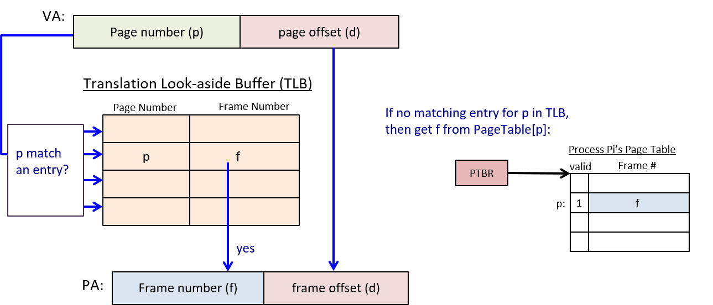

**图 11.** 转换后备缓冲区（TLB）是一个存放虚拟页到物理页框映射的小型硬件缓存。首先在 TLB 中查找第 p 页的表项。如果找到了，就不需要查页表来把虚拟地址转换为物理地址。

*Figure 11. The translation look-aside buffer (TLB) is a small hardware cache of virtual page to physical frame mappings. The TLB is first searched for an entry for page p. If found, no page table lookup is needed to translate the virtual address to its physical address.*
