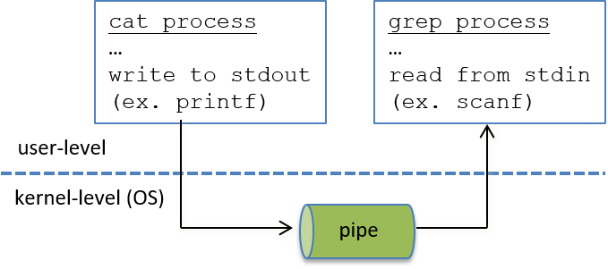
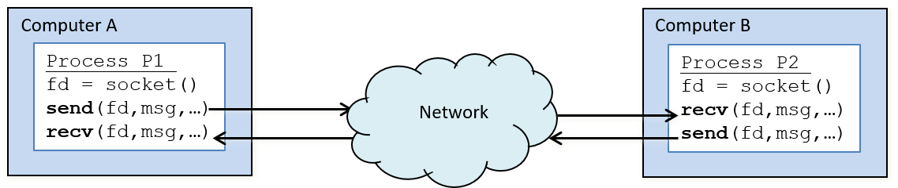

> **说明**
> 本文是个人学习用的**非官方**中英对照译文，原文：<https://diveintosystems.org/book/C13-OS/ipc_msging.html>。
> 原书采用 CC BY-NC-ND 4.0 许可（禁止演绎），**请勿公开传播本译文**。
> 标为「译注」「现代更新」的内容是译者补充，不代表原书作者观点；代码与原文逐字一致，未作改动。

### 13.4.2. 消息传递

*13.4.2. Message Passing*

拥有私有虚拟地址空间的进程之间相互通信的一种方式是**消息传递**（message passing），即相互发送和接收消息。消息传递让程序可以交换任意数据，而不仅仅是信号所支持的那一小组预定义的消息。操作系统通常会实现几种不同类型的消息传递抽象，供进程用来通信。

> One way in which processes with private virtual address spaces can communicate is through **message passing** — by sending and receiving messages to one another. Message passing allows programs to exchange arbitrary data rather than just a small set of predefined messages like those supported by signals. And operating systems typically implement a few different types of message passing abstractions that processes can use to communicate.

消息传递式的进程间通信模型由三部分组成：

> The message passing interprocess communication model consists of three parts:

1. 进程从操作系统分配某种类型的消息信道。消息信道的类型包括用于单向通信的*管道*（pipe）和用于双向通信的*套接字*（socket）等。进程可能还需要采取另外一些建立连接的步骤来配置消息信道。

> 1.  Processes allocate some type of message channel from the OS. Example message channel types include *pipes* for one-way communication, and *sockets* for two-way communication. There may be additional connection setup steps that processes need to take to configure the message channel.

2. 进程使用消息信道相互发送和接收消息。

> 2.  Processes use the message channel to send and receive messages to one another.

3. 进程用完消息信道后，关闭自己那一端。

> 3.  Processes close their end of the message channel when they are done using it.

**管道**（pipe）是运行在同一台机器上的两个进程之间的单向通信信道。单向是指管道的一端只能用来发送消息（即写入），另一端只能用来接收消息（即读取）。在 shell 命令中，管道常用来把一个进程的输出送到另一个进程的输入。

> A **pipe** is a one-way communication channel for two processes running on the same machine. One-way means that one end of the pipe is for sending messages (or writing to) only, and the other end of the pipe is for receiving messages (or for reading from) only. Pipes are commonly used in shell commands to send the output from one process to the input of another process.

例如，考虑在 bash shell 提示符下输入的下面这条命令，它在两个进程之间创建一个管道（`cat` 进程输出文件 `foo.c` 的内容，管道（`|`）把这个输出重定向到 `grep` 命令的输入，`grep` 在它的输入中查找字符串「factorial」）：

> For example, consider the following command entered at a bash shell prompt that creates a pipe between two processes (the `cat` process outputs the contents of file `foo.c` and the pipe (`|`) redirects that output to the input of the `grep` command that searches for the string "factorial" in its input):

```
$ cat foo.c | grep factorial
```

为了执行这条命令，bash shell 进程调用 `pipe` 系统调用，请求操作系统创建一个管道通信。这个管道将由 shell 的两个子进程（`cat` 和 `grep`）使用。shell 程序把 `cat` 进程的 `stdout` 设置为写入管道的写端，把 `grep` 进程的 `stdin` 设置为从管道的读端读取，这样当子进程被创建并运行时，`cat` 进程的输出就会作为输入发送给 `grep` 进程（见[图 1](13.4.2-ipc_msging.html)）。

> To execute this command, the bash shell process calls the `pipe` system call to request that the OS creates a pipe communication. The pipe will be used by the shell’s two child processes (`cat` and `grep`). The shell program sets up the `cat` process’s `stdout` to write to the write end of the pipe and the `grep` process’s `stdin` to read from the read end of the pipe, so that when the child processes are created and run, the `cat` process’s output will be sent as input to the `grep` process (see [Figure 1](13.4.2-ipc_msging.html)).



**图 1.** 管道是同一系统上的进程之间的单向通信信道。在这个例子中，cat 进程通过向管道的写端写入来向 grep 进程发送信息，grep 进程通过从管道的读端读取来接收这些信息。

*Figure 1. Pipes are unidirectional communication channels for processes on the same system. In this example, the cat process sends the grep process information by writing to the write end of the pipe. The grep process receives this information by reading from the read end of the pipe.*

管道只能单向地把数据从一个进程传给另一个进程，而其他消息传递抽象允许进程双向通信。**套接字**（socket）是一种双向通信信道，即套接字的每一端都既可以发送消息，也可以接收消息。运行在同一台计算机上的进程，或者运行在通过网络相连的不同计算机上的进程，都可以用套接字进行通信（见[图 2](13.4.2-ipc_msging.html)）。这些计算机可以通过**局域网**（local area network，LAN）相连，局域网连接的是一个小范围内的计算机，例如大学计算机系的网络。通信的进程也可以位于不同的局域网中，通过互联网相连。只要两台机器之间存在某条经过网络连接的路径，进程就可以用套接字通信。

> While pipes transmit data from one process to another in only one direction, other message passing abstractions allow processes to communicate in both directions. A **socket** is a two-way communication channel, which means that each end of a socket can be used for both sending and receiving messages. Sockets can be used by communicating processes running on the same computer or running on different computers connected by a network (see [Figure 2](13.4.2-ipc_msging.html)). The computers could be connected by a **local area network** (LAN), which connects computers in a small area, such as a network in a university computer science department. The communicating processes could also be on different LANs, connected to the internet. As long as there exists some path through network connections between the two machines, the processes can use sockets to communicate.



**图 2.** 套接字是双向通信信道，可以供通过网络相连的不同机器上的进程通信使用。

*Figure 2. Sockets are bidirectional communication channels that can be used by communicating processes on different machines connected by a network.*

由于每台计算机都是一个独立的系统（硬件和操作系统），而一个系统上的操作系统并不了解、也不管理另一个系统上的资源，所以消息传递是不同计算机上的进程相互通信的唯一方式。为了支持这类通信，操作系统需要实现一种通用的消息传递协议，用于在网络上发送和接收消息。TCP/IP 就是可以用来在互联网上发送消息的一种消息协议。当一个进程想向另一个进程发送消息时，它发出一个 `send` 系统调用，把想要用来传输的套接字、消息缓冲区，以及可能还有关于消息或其预期接收者的其他信息交给操作系统。操作系统负责把消息缓冲区中的消息打包，并通过网络发送到另一台机器。当操作系统从网络上收到一条消息时，它把消息解包，并交给本系统上请求接收该消息的进程。这个进程可能正处于阻塞状态，等待消息到来。在这种情况下，消息的到达会让该进程再次进入就绪状态。

> Because each individual computer is its own system (hardware and OS), and because the OS on one system does not know about or manage resources on the other system, message passing is the only way in which processes on different computers can communicate. To support this type of communication, operating systems need to implement a common message passing protocol for sending and receiving messages over a network. TCP/IP is one example of a messaging protocol that can be used to send messages over the internet. When a process wants to send a message to another, it makes a `send` system call, passing the OS a socket on which it wants to transmit, the message buffer, and possibly additional information about the message or its intended recipient. The OS takes care of packing up the message in the message buffer and sending it out over the network to the other machine. When an OS receives a message from the network, it unpacks the message and delivers it to the process on its system that has requested to receive the message. This process may be in a Blocked state waiting for the message to arrive. In this case, receipt of the message makes the process Ready to run again.

有许多建立在消息传递之上的系统软件抽象，它们向程序员隐藏了消息传递的细节。然而，不同计算机上进程之间的任何通信，在最底层都必须使用消息传递（对于运行在不同系统上的进程，通过共享内存或信号通信是行不通的）。在[并行系统一章](../C15-Parallel/15.0-index.html)中，我们会更详细地讨论消息传递以及建立在它之上的抽象。

> There are many system software abstractions built on top of message passing that hide the message passing details from the programmer. However, any communication between processes on different computers must use message passing at the lowest levels (communicating through shared memory or signals is not an option for processes running on different systems). In the [Parallel Systems Chapter](../C15-Parallel/15.0-index.html), we discuss message passing and the abstractions built atop it in more detail.
