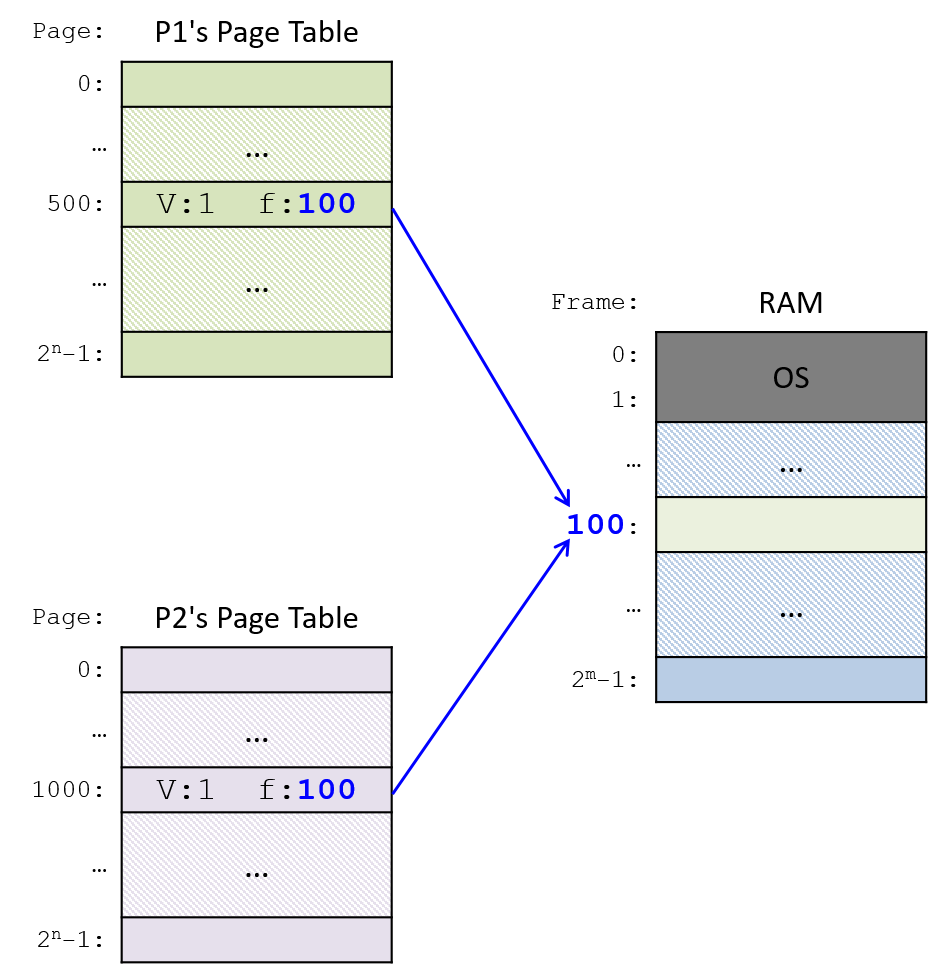

> [!WARNING] 说明
> 本文是个人学习用的**非官方**中英对照译文，原文：<https://diveintosystems.org/book/C13-OS/ipc_shm.html>。
> 原书采用 CC BY-NC-ND 4.0 许可（禁止演绎），**请勿公开传播本译文**。
> 标为「译注」「现代更新」的内容是译者补充，不代表原书作者观点；代码与原文逐字一致，未作改动。

*13.4.3. Shared Memory*

使用套接字的消息传递，对于同一台机器上运行的进程之间、以及不同机器上运行的进程之间的双向通信都很有用。然而，当两个进程运行在同一台机器上时，它们可以利用共享的系统资源，比使用消息传递更高效地通信。

> Message passing using sockets is useful for bidirectional communication between processes running on the same machine and between processes running on different machines. However, when two processes are running on the same machine, they can take advantage of shared system resources to communicate more efficiently than by using message passing.

例如，操作系统可以通过允许进程共享其全部或部分虚拟地址空间，来支持进程间通信。一个进程可以读写其地址空间中的共享部分，与共享同一内存区域的其他进程通信。

> For example, an operating system can support interprocess communication by allowing processes to share all or part of their virtual address spaces. One process can read and write values to the shared portion of its address space to communicate with other processes sharing the same memory region.

操作系统实现部分地址空间共享的一种方式，是把两个或多个进程页表中的表项设置为映射到相同的物理页框。[图 1](13.4.3-ipc_shm.html) 展示了这样一个映射的例子。为了通信，一个进程把一个值写到共享页上的某个地址，另一个进程随后读取这个值。

> One way that the OS can implement partial address space sharing is by setting entries in the page tables of two or more processes to map to the same physical frames. [Figure 1](13.4.3-ipc_shm.html) illustrates an example mapping. To communicate, one process writes a value to an address on a shared page, and another process subsequently reads the value.

**图 1.** 操作系统可以通过把共享进程页表中的表项设置为相同的物理页框号（例如页框 100），来支持共享虚拟地址空间中的页。注意，进程不需要用相同的虚拟地址来引用共享的物理内存页。

*Figure 1. The OS can support sharing pages of virtual address space by setting entries in the page tables of sharing processes to the same physical frame number (e.g., frame 100). Note that processes do not need to use the same virtual address to refer to the shared page of physical memory.*

如果操作系统支持部分共享内存，它就会为程序员实现一个接口，用来创建和附加到内存的共享页（或共享区域/段）上。在 Unix 系统中，`shmget` 系统调用创建或附加到一个共享内存段。每个共享内存段对应一组连续的虚拟地址，这些地址的物理映射与附加到同一共享内存段的其他进程共享。

> If the OS supports partial shared memory, then it implements an interface to the programmer for creating and attaching to shared pages (or shared regions/segments) of memory. In Unix systems, the system call `shmget` creates or attaches to a shared memory segment. Each shared memory segment corresponds to a contiguous set of virtual addresses whose physical mappings are shared with other processes attaching to the same shared memory segment.

操作系统通常还支持共享单个完整的虚拟地址空间。**线程**（thread）是操作系统对执行控制流的抽象。一个进程在单个虚拟地址空间中有单个执行控制流线程。多线程进程在单个共享的虚拟地址空间中有多个并发的执行控制流线程：所有线程共享它们所属进程的完整虚拟地址空间。

> Operating systems also typically support sharing a single, full virtual address space. A **thread** is the OS abstraction of an execution control flow. A process has a single thread of execution control flow in a single virtual address space. A multithreaded process has multiple concurrent threads of execution control flow in a single, shared virtual address space — all threads share the full virtual address space of their containing process.

线程可以通过读写其公共地址空间中的共享位置，轻松地共享执行状态。例如，如果一个线程改变了某个全局变量的值，其他所有线程都会看到这一改变的结果。

> Threads can easily share execution state by reading and writing to shared locations in their common address space. For example, if one thread changes the value of a global variable, all other threads see the result of that change.

在多处理器系统（SMP 或多核）上，多线程进程的各个线程可以被调度到多个核心上同时运行，即*并行*运行。在[共享内存一章](../C14-SharedMemory/14.0-index.html)中，我们会更详细地讨论线程和并行多线程编程。

> On a multiprocessor systems (SMP or multicore), individual threads of a multithreaded process can be scheduled to run simultaneously, *in parallel*, on the multiple cores. In the [Shared Memory Chapter](../C14-SharedMemory/14.0-index.html), we discuss threads and parallel multi-threaded programming in more detail.
