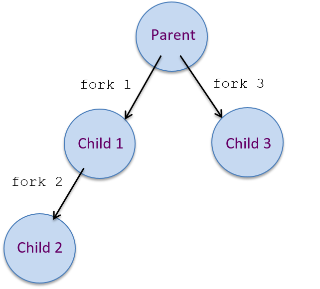

> **说明**
> 本文是个人学习用的**非官方**中英对照译文，原文：<https://diveintosystems.org/book/C13-OS/exercises.html>。
> 原书采用 CC BY-NC-ND 4.0 许可（禁止演绎），**请勿公开传播本译文**。
> 标为「译注」「现代更新」的内容是译者补充，不代表原书作者观点；代码与原文逐字一致，未作改动。

## 13.6. 练习

*13.6. Exercises*

- [第 13 章全部练习](https://diveintosystems.org/exercises/dive-into-systems-exercises-16.html)（英文交互式练习）

> - [All Chapter 13 Exercises](https://diveintosystems.org/exercises/dive-into-systems-exercises-16.html)

### 附加练习

*Additional Exercises*

1. 考虑下面这段调用了 fork 的代码片段（为了可读性去掉了错误处理代码）：

> 1.  Consider the code snippet below with calls to fork (and with error handling code removed just for readability sake):

```
    pid_t ret;

    printf("A\n");

    ret = fork();
    if(ret == 0) {
        printf("B\n");

        ret = fork();
        if(ret == 0) {
            printf("C\n");
        }
        printf("D\n");
    } else {
        printf("E\n");

        ret = fork();
        printf("F\n");
    }

    printf("G\n");
```

1. 画出执行这段代码所创建的进程层次结构。

> 1.  Draw the process hierarchy created by executing this code.

2. 对层次结构中的每个进程，指出它的输出序列（它执行各个 printf 的顺序）。

> 2.  For each process in the hierarchy, indicate its output sequence (the order in which it executes printf’s).

#### 解答

*Solutions*

**如果你的浏览器支持隐藏答案，点击这里显示答案。**

> **If your browser supports hidden solutions, click here to reveal them.**

\

1. 对于这段代码片段：

    ```
       int ret;

       printf("A\n");
       ret = fork();    // fork 1
       if(ret == 0) {
         printf("B\n");
         ret = fork();  // fork 2
         if(ret == 0) {
           print("C\n");
         }
         printf("D\n");
       } else {
         printf("E\n");
         ret = fork();  // fork 3
         printf("F\n");
      }
      printf("G\n");
    ```

    执行这段代码所创建的进程层次结构如下（层次结构的每条边上都标注了创建对应进程的那次 fork 调用）：

    

    *图示：一个由 4 个进程组成的进程层次结构：父进程通过 fork 1 创建子进程 1，子进程 1 通过 fork 2 创建它的子进程，即子进程 2，父进程通过 fork 3 创建它的第二个子进程，即子进程 3*

    层次结构中每个进程的输出序列（它按什么顺序执行哪些 printf）：

    ```
    parent: A, E, F, G
    child1: B, D, G
    child2: F, G
    child3: C, D, G
    ```

> 1.  For the code snippet:
>
>     ```
>        int ret;
>
>        printf("A\n");
>        ret = fork();    // fork 1
>        if(ret == 0) {
>          printf("B\n");
>          ret = fork();  // fork 2
>          if(ret == 0) {
>            print("C\n");
>          }
>          printf("D\n");
>        } else {
>          printf("E\n");
>          ret = fork();  // fork 3
>          printf("F\n");
>       }
>       printf("G\n");
>     ```
>
>     The process heirarchy created by executing this code (the specific fork call that creates each process is annotated on each edge in the process heirarchy):
>
>     For each process in the heirarchy, indicate its output sequence (which printf’s it executes in which order):
>
>     ```
>     parent: A, E, F, G
>     child1: B, D, G
>     child2: F, G
>     child3: C, D, G
>     ```

> **译注 · 解答中的两处错误**
> - 代码中的 `print("C\n");` 应为 `printf("C\n");`，否则无法编译。
> - 按图中的命名（子进程 2 由 fork 2 创建、子进程 3 由 fork 3 创建），输出序列中 child2 和 child3 两行写反了：子进程 2 是子进程 1 在 fork 2 处创建的，它从 fork 2 之后开始执行，输出 C、D、G；子进程 3 是父进程在 fork 3 处创建的，输出 F、G。
