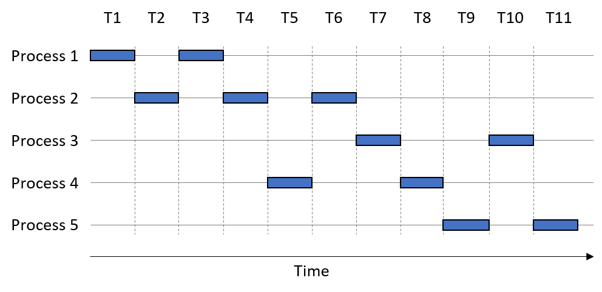
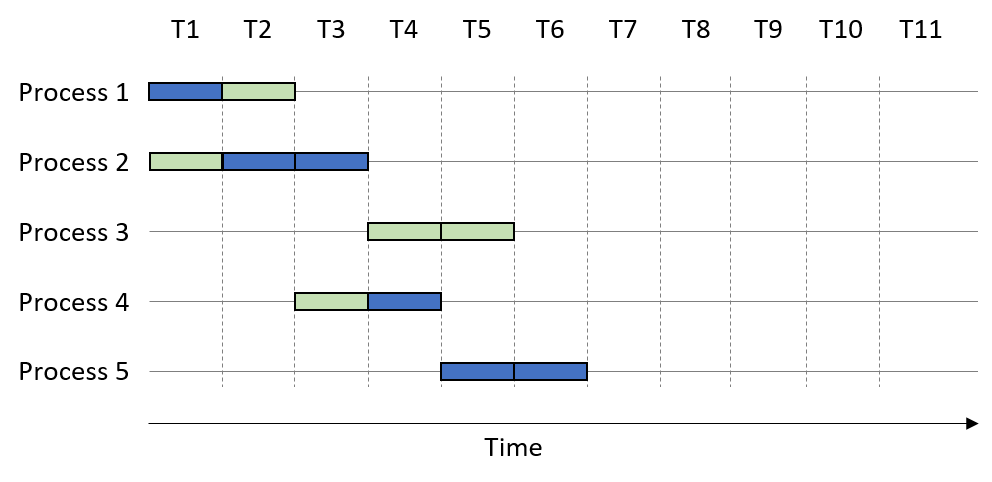
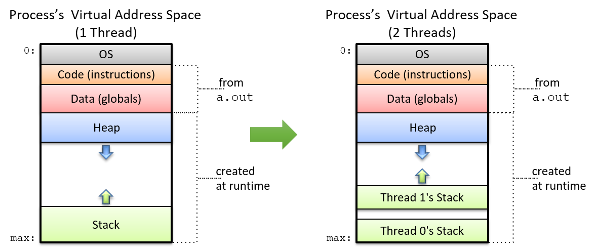
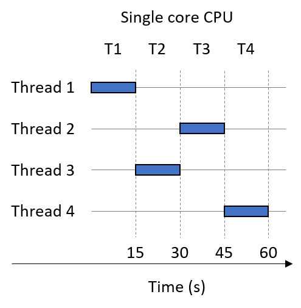
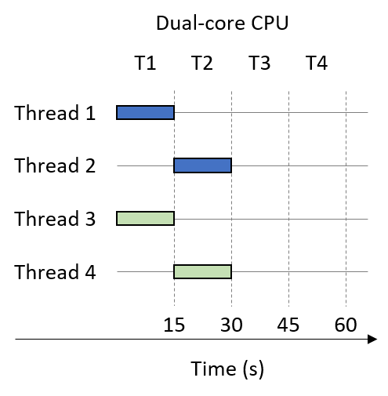
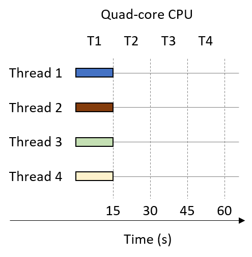

> **说明**
> 本文是个人学习用的**非官方**中英对照译文，原文：<https://diveintosystems.org/book/C14-SharedMemory/multicore.html>。
> 原书采用 CC BY-NC-ND 4.0 许可（禁止演绎），**请勿公开传播本译文**。
> 标为「译注」「现代更新」的内容是译者补充，不代表原书作者观点；代码与原文逐字一致，未作改动。

## 14.1. 多核系统编程

*14.1. Programming Multicore Systems*

如今程序员熟悉的大多数常用语言都诞生于多核时代之前。因此，许多语言无法*隐式地*（即自动地）利用多核处理器来加快程序的执行。程序员必须专门编写软件，来利用系统上的多个核心。

> Most of the common languages that programmers know today were created prior to the multicore age. As a result, many languages cannot *implicitly* (or automatically) employ multicore processors to speed up the execution of a program. Instead, programmers must specifically write software to leverage the multiple cores on a system.

### 14.1.1. 多核系统对进程执行的影响

*14.1.1. The Impact of Multicore Systems on Process Execution*

回想一下，[**进程**](../C13-OS/13.2-processes.html)可以看作正在运行的程序的抽象。每个进程都在自己的虚拟地址空间中执行。操作系统（OS）调度进程在 CPU 上执行；当 CPU 改变它当前执行的进程时，就发生了**上下文切换**（context switch）。

> Recall that a [**process**](../C13-OS/13.2-processes.html) can be thought of as an abstraction of a running program. Each process executes in its own virtual address space. The operating system (OS) schedules processes for execution on the CPU; a **context switch** occurs when the CPU changes which process it currently executes.

[图 1](14.1-multicore.html) 展示了五个示例进程可能如何在单核 CPU 上执行。

> [Figure 1](14.1-multicore.html) illustrates how five example processes may execute on a single-core CPU.



**图 1.** 五个进程共享单个 CPU 核心时的执行时间序列

*Figure 1. An execution time sequence for five processes as they share a single CPU core*

横轴是时间，每个时间片占一个时间单位。方框表示某个进程正在使用这个单核 CPU。假设每个进程执行完整的一个时间片之后才发生上下文切换。所以，进程 1 在时间步 T1 和 T3 使用 CPU。

> The horizontal axis is time, with each time slice taking one unit of time. A box indicates when a process is using the single-core CPU. Assume that each process executes for one full time slice before a context switch occurs. So, Process 1 uses the CPU during time steps T1 and T3.

在这个例子中，进程的执行顺序是 P1、P2、P1、P2、P4、P2、P3、P4、P5、P3、P5。这里我们花点时间区分两种时间度量。**CPU 时间**度量一个进程在 CPU 上执行所用的时间。与之不同，**挂钟时间**（wall-clock time）度量的是人所感知到的进程完成所用的时间。由于上下文切换，挂钟时间常常比 CPU 时间长得多。例如，进程 1 的 CPU 时间是两个时间单位，而它的挂钟时间是三个时间单位。

> In this example, the order of process execution is P1, P2, P1, P2, P4, P2, P3, P4, P5, P3, P5. We take a moment here to distinguish between two measures of time. The **CPU time** measures the amount of time a process takes to execute on a CPU. In contrast, the **wall-clock time** measures the amount of time a human perceives a process takes to complete. The wall-clock time is often significantly longer than the CPU time, due to context switches. For example, Process 1’s CPU time requires two time units, whereas its wall-clock time is three time units.

当一个进程的总执行时间与另一个进程的相重叠时，这两个进程就是**并发**（concurrently）运行的。在单核时代，操作系统利用并发营造出计算机能同时做许多事情的错觉（例如，你可以同时打开计算器程序、Web 浏览器和文字处理文档）。实际上，每个进程都是串行执行的，由操作系统决定[进程执行和完成的顺序](../C13-OS/13.2-processes.html)（而且这个顺序在后续运行中常常不同）。

> When the total execution time of one process overlaps with another, the processes are running **concurrently** with each other. Operating systems employed concurrency in the single-core era to give the illusion that a computer can execute many things at once (e.g., you can have a calculator program, a web browser, and a word processing document all open at the same time). In truth, each process executes serially and the operating system determines the [order in which processes execute and complete](../C13-OS/13.2-processes.html) (which often differs in subsequent runs).

回到这个例子，可以看到进程 1 和进程 2 是彼此并发运行的，因为它们的执行在时间点 T2–T4 上有重叠。同样，进程 2 与进程 4 并发运行，因为它们的执行在时间点 T4–T6 上有重叠。与之不同，进程 2 与进程 3 *不是*并发运行的，因为它们的执行没有任何重叠；进程 3 从时间 T7 才开始运行，而进程 2 在时间 T6 就完成了。

> Returning to the example, observe that Process 1 and Process 2 run concurrently with each other, since their executions overlap at time points T2-T4. Likewise, Process 2 runs concurrently with Process 4, as their executions overlap at time points T4-T6. In contrast, Process 2 does *not* run concurrently with Process 3, because they share no overlap in their execution; Process 3 only starts running at time T7, whereas Process 2 completes at time T6.

多核 CPU 让操作系统能够把不同的进程调度到各个可用的核心上，使进程能够*同时*执行。来自运行在多个核心上的进程的指令同时执行，称为**并行执行**（parallel execution）。[图 2](14.1-multicore.html) 展示了我们的示例进程可能如何在双核系统上执行。

> A multicore CPU enables the OS to schedule a different process to each available core, allowing processes to execute *simultaneously*. The simultaneous execution of instructions from processes running on multiple cores is referred to as **parallel execution**. [Figure 2](14.1-multicore.html) shows how our example processes might execute on a dual-core system.



**图 2.** 五个进程的执行时间序列，扩展为包含两个 CPU 核心（一个为深蓝色，另一个为浅绿色）。

*Figure 2. An execution time sequence for five processes, extended to include two CPU cores (one in dark blue, the other in light green).*

在这个例子中，两个 CPU 核心用不同的颜色表示。假设进程的执行顺序仍然是 P1、P2、P1、P2、P4、P2、P3、P4、P5、P3、P5。多个核心的存在让某些进程能够*更早*执行。例如，在时间单位 T1 内，第一个核心执行进程 1，同时第二个核心执行进程 2。在时间 T2，第一个核心执行进程 2，第二个核心执行进程 1。因此，进程 1 在时间 T2 之后就执行完了，而进程 2 在时间 T3 执行完。

> In this example, the two CPU cores are colored differently. Suppose that the process execution order is again P1, P2, P1, P2, P4, P2, P3, P4, P5, P3, P5. The presence of multiple cores enables certain processes to execute *sooner*. For example, during time unit T1, the first core executes Process 1 while the second core executes Process 2. At time T2, the first core executes Process 2 while the second executes Process 1. Thus, Process 1 finishes executing after time T2, whereas Process 2 finishes executing at time T3.

注意，多个进程的并行执行只是增加了任一时刻正在执行的进程数。在[图 2](14.1-multicore.html) 中，所有进程在时间单位 T7 之前都执行完了。然而，每个单独的进程完成所需的 CPU 时间仍然与[图 1](14.1-multicore.html) 中所示的相同。例如，无论在单核还是多核系统上执行，进程 2 都需要三个时间单位（即它的 *CPU 时间*保持不变）。多核处理器提高的是进程执行的**吞吐量**（throughput），即在给定时间段内能够完成的进程数。因此，尽管单个进程的 CPU 时间保持不变，它的挂钟时间却可能减少。

> Note that the parallel execution of multiple processes increases just the number of processes that execute at any one time. In [Figure 2](14.1-multicore.html), all the processes complete execution by time unit T7. However, each individual process still requires the same amount of CPU time to complete as shown in [Figure 1](14.1-multicore.html). For example, Process 2 requires three time units regardless of execution on a single or multicore system (i.e., its *CPU time* remains the same). A multicore processor increases the **throughput** of process execution, or the number of processes that can complete in a given period of time. Thus, while the CPU time of an individual process remains unchanged, its wall-clock time may decrease.

### 14.1.2. 用线程加快进程执行

*14.1.2. Expediting Process Execution with Threads*

加快单个进程执行的一种方式，是把它分解成称为**线程**（thread）的轻量级的独立执行流。[图 3](14.1-multicore.html) 展示了一个进程被多线程化为两个线程时，其虚拟地址空间如何变化。每个线程都有自己私有的调用栈内存，而所有线程*共享*分配给这个多线程进程的程序数据、指令和堆。

> One way to speed up the execution of a single process is to decompose it into lightweight, independent execution flows called **threads**. [Figure 3](14.1-multicore.html) shows how a process’s virtual address space changes when it is multithreaded with two threads. While each thread has its own private allocation of call stack memory, all threads *share* the program data, instructions, and the heap allocated to the multithreaded process.



**图 3.** 比较单线程进程与有两个线程的多线程进程的虚拟地址空间

*Figure 3. Comparing the virtual address space of a single-threaded and a multithreaded process with two threads*

操作系统调度线程的方式与调度进程的方式相同。在多核处理器上，操作系统可以把不同的线程调度到不同的核心上运行，从而加快多线程程序的执行。能够并行执行的线程数的最大值等于系统上物理核心的数目。如果线程数超过了物理核心数，其余的线程就必须等待轮到它们执行（类似于进程在单核上的执行方式）。

> The operating system schedules threads in the same manner as it schedules processes. On a multicore processor, the OS can speed up the execution of a multithreaded program by scheduling the different threads to run on separate cores. The maximum number of threads that can execute in parallel is equal to the number of physical cores on the system. If the number of threads exceeds the number of physical cores, the remaining threads must wait their turn to execute (similar to how processes execute on a single core).

#### 一个例子：标量乘法

*An Example: Scalar Multiplication*

作为如何用多线程加速应用程序的第一个例子，考虑对数组 `array` 和某个整数 `s` 执行标量乘法的问题。在标量乘法中，数组中的每个元素都通过与 `s` 相乘而被缩放。

> As an initial example of how to use multithreading to speed up an application, consider the problem of performing scalar multiplication of an array `array` and some integer `s`. In scalar multiplication, each element in the array is scaled by multiplying the element with `s`.

下面是标量乘法函数的一个串行实现：

> A serial implementation of a scalar multiplication function follows:

```
void scalar_multiply(int * array, long length, int s) {
    int i;
    for (i = 0; i < length; i++) {
      array[i] = array[i] * s;
    }
}
```

假设 `array` 总共有 *N* 个元素。要用 *t* 个线程创建这个应用程序的多线程版本，需要：

> Suppose that `array` has *N* total elements. To create a multithreaded version of this application with *t* threads, it is necessary to:

1. 创建 *t* 个线程。

> 1.  Create *t* threads.

2. 给每个线程分配输入数组的一个子集（即 *N*/*t* 个元素）。

> 2.  Assign each thread a subset of the input array (i.e., *N*/*t* elements).

3. 让每个线程把它所分到的数组子集中的元素乘以 `s`。

> 3.  Instruct each thread to multiply the elements in its array subset by `s`.

假设 `scalar_multiply` 的串行实现乘一个有 1 亿个元素的输入数组需要 60 秒。为了构建一个用 *t* = 4 个线程执行的版本，我们给每个线程分配整个输入数组的四分之一（2500 万个元素）。

> Suppose that the serial implementation of `scalar_multiply` spends 60 seconds multiplying an input array of 100 million elements. To build a version that executes with *t*= 4 threads, we assign each thread one fourth of the total input array (25 million elements).

[图 4](14.1-multicore.html) 展示了在单个核心上运行四个线程时会发生什么。和之前一样，执行顺序由操作系统决定。在这个场景中，假设线程的执行顺序是线程 1、线程 3、线程 2、线程 4。在单核处理器上（用方框表示），每个线程依次执行。因此，在一个核心上运行的这个多线程进程仍然需要 60 秒（考虑到创建线程的开销，也许还要稍长一点）。

> [Figure 4](14.1-multicore.html) shows what happens when we run four threads on a single core. As before, the execution order is left to the operating system. In this scenario, assume that the thread execution order is Thread 1, Thread 3, Thread 2, Thread 4. On a single-core processor (represented by the squares), each thread executes sequentially. Thus, the multithreaded process running on one core will still take 60 seconds to run (perhaps a little longer, given the overhead of creating threads).



**图 4.** 在单核 CPU 上运行四个线程

*Figure 4. Running four threads on a single-core CPU*

现在假设我们在双核系统上运行这个多线程进程。[图 5](14.1-multicore.html) 展示了结果。同样假设 *t* = 4 个线程，线程的执行顺序是线程 1、线程 3、线程 2、线程 4。两个核心用带阴影的方框表示。由于系统是双核的，线程 1 和线程 3 在时间步 T1 并行执行。然后线程 2 和线程 4 在时间步 T2 并行执行。因此，原本需要 60 秒运行的多线程进程，现在只需 30 秒。

> Now suppose that we run our multithreaded process on a dual-core system. [Figure 5](14.1-multicore.html) shows the result. Again, assume *t* = 4 threads, and that the thread execution order is Thread 1, Thread 3, Thread 2, Thread 4. Our two cores are represented by shaded squares. Since the system is dual-core, Thread 1 and Thread 3 execute in parallel during time step T1. Threads 2 and 4 then execute in parallel during time step T2. Thus, the multithreaded process that originally took 60 seconds to run now runs in 30 seconds.



**图 5.** 在双核 CPU 上运行四个线程

*Figure 5. Running four threads on a dual-core CPU*

最后，假设这个多线程进程（*t* = 4）在四核 CPU 上运行。[图 6](14.1-multicore.html) 展示了这样的一个执行序列。[图 6](14.1-multicore.html) 中的四个核心各用不同的阴影表示。在四核系统上，每个线程都在时间片 T1 内并行执行。因此，在四核 CPU 上，原本需要 60 秒的多线程进程现在只需 15 秒。

> Finally, suppose that the multithreaded process (*t* = 4) is run on a quad-core CPU. [Figure 6](14.1-multicore.html) shows one such execution sequence. Each of the four cores in [Figure 6](14.1-multicore.html) is shaded differently. On the quad-core system, each thread executes in parallel during time slice T1. Thus, on a quad-core CPU, the multithreaded process that originally took 60 seconds now runs in 15 seconds.



**图 6.** 在四核 CPU 上运行四个线程

*Figure 6. Running four threads on a quad-core CPU*

一般来说，如果线程数与核心数（*c*）相同，并且操作系统把每个线程调度到不同的核心上并行运行，那么多线程进程的运行时间应该大约是原来的 1/*c*。这样的线性加速比是理想情况，在实践中并不常见。例如，如果有许多其他进程（或多线程进程）在等待使用 CPU，它们会争夺数量有限的核心，导致进程之间的**资源争用**（resource contention）。如果指定的线程数超过了 CPU 核心数，每个线程都必须等待轮到它运行。我们会在[本章后面](14.4-performance.html)探讨其他经常妨碍线性加速的因素。

> In general, if the number of threads matches the number of cores (*c*) and the operating system schedules each thread to run on a separate core in parallel, then the multithreaded process should run in approximately 1/*c* of the time. Such linear speedup is ideal, but not frequently observed in practice. For example, if there are many other processes (or multithreaded processes) waiting to use the CPU, they will all compete for the limited number of cores, resulting in **resource contention** among the processes. If the number of specified threads exceeds the number of CPU cores, each thread must wait its turn to run. We explore other factors that often prevent linear speedup [later in this chapter](14.4-performance.html).
