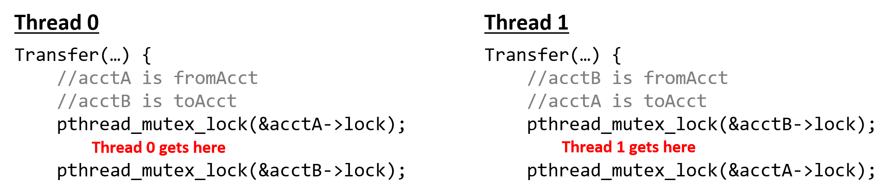

> **说明**
> 本文是个人学习用的**非官方**中英对照译文，原文：<https://diveintosystems.org/book/C14-SharedMemory/mutex.html>。
> 原书采用 CC BY-NC-ND 4.0 许可（禁止演绎），**请勿公开传播本译文**。
> 标为「译注」「现代更新」的内容是译者补充，不代表原书作者观点；代码与原文逐字一致，未作改动。

### 14.3.1. 互斥

*14.3.1. Mutual Exclusion*

*互斥锁是什么？答案就在那里，它在寻找你，只要你愿意，它就会找到你。*

> *What is the mutex? The answer is out there, and it’s looking for you, and it will find you if you want it to.*

——崔妮蒂向尼奥解释互斥锁（向《*黑客帝国*》致歉）

> ~Trinity, explaining mutexes to Neo (Apologies to *The Matrix*)

为了修正数据竞争，我们来使用一种称为互斥锁（mutual exclusion lock，简称 **mutex**）的同步结构。互斥锁是一种同步原语，它确保在任一时刻只有一个线程能进入并执行临界区中的代码。

> To fix the data race, let’s use a synchronization construct known as a mutual exclusion lock, or **mutex**. Mutual exclusion locks are a type of synchronization primitive that ensures that only one thread enters and executes the code inside the critical section at any given time.

在使用互斥锁之前，程序必须先：

> Before using a mutex, a program must first:

1. 在线程共享的内存中声明互斥锁（通常作为全局变量）。

> 1.  Declare the mutex in memory that’s shared by threads (often as a global variable).

2. 在线程需要使用互斥锁之前初始化它（通常在 `main` 函数中）。

> 2.  Initialize the mutex before the threads need to use it (typically in the `main` function).

Pthreads 库为互斥锁定义了 `pthread_mutex_t` 类型。要声明一个互斥锁变量，添加这一行：

> The Pthreads library defines a `pthread_mutex_t` type for mutexes. To declare a mutex variable, add this line:

```
pthread_mutex_t mutex;
```

要初始化互斥锁，使用 `pthread_mutex_init` 函数，它接收一个互斥锁的地址和一个属性结构（通常设为 `NULL`）：

> To initialize the mutex use the `pthread_mutex_init` function, which takes the address of a mutex and an attribute structure, typically set to `NULL`:

```
pthread_mutex_init(&mutex, NULL);
```

当不再需要互斥锁时（通常在 `main` 函数末尾、`pthread_join` 之后），程序应当调用 `pthread_mutex_destroy` 函数来释放互斥锁结构：

> When the mutex is no longer needed (typically at the end of the `main` function, after `pthread_join`), a program should release the mutex structure by invoking the `pthread_mutex_destroy` function:

```
pthread_mutex_destroy(&mutex);
```

#### 互斥锁：上膛

*The Mutex: Locked and Loaded*

互斥锁的初始状态是未加锁的，即任何线程都可以立即使用它。要进入临界区，线程必须先获得锁。这是通过调用 `pthread_mutex_lock` 函数来完成的。一个线程持有锁之后，在持锁线程释放锁之前，其他任何线程都不能进入临界区。如果另一个线程调用 `pthread_mutex_lock` 时互斥锁已经被锁住，该线程就会**阻塞**（block，即等待），直到互斥锁变为可用。回想一下，[*阻塞*意味着该线程不会被调度](../C13-OS/13.2-processes.html)使用 CPU，直到它所等待的条件（互斥锁可用）成立为止。

> The initial state of a mutex is unlocked, meaning it’s immediately usable by any thread. To enter a critical section, a thread must first acquire a lock. This is accomplished with a call to the `pthread_mutex_lock` function. After a thread has the lock, no other thread can enter the critical section until the thread with the lock releases it. If another thread calls `pthread_mutex_lock` and the mutex is already locked, the thread will **block** (or wait) until the mutex becomes available. Recall that [*blocking* implies that the thread will not be scheduled](../C13-OS/13.2-processes.html) to use the CPU until the condition it’s waiting for (the mutex being available) becomes true.

当线程退出临界区时，它必须调用 `pthread_mutex_unlock` 函数释放互斥锁，让其他线程可以使用它。这样，一次最多只有一个线程能获得锁并进入临界区，从而防止多个线程*竞相*读取和更新共享变量。

> When a thread exits the critical section it must call the `pthread_mutex_unlock` function to release the mutex, making it available for another thread. Thus, at most one thread may acquire the lock and enter the critical section at a time, which prevents multiple threads from *racing* to read and update shared variables.

声明并初始化互斥锁之后，下一个问题是：加锁和解锁函数应当放在哪里，才能最好地实施临界区？下面是用互斥锁增强 `countElems` 函数的初次尝试（完整源代码可从 [countElems_p_v2.c](https://diveintosystems.org/book/C14-SharedMemory/_attachments/countElems_p_v2.c) 下载）：

> Having declared and initialized a mutex, the next question is where the lock and unlock functions should be placed to best enforce the critical section. Here is an initial attempt at augmenting the `countElems` function with a mutex (The full source can be downloaded from [countElems_p_v2.c](https://diveintosystems.org/book/C14-SharedMemory/_attachments/countElems_p_v2.c)):

```
pthread_mutex_t mutex; //global declaration of mutex, initialized in main()

/*parallel version of step 1 of CountSort algorithm (attempt 1 with mutexes):
 * extracts arguments from args value
 * calculates component of the array that thread is responsible for counting
 * computes the frequency of all the elements in assigned component and stores
 * the associated counts of each element in counts array
*/
void *countElems( void *args ) {
    //extract arguments
    //ommitted for brevity
    int *array = myargs->ap;
    long *counts = myargs->countp;

    //assign work to the thread
    long chunk = length / nthreads; //nominal chunk size
    long start = myid * chunk;
    long end = (myid + 1) * chunk;
    long val;
    if (myid == nthreads - 1) {
        end = length;
    }
    long i;

    //heart of the program
    pthread_mutex_lock(&mutex); //acquire the mutex lock
    for (i = start; i < end; i++) {
        val = array[i];
        counts[val] = counts[val] + 1;
    }
    pthread_mutex_unlock(&mutex); //release the mutex lock

    return NULL;
}
```

互斥锁的初始化和销毁函数放在 `main` 中，位于线程创建和合并函数的前后：

> The mutex initialize and destroy functions are placed in `main` around the thread creation and join functions:

```
//code snippet from main():

pthread_mutex_init(&mutex, NULL); //initialize the mutex

for (t = 0; t < nthreads; t++) {
    pthread_create( &thread_array[t], NULL, countElems, &thread_args[t] );
}

for (t = 0; t < nthreads; t++) {
    pthread_join(thread_array[t], NULL);
}
pthread_mutex_destroy(&mutex); //destroy (free) the mutex
```

我们重新编译并运行这个新程序，同时改变线程数：

> Let’s recompile and run this new program while varying the number of threads:

```
$ ./countElems_p_v2 10000000 1 1
Counts array:
999170 1001044 999908 1000431 999998 1001479 999709 997250 1000804 1000207

$ ./countElems_p_v2 10000000 1 2
Counts array:
999170 1001044 999908 1000431 999998 1001479 999709 997250 1000804 1000207

$ ./countElems_p_v2 10000000 1 4
Counts array:
999170 1001044 999908 1000431 999998 1001479 999709 997250 1000804 1000207
```

太好了，无论使用多少个线程，输出*终于*一致了！

> Excellent, the output is *finally* consistent regardless of the number of threads used!

回想一下，多线程的另一个主要目标是随着线程数的增加缩短程序的运行时间（换句话说，就是*加速*程序的执行）。我们来对 `countElems` 函数的性能进行基准测试。尽管可能很想用 `time -p` 这样的命令行工具，但要记住，调用 `time -p` 测量的是*整个*程序的挂钟时间（包括生成随机元素的时间），而*不仅仅*是运行 `countElems` 函数的时间。在这种情况下，最好使用 `gettimeofday` 这样的系统调用，它让用户能准确测量某段代码的挂钟时间。在 1 亿个元素上对 `countElems` 进行基准测试，得到下面的运行时间：

> Recall that another primary goal of threading is to reduce the runtime of a program as the number of threads increases (in other words, to *speed up* program execution). Let’s benchmark the performance of the `countElems` function. Although it may be tempting to use a command line utility like `time -p`, recall that invoking `time -p` measures the wall-clock time of the *entire* program (including the generation of random elements) and *not* just the running of the `countElems` function. In this case, it is better to use a system call like `gettimeofday`, which allows a user to accurately measure the wall-clock time of a particular section of code. Benchmarking `countElems` on 100 million elements yields the following run times:

```
$ ./countElems_p_v2 100000000 0 1
Time for Step 1 is 0.368126 s

$ ./countElems_p_v2 100000000 0 2
Time for Step 1 is 0.438357 s

$ ./countElems_p_v2 100000000 0 4
Time for Step 1 is 0.519913 s
```

增加线程反而让程序变*慢*了！这与用线程让程序变*快*的目标背道而驰。

> Adding more threads causes the program to get *slower*! This goes against the goal of making programs *faster* with threads.

为了弄清发生了什么，考虑锁在 `countsElems` 函数中放在了哪里：

> To understand what is going on, consider where the locks are placed in the `countsElems` function:

```
//code snippet from the countElems function from earlier
//the heart of the program
pthread_mutex_lock(&mutex); //acquire the mutex lock
for (i = start; i < end; i++){
    val = array[i];
    counts[val] = counts[val] + 1;
}
pthread_mutex_unlock(&mutex); //release the mutex lock
```

在这个例子中，我们把锁放在了*整个* `for` 循环的周围。尽管这样放置解决了正确性问题，但从性能的角度看，这是一个极其糟糕的决定：临界区现在囊括了整个循环体。以这种方式放置锁，保证了一次只有一个线程能执行这个循环，实际上把程序串行化了！

> In this example, we placed the lock around the *entirety* of the `for` loop. Even though this placement solves the correctness problems, it’s an extremely poor decision from a performance perspective — the critical section now encompasses the entire loop body. Placing locks in this manner guarantees that only one thread can execute the loop at a time, effectively serializing the program!

#### 互斥锁：重装上阵

*The Mutex: Reloaded*

我们试试另一种方法，把互斥锁的加锁和解锁函数放在循环的每次迭代之内：

> Let’s try another approach and place the mutex locking and unlocking functions within every iteration of the loop:

```
/*modified code snippet of countElems function:
 *locks are now placed INSIDE the for loop!
*/
//the heart of the program
for (i = start; i < end; i++) {
    val = array[i];
    pthread_mutex_lock(&m); //acquire the mutex lock
    counts[val] = counts[val] + 1;
    pthread_mutex_unlock(&m); //release the mutex lock
}
```

乍一看，这似乎是个更好的解决办法，因为每个线程都可以并行地进入循环，只在到达锁时才串行化。临界区非常小，只包括 `counts[val] = counts[val] + 1` 这一行。

> This may initially look like a better solution because each thread can enter the loop in parallel, serializing only when reaching the lock. The critical section is very small, encompassing only the line `counts[val] = counts[val] + 1`.

我们先对这个版本的程序进行正确性检查：

> Let’s first perform a correctness check on this version of the program:

```
$ ./countElems_p_v3 10000000 1 1
Counts array:
999170 1001044 999908 1000431 999998 1001479 999709 997250 1000804 1000207

$ ./countElems_p_v3 10000000 1 2
Counts array:
999170 1001044 999908 1000431 999998 1001479 999709 997250 1000804 1000207

$ ./countElems_p_v3 10000000 1 4
Counts array:
999170 1001044 999908 1000431 999998 1001479 999709 997250 1000804 1000207
```

到目前为止一切顺利。无论使用多少个线程，这个版本的程序也能产生一致的输出。

> So far so good. This version of the program also produces consistent output regardless of the number of threads employed.

现在，我们来看看性能：

> Now, let’s look at performance:

```
$ ./countElems_p_v3 100000000 0 1
Time for Step 1 is 1.92225 s

$ ./countElems_p_v3 100000000 0 2
Time for Step 1 is 10.9704 s

$ ./countElems_p_v3 100000000 0 4
Time for Step 1 is 9.13662 s
```

运行这个版本的代码，得到的运行时间（令人惊讶地）*显著变慢*了！

> Running this version of the code yields (amazingly enough) a *significantly slower* runtime!

事实证明，给互斥锁加锁和解锁是代价很高的操作。回想[函数调用优化](../C12-CodeOpt/12.2-loops_functions.html)的讨论中所讲的内容：在循环中反复（且不必要地）调用一个函数，可能是程序变慢的一个主要原因。在之前使用互斥锁的方式中，每个线程只加锁和解锁互斥锁一次。在当前的解决方案中，每个线程要加锁和解锁互斥锁 *n/t* 次，其中 *n* 是数组的大小，*t* 是线程数，*n/t* 是分配给每个线程的那部分数组的大小。因此，额外的互斥锁操作的开销大大拖慢了循环的执行。

> As it turns out, locking and unlocking a mutex are expensive operations. Recall what was covered in the discussion on [function call optimizations](../C12-CodeOpt/12.2-loops_functions.html): calling a function repeatedly (and needlessly) in a loop can be a major cause of slowdown in a program. In our prior use of mutexes, each thread locks and unlocks the mutex exactly once. In the current solution, each thread locks and unlocks the mutex *n/t* times, where *n* is the size of the array, *t* is the number of threads, and *n/t* is the size of the array component assigned to each particular thread. As a result, the cost of the additional mutex operations slows down the loop’s execution considerably.

#### 互斥锁：再探

*The Mutex: Revisited*

除了保护临界区以实现正确的行为之外，理想的解决方案还应当尽可能少地使用加锁和解锁函数，并把临界区缩到尽可能小。

> In addition to protecting the critical section to achieve correct behavior, an ideal solution would use the lock and unlock functions as little as possible, and reduce the critical section to the smallest possible size.

最初的实现满足了第一个要求，而第二个实现试图实现第二个要求。乍一看，这两个要求似乎是互不相容的。有没有办法真正同时做到这两点（顺便还能加快程序的执行）？

> The original implementation satisfies the first requirement, whereas the second implementation tries to accomplish the second. At first glance, it appears that the two requirements are incompatible with each other. Is there a way to actually accomplish both (and while we are at it, speed up the execution of our program)?

在下一次尝试中，每个线程在自己的栈上维护一个私有的、*局部的*计数数组。由于这个数组是每个线程局部的，线程访问它时无须加锁：不在线程之间共享的数据不存在竞态条件的风险。每个线程处理共享数组中分配给它的子集，填充自己的局部计数数组。统计完自己子集中的所有值之后，每个线程：

> For the next attempt, each thread maintains a private, *local* array of counts on its stack. Because the array is local to each thread, a thread can access it without locking — there’s no risk of a race condition on data that isn’t shared between threads. Each thread processes its assigned subset of the shared array and populates its local counts array. After counting up all the values within its subset, each thread:

1. 给共享的互斥锁加锁（进入临界区）。

> 1.  Locks the shared mutex (entering a critical section).

2. 把局部计数数组中的值加到共享的计数数组中。

> 2.  Adds the values from its local counts array to the shared counts array.

3. 给共享的互斥锁解锁（退出临界区）。

> 3.  Unlocks the shared mutex (exiting the critical section).

限制每个线程只更新一次共享的计数数组，能显著减少对共享变量的争用，并把代价高昂的互斥锁操作降到最少。

> Restricting each thread to update the shared counts array only once significantly reduces the contention for shared variables and minimizes expensive mutex operations.

下面是修改后的 `countElems` 函数。这个最终程序的完整源代码可以在（[countElems_p_v3.c](https://diveintosystems.org/book/C14-SharedMemory/_attachments/countElems_p_v3.c)）获取：

> The following is our revised `countElems` function. The full source code for this final program can be accessed at ([countElems_p_v3.c](https://diveintosystems.org/book/C14-SharedMemory/_attachments/countElems_p_v3.c)):

```
/*parallel version of step 1 of CountSort algorithm (final attempt w/mutexes):
 * extracts arguments from args value
 * calculates component of the array that thread is responsible for counting
 * computes the frequency of all the elements in assigned component and stores
 * the associated counts of each element in counts array
*/
void *countElems( void *args ) {
    //extract arguments
    //ommitted for brevity
    int *array = myargs->ap;
    long *counts = myargs->countp;

    //local declaration of counts array, initializes every element to zero.
    long local_counts[MAX] = {0};

    //assign work to the thread
    long chunk = length / nthreads; //nominal chunk size
    long start = myid * chunk;
    long end = (myid + 1) * chunk;
    long val;
    if (myid == nthreads-1)
        end = length;

    long i;

    //heart of the program
    for (i = start; i < end; i++) {
        val = array[i];

        //updates local counts array
        local_counts[val] = local_counts[val] + 1;
    }

    //update to global counts array
    pthread_mutex_lock(&mutex); //acquire the mutex lock
    for (i = 0; i < MAX; i++) {
        counts[i] += local_counts[i];
    }
    pthread_mutex_unlock(&mutex); //release the mutex lock

    return NULL;
}
```

这个版本有几个额外的特点：

> This version has a few additional features:

- 有一个 `local_counts` 数组，它对每个线程的作用域来说是私有的（即分配在线程的栈上）。与 `counts` 一样，`local_counts` 包含 `MAX` 个元素，因为 `MAX` 是输入数组中任何元素可能取到的最大值。

> - The presence of `local_counts`, an array that is private to the scope of each thread (i.e., allocated in the thread’s stack). Like `counts`, `local_counts` contains `MAX` elements, given that `MAX` is the maximum value any element can hold in our input array.

- 每个线程按自己的节奏更新 `local_counts`，不会争用任何共享变量。

> - Each thread makes updates to `local_counts` at its own pace, without any contention for shared variables.

- 每个线程对全局 `counts` 数组的更新由一次 `pthread_mutex_lock` 调用保护，这个更新在每个线程执行结束时只发生一次。

> - A single call to `pthread_mutex_lock` protects each thread’s update to the global `counts` array, which happens only once at the end of each thread’s execution.

通过这种方式，我们把每个线程在临界区中花费的时间减少到只有更新共享计数数组那一点。尽管一次仍只能有一个线程进入临界区，但每个线程在其中花费的时间与 `MAX` 成正比，而不是与全局数组的长度 *n* 成正比。由于 `MAX` 远小于 *n*，我们应该能看到性能的提升。

> In this manner, we reduce the time each thread spends in a critical section to just updating the shared counts array. Even though only one thread can enter the critical section at a time, the time each thread spends there is proportional to `MAX`, not *n*, the length of the global array. Since `MAX` is much less than *n*, we should see an improvement in performance.

我们现在来对这个版本的代码进行基准测试：

> Let’s now benchmark this version of our code:

```
$ ./countElems_p_v3 100000000 0 1
Time for Step 1 is 0.334574 s

$ ./countElems_p_v3 100000000 0 2
Time for Step 1 is 0.209347 s

$ ./countElems_p_v3 100000000 0 4
Time for Step 1 is 0.130745 s
```

哇，差别真大！我们的程序不仅能算出正确的答案，而且随着线程数的增加执行得更快了。

> Wow, what a difference! Our program not only computes the correct answers, but also executes faster as we increase the number of threads.

这里要吸取的教训是：要有效地缩小临界区，就用局部变量来收集中间值。等需要并行化的繁重工作完成之后，再用互斥锁安全地更新任何共享变量。

> The lesson to take away here is this: to efficiently minimize a critical section, use local variables to collect intermediate values. After the hard work requiring parallelization is over, use a mutex to safely update any shared variable(s).

#### 死锁

*Deadlock*

在一些程序中，正在等待的线程之间存在相互依赖。当多个同步结构（例如互斥锁）使用不当时，就可能出现一种称为**死锁**（deadlock）的情况。一个陷入死锁的线程被另一个线程阻塞而无法执行，而后者*自身*又阻塞在一个被阻塞的线程上。交通堵塞（所有方向的车辆都因被其他车辆挡住而无法前进）是繁忙的城市路口常见的一个现实世界中的死锁例子。

> In some programs, waiting threads have dependencies on one another. A situation called **deadlock** can arise when multiple synchronization constructs like mutexes are incorrectly applied. A deadlocked thread is blocked from execution by another thread, which *itself* is blocked on a blocked thread. Gridlock (in which cars in all directions cannot move forward due to being blocked by other cars) is a common real-world example of deadlock that occurs at busy city intersections.

为了用代码说明死锁的情形，我们来考虑一个用多线程实现银行应用程序的例子。每个用户的账户由余额和它自己的互斥锁定义（确保更新余额时不会出现竞态条件）：

> To illustrate a deadlock scenario in code, let’s consider an example where multithreading is used to implement a banking application. Each user’s account is defined by a balance and its own mutex (ensuring that no race conditions can occur when updating the balance):

```
struct account {
    pthread_mutex_t lock;
    int balance;
};
```

考虑下面这个把钱从一个银行账户转到另一个账户的 `Transfer` 函数的简单实现：

> Consider the following naive implementation of a `Transfer` function that moves money from one bank account to another:

```
void *Transfer(void *args){
    //argument passing removed to increase readability
    //...

    pthread_mutex_lock(&fromAcct->lock);
    pthread_mutex_lock(&toAcct->lock);

    fromAcct->balance -= amt;
    toAcct->balance += amt;

    pthread_mutex_unlock(&fromAcct->lock);
    pthread_mutex_unlock(&toAcct->lock);

    return NULL;
}
```

假设线程 0 和线程 1 并发执行，分别代表用户 A 和 B。现在考虑 A 和 B 想相互转账的情形：A 想给 B 转 20 美元，而 B 想给 A 转 40 美元。

> Suppose that Threads 0 and 1 are executing concurrently and represent users A and B, respectively. Now consider the situation in which A and B want to transfer money to each other: A wants to transfer 20 dollars to B, while B wants to transfer 40 to A.

在[图 1](14.3.1-mutex.html) 所示的执行路径中，两个线程并发地执行 `Transfer` 函数。线程 0 获得了 `acctA` 的锁，而线程 1 获得了 `acctB` 的锁。现在考虑会发生什么。为了继续执行，线程 0 需要获得 `acctB` 的锁，而这个锁被线程 1 持有。同样，线程 1 需要获得 `acctA` 的锁才能继续执行，而这个锁被线程 0 持有。由于两个线程相互阻塞，它们陷入了死锁。

> In the path of execution highlighted by [Figure 1](14.3.1-mutex.html), both threads concurrently execute the `Transfer` function. Thread 0 acquires the lock of `acctA` while Thread 1 acquires the lock of `acctB`. Now consider what happens. To continue executing, Thread 0 needs to acquire the lock on `acctB`, which Thread 1 holds. Likewise, Thread 1 needs to acquire the lock on `acctA` to continue executing, which Thread 0 holds. Since both threads are blocked on each other, they are in deadlock.



**图 1.** 一个死锁的例子

*Figure 1. An example of deadlock*

尽管操作系统提供了一些防止死锁的保护，但程序员仍应注意自己编写的代码是否会增加死锁的可能性。例如，前面的情形本可以通过重新安排锁来避免，让每对加锁/解锁只包围与之相关的那条余额更新语句：

> Although the OS provides some protection against deadlock, programmers should be mindful about writing code that increases the likelihood of deadlock. For example, the preceding scenario could have been avoided by rearranging the locks so that each lock/unlock pair surrounds only the balance update statement associated with it:

> **译注**
> 这种改法确实不会死锁（任何时刻一个线程最多只持有一把锁），但代价是转账不再是原子的：在两次加锁之间，钱已经从 `fromAcct` 扣除、还没有到账 `toAcct`，其他线程此时看到的两个余额之和会暂时变少。若需要保持转账的原子性，可以让所有线程按同一个全局顺序（例如按账户编号或地址从小到大）获取两把锁，这样就不会形成循环等待。

```
void *Transfer(void *args){
    //argument passing removed to increase readability
    //...

    pthread_mutex_lock(&fromAcct->lock);
    fromAcct->balance -= amt;
    pthread_mutex_unlock(&fromAcct->lock);

    pthread_mutex_lock(&toAcct->lock);
    toAcct->balance += amt;
    pthread_mutex_unlock(&toAcct->lock);

    return NULL;
}
```

死锁并不是线程特有的情况。进程（尤其是相互通信的进程）之间也可能发生死锁。程序员应当注意所使用的同步原语，以及错误使用它们的后果。

> Deadlock is not a situation that is unique to threads. Processes (especially those that are communicating with one another) can deadlock with one another. Programmers should be mindful of the synchronization primitives they use and the consequences of using them incorrectly.
