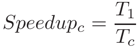
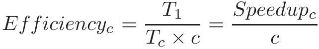
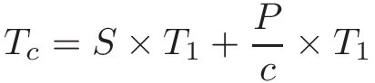
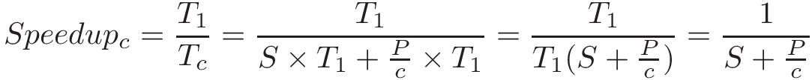

> [!WARNING] 说明
> 本文是个人学习用的**非官方**中英对照译文，原文：<https://diveintosystems.org/book/C14-SharedMemory/performance_basics.html>。
> 原书采用 CC BY-NC-ND 4.0 许可（禁止演绎），**请勿公开传播本译文**。
> 标为「译注」「现代更新」的内容是译者补充，不代表原书作者观点；代码与原文逐字一致，未作改动。


*14.4.1. Parallel Performance Basics*

#### 加速比

*Speedup*

假设一个程序在 *c* 个核心上执行需要 T<sub>*c*</sub> 的时间。那么，这个程序的串行版本需要 T<sub>1</sub> 的时间。

> Suppose that a program takes T<sub>*c*</sub> time to execute on *c* cores. Thus, the serial version of the program would take T<sub>1</sub> time.

于是，程序在 *c* 个核心上的加速比（speedup）由下面的公式表示：

> The speedup of the program on *c* cores is then expressed by the equation:



如果一个串行程序执行需要 60 秒，而它的并行版本在 2 个核心上需要 30 秒，对应的加速比就是 2。同样，如果这个程序在 4 个核心上需要 15 秒，加速比就是 4。在理想情况下，一个在 *n* 个核心上用总共 *n* 个线程运行的程序，加速比为 *n*。

> If a serial program takes 60 seconds to execute, while its parallel version takes 30 seconds on 2 cores, the corresponding speedup is 2. Likewise if that program takes 15 seconds on 4 cores, the speedup is 4. In an ideal scenario, a program running on *n* cores with *n* total threads has a speedup of *n*.

> [!NOTE] 译注
> 上图的公式即：加速比 = T<sub>1</sub> / T<sub>*c*</sub>。

如果程序的加速比大于 1，说明并行化带来了一些改进。如果加速比小于 1，那么并行解法实际上比串行解法还慢。程序的加速比也可能大于 *n*（例如，作为额外的缓存减少了内存访问的副作用）。这种情况称为**超线性加速**（superlinear speedup）。

> If the speedup of a program is greater than 1, it indicates that the parallelization yielded some improvement. If the speedup is less than 1, then the parallel solution is in fact slower than the serial solution. It is possible for a program to have a speedup greater than *n* (for example, as a side effect of additional caches reducing accesses to memory). Such cases are referred to as **superlinear speedup**.

#### 效率

*Efficiency*

加速比没有把核心数考虑进去，它只是串行时间与并行时间之比。例如，如果一个串行程序需要 60 秒，而一个并行程序在四个核心上需要 30 秒，它的加速比仍然是 2。然而，这个指标并没有反映出它是在四个核心上运行的这一事实。

> Speedup doesn’t factor in the number of cores — it is simply the ratio of the serial time to the parallel time. For example, if a serial program takes 60 seconds, but a parallel program takes 30 seconds on four cores, it still gets a speedup of 2. However, that metric doesn’t capture the fact that it ran on four cores.

要度量每个核心的加速比，就用效率（efficiency）：

> To measure the speedup per core, use efficiency:



效率通常在 0 到 1 之间变化。效率为 1 表示核心得到了完美的利用。如果效率接近 0，说明并行几乎没有带来好处，因为额外的核心并没有提高性能。如果效率大于 1，说明出现了超线性加速。

> Efficiency typically varies from 0 to 1. An efficiency of 1 indicates that the cores are being used perfectly. If efficiency is close to 0, then there is little to no benefit to parallelism, as the additional cores do not improve performance. If efficiency is greater than 1, it indicates superlinear speedup.

> [!NOTE] 译注
> 上图的公式即：效率 = 加速比 / *c* = T<sub>1</sub> / (*c* × T<sub>*c*</sub>)。

我们再看前面那个串行程序需要 60 秒的例子。如果并行版本在两个核心上需要 30 秒，那么它的效率是 1（即 100%）。如果程序在四个核心上需要 30 秒，那么效率就降到 0.5（即 50%）。

> Let’s revisit the previous example, in which a serial program takes 60 seconds. If the parallel version takes 30 seconds on two cores, then its efficiency is 1 (or 100%). If instead the program takes 30 seconds on four cores, then the efficiency drops to 0.5 (or 50%).

#### 现实世界中的并行性能

*Parallel Performance in the Real World*

在理想的世界里，加速比是线性的。每增加一个计算单元，并行程序都应该获得相应的加速。然而，这种情形在现实世界中很少出现。大多数程序都包含一个必然串行的部分，它源于代码中固有的依赖关系。程序中最长的依赖链称为它的**关键路径**（critical path）。缩短程序的关键路径，是并行化的重要第一步。线程同步点以及（对于在多个计算节点上运行的程序而言）进程之间的通信开销，是代码中可能限制程序并行性能的其他因素。

> In an ideal world, speedup is linear. For each additional compute unit, a parallel program should achieve a commensurate amount of speedup. However, this scenario rarely occurs in the real world. Most programs contain a necessarily serial component that exists due to inherent dependencies in the code. The longest set of dependencies in a program is referred to as its **critical path**. Reducing the length of a program’s critical path is an important first step in its parallelization. Thread synchronization points and (for programs running on multiple compute nodes) communication overhead between processes are other components in the code that can limit a program’s parallel performance.

> [!WARNING] 原书警示 · 并非所有程序都适合并行化！（Not all programs are good candidates for parallelism!）
> 关键路径的长度可能使某些程序*极难*并行化。举个例子，考虑生成第 *n* 个斐波那契数的问题。由于每个斐波那契数都依赖于它前面的两个数，要高效地并行化这个程序是非常困难的！
>
> > The length of the critical path can make some programs downright *hard* to parallelize. As an example, consider the problem of generating the _n_th Fibonacci number. Since every Fibonacci number is dependent on the two before it, parallelizing this program efficiently is very difficult!

考虑本章前面计数排序算法中 `countElems` 函数的并行化。在理想的世界里，我们会预期程序的加速比随核心数线性增长。然而，我们来测量一下它的运行时间（这里是在一个有八个逻辑线程的四核系统上运行）：

> Consider the parallelization of the `countElems` function of the CountSort algorithm from earlier in this chapter. In an ideal world, we would expect the speedup of the program to be linear with respect to the number of cores. However, let’s measure its runtime (in this case, running on a quad-core system with eight logical threads):

```
$ ./countElems_p_v3 100000000 0 1
Time for Step 1 is 0.331831 s

$ ./countElems_p_v3 100000000 0 2
Time for Step 1 is 0.197245 s

$ ./countElems_p_v3 100000000 0 4
Time for Step 1 is 0.140642 s

$ ./countElems_p_v3 100000000 0 8
Time for Step 1 is 0.107649 s
```

[表 1](14.4.1-performance_basics.html) 展示了这些多线程执行的加速比和效率：

> [Table 1](14.4.1-performance_basics.html) shows the speedup and efficiency for these multithreaded executions:

**表 1.** 性能基准测试

*Table 1. Performance Benchmarks*

| 线程数 | 2 | 4 | 8 |
|---|---|---|---|
| 加速比 | 1.68 | 2.36 | 3.08 |
| 效率 | 0.84 | 0.59 | 0.39 |

> | Number of threads | 2    | 4    | 8    |
> |-------------------|------|------|------|
> | Speedup           | 1.68 | 2.36 | 3.08 |
> | Efficiency        | 0.84 | 0.59 | 0.39 |

两个核心时我们有 84% 的效率，而八个核心时核心效率降到了 39%。注意，没有达到理想的加速比 8。一个原因是，在线程数较多时，给线程分配工作的开销以及对 `counts` 数组的串行更新开始主导性能。第二，八个线程之间的资源争用（记住这是一个四核处理器）降低了核心效率。

> While we have 84% efficiency with two cores, the core efficiency falls to 39% with eight cores. Notice that the ideal speedup of 8 was not met. One reason for this is that the overhead of assigning work to threads and the serial update to the `counts` array starts dominating performance at higher numbers of threads. Second, resource contention by the eight threads (remember this is a quad-core processor) reduces core efficiency.

#### 阿姆达尔定律

*Amdahl’s Law*

1967 年，IBM 的杰出计算机体系结构设计师吉恩·阿姆达尔（Gene Amdahl）预言，计算机程序能够达到的最大加速比受限于其必然串行部分的大小（这一点如今称为阿姆达尔定律，Amdahl's Law）。更一般地说，阿姆达尔定律指出，每个程序都有一个可以加速的部分（即程序中可以被优化或并行化的那部分所占的比例，记为 *P*），以及一个*不能*加速的部分（即程序中固有串行的那部分所占的比例，记为 *S*）。即使执行可优化或可并行化部分 *P* 所需的时间减少到零，串行部分 *S* 仍然存在，并最终会主导性能。由于 *S* 和 *P* 都是比例，注意 *S* + *P* = 1。

> In 1967, Gene Amdahl, a leading computer architect at IBM, predicted that the maximum speedup that a computer program can achieve is limited by the size of its necessarily serial component (now referred to as Amdahl’s Law). More generally, Amdahl’s Law states that for every program, there is a component that can be sped up (i.e., the fraction of a program that can be optimized or parallelized, *P*), and a component that *cannot* be sped up (i.e., the fraction of a program that is inherently serial, or *S*). Even if the time needed to execute the optimizable or parallelizable component *P* is reduced to zero, the serial component *S* will exist, and will come to eventually dominate performance. Since *S* and *P* are fractions, note that *S* + *P* = 1.

考虑一个在一个核心上执行需要 T<sub>1</sub> 时间的程序。那么，程序执行中必然串行的那部分需要 *S* × T<sub>1</sub> 的时间运行，而可并行的那部分（*P* = 1 - *S*）需要 *P* × T<sub>1</sub> 的时间运行。

> Consider a program that executes on one core in time T<sub>1</sub>. Then, the fraction of the program execution that is necessarily serial takes *S* × T<sub>1</sub> time to run, and the parallelizable fraction of program execution (*P* = 1 - *S*) takes *P* × T<sub>1</sub> to run.

当程序在 *c* 个核心上执行时，代码的串行部分仍然需要 *S* × T<sub>1</sub> 的时间运行（其他条件相同），但可并行的部分可以分到 *c* 个核心上。因此，用有 *c* 个核心的并行处理器运行同一个任务，能达到的最大改进是：

> When the program executes on *c* cores, the serial fraction of the code still takes *S* × T<sub>1</sub> time to run (all other conditions being equal), but the parallelizable fraction can be divided into *c* cores. Thus, the maximum improvement for the parallel processor with *c* cores to run the same job is:



随着 *c* 的增大，并行处理器上的执行时间会被程序的串行部分所主导。

> As *c* increases, the execution time on the parallel processor becomes dominated by the serial fraction of the program.

> [!NOTE] 译注
> 上图的公式即：T<sub>*c*</sub> = *S* × T<sub>1</sub> + (*P* × T<sub>1</sub>) / *c*。

为了理解阿姆达尔定律的影响，考虑一个 90% 可并行、在 1 个核心上执行需要 10 秒的程序。在我们的公式中，可并行部分（*P*）是 0.9，串行部分（*S*）是 0.1。[表 2](14.4.1-performance_basics.html) 描绘了根据阿姆达尔定律，在 *c* 个核心上对应的总时间（T<sub>*c*</sub>）以及相应的加速比。

> To understand the impact of Amdahl’s law, consider a program that is 90% parallelizable and executes in 10 seconds on 1 core. In our equation, the parallelizable component (*P*) is 0.9, while the serial component (*S*) is 0.1. [Table 2](14.4.1-performance_basics.html) depicts the corresponding total time on *c* cores (T<sub>*c*</sub>) according to Amdahl’s Law, and the associated speedup.

**表 2.** 阿姆达尔定律对一个 90% 可并行的 10 秒程序的影响

*Table 2. The Effect of Amdahl’s Law on a 10-Second Program that is 90% Parallelizable*

| 核心数 | 串行时间（秒） | 并行时间（秒） | 总时间（T<sub>*c*</sub>，秒） | 加速比（相对于一个核心） |
|----|----|----|----|----|
| 1 | 1 | 9 | 10 | 1 |
| 10 | 1 | 0.9 | 1.9 | 5.26 |
| 100 | 1 | 0.09 | 1.09 | 9.17 |
| 1000 | 1 | 0.009 | 1.009 | 9.91 |

> | Number of cores | Serial time (s) | Parallel time (s) | Total Time (T<sub>*c*</sub> s) | Speedup (over one core) |
> |----|----|----|----|----|
> | 1 | 1 | 9 | 10 | 1 |
> | 10 | 1 | 0.9 | 1.9 | 5.26 |
> | 100 | 1 | 0.09 | 1.09 | 9.17 |
> | 1000 | 1 | 0.009 | 1.009 | 9.91 |

可以看到，随着核心数的增加，程序的串行部分开始占主导地位，再增加越来越多的核心似乎几乎没有任何效果。

> Observe that, over time, the serial component of the program begins to dominate, and the effect of adding more and more cores seems to have little to no effect.

更形式化的分析方法是，把阿姆达尔对 T<sub>*c*</sub> 的计算代入加速比的公式：

> A more formal way to look at this requires incorporating Amdahl’s calculation for T<sub>*c*</sub> into the equation for speedup:



对这个公式取极限可以看出，当核心数（*c*）趋于无穷时，加速比趋近于 1/*S*。在[表 2](14.4.1-performance_basics.html) 所示的例子中，加速比趋近于 1/0.1，即 10。

> Taking the limit of this equation shows that as the number of cores (*c*) approaches infinity, speedup approaches 1/*S*. In the example shown in [Table 2](14.4.1-performance_basics.html), speedup approaches 1/0.1, or 10.

> [!NOTE] 译注
> 上图的公式即：加速比 = T<sub>1</sub> / T<sub>*c*</sub> = 1 / (*S* + *P* / *c*)。当 *c* → ∞ 时，*P* / *c* → 0，所以加速比 → 1/*S*。

再举一个例子，考虑一个 *P* = 0.99 的程序。换句话说，程序的 99% 是可并行的。当 *c* 趋于无穷时，串行时间开始主导性能（在这个例子中，*S* = 0.01）。因此，加速比趋近于 1/0.01，即 100。换句话说，即使有一百万个核心，这个程序能达到的最大加速比也只有 100。

> As another example, consider a program where *P* = 0.99. In other words, 99% of the program is parallelizable. As *c* approaches infinity, the serial time starts to dominate the performance (in this example, *S* = 0.01). Thus, speedup approaches 1/0.01 or 100. In other words, even with a million cores, the maximum speedup achievable by this program is only 100.

> [!NOTE] 原书旁注 · 并非全无希望：阿姆达尔定律的局限（All is not lost: The limits of Amdahl’s Law）
> 在学习阿姆达尔定律时，重要的是要考虑它的提出者吉恩·阿姆达尔的*本意*。用他自己的话说，这个定律的提出是为了论证「*单处理器方法的持续有效性，以及多处理器方法在应用于实际问题及其伴随的不规则性时的弱点*<sup>1</sup>」。在他 1967 年的论文中，阿姆达尔进一步阐述了这个观点，写道：「*十多年来，一些预言家一直声称，单台计算机的组织结构已经达到了极限，只有把多台计算机互连起来、使之能够协作求解，才能取得真正重大的进展<sup>1</sup>。*」
>
> 后来的研究对阿姆达尔所做的一些关键假设提出了挑战。关于阿姆达尔定律的局限，以及关于如何看待并行之好处的另一种论证，请阅读[古斯塔夫森-巴西斯定律](14.4.2-performance_advanced.html)。
>
> > When learning about Amdahl’s Law, it’s important to consider the *intentions* of its originator, Gene Amdahl. In his own words, the law was proposed to demonstrate "*the continued validity of the single processor approach, and the weakness of the multiple processor approach in terms of application to real problems and their attendant irregularities*<sup>1</sup>." In his 1967 paper Amdahl expanded on this concept, writing: "*For over a decade prophets have voiced the contention that the organization of a single computer has reached its limits, and that truly significant advances can be made only by interconnection of a multiplicity of computers in such a manner as to permit cooperative solution<sup>1</sup>.*"
> >
> > Subsequent work challenged some of the key assumptions made by Amdahl. Read about the [Gustafson-Barsis Law](14.4.2-performance_advanced.html) for a discussion on the limits of Amdahl’s Law and a different argument on how to think about the benefits of parallelism.

#### 参考文献

*References*

1.  Gene Amdahl. "Validity of the single processor approach to achieving large scale computing capabilities" *Proceedings of the April 18-20, 1967, Spring Joint Computer Conference*. pp. 483—​485. ACM. 1967.
