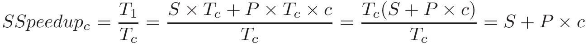

> [!WARNING] 说明
> 本文是个人学习用的**非官方**中英对照译文，原文：<https://diveintosystems.org/book/C14-SharedMemory/performance_advanced.html>。
> 原书采用 CC BY-NC-ND 4.0 许可（禁止演绎），**请勿公开传播本译文**。
> 标为「译注」「现代更新」的内容是译者补充，不代表原书作者观点；代码与原文逐字一致，未作改动。

*14.4.2. Advanced Topics*

#### 古斯塔夫森-巴西斯定律

*Gustafson-Barsis Law*

1988 年，桑迪亚国家实验室的计算机科学家和研究员约翰·L·古斯塔夫森（John L. Gustafson）写了一篇题为《重新评估阿姆达尔定律》（Reevaluating Amdahl's Law1）的论文。在这篇论文中，古斯塔夫森指出了关于并行程序执行的一个关键假设，而这个假设并不总是成立。

> In 1988, John L. Gustafson, a computer scientist and researcher at Sandia National Labs, wrote a paper called "Reevaluating Amdahl’s Law1". In this paper, Gustafson calls to light a critical assumption that was made about the execution of a parallel program that is not always true.

具体来说，阿姆达尔定律隐含了一个前提：计算核心数 *c* 与程序中可并行的比例 *P* 彼此独立。古斯塔夫森指出，这「*几乎从来不是事实*」1。尽管在一组固定的数据上改变核心数来测试程序的性能是一项有用的学术练习，但在现实世界中，人们是随着问题规模变大才增加更多的核心（或者处理器，正如我们在讨论分布式内存时所考察的那样）。古斯塔夫森写道1：「*假定运行时间而不是问题规模保持不变，可能是最符合实际的*。」

> Specifically, Amdahl’s law implies that the number of compute cores *c* and the fraction of a program that is parallelizable *P* are independent of each other. Gustafson notes that this "*is virtually never the case*."1 While benchmarking a program’s performance by varying the number of cores on a fixed set of data is a useful academic exercise, in the real world, more cores (or processors, as examined in our discussion of distributed memory) are added as the problem grows large. "*It may be most realistic*," Gustafson writes1, "*to assume run time, not problem size, is constant*."

因此，按照古斯塔夫森的说法，最准确的说法是：「*可以并行完成的工作量随处理器数线性变化*。」1

> Thus, according to Gustafson, it is most accurate to say that "*The amount of work that can be done in parallel varies linearly with the number of processors*."1

考虑一个*并行*程序，它在有 *c* 个核心的系统上运行需要 T*c* 的时间。设 *S* 表示程序执行中必然串行的那部分所占的比例，它需要 *S* × T*c* 的时间运行。于是，程序执行中可并行的那部分 *P* = 1 - *S*，在 *c* 个核心上需要 *P* × T*c* 的时间运行。

> Consider a *parallel* program that takes time T*c* to run on a system with *c* cores. Let *S* represent the fraction of the program execution that is necessarily serial and takes *S* × T*c* time to run. Thus, the parallelizable fraction of the program execution, *P* = 1 - *S*, takes *P* × T*c* time to run on *c* cores.

当同一个程序只在一个核心上运行时，代码的串行部分仍然需要 *S* × T*c* 的时间（假设其他条件相同）。然而，可并行的部分（原本分给了 *c* 个核心）现在必须由一个核心串行执行，需要 *P* × T*c* × *c* 的时间。换句话说，在单核系统上，并行部分要花 *c* 倍的时间。由此可得，按比例扩展的加速比（scaled speedup）为：

> When the same program is run on just one core, the serial fraction of the code still takes *S* x T*c* (assuming all other conditions are equal). However, the parallelizable fraction (which was divided between *c* cores) now has to be executed by just one core to run serially and takes *P* × T*c* × *c* time. In other words, the parallel component will take *c* times as long on a single-core system. It follows that the scaled speedup would be:

这表明，按比例扩展的加速比随计算单元的数目线性增长。

> This shows that the scaled speedup increases linearly with the number of compute units.

> [!NOTE] 译注
> 上图的公式即：按比例扩展的加速比 = (*S* × T*c* + *P* × T*c* × *c*) / T*c* = *S* + *P* × *c*。

考虑我们之前那个程序的 99% 可并行（即 *P* = 0.99）的例子。应用按比例扩展的加速比公式，在 100 个处理器上的理论加速比将是 99.01。在 1,000 个处理器上，它将是 990.01。注意，效率保持在 *P* 不变。

> Consider our prior example in which 99% of a program is parallelizable (i.e., *P* = 0.99). Applying the scaled speedup equation, the theoretical speedup on 100 processors would be 99.01. On 1,000 processors, it would be 990.01. Notice that the efficiency stays constant at *P*.

正如古斯塔夫森所总结的：「*衡量加速比时，应当让问题规模随处理器数按比例扩展，而不是固定问题规模*。」1 古斯塔夫森的结论之所以引人注目，是因为它表明，通过增加处理器数获得越来越大的加速比是可能的。作为一名在国家超级计算机构工作的研究员，古斯塔夫森更关心的是在固定的时间内完成*更多的工作*。在一些科学领域中，能够分析更多的数据通常会带来更高的精度或保真度。古斯塔夫森的工作表明，在大量处理器上获得很大的加速比是可能的，这重新激起了人们对并行处理的兴趣2。

> As Gustafson concludes, "*speedup should be measured by scaling the problem to the number of processors, not by fixing a problem size*."1 Gustafson’s result is notable because it shows that it is possible to get increasing speedup by updating the number of processors. As a researcher working in a national supercomputing facility, Gustafson was more interested in doing *more work* in a constant amount of time. In several scientific fields, the ability to analyze more data usually leads to higher accuracy or fidelity of results. Gustafson’s work showed that it was possible to get large speedups on large numbers of processors, and revived interest in parallel processing2.

#### 可扩展性

*Scalability*

如果在增加资源（核心、处理器）数量或问题规模时，程序的性能有所提高（或保持不变），我们就说这个程序是**可扩展的**（scalable）。两个相关的概念是**强扩展**（strong scaling）和**弱扩展**（weak scaling）。重要的是要注意，这里的「弱」和「强」并不表示程序可扩展性的*好坏*，而只是衡量可扩展性的不同方式。

> We describe a program as **scalable** if we see improving (or constant) performance as we increase the number of resources (cores, processors) or the problem size. Two related concepts are **strong scaling** and **weak scaling**. It is important to note that "weak" and "strong" in this context do not indicate the *quality* of a program’s scalability, but are simply different ways to measure scalability.

如果在问题规模*固定*的情况下，增加核心/处理单元的数量能提高性能，我们就说这个程序是**强可扩展的**（strongly scalable）。如果程序在 *n* 个核心上运行时加速比也是 *n*，就说它表现出强线性可扩展性。当然，阿姆达尔定律保证了过了某个点之后，再增加核心就没有什么意义了。

> We say that a program is **strongly scalable** if increasing the number of cores/processing units on a *fixed* problem size yields an improvement in performance. A program displays strong linear scalability if, when run on *n* cores, the speedup is also *n*. Of course, Amdahl’s Law guarantees that after some point, adding additional cores makes little sense.

如果以与核心数相同的速率增大数据规模（即每个核心/处理器分到的数据量固定）时，性能保持不变或有所提高，我们就说这个程序是**弱可扩展的**（weakly scalable）。如果每个核心的工作量扩大 *n* 倍时，我们看到 *n* 倍的改进，就说这个程序表现出弱线性可扩展性。

> We say that a program is **weakly scalable** if increasing the size of the data at the same rate as the number of cores (i.e., if there is a fixed data size per core/processor) results in constant or an improvement in performance. We say a program displays weak linear scalability if we see an improvement of *n* if the work per core is scaled up by a factor of *n*.

#### 关于测量性能的一般建议

*General Advice Regarding Measuring Performance*

最后，我们就基准测试以及超线程核心上的性能给出一些说明，结束对性能的讨论。

> We conclude our discussion on performance with some notes about benchmarking and performance on hyperthreaded cores.

- **做基准测试时要多次运行程序。**

  在本书迄今展示的许多例子中，我们只运行一次程序来大致了解它的运行时间。然而，对于正式的基准测试来说，这是不够的。只运行一次程序*绝不*是对程序真实运行时间的准确度量！上下文切换和其他正在运行的进程可能会暂时导致运行时间剧烈波动。因此，最好总是多次运行程序，报告平均运行时间，并给出尽可能多的细节，包括运行次数、观察到的测量波动（例如误差棒、最小值、最大值、中位数、标准差）以及测量时的条件。

> - **Run a program multiple times when benchmarking.**
>
>   In many of the examples shown thus far in this book, we run a program only once to get a sense of its runtime. However, this is not sufficient for formal benchmarks. Running a program once is *never* an accurate measure of a program’s true runtime! Context switches and other running processes can temporarily cause the runtime to radically fluctuate. Therefore, it is always best to run a program several times and report an average runtime together with as many details as feasible, including number of runs, observed variability of the measurements (e.g., error bars, minimum, maximum, median, standard deviation) and conditions under which the measurements were taken.

- **注意在哪里计时。**

  `gettimeofday` 函数有助于准确测量程序运行所用的时间。然而，它也可能被滥用。尽管可能很想只把 `gettimeofday` 调用放在 `main` 中线程创建和合并那部分的周围，但重要的是要想清楚你到底要测量什么。例如，如果程序在执行中必须读入一个外部数据文件，那么读取文件的时间很可能应当计入程序的计时中。

> - **Be careful where you measure timing.**
>
>   The `gettimeofday` function is useful in helping to accurately measure the time a program takes to run. However, it can also be abused. Even though it may be tempting to place the `gettimeofday` call around only the thread creation and joining component in `main`, it is important to consider what exactly you are trying to time. For example, if a program reads in an external data file as a necessary part of its execution, the time for file reading should likely be included in the program’s timing.

- **留意超线程核心的影响。**

  正如[本章引言](14.0-index.html)和[硬件多线程一节](../C5-Arch/5.9-modern.html)所讨论的，超线程（逻辑）核心能够在单个核心上执行多个线程。在一个每个核心有两个逻辑线程的四核系统上，我们说系统上有八个超线程核心。在许多情况下，在八个逻辑核心上并行运行程序，比在四个核心上运行能得到更好的挂钟时间。然而，由于超线程核心通常会发生资源争用，你可能会看到核心效率下降，加速比也不是线性的。

> - **Be aware of the impact of hyperthreaded cores.**
>
>   As discussed in the [introduction to this chapter](14.0-index.html) and [hardware multithreading section](../C5-Arch/5.9-modern.html), hyper-threaded (logical) cores are capable of executing multiple threads on a single core. In a quad-core system with two logical threads per core, we say there are eight hyperthreaded cores on the system. Running a program in parallel on eight logical cores in many cases yields better wall time than running a program on four cores. However, due to the resource contention that usually occurs with hyperthreaded cores, you may see a dip in core efficiency and nonlinear speedup.

> [!NOTE] 译注
> 在 Apple Silicon Mac 这类混合了性能核与能效核的机器上（见本章引言的译注），还要注意线程可能被调度到能效核上运行，这也会让测得的加速比偏离线性。

- **当心资源争用。**

  做基准测试时，始终要考虑系统上还有哪些*其他*进程和多线程应用程序在运行。如果你的性能结果看起来有点奇怪，值得快速运行一下 `top`，看看是否有其他用户也在同一系统上运行资源密集型的任务。如果有，试着换一个系统做基准测试（或者等到系统不那么繁忙时再测）。

> - **Beware of resource contention.**
>
>   When benchmarking, it’s always important to consider what *other* processes and threaded applications are running on the system. If your performance results ever look a bit strange, it is worth quickly running `top` to see whether there are any other users also running resource-intensive tasks on the same system. If so, try using a different system to benchmark (or wait until the system is not so heavily used).

#### 参考文献

*References*

1.  John Gustafson. "Reevaluating Amdahl’s law". *Communications of the ACM* 31(5), pp. 532—​533. ACM. 1988.

2.  Caroline Connor. "Movers and Shakers in HPC: John Gustafson" *HPC Wire*. <http://www.hpcwire.com/hpcwire/2010-10-20/movers_and_shakers_in_hpc_john_gustafson.html>
