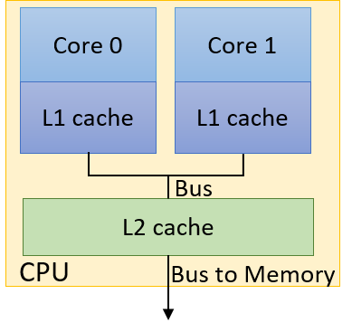
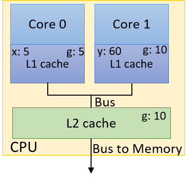

> **说明**
> 本文是个人学习用的**非官方**中英对照译文，原文：<https://diveintosystems.org/book/C14-SharedMemory/cache_coherence.html>。
> 原书采用 CC BY-NC-ND 4.0 许可（禁止演绎），**请勿公开传播本译文**。
> 标为「译注」「现代更新」的内容是译者补充，不代表原书作者观点；代码与原文逐字一致，未作改动。

## 14.5. 缓存一致性与伪共享

*14.5. Cache Coherence and False Sharing*

多核缓存可能对多线程程序的性能产生深远的影响。不过，我们先快速回顾一下[与缓存设计有关的一些基本概念](../C11-MemHierarchy/11.4-caching.html)：

> Multicore caches can have profound implications on a multithreaded program’s performance. First, however, let’s quickly review some of the [basic concepts related to cache design](../C11-MemHierarchy/11.4-caching.html):

- 数据/指令不是*单个*地传送到缓存中的，而是以*块*为单位传送，并且在存储器层次结构中越往下，块往往越大。

> - Data/instructions are not transported *individually* to the cache. Instead, data is transferred in *blocks*, and block sizes tend to get larger at lower levels of the memory hierarchy.

- 每个缓存被组织成一系列组，每个组有若干行。每一行存放一个数据块。

> - Each cache is organized into a series of sets, with each set having a number of lines. Each line holds a single block of data.

- 内存地址的各个位用来确定一个数据块要写入缓存的哪个组、标记是什么以及块内偏移是多少。

> - The individual bits of a memory address are used to determine which set, tag, and block offset of the cache to which to write a block of data.

- 当所需的数据块存在于缓存中时，发生**缓存命中**（cache hit）。否则，发生**缓存未命中**（cache miss），并在存储器层次结构的下一层（可能是缓存，也可能是主存）进行查找。

> - A **cache hit** occurs when the desired data block exists in the cache. Otherwise, a **cache miss** occurs, and a lookup is performed on the next lower level of the memory hierarchy (which can be cache or main memory).

- **有效位**（valid bit）表示缓存中某一行的块是否可以安全使用。如果有效位为 0，该行的数据块就不能使用（例如，这个块可能包含来自一个已退出进程的数据）。

> - The **valid bit** indicates if a block at a particular line in the cache is safe to use. If the valid bit is set to 0, the data block at that line cannot be used (e.g., the block could contain data from an exited process).

- 信息写入缓存/内存主要有两种策略。在**写直达**（write-through）策略中，数据同时写入缓存和主存。在**写回**（write-back）策略中，数据只写入缓存，在块被驱逐出缓存之后才写到层次结构的较低层。

> - Information is written to cache/memory based on two main strategies. In the **write-through** strategy, the data is written to cache and main memory simultaneously. In the **write-back** strategy, data is written only to cache and gets written to lower levels in the hierarchy after the block is evicted from the cache.

### 14.5.1. 多核系统上的缓存

*14.5.1. Caches on Multicore Systems*

[回想一下](../C11-MemHierarchy/11.6-coherency.html)，在共享内存体系结构中，每个核心可以有自己的缓存，多个核心也可以共享一个公共的缓存。[图 1](14.5-cache_coherence.html) 描绘了一个双核 CPU 的例子。尽管每个核心都有自己的本地 L1 缓存，但两个核心共享一个公共的 L2 缓存。

> [Recall](../C11-MemHierarchy/11.6-coherency.html) that, in shared memory architectures, each core can have its own cache and that multiple cores can share a common cache. [Figure 1](14.5-cache_coherence.html) depicts an example dual-core CPU. Even though each core has its own local L1 cache, the cores share a common L2 cache.



**图 1.** 一个有独立 L1 缓存和共享 L2 缓存的双核 CPU 示例

*Figure 1. An example dual-core CPU with separate L1 caches and a shared L2 cache*

单个可执行文件中的多个线程可能执行不同的函数。如果没有[**缓存一致性**策略](../C11-MemHierarchy/11.6-coherency.html)来确保每个缓存都维持一致的共享内存视图，共享变量就可能被不一致地更新。举个例子，考虑[图 1](14.5-cache_coherence.html) 中的双核处理器，其中每个核心都在忙于并发地执行不同的线程。分配给核心 0 的线程有一个局部变量 `x`，在核心 1 上执行的线程有一个局部变量 `y`，两个线程都可以访问共享的全局变量 `g`。[表 1](14.5-cache_coherence.html) 展示了一条可能的执行路径。

> Multiple threads in a single executable may execute separate functions. Without a [**cache coherence** strategy](../C11-MemHierarchy/11.6-coherency.html) to ensure that each cache maintains a consistent view of shared memory, it is possible for shared variables to be updated inconsistently. As an example, consider the dual-core processor in [Figure 1](14.5-cache_coherence.html), where each core is busy executing separate threads concurrently. The thread assigned to Core 0 has a local variable `x`, whereas the thread executing on Core 1 has a local variable `y`, and both threads have shared access to a global variable `g`. [Table 1](14.5-cache_coherence.html) shows one possible path of execution.

**表 1.** 缓存导致的有问题的数据共享

*Table 1. Problematic Data Sharing Due to Caching*

| 时间 | 核心 0 | 核心 1 |
|---|---|---|
| 0 | g = 5 | （其他工作） |
| 1 | （其他工作） | y = g\*4 |
| 2 | x += g | y += g\*2 |

> | Time | Core 0       | Core 1       |
> |------|--------------|--------------|
> | 0    | g = 5        | (other work) |
> | 1    | (other work) | y = g\*4     |
> | 2    | x += g       | y += g\*2    |

假设 `g` 的初值是 10，`x` 和 `y` 的初值都是 0。在这一串操作结束时，`y` 的最终值是多少？如果没有缓存一致性，这个问题就很难回答，因为 `g` 至少有三个存储着的值：一个在核心 0 的 L1 缓存中，一个在核心 1 的 L1 缓存中，还有一个单独的 `g` 副本存放在共享的 L2 缓存中。

> Suppose that the initial value of `g` is 10, and the initial values of `x` and `y` are both 0. What is the final value of `y` at the end of this sequence of operations? Without cache coherence, this is a very difficult question to answer, given that there are at least three stored values of `g`: one in Core 0’s L1 cache, one in Core 1’s L1 cache, and a separate copy of `g` stored in the shared L2 cache.



**图 2.** 对不采用缓存一致性的缓存进行的一次有问题的更新

*Figure 2. A problematic update to caches that do not employ cache coherency*

[图 2](14.5-cache_coherence.html) 展示了[表 1](14.5-cache_coherence.html) 中的操作序列完成后一种可能的错误结果。假设 L1 缓存实现的是写回策略。当在核心 0 上执行的线程把值 5 写入 `g` 时，它只更新了核心 0 的 L1 缓存中 `g` 的值。核心 1 的 L1 缓存中 `g` 的值仍然是 10，共享 L2 缓存中的副本也是如此。即使实现的是写直达策略，也不能保证存放在核心 1 的 L1 缓存中的 `g` 副本会被更新！在这种情况下，`y` 的最终值将是 `60`。

> [Figure 2](14.5-cache_coherence.html) shows one possible erroneous result after the sequence of operations in [Table 1](14.5-cache_coherence.html) completes. Suppose that the L1 caches implement a write-back policy. When the thread executing on Core 0 writes the value 5 to `g`, it updates only the value of `g` in Core 0’s L1 cache. The value of `g` in Core 1’s L1 cache still remains 10, as does the copy in the shared L2 cache. Even if a write-through policy is implemented, there is no guarantee that the copy of `g` stored in Core 1’s L1 cache gets updated! In this case, `y` will have the final value of `60`.

缓存一致性策略在一个缓存中对共享数据值进行写操作时，使其他缓存中该共享值的缓存副本失效或得到更新。[已修改-共享-无效（MSI）](../C11-MemHierarchy/11.6-coherency.html)协议（在[第 11.6 节](../C11-MemHierarchy/11.6-coherency.html)中有详细讨论）是失效型缓存一致性协议的一个例子。

> A cache coherence strategy invalidates or updates cached copies of shared values in other caches when a write to the shared data value is made in one cache. The [Modified Shared Invalid (MSI)](../C11-MemHierarchy/11.6-coherency.html) protocol (discussed in detail in [Chapter 11.6](../C11-MemHierarchy/11.6-coherency.html)) is one example of an invalidating cache coherency protocol.

实现 MSI 的一种常见技术是监听。这样的**监听式缓存**（snoopy cache）在内存总线上「监听」可能的写信号。如果监听式缓存检测到对一个共享缓存块的写操作，它就使包含该缓存块的那一行失效。最终结果是，该块唯一有效的版本在被写入的那个缓存中，而其他缓存中该块的*所有其他*副本都被标记为无效。

> A common technnique for implementing MSI is snooping. Such a **snoopy cache** "snoops" on the memory bus for possible write signals. If the snoopy cache detects a write to a shared cache block, it invalidates its line containing that cache block. The end result is that the only valid version of the block is in the cache that is written to, whereas *all other* copies of the block in other caches are marked as invalid.

在前面的例子中，采用带监听的 MSI 协议，会让变量 `y` 得到正确的最终值 `30`。

> Employing the MSI protocol with snoooping would yield the correct final assignment of `30` to variable `y` in the previous example.

### 14.5.2. 伪共享

*14.5.2. False Sharing*

缓存一致性保证了正确性，但它可能会损害性能。回想一下，当线程在核心 0 上更新 `g` 时，监听式缓存使之失效的不仅是 `g`，而是 `g` 所在的*整个缓存行*。

> Cache coherence guarantees correctness, but it can potentially harm performance. Recall that when the thread updates `g` on Core 0, the snoopy cache invalidates not only `g`, but the *entire cache line* that `g` is a part of.

考虑我们并行化计数排序算法中 `countElems` 函数的[初次尝试](https://diveintosystems.org/book/C14-SharedMemory/_attachments/countElems_p.c)。为方便起见，这里再把函数列出来：

> Consider our [initial attempt](https://diveintosystems.org/book/C14-SharedMemory/_attachments/countElems_p.c) at parallelizing the `countElems` function of the CountSort algorithm. For convenience, the function is reproduced here:

```
/*parallel version of step 1 (first cut) of CountSort algorithm:
 * extracts arguments from args value
 * calculates portion of the array this thread is responsible for counting
 * computes the frequency of all the elements in assigned component and stores
 * the associated counts of each element in counts array
*/
void *countElems(void *args){
    //extract arguments
    //ommitted for brevity
    int *array = myargs->ap;
    long *counts = myargs->countp;

    //assign work to the thread
    //compute chunk, start, and end
    //ommited for brevity

    long i;
    //heart of the program
    for (i = start; i < end; i++){
        val = array[i];
        counts[val] = counts[val] + 1;
    }

    return NULL;
}
```

在[之前](14.3-synchronization.html)对这个函数的讨论中，我们指出了数据竞争会导致 `counts` 数组填入的计数不正确。我们来看看，如果对这个函数*计时*会发生什么。我们按照与 [countElems_p_v3.c](https://diveintosystems.org/book/C14-SharedMemory/_attachments/countElems_p_v3.c) 中完全相同的方式，用 `getimeofday` 在 `main` 中加入计时代码。在 1 亿个元素上对刚才列出的 `countElems` 初始版本进行基准测试，得到下面的时间：

> In our [previous discussion](14.3-synchronization.html) of this function, we pointed out how data races can cause the `counts` array to not populate with the correct set of counts. Let’s see what happens if we attempt to *time* this function. We add timing code to `main` using `getimeofday` in the exact manner as shown in [countElems_p_v3.c](https://diveintosystems.org/book/C14-SharedMemory/_attachments/countElems_p_v3.c). Benchmarking the initial version of `countElems` as just shown on 100 million elements yields the following times:

```
$ ./countElems_p 100000000 0 1
Time for Step 1 is 0.336239 s

$ ./countElems_p 100000000 0 2
Time for Step 1 is 0.799464 s

$ ./countElems_p 100000000 0 4
Time for Step 1 is 0.767003 s
```

即使没有任何同步结构，这个版本的程序*仍然*随着线程数的增加而*变慢*！

> Even without any synchronization constructs, this version of the program *still gets slower* as the number of threads increases!

为了弄清发生了什么，我们再来看 `counts` 数组。`counts` 数组存放输入数组中每个数出现的频次。最大值由变量 `MAX` 决定。在我们的示例程序中，`MAX` 被设为 10。换句话说，`counts` 数组占用 40 字节的空间。

> To understand what is going on, let’s revisit the `counts` array. The `counts` array holds the frequency of occurrence of each number in our input array. The maximum value is determined by the variable `MAX`. In our example program, `MAX` is set to 10. In other words, the `counts` array takes up 40 bytes of space.

回想一下，Linux 系统上的[缓存细节](../C11-MemHierarchy/11.6-coherency.html)位于 `/sys/devices/system/cpu/` 目录中。每个逻辑核心都有自己的 cpu 子目录，名为 `cpuk`，其中 `k` 表示第 *k* 个逻辑核心。每个 `cpu` 子目录中又有若干个单独的 `index` 目录，表示该核心可用的缓存。

> Recall that the [cache details](../C11-MemHierarchy/11.6-coherency.html) on a Linux system are located in the `/sys/devices/system/cpu/` directory. Each logical core has its own cpu subdirectory called `cpuk` where `k` indicates the *kth* logical core. Each `cpu` subdirectory in turn has separate `index` directories that indicate the caches available to that core.

`index` 目录中的文件包含关于每个逻辑核心的缓存的大量细节。下面展示了一个 `index0` 目录示例的内容（`index0` 通常对应于 Linux 系统的 L1 缓存）：

> The `index` directories contain files with numerous details about each logical core’s caches. The contents of a sample `index0` directory are shown here (`index0` typically corresponds to a Linux system’s L1 cache):

```
$ ls /sys/devices/system/cpu/cpu0/cache/index0
coherency_line_size      power            type
level                    shared_cpu_list  uevent
number_of_sets           shared_cpu_map   ways_of_associativity
physical_line_partition  size
```

要查出 L1 缓存的缓存行大小，使用这条命令：

> To discover the cache line size of the L1 cache, use this command:

```
$ cat /sys/devices/system/cpu/cpu0/cache/index0/coherency_line_size
64
```

输出表明，这台机器的 L1 缓存行大小是 64 字节。换句话说，40 字节的 `counts` 数组*可以放在一个缓存行之内*。

> The output reveals that L1 cache line size for the machine is 64 bytes. In other words, the 40-byte `counts` array fits *within one cache line*.

> **译注**
> 缓存行大小因机器而异。在 Apple Silicon Mac 上没有 `/sys` 目录，可以用 `sysctl hw.cachelinesize` 查询；译者在 M1 Pro 上得到的是 128 字节（见第 11 章的译注），伪共享的范围相应更大。

回想一下，使用 MSI 这样的失效型缓存一致性协议时，程序每次更新一个共享变量，*其他缓存中存放该变量的整个缓存行都会失效*。我们来考虑两个线程执行前面这个函数时会发生什么。[表 2](14.5-cache_coherence.html) 展示了一条可能的执行路径（假设每个线程被分配到不同的核心上，并且变量 `x` 是每个线程局部的）。

> Recall that with invalidating cache coherence protocols like MSI, every time a program updates a shared variable, the *entire cache line in other caches storing the variable is invalidated*. Let’s consider what happens when two threads execute the preceding function. One possible path of execution is shown in [Table 2](14.5-cache_coherence.html) (assuming that each thread is assigned to a separate core, and the variable `x` is local to each thread).

**表 2.** 两个线程运行 `countElems` 的一种可能的执行序列

*Table 2. A Possible Execution Sequence of Two Threads Running `countElems`*

| 时间 | 线程 0 | 线程 1 |
|----|----|----|
| *i* | 读取 array[x]（1） | …​ |
| *i+1* | 增加 counts[1]（**使缓存行失效**） | 读取 array[x]（4） |
| *i+2* | 读取 array[x]（6） | 增加 counts[4]（**使缓存行失效**） |
| *i+3* | 增加 counts[6]（**使缓存行失效**） | 读取 array[x]（2） |
| *i+4* | 读取 array[x]（3） | 增加 counts[2]（**使缓存行失效**） |
| *i+5* | 增加 counts[3]（**使缓存行失效**） | …​ |

> | Time | Thread 0 | Thread 1 |
> |----|----|----|
> | *i* | Reads array[x] (1) | …​ |
> | *i+1* | Increments counts[1] (**invalidates cache line**) | Reads array[x] (4) |
> | *i+2* | Reads array[x] (6) | Increments counts[4] (**invalidates cache line**) |
> | *i+3* | Increments counts[6] (**invalidates cache line**) | Reads array[x] (2) |
> | *i+4* | Reads array[x] (3) | Increments counts[2] (**invalidates cache line**) |
> | *i+5* | Increments counts[3] (**invalidates cache line**) | …​ |

- 在时间步 *i*，线程 0 读取它那部分数组中 `array[x]` 的值，在这个例子中是 1。

> - During time step *i*, Thread 0 reads the value at `array[x]` in its part of the array, which is a 1 in this example.

- 在时间步 *i + 1* 到 *i + 5*，每个线程都从 `array[x]` 读取一个值。注意，每个线程查看的是数组的不同部分。不仅如此，在我们的示例执行中，每次读取 `array` 得到的值都各不相同（所以在这个示例执行序列中没有竞态条件！）。从 `array[x]` 读到值之后，每个线程把 `counts` 中相应的值加一。

> - During time steps *i + 1* to *i + 5*, each thread reads a value from `array[x]`. Note that each thread is looking at different components of the array. Not only that, each read of `array` in our sample execution yields unique values (so no race conditions in this sample execution sequence!). After reading the value from `array[x]`, each thread increments the associated value in `counts`.

- 回想一下，`counts` 数组*可以放在我们 L1 缓存中的一个缓存行上*。因此，每次写 `counts` 都会使*其他每个 L1 缓存*中的*整行*失效。

> - Recall that the `counts` array *fits on a single cache line* in our L1 cache. As a result, every write to `counts` invalidates the *entire line* in *every other L1 cache*.

- 最终结果是，尽管更新的是 `counts` 中*不同的*内存位置，但每次更新 `counts`，任何包含 `counts` 的缓存行都会*失效*！

> - The end result is that, despite updating *different* memory locations in `counts`, any cache line containing `counts` is *invalidated* with *every update* to `counts`!

失效迫使所有 L1 缓存从 L2 中取得该行的「有效」版本来更新。L1 缓存中的行被反复失效和覆盖，这是**抖动**（thrashing）的一个例子，即缓存中反复发生冲突，导致一连串的未命中。

> The invalidation forces all L1 caches to update the line with a "valid" version from L2. The repeated invalidation and overwriting of lines from the L1 cache is an example of **thrashing**, where repeated conflicts in the cache cause a series of misses.

加入更多的核心会让问题更加严重，因为现在有更多的 L1 缓存在使该行失效。因此，尽管每个线程访问的是 `counts` 数组中不同的元素，增加线程反而拖慢了运行时间！这就是**伪共享**（false sharing）的一个例子，即一种多个核心在共享各个元素的假象。在前面的例子中，看起来所有核心都在访问 `counts` 中相同的元素，尽管事实并非如此。

> The addition of more cores makes the problem worse, given that now more L1 caches are invalidating the line. As a result, adding additional threads slows down the runtime, despite the fact that each thread is accessing different elements of the `counts` array! This is an example of **false sharing**, or the illusion that individual elements are being shared by multiple cores. In the previous example, it appears that all the cores are accessing the same elements of `counts`, even though this is not the case.

### 14.5.3. 修正伪共享

*14.5.3. Fixing False Sharing*

修正伪共享的一种方法，是给数组（在我们的例子中是 `counts`）填充额外的元素，使它不能放在单个缓存行中。然而，填充会浪费内存，而且可能无法在所有体系结构上都消除这个问题（考虑两台不同的机器 L1 缓存大小不同的情形）。在大多数情况下，为了支持不同的缓存大小而编写代码，通常不值得为此付出性能上的收益。

> One way to fix an instance of false sharing is to pad the array (in our case `counts`) with additional elements so that it doesn’t fit in a single cache line. However, padding can waste memory, and may not eliminate the problem from all architectures (consider the scenario in which two different machines have different L1 cache sizes). In most cases, writing code to support different cache sizes is generally not worth the gain in performance.

更好的解决办法是尽可能让线程写*局部存储*。这里的局部存储指的是对一个线程来说是*局部的*内存。下面的解决方案通过选择对局部声明的 `counts` 版本 `local_counts` 进行更新，减少了伪共享。

> A better solution is to have threads write to *local storage* whenever possible. Local storage in this context refers to memory that is *local* to a thread. The following solution reduces false sharing by choosing to perform updates to a locally declared version of `counts` called `local_counts`.

我们再来看 `countElems` 函数的最终版本（转引自 [countElems_p_v3.c](https://diveintosystems.org/book/C14-SharedMemory/_attachments/countElems_p_v3.c)）：

> Let’s revisit the final version of our `countElems` function (reproduced from [countElems_p_v3.c](https://diveintosystems.org/book/C14-SharedMemory/_attachments/countElems_p_v3.c)):

```
/*parallel version of CountSort algorithm step 1 (final attempt with mutexes):
 * extracts arguments from args value
 * calculates the portion of the array this thread is responsible for counting
 * computes the frequency of all the elements in assigned component and stores
 * the associated counts of each element in counts array
*/
void *countElems( void *args ){
    //extract arguments
    //omitted for brevity
    int *array = myargs->ap;
    long *counts = myargs->countp;

    long local_counts[MAX] = {0}; //local declaration of counts array

    //assign work to the thread
    //compute chunk, start, and end values (omitted for brevity)

    long i;

    //heart of the program
    for (i = start; i < end; i++){
        val = array[i];
        local_counts[val] = local_counts[val] + 1; //update local counts array
    }

    //update to global counts array
    pthread_mutex_lock(&mutex); //acquire the mutex lock
    for (i = 0; i < MAX; i++){
        counts[i] += local_counts[i];
    }
    pthread_mutex_unlock(&mutex); //release the mutex lock

    return NULL;
}
```

在这个例子中，使用 `local_counts` 代替 `counts` 来累计频次，是减少伪共享的主要原因：

> The use of `local_counts` to accumulate frequencies in lieu of `counts` is the major source of reduction of false sharing in this example:

```
for (i = start; i < end; i++){
    val = array[i];
    local_counts[val] = local_counts[val] + 1; //updates local counts array
}
```

由于缓存一致性的目的是维持共享内存的一致视图，所以只有对内存中*共享值*的*写*操作才会触发失效。由于 `local_counts` 不在不同线程之间共享，写它不会使它所在的缓存行失效。

> Since cache coherence is meant to maintain a consistent view of shared memory, the invalidations trigger only on *writes* to *shared values* in memory. Since `local_counts` is not shared among the different threads, a write to it will not invalidate its associated cache line.

在代码的最后一部分，互斥锁确保一次只有一个线程更新共享的 `counts` 数组，从而保证了正确性：

> In the last component of the code, the mutex enforces correctness by ensuring that only one thread updates the shared `counts` array at a time:

```
//update to global counts array
pthread_mutex_lock(&mutex); //acquire the mutex lock
for (i = 0; i < MAX; i++){
    counts[i] += local_counts[i];
}
pthread_mutex_unlock(&mutex); //release the mutex lock
```

由于 `counts` 位于单个缓存行上，每次写它时它仍然会失效。不同之处在于，这里的代价最多是 `MAX` × *t* 次写操作，而不是 *n* 次写操作，其中 *n* 是输入数组的长度，*t* 是使用的线程数。

> Since `counts` is located on a single cache line, it will still get invalidated with every write. The difference is that the penalty here is at most `MAX` × *t* writes vs. *n* writes, where *n* is the length of our input array, and *t* is the number of threads employed.
