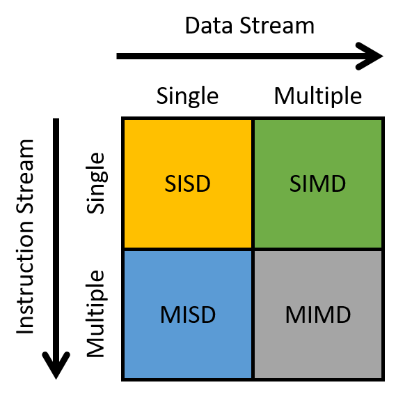

> **说明**
> 本文是个人学习用的**非官方**中英对照译文，原文：<https://diveintosystems.org/book/C15-Parallel/index.html>。
> 原书采用 CC BY-NC-ND 4.0 许可（禁止演绎），**请勿公开传播本译文**。
> 标为「译注」「现代更新」的内容是译者补充，不代表原书作者观点；代码与原文逐字一致，未作改动。

## 15. 展望：其他并行系统与并行编程模型

*15. Looking Ahead: Other Parallel Systems and Parallel Programming Models*

在[上一章](../C14-SharedMemory/14.0-index.html)中，我们讨论了共享内存并行与多线程编程。本章将介绍面向不同类别体系结构的其他并行编程模型与语言。具体来说：以 CUDA 为例，介绍面向硬件加速器的并行，重点是图形处理器（GPU）以及在 GPU 上进行的通用计算（GPGPU 计算）；以 MPI 为例，介绍分布式内存系统与消息传递；以 MapReduce 和 Apache Spark 为例，介绍云计算。

> In the [previous chapter](../C14-SharedMemory/14.0-index.html), we discussed shared memory parallelism and multithreaded programming. In this chapter, we introduce other parallel programming models and languages for different classes of architecture. Namely, we introduce parallelism for hardware accelerators focusing on graphics processing units (GPUs) and general-purpose computing on GPUs (GPGPU computing), using CUDA as an example; distributed memory systems and message passing, using MPI as an example; and cloud computing, using MapReduce and Apache Spark as examples.

### 全新的世界：弗林体系结构分类法

*A Whole New World: Flynn’s Taxonomy of Architecture*

**弗林分类法**（Flynn's taxonomy）常被用来描述现代计算体系结构的整体版图（[图 1](15.0-index.html)）。

> **Flynn’s taxonomy** is commonly used to describe the ecosystem of modern computing architecture ([Figure 1](15.0-index.html)).

> **译注**
> 该分类由 Michael J. Flynn 于 1966 年提出（1972 年的论文做了扩展）。它只看"指令流"和"数据流"各是一条还是多条，不涉及内存组织方式；所以后面 15.2 节还要再引入"共享内存 vs. 分布式内存"这条正交的维度。

**图 1.** 弗林分类法根据处理器执行指令的方式对其进行分类。

*Figure 1. Flynn’s taxonomy classifies the ways in which a processor applies instructions.*

> **译注 · 图中标签**
> 横轴 Data Stream＝数据流，纵轴 Instruction Stream＝指令流；Single＝单，Multiple＝多。四格依次为 SISD（单指令单数据）、SIMD（单指令多数据）、MISD（多指令单数据）、MIMD（多指令多数据）。

横轴表示数据流，纵轴表示指令流。这里的**流**（stream）指的是数据或指令的流动。**单一流**每个时间单位发出一个元素，类似于一个队列；相比之下，**多重流**通常每个时间单位发出多个元素（可以想象成多个队列）。因此，单指令流（SI）每个时间单位发出一条指令，而多指令流（MI）每个时间单位发出多条指令。同样，单数据流（SD）每个时间单位发出一个数据元素，而多数据流（MD）每个时间单位发出多个数据元素。

> The horizontal axis refers to the data stream, whereas the vertical axis refers to the instruction stream. A **stream** in this context is a flow of data or instructions. A **single stream** issues one element per time unit, similar to a queue. In contrast, **multiple streams** typically issue many elements per time unit (think of multiple queues). Thus, a single instruction stream (SI) issues a single instruction per time unit, whereas a multiple instruction stream (MI) issues many instructions per time unit. Likewise, a single data stream (SD) issues one data element per time unit, whereas a multiple data stream (MD) issues many data elements per time unit.

根据所使用的流的类型，处理器可以归入以下四类之一：

> A processor can be classified into one of four categories based on the types of streams it employs:

- **SISD**：单指令流/单数据流系统只有一个控制单元，处理单一的指令流，因此一次只能执行一条指令。同样，处理器也只能处理单一的数据流，即一次处理一个数据单元。2000 年代中期以前，大多数商用处理器都是 SISD 机器。

> - **SISD**: Single instruction/single data systems have a single control unit processing a single stream of instructions, allowing it to execute only one instruction at a time. Likewise, the processor can process only a single stream of data or process one data unit at a time. Most commercially available processors prior to the mid-2000s were SISD machines.

> **译注**
> 严格来说，2000 年代中期以前的商用 CPU 也并非"纯" SISD：x86 早在 1997 年就有了 MMX、1999 年有了 SSE 这类 SIMD 扩展指令。这里的"SISD"应理解为"单核、单指令流"。另外，单核时代的性能提升主要来自流水线、超标量、乱序执行等**指令级并行**（ILP），这些对程序员是透明的；而本章讨论的都是需要程序员显式表达的并行。

- **MISD**：多指令流/单数据流系统由多个指令单元作用于同一条数据流。MISD 系统通常用于为关键任务系统提供容错能力，例如 NASA 航天飞机的飞行控制程序。话虽如此，MISD 机器如今在实践中已很少使用。

> - **MISD**: Multiple instruction/single data systems have multiple instruction units performing on a single data stream. MISD systems were typically designed for incorporating fault tolerance in mission-critical systems, such as the flight control programs for NASA shuttles. That said, MISD machines are rarely used in practice anymore.

> **译注**
> 航天飞机的例子是"多台计算机用同样的输入各自计算、再投票表决"的冗余设计。也有教材把**脉动阵列**（systolic array，如 Google TPU 的矩阵乘法单元：同一份数据在一串处理单元之间逐级流动、被多个单元依次使用）归为类 MISD 结构，但这种归类有争议（每个单元执行的其实是同样的乘加运算），了解即可。

- **SIMD**：单指令流/多数据流系统以"锁步"（lockstep）方式，同时在多个数据上执行*同一条*指令。在"锁步"执行过程中，所有指令被放入一个队列，而数据被分发到不同的计算单元。执行时，每个计算单元同时执行队列中的第一条指令，然后再同时执行队列中的下一条指令，依此类推。SIMD 体系结构最著名的例子是图形处理器（GPU）。早期的超级计算机也采用 SIMD 体系结构。我们将在[下一节](15.1-gpu.html)进一步讨论 GPU。

> - **SIMD**: Single instruction/multiple data systems execute the *same* instruction on multiple data simultaneously and in lockstep fashion. During "lockstep" execution, all instructions are placed into a queue, while data is distributed among different compute units. During execution, each compute unit executes the first instruction in the queue simultaneously, before simultaneously executing the next instruction in the queue, and then the next, and so forth. The most well-known example of the SIMD architecture is the graphics processing unit. Early supercomputers also followed the SIMD architecture. We discuss GPUs more in the [next section](15.1-gpu.html).

> **译注**
> 今天最常见的 SIMD 其实就在你的 CPU 核内部：x86 的 SSE/AVX/AVX-512，Arm 的 NEON/SVE，RISC-V 的 V 扩展（RVV），一条指令同时处理一个向量寄存器里的多个元素。编译器的"自动向量化"就是把普通循环翻译成这类指令。GPU 严格说是 SIMT（下一节会讲），它是 SIMD 的变体。"早期超级计算机"指 ILLIAC IV、Thinking Machines CM-1/CM-2 这类阵列处理机，以及 Cray-1 这类向量机。

- **MIMD**：多指令流/多数据流系统是使用最广泛的体系结构类别。它们极其灵活，能够同时处理多条指令流或多条数据流。由于几乎所有现代计算机都使用多核 CPU，大多数计算机都属于 MIMD 机器。我们将在 [15.2 节](15.2-distrmem.html)中讨论另一类 MIMD 系统——分布式内存系统。

> - **MIMD**: Multiple instruction/multiple data systems represent the most widely used architecture class. They are extremely flexible and have the ability to work on multiple instructions or multiple data streams. Since nearly all modern computers use multicore CPUs, most are classified as MIMD machines. We discuss another class of MIMD systems, distributed memory systems, in [Section 15.2](15.2-distrmem.html).

> **译注**
> 现代机器往往是"多层嵌套"的：一台服务器在多个核之间是 MIMD，每个核内部的向量单元是 SIMD，插在上面的 GPU 是 SIMT，多台服务器组成集群又是分布式内存的 MIMD。还有一个常用的编程层面的说法：**SPMD**（单程序多数据）——所有进程/线程运行同一份程序、处理不同数据，CUDA 核函数和 MPI 程序基本都是这种写法（见 15.1、15.2 节）。

> **现代更新（截至 2026-11） · SIMD、加速器与矩阵单元**
> - **CPU 内的 SIMD 仍在演进**：Intel 于 2023 年提出 AVX10（融合向量指令集），让未来所有 Intel 处理器支持同一套以 AVX-512 为基础的向量指令；2025 年 3 月的 3.0 版文档删去了早期"最大 256 位"的限制表述。[Intel AVX10 技术文档](https://cdrdv2-public.intel.com/849709/356368-003-intel-avx10-technical-paper.pdf)
> - **异构已成主流**：2026 年 6 月 TOP500 中，500 台超算有 276 台使用加速器（107 台 NVIDIA Hopper、62 台 Ampere、32 台 AMD Instinct）。[TOP500 2026-06](https://top500.org/lists/top500/2026/06/highs/)
> - **GPU 里的矩阵单元**：H100 每个 SM 有 4 个第四代 Tensor Core，一条指令完成一小块矩阵乘加，可看作 SIMD 在矩阵维度上的延伸。[NVIDIA Hopper 架构详解](https://developer.nvidia.com/blog/nvidia-hopper-architecture-in-depth/)
