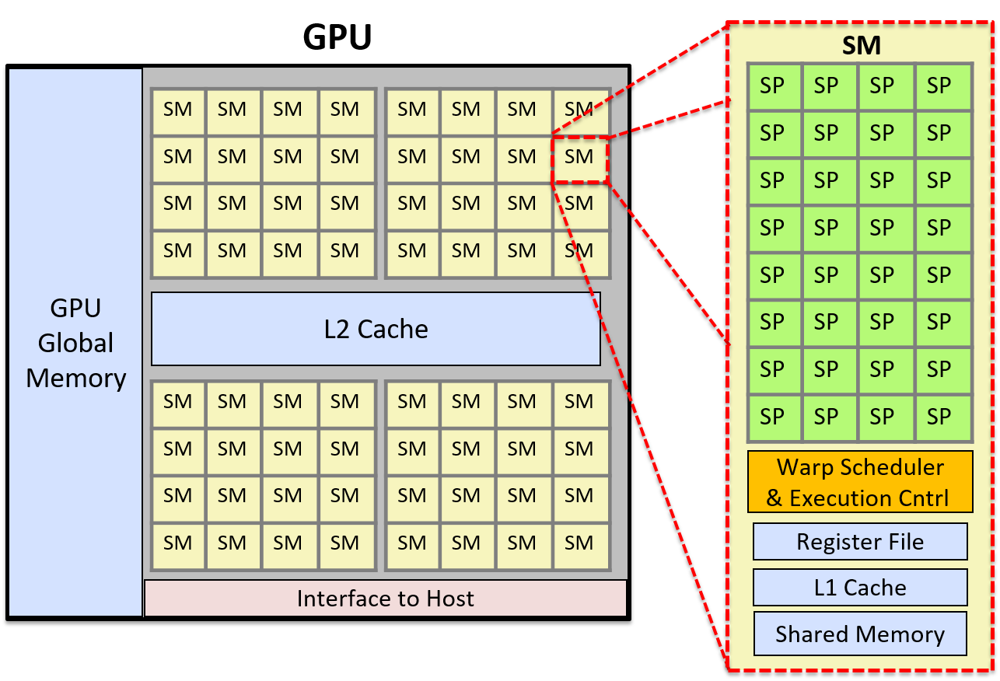
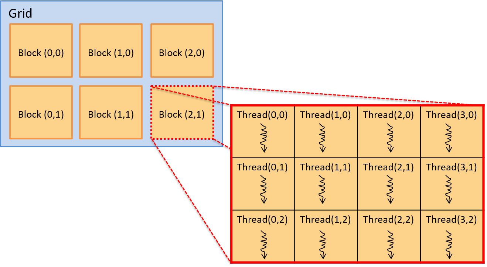

> [!WARNING] 说明
> 本文是个人学习用的**非官方**中英对照译文，原文：<https://diveintosystems.org/book/C15-Parallel/gpu.html>。
> 原书采用 CC BY-NC-ND 4.0 许可（禁止演绎），**请勿公开传播本译文**。
> 标为「译注」「现代更新」的内容是译者补充，不代表原书作者观点；代码与原文逐字一致，未作改动。


*15.1. Heterogeneous Computing: Hardware Accelerators, GPGPU Computing, and CUDA*

**异构计算**（heterogeneous computing）是指利用计算机中多种不同的处理单元进行计算。这些处理单元往往具有不同的指令集架构（ISA），其中一些由操作系统管理，另一些则不由操作系统管理。通常，异构计算指的是同时利用计算机的 CPU 核心和一个或多个加速单元——例如**图形处理器**（GPU）或**现场可编程门阵列**（FPGA）——来支持并行计算<sup>1</sup>。

> **Heterogeneous computing** is computing using multiple, different processing units found in a computer. These processing units often have different ISAs, some managed by the OS, and others not. Typically, heterogeneous computing means support for parallel computing using the computer’s CPU cores and one or more of its accelerator units such as **graphics processing units** (GPUs) or **field programmable gate arrays** (FPGAs)<sup>1</sup>.

针对大规模的数据密集型和计算密集型问题，开发者越来越多地采用异构计算方案。这类问题在科学计算中无处不在，也广泛出现在大数据处理、分析与信息提取等更多样的应用中。通过同时利用计算机上 CPU 和加速单元的处理能力，程序员可以提高应用程序的并行执行程度，从而获得更好的性能和可扩展性。

> It is increasingly common for developers to implement heterogeneous computing solutions to large, data-intensive and computation-intensive problems. These types of problems are pervasive in scientific computing, as well as in a more diverse range of applications to Big Data processing, analysis, and information extraction. By making use of the processing capabilities of both the CPU and the accelerator units that are available on a computer, a programmer can increase the degree of parallel execution in their application, resulting in improved performance and scalability.

本节介绍如何利用硬件加速器进行异构计算，以支持通用并行计算。我们重点讨论 GPU 和 CUDA 编程语言。

> In this section, we introduce heterogeneous computing using hardware accelerators to support general-purpose parallel computing. We focus on GPUs and the CUDA programming language.

### 15.1.1. 硬件加速器

*15.1.1. Hardware Accelerators*

除了 CPU 之外，计算机中还有其他为执行特定任务而设计的处理单元。它们不像 CPU 那样是通用处理单元，而是专用硬件：经过优化，用来实现某些设备特有的功能，或在系统中执行特定类型的处理。FPGA、Cell 处理器和 GPU 就是这类处理单元的三个例子。

> In addition to the CPU, computers have other processing units that are designed to perform specific tasks. These units are not general-purpose processing units like the CPU, but are special-purpose hardware that is optimized to implement functionality that is specific to certain devices or that is used to perform specialized types of processing in the system. FPGAs, Cell processors, and GPUs are three examples of these types of processing units.

#### FPGA

*FPGAs*

FPGA 是一种由逻辑门、存储器和互连部件组成的集成电路。它是可重新编程的，也就是说可以被重新配置，从而在硬件中实现特定的功能；FPGA 常被用来为专用集成电路（ASIC）做原型验证。FPGA 运行所需的功耗通常低于一颗完整的 CPU，因此能效较高。FPGA 集成到计算机系统中的方式举例来说包括：用作设备控制器、处理传感器数据、执行密码运算，以及测试新的硬件设计（由于可重编程，设计可以在 FPGA 上实现、调试和测试）。FPGA 可以被设计成包含大量简单处理单元的电路。FPGA 还是低延迟器件，可以直接连接到系统总线上。因此，人们用它来实现非常快速的并行计算，这类计算的特点是：在多个数据输入通道上进行规则的、相互独立的并行处理。不过，对 FPGA 重新编程需要很长时间，因此它的用途仅限于加速并行工作负载中的某些特定部分，或运行固定不变的程序负载<sup>2</sup>。

> An FPGA is an integrated circuit that consists of gates, memory, and interconnection components. They are reprogrammable, meaning that they can be reconfigured to implement specific functionality in hardware, and they are often used to prototype application-specific integrated circuits (ASICs). FPGAs typically require less power to run than a full CPU, resulting in energy-efficient operation. Some example ways in which FPGAs are integrated into a computer system include as device controllers, for sensor data processing, for cryptography, and for testing new hardware designs (because they are reprogrammable, designs can be implemented, debugged, and tested on an FPGA). FPGAs can be designed as a circuit with a high number of simple processing units. FPGAs are also low-latency devices that can be directly connected to system buses. As a result, they have been used to implement very fast parallel computation that consists of regular patterns of independent parallel processing on several data input channels. However, reprogramming FPGAs takes a long time, and their use is limited to supporting fast execution of specific parts of parallel workloads or for running a fixed program workload<sup>2</sup>.

> [!TIP] 现代更新（截至 2026-11）· FPGA 厂商格局
> AMD 于 2022-02-14 完成对 Xilinx 的收购（2020-10-27 宣布）[AMD 公告](https://www.amd.com/en/newsroom/press-releases/2022-2-14-amd-completes-acquisition-of-xilinx.html)；Intel 于 2025 年 9 月把 Altera 51% 股权售予 Silver Lake（Intel 保留 49%），Altera 成为独立的 FPGA 公司 [Altera 公告](https://www.edge-ai-vision.com/2025/09/altera-closes-silver-lake-investment-to-become-worlds-largest-pure-play-fpga-solutions-provider/)。两大 FPGA 厂商一家并入 CPU/GPU 厂商、一家独立。

#### GPU 与 Cell 处理器

*GPUs and Cell Processors*

Cell 处理器是一种多核处理器，由一个通用处理器和多个协处理器组成，这些协处理器专门用于加速某一类计算，例如多媒体处理。索尼 PlayStation 3 游戏机是第一个采用 Cell 架构的系统，它利用 Cell 协处理器实现快速图形处理。

> A Cell processor is a multicore processor consisting of one general-purpose processor and multiple co-processors that are specialized to accelerate a specific type of computation, such as multimedia processing. The Sony PlayStation 3 gaming system was the first Cell architecture, using the Cell coprocessors for fast graphics.

> [!NOTE] 译注
> 补充两点背景：① PS3 其实另有一颗 NVIDIA 设计的 RSX 图形芯片负责主要的图形渲染，Cell 的 8 个 SPE 协处理器更多用于物理、音频、视频解码等计算，也可以辅助图形处理。② Cell 后来还被 IBM 用在 Roadrunner 超级计算机上，它在 2008 年成为世界上第一台持续性能突破 1 PetaFLOPS（每秒千万亿次浮点运算）的机器。Cell 架构之后没有后续产品，但"一个通用核 + 多个专用核"的思路在今天的手机/笔记本 SoC 里随处可见。

GPU 负责计算机图形计算——它们对图像数据进行运算，以实现高速图形渲染和图像处理。GPU 将计算结果写入帧缓冲区（frame buffer），再由帧缓冲区把数据送到计算机的显示器上。在电脑游戏应用的推动下，如今台式机和笔记本电脑都标配了复杂的 GPU。

> GPUs perform computer graphics computations — they operate on image data to enable high-speed graphics rendering and image processing. A GPU writes its results to a frame buffer, which delivers the data to the computer’s display. Driven by computer gaming applications, today sophisticated GPUs come standard in desktop and laptop systems.

在 2000 年代中期，并行计算研究者认识到，将加速器与计算机的 CPU 核心结合使用来支持通用并行计算具有很大潜力。

> In the mid 2000s, parallel computing researchers recognized the potential of using accelerators in combination with a computer’s CPU cores to support general-purpose parallel computing.

### 15.1.2. GPU 体系结构概览

*15.1.2. GPU architecture overview*

GPU 硬件是为计算机图形和图像处理而设计的。从历史上看，GPU 的发展一直由电子游戏产业推动。为了支持更精细的画面和更快的帧渲染，一块 GPU 设备包含数千个专用处理器，它们专门被设计用来高效地并行处理图像数据，例如二维图像中各个像素的值。

> GPU hardware is designed for computer graphics and image processing. Historically, GPU development has been driven by the video game industry. To support more detailed graphics and faster frame rendering, a GPU device consists of thousands of special-purpose processors, specifically designed to efficiently manipulate image data, such as the individual pixel values of a two-dimensional image, in parallel.

GPU 所实现的硬件执行模型是**单指令多线程**（single instruction/multiple thread，SIMT），它是 SIMD 的一种变体。SIMT 类似于多线程版的 SIMD：同一条指令由运行在各个处理单元上的多个线程以锁步方式执行。在 SIMT 中，线程总数可以多于处理单元总数，因此需要把多组线程调度到处理器上，去执行同一段指令序列。

> The hardware execution model implemented by GPUs is **single instruction/multiple thread** (SIMT), a variation of SIMD. SIMT is like multithreaded SIMD, where a single instruction is executed in lockstep by multiple threads running on the processing units. In SIMT, the total number of threads can be larger than the total number of processing units, requiring the scheduling of multiple groups of threads on the processors to execute the same sequence of instructions.

> [!NOTE] 译注 · SIMT 与 SIMD 的区别
> 对程序员来说，最大的区别是：SIMD 要你**显式**操作向量寄存器（比如用 AVX intrinsics 一次算 8 个 float）；SIMT 让你写**普通的标量代码**，按"一个线程处理一个元素"来思考，硬件再把 32 个线程打包成一个 warp 去执行。当一个 warp 内的线程走进 `if/else` 的不同分支时，硬件会把两个分支依次执行、并屏蔽掉不该执行的线程，这叫**分支发散**（warp divergence），会降低效率——这是写 GPU 代码时要注意的第一个性能陷阱。

举个例子，NVIDIA 的 GPU 由若干个流式多处理器（streaming multiprocessor，SM）组成，每个 SM 都有自己的执行控制单元和存储空间（寄存器、L1 缓存和共享内存）。每个 SM 包含若干个标量处理器（scalar processor，SP）核心。SM 中有一个线程束调度器（warp scheduler），负责调度 **warp**（线程束，即一组应用程序线程），让它们在 SP 核心上以锁步方式执行。在锁步执行中，一个 warp 中的每个线程在每个周期都执行同一条指令，但处理的数据不同。例如，如果应用程序要把一张彩色图像转换为灰度图，那么 warp 中的每个线程会同时执行同一段指令序列，把一个像素的 RGB 值设置成对应的灰度值。warp 中的每个线程在不同的像素数据上执行这些指令，于是图像中的多个像素被并行地更新。由于线程是以锁步方式执行的，处理器的设计可以得到简化，让多个核心共享同一套指令控制单元。每个单元都包含缓存和多个寄存器，用来存放由这些并行处理核心以锁步方式处理的数据。

> As an example, NVIDIA GPUs consist of several streaming multiprocessors (SMs), each of which has its own execution control units and memory space (registers, L1 cache, and shared memory). Each SM consists of several scalar processor (SP) cores. The SM includes a warp scheduler that schedules **warps**, or sets of application threads, to execute in lockstep on its SP cores. In lockstep execution, each thread in a warp executes the same instruction each cycle but on different data. For example, if an application is changing a color image to grayscale, each thread in a warp executes the same sequence of instructions at the same time to set a pixel’s RGB value to its grayscale equivalent. Each thread in the warp executes these instructions on a different pixel data value, resulting in multiple pixels of the image being updated in parallel. Because the threads are executed in lockstep, the processor design can be simplified so that multiple cores share the same instruction control units. Each unit contains cache memory and multiple registers that it uses to hold data as it’s manipulated in lockstep by the parallel processing cores.

> [!NOTE] 译注
> - 原书的 SP 核心，就是 NVIDIA 文档中常说的 **CUDA Core**（例如 H100 的每个 SM 有 128 个 FP32 CUDA Core，见 [NVIDIA Hopper 架构详解](https://developer.nvidia.com/blog/nvidia-hopper-architecture-in-depth/)）。
> - 迄今为止，NVIDIA GPU 的 warp 大小一直是 **32 个线程**（AMD GPU 对应的概念叫 wavefront，传统上是 64，RDNA 架构起支持 32）。代码里不要写死，可以用内置变量 `warpSize`。
> - 这里说的"共享内存"（shared memory）是 SM 内部一块由程序员显式管理的片上高速存储（类似软件管理的缓存），只在同一个线程块内共享，和第 14 章"共享内存多线程"里的共享内存不是一回事，注意区分。

[图 1](15.1-gpu.html) 展示了一个简化的 GPU 体系结构，其中包括其中一个 SM 单元的详细视图。每个 SM 由多个 SP 核心、一个线程束调度器、一个执行控制单元、一个 L1 缓存和一块共享内存空间组成。

> [Figure 1](15.1-gpu.html) shows a simplified GPU architecture that includes a detailed view of one of its SM units. Each SM consists of multiple SP cores, a warp scheduler, an execution control unit, an L1 cache, and shared memory space.



**图 1.** 一个简化的 GPU 体系结构示例，共有 2,048 个核心。图中 GPU 被划分为 64 个 SM 单元，并展示了其中一个 SM 的细节，它由 32 个 SP 核心组成。SM 的线程束调度器把线程 warp 调度到它的 SP 上执行。一个 warp 中的线程在 SP 核心上以锁步方式执行。

*Figure 1. An example of a simplified GPU architecture with 2,048 cores. This shows the GPU divided into 64 SM units, and the details of one SM consisting of 32 SP cores. The SM’s warp scheduler schedules thread warps on its SPs. A warp of threads executes in lockstep on the SP cores.*

> [!NOTE] 译注 · 图中标签
> GPU Global Memory＝GPU 全局内存（即显存）；L2 Cache＝所有 SM 共享的二级缓存；Interface to Host＝与主机（CPU）的接口（通常是 PCIe）；右侧放大的 SM 中：Warp Scheduler & Execution Cntrl＝线程束调度器与执行控制，Register File＝寄存器文件，L1 Cache＝一级缓存，Shared Memory＝共享内存。图中 4 组 × 16 个 SM ＝ 64 个 SM，每个 SM 32 个 SP，共 2,048 个核心。

> [!TIP] 现代更新（截至 2026-11）· 真实 GPU 的规模
> | | 本图示意 | NVIDIA H100 SXM5（2022） |
> |---|---|---|
> | SM 数 | 64 | 132（完整芯片 144） |
> | 每 SM 的 FP32 核 | 32 | 128 |
> | FP32 核总数 | 2,048 | 16,896 |
> | 显存 | — | 80 GB HBM3，> 3 TB/s；L2 50 MB |
>
> 来源：[NVIDIA Hopper 架构详解](https://developer.nvidia.com/blog/nvidia-hopper-architecture-in-depth/)。下一代 Blackwell 有 2,080 亿晶体管，由两颗裸片经 10 TB/s 互连组成一颗 GPU，支持 FP4，第五代 NVLink 最多连 576 颗 GPU。[NVIDIA Blackwell](https://www.nvidia.com/en-us/data-center/technologies/blackwell-architecture/)

### 15.1.3. GPGPU 计算

*15.1.3. GPGPU Computing*

**通用 GPU**（General Purpose GPU，GPGPU）计算是指把专用的 GPU 处理器用于通用的并行计算任务。GPGPU 计算把主机（host）CPU 核心上的计算与 GPU 处理器上的 SIMT 计算结合起来。GPGPU 计算最适合这样的并行应用（或应用中的某些部分）：它们可以被构造成在多维数据网格上进行的流式处理（stream processing）计算。

> **General Purpose GPU** (GPGPU) computing applies special-purpose GPU processors to general-purpose parallel computing tasks. GPGPU computing combines computation on the host CPU cores with SIMT computation on the GPU processors. GPGPU computing performs best on parallel applications (or parts of applications) that can be constructed as a stream processing computation on a grid of multidimensional data.

主机操作系统并不管理 GPU 的处理器和内存。因此，程序员需要自己在 GPU 上为程序数据分配空间，并在主机内存与 GPU 内存之间复制数据。GPGPU 编程语言和库通常会提供访问 GPU 内存的编程接口，向程序员隐藏显式管理 GPU 内存的部分甚至全部难度。例如在 CUDA 中，程序员可以调用 CUDA 库函数，显式地在 GPU 上分配 CUDA 内存，并在 GPU 上的 CUDA 内存与主机内存之间复制数据。CUDA 程序员也可以使用 CUDA 统一内存（unified memory），它是 CUDA 在主机内存和 GPU 内存之上抽象出的单一内存空间。CUDA 统一内存向 CUDA 程序员隐藏了 GPU 内存与主机内存相互分离这一事实，以及两者之间的内存复制。

> The host operating system does not manage the GPU’s processors or memory. As a result, space for program data needs to be allocated on the GPU and the data copied between the host memory and the GPU memory by the programmer. GPGPU programming languages and libraries typically provide programming interfaces to GPU memory that hide some or all of the difficulty of explicitly managing GPU memory from the programmer. For example, in CUDA a programmer can include calls to CUDA library functions to explicitly allocate CUDA memory on the GPU and to copy data between CUDA memory on the GPU and host memory. A CUDA programmer can also use CUDA unified memory, which is CUDA’s abstraction of a single memory space on top of host and GPU memory. CUDA unified memory hides the separate GPU and host memory, and the memory copies between the two, from the CUDA programmer.

> [!TIP] 现代更新（截至 2026-11）· 统一内存走向硬件
> - **NVIDIA Grace Hopper（GH200）**：72 核 Arm CPU 与 Hopper GPU 之间用 NVLink-C2C 相连，带宽 900 GB/s（约 PCIe Gen5 x16 的 7 倍），**硬件保证一致性**，CPU 和 GPU 线程可同时透明访问对方内存并做原子操作。[NVIDIA 博客](https://developer.nvidia.com/blog/nvidia-grace-hopper-superchip-architecture-in-depth/)
> - **AMD Instinct MI300A**（2023-12 发布）：Zen 4 CPU 与 CDNA3 GPU 封装在一起，**共用 128 GB HBM3**（5.3 TB/s）[AMD 产品页](https://www.amd.com/en/products/accelerators/instinct/mi300/mi300a.html)；AMD 文档称其为带硬件缓存一致性的完全统一内存架构 [AMD MI300A 概览](https://instinct.docs.amd.com/projects/amdgpu-docs/en/develop/gpu-partitioning/mi300a/overview.html)。超算 El Capitan 就用它。

GPU 对线程同步的支持也很有限，这意味着 GPGPU 并行计算尤其适合这样的并行应用：要么是易并行（embarrassingly parallel）的，要么包含大量相互独立、基于流的并行计算且同步点很少。GPU 是大规模并行处理器，任何对数据执行长串相互独立、相同（或基本相同）计算步骤的程序，都可能非常适合作为 GPGPU 并行应用。当主机内存与设备内存之间的内存复制较少时，GPGPU 计算的表现也会更好。如果 GPU 与 CPU 之间的数据传输占据了大部分执行时间，或者应用需要细粒度的同步，那么 GPGPU 计算的表现可能不佳，与程序的 CPU 多线程版本相比几乎没有提升，甚至毫无提升。

> GPUs also provide limited support for thread synchronization, which means that GPGPU parallel computing performs particularly well for parallel applications that are either embarrassingly parallel or have large extents of independent parallel stream-based computation with very few synchronization points. GPUs are massively parallel processors, and any program that performs long sequences of independent identical (or mostly identical) computation steps on data may perform well as a GPGPU parallel application. GPGPU computing also performs well when there are few memory copies between host and device memory. If GPU-CPU data transfer dominates execution time, or if an application requires fine-grained synchronization, GPGPU computing may not perform well or provide much, if any, gain over a multithreaded CPU version of the program.

> [!NOTE] 译注 · 判断"值不值得上 GPU"的粗略算法
> 一个常用的思考工具是**算术强度**（arithmetic intensity）＝ 每从内存搬运 1 字节数据所做的浮点运算次数，以及据此画出的 **Roofline 模型**。本节后面的例子"向量乘一个标量"每读写 8 字节只做 1 次乘法，算术强度极低，在真实机器上几乎一定是被内存带宽（以及 CPU↔GPU 的 PCIe 传输）卡住的——它适合用来学习 CUDA 语法，但不是 GPU 能体现优势的场景。矩阵乘法、卷积这类每个数据被反复使用的计算才是 GPU 的主场，这也是深度学习和 GPU 绑定在一起的根本原因。

### 15.1.4. CUDA

*15.1.4. CUDA*

CUDA（Compute Unified Device Architecture，统一计算设备架构）<sup>3</sup>是 NVIDIA 为在其图形设备上进行 GPGPU 计算而提供的编程接口。CUDA 是为异构计算而设计的：程序中的一些函数运行在主机 CPU 上，另一些运行在 GPU 设备上。程序员通常用 C 或 C++ 编写 CUDA 程序，用注解（annotation）标明哪些是 CUDA 核函数，并调用 CUDA 库函数来管理 GPU 设备内存。CUDA **核函数**（kernel function）是在 GPU 上执行的函数，而 CUDA **线程**是 CUDA 程序中最基本的执行单位。CUDA 线程以 warp 为单位进行调度，在 GPU 的 SM 上以锁步方式执行，各自在 GPU 内存中属于自己的那部分数据上执行 CUDA 核函数代码。核函数用 *`global`* 注解，以区别于主机函数。CUDA *`device`* 函数是可以从 CUDA 核函数中调用的辅助函数。

> CUDA (Compute Unified Device Architecture)<sup>3</sup> is NVIDIA’s programming interface for GPGPU computing on its graphics devices. CUDA is designed for heterogeneous computing in which some program functions run on the host CPU, and others run on the GPU device. Programmers typically write CUDA programs in C or C++ with annotations that specify CUDA kernel functions, and they make calls to CUDA library functions to manage GPU device memory. A CUDA **kernel function** is a function that is executed on the GPU, and a CUDA **thread** is the basic unit of execution in a CUDA program. CUDA threads are scheduled in warps that execute in lockstep on the GPU’s SMs, executing CUDA kernel code on their part of data stored in GPU memory. Kernel functions are annotated with *`global`* to distinguish them from host functions. CUDA *`device`* functions are helper functions that can be called from a CUDA kernel function.

> [!NOTE] 译注 · 原文排版问题
> 原网页这里显示成斜体的 *global* / *device*，实际应为带双下划线的限定符 **`__global__`** 和 **`__device__`**（AsciiDoc 把成对的下划线当成了斜体标记）。后面的代码清单，以及原书附带的完整代码 [scalar_multiply_cuda.cu](https://diveintosystems.org/book/C15-Parallel/_attachments/scalar_multiply_cuda.cu)，写的都是 `__global__ void scalar_multiply(...)`。此外还有 `__host__`（默认，可省略），`__host__ __device__` 可同时为两端编译。

CUDA 程序的内存空间分为主机内存和 GPU 内存两部分。程序必须显式地分配和释放 GPU 内存空间，用来存放由 CUDA 核函数处理的程序数据。CUDA 程序员要么显式地在主机内存与 GPU 内存之间来回复制数据，要么使用 CUDA 统一内存——它提供了一个由 GPU 和主机直接共享的内存空间视图。下面是 CUDA 基本的内存分配、内存释放以及显式内存复制函数的示例：

> The memory space of a CUDA program is separated into host and GPU memory. The program must explicitly allocate and free GPU memory space to store program data manipulated by CUDA kernels. The CUDA programmer must either explicitly copy data to and from the host and GPU memory, or use CUDA unified memory that presents a view of memory space that is directly shared by the GPU and host. Here is an example of CUDA’s basic memory allocation, memory deallocation, and explicit memory copy functions:

```
/* "returns" through pass-by-pointer param dev_ptr GPU memory of size bytes
 * returns cudaSuccess or a cudaError value on error
 */
cudaMalloc(void **dev_ptr, size_t size);

/* free GPU memory
 * returns cudaSuccess or cudaErrorInvalidValue on error
 */
cudaFree(void *data);

/* copies data from src to dst, direction is based on value of kind
 *   kind: cudaMemcpyHosttoDevice is copy from cpu to gpu memory
 *   kind: cudaMemcpyDevicetoHost is copy from gpu to cpu memory
 * returns cudaSuccess or a cudaError value on error
 */
cudaMemcpy(void *dst, const void *src, size_t count, cudaMemcpyKind kind);
```

> [!NOTE] 译注
> - 注释中的枚举值大小写不准确，真正的名字是 `cudaMemcpyHostToDevice` / `cudaMemcpyDeviceToHost`（主机→设备 / 设备→主机），下面的完整程序里写的是对的。
> - 这里列出的是**函数原型**而不是调用。所有这些函数都返回 `cudaError_t`，真实代码应该检查返回值，常见写法是包一个宏：`#define CHECK(x) do { cudaError_t e = (x); if (e != cudaSuccess) { fprintf(stderr, "%s\n", cudaGetErrorString(e)); exit(1); } } while (0)`。
> - 使用统一内存时，把 `cudaMalloc` 换成 `cudaMallocManaged(&ptr, size)`，CPU 和 GPU 就可以用同一个指针访问，不再需要手写 `cudaMemcpy`（但别忘了在 CPU 读结果前 `cudaDeviceSynchronize()`）。

CUDA 线程被组织成**线程块**（block），线程块又被组织成**网格**（grid）。网格可以把线程块组织成一维、二维或三维的形式；同样，线程块也可以把线程组织成一维、二维或三维的形式。每个线程由两部分唯一确定：它在所属线程块中的 (*x*,*y*,*z*) 位置，以及该线程块在网格中的 (*x*,*y*,*z*) 位置。例如，程序员可以像下面这样定义二维的线程块和网格维度：

> CUDA threads are organized into **blocks**, and the blocks are organized into a **grid**. Grids can be organized into one-, two-, or three-dimensional groupings of blocks. Blocks, likewise, can be organized into one-, two-, or three-dimensional groupings of threads. Each thread is uniquely identified by its thread (*x*,*y*,*z*) position in its containing block’s (*x*,*y*,*z*) position in the grid. For example, a programmer could define two-dimensional block and grid dimensions as the following:

```
dim3 blockDim(16,16);  // 256 threads per block, in a 16x16 2D arrangement
dim3 gridDim(20,20);   // 400 blocks per grid, in a 20x20 2D arrangement
```

> [!NOTE] 译注
> 注释的意思：每个线程块 256 个线程，按 16×16 的二维排列；每个网格 400 个线程块，按 20×20 的二维排列。另外要注意，CUDA 里 `gridDim` 和 `blockDim` 也是核函数内部可用的**内置变量名**，这里在主机代码里用同名变量只是为了好理解，实际工程中通常起别的名字（如 `grid`、`block`）以免混淆。

调用核函数时，要在调用中指定"网格中的线程块"布局和"线程块中的线程"布局。例如，下面调用一个名为 `do_something` 的核函数，用上面定义的 `gridDim` 和 `blockDim` 指定网格和线程块的布局（并传入参数 `dev_array` 和 100）：

> When a kernel is invoked, its blocks/grid and thread/block layout is specified in the call. For example, here is a call to a kernel function named `do_something` specifying the grid and block layout using `gridDim` and `blockDim` defined above (and passing parameters `dev_array` and 100):

```
ret = do_something<<<gridDim,blockDim>>>(dev_array, 100);
```

> [!NOTE] 译注
> 这行是示意写法，实际上**核函数的返回类型必须是 `void`**，`ret = ...<<<...>>>(...)` 无法通过编译。核函数调用是**异步**的：CPU 发起调用后立刻返回，错误要用 `cudaGetLastError()`（检查启动参数错误）和 `cudaDeviceSynchronize()`（等待执行完并取得运行时错误）来获取。`<<<...>>>` 里还可以写第 3、4 个参数：动态共享内存大小和 CUDA 流（stream）。

[图 2](15.1-gpu.html) 展示了线程块二维排列的一个例子。在这个例子中，网格是一个 3 × 2 的线程块数组，每个线程块是一个 4 × 3 的线程数组。

> [Figure 2](15.1-gpu.html) shows an example of a two-dimensional arrangement of thread blocks. In this example, the grid is a 3 × 2 array of blocks, and each block is a 4 × 3 array of threads.



**图 2.** CUDA 线程模型。由线程块组成的网格，线程块由线程组成。线程块和线程都可以组织成一维、二维或三维的布局。本例展示了一个由二维线程块组成的网格，每个网格有 3 × 2 个线程块，每个线程块中有一组二维排列的线程，每块 4 × 3 个线程。

*Figure 2. The CUDA thread model. A grid of blocks of threads. Blocks and threads can be organized into one-, two-, or three-dimensional layouts. This example shows a grid of two-dimensional blocks, 3 × 2 blocks per grid, and each block has a two-dimensional set of threads, 4 × 3 threads per block).*

> [!NOTE] 译注 · 用图做一道练习
> 图中 Block (x,y) 即 `blockIdx`，Thread(x,y) 即块内的 `threadIdx`；这里 `blockDim` = (4, 3)。以放大的 Block (2,1) 中的 Thread(1,2) 为例，代入下文的公式：row = `blockIdx.y * blockDim.y + threadIdx.y` = 1×3+2 = **5**，col = `blockIdx.x * blockDim.x + threadIdx.x` = 2×4+1 = **9**。整个网格共 (3×4) 列 × (2×3) 行 = 12 × 6 个线程。

线程在这个布局中的位置，由它在所属线程块中的 (*x*,*y*) 坐标（`threadId.x`、`threadId.y`）以及它所在线程块在网格中的 (*x*,*y*) 坐标（`blockIdx.x`、`blockIdx.y`）共同给出。注意，线程块和线程的坐标都基于 (*x*,*y*)，x 轴为水平方向，y 轴为竖直方向，(0,0) 元素位于左上角。CUDA 核函数中还有表示线程块维度的变量（`blockDim.x` 和 `blockDim.y`）。因此，对于任何一个正在执行核函数的线程，它在"由线程块组成的二维数组中的、由线程组成的二维数组"里的（行，列）位置，在逻辑上可以这样确定：

> A thread’s position in this layout is given by the (*x*,*y*) coordinate in its containing block (`threadId.x`, `threadId.y`) and by the (*x*,*y*) coordinate of its block in the grid (`blockIdx.x`, `blockIdx.y`). Note that block and thread coordinates are (*x*,*y*) based, with the x-axis being horizontal, and the y-axis vertical. The (0,0) element is in the upper left. The CUDA kernel also has variables that are defined to the block dimensions (`blockDim.x` and `blockDim.y`). Thus, for any thread executing the kernel, its (row, col) position in the two-dimensional array of threads in the two-dimensional array of blocks can be logically identified as follows:

> [!NOTE] 译注
> 原文这里的 `threadId.x` 是笔误，正确的内置变量名是 **`threadIdx.x`**（与 `blockIdx` 对称，下面代码里写的是对的）。速记：`threadIdx`（块内第几个线程）、`blockIdx`（网格内第几个块）、`blockDim`（每块多少线程）、`gridDim`（网格多少块）。

```
int row = blockIdx.y * blockDim.y + threadIdx.y;
int col = blockIdx.x * blockDim.x + threadIdx.x;
```

虽然并非必须，但 CUDA 程序员通常会让线程块和线程的组织方式与程序数据的逻辑组织方式相匹配。例如，如果程序处理的是一个二维矩阵，那么把线程和线程块也组织成二维排列通常是合理的。这样，就可以用线程所在块的 (*x*,*y*) 以及它在块内的 (*x*,*y*)，把线程在二维线程块中的位置与二维数组中的一个或多个数据值对应起来。

> Although not strictly necessary, CUDA programmers often organize blocks and threads to match the logical organization of program data. For example, if a program is manipulating a two-dimensional matrix, it often makes sense to organize threads and blocks into a two-dimensional arrangement. This way, a thread’s block (*x*,*y*) and its thread (*x*,*y*) within a block can be used to associate a thread’s position in the two-dimensional blocks of threads with one or more data values in the two-dimensional array.

#### CUDA 程序示例：标量乘法

*Example CUDA Program: Scalar Multiply*

作为一个例子，考虑一个对向量做标量乘法的 CUDA 程序：

> As an example, consider a CUDA program that performs scalar multiplication of a vector:

```
x = a * x    // where x is a vector and a is a scalar value
```

> [!NOTE] 译注
> 注释的意思：x 是一个向量，a 是一个标量值。即把向量的每个元素都乘以 a。

由于程序数据是一维数组，因此使用一维的"网格中的线程块"布局和一维的"线程块中的线程"布局就很合适。这并非必须，但这样能让线程到数据的映射更简单。

> Because the program data comprises one-dimensional arrays, using a one-dimensional layout of blocks/grid and threads/block works well. This is not necessary, but it makes the mapping of threads to data easier.

运行时，该程序的 main 函数会依次完成以下工作：

> When run, the main function of this program will do the following:

1. 在主机端为向量 `x` 分配内存并初始化。

> 1.  Allocate host-side memory for the vector `x` and initialize it.

2. 在设备端为向量 `x` 分配内存，并把它从主机内存复制到 GPU 内存。

> 2.  Allocate device-side memory for the vector `x` and copy it from host memory to GPU memory.

3. 调用一个 CUDA 核函数并行地完成向量的标量乘法，传入的参数是向量 `x` 在设备上的地址和标量值 `a`。

> 3.  Invoke a CUDA kernel function to perform vector scalar multiply in parallel, passing as arguments the device address of the vector `x` and the scalar value `a`.

4. 把结果从 GPU 内存复制回主机内存中的向量 `x`。

> 4.  Copy the result from GPU memory to host memory vector `x`.

在接下来的例子中，我们展示一个执行上述步骤、实现向量标量乘法的 CUDA 程序。我们从代码清单中删去了部分错误处理和细节，完整的代码可以在这里获取：[scalar_multiply_cuda.cu](https://diveintosystems.org/book/C15-Parallel/_attachments/scalar_multiply_cuda.cu)。

> In the example that follows, we show a CUDA program that performs these steps to implement scalar vector multiplication. We have removed some error handling and details from the code listing, but the full solution is available here: [scalar_multiply_cuda.cu](https://diveintosystems.org/book/C15-Parallel/_attachments/scalar_multiply_cuda.cu).

该 CUDA<sup>3</sup> 程序的 main 函数执行上面列出的四个步骤：

> The main function of the CUDA<sup>3</sup> program performs the four steps listed above:

```
#include <cuda.h>

#define BLOCK_SIZE       64     /* threads per block */
#define N              10240    /* vector size */

// some host-side init function
void init_array(int *vector, int size, int step);

// host-side function: main
int main(int argc, char **argv) {

  int *vector, *dev_vector, scalar;

  scalar = 3;     // init scalar to some default value
  if(argc == 2) { // get scalar's value from a command line argument
    scalar = atoi(argv[1]);
  }

  // 1. allocate host memory space for the vector (missing error handling)
  vector = (int *)malloc(sizeof(int)*N);

  // initialize vector in host memory
  // (a user-defined initialization function not listed here)
  init_array(vector, N, 7);

  // 2. allocate GPU device memory for vector (missing error handling)
  cudaMalloc(&dev_vector, sizeof(int)*N);

  // 2. copy host vector to device memory (missing error handling)
  cudaMemcpy(dev_vector, vector, sizeof(int)*N, cudaMemcpyHostToDevice);

  // 3. call the CUDA scalar_multiply kernel
  // specify the 1D layout for blocks/grid (N/BLOCK_SIZE)
  //    and the 1D layout for threads/block (BLOCK_SIZE)
  scalar_multiply<<<(N/BLOCK_SIZE), BLOCK_SIZE>>>(dev_vector, scalar);

  // 4. copy device vector to host memory (missing error handling)
  cudaMemcpy(vector, dev_vector, sizeof(int)*N, cudaMemcpyDeviceToHost);

  // ...(do something on the host with the result copied into vector)

  // free allocated memory space on host and GPU
  cudaFree(dev_vector);
  free(vector);

  return 0;
}
```

> [!NOTE] 译注 · 读代码要点
> - 代码注释与正文的四个步骤一一对应：1. 分配并初始化主机内存；2. 分配设备内存并把向量复制过去；3. 启动核函数，网格为 `N/BLOCK_SIZE` 个块、每块 `BLOCK_SIZE` 个线程（一维布局）；4. 把结果复制回主机。"missing error handling" 意为"此处省略了错误处理"。
> - 这里 N = 10240 恰好是 BLOCK_SIZE = 64 的整数倍（160 个块）。一般情况下 N 不能整除时，要**向上取整**：`(N + BLOCK_SIZE - 1) / BLOCK_SIZE`，同时核函数里加越界判断（见下一段代码的译注）。
> - 第 3 步和第 4 步之间没有显式同步也是正确的：默认流上的 `cudaMemcpy` 会等前面的核函数执行完才开始复制。
> - 编译运行（需要 NVIDIA GPU 和 CUDA Toolkit）：`nvcc -o scalar_multiply scalar_multiply_cuda.cu && ./scalar_multiply 5`。

每个 CUDA 线程都执行 CUDA 核函数 `scalar_multiply`。CUDA 核函数是从**单个线程**的视角来编写的，通常包括两个主要步骤：(1) 调用线程根据自己在所属线程块中的位置以及线程块在网格中的位置，确定自己负责哪一部分数据；(2) 调用线程对自己负责的那部分数据执行与应用相关的计算。在这个例子中，每个线程恰好负责数组中一个元素的标量乘法。核函数代码首先根据调用线程的线程块编号和线程编号计算出一个唯一的索引值，然后用这个值作为数组下标，对自己负责的数组元素执行标量乘法（`array[index] = array[index] * scalar`）。运行在 GPU 各个 SM 单元上的 CUDA 线程各自计算出不同的索引值，从而并行地更新数组元素。

> Each CUDA thread executes the CUDA kernel function `scalar_multiply`. A CUDA kernel function is written from an individual thread’s point of view. It typically consists of two main steps: (1) the calling thread determines which portion of the data it is responsible for based on its thread’s position in its enclosing block and its block’s position in the grid; (2) and the calling thread performs application-specific computation on its portion of the data. In this example, each thread is responsible for computing scalar multiplication on exactly one element in the array. The kernel function code first calculates a unique index value based on the calling thread’s block and thread identifier. It then uses this value as an index into the array of data to perform scalar multiplication on its array element (`array[index] = array[index] * scalar`). CUDA threads running on the GPU’s SM units each compute a different index value to update array elements in parallel.

```
/*
 * CUDA kernel function that performs scalar multiply
 * of a vector on the GPU device
 *
 * This assumes that there are enough threads to associate
 * each array[i] element with a signal thread
 * (in general, each thread would be responsible for a set of data elements)
 */
__global__ void scalar_multiply(int *array, int scalar) {

  int index;

  // compute the calling thread's index value based on
  // its position in the enclosing block and grid
  index = blockIdx.x * blockDim.x + threadIdx.x;

  // the thread's uses its index value is to
  // perform scalar multiply on its array element
  array[index] = array[index] * scalar;
}
```

> [!NOTE] 译注 · 更稳妥的写法
> 注释大意：这里假设线程数足够多，可以让每个 `array[i]` 元素各对应一个线程（"signal thread" 是 "single thread" 的笔误）；一般情况下，每个线程会负责一组数据元素。实际工程中常见的是下面这种带**越界检查**和**网格跨步循环**（grid-stride loop）的写法，线程数和数据量就解耦了：
> ```c
> __global__ void scalar_multiply(int *array, int scalar, int n) {
>   for (int i = blockIdx.x * blockDim.x + threadIdx.x; i < n;
>        i += blockDim.x * gridDim.x) {
>     array[i] = array[i] * scalar;
>   }
> }
> ```

#### CUDA 线程调度与同步

*CUDA Thread Scheduling and Synchronization*

每个 CUDA 线程块由 GPU 的一个 SM 单元来运行。SM 从同一个线程块中调度一个 warp 的线程，让它们在自己的处理器核心上运行。一个 warp 中的所有线程以锁步方式执行同一组指令，处理的通常是不同的数据。这些线程共享指令流水线，但各自拥有自己的寄存器，以及存放局部变量和参数的栈空间。

> Each CUDA thread block is run by a GPU SM unit. An SM schedules a warp of threads from the same thread block to run its processor cores. All threads in a warp execute the same set of instructions in lockstep, typically on different data. Threads share the instruction pipeline but get their own registers and stack space for local variables and parameters.

> [!TIP] 现代更新 · warp 不再保证锁步
> 从 Volta 架构开始，NVIDIA GPU 采用**独立线程调度**，同一 warp 中不同分支的语句可以交错执行。NVIDIA 官方建议 "Do not assume lock-step execution."，warp 内线程有数据依赖时要显式调用 `__syncwarp()`。很多老教程和老代码默认 warp 内线程天然同步，在新 GPU 上可能出错。[NVIDIA：Using CUDA Warp-Level Primitives](https://developer.nvidia.com/blog/using-cuda-warp-level-primitives/)

由于线程块是被调度到单个 SM 上执行的，增加每个线程块的线程数可以提高并行执行的程度。由于 SM 以 warp 为单位把线程调度到其处理单元上运行，如果每个线程块的线程数是 warp 大小的整数倍，那么计算中就不会浪费 SM 的处理器核心。实践中，让每个线程块的线程数取 SM 处理核心数的一个较小倍数，效果通常不错。

> Because blocks of threads are scheduled on individual SMs, increasing the threads per block increases the degree of parallel execution. Because the SM schedules thread warps to run on its processing units, if the number of threads per block is a multiple of the warp size, no SM processor cores are wasted in the computation. In practice, using a number of threads per block that is a small multiple of the number of processing cores of an SM works well.

> [!NOTE] 译注
> 实践中常用的块大小是 128 或 256（必须 ≤ 1024，且最好是 32 的倍数）。更深一层的概念叫**占用率**（occupancy）：一个 SM 上能同时驻留多少个 warp，受每个线程用的寄存器数、每块用的共享内存量等限制。驻留的 warp 越多，某个 warp 等内存时调度器就越有机会切换到别的 warp 去"掩盖延迟"——GPU 正是靠大量线程而不是靠大缓存来容忍内存延迟的，这一点和 CPU 的设计哲学正好相反。

CUDA 保证：一次核函数调用中的所有线程都执行完之后，后续核函数调用中的线程才会被调度执行。因此，两次独立的核函数调用之间存在一个隐式的同步点。然而，在单次核函数调用内部，各个线程块会以任意顺序被调度到 GPU 的 SM 上执行核函数代码。因此，程序员不应假设不同线程块中的线程之间有任何执行顺序。CUDA 对线程同步提供了一定的支持，但只限于同一个线程块内的线程。

> CUDA guarantees that all threads from a single kernel call complete before any threads from a subsequent kernel call are scheduled. Thus, there is an implicit synchronization point between separate kernel calls. Within a single kernel call, however, thread blocks are scheduled to run the kernel code in any order on the GPU SMs. As a result, a programmer should not assume any ordering of execution between threads in different thread blocks. CUDA provides some support for synchronizing threads, but only for threads that are in the same thread block.

> [!NOTE] 译注
> - 块内同步用的是 `__syncthreads()`（屏障，barrier），常和 `__shared__` 共享内存配合使用；此外还有原子操作 `atomicAdd()` 等可以跨线程块使用。
> - 第一句的"保证"只对**同一个 CUDA 流**中的核函数成立；放在不同流中的核函数可以并发执行。

> [!TIP] 现代更新 · 超出线程块的同步
> - Hopper（H100）在线程层级中新增**线程块簇**（thread block cluster）：线程 → 线程块 → 簇 → 网格。同一簇内的线程块保证同时被调度到多个 SM 上，可以相互同步，并通过分布式共享内存读写彼此的共享内存。[NVIDIA Hopper 架构详解](https://developer.nvidia.com/blog/nvidia-hopper-architecture-in-depth/)
> - **协作组**（Cooperative Groups）API 用 `this_thread_block()`、`this_cluster()`、`this_grid()` 统一表示不同范围的线程组，并在其上做屏障同步。[CUDA 编程指南 · Cooperative Groups](https://docs.nvidia.com/cuda/cuda-programming-guide/04-special-topics/cooperative-groups.html)

### 15.1.5. 其他 GPGPU 编程语言

*15.1.5. Other Languages for GPGPU Programming*

还有其他一些用于 GPGPU 计算的编程语言。OpenCL、OpenACC 和 OpenHMPP 就是三个例子，它们可以用来为任何图形设备编程（不局限于 NVIDIA 的设备）。OpenCL（Open Computing Language，开放计算语言）的编程模型与 CUDA 相似：两者都在目标体系结构之上实现了一种较底层的编程模型（或者说实现了一层较薄的编程抽象）。OpenCL 面向多种多样的异构计算平台，这些平台由主机 CPU 与其他计算单元组成，后者可以是 CPU，也可以是 GPU、FPGA 等加速器。OpenACC（Open Accelerator，开放加速器）是一种比 CUDA 或 OpenCL 抽象层次更高的编程模型，它的设计目标是可移植性和易用性：程序员对代码中需要并行执行的部分加上注解，编译器就会生成能在 GPU 上运行的并行代码。OpenHMPP（Open Hybrid Multicore Programming，开放混合多核编程）是另一种为异构编程提供较高层次编程抽象的语言。

> There are other programming languages for GPGPU computing. OpenCL, OpenACC, and OpenHMPP are three examples of languages that can be used to program any graphics device (they are not specific to NVIDIA devices). OpenCL (Open Computing Language) has a similar programming model to CUDA’s; both implement a lower-level programming model (or implement a thinner programming abstraction) on top of the target architectures. OpenCL targets a wide range of heterogeneous computing platforms that include a host CPU combined with other compute units, which could include CPUs or accelerators such as GPUs and FPGAs. OpenACC (Open Accelerator) is a higher-level abstraction programming model than CUDA or OpenCL. It is designed for portability and programmer ease. A programmer annotates portions of their code for parallel execution, and the compiler generates parallel code that can run on GPUs. OpenHMPP (Open Hybrid Multicore Programming) is another language that provides a higher-level programming abstraction for heterogeneous programming.

> [!TIP] 现代更新（截至 2026-11）· 今天常见的选择
> - **HIP**（AMD ROCm）：写法几乎与 CUDA 相同，并有与 CUDA 库 API 兼容的配套库，便于移植。[ROCm 文档](https://rocm.docs.amd.com/projects/HIP/en/latest/what_is_hip.html)
> - **SYCL 2020**（Khronos 标准）：单源 C++ 异构编程；PyTorch 2.4 借助 SYCL 支持 Intel GPU。[Khronos SYCL](https://www.khronos.org/sycl/)
> - **Triton**：用 Python 写深度学习 GPU 计算核的语言和编译器。[Triton 文档](https://triton-lang.org/main/index.html)
>
> 原文提到的 OpenHMPP，在近年资料里已基本看不到了。

### 15.1.6. 参考文献

*15.1.6. References*

1.  "A Survey Of Techniques for Architecting and Managing Asymmetric Multicore Processors", Sparsh Mittal, in ACM Computing Surveys 48(3), February 2016

2.  "FPGAs and the Road to Reprogrammable HPC", inside HPC, July 2019 (<https://insidehpc.com/2019/07/fpgas-and-the-road-to-reprogrammable-hpc/>)

3.  CUDA Toolkit documentation: <https://docs.nvidia.com/cuda/index.html>

4.  "GPU Programming", from CSinParallel: <https://csinparallel.org/csinparallel/modules/gpu_programming.html>, and CSinParallel has other GPU programming modules: <https://csinparallel.org>
