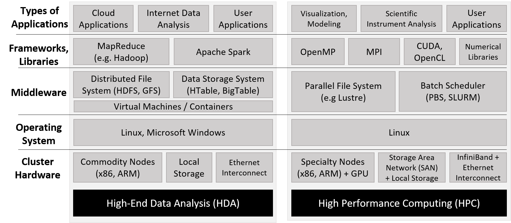
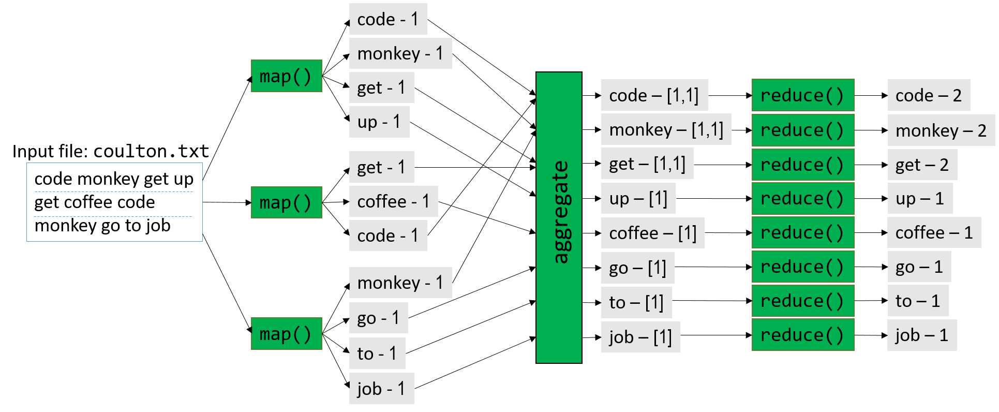

> [!WARNING] 说明
> 本文是个人学习用的**非官方**中英对照译文，原文：<https://diveintosystems.org/book/C15-Parallel/cloud.html>。
> 原书采用 CC BY-NC-ND 4.0 许可（禁止演绎），**请勿公开传播本译文**。
> 标为「译注」「现代更新」的内容是译者补充，不代表原书作者观点；代码与原文逐字一致，未作改动。


*15.3. To Exascale and Beyond: Cloud Computing, Big Data, and the Future of Computing*

> [!NOTE] 译注
> **Exascale**（百亿亿次，也称 E 级）指每秒 10¹⁸ 次浮点运算（1 ExaFLOPS）。数量级依次是：Giga（10⁹）→ Tera（10¹²）→ Peta（10¹⁵，千万亿次）→ Exa（10¹⁸）。

> [!TIP] 现代更新（截至 2026-11）· E 级已经实现
> 2026 年 6 月第 67 期 TOP500 前五名全部 ≥ 1 ExaFLOPS（HPL，64 位浮点）：
>
> | 排名 | 系统 | 所在地 | ExaFLOPS | 功耗 MW |
> |---|---|---|---|---|
> | 1 | LineShine | 中国深圳 | 2.198 | 42.2 |
> | 2 | El Capitan | 美国 LLNL | 1.809 | 29.7 |
> | 3 | Frontier | 美国 ORNL | 1.353 | 24.6 |
> | 4 | Aurora | 美国 ANL | 1.012 | 38.7 |
> | 5 | JUPITER Booster | 德国于利希（欧洲首台 E 级） | 1.000 | 15.8 |
>
> 来源：[TOP500 2026-06 Highlights](https://top500.org/lists/top500/2026/06/highs/)、[TOP500 榜单](https://top500.org/lists/top500/list/2026/06/)

技术的进步让人类能够以前所未有的速度产生数据。望远镜、生物测序仪和各类传感器等科学仪器，能以低成本产生高保真度的科学数据。在科学家们努力分析这场"数据洪流"的过程中，他们越来越依赖复杂的多节点超级计算机，而超级计算机正是**高性能计算**（high-performance computing，HPC）的基础。

> Advances in technology have made it possible for humanity to produce data at a rate never seen before. Scientific instruments such as telescopes, biological sequencers, and sensors produce high-fidelity scientific data at low cost. As scientists struggle to analyze this "data deluge", they increasingly rely on sophisticated multinode supercomputers, which form the foundation of **high-performance computing** (HPC).

HPC 应用通常用 C、C++ 或 Fortran 等语言编写，并借助 [POSIX 线程](../C14-SharedMemory/14.2-posix.html)、[OpenMP](../C14-SharedMemory/14.7-openmp.html) 和 [MPI](15.2-distrmem.html) 等库来实现[多线程](../C14-SharedMemory/14.1-multicore.html)和[消息传递](15.2-distrmem.html)。到目前为止，本书的绝大部分内容所介绍的，都是 HPC 系统上常用的体系结构特性、语言和库。致力于推动科学进步的公司、国家实验室和其他机构通常使用 HPC 系统，它们构成了计算科学生态系统的核心。

> HPC applications are typically written in languages like C, C++, or Fortran, with [multithreading](../C14-SharedMemory/14.1-multicore.html) and [message passing](15.2-distrmem.html) enabled with libraries such as [POSIX threads](../C14-SharedMemory/14.2-posix.html), [OpenMP](../C14-SharedMemory/14.7-openmp.html), and [MPI](15.2-distrmem.html). Thus far, the vast majority of this book has described architectural features, languages, and libraries commonly leveraged on HPC systems. Companies, national laboratories, and other organizations interested in advancing science typically use HPC systems and form the core of the computational science ecosystem.

与此同时，联网设备的普及和社交媒体的无处不在，使人类毫不费力地产生了海量的在线多媒体内容，包括网页、图片、视频、推文和社交媒体帖子。据估计，所有在线数据中有 90% 是在过去两年内产生的，而且整个社会每秒产生 30 TB 的用户数据（即每天 2.5 EB）。**用户数据**的洪流为公司和机构提供了关于其用户习惯、兴趣和行为的丰富信息，也便于它们构建数据丰富的客户画像，从而更好地定制商业产品和服务。为了分析用户数据，公司通常依赖多节点的数据中心，这些数据中心与典型的超级计算机共享许多硬件体系结构组件。然而，数据中心依赖的是另一套专为互联网数据设计的软件栈。用于存储和分析大规模互联网数据的计算机系统，有时被称为**高端数据分析**（high-end data analysis，HDA）系统。Amazon、Google、Microsoft 和 Facebook 等公司在互联网数据分析方面有切身利益，它们构成了数据分析生态系统的核心。HDA 和数据分析革命大约始于 2010 年，如今已成为云计算研究的主导领域。

> Meanwhile, the proliferation of internet-enabled devices and the ubiquity of social media have caused humanity to effortlessly produce large volumes of online multimedia, in the form of web pages, pictures, videos, tweets, and social media posts. It is estimated that 90% of all online data was produced in the past two years, and that society produces 30 terabytes of user data per second (or 2.5 exabytes per day). The deluge of **user data** offers companies and organizations a wealth of information about the habits, interests, and behavior of its users, and it facilitates the construction of data-rich customer profiles to better tailor commercial products and services. To analyze user data, companies typically rely on multinode data centers that share many of the hardware architecture components of typical supercomputers. However, these data centers rely on a different software stack designed specifically for internet-based data. The computer systems used for the storage and analysis of large-scale internet-based data are sometimes referred to as **high-end data analysis** (HDA) systems. Companies like Amazon, Google, Microsoft, and Facebook have a vested interest in the analysis of internet data, and form the core of the data analytics ecosystem. The HDA and data analytics revolution started around 2010, and now is a dominant area of cloud computing research.

> [!TIP] 现代更新 · Facebook 更名与旧数据统计
> Facebook 公司已于 2021 年 10 月更名为 Meta。[Meta 公告](https://about.fb.com/news/2021/10/facebook-company-is-now-meta/) 本段关于 90% 数据产生于近两年、每天 2.5 EB 的数字是较早的统计口径，本次未找到可核实的最新替代数字，引用时请查阅 IDC 等机构的最新原始报告。

[图 1](15.3-cloud.html) 突出展示了 HDA 社区和 HPC 社区在所用软件上的主要差异。注意，两个社区使用的集群硬件很相似，都遵循[分布式内存](15.2-distrmem.html)模型：每个计算节点通常有一个或多个[多核](../C14-SharedMemory/14.0-index.html)处理器，并且常常配有 [GPU](15.1-gpu.html)。集群硬件通常还包括一个**分布式文件系统**，让用户和应用能够共同访问分散存放在集群多个节点本地的文件。

> [Figure 1](15.3-cloud.html) highlights the key differences in software utilized by the HDA and HPC communities. Note that both communities use similar cluster hardware that follows a [distributed memory](15.2-distrmem.html) model, where each compute node typically has one or more [multicore](../C14-SharedMemory/14.0-index.html) processors and frequently a [GPU](15.1-gpu.html). The cluster hardware typically includes a **distributed filesystem** that allows users and applications common access to files that reside locally on multiple nodes in the cluster.



**图 1.** HDA 与 HPC 框架的比较。根据 Jack Dongarra 和 Daniel Reed 的一幅图绘制。<sup>8</sup>

*Figure 1. Comparison of HDA vs. HPC frameworks. Based on a figure by Jack Dongarra and Daniel Reed.<sup>8</sup>*

> [!NOTE] 译注 · 图中标签对照（自下而上）
> | 层次 | 左：高端数据分析（HDA） | 右：高性能计算（HPC） |
> |---|---|---|
> | 集群硬件 Cluster Hardware | 商用节点（x86、ARM）、本地存储、以太网互连 | 专用节点（x86、ARM）+ GPU、存储区域网络（SAN）+ 本地存储、InfiniBand + 以太网互连 |
> | 操作系统 Operating System | Linux、Microsoft Windows | Linux |
> | 中间件 Middleware | 分布式文件系统（HDFS、GFS）、数据存储系统（HTable、BigTable）、虚拟机/容器 | 并行文件系统（如 Lustre）、批处理调度器（PBS、SLURM） |
> | 框架与库 Frameworks, Libraries | MapReduce（如 Hadoop）、Apache Spark | OpenMP、MPI、CUDA/OpenCL、数值计算库 |
> | 应用类型 Types of Applications | 云应用、互联网数据分析、用户应用 | 可视化与建模、科学仪器数据分析、用户应用 |
>
> 一句话概括差异：HDA 用便宜的通用硬件、靠软件层（复制、重算）容错，追求吞吐量；HPC 用昂贵的专用硬件和高速网络，追求单个作业的极致性能和低延迟通信。

与通常为 HPC 用途而构建和优化的超级计算机不同，HDA 社区依赖的是**数据中心**：它由大量通用计算节点组成，节点之间通常通过以太网连接。在软件层面，数据中心通常使用虚拟机、大型分布式数据库，以及能够对互联网数据进行高吞吐量分析的框架。**云**（cloud）一词指的就是 HDA 数据中心中的数据存储和计算能力这两部分。

> Unlike supercomputers, which are typically built and optimized for HPC use, the HDA community relies on **data centers**, which consist of a large collection of general-purpose compute nodes typically networked together via Ethernet. At a software level, data centers typically employ virtual machines, large distributed databases, and frameworks that enable high-throughput analysis of internet data. The term **cloud** refers to the data storage and computing power components of HDA data centers.

本节我们简要介绍云计算、一些常用于支撑云计算的软件（具体来说是 MapReduce），以及未来面临的一些挑战。请注意，本节并不打算深入探讨这些概念；我们鼓励感兴趣的读者阅读所引用的资料以了解更多细节。

> In this section, we take a brief look at cloud computing, some of the software commonly used to enable cloud computing (specifically MapReduce), and some challenges for the future. Please note that this section is not meant to be an in-depth look at these concepts; we encourage interested readers to explore the referenced sources for greater detail.

### 15.3.1. 云计算

*15.3.1. Cloud Computing*

**云计算**（cloud computing）是指为获取各种服务而使用或租用云。云计算让计算基础设施能够像"公用事业"（utility）一样运作：少数几家集中的提供商通过互联网，向用户和机构提供（看似无限的）计算能力，用户和机构按需选择用多少，并按使用量付费。云计算有三大支柱：软件即服务（SaaS）、基础设施即服务（IaaS）和平台即服务（PaaS）<sup>1</sup>。

> **Cloud computing** is the use or lease of the cloud for a variety of services. Cloud computing enables computing infrastructure to act as a "utility": a few central providers give users and organizations access to (a seemingly infinite amount of) compute power through the internet, with users and organizations choosing to use as much as they want and paying according to their level of use. Cloud computing has three main pillars: software as a service (SaaS), infrastructure as a service (IaaS), and platform as a service (PaaS)<sup>1</sup>.

#### 软件即服务（SaaS）

*Software as a Service*

**软件即服务**（software as a service，SaaS）是指通过云直接提供给用户的软件。大多数人都在使用云计算的这一支柱，甚至没有意识到这一点。许多人每天使用的应用（例如网页邮箱、社交媒体和视频流媒体）都依赖于云基础设施。以网页邮箱这个经典应用为例：用户可以从任何设备登录并访问自己的网页邮箱，收发邮件，而且似乎永远不会用完存储空间。感兴趣的机构也可以反过来"租用"云邮件服务，为自己的客户和员工提供电子邮件，而无需承担自己运行该服务的硬件和维护成本。SaaS 支柱中的服务完全由云提供商管理；机构和用户（除了也许配置几项设置之外）不需要管理应用、数据、软件或硬件基础设施的任何部分——如果它们想在自己的硬件上搭建这个服务，这些都是必不可少的。在云计算出现之前，想为用户提供网页邮箱的机构需要有自己的基础设施，以及专门维护它的 IT 支持人员。SaaS 提供商的常见例子包括 Google 的 G Suite 和 Microsoft 的 Office 365。

> **Software as a service** (SaaS) refers to software provided directly to users through the cloud. Most people utilize this pillar of cloud computing without even realizing it. Applications that many people use daily (e.g., web mail, social media, and video streaming) depend upon cloud infrastructure. Consider the classic application of web mail. Users are able to log on and access their web mail from any device, send and receive mail, and seemingly never run out of storage space. Interested organizations can in turn "rent" cloud email services to provide email to their own clients and employees, without incurring the hardware and maintenance cost of running the service themselves. Services in the SaaS pillar are managed completely by cloud providers; organizations and users do not (beyond configuring a few settings, perhaps) manage any part of the application, data, software, or hardware infrastructure, all which would be necessary if they were trying to set up the service on their own hardware. Prior to the advent of cloud computing, organizations interested in providing web mail for their users would need their own infrastructure and dedicated IT support staff to maintain it. Popular examples of SaaS providers include Google’s G Suite and Microsoft’s Office 365.

> [!TIP] 现代更新 · SaaS 产品更名
> G Suite 已于 2020-10-06 更名为 **Google Workspace** [Google 公告](https://workspace.google.com/blog/product-announcements/introducing-google-workspace)；面向中小企业的 Office 365 订阅自 2020-04-21 起改为 **Microsoft 365** 品牌（企业版 E1/E3/E5 仍叫 Office 365）[Microsoft 公告](https://www.microsoft.com/en-us/microsoft-365/blog/2020/03/30/new-microsoft-365-offerings-small-and-medium-sized-businesses/)。

#### 基础设施即服务（IaaS）

*Infrastructure as a Service*

**基础设施即服务**（infrastructure as a service，IaaS）让个人和机构能够"租用"计算资源来满足自己的需要，通常的形式是访问虚拟机，这些虚拟机可以是通用的，也可以是为特定应用预先配置好的。一个经典的例子是 Amazon Web Services（AWS）的 Amazon 弹性计算云（Elastic Compute Cloud，EC2）服务。EC2 让用户能够创建完全可定制的虚拟机。EC2 中的**弹性**（elastic）一词，指的是用户可以根据需要扩大或缩小所申请的计算资源，并按用量付费。例如，一个机构可以使用 IaaS 提供商来托管自己的网站，或者向用户部署一系列自己定制开发的应用。一些研究实验室和课堂用 IaaS 服务来代替实验室机器，在云中运行实验，或为学生提供一个虚拟的学习平台。在所有这些情况下，目标都是省去为类似目的自建集群或服务器所需的维护和资本投入。与 SaaS 支柱的用例不同，IaaS 支柱的用例要求客户自己配置应用、数据，有时甚至要配置虚拟机的操作系统本身。不过，宿主操作系统和硬件基础设施由云提供商负责搭建和管理。常见的 IaaS 提供商包括 Amazon AWS、Google Cloud Services 和 Microsoft Azure。

> **Infrastructure as a service** (IaaS) allows people and organizations to "rent out" computational resources to meet their needs, usually in the form of accessing virtual machines that are either general purpose or preconfigured for a particular application. One classic example is Amazon’s Elastic Compute Cloud (EC2) service from Amazon Web Services (AWS). EC2 enables users to create fully customizable virtual machines. The term **elastic** in EC2 refers to a user’s ability to grow or shrink their compute resource requests as needed, paying as they go. For example, an organization may use an IaaS provider to host its website or deploy its own series of custom-built applications to users. Some research labs and classrooms use IaaS services in lieu of lab machines, running experiments in the cloud or offering a virtual platform for their students to learn. In all cases, the goal is to eliminate the maintenance and capital needed to maintain a personal cluster or server for similar purposes. Unlike use cases in the SaaS pillar, use cases in the IaaS pillar require clients to configure applications, data, and in some cases the virtual machine’s OS itself. However, the host OS and hardware infrastructure is set up and managed by the cloud provider. Popular IaaS providers include Amazon AWS, Google Cloud Services, and Microsoft Azure.

> [!NOTE] 译注
> 和第 13 章操作系统的知识联系起来：IaaS 的底层就是**虚拟化**——宿主机上的虚拟机监控器（hypervisor，如 AWS 的 Nitro、KVM、Xen）把一台物理服务器切分成多台虚拟机，每台虚拟机里运行"客户操作系统"。原文中的 host OS 即宿主操作系统。

> [!TIP] 现代更新 · GPU 也能"切片出租"
> H100 支持第二代**多实例 GPU（MIG）**：一颗 GPU 最多切成 7 个相互隔离的实例，并支持机密计算，在虚拟化环境中隔离保护各个虚拟机——IaaS 的虚拟化思路已经延伸到加速器。[NVIDIA Hopper 架构详解](https://developer.nvidia.com/blog/nvidia-hopper-architecture-in-depth/)

#### 平台即服务（PaaS）

*Platform as a Service*

**平台即服务**（platform as a service，PaaS）让个人和机构能够为云开发和部署自己的 Web 应用，无需在本地进行配置或维护。大多数 PaaS 提供商允许开发者用多种语言编写应用，并提供多种 API 供选择。例如，Microsoft Azure 的服务让用户可以在 Visual Studio IDE 中编写 Web 应用，并把应用部署到 Azure 上进行测试。Google App Engine 让开发者能够用多种语言在云中构建和测试定制的移动应用。Heroku 和 CloudBees 是另外两个知名的例子。注意，开发者只能控制自己的应用和数据；其余的软件基础设施以及全部底层硬件基础设施都由云提供商控制。

> **Platform as a service** (PaaS) allows individuals and organizations to develop and deploy their own web applications for the cloud, eliminating the need for local configuration or maintenance. Most PaaS providers enable developers to write their applications in a variety of languages and offer a choice of APIs to use. For example, Microsoft Azure’s service allows users to code web applications in the Visual Studio IDE and deploy their applications to Azure for testing. Google App Engine enables developers to build and test custom mobile applications in the cloud in a variety of languages. Heroku and CloudBees are other prominent examples. Note that developers have control over their applications and data only; the cloud provider controls the rest of the software infrastructure and all of the underlying hardware infrastructure.

> [!NOTE] 译注 · 三种模式的速记
> 用"谁管什么"来记最清楚：从硬件 → 虚拟化 → 操作系统 → 运行时 → 应用 → 数据，IaaS 里云厂商管到虚拟化为止，PaaS 管到运行时为止，SaaS 全包。原书没提到的两个常见形态：**CaaS**（容器即服务，如托管的 Kubernetes）介于 IaaS 和 PaaS 之间；**FaaS / Serverless**（函数即服务，如 AWS Lambda）比 PaaS 更进一步——你只上传一个函数，按调用次数和执行时间计费，连"服务器进程一直在跑"这件事都不用管。

### 15.3.2. MapReduce

*15.3.2. MapReduce*

云系统上最著名的编程范式，大概要数 MapReduce<sup>3</sup>。虽然 MapReduce 起源于函数式编程中的 Map 和 Reduce 操作，但 Google 是第一个把这个概念用于分析海量 Web 数据的。MapReduce 让 Google 处理 Web 查询的速度比竞争对手更快，助力 Google 迅速崛起，成为人们首选的 Web 服务提供商，以及今天的互联网巨头。

> Perhaps the most famous programming paradigm used on cloud systems is MapReduce<sup>3</sup>. Although MapReduce’s origins lay in functional programming’s Map and Reduce operations, Google was the first to apply the concept to analyzing large quantities of web data. MapReduce enabled Google to perform web queries faster than its competitors, and enabled Google’s meteoric rise as the go-to web service provider and internet giant it is today.

> [!NOTE] 译注
> 准确地说，MapReduce 在 Google 内部主要用于**离线批处理**——例如构建网页索引（[2004 年的论文](https://static.googleusercontent.com/media/research.google.com/en//archive/mapreduce-osdi04.pdf)提到，Google 用 MapReduce 重写了生产环境的索引系统）——而不是直接响应用户的实时搜索查询。原书"perform web queries faster"的说法是一种简化。

#### 理解 Map 与 Reduce 操作

*Understanding Map and Reduce Operations*

MapReduce 范式中的 `map` 和 `reduce` 函数，源自函数式编程中 Map 和 Reduce 这两种数学运算。本节通过回顾本书前面出现过的一些例子，简要讨论这些数学运算是如何工作的。

> The `map` and `reduce` functions in the MapReduce paradigm are based on the mathematical operations of Map and Reduce from functional programming. In this section, we briefly discuss how these mathematical operations work by revisiting some examples presented earlier in the book.

Map 操作通常把同一个函数应用于集合中的所有元素。熟悉 Python 的读者可能最容易从 Python 的列表推导式（list comprehension）功能中认出这种功能。例如，[表 1](15.3-cloud.html) 中的两段代码都在 Python 中实现了标量乘法：

> The Map operation typically applies the same function to all the elements in a collection. Readers familiar with Python may recognize this functionality most readily in the list comprehension feature in Python. For example, the following two code snippets in [Table 1](15.3-cloud.html) perform scalar multiplication in Python:

**表 1.** 使用循环与使用列表推导式的标量乘法对比。

*Table 1. Comparison scalar multiplication using loop and list comprehension.*

**常规的标量乘法**（Regular scalar multiply）

```
'''
    The typical way to perform
    scalar multiplication
'''

# array is an array of numbers
# s is an integer
def scalarMultiply(array, s):

    for i in range(len(array)):
        array[i] = array[i] * s

    return array

# call the scalarMultiply function:
myArray = [1, 3, 5, 7, 9]
result = scalarMultiply(myArray, 2)

#prints [2, 6, 10, 14, 18]
print(result)
```

> [!NOTE] 译注
> 代码注释：执行标量乘法的常规方式；array 是一个数字数组，s 是一个整数；调用 scalarMultiply 函数；输出 [2, 6, 10, 14, 18]。

**使用列表推导式的标量乘法**（Scalar multiply with list comprehension）

```
'''
    Equivalent program that
    performs scalar multiplication
    with list comprehension
'''

# multiplies two numbers together
def multiply(num1, num2):
    return num1 * num2

# array is an array of numbers
# s is an integer
def scalarMultiply(array, s):

    # using list comprehension
    return [multiply(x, s) for x in array]

# call the scalarMultiply function:
myArray = [1, 3, 5, 7, 9]
result = scalarMultiply(myArray, 2)

# prints [2, 6, 10, 14, 18]
print(result)
```

> [!NOTE] 译注
> 代码注释：用列表推导式实现标量乘法的等价程序；把两个数相乘。Python 里也有直接对应 Map / Reduce 的内置函数：`list(map(lambda x: x * s, array))`，以及 `functools.reduce(lambda a, b: a + b, result)`。

列表推导式把同一个函数（在本例中，是把数组元素与标量值 `s` 相乘）应用到 `array` 中的每一个元素 `x` 上。

> The list comprehension applies the same function (in this case, multiplying an array element with scalar value `s`) to every element `x` in `array`.

一次 Reduce 操作接受一个元素集合，并用某个共同的函数把它们组合成单个值。例如，Python 的 `sum` 函数的行为就类似于 Reduce 操作：它接受一个集合（通常是 Python 列表），并用加法把所有元素组合在一起。例如，对[表 1](15.3-cloud.html) 中 `scalarMultiply` 函数返回的 `result` 数组的所有元素应用加法，得到的总和是 50。

> A single Reduce operation takes a collection of elements and combines them together into a single value using some common function. For example, the Python function `sum` acts similarly to a Reduce operation, as it takes a collection (typically a Python list) and combines all the elements together using addition. So, for example, applying addition to all the elements in the `result` array returned from the `scalarMultiply` function in [Table 1](15.3-cloud.html) yields a combined sum of 50.

#### MapReduce 编程模型

*The MapReduce Programming Model*

MapReduce 的一个关键特性是它简化的编程模型。开发者只需要实现两类函数：`map` 和 `reduce`；其余的工作都由底层的 MapReduce 框架自动完成。

> A key feature of MapReduce is its simplified programming model. Developers need to implement only two types of functions, `map` and `reduce`; the underlying MapReduce framework automates the rest of the work.

由程序员编写的 `map` 函数接受一个输入 (*key*,*value*) 对，输出一系列中间 (*key*,*value*) 对，这些中间结果被写入一个由所有节点共享的分布式文件系统。然后，一个通常由 MapReduce 框架定义的合并器（combiner）按 key 对这些 (*key*,*value*) 对进行聚合，生成 (*key*,list(*value*)) 对，并传给程序员定义的 `reduce` 函数。`reduce` 函数以一个 (*key*,list(*value*)) 对作为输入，通过某种由程序员定义的操作把所有的值组合在一起，形成最终的 (*key*,*value*)，其中输出的 *value* 就是归约操作的结果。`reduce` 函数的输出被写入分布式文件系统，通常也会输出给用户。

> The programmer-written `map` function takes an input (*key*,*value*) pair and outputs a series of intermediate (*key*,*value*) pairs that are written to a distributed filesystem shared among all the nodes. A combiner that is typically defined by the MapReduce framework then aggregates (*key*,*value*) pairs by key, to produce (*key*,list(*value*)) pairs that are passed to the programmer-defined `reduce` function. The `reduce` function then takes as input a (*key*,list(*value*)) pair and combines all the values together through some programmer-defined operation to form a final (*key*,*value*), where the *value* in this output corresponds to the result of the reduction operation. The output from the `reduce` function is written to the distributed filesystem and usually output to the user.

> [!NOTE] 译注 · 与原论文的术语差异（重要）
> 对照 Dean & Ghemawat 2004 年的[原论文](https://static.googleusercontent.com/media/research.google.com/en//archive/mapreduce-osdi04.pdf)（第 3.1 节执行流程、第 4.3 节 Combiner Function），这一段有两处与通行说法不同，读其他资料时容易混淆：
> 1. 按 key 把中间结果分组、排序并送到对应 reducer 的过程，通常叫 **shuffle（洗牌）/ sort** 阶段，由框架完成。论文中的 **combiner** 是另一个东西：一个**可选的、由用户提供**的函数，在 map 端先做一次局部归约（比如把同一台机器上的 1000 个 `(the, 1)` 先合并成 `(the, 1000)`），以减少网络传输量。
> 2. 在原论文的实现中，map 输出的中间结果写在 **map 工作节点的本地磁盘**上，reduce 任务再通过远程读取把它们拉过来；只有 reduce 的**最终输出**才写入分布式文件系统（GFS）。

为了说明如何用 MapReduce 模型把程序并行化，我们来讨论词频统计（Word Frequency）程序。词频统计的目标是确定一个大型文本语料库中每个单词出现的频率。

> To illustrate how to use the MapReduce model to parallelize a program, we discuss the Word Frequency program. The goal of Word Frequency is to determine the frequency of each word in a large text corpus.

C 程序员可能会为词频统计程序实现如下的 `map` 函数：<sup>3</sup>

> A C programmer may implement the following `map` function for the Word Frequency program:<sup>3</sup>

```
void map(char *key, char *value) {
    // key is document name
    // value is string containing some words (separated by spaces)
    int i;
    int numWords = 0; // number of words found: populated by parseWords()

    // returns an array of numWords words
    char *words[] = parseWords(value, &numWords);
    for (i = 0; i < numWords; i++) {
        // output (word, 1) key-value intermediate to file system
        emit(words[i], "1");
    }
}
```

> [!NOTE] 译注
> 代码注释：key 是文档名；value 是包含若干单词（以空格分隔）的字符串；numWords 为找到的单词数，由 `parseWords()` 填入；`parseWords` 返回一个包含 numWords 个单词的数组；把中间结果键值对 (word, 1) 输出到文件系统。注意这是**伪代码风格的 C**（C 语言里数组不能这样用函数返回值初始化），重在表达意思。

这个 `map` 函数接收的输入是一个对应文件名的字符串（`key`），以及另一个包含部分文件数据的字符串（`value`）。函数随后从输入的 `value` 中解析出单词，并把每个单词（`words[i]`）分别与字符串值 `"1"` 一起发射（emit）出去。`emit` 函数由 MapReduce 框架提供，它把中间 (*key*,*value*) 对写入分布式文件系统。

> This `map` function receives as input a string (`key`) that corresponds to the name of the file, and a separate string (`value`) that contains a component of file data. The function then parses words from the input `value` and emits each word (`words[i]`) separately with the string value `"1"`. The `emit` function is provided by the MapReduce framework and writes the intermediate (*key*,*value*) pairs to the distributed filesystem.

为了完成词频统计程序，程序员可以实现如下的 `reduce` 函数：

> To complete the Word Frequency program, a programmer may implement the following `reduce` function:

```
void reduce(char *key, struct Iterator values) {
    // key is individual word
    // value is of type Iterator (a struct that consists of
    // a items array (type char **), and its associated length (type int))
    int numWords = values.length();  // get length
    char *counts[] = values.items(); // get counts
    int i, total = 0;
    for (i = 0; i < numWords; i++) {
        total += atoi(counts[i]); // sum up all counts
    }
    char *stringTotal = itoa(total); // convert total to a string
    emit(key, stringTotal); // output (word, total) pair to file system
}
```

> [!NOTE] 译注
> 代码注释：key 是单个单词；value 的类型是 Iterator（一个结构体，包含一个 items 数组（类型为 `char **`）及其长度（类型为 int））；获取长度；获取计数；把所有计数加起来；把总数转换为字符串；把 (word, total) 键值对输出到文件系统。同样是伪代码风格：`itoa` 不是标准 C 函数，标准写法是 `snprintf`。

这个 `reduce` 函数接收的输入是一个对应某个特定单词的字符串（`key`），以及一个 `Iterator` 结构体（同样由 MapReduce 框架提供），该结构体包含与这个 key 相关联的、聚合后的元素数组（`items`）以及该数组的长度（`length`）。在词频统计应用中，`items` 对应的是一组计数。函数随后从 `Iterator` 结构体的 `length` 字段中取出单词数，从 `items` 字段中取出计数数组。然后它遍历所有计数，把值累加到变量 `total` 中。由于 `emit` 函数要求的参数类型是 `char *`，函数在调用 `emit` 之前先把 `total` 转换成字符串。

> This `reduce` function receives as input a string (`key`) that corresponds to a particular word, and an `Iterator` struct (again, provided by the MapReduce framework) that consists of an aggregated array of items associated with the key (`items`), and the length of that array (`length`). In the Word Frequency application, `items` corresponds to a list of counts. The function then extracts the number of words from the `length` field of the `Iterator` struct, and the array of counts from the `items` field. It then loops over all the counts, aggregating the values into the variable `total`. Since the `emit` function requires `char *` parameters, the function converts `total` to a string prior to calling `emit`.

实现了 `map` 和 `reduce` 之后，程序员的职责就结束了。MapReduce 框架会自动完成其余的工作，包括：对输入进行划分，生成和管理运行 `map` 函数的进程（map 任务），对中间 (*key*,*value*) 对进行聚合和排序，生成和管理运行 `reduce` 函数的独立进程（reduce 任务），以及生成最终的输出文件。

> After implementing `map` and `reduce`, the programmer’s responsibility ends. The MapReduce framework automates the rest of the work, including partitioning the input, generating and managing the processes that run the `map` function (map tasks), aggregating and sorting intermediate (*key*,*value*) pairs, generating and managing the separate processes that run the `reduce` function (reduce tasks), and generating a final output file.

为简单起见，我们在[图 2](15.3-cloud.html) 中演示 MapReduce 如何把 Jonathan Coulton 的流行歌曲《Code Monkey》的开头几句并行化：*code monkey get up get coffee, code monkey go to job*。

> For simplicity, in [Figure 2](15.3-cloud.html) we illustrate how MapReduce parallelizes the opening lines of the popular Jonathan Coulton song "Code Monkey": *code monkey get up get coffee, code monkey go to job*.



**图 2.** 用 MapReduce 框架并行处理歌曲《Code Monkey》的开头几句

*Figure 2. Parallelization of the opening lines of the song "Code Monkey" using the MapReduce framework*

> [!NOTE] 译注 · 图中标签
> Input file＝输入文件，被切成 3 段（*M* = 3），分别交给 3 个 `map()`；中间的 aggregate＝聚合（即上文译注说的 shuffle 分组）；右侧 8 个 `reduce()` 对应 8 个不同的单词（*R* = 8），输出每个单词的最终计数，例如 `get – [1,1]` 归约为 `get – 2`。

[图 2](15.3-cloud.html) 概括展示了这个过程。在执行之前，boss 节点首先把输入划分为 *M* 个部分，其中 *M* 对应 map 任务的数量。在[图 2](15.3-cloud.html) 中，*M* = 3，输入文件（`coulton.txt`）被分成三部分。在 map 阶段，boss 节点把 map 任务分配给一个或多个 worker 节点，每个 map 任务独立且并行地执行。例如，第一个 map 任务把片段 *code monkey get up* 解析成单独的单词，并发射以下四个 (*key*,*value*) 对：(`code`,`1`)、(`monkey`,`1`)、(`get`,`1`)、(`up`,`1`)。随后，每个 map 任务把自己的中间值发射到分布式文件系统中，该文件系统在每个节点上都占用一定的存储空间。

> [Figure 2](15.3-cloud.html) gives an overview of this process. Prior to execution, the boss node first partitions the input into *M* parts, where *M* corresponds to the number of map tasks. In [Figure 2](15.3-cloud.html), *M* = 3, and the input file (`coulton.txt`) is split into three parts. During the map phase, the boss node distributes the map tasks among one or more worker nodes, with each map task executing independently and in parallel. For example, the first map task parses the snippet *code monkey get up* into separate words and emits the following four (*key*,*value*) pairs: (`code`,`1`), (`monkey`,`1`), (`get`,`1`), (`up`,`1`). Each map task then emits its intermediate values to a distributed filesystem that takes up a certain amount of storage on each node.

在 reduce 阶段开始之前，框架会把中间 (*key*,*value*) 对聚合、合并成 (*key*,list(*value*)) 对。例如在[图 2](15.3-cloud.html) 中，(*key*,*value*) 对 (`get`,`1`) 由两个不同的 map 任务分别发射出来。MapReduce 框架把这些分散的 (*key*,*value*) 对聚合成单个 (*key*,list(*value*)) 对 (`get`,`[1,1]`)。聚合后的中间结果对被写入磁盘上的分布式文件系统。

> Prior to the start of the reduce phase, the framework aggregates and combines the intermediate (*key*,*value*) pairs into (*key*,list(*value*)) pairs. In [Figure 2](15.3-cloud.html), for example, the (*key*,*value*) pair (`get`,`1`) is emitted by two separate map tasks. The MapReduce framework aggregates these separate (*key*,*value*) pairs into the single (*key*,list(*value*)) pair (`get`,`[1,1]`). The aggregated intermediate pairs are written to the distributed filesystem on disk.

接下来，MapReduce 框架指示 boss 节点生成 *R* 个 reduce 任务。在[图 2](15.3-cloud.html) 中，*R* = 8。然后框架把这些任务分配给它的 worker 节点。同样，每个 reduce 任务都独立且并行地执行。在这个例子的 reduce 阶段，(*key*,list(*value*)) 对 (`get`,`[1,1]`) 被归约为 (*key*,*value*) 对 (`get`,`2`)。每个 worker 节点把自己那组 reduce 任务的输出追加到一个最终文件中，作业完成后用户就可以使用这个文件。

> Next, the MapReduce framework directs the boss node to generate *R* reduce tasks. In [Figure 2](15.3-cloud.html), *R* = 8. The framework then distributes the tasks among its worker nodes. Once again, each reduce task executes independently and in parallel. In the reduce phase of this example, the (*key*,list(*value*)) pair (`get`,`[1,1]`) is reduced to the (*key*,*value*) pair (`get`,`2`). Each worker node appends the output of its set of reduce tasks to a final file, which is available to the user upon completion.

> [!NOTE] 译注
> 某个 key 由哪个 reduce 任务处理，默认用 `hash(key) mod R` 决定，这样同一个单词的所有计数一定会汇到同一个 reducer。另外，[原论文](https://static.googleusercontent.com/media/research.google.com/en//archive/mapreduce-osdi04.pdf)中每个 reduce 任务各自写一个输出文件（共 R 个），而不是追加到同一个文件里；论文给出的默认划分函数正是 `hash(key) mod R`。

#### 容错

*Fault Tolerance*

数据中心通常包含数千个节点。因此，故障率很高：假设数据中心里单个节点发生硬件故障的概率是 2%，那么在一个 1000 节点的数据中心里，至少有一个节点发生故障的概率超过 99.99%。因此，为数据中心编写的软件必须是**容错的**（fault tolerant），也就是说，它必须能在出现硬件故障时继续运行（否则也要优雅地失败）。

> Data centers typically contain thousands of nodes. Consequently, the rate of failure is high; consider that if an individual node in a data center has a 2% chance of hardware failure, there is a greater than 99.99% chance that some node in a 1,000-node data center will fail. Software written for data centers must therefore be **fault tolerant**, meaning that is must be able to continue operation in the face of hardware failures (or else fail gracefully).

> [!NOTE] 译注
> 这个数字是这样算出来的：所有节点都不出故障的概率是 0.98¹⁰⁰⁰ ≈ 1.7 × 10⁻⁹，所以至少一个节点出故障的概率 ≈ 1 − 1.7 × 10⁻⁹，远超 99.99%。规模一大，"故障"就从意外变成了常态——这是整个大规模系统设计的出发点。

MapReduce 在设计时就考虑了容错。在任何一次 MapReduce 运行中，都有一个 boss 节点和可能多达数千个 worker 节点。因此，某个 worker 节点发生故障的可能性很高。为了解决这个问题，boss 节点会定期 ping 各个 worker 节点。如果 boss 节点没有收到某个 worker 节点的响应，boss 就会把该 worker 被分配的工作重新分配给另一个节点，并重新执行该任务<sup>3</sup>。如果 boss 节点本身发生故障（由于它只是一个节点，这种可能性很低），MapReduce 作业就会中止，必须在另一个节点上重新运行。注意，有时 worker 节点没有响应 boss 节点的 ping，是因为它被任务拖住了。因此，MapReduce 使用同样的 ping 和工作重新分配策略，来限制缓慢（或称"掉队"，straggler）的 worker 节点所造成的影响。

> MapReduce was designed with fault tolerance in mind. For any MapReduce run, there is one boss node and potentially thousands of worker nodes. The chance that a worker node will fail is therefore high. To remedy this, the boss node pings individual worker nodes periodically. If the boss node does not receive a response from a worker node, the boss redistributes the worker’s assigned workload to a different node and re-executes the task<sup>3</sup>. If the boss node fails (a low probability given that it is only one node), the MapReduce job aborts and must be rerun on a separate node. Note that sometimes a worker node may fail to respond to the boss node’s pings because the worker is bogged down by tasks. MapReduce therefore uses the same pinging and work redistribution strategy to limit the effect of slow (or straggler) worker nodes.

> [!NOTE] 译注
> 两个补充：① 重新执行之所以安全，是因为 map 和 reduce 被设计成**确定性、无副作用**的函数——同一个任务跑两遍得到相同结果，这正是函数式编程思想带来的好处。② 原论文对付掉队节点的具体机制叫**备份任务**（backup tasks，后来 Hadoop 称为**推测执行** speculative execution）：作业快结束时，把还在运行的任务再派一份给别的空闲节点，哪个先完成就用哪个的结果。[论文](https://static.googleusercontent.com/media/research.google.com/en//archive/mapreduce-osdi04.pdf)报告：关闭备份任务后，一个大型排序作业的耗时会增加 44%。

#### Hadoop 与 Apache Spark

*Hadoop and Apache Spark*

MapReduce 的出现在计算界掀起了一场风暴。然而，Google 的 MapReduce 实现是闭源的。因此，Yahoo! 的工程师开发了 [Hadoop](https://hadoop.apache.org/)——MapReduce 的一个开源实现，后来被 Apache 基金会采纳。Hadoop 项目包含一整套围绕 Apache Hadoop 的工具生态，其中包括 Hadoop 分布式文件系统（HDFS，Google 文件系统 GFS 的开源替代品），以及 HBase（仿照 Google 的 BigTable 设计）。

> The development of MapReduce took the computing world by storm. However, Google’s implementation of MapReduce is closed source. As a result, engineers at Yahoo! developed [Hadoop](https://hadoop.apache.org/), an open source implementation of MapReduce, which was later adopted by the Apache Foundation. The Hadoop project consists of an ecosystem of tools for Apache Hadoop, including the Hadoop Distributed File System or HDFS (an open source alternative to Google File System), and HBase (modeled after Google’s BigTable).

Hadoop 有几个关键的局限。第一，很难把多个 MapReduce 作业串联成一个更大的工作流。第二，把中间结果写入 HDFS 被证明是一个瓶颈，对于小作业（小于 1 GB）尤其如此。[Apache Spark](https://spark.apache.org/) 正是为了解决这些问题（以及其他一些问题）而设计的。得益于它的各种优化，以及能够在很大程度上在内存中处理中间数据的能力，Apache Spark 在某些应用上比 Hadoop 快多达 100 倍<sup>4</sup>。

> Hadoop has a few key limitations. First, it is difficult to chain multiple MapReduce jobs together into a larger workflow. Second, the writing of intermediates to the HDFS proves to be a bottleneck, especially for small jobs (smaller than one gigabyte). [Apache Spark](https://spark.apache.org/) was designed to address these issues, among others. Due to its optimizations and ability to largely process intermediate data in memory, Apache Spark is up to 100 times faster than Hadoop on some applications<sup>4</sup>.

> [!NOTE] 译注
> Spark 的核心抽象最初叫 **RDD**（弹性分布式数据集，2012 年的论文）：数据集被切分到各节点的内存中，并记录"它是由哪些变换从哪些数据算出来的"（血统 lineage）；某个分区丢了，就按血统重新计算，而不是靠写磁盘副本来容错——这和 MapReduce 的"重新执行任务"是同一种思想。"快 100 倍"来自 Spark 官方/Databricks 的宣传口径，适用于迭代式、能全部放进内存的工作负载（如机器学习的多轮迭代），不代表一般情况。

> [!TIP] 现代更新（截至 2026-11） · Spark 4.x 与 Spark Connect
> Spark 已进入 4.x：Spark 4.0.0 是 4.x 首个版本（5,100 多个问题单、390 多位贡献者），重点推进客户端/服务器式的 **Spark Connect**（轻量 Python 客户端仅 1.5 MB）。[Spark 4.0.0 发布说明](https://spark.apache.org/releases/spark-release-4-0-0.html)

### 15.3.3. 展望未来：机遇与挑战

*15.3.3. Looking Toward the Future: Opportunities and Challenges*

尽管互联网数据分析领域不断创新，人类产生的数据量仍在持续增长。大部分新数据产生于所谓的**边缘环境**（edge environments），即靠近传感器和其他数据生成仪器的地方——按照定义，它们位于网络的另一端，远离商业云提供商和 HPC 系统。传统上，科学家和从业者收集数据后，用本地集群进行分析，或者把数据迁移到超级计算机或数据中心去分析。随着传感器技术的进步加剧了数据洪流，这种"集中式"的计算观念已不再是可行的策略。

> Despite the innovations in the internet data analytics community, the amount of data produced by humanity continues to grow. Most new data is produced in so-called **edge environments**, or near sensors and other data-generating instruments that are by definition on the other end of the network from commercial cloud providers and HPC systems. Traditionally, scientists and practitioners gather data and analyze it using a local cluster, or move it to a supercomputer or data center for analysis. This "centralized" view of computing is no longer a viable strategy as improvements in sensor technology have exacerbated the data deluge.

这种爆炸式增长的原因之一，是带有各种传感器的小型联网设备的激增。这些**物联网**（Internet of Things，IoT）设备在边缘环境中产生了大量多样的数据集。把大型数据集从边缘传到云端很困难，因为数据集越大，迁移所需的时间和能耗就越多。为了缓解所谓"大数据"的这些后勤问题，研究界已经开始研发在边缘与云之间每个传输点上积极地对数据进行汇总（摘要）的技术<sup>2</sup>。计算研究界非常希望构建这样的基础设施：能够在一个统一的平台上，在边缘环境中处理、存储和汇总数据；这个领域被称为**边缘计算**（edge computing，或称**雾计算** fog computing）。边缘计算颠覆了传统的大数据分析模式：分析不再发生在超级计算机或数据中心（"最后一公里"），而是发生在数据产生的源头（"最初一公里"）<sup>2</sup>。

> One reason for this explosive growth is the proliferation of small internet-enabled devices that contain a variety of sensors. These **Internet of Things** (IoT) devices have led to the generation of large and diverse datasets in edge environments. Transferring large datasets from the edge to the cloud is difficult, as larger datasets take more time and energy to move. To mitigate the logistic issues of so-called "Big Data", the research community has begun to create techniques that aggressively summarize data at each transfer point between the edge and the cloud<sup>2</sup>. There is intense interest in the computing research community in creating infrastructure that is capable of processing, storing, and summarizing data in edge environments in a unified platform; this area is known as **edge** (or **fog**) computing. Edge computing flips the traditional analysis model of Big Data; instead of analysis occurring at the supercomputer or data center ("last mile"), analysis instead occurs at the source of data production ("first mile")<sup>2</sup>.

除了数据迁移的后勤问题之外，大数据分析的另一个贯穿性问题是功耗管理。超级计算机和数据中心这类大型集中式资源需要大量能源；现代超级计算机需要数兆瓦（百万瓦）的电力来供电和冷却。超级计算界有一句老话："一兆瓦要花一百万美元"（a megawatt costs a megabuck），也就是说，维持一兆瓦的电力需求每年大约要花费 100 万美元<sup>5</sup>。在边缘环境中就地处理数据有助于缓解迁移大型数据集的后勤问题，但这类环境中的计算基础设施同样必须尽可能少地消耗能量<sup>2</sup>。与此同时，提高大型超级计算机和数据中心的能效也至关重要<sup>5</sup>。

> In addition to data movement logistics, the other cross-cutting concern for the analysis of Big Data is power management. Large, centralized resources such as supercomputers and data centers require a lot of energy; modern supercomputers require several megawatts (million watts) to power and cool. An old adage in the supercomputing community is that "a megawatt costs a megabuck"; in other words, it costs roughly \$1 million annually to maintain the power requirement of one megawatt<sup>5</sup>. Local data processing in edge environments helps mitigate the logistical issue of moving large datasets, but the computing infrastructure in such environments must likewise use the minimal energy possible<sup>2</sup>. At the same time, increasing the energy efficiency of large supercomputers and data centers is paramount<sup>5</sup>.

> [!TIP] 现代更新（截至 2026-11）· 功耗
> - 顶级超算功耗已是 15–42 MW（见本节开头表格）；按一兆瓦每年约一百万美元的老话粗估，El Capitan 年电费在 3,000 万美元量级（经验法则推算，非官方数据）。
> - 能效：El Capitan 60.94 GFLOPS/W；Green500 第一名 KAIROS 73.28 GFLOPS/W（前三均为 Grace Hopper 系统）。[TOP500 2026-06](https://top500.org/lists/top500/2026/06/highs/)
> - IEA 预测：到 2030 年全球数据中心用电量将翻一番以上，达约 945 TWh（略高于日本全国用电量），AI 专用数据中心用电将增长到四倍以上。[IEA](https://www.iea.org/news/ai-is-set-to-drive-surging-electricity-demand-from-data-centres-while-offering-the-potential-to-transform-how-the-energy-sector-works)

人们也很希望找到让 HPC 生态和云计算生态融合的方法，为大规模数据分析打造一套通用的框架、基础设施和工具。近年来，许多科学家使用云计算社区研究人员开发的技术和工具来分析传统的 HPC 数据集，反之亦然。融合这两个软件生态系统将促进研究上的相互借鉴，并推动开发一个统一的系统，使两个社区都能应对即将到来的数据冲击，并有可能共享资源。[大数据与百亿亿次计算（BDEC）](https://www.exascale.org/bdec/)工作组认为，与其把 HPC 和云计算看成两种根本不同的范式，不如把云计算看作科学计算的一个"数字化赋能"的阶段，在这个阶段中，数据源越来越多地经由互联网产生<sup>2</sup>。此外，要把 HPC 和云计算的软件与研究社区完全整合起来，还需要文化、培训和工具上的融合。BDEC 还提出了一种模型：把超级计算机和数据中心看作一个超大型计算资源网络中的"节点"，它们协同工作，共同应对来自多个来源的数据洪流<sup>2</sup>。每个节点都积极地对流向它的数据进行汇总，只有在必要时才把数据交给更大的计算资源节点。

> There is also interest in figuring out ways to converge the HPC and cloud computing ecosystems to create a common set of frameworks, infrastructure and tools for large-scale data analysis. In recent years, many scientists have used techniques and tools developed by researchers in the cloud computing community to analyze traditional HPC datasets, and vice versa. Converging these two software ecosystems will allow for the cross-pollination of research and lead to the development of a unified system that allows both communities to tackle the coming onslaught of data, and potentially share resources. The [Big Data Exascale Computing (BDEC)](https://www.exascale.org/bdec/) working group argues that instead of seeing HPC and cloud computing as two fundamentally different paradigms, it is perhaps more useful to view cloud computing as a "digitally empowered" phase of scientific computing, in which data sources are increasingly generated over the internet<sup>2</sup>. In addition, a convergence of culture, training, and tools is necessary to fully integrate the HPC and cloud computing software and research communities. BDEC also suggests a model in which supercomputers and data centers are "nodes" in a very large network of computing resources, all working in concert to deal with data flooding from multiple sources<sup>2</sup>. Each node aggressively summarizes the data flowing to it, releasing it to a larger computational resource node only when necessary.

> [!TIP] 现代更新（截至 2026-11）· 融合已经发生
> - TOP500 前十中的第 7 名 Eagle 是 **Microsoft Azure 云**中的系统（H100 + InfiniBand NDR）。
> - 混合精度基准 HPL-MxP 上，El Capitan 达 16.7 ExaFLOPS（约为其 64 位成绩的 9 倍）——AI 风格的低精度计算正被用于科学计算。
> - 排名取决于基准：LineShine 在 HPL 和 HPCG 上第一，在 HPL-MxP 上第四；El Capitan 的 HPCG（访存密集）成绩只有 HPL 的不到 1%——这就是内存墙。
>
> 来源：[TOP500 2026-06 Highlights](https://top500.org/lists/top500/2026/06/highs/)

随着云计算和 HPC 生态系统寻求统一，并做好准备迎接日益汹涌的数据浪潮，计算机系统的未来充满了令人兴奋的可能性。人工智能和量子计算等新领域，正在催生新的**领域专用架构**（domain-specific architectures，DSA）和**专用集成电路**（application-specific integrated circuits，ASIC），它们将能以比以往更高的能效处理定制的工作流（TPU<sup>6</sup> 就是一个例子）。此外，这类体系结构的安全性长期以来被业界忽视，但随着它们所分析的数据越来越重要，安全性将变得至关重要。新的体系结构还会催生为其编程所需的新语言，甚至可能需要新的操作系统来管理它们的各种接口。想进一步了解计算机体系结构的未来可能是什么样子，我们鼓励读者阅读 2017 年 ACM 图灵奖得主、计算机体系结构领域的巨擘 John Hennessy 和 David Patterson 撰写的[这篇文章](https://cacm.acm.org/magazines/2019/2/234352-a-new-golden-age-for-computer-architecture/fulltext)<sup>7</sup>。

> As the cloud computing and HPC ecosystems look for unification and gird themselves against an increasing onslaught of data, the future of computer systems brims with exciting possibilities. New fields like artificial intelligence and quantum computing are leading to the creation of new **domain-specific architectures** (DSAs) and **application-specific integrated circuits** (ASICS) that will be able to handle custom workflows more energy efficiently than before (see the TPU<sup>6</sup> for one example). In addition, the security of such architectures, long overlooked by the community, will become critical as the data they analyze increases in importance. New architectures will also lead to new languages needed to program them, and perhaps even new operating systems to manage their various interfaces. To learn more about what the future of computer architecture may look like, we encourage readers to peruse [this article](https://cacm.acm.org/magazines/2019/2/234352-a-new-golden-age-for-computer-architecture/fulltext) by the 2017 ACM Turing Award winners and computer architecture giants, John Hennessy and David Patterson<sup>7</sup>.

> [!TIP] 现代更新（截至 2026-11）· DSA 与安全
> - Google 于 2025-04-09 发布第七代 TPU **Ironwood**，首款专为推理设计，单 pod 最多 9,216 颗芯片、42.5 ExaFLOPS；Google 称是 El Capitan 的 24 倍以上。[Google 博客](https://blog.google/products/google-cloud/ironwood-tpu-age-of-inference/) ⚠️ 注意：TOP500 是 64 位浮点，AI 芯片的峰值通常是 8 位甚至 4 位（Blackwell 支持 FP4），精度不同的 FLOPS 不能直接比较。
> - 原文预言这类体系结构的安全性将变得至关重要，这已在兑现：NVIDIA Blackwell 把机密计算（配合 TEE-I/O 主机、NVLink 内联加密，吞吐几乎无损）作为卖点。[NVIDIA Blackwell](https://www.nvidia.com/en-us/data-center/technologies/blackwell-architecture/)

### 参考文献

*References:*

1.  Armbrust et. al. "A view of cloud computing". CACM 53(4). 2010.

2.  Asch et. al. "Big data and extreme-scale computing: Pathways to Convergence-Toward a shaping strategy for a future software and data ecosystem for scientific inquiry". The International Journal of High Performance Computing Applications 32(4), 435–479. 2018.

3.  Dean and Ghemawat. "MapReduce: Simplified Data Processing on Large Clusters". USENIX. 2004.

4.  DataBricks. "Apache Spark". <https://databricks.com/spark/about>

5.  M. Halper. "Supercomputing’s Super Energy Needs, and What to Do About Them". CACM News: <https://cacm.acm.org/news/192296-supercomputings-super-energy-needs-and-what-to-do-about-them/fulltext>

6.  Jouppi et. al. "In-datacenter performance analysis of a tensor processing unit". 2017 ACM/IEEE 44th Annual International Symposium on Computer Architecture (ISCA), pp. 1-12. 2017.

7.  J. Hennessy and D. Patterson. "A New Golden Age for Computer Architecture". CACM 62(2), 48-60. 2019.

8.  D. A. Reed and J. Dongarra. "Exascale computing and big data". CACM 58(7), 56–68. 2015.
