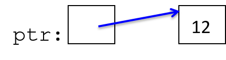
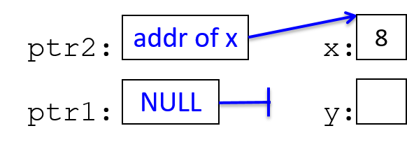
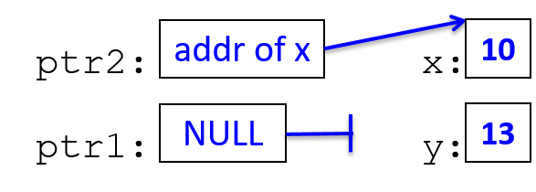
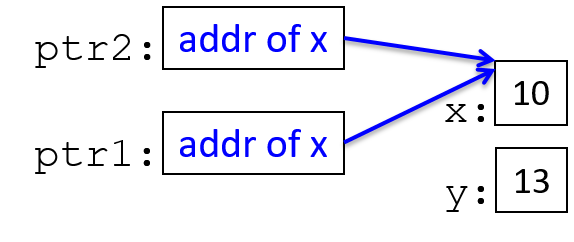
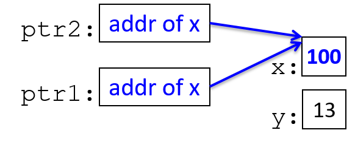
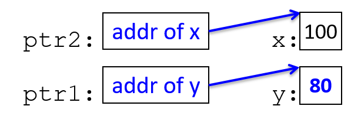

> [!WARNING] 说明
> 本文是个人学习用的**非官方**中英对照译文，原文：<https://diveintosystems.org/book/C2-C_depth/pointers.html>。
> 原书采用 CC BY-NC-ND 4.0 许可（禁止演绎），**请勿公开传播本译文**。
> 标为「译注」「现代更新」的内容是译者补充，不代表原书作者观点；代码与原文逐字一致，未作改动。


*2.2. C’s Pointer Variables*

C 的指针变量为访问程序内存提供了一层间接性（indirection）。理解了指针变量的用法，程序员就能写出既强大又高效的 C 程序。例如，借助指针变量，C 程序员可以：

> C’s pointer variables provide a level of indirection to accessing program memory. By understanding how to use pointer variables, a programmer can write C programs that are both powerful and efficient. For example, through pointer variables, a C programmer can:

- 实现能够修改调用者栈帧中数值的函数参数

> - implement functions whose parameters can modify values in the caller’s stack frame

- 在程序运行时按需动态分配（和释放）程序内存

> - dynamically allocate (and deallocate) program memory at runtime when the program needs it

- 高效地把大型数据结构传递给函数

> - efficiently pass large data structures to functions

- 创建链式的动态数据结构

> - create linked dynamic data structures

- 以不同方式解读程序内存中的字节。

> - interpret bytes of program memory in different ways.

本节介绍 C 指针变量的语法和语义，并给出在 C 程序中使用指针的常见示例。

> In this section we introduce the syntax and semantics of C’s pointer variables and introduce common examples of how to use them in C programs.

### 2.2.1. 指针变量

*2.2.1. Pointer Variables*

**指针变量**（pointer variable）存储的是一个内存位置的地址，该位置可以存放某种特定类型的值。例如，指针变量可以存储一个 `int` 的地址，这个地址处存放着整数值 12。我们说指针变量*指向*（points to，即引用）这个值。指针为访问内存中存储的值提供了*一层间接性*。[图 1](2.2-pointers.html) 展示了指针变量在内存中大致的样子：

> A **pointer variable** stores the address of a memory location in which a value of a specific type can be stored. For example, a pointer variable can store the value of an `int` address at which the integer value 12 is stored. The pointer variable *points to* (refers to) the value. A pointer provides *a level of indirection* for accessing values stored in memory. [Figure 1](2.2-pointers.html) illustrates an example of what a pointer variable might look like in memory:



**图 1.** 指针变量存储的是内存中某个位置的地址。这里，指针存储的是一个整型变量的地址，该变量中存放着数值 12。

*Figure 1. A pointer variable stores the address of a location in memory. Here, the pointer stores the address of an integer variable that holds the number 12.*

通过指针变量 `ptr`，可以间接访问它所指向的内存位置中存储的值（`12`）。C 程序最常在以下两种场合使用指针变量：

> Through the pointer variable, `ptr`, the value (`12`) stored in the memory location it points to can be indirectly accessed. C programs most frequently use pointer variables for:

1. **"按指针传递"参数**：编写能通过指针参数修改实参值的函数

> 1.  **"Pass by pointer" parameters**, for writing functions that can modify their argument’s value through a pointer parameter

2. **动态内存分配**：编写在运行过程中分配（和释放）空间的程序。动态内存常用于动态分配数组。当程序员在编译时不知道某个数据结构的大小（例如数组大小取决于用户在运行时的输入）时，它就很有用。它还允许数据结构在程序运行期间改变大小。

> 2.  **Dynamic memory allocation**, for writing programs that allocate (and free) space as the program runs. Dynamic memory is commonly used for dynamically allocating arrays. It is useful when a programmer doesn’t know the size of a data structure at compile time (e.g., the array size depends on user input at runtime). It also enables data structures to be resized as the program runs.

#### 使用指针变量的规则

*Rules for Using Pointer Variables*

使用指针变量的规则与普通变量类似，只是你需要同时考虑两种类型：指针变量本身的类型，以及指针所指向的内存地址中存放的值的类型。

> The rules for using pointer variables are similar to regular variables, except that you need to think about two types: the type of the pointer variable, and the type stored in the memory address to which the pointer variable points.

1. 首先，用 `type_name *var_name` 的形式**声明一个指针变量**：

    ```
    int *ptr;   // stores the memory address of an int (ptr "points to" an int)
    char *cptr; // stores the memory address of a char (cptr "points to" a char)
    ```

    > **注：指针的类型**
    >
    > 注意，虽然 `ptr` 和 `cptr` 都是指针，但它们指向的类型不同：
    >
    > - `ptr` 的类型是*"指向 int 的指针"*（`int *`），它可以指向存放 `int` 值的内存位置。
    >
    > - `cptr` 的类型是*"指向 char 的指针"*（`char *`），它可以指向存放 `char` 值的内存位置。

> 1.  First, **declare a pointer variable** using `type_name *var_name`:
>
>     ```
>     int *ptr;   // stores the memory address of an int (ptr "points to" an int)
>     char *cptr; // stores the memory address of a char (cptr "points to" a char)
>     ```
>
>     > **Note: Pointer Types**
>     >
>     > Note that although `ptr` and `cptr` are both pointers, they refer to different types:
>     >
>     > - The type of `ptr` is *"pointer to int"* (`int *`). It can point to a memory location that stores an `int` value.
>     >
>     > - The type of `cptr` is *"pointer to char"* (`char *`). It can point to a memory location that stores a `char` value.

2. 接着，**初始化指针变量**（让它指向某个东西）。指针变量*存储的是地址值*。指针应当被初始化为某个内存位置的地址，并且该位置的类型要与指针所指向的类型一致。初始化指针的一种方法是对变量使用**取地址运算符**（`&`），得到该变量的地址值：

    ```
    int x;
    char ch;

    ptr = &x;    // ptr gets the address of x, pointer "points to" x
    cptr = &ch;  // cptr gets the address of ch, pointer "points to" ch
    ```

    

    **图 2.** 程序可以把一个类型合适的已有变量的地址赋给指针，以此来初始化指针。

    下面是一个因类型不匹配而无效的指针初始化示例：

    ```
    cptr = &x;   // ERROR: cptr can hold a char memory location
                 // (&x is the address of an int)
    ```

    尽管 C 编译器可能允许这种赋值（并给出类型不兼容的警告），但通过 `cptr` 访问和修改 `x` 的行为很可能与程序员的预期不符。程序员应当使用 `int *` 类型的变量去指向 `int` 存储位置。

    所有指针变量都可以被赋予一个特殊值 **NULL**，它表示一个无效地址。**空指针**（null pointer，即值为 `NULL` 的指针）永远不应被用来访问内存，但 `NULL` 这个值可以用来检测指针变量是否指向一个有效的内存地址。也就是说，C 程序员在访问指针所指向的内存位置之前，通常会先检查它的值不是 `NULL`。把指针设为 `NULL` 的写法如下：

    ```
    ptr = NULL;
    cptr = NULL;
    ```

    

    **图 3.** 任何指针都可以被赋予特殊值 NULL，表示它不指向任何特定地址。空指针永远不应被解引用。

> 2.  Next, **initialize the pointer variable** (make it point to something). Pointer variables *store address values*. A pointer should be initialized to store the address of a memory location whose type matches the type to which the pointer variable points. One way to initialize a pointer is to use the **address operator** (`&`) with a variable to get the variable’s address value:
>
>     ```
>     int x;
>     char ch;
>
>     ptr = &x;    // ptr gets the address of x, pointer "points to" x
>     cptr = &ch;  // cptr gets the address of ch, pointer "points to" ch
>     ```
>
>     *Figure 2. A program can initialize a pointer by assigning it the address of an existing variable of the appropriate type.*
>
>     Here’s an example of an invalid pointer initialization due to mismatched types:
>
>     ```
>     cptr = &x;   // ERROR: cptr can hold a char memory location
>                  // (&x is the address of an int)
>     ```
>
>     Even though the C compiler may allow this type of assignment (with a warning about incompatible types), the behavior of accessing and modifying `x` through `cptr` will likely not behave as the programmer expects. Instead, the programmer should use an `int *` variable to point to an `int` storage location.
>
>     All pointer variables can also be assigned a special value, **NULL**, which represents an invalid address. While a **null pointer** (one whose value is `NULL`) should never be used to access memory, the value `NULL` is useful for testing a pointer variable to see if it points to a valid memory address. That is, C programmers will commonly check a pointer to ensure that its value isn’t `NULL` before attempting to access the memory location to which it points. To set a pointer to `NULL`:
>
>     ```
>     ptr = NULL;
>     cptr = NULL;
>     ```
>
>     *Figure 3. Any pointer can be given the special value NULL, which indicates that it doesn’t refer to any particular address. Null pointers should never be dereferenced.*

3. 最后，**使用指针变量**：**解引用运算符**（dereference operator，`*`）会沿着指针变量找到它所指向的内存位置，并访问该位置上的值：

    ```
    /* Assuming an integer named x has already been declared, this code sets the
       value of x to 8. */

    ptr = &x;   /* initialize ptr to the address of x (ptr points to variable x) */
    *ptr = 8;   /* the memory location ptr points to is assigned 8 */
    ```

    

    **图 4.** 对指针解引用，就会访问该指针所指向的值。

> 3.  Finally, **use the pointer variable**: the **dereference operator** (`*`) follows a pointer variable to the location in memory that it points to and accesses the value at that location:
>
>     ```
>     /* Assuming an integer named x has already been declared, this code sets the
>        value of x to 8. */
>
>     ptr = &x;   /* initialize ptr to the address of x (ptr points to variable x) */
>     *ptr = 8;   /* the memory location ptr points to is assigned 8 */
>     ```
>
>     *Figure 4. Dereferencing a pointer accesses the value to which the pointer refers.*

#### 指针示例

*Pointer Examples*

下面是一段使用两个指针变量的 C 语句示例：

> Here’s an example sequence of C statements using two pointer variables:

```
int *ptr1, *ptr2, x, y;

x = 8;
ptr2 = &x;     // ptr2 is assigned the address of x
ptr1 = NULL;
```



*图示：把 x 初始化为 8，把 ptr2 初始化为 x 的地址，ptr1 被赋值为 NULL。*

```
*ptr2 = 10;     // the memory location ptr2 points to is assigned 10
y = *ptr2 + 3;  // y is assigned what ptr2 points to plus 3
```



*图示：解引用 ptr2，把 x 改为 10，并给 y 赋值 13。*

```
ptr1 = ptr2;   // ptr1 gets the address value stored in ptr2 (both point to x)
```



*图示：把 ptr2 的值赋给 ptr1（现在两者指向同一个位置）。*

```
*ptr1 = 100;
```



*图示：解引用 ptr1，把它所指向的值赋为 100。注意：这次赋值同时改变了 ptr1 和 ptr2 所指向的值，因为它们指向同一个位置。*

```
ptr1 = &y;     // change ptr1's value (change what it points to)
*ptr1 = 80;
```



*图示：让 ptr1 改为指向 y 的地址，并通过解引用把 y 的值改为 80。*

使用指针变量时，要仔细考虑相关变量的类型。画出内存示意图（如上面那些图）有助于理解指针代码在做什么。一些常见错误与误用解引用运算符（`*`）或取地址运算符（`&`）有关。例如：

> When using pointer variables, carefully consider the types of the relevant variables. Drawing pictures of memory (like those shown above) can help with understanding what pointer code is doing. Some common errors involve misusing the dereference operator (`*`) or the address operator (`&`). For example:

```
ptr = 20;       // ERROR?:  this assigns ptr to point to address 20
ptr = &x;
*ptr = 20;      // CORRECT: this assigns 20 to the memory pointed to by ptr
```

如果程序对一个不含有效地址的指针变量进行解引用，程序就会崩溃：

> If your program dereferences a pointer variable that does not contain a valid address, the program crashes:

> [!NOTE] 译注
> 段错误（segmentation fault，简称 segfault）是操作系统在程序访问了不允许访问的内存地址时发出的信号（`SIGSEGV`），默认处理方式是终止进程。地址 0（`NULL`）和 20 这样的小地址所在的页通常不会被映射，因此一定会触发段错误；而把任意整数当地址用（`ptr = x;`）则可能恰好落在已映射的内存上，悄悄改坏别的数据——这比直接崩溃更难排查。第 13 章讲虚拟内存时会解释这背后的机制。

```
ptr = NULL;
*ptr = 6;    // CRASH! program crashes with a segfault (a memory fault)

ptr = 20;
*ptr = 6;    // CRASH! segfault (20 is not a valid address)

ptr = x;
*ptr = 6;   // likely CRASH or may set some memory location with 6
            // (depends on the value of x which is used as an address value)

ptr = &x;   // This is probably what the programmer intended
*ptr = 6;
```

这类错误正是应当把指针变量初始化为 `NULL` 的原因之一：程序可以在解引用之前先检查指针的值是否为 `NULL`：

> These types of errors exemplify one reason to initialize pointer variables to `NULL`; a program can then test a pointer’s value for `NULL` before dereferencing it:

```
if (ptr != NULL) {
    *ptr = 6;
}
```
