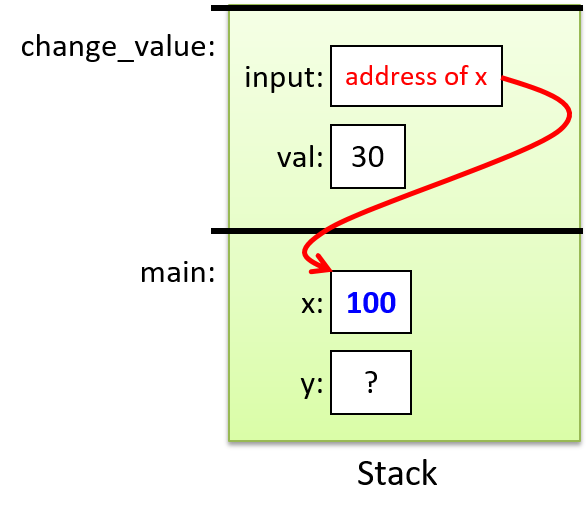

> **说明**
> 本文是个人学习用的**非官方**中英对照译文，原文：<https://diveintosystems.org/book/C2-C_depth/pointers_functions.html>。
> 原书采用 CC BY-NC-ND 4.0 许可（禁止演绎），**请勿公开传播本译文**。
> 标为「译注」「现代更新」的内容是译者补充，不代表原书作者观点；代码与原文逐字一致，未作改动。

## 2.3. 指针与函数

*2.3. Pointers and Functions*

指针参数提供了一种让函数修改实参值的机制。常用的**按指针传递**（pass by pointer）模式使用一个指针类型的函数形参，它*得到的是调用者传入的某个存储位置的地址值*。例如，调用者可以传入它的某个局部变量的地址。在函数内部对指针形参解引用，函数就能修改它所指向的存储位置上的值。

> Pointer parameters provide a mechanism through which functions can modify argument values. The commonly used **pass by pointer** pattern uses a pointer function parameter that *gets the value of the address of some storage location* passed to it by the caller. For example, the caller could pass the address of one of its local variables. By dereferencing the pointer parameter inside the function, the function can modify the value at the storage location to which it points.

我们在数组参数中已经见过类似的功能：数组类型的函数形参得到的是传入数组的基地址值（形参与实参指向同一组数组元素），函数可以修改数组中存储的值。一般来说，通过向函数传递指向调用者作用域内某个内存位置的指针形参，也可以运用同样的思路。

> We have already seen similar functionality with array parameters, where an array function parameter gets the value of the base address of the passed array (the parameter refers to the same set of array elements as its argument), and the function can modify the values stored in the array. In general, this same idea can be applied by passing pointer parameters to functions that point to the memory locations in the caller’s scope.

> **原书注 · 按值传递（Pass by Value）**
> C 中的所有实参都是按值传递的，遵循按值传递的语义：形参得到实参值的一份副本，修改形参的值不会改变实参的值。传递基本类型的值时（例如一个 `int` 变量的值），函数形参得到的是实参值（那个具体的 `int` 值）的副本，修改形参中存储的值无法改变实参中存储的值。
>
> 在按指针传递模式中，形参得到的仍然是实参的值，只不过传入的是*一个地址值*。与传递基本类型一样，修改指针形参本身的值不会改变实参的值（也就是说，让形参指向另一个地址，不会改变实参的地址值）。但是，通过对指针形参解引用，函数可以修改形参和实参共同指向的那块内存的内容；借助指针形参，函数可以修改一个在函数返回后对调用者可见的变量。
>
> > All arguments in C are passed by value and follow pass-by-value semantics: the parameter gets a copy of its argument value, and modifying the parameter’s value does not change its argument’s value. When passing base type values, like the value of an `int` variable, the function parameter gets a copy of its argument value (the specific `int` value), and changing the value stored in the parameter cannot change the value stored in its argument.
> >
> > In the pass-by-pointer pattern, the parameter still gets the value of its argument, but it is passed *the value of an address*. Just like in passing base types, changing a pointer parameter’s value will not change its argument’s value (that is, assigning the parameter to point to a different address will not change the argument’s address value). However, by dereferencing a pointer parameter, the function can change the contents of memory that both the parameter and its argument refer to; through a pointer parameter, a function can modify a variable that is visible to the caller after the function returns.

下面是实现和调用一个带按指针传递参数的函数的步骤，每一步都配有示例代码片段：

> Here are the steps for implementing and calling a function with a pass by pointer parameter, with example code snippets showing each step:

1. 把函数形参声明为指向该变量类型的指针：

    ```
    /* input: an int pointer that stores the address of a memory
     *        location that can store an int value (it points to an int)
     */
    int change_value(int *input) {
    ```

> 1.  Declare the function parameter to be a pointer to the variable type:
>
>     ```
>     /* input: an int pointer that stores the address of a memory
>      *        location that can store an int value (it points to an int)
>      */
>     int change_value(int *input) {
>     ```

2. 调用函数时，把某个变量的地址作为实参传入：

    ```
    int x;
    change_value(&x);
    ```

    在上面的例子中，由于形参的类型是 `int *`，传入的地址必须是一个 `int` 变量的地址。

> 2.  When making the function call, pass in the address of a variable as the argument:
>
>     ```
>     int x;
>     change_value(&x);
>     ```
>
>     In the preceding example, since the parameter’s type is `int *`, the address passed must be the address of an `int` variable.

3. 在函数体中，对指针形参解引用来修改实参的值：

    ```
    *input = 100;  // the location input points to (x's memory) is assigned 100
    ```

> 3.  In the body of the function, dereference the pointer parameter to change the argument’s value:
>
>     ```
>     *input = 100;  // the location input points to (x's memory) is assigned 100
>     ```

接下来，我们看一个[更大的示例程序](https://diveintosystems.org/book/C2-C_depth/_attachments/passbypointer.c)：

> Next, let’s examine a [larger example program](https://diveintosystems.org/book/C2-C_depth/_attachments/passbypointer.c):

```
#include <stdio.h>

int change_value(int *input);

int main(void) {
    int x;
    int y;

    x = 30;
    y = change_value(&x);
    printf("x: %d y: %d\n", x, y);  // prints x: 100 y: 30

    return 0;
}

/*
 * changes the value of the argument
 *     input: a pointer to the value to change
 *     returns: the original value of the argument
 */
int change_value(int *input) {
    int val;

    val = *input; /* val gets the value input points to */

    if (val < 100) {
        *input = 100;  /* the value input points to gets 100 */
    } else {
        *input =  val * 2;
    }

    return val;
}
```

运行时，输出为：

> When run, the output is:

```
x: 100 y: 30
```

[图 1](2.3-pointers_functions.html) 展示了在 `change_value` 中执行 return 之前调用栈的样子。

> [Figure 1](2.3-pointers_functions.html) shows what the call stack looks like before executing the return in `change_value`.



**图 1.** 从 change_value 返回之前调用栈的快照

*Figure 1. A snapshot of the call stack prior to returning from change_value.*

> **译注 · 图中内容**
> `change_value` 的形参 `input` 中存放的是 `main` 中变量 `x` 的地址（图中用箭头表示）。

形参 input 得到的是其实参值（`x` 的地址）的副本。调用函数时 `x` 的值是 30。在 `change_value` 函数内部，对形参解引用，把值 100 赋给形参所指向的内存位置（`*input = 100;`，意思是「`input` 所指向的位置得到值 100」）。由于形参存放的是 `main` 函数栈帧中一个局部变量的地址，通过对形参解引用，就能修改调用者局部变量中存储的值。函数返回后，实参的值反映了通过指针形参对它所做的修改（`main` 中 `x` 的值被 `change_value` 函数通过其 `input` 形参改成了 100）。

> The input parameter gets a copy of the value of its argument (the address of `x`). The value of `x` is 30 when the function call is made. Inside the `change_value` function, the parameter is dereferenced to assign the value 100 to the memory location pointed to by the parameter (`*input = 100;`, meaning "the location `input` points to gets the value 100"). Since the parameter stores the address of a local variable in the `main` function’s stack frame, through dereferencing the parameter, the value stored in the caller’s local variable can be changed. When the function returns, the argument’s value reflects the change made to it through the pointer parameter (the value of `x` in `main` was changed to 100 by the `change_value` function through its `input` parameter).
