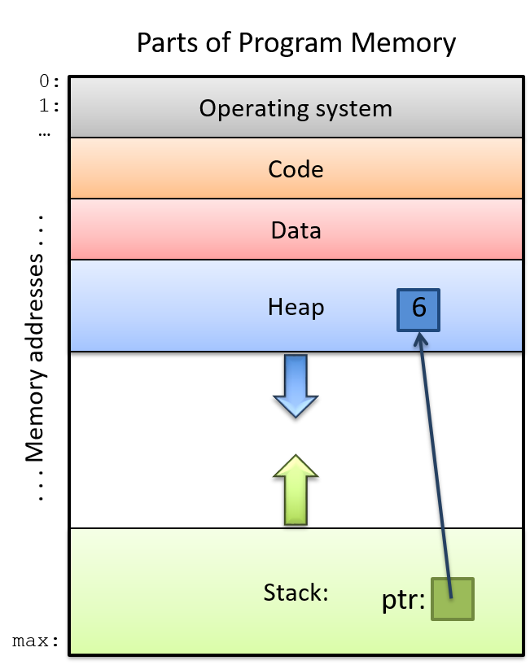
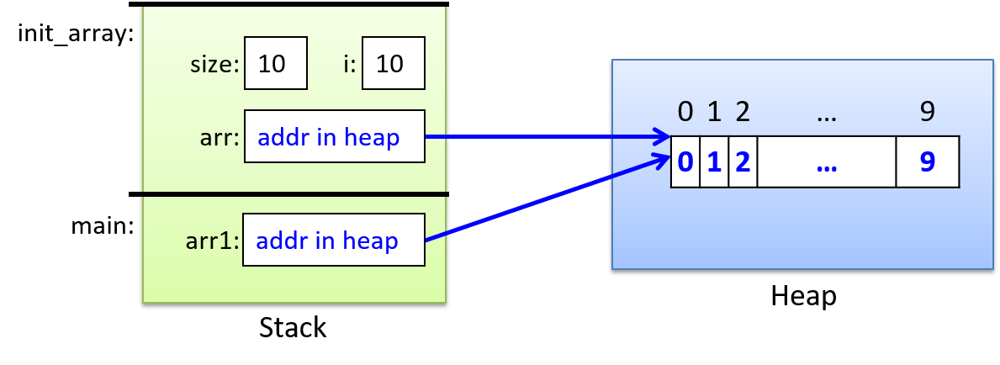

> **说明**
> 本文是个人学习用的**非官方**中英对照译文，原文：<https://diveintosystems.org/book/C2-C_depth/dynamic_memory.html>。
> 原书采用 CC BY-NC-ND 4.0 许可（禁止演绎），**请勿公开传播本译文**。
> 标为「译注」「现代更新」的内容是译者补充，不代表原书作者观点；代码与原文逐字一致，未作改动。

## 2.4. 动态内存分配

*2.4. Dynamic Memory Allocation*

除了按指针传递参数之外，程序还经常用指针变量来动态分配内存。这种**动态内存分配**（dynamic memory allocation）让 C 程序在运行过程中可以申请更多内存，并由一个指针变量存放动态分配到的空间的地址。程序常常通过动态分配内存，按某次运行的具体需要来确定数组的大小。

> In addition to pass-by-pointer parameters, programs commonly use pointer variables to dynamically allocate memory. Such **dynamic memory allocation** allows a C program to request more memory as it’s running, and a pointer variable stores the address of the dynamically allocated space. Programs often allocate memory dynamically to tailor the size of an array for a particular run.

动态内存分配为以下几类程序提供了灵活性：

> Dynamic memory allocation grants flexibility to programs that:

- 直到运行时才知道数组或其他数据结构大小的程序（例如大小取决于用户输入）

> - do not know the size of arrays or other data structures until runtime (e.g. the size depends on user input)

- 需要支持各种不同输入规模（而不只是不超过某个固定容量）的程序

> - need to allow for a variety of input sizes (not just up to some fixed capacity)

- 希望按某次执行的需要精确分配数据结构大小（不浪费容量）的程序

> - want to allocate exactly the size of data structures needed for a particular execution (don’t waste capacity)

- 在运行过程中增大或缩小已分配内存的程序：需要时重新分配更多空间，不再需要时释放空间。

> - grow or shrink the sizes of memory allocated as the program runs, reallocating more space when needed and freeing up space when it’s no longer required.

### 2.4.1. 堆内存

*2.4.1. Heap Memory*

程序内存空间中的每个字节都有一个对应的地址。程序运行所需的一切都在它的内存空间中，不同类型的实体位于程序内存空间的不同部分。例如，*代码*区存放程序的指令，全局变量位于*数据*区，局部变量和参数占据*栈*，而动态分配的内存来自*堆*。由于栈和堆都会在运行时增长（随着函数的调用和返回，以及动态内存的分配和释放），它们在程序地址空间中通常相距很远，好在程序运行时为两者各留出大片的增长空间。

> Every byte of memory in a program’s memory space has an associated address. Everything the program needs to run is in its memory space, and different types of entities reside in different parts of a program’s memory space. For example, the *code* region contains the program’s instructions, global variables reside in the *data* region, local variables and parameters occupy the *stack*, and dynamically allocated memory comes from the *heap*. Because the stack and the heap grow at runtime (as functions are called and return and as dynamic memory is allocated and freed), they are typically far apart in a program’s address space to leave a large amount of space for each to grow into as the program runs.

动态分配的内存位于程序地址空间中的[**堆**内存](2.1-scope_memory.html)区域。当程序在运行时动态申请内存时，堆会提供一块内存，其地址必须赋给一个指针变量。

> Dynamically allocated memory occupies the [**heap** memory](2.1-scope_memory.html) region of a program’s address space. When a program dynamically requests memory at runtime, the heap provides a chunk of memory whose address must be assigned to a pointer variable.

[图 1](2.4-dynamic_memory.html) 展示了一个正在运行的程序的内存组成，其中有一个位于栈上的指针变量（`ptr`），它存放着一块动态分配的堆内存的地址（即指向堆内存）。

> [Figure 1](2.4-dynamic_memory.html) illustrates the parts of a running program’s memory with an example of a pointer variable (`ptr`) on the stack that stores the address of dynamically allocated heap memory (it points to heap memory).



**图 1.** 栈上的一个指针指向一块从堆中分配的内存。

*Figure 1. A pointer on the stack points to a block of memory that was allocated from the heap.*

要记住，堆内存是匿名内存，「匿名」指的是堆中的地址并不绑定到变量名上。声明一个具名的程序变量，会把它分配在栈上或程序内存的数据部分。局部或全局指针变量可以存放某个匿名堆内存位置的地址（例如，栈上的局部指针变量可以指向堆内存），对这样的指针解引用，程序就能把数据存放到堆中。

> It’s important to remember that heap memory is anonymous memory, where "anonymous" means that addresses in the heap are not bound to variable names. Declaring a named program variable allocates it on the stack or in the data part of program memory. A local or global pointer variable can store the address of an anonymous heap memory location (e.g. a local pointer variable on the stack can point to heap memory), and dereferencing such a pointer enables a program to store data in the heap.

### 2.4.2. malloc 与 free

*2.4.2. malloc and free*

**malloc** 和 **free** 是标准 C 库（`stdlib`）中的函数，程序可以调用它们在**堆**中分配和释放内存。C 程序必须显式地分配（malloc）和释放（free）堆内存。

> **malloc** and **free** are functions in the standard C library (`stdlib`) that a program can call to allocate and deallocate memory in the **heap**. Heap memory must be explicitly allocated (malloc’ed) and deallocated (freed) by a C program.

要分配堆内存，就调用 `malloc`，并传入要分配的连续堆内存的总字节数。用 **`sizeof` 运算符**计算要申请的字节数。例如，要在堆上分配存放单个整数的空间，程序可以这样调用：

> To allocate heap memory, call `malloc`, passing in the total number of bytes of contiguous heap memory to allocate. Use the **`sizeof` operator** to compute the number of bytes to request. For example, to allocate space on the heap to store a single integer, a program could call:

```
// Determine the size of an integer and allocate that much heap space.
malloc(sizeof(int));
```

`malloc` 函数把分配到的堆内存的基地址返回给调用者（出错时返回 `NULL`）。下面是一个完整的示例程序，它调用 `malloc` 分配堆空间来存放一个 `int` 值：

> The `malloc` function returns the base address of the allocated heap memory to the caller (or `NULL` if an error occurs). Here’s a full example program with a call to `malloc` to allocate heap space to store a single `int` value:

```
#include <stdio.h>
#include <stdlib.h>

int main(void) {
    int *p;

    p = malloc(sizeof(int));  // allocate heap memory for storing an int

    if (p != NULL) {
        *p = 6;   // the heap memory p points to gets the value 6
    }
}
```

`malloc` 函数返回 `void *` 类型，它表示指向未指定类型（或任意类型）的通用指针。当程序调用 `malloc` 并把结果赋给一个指针变量时，程序就把分配到的内存与该指针变量的类型关联起来了。

> The `malloc` function returns a `void *` type, which represents a generic pointer to a non-specified type (or to any type). When a program calls `malloc` and assigns the result to a pointer variable, the program associates the allocated memory with the type of the pointer variable.

有时你可能会看到对 `malloc` 的调用显式地把它的返回类型从 `void *` 转换为与指针变量匹配的类型。例如：

> Sometimes you may see calls to `malloc` that explicitly recast its return type from `void *` to match the type of the pointer variable. For example:

```
p = (int *) malloc(sizeof(int));
```

`malloc` 前面的 `(int *)` 告诉编译器，在这次调用中 `malloc` 返回的 `void *` 类型将被当作 `int *` 使用（即把 `malloc` 的返回类型强制转换为 `int *`）。本章后面会更详细地讨论[类型强制转换和 `void *` 类型](2.9.3-advanced_voidstar.html)。

> The `(int *)` before `malloc` tells the compiler that the `void *` type returned by `malloc` will be used as an `int *` in this call (it recasts the return type of `malloc` to an `int *`). We discuss [type recasting and the `void *` type](2.9.3-advanced_voidstar.html) in more detail later in this chapter.

> **译注**
> 在 C 中，`void *` 可以隐式转换为任何对象指针类型，所以这个强制转换不是必需的，很多 C 风格指南反而建议不写。必须写转换的是 C++：在 C++ 里把 `malloc` 的结果赋给 `int *` 不加转换会编译失败。

如果没有足够的空闲堆内存来满足申请的字节数，`malloc` 调用就会失败。`malloc` 失败通常意味着程序中有错误，例如给 `malloc` 传了一个非常大的申请量、传了负数的字节数，或者在死循环中调用 `malloc` 耗尽了堆内存。由于任何一次 `malloc` 调用都可能失败，在对指针值解引用之前，你应当*始终检查它的返回值是否为 NULL*（为 NULL 表示 `malloc` 失败）。对空指针解引用会导致程序崩溃！例如：

> A call to `malloc` fails if there is not enough free heap memory to satisfy the requested number of bytes to allocate. Usually, `malloc` failing indicates an error in the program such as passing `malloc` a very large request, passing a negative number of bytes, or calling `malloc` in an infinite loop and running out of heap memory. Because any call to `malloc` can fail, you should *always test its return value for NULL* (indicating `malloc` failed) before dereferencing the pointer value. Dereferencing a NULL pointer will cause your program to crash! For example:

> **译注**
> `malloc` 的参数类型是无符号的 `size_t`，所以「传入负数」实际上会被转换成一个极大的正数，申请自然会失败。另外，在 Linux 等采用内存超额分配（overcommit）策略的系统上，`malloc` 即使返回了非 NULL，也可能要等到真正写入这块内存时才发现物理内存不够——检查 NULL 仍然必要，但并不能保证万无一失。

```
int *p;

p = malloc(sizeof(int));
if (p == NULL) {
    printf("Bad malloc error\n");
    exit(1);   // exit the program and indicate error
}
*p = 6;
```

当程序不再需要用 `malloc` 动态分配的堆内存时，应当调用 `free` 函数显式地释放这块内存。调用 `free` 之后把指针的值设为 `NULL` 也是个好主意：这样，如果程序中的某个错误导致它在 `free` 之后被意外解引用，程序会直接崩溃，而不是去修改已被后续 `malloc` 调用重新分配出去的堆内存。这种意料之外的内存引用会导致未定义的程序行为，往往很难调试；而空指针解引用会立即失败，因此是一种相对容易发现和修复的缺陷。

> When a program no longer needs the heap memory it dynamically allocated with `malloc`, it should explicitly deallocate the memory by calling the `free` function. It’s also a good idea to set the pointer’s value to `NULL` after calling `free`, so that if an error in the program causes it to be accidentally dereferenced after the call to `free`, the program will crash rather than modify parts of heap memory that have been reallocated by subsequent calls to `malloc`. Such unintended memory references can result in undefined program behavior that is often very difficult to debug, whereas a null pointer dereference will fail immediately, making it a relatively easy bug to find and to fix.

```
free(p);
p = NULL;
```

### 2.4.3. 动态分配的数组与字符串

*2.4.3. Dynamically Allocated Arrays and Strings*

C 程序员经常动态分配内存来存放数组。一次成功的 `malloc` 调用会分配一块所申请大小的连续堆内存，并把这块内存起始处的地址返回给调用者，因此返回的地址值正适合作为堆内存中一个动态分配数组的基地址。

> C programmers often dynamically allocate memory to store arrays. A successful call to `malloc` allocates one contiguous chunk of heap memory of the requested size. It returns the address of the start of this chunk of memory to the caller, making the returned address value suitable for the base address of a dynamically allocated array in heap memory.

要为一个元素数组动态分配空间，就把所需数组的总字节数传给 `malloc`。也就是说，程序应当向 `malloc` 申请「每个数组元素的字节数 × 数组元素个数」这么多字节。传给 `malloc` 的总字节数表达式写成 `sizeof(<type>) * <number of elements>` 的形式。例如：

> To dynamically allocate space for an array of elements, pass `malloc` the total number of bytes in the desired array. That is, the program should request from `malloc` the total number of bytes in each array element times the number of elements in the array. Pass `malloc` an expression for the total number of bytes in the form of `sizeof(<type>) * <number of elements>`. For example:

```
int *arr;
char *c_arr;

// allocate an array of 20 ints on the heap:
arr = malloc(sizeof(int) * 20);

// allocate an array of 10 chars on the heap:
c_arr = malloc(sizeof(char) * 10);
```

在这个例子中调用 `malloc` 之后，`int` 指针变量 `arr` 存放着堆内存中一个由 20 个连续整数存储位置组成的数组的基地址，`char` 指针变量 `c_arr` 存放着堆内存中一个由 10 个连续字符存储位置组成的数组的基地址。[图 2](2.4-dynamic_memory.html) 展示了大致的情形。

> After the calls to `malloc` in this example, the `int` pointer variable `arr` stores the base address of an array of 20 contiguous integer storage locations in heap memory, and the `c_arr` char pointer variable stores the base address of an array of 10 contiguous char storage locations in heap memory. [Figure 2](2.4-dynamic_memory.html) depicts what this might look like.


**图 2.** 在堆上分配的一个 20 元素整数数组和一个 10 元素字符数组。

*Figure 2. A 20-element integer array and 10-element character array allocated on the heap.*

注意，虽然 `malloc` 返回的是指向堆内存中动态分配空间的指针，但 C 程序把这些指向堆位置的指针存放在栈上。指针变量中存放的*只是*堆中数组存储空间的基地址（起始地址）。与静态声明的数组一样，动态分配数组的内存位置也是连续的。不过，虽然单次 `malloc` 调用会分配一块所申请字节数的连续内存，但多次调用 `malloc` *并不会*得到连续的堆地址（在大多数系统上）。在上面的例子中，`char` 数组的元素和 `int` 数组的元素在堆中的地址可能相距很远。

> Note that while `malloc` returns a pointer to dynamically allocated space in heap memory, C programs store the pointer to heap locations on the stack. The pointer variables contain *only the base address* (the starting address) of the array storage space in the heap. Just like statically declared arrays, the memory locations for dynamically allocated arrays are in contiguous memory locations. While a single call to `malloc` results in a chunk of memory of the requested number of bytes being allocated, multiple calls to `malloc` *will not* result in heap addresses that are contiguous (on most systems). In the example above, the `char` array elements and the `int` array elements may be at addresses that are far apart in the heap.

为数组动态分配了堆空间之后，程序就可以通过指针变量访问这个数组。由于指针变量的值代表数组在堆中的基地址，我们可以用与访问[静态声明数组](../C1-C_intro/1.5-arrays_strings.html)元素相同的语法，来访问动态分配数组中的元素。例如：

> After dynamically allocating heap space for an array, a program can access the array through the pointer variable. Because the pointer variable’s value represents the base address of the array in the heap, we can use the same syntax to access elements in dynamically allocated arrays as we use to access elements in [statically declared arrays](../C1-C_intro/1.5-arrays_strings.html). Here’s an example:

```
int i;
int s_array[20];
int *d_array;

d_array = malloc(sizeof(int) * 20);
if (d_array == NULL) {
    printf("Error: malloc failed\n");
    exit(1);
}

for (i=0; i < 20; i++) {
    s_array[i] = i;
    d_array[i] = i;
}

printf("%d %d \n", s_array[3], d_array[3]);  // prints 3 3
```

为什么访问动态分配数组的元素可以用与访问静态声明数组元素相同的语法，这一点也许并不显而易见。但是，尽管两者类型不同，`s_array` 和 `d_array` 的值都求值为数组在内存中的基地址。

> It may not be obvious why the same syntax can be used for accessing elements in dynamically allocated arrays as is used in accessing elements in statically declared arrays. However, even though their types are different, the values of `s_array` and `d_array` both evaluate to the base address of the array in memory.

**表 1.** 静态分配的 s_array 与动态分配的 d_array 的对比

*Table 1. Comparison of Statically Allocated s_array and Dynamically Allocated d_array*

| 表达式 | 值 | 类型 |
|------------|---------------------------------|-----------------------|
| s_array | 数组在内存中的基地址 | （静态）int 数组 |
| d_array | 数组在内存中的基地址 | int 指针（int \*） |

> | Expression | Value                           | Type                  |
> |------------|---------------------------------|-----------------------|
> | s_array    | base address of array in memory | (static) array of int |
> | d_array    | base address of array in memory | int pointer (int \*)  |

由于两个变量的名字都求值为数组在内存中的基地址（第一个元素所在内存的地址），变量名后面 `[i]` 语法的语义对两者都相同：`[i]` *对数组基地址偏移 i 处的 int 存储位置解引用*——也就是访问第 i 个元素。

> Because the names of both variables evaluate to the base address of the array in memory (the address of the first element memory), the semantics of the `[i]` syntax following the name of the variable remain the same for both: `[i]` *dereferences the int storage location at offset i from the base address of the array in memory* — it’s accessing the _i_th element.

在大多数情况下，我们建议用 `[i]` 语法访问动态分配数组的元素。不过，程序也可以用指针解引用语法（`*` 运算符）来访问数组元素。例如，在指向动态分配数组的指针前面加上 `*`，就会对指针解引用，访问数组的第 0 个元素：

> For most purposes, we recommend using the `[i]` syntax to access the elements of a dynamically allocated array. However, programs can also use the pointer dereferencing syntax (the `*` operator) to access array elements. For example, placing a `*` in front of a pointer that refers to a dynamically allocated array will dereference the pointer to access element 0 of the array:

```
/* these two statements are identical: both put 8 in index 0 */
d_array[0] = 8; // put 8 in index 0 of the d_array
*d_array = 8;   // in the location pointed to by d_array store 8
```

[数组](2.5-arrays.html)一节会更详细地介绍数组，[指针运算](2.9.4-advanced_pointer_arithmetic.html)一节会讨论通过指针变量访问数组元素。

> The [Arrays section](2.5-arrays.html) describes arrays in more detail, and the [Pointer Arithmetic section](2.9.4-advanced_pointer_arithmetic.html) discusses accessing array elements through pointer variables.

程序用完一个动态分配的数组后，应当调用 `free` 释放这块堆空间。如前所述，我们建议在释放指针后把它设为 `NULL`：

> When a program is finished using a dynamically allocated array, it should call `free` to deallocate the heap space. As mentioned earlier, we recommend setting the pointer to `NULL` after freeing it:

```
free(arr);
arr = NULL;

free(c_arr);
c_arr = NULL;

free(d_array);
d_array = NULL;
```

> **原书旁注 · 堆内存管理、malloc 与 free（Heap Memory Management, malloc and free）**
> C 标准库实现了 `malloc` 和 `free`，它们是其堆内存管理器的编程接口。被调用时，`malloc` 需要找到一块能满足申请大小的、连续的未分配堆内存空间。堆内存管理器维护着一个由未分配的堆内存**区段**（extent）组成的**空闲链表**（free list），每个区段指明一块连续的未分配堆空间的起始地址和大小。
>
> 最初整个堆内存都是空的，也就是说空闲链表中只有一个区段，它覆盖整个堆区域。程序调用若干次 `malloc` 和 `free` 之后，堆内存可能变得**碎片化**（fragmented），即空闲的堆空间块与已分配的堆空间块交错分布。堆内存管理器通常按不同的大小范围维护多个链表，以便快速找到特定大小的空闲区段。此外，它还实现一种或多种策略，用于在多个都能满足申请的空闲区段之间作出选择。
>
> `free` 函数看起来可能有些奇怪：它只需要接收要释放的堆空间的地址，而不需要知道该地址处要释放的堆空间有多大。这是因为 `malloc` 不仅分配所申请的内存字节，还会在分配的内存块之前额外分配几个字节，用来存放一个头部结构。头部中存放着这块已分配堆空间的元数据，比如大小。因此，调用 `free` 只需传入要释放的堆内存地址。`free` 的实现可以从传给它的地址之前的那段内存中的头部信息里得到要释放的内存大小。
>
> 想进一步了解堆内存管理，可以参考操作系统教材（例如 [OS in Three Easy Pieces](http://pages.cs.wisc.edu/~remzi/OSTEP/#book-chapters) 的第 17 章「空闲空间管理」（Free Space Management）就讲了这些细节）。
>
> > The C standard library implements `malloc` and `free`, which are the programming interface to its heap memory manager. When called, `malloc` needs to find a contiguous chunk of unallocated heap memory space that can satisfy the size of the request. The heap memory manager maintains a **free list** of unallocated **extents** of heap memory, where each extent specifies the start address and size of a contiguous unallocated chunk of heap space.
> >
> > Initially, all of heap memory is empty, meaning that the free list has a single extent consisting of the entire heap region. After a program has made some calls to `malloc` and `free`, heap memory can become **fragmented**, meaning that there are chunks of free heap space interspersed with chunks of allocated heap space. The heap memory manager typically keeps lists of different ranges of sizes of heap space to enable fast searching for a free extent of a particular size. In addition, it implements one or more policies for choosing among multiple free extents that could be used to satisfy a request.
> >
> > The `free` function may seem odd in that it only expects to receive the address of the heap space to free without needing the size of the heap space to free at that address. That’s because `malloc` not only allocates the requested memory bytes, but it also allocates a few additional bytes right before the allocated chunk to store a header structure. The header stores metadata about the allocated chunk of heap space, such as the size. As a result, a call to `free` only needs to pass the address of heap memory to free. The implementation of `free` can get the size of the memory to free from the header information that is in memory right before the address passed to `free`.
> >
> > For more information about heap memory management, see an OS textbook (for example, Chapter 17 \`\`Free Space Management'', in [OS in Three Easy Pieces](http://pages.cs.wisc.edu/~remzi/OSTEP/#book-chapters) covers these details).

> **译注**
> 《Operating Systems: Three Easy Pieces》（OSTEP）是一本免费的操作系统教材，有中文译本《操作系统导论》。实际使用中，glibc 的 `malloc`（ptmalloc）、jemalloc、tcmalloc、mimalloc 等分配器都在这里描述的基本思路上加入了按大小分级的空闲表、按线程缓存等优化。

### 2.4.4. 指向堆内存的指针与函数

*2.4.4. Pointers to Heap Memory and Functions*

把一个动态分配的数组传给函数时，传给函数的是指针变量实参的*值*（即数组在堆中的基地址）。因此，无论把静态声明的数组还是动态分配的数组传给函数，形参得到的值完全相同——数组在内存中的基地址。于是，同一个函数既可用于静态分配的数组，也可用于同类型的动态分配数组，并且在函数内部可以用完全相同的语法访问数组元素。形参声明 `int *arr` 与 `int arr[]` 是等价的。不过，按照惯例，可能会以动态分配数组调用的函数倾向于使用指针语法：

> When passing a dynamically allocated array to a function, the pointer variable argument’s *value* is passed to the function (i.e., the base address of the array in the heap is passed to the function). Thus, when passing either statically declared or dynamically allocated arrays to functions, the parameter gets exactly the same value — the base address of the array in memory. As a result, the same function can be used for statically and dynamically allocated arrays of the same type, and identical syntax can be used inside the function for accessing array elements. The parameter declarations `int *arr` and `int arr[]` are equivalent. However, by convention, the pointer syntax tends to be used for functions that may be called with dynamically allocated arrays:

```
int main(void) {
    int *arr1;

    arr1 = malloc(sizeof(int) * 10);
    if (arr1 == NULL) {
        printf("malloc error\n");
        exit(1);
    }

    /* pass the value of arr1 (base address of array in heap) */
    init_array(arr1, 10);
    ...
}

void init_array(int *arr, int size) {
    int i;
    for (i = 0; i < size; i++) {
        arr[i] = i;
    }
}
```

在 `init_array` 函数即将返回的那一刻，内存的内容如[图 3](2.4-dynamic_memory.html) 所示。注意，`main` 把 `arr1` 传给 `init_array` 时，传的只是数组的基地址。数组那一大块连续内存仍然留在堆上，函数可以通过对指针形参 `arr` 解引用来访问它。`main` 还传入了数组的大小，好让 `init_array` 知道要访问多少个元素。

> At the point just before returning from the `init_array` function, the contents of memory will look like [Figure 3](2.4-dynamic_memory.html). Note that when `main` passes `arr1` to `init_array`, it’s passing only the base address of the array. The array’s large block of contiguous memory remains on the heap, and the function can access it by dereferencing the `arr` pointer parameter. It also passes the size of the array so that `init_array` knows how many elements to access.



**图 3.** 从 init_array 返回之前的内存内容。main 的 arr1 和 init_array 的 arr 变量指向同一块堆内存。

*Figure 3. The contents of memory prior to returning from init_array. Both main’s arr1 and init_array’s arr variable point to the same block of heap memory.*
