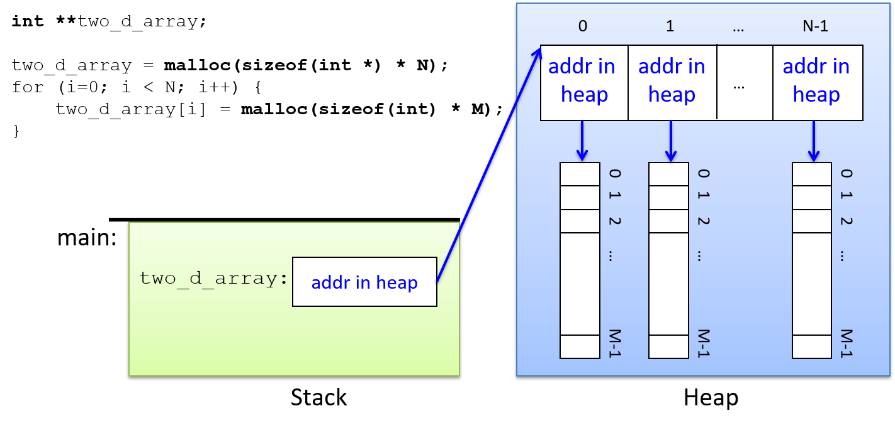

> **说明**
> 本文是个人学习用的**非官方**中英对照译文，原文：<https://diveintosystems.org/book/C2-C_depth/arrays.html>。
> 原书采用 CC BY-NC-ND 4.0 许可（禁止演绎），**请勿公开传播本译文**。
> 标为「译注」「现代更新」的内容是译者补充，不代表原书作者观点；代码与原文逐字一致，未作改动。

## 2.5. C 中的数组

*2.5. Arrays in C*

在[上一章](../C1-C_intro/1.5-arrays_strings.html)中，我们介绍了静态声明的一维 C 数组，并讨论了把数组传给函数的语义。在本章的[动态内存分配一节](2.2-pointers.html)中，我们介绍了动态分配的一维数组，并讨论了把它们传给函数的语义。

> In the [previous chapter](../C1-C_intro/1.5-arrays_strings.html) we introduced statically declared one-dimensional C arrays and discussed the semantics of passing arrays to functions. In the [dynamic memory allocation section](2.2-pointers.html) of this chapter, we introduced dynamically allocated one dimensional arrays and discussed the semantics of passing them to functions.

本节更深入地探讨 C 中的数组。我们会更详细地介绍静态分配和动态分配的数组，并讨论二维数组。

> In this section, we take a more in-depth look at arrays in C. We describe both statically and dynamically allocated arrays in more detail and discuss two-dimensional arrays.

### 2.5.1. 一维数组

*2.5.1. Single-Dimensional Arrays*

#### 静态分配

*Statically Allocated*

在进入新内容之前，我们先用一个例子简要回顾一下静态数组。关于静态声明的一维数组的更多细节，请参见[上一章](../C1-C_intro/1.5-arrays_strings.html)。

> Before jumping into new content, we briefly summarize static arrays with an example. See the [previous chapter](../C1-C_intro/1.5-arrays_strings.html) for more detail on statically declared one-dimensional arrays.

静态声明的数组要么分配在栈上（局部变量），要么分配在内存的数据区（全局变量）。程序员可以通过指定数组变量的类型（每个下标处存放的类型）和总容量（元素个数）来声明它。

> Statically declared arrays are allocated either on the stack (for local variables) or in the data region of memory (for global variables). A programmer can declare an array variable by specifying its type (the type stored at each index) and its total capacity (number of elements).

把数组传给函数时，C 把基地址的值复制给形参。也就是说，形参和实参都指向同一组内存位置——形参指针指向内存中实参数组的元素。因此，通过数组形参修改数组中存放的值，会修改实参数组中存放的值。

> When passing an array to a function, C copies the value of the base address to the parameter. That is, both the parameter and the argument refer to the same memory locations — the parameter pointer points to the argument’s array elements in memory. As a result, modifying the values stored in the array through an array parameter modifies the values stored in the argument array.

下面是一些静态数组声明和使用的例子：

> Here are some examples of static array declaration and use:

```
// declare arrays specifying their type and total capacity
float averages[30];   // array of float, 30 elements
char  name[20];       // array of char, 20 elements
int i;

// access array elements
for (i = 0; i < 10; i++) {
    averages[i] = 0.0 + i;
    name[i] = 'a' + i;
}
name[10] = '\0';    // name is being used for storing a C-style string

// prints: 3 d abcdefghij
printf("%g %c %s\n", averages[3], name[3], name);

strcpy(name, "Hello");
printf("%s\n", name);  // prints: Hello
```

#### 动态分配

*Dynamically Allocated*

在本章的[动态内存分配一节](2.2-pointers.html)中，我们介绍了动态分配的一维数组，包括它们的访问语法，以及把动态分配数组传给函数的语法和语义。这里我们用一个例子简短地回顾一下这些内容。

> In the [Dynamic Memory Allocation section](2.2-pointers.html) of this chapter, we introduced dynamically allocated one-dimensional arrays, including their access syntax and the syntax and semantics of passing dynamically allocated arrays to functions. Here, we present a short recap of that information with an example.

调用 `malloc` 函数会在运行时于堆上动态分配一个数组。分配到的堆空间的地址可以赋给一个全局或局部指针变量，该指针于是指向数组的第一个元素。要动态分配空间，就把要为数组分配的总字节数传给 `malloc`（用 `sizeof` 运算符获取特定类型的大小）。一次 `malloc` 调用会分配一块所申请大小的连续堆空间。例如：

> Calling the `malloc` function dynamically allocates an array on the heap at runtime. The address of the allocated heap space can be assigned to a global or local pointer variable, which then points to the first element of the array. To dynamically allocate space, pass `malloc` the total number of bytes to allocate for the array (using the `sizeof` operator to get the size of a specific type). A single call to `malloc` allocates a contiguous chunk of heap space of the requested size. For example:

```
// declare a pointer variable to point to allocated heap space
int    *p_array;
double *d_array;

// call malloc to allocate the appropriate number of bytes for the array

p_array = malloc(sizeof(int) * 50);      // allocate 50 ints
d_array = malloc(sizeof(double) * 100);  // allocate 100 doubles

// always CHECK RETURN VALUE of functions and HANDLE ERROR return values
if ( (p_array == NULL) || (d_array == NULL) ) {
    printf("ERROR: malloc failed!\n");
    exit(1);
}

// use [] notation to access array elements
for (i = 0; i < 50; i++) {
    p_array[i] = 0;
    d_array[i] = 0.0;
}

// free heap space when done using it
free(p_array);
p_array = NULL;

free(d_array);
d_array = NULL;
```

#### 数组的内存布局

*Array Memory Layout*

无论数组是静态声明的，还是通过一次 `malloc` 调用动态分配的，数组元素都占据连续的内存位置（地址）：

> Whether an array is statically declared or dynamically allocated via a single call to `malloc`, array elements represent contiguous memory locations (addresses):

```
 array [0]:  base address
 array [1]:  next address
 array [2]:  next address
   ...            ...
 array [99]: last address
```

元素 `i` 位于相对于数组基地址偏移 `i` 处。第 i 个元素的确切地址取决于数组中所存类型的字节数。例如，看下面的数组声明：

> The location of element `i` is at an offset `i` from the base address of the array. The exact address of the ith element depends on the number of bytes of the type stored in the array. For example, consider the following array declarations:

```
int  iarray[6];  // an array of six ints, each of which is four bytes
char carray[4];  // an array of four chars, each of which is one byte
```

它们各个数组元素的地址可能是这样的：

> The addresses of their individual array elements might look something like this:

```
 addr   element
 ----   -------
 1230:  iarray[0]
 1234:  iarray[1]
 1238:  iarray[2]
 1242:  iarray[3]
 1246:  iarray[4]
 1250:  iarray[5]
     ...
 1280:  carray[0]
 1281:  carray[1]
 1282:  carray[2]
 1283:  carray[3]
```

在这个例子中，`1230` 是 `iarray` 的基地址，`1280` 是 `carray` 的基地址。注意每个数组的各个元素都被分配在连续的内存地址上：`iarray` 的每个元素存放一个 4 字节的 `int` 值，所以其元素地址相差 4；`carray` 的每个元素存放一个 1 字节的 `char` 值，所以其地址相差 1。并不保证这组局部变量在栈上被分配到连续的内存位置（因此，如本例所示，`iarray` 的末尾与 `carray` 的开头之间可能有一段地址空隙）。

> In this example, `1230` is the base address of `iarray` and `1280` the base address of `carray`. Note that individual elements of each array are allocated to contiguous memory addresses: each element of `iarray` stores a 4-byte `int` value, so its element addresses differ by 4, and each element of `carray` stores a 1-byte `char` value, so its addresses differ by 1. There is no guarantee that the set of local variables are allocated to contiguous memory locations on the stack (hence, there could be a gap in the addresses between the end of `iarray` and the start of `carray`, as shown in this example.)

> **原书注**
> 定义数组的总容量时，人们常用常量而不是字面数值。常量是 C 字面值的别名，用常量代替字面值能让代码更易读，也更便于修改。关于如何定义和使用 C 常量，请参见 [C 常量](2.9.1-advanced_switch.html)。
>
> 下面是一个定义常量（`N`）并用它作为数组维度的例子：
>
> ```
> #define N   20
>
> int main(void) {
>   int array[N];   // an array of 20 ints
>   int *d_arr, i;
>
>   // dynamically alloc array of 20 ints
>   d_arr = malloc(sizeof(int)*N);
>   if(d_arr == NULL) {
>     exit(1);
>   }
>
>   for(i=0; i < N; i++) {
>     array[i] = i;
>     d_arr[i] = i*2;
>   }
>   ...
> }
> ```
>
> > Constants are often used when defining the total capacity of an array rather than using a literal numeric value. Constants are aliases for C literal values, and are used instead of literals to make the code easier to read and to allow for it to be more easily updated. See [C Constants](2.9.1-advanced_switch.html) to learn more about defining and using C constants.
> >
> > Here is an example defining and using a constant (`N`) for the dimension of the arrays:
> >
> > ```
> > #define N   20
> >
> > int main(void) {
> >   int array[N];   // an array of 20 ints
> >   int *d_arr, i;
> >
> >   // dynamically alloc array of 20 ints
> >   d_arr = malloc(sizeof(int)*N);
> >   if(d_arr == NULL) {
> >     exit(1);
> >   }
> >
> >   for(i=0; i < N; i++) {
> >     array[i] = i;
> >     d_arr[i] = i*2;
> >   }
> >   ...
> > }
> > ```

### 2.5.2. 二维数组

*2.5.2. Two-Dimensional Arrays*

C 支持多维数组，但我们只讨论二维（2D）数组，因为一维和二维数组是 C 程序员最常用的。

> C supports multidimensional arrays, but we limit our discussion of multidimensional arrays to two-dimensional (2D) arrays, since 1D and 2D arrays are the most commonly used by C programmers.

#### 静态分配的二维数组

*Statically Allocated 2D Arrays*

要静态声明一个多维数组变量，需要指定每一维的大小。例如：

> To statically declare a multidimensional array variable, specify the size of each dimension. For example:

```
int   matrix[50][100];
short little[10][10];
```

这里 `matrix` 是一个 50 行 100 列的 `int` 二维数组，`little` 是一个 10 行 10 列的 `short` 二维数组。

> Here, `matrix` is a 2D array of `int` values with 50 rows and 100 columns, and `little` is a 2D array of `short` values with 10 rows and 10 columns.

要访问单个元素，需要同时给出行下标和列下标：

> To access an individual element, indicate both the row and the column index:

```
int   val;
short num;

val = matrix[3][7];  // get int value in row 3, column 7 of matrix
num = little[8][4];  // get short value in row 8, column 4 of little
```

[图 1](2.5-arrays.html) 把二维数组画成一个整数值矩阵，二维数组中的某个特定元素由行下标和列下标确定。

> [Figure 1](2.5-arrays.html) illustrates the 2D array as a matrix of integer values, where a specific element in the 2D array is indexed by row and column index values.

![Accessing matrix\[2\]\[3\] is like indexing into a grid at row 2 and column 3.](images/matrix.png)

**图 1.** 表示为矩阵的二维数组。访问 matrix[2][3] 就像在网格中取第 2 行第 3 列的格子。

*Figure 1. A two-dimensional array represented as a matrix. Accessing matrix[2][3] is like indexing into a grid at row 2 and column 3.*

程序常用嵌套循环遍历二维数组的元素。例如，下面的嵌套循环把 `matrix` 中的所有元素初始化为 0：

> Programs often access the elements of a 2D array by iterating with nested loops. For example, the following nested loop initializes all elements in `matrix` to 0:

```
int i, j;

for (i = 0; i < 50; i++) {  // for each row i
    for (j = 0; j < 100; j++) { // iterate over each column element in row i
        matrix[i][j] = 0;
    }
}
```

#### 二维数组参数

*Two-Dimensional Array Parameters*

把一维数组实参传给函数的规则同样适用于二维数组实参：形参得到的是二维数组基地址的值（`&arr[0][0]`）。换句话说，形参指向实参的数组元素，因此函数可以修改传入数组中存放的值。

> The same rules for passing one-dimensional array arguments to functions apply to passing two-dimensional array arguments: the parameter gets the value of the base address of the 2D array (`&arr[0][0]`). In other words, the parameter points to the argument’s array elements and therefore the function can change values stored in the passed array.

对于多维数组形参，你必须指明形参是一个多维数组，但可以不指定第一维的大小（这样设计更通用）。其他各维的大小必须完整指定，以便编译器生成正确的数组偏移量。下面是一个二维的例子：

> For multidimensional array parameters, you must indicate that the parameter is a multidimensional array, but you can leave the size of the first dimension unspecified (for good generic design). The sizes of other dimensions must be fully specified so that the compiler can generate the correct offsets into the array. Here’s a 2D example:

```
// a C constant definition: COLS is defined to be the value 100
#define COLS  (100)

/*
 * init_matrix: initializes the passed matrix elements to the
 *              product of their index values
 *   m: a 2D array (the column dimension must be 100)
 *   rows: the number of rows in the matrix
 *   return: does not return a value
 */
void init_matrix(int m[][COLS], int rows) {
    int i, j;
    for (i = 0; i < rows; i++) {
        for (j = 0; j < COLS; j++) {
            m[i][j] = i*j;
        }
    }
}

int main(void) {
    int matrix[50][COLS];
    int bigger[90][COLS];

    init_matrix(matrix, 50);
    init_matrix(bigger, 90);
    ...
```

`matrix` 和 `bigger` 两个数组都可以作为实参传给 `init_matrix` 函数，因为它们的列维度与形参定义中的相同。

> Both the `matrix` and the `bigger` arrays can be passed as arguments to the `init_matrix` function because they have the same column dimension as the parameter definition.

> **原书注**
> 二维数组的形参定义中必须指定列维度，这样编译器才能计算从二维数组基地址到某一行元素起始处的偏移量。这一偏移量的计算方式取决于二维数组在内存中的布局。
>
> > The column dimension must be specified in the parameter definition of a 2D array so that the compiler can calculate the offset from the base address of the 2D array to the start of a particular row of elements. The offset calculation follows from the layout of 2D arrays in memory.

#### 二维数组的内存布局

*Two-Dimensional Array Memory Layout*

静态分配的二维数组在内存中按**行主序**（row-major order）排列，即第 0 行的所有元素在最前面，接着是第 1 行的所有元素，依此类推。例如，对于下面这个二维整数数组的声明：

> Statically allocated 2D arrays are arranged in memory in **row-major order**, meaning that all of row 0’s elements come first, followed by all of row 1’s elements, and so on. For example, given the following declaration of a 2D array of integers:

```
int arr[3][4];  // int array with 3 rows and 4 columns
```

它在内存中的布局可能如[图 2](2.5-arrays.html) 所示。

> its layout in memory might look like [Figure 2](2.5-arrays.html).

![Declaring an array as "int arr\[3\]\[4\]" yields three rows, each of which has four elements. Row 0 consists of arr\[0\]\[0\], arr\[0\]\[1\], arr\[0\]\[2\], and arr\[0\]\[3\]. Row 1 consists of arr\[1\]\[0\], arr\[1\]\[1\], etc.](images/2Dmem.png)

**图 2.** 按行主序排列的二维数组布局。

*Figure 2. The layout of a two-dimensional array in row-major order.*

注意，所有数组元素都被分配在连续的内存地址上。也就是说，二维数组的基地址就是 `[0][0]` 元素的内存地址（`&arr[0][0]`），后续元素按行主序连续存放（例如，第 1 行整行之后紧跟着第 2 行整行，依此类推）。

> Note that all array elements are allocated to contiguous memory addresses. That is, the base address of the 2D array is the memory address of the `[0][0]` element (`&arr[0][0]`), and subsequent elements are stored contiguously in row-major order (e.g., the entirety of row 1 is followed immediately by the entirety of row 2, and so on).

#### 动态分配的二维数组

*Dynamically Allocated 2D Arrays*

动态分配二维数组有两种方法。对于一个 *N*x*M* 的二维数组，可以：

> Dynamically allocated 2D arrays can be allocated in two ways. For an *N*x*M* 2D array, either:

1. 调用一次 `malloc`，分配一大块堆空间来存放全部 *N*x*M* 个数组元素。

> 1.  Make a single call to `malloc`, allocating one large chunk of heap space to store all *N*x*M* array elements.

2. 多次调用 `malloc`，分配一个「数组的数组」。首先分配一个由 *N* 个指向元素类型的指针组成的一维数组，二维数组的每一行对应其中一个指针。然后分配 *N* 个大小为 *M* 的一维数组，分别存放二维数组每一行的各列值。把这 *N* 个数组各自的地址赋给第一个数组中的 *N* 个指针元素。

> 2.  Make multiple calls to `malloc`, allocating an array of arrays. First, allocate a 1D array of *N* pointers to the element type, with a 1D array of pointers for each row in the 2D array. Then, allocate *N* 1D arrays of size *M* to store the set of column values for each row in the 2D array. Assign the addresses of each of these *N* arrays to the elements of the first array of *N* pointers.

程序员选用哪种方法，变量声明、分配代码和访问数组元素的语法都会随之不同。

> The variable declarations, allocation code, and array element access syntax differ depending on which of these two methods a programmer chooses to use.

#### 方法 1：节省内存的分配方式

*Method 1: Memory-Efficient Allocation*

在这种方法中，一次 `malloc` 调用就分配存放 *N*x*M* 个值所需的全部字节。这种方法的好处是更节省内存，因为全部 *N*x*M* 个元素的空间被一次性地分配在连续的内存位置上。

> In this method, a single call to `malloc` allocates the total number of bytes needed to store the *N*x*M* array of values. This method has the benefit of being more memory efficient because the entire space for all *N*x*M* elements will be allocated at once, in contiguous memory locations.

`malloc` 调用返回所分配空间的起始地址（数组的基地址），它（与一维数组一样）应当存放在一个指针变量中。实际上，用这种方法分配一维数组还是二维数组，在语义上没有任何区别：`malloc` 调用返回的是一块所申请字节数的连续堆内存的起始地址。由于用这种方法分配二维数组看起来与分配一维数组完全一样，程序员必须自己在这块单一的堆内存空间之上显式地映射二维的行列下标（编译器没有隐含的行或列的概念，因此无法把双下标语法解释为对这块 malloc 空间的访问）。

> The call to `malloc` returns the starting address of the allocated space (the base address of the array), which (like a 1D array) should be stored in a pointer variable. In fact, there is no semantic difference between allocating a 1D or 2D array using this method: the call to `malloc` returns the starting address of a contiguously allocated chunk of heap memory of the requested number of bytes. Because allocation of a 2D array using this method looks just like allocation for a 1D array, the programmer has to explicitly map 2D row and column indexing on top of this single chunk of heap memory space (the compiler has no implicit notion of rows or columns and thus cannot interpret double indexing syntax into this malloc’ed space).

下面是一段用方法 1 动态分配二维数组的 C 代码示例：

> Here’s an example C code snippet that dynamically allocates a 2D array using method 1:

```
#define N 3
#define M 4

int main(void) {
    int *two_d_array;    // the type is a pointer to an int (the element type)

    // allocate in a single malloc of N x M int-sized elements:
    two_d_array = malloc(sizeof(int) * N * M);

    if (two_d_array == NULL) {
        printf("ERROR: malloc failed!\n");
        exit(1);
    }

    ...
```

[图 3](2.5-arrays.html) 给出了用这种方法分配二维数组的例子，并展示了调用 `malloc` 之后内存可能的样子。

> [Figure 3](2.5-arrays.html) shows an example of allocating a 2D array using this method and illustrates what memory might look like after the call to `malloc`.


**图 3.** 用一次 malloc 调用分配二维数组的结果。

*Figure 3. The results of allocating a 2D array with a single call to malloc.*

> **译注 · 图中内容**
> 可以用 `malloc(sizeof(int) * (3*4))` 分配数组，并把基地址存放在栈上的指针变量中。由于 `malloc` 返回的是一块连续内存，我们可以像对待静态分配的数组那样，把这块内存看作按行主序排列的若干行和列。

与动态分配的一维数组一样，二维数组的指针变量分配在栈上。然后，这个指针被赋予 `malloc` 调用的返回值，它代表堆内存中那块由 *N*x*M* 个 `int` 存储位置组成的连续内存的基地址。

> Like 1D dynamically allocated arrays, the pointer variable for a 2D array is allocated on the stack. That pointer is then assigned the value returned by the call to `malloc`, which represents the base address of the contiguous chunk of *N*x*M* `int` storage locations in the heap memory.

由于这种方法为二维数组只使用一块 malloc 空间，内存分配的效率达到了最高（整个二维数组只需调用一次 `malloc`）。由于所有元素在连续内存中彼此紧挨着，而且每次访问只需经过指针变量的一层间接访问，这也是访问内存更高效的方式。

> Because this method uses a single chunk of malloc’ed space for the 2D array, the memory allocation is as efficient as possible (it only requires one call to `malloc` for the entire 2D array). It’s the more efficient way to access memory due to all elements being located close together in contiguous memory, with each access requiring only a single level of indirection from the pointer variable.

然而，用这种方法分配时，C 编译器分不清分配的是二维数组还是一维数组。因此，用这种方法分配二维数组时，*不能*使用静态声明二维数组的双下标语法（`[i][j]`），而必须由程序员根据行下标和列下标显式地计算在这块连续堆内存中的偏移量（`[i*M + j]`，其中 `M` 是列维度）。

> However, the C compiler does not know the difference between a 2D or 1D array allocation using this method. As a result, the double indexing syntax (`[i][j]`) of statically declared 2D arrays *cannot* be used when allocating a 2D array using this method. Instead, the programmer must explicitly compute the offset into the contiguous chunk of heap memory using a function of row and column index values (`[i*M + j]`, where `M` is the column dimension).

> **译注 · 其实也可以用双下标**
> 如果列数 `M` 在编译时已知（比如用 `#define M 4` 定义），可以把指针声明成「指向含 M 个 int 的数组的指针」：`int (*two_d_array)[M] = malloc(sizeof(int) * N * M);`，之后就能直接写 `two_d_array[i][j]`，内存仍是一整块连续空间。这种写法在 C89 中就合法（译者已用 `gcc -std=c89 -pedantic` 编译验证）；C99 起的可变长数组类型还允许 `M` 是运行时的变量。原书为了入门简单，没有介绍这种写法。

下面是程序员组织代码以初始化二维数组全部元素的一个例子：

> Here’s an example of how a programmer would structure code to initialize all the elements of a 2D array:

```
// access using [] notation:
//   cannot use [i][j] syntax because the compiler has no idea where the
//   next row starts within this chunk of heap space, so the programmer
//   must explicitly add a function of row and column index values
//   (i*M+j) to map their 2D view of the space into the 1D chunk of memory
for (i = 0; i < N; i++) {
    for (j = 0; j < M; j++) {
        two_d_array[i*M + j] = 0;
    }
}
```

##### 方法 1（单次 malloc）与函数参数

*Method 1 (Single malloc) and Function Parameters*

通过一次 `malloc` 分配的 `int` 数组，其基地址是一个指向 `int` 的指针，因此可以传给带有（`int *`）形参的函数。此外，还必须把行数和列数传给函数，以便它正确计算二维数组中的偏移量。例如：

> The base address of an array of `int` types allocated via a single `malloc` is a pointer to an `int`, so it can be passed to a function with an (`int *`) parameter. Additionally, the function must be passed row and column dimensions so that it can correctly compute offsets into the 2D array. For example:

```
/*
 * initialize all elements in a 2D array to 0
 *  arr: the array
 *  rows: number of rows
 *  cols: number of columns
 */
void init2D(int *arr, int rows, int cols) {
    int i, j;
    for (i = 0; i < rows; i++) {
        for (j = 0; j < cols; j++) {
            arr[i*cols + j] = 0;
        }
    }
}

int main(void) {
    int *array;
    array = malloc(sizeof(int) * N * M);
    if (array != NULL) {
        init2D(array, N, M);
    }
    ...
```

#### 方法 2：对程序员友好的方式

*Method 2: The Programmer-Friendly Way*

动态分配二维数组的第二种方法把数组存成由 *N* 个一维数组组成的数组（每行一个一维数组）。它需要调用 *N+1* 次 `malloc`：一次为行数组组成的数组分配空间，再为 *N* 行中每一行的列数组各分配一次。因此，*同一行内*的元素位置是连续的，但二维数组不同行之间的元素并不连续。分配和元素访问都不如方法 1 高效，变量的类型定义也可能有点让人困惑。不过，用这种方法，程序员可以使用双下标语法访问二维数组中的单个元素（第一个下标是行数组中的下标，第二个下标是该行中列元素数组的下标）。

> The second method for dynamically allocating a 2D array stores the array as an array of *N* 1D arrays (one 1D array per row). It requires *N+1* calls to `malloc`: one `malloc` for the array of row arrays, and one `malloc` for each of the *N* row’s column arrays. As a result, the element locations *within a row* are contiguous, but elements are not contiguous across rows of the 2D array. Allocation and element access are not as efficient as in method 1, and the type definitions for variables can be a bit more confusing. However, using this method, a programmer can use double indexing syntax to access individual elements of the 2D array (the first index is an index into the array of rows, the second index is an index into the array of column elements within that row).

下面是一个用方法 2 分配二维数组的例子（为了便于阅读，去掉了错误检测和处理代码）：

> Here is an example of allocating a 2D array using method 2 (with the error detection and handling code removed for readability):

```
// the 2D array variable is declared to be `int **` (a pointer to an int *)
// a dynamically allocated array of dynamically allocated int arrays
// (a pointer to pointers to ints)
int **two_d_array;
int i;

// allocate an array of N pointers to ints
// malloc returns the address of this array (a pointer to (int *)'s)
two_d_array = malloc(sizeof(int *) * N);

// for each row, malloc space for its column elements and add it to
// the array of arrays
for (i = 0; i < N; i++) {
// malloc space for row i's M column elements
    two_d_array[i] = malloc(sizeof(int) * M);
}
```

在这个例子中，注意变量的类型以及传给 `malloc` 调用的大小。为了引用这个动态分配的二维数组，程序员声明了一个 `int **` 类型的变量（`two_d_array`），它将存放一个动态分配的 `int *` 元素数组的地址。`two_d_array` 中的每个元素都存放着一个动态分配的 `int` 值数组的地址（`two_d_array[i]` 的类型是 `int *`）。

> In this example, note the types of the variables and the sizes passed to the calls to `malloc`. To refer to the dynamically allocated 2D array, the programmer declares a variable (`two_d_array`) of type `int **` that will store the address of a dynamically allocated array of `int *` element values. Each element in `two_d_array` stores the address of a dynamically allocated array of `int` values (the type of `two_d_array[i]` is `int *`).

[图 4](2.5-arrays.html) 展示了执行完上例中 *N+1* 次 `malloc` 调用之后内存可能的样子。

> [Figure 4](2.5-arrays.html) shows what memory might look like after the above example’s *N+1* calls to `malloc`.



**图 4.** 用 N+1 次 malloc 调用分配二维数组之后的内存布局。

*Figure 4. The arrangement of memory after allocating a 2D array with N+1 malloc calls.*

> **译注 · 图中内容**
> `two_d_array` 是一个栈变量，指向一个动态分配的指针数组；其中每个指针又指向一个一维整数数组。

注意，使用这种方法时，只有同一次 `malloc` 调用分配的元素在内存中是连续的。也就是说，每一行内的元素是连续的，但不同行（即使是相邻的行）的元素并不连续。

> Note that when using this method, only the elements allocated as part of a single call to `malloc` are contiguous in memory. That is, elements within each row are contiguous, but elements from different rows (even neighboring rows) are not.

分配好之后，就可以用双下标记法访问二维数组的单个元素。第一个下标指定外层 `int *` 指针数组中的一个元素（哪一行），第二个下标指定内层 `int` 数组中的一个元素（该行中的哪一列）。

> Once allocated, individual elements of the 2D array can be accessed using double-indexing notation. The first index specifies an element in the outer array of `int *` pointers (which row), and the second index specifies an element in the inner `int` array (which column within the row).

```
int i, j;

for (i = 0; i < N; i++) {
    for (j = 0; j < M; j++) {
        two_d_array[i][j] = 0;
    }
}
```

为了理解双下标是如何求值的，看看表达式中以下几个部分的类型和值：

> To understand how double indexing is evaluated, consider the type and value of the following parts of the expression:

```
       two_d_array: an array of int pointers, it stores the base address of an
                 array of (int *) values. Its type is int** (a pointer to int *).

    two_d_array[i]: the ith index into the array of arrays, it stores an (int *)
                 value that represents the base address of an array of (int)
                 values.  Its type is int*.

 two_d_array[i][j]: the jth element pointed to by the ith element of the array of
                 arrays, it stores an int value (the value in row i, column j
                 of the 2D array).  Its type is int.
```

##### 方法 2（数组的数组）与函数参数

*Method 2 (An Array of Arrays) and Function Parameters*

数组实参的类型是 `int **`（指向 `int` 指针的指针），函数形参的类型与实参一致。此外，还应当把行数和列数传给函数。由于这与方法 1 是不同的类型，两种数组无法共用同一个函数（它们不是同一种 C 类型）。

> The array argument’s type is `int **` (a pointer to a pointer to an `int`), and the function parameter matches its argument’s type. Additionally, row and column sizes should be passed to the function. Because this is a different type from method 1, both array types cannot use a common function (they are not the same C type).

下面是一个以方法 2（数组的数组）分配的二维数组为参数的函数示例：

> Here’s an example function that takes a method 2 (array of arrays) 2D array as a parameter:

```
/*
 * initialize a 2D array
 * arr: the array
 * rows: number of rows
 * cols: number of columns
 */
void init2D_Method2(int **arr, int rows, int cols) {
    int i,j;

    for (i = 0; i < rows; i++) {
        for (j = 0; j < cols; j++) {
            arr[i][j] = 0;
        }
    }
}

/*
 * main: example of calling init2D_Method2
 */
int main(void) {
    int **two_d_array;

    // some code to allocate the row array and multiple col arrays
    // ...

    init2D_Method2(two_d_array, N, M);
    ...
```

在这里，函数的实现可以使用双下标语法。与静态声明的二维数组不同，行和列两个维度都需要作为参数传入：`rows` 参数指定最外层数组（行数组组成的数组）的边界，`cols` 参数指定内层数组（每一行的列值数组）的边界。

> Here, the function implementation can use double-indexing syntax. Unlike statically declared 2D arrays, both the row and column dimensions need to be passed as parameters: the `rows` parameter specifies the bounds on the outermost array (the array of row arrays), and the `cols` parameter specifies the bounds on the inner arrays (the array column values for each row).
