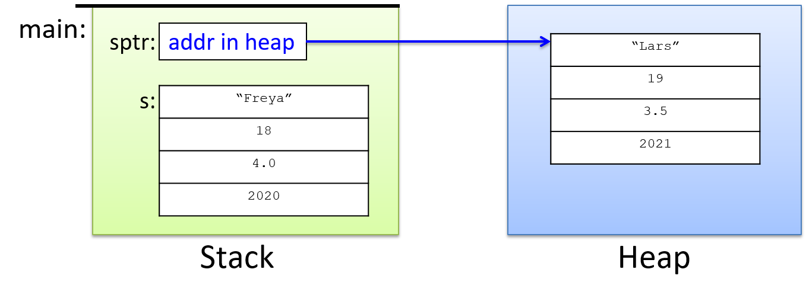
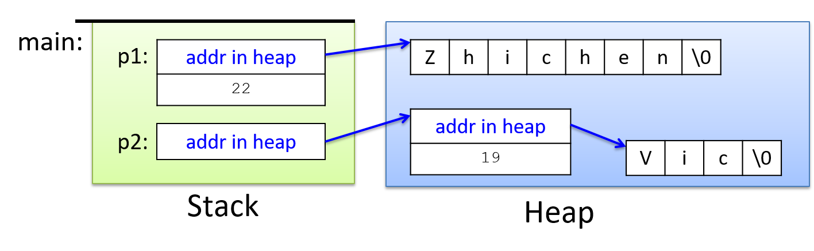
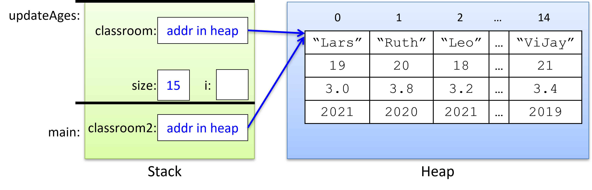
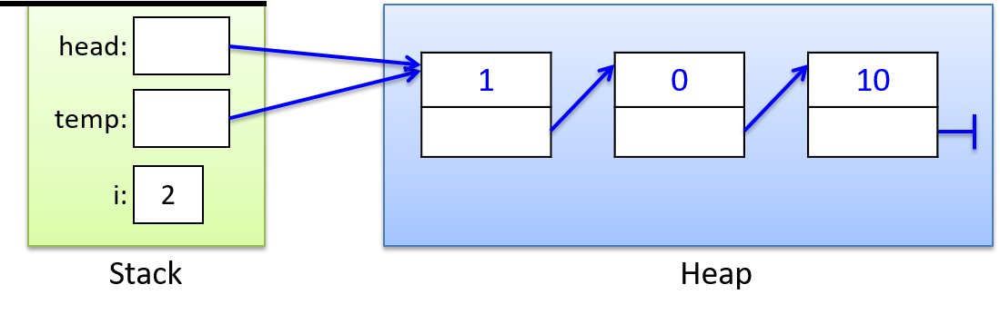

> [!WARNING] 说明
> 本文是个人学习用的**非官方**中英对照译文，原文：<https://diveintosystems.org/book/C2-C_depth/structs.html>。
> 原书采用 CC BY-NC-ND 4.0 许可（禁止演绎），**请勿公开传播本译文**。
> 标为「译注」「现代更新」的内容是译者补充，不代表原书作者观点；代码与原文逐字一致，未作改动。


*2.7. C Structs*

上一章我们介绍了 [C 的结构体类型](../C1-C_intro/1.6-structs.html)。本章更深入地探讨 C 结构体，考察静态分配和动态分配的结构体，并把结构体和指针结合起来，创建更复杂的数据类型和数据结构。

> In the previous chapter we introduced [C struct types](../C1-C_intro/1.6-structs.html). In this chapter we dive deeper into C structs, examine statically and dynamically allocated structs, and combine structs and pointers to create more complex data types and data structures.

我们先快速回顾一下静态声明的结构体。更多细节请参见上一章。

> We begin with a quick overview of statically declared structs. See the previous chapter for more details.

### 2.7.1. C 结构体类型回顾

*2.7.1. Review of the C struct Type*

**结构体**（struct）类型表示一个异构的数据集合，它是一种把一组不同类型的数据当作单个整体来处理的机制。

> A **struct** type represents a heterogeneous collection of data; it’s a mechanism for treating a set of different types as a single, coherent unit.

在 C 程序中定义和使用 `struct` 类型分为三步：

> There are three steps to defining and using `struct` types in C programs:

1. 定义一个 `struct` 类型，规定各字段及其类型。

> 1.  Define a `struct` type that defines the field values and their types.

2. 声明这个 `struct` 类型的变量。

> 2.  Declare variables of the `struct` type.

3. 用*点记法*访问变量中的各个字段值。

> 3.  Use *dot notation* to access individual field values in the variable.

在 C 中，结构体是[左值](../C1-C_intro/1.6-structs.html)（可以出现在赋值语句的左边）。`struct` 变量的值就是它的内存内容（构成其各字段值的所有字节）。调用带 `struct` 形参的函数时，`struct` 实参的值（其所有字段全部字节的副本）会被复制给 `struct` 函数形参。

> In C, structs are [lvalues](../C1-C_intro/1.6-structs.html) (they can appear on the left-hand side of an assignment statement). The value of a `struct` variable is the contents of its memory (all of the bytes making up its field values). When calling functions with `struct` parameters, the value of the `struct` argument (a copy of all of the bytes of all of its fields) gets copied to the `struct` function parameter.

用结构体编程时，尤其是把结构体和数组结合使用时，仔细考虑每个表达式的类型至关重要。`struct` 中的每个字段都代表一种特定的类型，访问字段值的语法以及把单个字段值传给函数的语义，都遵循该字段具体类型的规则。

> When programming with structs, and in particular when combining structs and arrays, it’s critical to carefully consider the type of every expression. Each field in a `struct` represents a specific type, and the syntax for accessing field values and the semantics of passing individual field values to functions follow those of their specific type.

下面这个[完整的示例程序](https://diveintosystems.org/book/C2-C_depth/_attachments/struct_review.c)演示了如何定义 `struct` 类型、声明该类型的变量、访问字段值，以及把结构体和单个字段值传给函数（为了便于阅读，省略了部分错误处理和注释）。

> The following [full example program](https://diveintosystems.org/book/C2-C_depth/_attachments/struct_review.c) demonstrates defining a `struct` type, declaring variables of that type, accessing field values, and passing structs and individual field values to functions. (We omit some error handling and comments for readability).

```
#include <stdio.h>
#include <string.h>

/* define a new struct type (outside function bodies) */
struct studentT {
    char  name[64];
    int   age;
    float gpa;
    int   grad_yr;
};

/* function prototypes */
int checkID(struct studentT s1, int min_age);
void changeName(char *old, char *new);

int main(void) {
    int can_vote;
    // declare variables of struct type:
    struct studentT student1, student2;

    // access field values using .
    strcpy(student1.name, "Ruth");
    student1.age = 17;
    student1.gpa = 3.5;
    student1.grad_yr = 2021;

    // structs are lvalues
    student2 = student1;
    strcpy(student2.name, "Frances");
    student2.age = student1.age + 4;

    // passing a struct
    can_vote = checkID(student1, 18);
    printf("%s %d\n", student1.name, can_vote);

    can_vote = checkID(student2, 18);
    printf("%s %d\n", student2.name, can_vote);

    // passing a struct field value
    changeName(student2.name, "Kwame");
    printf("student 2's name is now %s\n", student2.name);

    return 0;
}

int checkID(struct studentT s, int min_age) {
    int ret = 1;

    if (s.age < min_age) {
        ret = 0;
        // changes age field IN PARAMETER COPY ONLY
        s.age = min_age + 1;
    }
    return ret;
}

void changeName(char *old, char *new) {
    if ((old == NULL) || (new == NULL)) {
        return;
    }
    strcpy(old,new);
}
```

运行时，程序输出：

> When run, the program produces:

```
Ruth 0
Frances 1
student 2's name is now Kwame
```

使用结构体时，考虑 `struct` 及其字段的类型尤为重要。例如，把 `struct` 传给函数时，形参得到的是该结构体值的副本（实参全部字节的副本）。因此，修改形参的字段值*不会*改变实参的值。上面程序中对 `checkID` 的调用就说明了这一行为：它修改了形参的 age 字段，而 `checkID` 中的修改对对应实参的 age 字段值没有任何影响。

> When working with structs, it’s particularly important to think about the types of the `struct` and its fields. For example, when passing a `struct` to a function, the parameter gets a copy of the struct’s value (a copy of all bytes from the argument). Consequently, changes to the parameter’s field values *do not* change the argument’s value. This behavior is illustrated in the preceding program in the call to `checkID`, which modifies the parameter’s age field. The changes in `checkID` have no effect on the corresponding argument’s age field value.

把 `struct` 的某个字段传给函数时，语义与该字段的类型（即函数形参的类型）相符。例如，在对 `changeName` 的调用中，`name` 字段的值（`student2` 结构体内 `name` 数组的基地址）被复制给形参 `old`，也就是说形参与实参指向内存中同一组数组元素。因此，在函数中修改数组的元素，也会改变实参中该元素的值；传递 `name` 字段的语义与 `name` 字段的类型相符。

> When passing a field of a `struct` to a function, the semantics match the type of the field (the type of the function’s parameter). For example, in the call to `changeName`, the value of the `name` field (the base address of the `name` array inside the `student2` struct) gets copied to the parameter `old`, meaning that the parameter refers to the same set of array elements in memory as its argument. Thus, changing an element of the array in the function also changes the element’s value in the argument; the semantics of passing the `name` field match the type of the `name` field.

### 2.7.2. 指针与结构体

*2.7.2. Pointers and Structs*

与其他 C 类型一样，程序员可以把变量声明为指向某个用户定义的 `struct` 类型的指针。使用 `struct` 指针变量的语义与 `int *` 等其他指针类型类似。

> Just like other C types, programmers can declare a variable as a pointer to a user-defined `struct` type. The semantics of using a `struct` pointer variable resemble those of other pointer types such as `int *`.

来看前面示例程序中介绍的 `struct studentT` 类型：

> Consider the `struct studentT` type introduced in the previous program example:

```
struct studentT {
    char  name[64];
    int   age;
    float gpa;
    int   grad_yr;
};
```

程序员可以声明 `struct studentT` 类型或 `struct studentT *` 类型（指向 `struct studentT` 的指针）的变量：

> A programmer can declare variables of type `struct studentT` or `struct studentT *` (a pointer to a `struct studentT`):

```
struct studentT s;
struct studentT *sptr;

// think very carefully about the type of each field when
// accessing it (name is an array of char, age is an int ...)
strcpy(s.name, "Freya");
s.age = 18;
s.gpa = 4.0;
s.grad_yr = 2020;

// malloc space for a struct studentT for sptr to point to:
sptr = malloc(sizeof(struct studentT));
if (sptr == NULL) {
    printf("Error: malloc failed\n");
    exit(1);
}
```

注意，`malloc` 调用把 `sptr` 初始化为指向堆内存中一个动态分配的结构体。用 `sizeof` 运算符计算 `malloc` 的申请大小（例如 `sizeof(struct studentT)`），可以确保 `malloc` 为结构体中的*所有*字段值分配空间。

> Note that the call to `malloc` initializes `sptr` to point to a dynamically allocated struct in heap memory. Using the `sizeof` operator to compute `` malloc’s size request (e.g., `sizeof(struct studentT) ``) ensures that `malloc` allocates space for *all* of the field values in the struct.

要通过指向 `struct` 的指针访问单个字段，首先需要对指针变量**解引用**。根据[指针解引用](2.2-pointers.html)的规则，你可能会想这样访问 `struct` 的字段：

> To access individual fields in a pointer to a `struct`, the pointer variable first needs to be **dereferenced**. Based on the rules for [pointer dereferencing](2.2-pointers.html), you may be tempted to access `struct` fields like so:

```
// the grad_yr field of what sptr points to gets 2021:
(*sptr).grad_yr = 2021;

// the age field of what sptr points to gets s.age plus 1:
(*sptr).age = s.age + 1;
```

不过，由于指向结构体的指针用得非常多，C 提供了一个特殊的运算符（`→`），它既对 `struct` 解引用，又访问其中的一个字段值。例如，`sptr→year` 等价于 `(*sptr).year`。下面是用这种记法访问字段值的一些例子：

> However, because pointers to structs are so commonly used, C provides a special operator (`→`) that both dereferences a `struct` and accesses one of its field values. For example, `sptr→year` is equivalent to `(*sptr).year`. Here are some examples of accessing field values using this notation:

> [!NOTE] 译注 · 箭头运算符的写法
> 原书网页把运算符自动排版成了箭头符号「→」，在代码里它要写成两个字符 `->`（减号加大于号），如下面代码所示。另外 `struct studentT` 并没有 `year` 字段，这里的 `sptr→year` 只是示意，对应的字段是 `grad_yr`。

```
// the gpa field of what sptr points to gets 3.5:
sptr->gpa = 3.5;

// the name field of what sptr points to is a char *
// (can use strcpy to init its value):
strcpy(sptr->name, "Lars");
```

[图 1](2.7-structs.html) 大致画出了上面的代码执行后，变量 `s` 和 `sptr` 在内存中的样子。回想一下，`malloc` 从堆中分配内存，而局部变量分配在栈上。

> [Figure 1](2.7-structs.html) sketches what the variables `s` and `sptr` may look like in memory after the code above executes. Recall that `malloc` allocates memory from the heap, and local variables are allocated on the stack.



**图 1.** 静态分配的结构体（数据在栈上）与动态分配的结构体（数据在堆上）在内存布局上的区别。

*Figure 1. The differences in memory layout between a statically allocated struct (data on the stack) and a dynamically allocated struct (data on the heap).*

> [!NOTE] 译注 · 图中内容
> 结构体 `s`（Freya）的所有字段都存放在栈上；栈上的指针 `sptr` 存放着另一个学生结构体（Lars）在堆上的地址。

### 2.7.3. 结构体中的指针字段

*2.7.3. Pointer Fields in Structs*

结构体也可以定义成以指针类型作为字段。例如：

> Structs can also be defined to have pointer types as field values. For example:

```
struct personT {
    char *name;     // for a dynamically allocated string field
    int  age;
};

int main(void) {
    struct personT p1, *p2;

    // need to malloc space for the name field:
    p1.name = malloc(sizeof(char) * 8);
    strcpy(p1.name, "Zhichen");
    p1.age = 22;


    // first malloc space for the struct:
    p2 = malloc(sizeof(struct personT));

    // then malloc space for the name field:
    p2->name = malloc(sizeof(char) * 4);
    strcpy(p2->name, "Vic");
    p2->age = 19;
    ...

    // Note: for strings, we must allocate one extra byte to hold the
    // terminating null character that marks the end of the string.
}
```

在内存中，这些变量的样子如[图 2](2.7-structs.html) 所示（注意哪些部分分配在栈上，哪些在堆上）。

> In memory, these variables will look like [Figure 2](2.7-structs.html) (note which parts are allocated on the stack and which are on the heap).



**图 2.** 含指针字段的结构体在内存中的布局。

*Figure 2. The layout in memory of a struct with a pointer field.*

随着结构体及其字段类型越来越复杂，要小心它们的语法。要正确地访问字段值，应从最外层变量的类型出发，按照它的类型语法去访问各个部分。例如，[表 1](2.7-structs.html) 中 `struct` 变量的类型决定了程序员应当如何访问它们的字段。

> As structs and the types of their fields increase in complexity, be careful with their syntax. To access field values appropriately, start from the outermost variable type and use its type syntax to access individual parts. For example, the types of the `struct` variables shown in [Table 1](2.7-structs.html) govern how a programmer should access their fields.

**表 1.** 结构体字段访问示例

*Table 1. Struct field access examples*

**表达式**

> **Expression**

```
 p1
```

**类型**

> **Type**

```
 struct personT
```

**字段访问语法**

> **Field Access Syntax**

```
 p1.age, p1.name
```

**表达式**

> **Expression**

```
 p2
```

**类型**

> **Type**

```
 struct personT *
```

**字段访问语法**

> **Field Access Syntax**

```
 p2->age, p2->name
```

此外，知道字段值的类型，程序才能用正确的语法访问它们，如[表 2](2.7-structs.html) 中的例子所示。

> Further, knowing the types of field values allows a program to use the correct syntax in accessing them, as shown by the examples in [Table 2](2.7-structs.html).

**表 2.** 访问不同类型的结构体字段

*Table 2. Accessing different struct field types*

**表达式**

> **Expression**

```
 p1.age
```

**类型**

> **Type**

```
 int
```

**访问语法示例**

> **Example Access Syntax**

```
 p1.age = 18;
```

**表达式**

> **Expression**

```
 p2->age
```

**类型**

> **Type**

```
 int
```

**访问语法示例**

> **Example Access Syntax**

```
 p2->age = 18;
```

**表达式**

> **Expression**

```
 p1.name
```

**类型**

> **Type**

```
 char *
```

**访问语法示例**

> **Example Access Syntax**

```
 printf("%s", p1.name);
```

**表达式**

> **Expression**

```
 p2->name
```

**类型**

> **Type**

```
 char *
```

**访问语法示例**

> **Example Access Syntax**

```
 printf("%s", p2->name);
```

**表达式**

> **Expression**

```
 p1.name[2]
```

**类型**

> **Type**

```
 char
```

**访问语法示例**

> **Example Access Syntax**

```
 p1.name[2] = 'a';
```

**表达式**

> **Expression**

```
 p2->name[2]
```

**类型**

> **Type**

```
 char
```

**访问语法示例**

> **Example Access Syntax**

```
 p2->name[2] = 'a';
```

分析最后一个例子时，先考虑最外层变量的类型（`p2` 是指向 `struct personT` 的指针）。因此，要访问结构体中的字段值，程序员需要使用 `→` 语法（`p2→name`）。接着，考虑 `name` 字段的类型，它是 `char *`，在这个程序中用来指向一个 `char` 值数组。要通过 `name` 字段访问某个特定的 `char` 存储位置，就使用数组下标记法：`p2→name[2] = 'a'`。

> In examining the last example, start by considering the type of the outermost variable (`p2` is a pointer to a `struct personT`). Therefore, to access a field value in the struct, the programmer needs to use `→` syntax (`p2→name`). Next, consider the type of the `name` field, which is a `char *`, used in this program to point to an array of `char` values. To access a specific `char` storage location through the `name` field, use array indexing notation: `p2→name[2] = 'a'`.

### 2.7.4. 结构体数组

*2.7.4. Arrays of Structs*

数组、指针和结构体可以结合起来，创建更复杂的数据结构。下面是声明几种不同的结构体数组类型变量的例子：

> Arrays, pointers, and structs can be combined to create more complex data structures. Here are some examples of declaring variables of different types of arrays of structs:

```
struct studentT classroom1[40];   // an array of 40 struct studentT

struct studentT *classroom2;      // a pointer to a struct studentT
                                  // (for a dynamically allocated array)

struct studentT *classroom3[40];  // an array of 40 struct studentT *
                                  // (each element stores a (struct studentT *))
```

同样，要理解在程序中使用这些变量的语法和语义，必须非常仔细地考虑变量和字段的类型。下面是访问这些变量的正确语法的一些例子：

> Again, thinking very carefully about variable and field types is necessary for understanding the syntax and semantics of using these variables in a program. Here are some examples of the correct syntax for accessing these variables:

> [!NOTE] 译注
> 下面代码中的 `classroom2[3].year = 2013;` 无法通过编译：`struct studentT` 中没有 `year` 字段，应为 `grad_yr`。访问语法（下标加点记法）本身是对的。

```
// classroom1 is an array:
//    use indexing to access a particular element
//    each element in classroom1 stores a struct studentT:
//    use dot notation to access fields
classroom1[3].age = 21;

// classroom2 is a pointer to a struct studentT
//    call malloc to dynamically allocate an array
//    of 15 studentT structs for it to point to:
classroom2 = malloc(sizeof(struct studentT) * 15);

// each element in array pointed to by classroom2 is a studentT struct
//    use [] notation to access an element of the array, and dot notation
//    to access a particular field value of the struct at that index:
classroom2[3].year = 2013;

// classroom3 is an array of struct studentT *
//    use [] notation to access a particular element
//    call malloc to dynamically allocate a struct for it to point to
classroom3[5] = malloc(sizeof(struct studentT));

// access fields of the struct using -> notation
// set the age field pointed to in element 5 of the classroom3 array to 21
classroom3[5]->age = 21;
```

以 `struct studentT` 类型的数组为参数的函数可能是这样的：

> A function that takes an array of type `struct studentT` as a parameter might look like this:

```
void updateAges(struct studentT *classroom, int size) {
    int i;

    for (i = 0; i < size; i++) {
        classroom[i].age += 1;
    }
}
```

程序既可以把静态分配的、也可以把动态分配的 `struct studentT` 数组传给这个函数：

> A program could pass this function either a statically or dynamically allocated array of `struct studentT`:

```
updateAges(classroom1, 40);
updateAges(classroom2, 15);
```

把 `classroom1`（或 `classroom2`）传给 `updateAges` 的语义，与把静态声明（或动态分配）的数组传给函数的语义相同：形参与实参指向同一组元素，因此在函数中修改数组的值会影响实参的元素。

> The semantics of passing `classroom1` (or `classroom2`) to `updateAges` match the semantics of passing a statically declared (or dynamically allocated) array to a function: the parameter refers to the same set of elements as the argument, and thus changes to the array’s values within the function affect the argument’s elements.

[图 3](2.7-structs.html) 展示了第二次调用 `updateAges` 函数时栈可能的样子（图中画出了传入的 `classroom2` 数组，以及其每个元素中结构体的示例字段值）。

> [Figure 3](2.7-structs.html) shows what the stack might look like for the second call to the `updateAges` function (showing the passed `classroom2` array with example field values for the struct in each of its elements).



**图 3.** 传给函数的 struct studentT 数组的内存布局。

*Figure 3. The memory layout of an array of struct studentT passed to a function.*

> [!NOTE] 译注 · 图中内容
> `main` 的 `classroom2` 变量指向堆上的一个 studentT 结构体数组。把 `classroom2` 传给 `updateAges` 时，复制的是这个指针，于是得到另一个指向同一个堆数组的指针。

和往常一样，形参得到的是其实参值（数组在堆内存中的地址）的副本。因此，在函数中修改数组的元素，会反映到实参的值上（形参和实参指向内存中的同一个数组）。

> As always, the parameter gets a copy of the value of its argument (the memory address of the array in heap memory). Thus, modifying the array’s elements in the function will persist to its argument’s values (both the parameter and the argument refer to the same array in memory).

不能把 `classroom3` 数组传给 `updateAges` 函数，因为它的类型与形参类型不同：`classroom3` 是 `struct studentT *` 的数组，而不是 `struct studentT` 的数组。

> The `updateAges` function cannot be passed the `classroom3` array because its type is not the same as the parameter’s type: `classroom3` is an array of `struct studentT *`, not an array of `struct studentT`.

### 2.7.5. 自引用结构体

*2.7.5. Self-Referential Structs*

结构体可以定义成含有类型为「指向同一 `struct` 类型的指针」的字段。这种自引用的 `struct` 类型可以用来构建数据结构的链式实现，如链表、树和图。

> A struct can be defined with fields whose type is a pointer to the same `struct` type. These self-referential `struct` types can be used to build linked implementations of data structures, such as linked lists, trees, and graphs.

这些数据类型及其链式实现的细节超出了本书的范围。不过，我们简要地举一个例子，说明如何在 C 中定义和使用自引用的 `struct` 类型来创建链表。关于链表的更多内容，请参考数据结构与算法方面的教材。

> The details of these data types and their linked implementations are beyond the scope of this book. However, we briefly show one example of how to define and use a self-referential `struct` type to create a linked list in C. Refer to a textbook on data structures and algorithms for more information about linked lists.

**链表**（linked list）是实现**列表抽象数据类型**（list abstract data type）的一种方式。列表表示一个元素序列，元素按其在列表中的位置排序。在 C 中，列表数据结构可以实现为数组，也可以实现为链表——用一个自引用的 `struct` 类型来存放列表中的各个结点。

> A **linked list** is one way to implement a **list abstract data type**. A list represents a sequence of elements that are ordered by their position in the list. In C, a list data structure could be implemented as an array or as a linked list using a self-referential `struct` type for storing individual nodes in the list.

要构建后者，程序员会定义一个 `node` 结构体，它包含一个列表元素以及指向列表中下一个结点的链接。下面是一个可以存放整数值链表的例子：

> To build the latter, a programmer would define a `node` struct to contain one list element and a link to the next node in the list. Here’s an example that could store a linked list of integer values:

```
struct node {
    int data;           // used to store a list element's data value
    struct node *next;  // used to point to the next node in the list
};
```

这种 `struct` 类型的实例可以通过 `next` 字段连接起来，构成一个链表。

> Instances of this `struct` type can be linked together through the `next` field to create a linked list.

下面这段示例代码创建了一个含三个元素的链表（链表本身由指向第一个结点的 `head` 变量来引用）：

> This example code snippet creates a linked list containing three elements (the list itself is referred to by the `head` variable that points to the first node in the list):

```
struct node *head, *temp;
int i;

head = NULL;  // an empty linked list

head = malloc(sizeof(struct node));  // allocate a node
if (head == NULL) {
    printf("Error malloc\n");
    exit(1);
}
head->data = 10;    // set the data field
head->next = NULL;  // set next to NULL (there is no next element)

// add 2 more nodes to the head of the list:
for (i = 0; i < 2; i++) {
    temp = malloc(sizeof(struct node));  // allocate a node
    if (temp == NULL) {
        printf("Error malloc\n");
        exit(1);
    }
    temp->data = i;     // set data field
    temp->next = head;  // set next to point to current first node
    head = temp;        // change head to point to newly added node
}
```

注意，`temp` 变量临时指向一个用 malloc 分配的 `node`：先初始化这个结点，然后把它的 `next` 字段设为指向 `head` 当前所指的结点，再让 `head` 指向这个新结点，从而把它加到链表的开头。

> Note that the `temp` variable temporarily points to a malloc’ed `node` that gets initialized and then added to the beginning of the list by setting its `next` field to point to the node currently pointed to by `head`, and then by changing the `head` to point to this new node.

这段代码执行后的结果在内存中如[图 4](2.7-structs.html) 所示。

> The result of executing this code would look like [Figure 4](2.7-structs.html) in memory.



**图 4.** 三个示例链表结点在内存中的布局。

*Figure 4. The layout in memory of three example linked list nodes.*

> [!NOTE] 译注 · 图中内容
> 两个栈变量 `head` 和 `temp` 都存放着堆上第一个结点的地址。第一个结点的 `next` 字段指向第二个结点，第二个结点的 `next` 又指向第三个；第三个结点的 `next` 为 NULL，表示链表结束。
