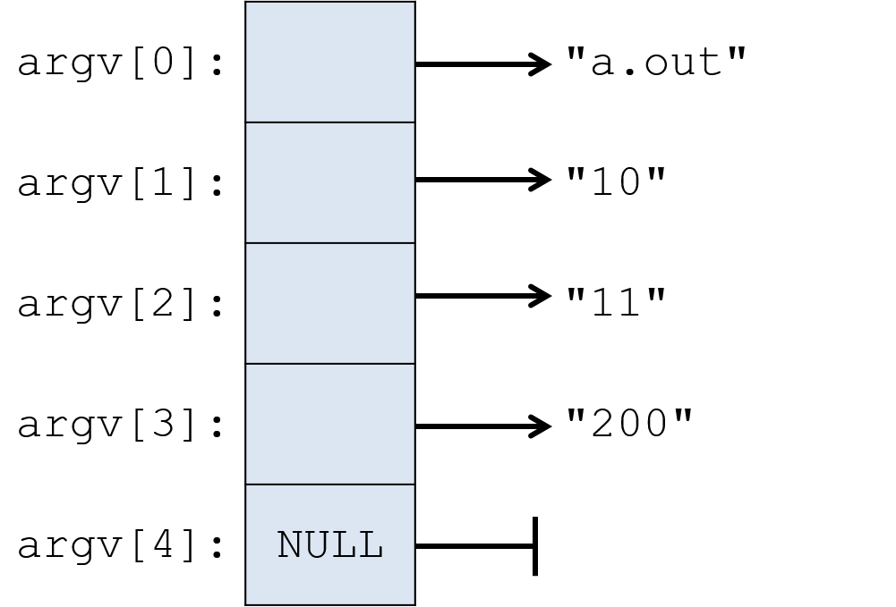

> **说明**
> 本文是个人学习用的**非官方**中英对照译文，原文：<https://diveintosystems.org/book/C2-C_depth/advanced_cmd_line_args.html>。
> 原书采用 CC BY-NC-ND 4.0 许可（禁止演绎），**请勿公开传播本译文**。
> 标为「译注」「现代更新」的内容是译者补充，不代表原书作者观点；代码与原文逐字一致，未作改动。

### 2.9.2. 命令行参数

*2.9.2. Command Line Arguments*

通过读取命令行参数，可以让程序变得更通用。命令行参数是用户输入的、用来运行二进制可执行程序的命令的一部分，它们指定改变程序运行时行为的输入值或选项。换句话说，用不同的命令行参数值运行程序，程序每次运行的行为就会不同，而无需修改程序代码并重新编译。例如，如果一个程序把输入文件名作为命令行参数，用户就可以用任意输入文件名来运行它；而在代码中写死某个输入文件名的程序就做不到这一点。

> A program can be made more general purpose by reading command line arguments, which are included as part of the command entered by the user to run a binary executable program. They specify input values or options that change the runtime behavior of the program. In other words, running the program with different command line argument values results in a program’s behavior changing from run to run without having to modify the program code and recompile it. For example, if a program takes the name of an input filename as a command line argument, a user can run it with any input filename as opposed to a program that refers to a specific input filename in the code.

用户提供的所有命令行参数都会作为参数值传给 `main` 函数。要编写接收命令行参数的程序，`main` 函数的定义中必须包含两个参数，`argc` 和 `argv`：

> Any command line arguments the user provides get passed to the `main` function as parameter values. To write a program that takes command line arguments, the `main` function’s definition must include two parameters, `argc` and `argv`:

```
int main(int argc, char *argv[]) { ...
```

注意，第二个参数的类型也可以写成 `char **argv`。

> Note that the type of the second parameter could also be represented as `char **argv`.

第一个参数 **argc** 存放参数个数（argument count），它的值表示传给 main 函数的命令行参数的个数（包括程序名）。例如，如果用户输入

> The first parameter, **argc**, stores the argument count. Its value represents the number of command line arguments passed to the main function (including the name of the program). For example, if the user enters

```
./a.out 10 11 200
```

那么 `argc` 的值将是 4（`a.out` 算作第一个命令行参数，`10`、`11` 和 `200` 是另外三个）。

> then `argc` will hold the value 4 (`a.out` counts as the first command line argument, and `10`, `11`, and `200` as the other three).

第二个参数 **argv** 存放参数向量（argument vector），其中包含每个命令行参数的值。每个命令行参数都以字符串值的形式传入，因此 `argv` 的类型是字符串数组（即 `char` 数组的数组）。`argv` 数组有 `argc + 1` 个元素。前 `argc` 个元素存放命令行参数字符串，最后一个元素存放 `NULL`，表示命令行参数列表结束。例如，对于上面输入的命令行，`argv` 数组的样子如[图 1](2.9.2-advanced_cmd_line_args.html) 所示：

> The second parameter, **argv**, stores the argument vector. It contains the value of each command line argument. Each command line argument gets passed in as a string value, thus `argv`'s type is an array of strings (or an array of `char` arrays). The `argv` array contains `argc + 1` elements. The first `argc` elements store the command line argument strings, and the last element stores `NULL`, signifying the end of the command line argument list. For example, in the command line entered above, the `argv` array would look like [Figure 1](2.9.2-advanced_cmd_line_args.html):

> **译注**
> `argv[0]` 是用户启动程序时输入的命令名，这里是 `./a.out`（含路径前缀），而不一定是不带路径的程序名。



**图 1.** 传给 main 的 argv 参数是一个字符串数组。每个命令行参数都作为数组中一个单独的字符串元素传入。最后一个元素的值是 NULL，表示命令行参数列表结束。

*Figure 1. The argv parameter passed to main is an array of strings. Each command line argument is passed as a separate string element in the array. The value of the last element is NULL, signifying the end of the list of command line arguments.*

程序常常需要把传给 `main` 的命令行参数解释为字符串以外的类型。在上面的例子中，程序可能想从第一个命令行参数的字符串值 `"10"` 中提取出整数值 `10`。C 标准库提供了把字符串转换为其他类型的函数。例如，`atoi` 函数（"a to i"，即 "ASCII to integer"）把一串数字字符转换为对应的整数值：

> Often, a program wants to interpret a command line argument passed to `main` as a type other than a string. In the example above, the program may want to extract the integer value `10` from the string value `"10"` of its first command line argument. C’s standard library provides functions for converting strings to other types. For example, the `atoi` ("a to i", for "ASCII to integer") function converts a string of digit characters to its corresponding integer value:

```
int x;
x = atoi(argv[1]);  // x gets the int value 10
```

关于这些函数的更多信息，请参见[字符串与字符串库](2.6-strings.html)一节。另一个 C 命令行参数的例子见 [commandlineargs.c](https://diveintosystems.org/book/C2-C_depth/_attachments/commandlineargs.c) 程序。

> See the [Strings and the String Library section](2.6-strings.html) for more information about these functions. And the [commandlineargs.c](https://diveintosystems.org/book/C2-C_depth/_attachments/commandlineargs.c) program for another example of C command line arguments.
