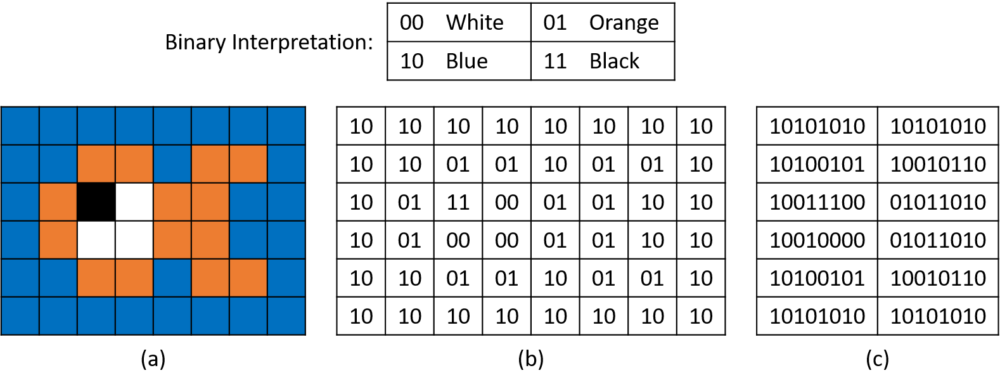

> [!WARNING] 说明
> 本文是个人学习用的**非官方**中英对照译文，原文：<https://diveintosystems.org/book/C4-Binary/index.html>。
> 原书采用 CC BY-NC-ND 4.0 许可（禁止演绎），**请勿公开传播本译文**。
> 标为「译注」「现代更新」的内容是译者补充，不代表原书作者观点；代码与原文逐字一致，未作改动。

*4. Binary and Data Representation*

从简陋的石板和洞穴壁画，到书面文字和留声机唱片的纹槽，人类一直在设法记录和保存信息。本章我们将刻画人类在存储方面最新的重大突破——数字计算——是如何表示信息的，并说明如何从数字数据中解读出含义。

> From simple stone tablets and cave paintings to written words and phonograph grooves, humans have perpetually sought to record and store information. In this chapter, we’ll characterize how the latest of humanity’s big storage breakthroughs, digital computing, represents information. We also illustrate how to interpret meaning from digital data.

现代计算机使用多种介质存储信息（例如磁盘、光盘、闪存、磁带和简单的电路）。我们会在后面的[第 11 章](../C11-MemHierarchy/11.2-devices.html)中刻画存储设备；不过就本章的讨论而言，介质基本无关紧要——无论是激光扫描 DVD 的表面，还是磁头掠过磁盘盘片，存储设备的输出最终都是一串电信号。为了简化电路，每个信号都是**二进制**（binary）的，即只能取两种状态之一：没有电压（解释为零）和有电压（解释为一）。本章探讨系统如何把信息编码为二进制，而不管原始的存储介质是什么。

> Modern computers utilize a variety of media for storing information (e.g., magnetic disks, optical discs, flash memory, tapes, and simple electrical circuits). We characterize storage devices later in [Chapter 11](../C11-MemHierarchy/11.2-devices.html); however, for this discussion, the medium is largely irrelevant — whether there’s a laser scanning the surface of a DVD or a disk head gliding over a magnetic platter, the output from the storage device is ultimately a sequence of electrical signals. To simplify the circuitry, each signal is **binary**, meaning it can take only one of two states: the absence of a voltage (interpreted as zero) and the presence of a voltage (one). This chapter explores how systems encode information into binary, regardless of the original storage medium.

在二进制中，每个信号对应一**位**（bit，即 binary digit，二进制数字）信息：0 或 1。所有数据都能只用 0 和 1 表示，这也许让人惊讶。当然，信息越复杂，表示它所需的位数也越多。幸运的是，位序列每增加一位，能表示的不同值的个数就翻一倍，因此一个 *N* 位的序列可以表示 2*N* 个不同的值。

> In binary, each signal corresponds to one **bit** (binary digit) of information: a zero or a one. It may be surprising that all data can be represented using just zeros and ones. Of course, as the complexity of information increases, so does the number of bits needed to represent it. Luckily, the number of unique values doubles for each additional bit in a bit sequence, so a sequence of *N* bits can represent 2*N* unique values.

[图 1](4.0-index.html) 展示了随着位序列长度的增加，可表示值的个数如何增长。一位可以表示*两*个值：0 和 1。两位可以表示*四*个值：在两个一位值前面加上 0（00 和 01），以及在两个一位值前面加上 1（10 和 11）。任何一个扩展已有位序列的新位都遵循同样的模式：新位可以是 0 或 1，无论哪种情况，其余各位表示的值的范围都与加入新位之前相同。因此，增加位数会使新序列能表示的值的个数呈指数增长。

> [Figure 1](4.0-index.html) illustrates the growth in the number of representable values as the length of a bit sequence increases. A single bit can represent *two* values: 0 and 1. Two bits can represent *four* values: both of the one-bit values with a leading 0 (00 and 01), and both of the one-bit values with a leading 1 (10 and 11). The same pattern applies for any additional bit that extends an existing bit sequence: the new bit can be a 0 or 1, and in either case, the remaining bits represent the same range of values they did prior to the new bit being added. Thus, adding additional bits exponentially increases the number of values the new sequence can represent.

**图 1.** 用一到四位能表示的值。带下划线的位对应来自上一行的前缀。

*Figure 1. The values that can be represented with one to four bits. The underlined bits correspond to the prefix coming from the row above.*

由于单个位表示不了多少信息，存储系统通常把位组成更长的序列，来存储更有意义的值。最普遍的分组是**字节**（byte），即八位的集合。一个字节可以表示 28 = 256 个不同的值（0–255）——足以列举英语的字母和常用标点符号。字节是计算机系统中可寻址内存的最小单位，也就是说，程序不能申请少于八位的空间来存储变量。

> Because a single bit doesn’t represent much information, storage systems commonly group bits into longer sequences for storing more interesting values. The most ubiquitous grouping is a **byte**, which is a collection of eight bits. One byte represents 28 = 256 unique values (0-255) — enough to enumerate the letters and common punctuation symbols of the English language. Bytes are the smallest unit of addressable memory in a computer system, meaning a program can’t ask for fewer than eight bits to store a variable.

现代 CPU 通常还把**字**（word）定义为 32 位或 64 位，取决于硬件的设计。字的大小决定了系统硬件在组件之间（例如在内存和寄存器之间）移动数据时使用的「默认」大小。存储数字需要这些更长的序列，因为程序常常需要数到比 256 更大的数！

> Modern CPUs also typically define a **word** as either 32 bits or 64 bits, depending on the design of the hardware. The size of a word determines the "default" size a system’s hardware uses to move data from one component to another (e.g., between memory and registers). These larger sequences are necessary for storing numbers, since programs often need to count higher than 256!

如果你用 C 编过程序，就知道必须[先声明变量再使用](../C1-C_intro/1.1-getting_started.html)。这样的声明会告诉 C 编译器变量二进制表示的两个重要属性：要为它分配多少位，以及程序打算如何解释这些位。从概念上讲，位数很简单，编译器只需查一下[所声明类型对应多少位](../C1-C_intro/1.1-getting_started.html)（例如 `char` 是一个字节），并把这么多内存与该变量关联起来。而对一串位的解释在概念上则有趣得多。计算机内存中的所有数据都以位的形式存储，但位本身并没有*固有的*含义。例如，即使只有一位，也可以用许多不同的方式解释它的两个值：上和下、黑和白、是和否、开和关，等等。

> If you’ve programmed in C, you know that you must [declare a variable before using it](../C1-C_intro/1.1-getting_started.html). Such declarations inform the C compiler of two important properties regarding the variable’s binary representation: the number of bits to allocate for it, and the way in which the program intends to interpret those bits. Conceptually, the number of bits is straightforward, as the compiler simply looks up [how many bits are associated with the declared type](../C1-C_intro/1.1-getting_started.html) (e.g., a `char` is one byte) and associates that amount of memory with the variable. The interpretation of a sequence of bits is much more conceptually interesting. All data in a computer’s memory is stored as bits, but bits have no *inherent* meaning. For example, even with just a single bit, you could interpret the bit’s two values in many different ways: up and down, black and white, yes and no, on and off, etc.

增加位序列的长度会扩大它的解释范围。例如，`char` 变量使用美国信息交换标准代码（American Standard Code for Information Interchange，ASCII）编码标准，它定义了八位二进制值与英文字母和标点符号之间的对应关系。[表 1](4.0-index.html) 列出了 ASCII 标准的一小部分（完整的参考可以在命令行运行 `man ascii` 查看）。字符 `'X'` 对应 01011000 并没有什么特别的原因，所以不必费力去记这张表。重要的是，每个存储字母的程序对位序列的解释必须一致，这正是 ASCII 由一个标准委员会来定义的原因。

> Extending the length of a bit sequence expands the range of its interpretations. For example, a `char` variable uses the American Standard Code for Information Interchange (ASCII) encoding standard, which defines how an eight-bit binary value corresponds to English letters and punctuation symbols. [Table 1](4.0-index.html) shows a small subset of the ASCII standard (for a full reference, run `man ascii` on the command line). There’s no special reason why the character `'X'` needs to correspond to 01011000, so don’t bother memorizing the table. What matters is that every program storing letters agrees on their bit sequence interpretation, which is why ASCII is defined by a standards committee.

> [!NOTE] 译注
> 严格说 ASCII 是 **7 位**编码（0–127），存在 8 位的 `char` 中时最高位为 0；表题中的「八位 ASCII」是一种宽松的说法。0–127 以外的值在不同的扩展编码中含义不同，这正是后来统一到 Unicode/UTF-8 的原因。

> [!TIP] 现代更新（截至 2026-11）· 今天的文本几乎都是 UTF-8
> ASCII 只覆盖英文字母和常用符号。如今的文本普遍采用 Unicode 的 **UTF-8** 编码：它对 ASCII 范围内的字符仍用单字节、编码与 ASCII 完全相同，其他字符（包括汉字）用 2–4 个字节表示。根据 W3Techs 2026 年 11 月的统计，在已知字符编码的网站中，99.1% 使用 UTF-8。因此在 C 中处理中文时要记住：一个汉字通常占 3 个 `char`，`strlen` 返回的是字节数而不是字符数。[W3Techs：网站字符编码统计](https://w3techs.com/technologies/overview/character_encoding)

**表 1.** 八位 ASCII 字符编码标准的一小段

*Table 1. A Small Snippet of the Eight-Bit ASCII Character Encoding Standard*

| 二进制值 | 字符含义 | 二进制值 | 字符含义 |
|--------------|--------------------------|--------------|--------------------------|
| 01010111 | W | 00100000 | 空格 |
| 01011000 | X | 00100001 | ! |
| 01011001 | Y | 00100010 | " |
| 01011010 | Z | 00100011 | \# |

> | Binary value | Character interpretation | Binary value | Character interpretation |
> |--------------|--------------------------|--------------|--------------------------|
> | 01010111     | W                        | 00100000     | space                    |
> | 01011000     | X                        | 00100001     | !                        |
> | 01011001     | Y                        | 00100010     | "                        |
> | 01011010     | Z                        | 00100011     | \#                       |

任何信息都可以编码为二进制，包括图形和音频这样的丰富数据。例如，假设某种图像编码方案规定 00、01、10 和 11 分别对应白色、橙色、蓝色和黑色。[图 2](4.0-index.html) 说明了如何用这种简单的两位编码策略，只用 12 个字节画出一条粗糙的鱼。在 (a) 部分中，图像的每个格子相当于一个两位序列。(b) 和 (c) 部分分别给出了相应的两位序列和字节序列形式的二进制编码。虽然这个示例编码方案出于教学目的做了简化，但其基本思路与真实图形系统所用的类似，只不过真实系统用多得多的位来表示更丰富的颜色。

> Any information can be encoded in binary, including rich data like graphics and audio. For example, suppose that an image encoding scheme defines 00, 01, 10, and 11 to correspond to the colors white, orange, blue, and black. [Figure 2](4.0-index.html) illustrates how we might use this simple two-bit encoding strategy to draw a crude image of a fish using only 12 bytes. In part a, each cell of the image equates to one two-bit sequence. Parts b and c show the corresponding binary encoding as two-bit and byte sequences, respectively. Although this example encoding scheme is simplified for learning purposes, the general idea is similar to what real graphics systems use, albeit with many more bits for a wider range of colors.

**图 2.** 一幅简单的鱼图像的 (a) 图像表示、(b) 两位格子表示和 (c) 字节表示。

*Figure 2. The (a) image representation, (b) two-bit cell representation, and (c) byte representation of a simple fish image.*

> [!NOTE] 译注 · 图中内容
> 鱼的背景是蓝色（10），眼白是白色（00），瞳孔是黑色（11），身体是橙色（01）。

我们刚刚介绍了两种编码方案，同一个位序列 01011010，对文本编辑器来说可能表示字符 `'Z'`，而图形程序可能把它解释为鱼尾鳍的一部分。哪种解释正确取决于上下文。尽管底层的位相同，人们往往觉得某些解释比另一些容易理解得多（例如，把鱼看成彩色格子，要比看成一张字节表容易）。

> Having just introduced two encoding schemes, the same bit sequence, 01011010, might mean the character `'Z'` to a text editor, whereas a graphics program might interpret it as part of a fish’s tail fin. Which interpretation is correct depends on the context. Despite the underlying bits being the same, humans often find some interpretations much easier to comprehend than others (e.g., perceiving the fish as colored cells rather than a table of bytes).

本章其余部分主要讨论二进制数的表示和运算，但总体的要点值得再强调一遍：所有信息都以 0 和 1 的形式存储在计算机内存中，这些位的含义由程序或运行程序的人来解释。

> The remainder of this chapter largely deals with representing and manipulating binary numbers, but the overall point bears repeating: all information is stored in a computer’s memory as 0’s and 1’s, and it’s up to programs or the people running them to interpret the meaning of those bits.
