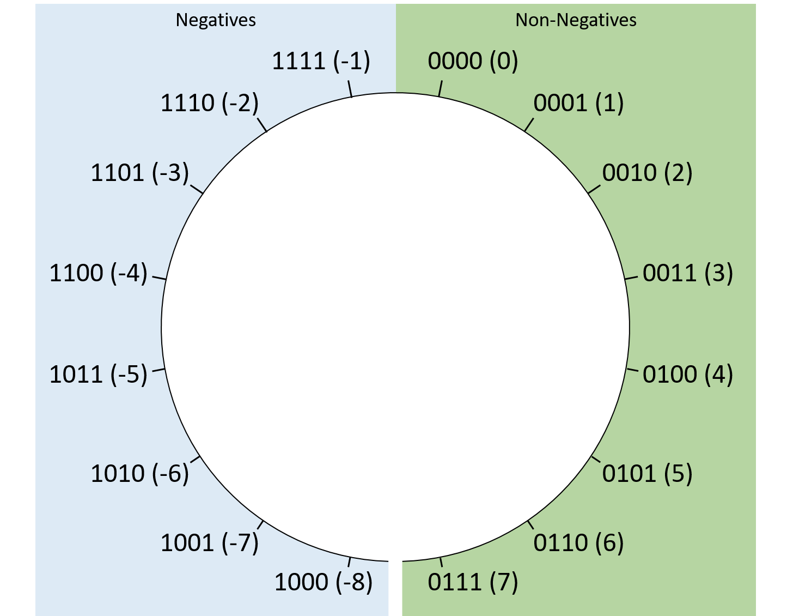

> [!WARNING] 说明
> 本文是个人学习用的**非官方**中英对照译文，原文：<https://diveintosystems.org/book/C4-Binary/signed.html>。
> 原书采用 CC BY-NC-ND 4.0 许可（禁止演绎），**请勿公开传播本译文**。
> 标为「译注」「现代更新」的内容是译者补充，不代表原书作者观点；代码与原文逐字一致，未作改动。


*4.3. Signed Binary Integers*

到目前为止，我们对二进制数的讨论仅限于*无符号*（严格非负的）整数。本节介绍另一种包含负数的二进制解释方式。由于变量的存储空间是有限的，有符号的二进制编码必须能区分负值、零和正值。对有符号数进行运算，还需要一种对数取负的方法。

> So far, we’ve limited the discussion of binary numbers to *unsigned* (strictly non-negative) integers. This section presents an alternative interpretation of binary that incorporates negative numbers. Given that a variable has finite storage space, a signed binary encoding must distinguish between negative values, zero, and positive values. Manipulating signed numbers additionally requires a procedure for negating a number.

有符号二进制编码必须把位序列在负值和非负值之间进行划分。在实践中，系统设计者构建的是*通用*系统，所以各分一半是个不偏不倚的好选择。因此，本章介绍的有符号数编码表示的负值和非负值的个数相等。

> A signed binary encoding must divide bit sequences between negative and non-negative values. In practice, systems designers build *general-purpose* systems, so a 50% / 50% split is a good middle-of-the-road choice. Therefore, the signed number encodings that this chapter presents represent an equal number of negative and non-negative values.

> [!NOTE] 原书注 · 非负与正（Non-Negative versus Positive）
> 注意，*非负*（non-negative）和*正*（positive）之间有一个细微但重要的区别：严格正值的集合不包括零，而非负值的集合包括零。即使把可用的位序列在负值和非负值之间各分一半，非负值中仍必须留一个给零。因此，在位数固定的情况下，一种数制最终表示的负值可能比正值多（例如二进制补码系统）。
>
> > Note that there’s a subtle but important difference between *non-negative* and *positive*. The set of strictly positive values excludes zero, whereas the non-negative set includes zero. Even after dividing the available bit sequences 50% / 50% between negative and non-negative values, one of the non-negative values must still be reserved for zero. Thus, with a fixed number of bits, a number system may end up representing more negative values than positive values (e.g., in the two’s complement system).

有符号数编码用一位来区分*负*数集合和*非负*数集合。按照惯例，最左边的一位表示一个数是负数（1）还是非负数（0）。这个最左边的位称为**高位**（high-order bit）或**最高有效位**（most significant bit）。

> Signed number encodings use one bit to distinguish between the sets of *negative* numbers and *non-negative* numbers. By convention, the left-most bit indicates whether a number is negative (1) or non-negative (0). This leftmost bit is known as the **high-order bit** or the **most significant bit**.

本章介绍两种可能的有符号二进制编码——*原码*（signed magnitude）和*补码*（two’s complement）。尽管其中只有一种编码（补码）至今仍在实际使用，但对比两者有助于说明它们的重要特性。

> This chapter presents two potential signed binary encodings — *signed magnitude* and *two’s complement*. Even though only one of these encodings (two’s complement) is still used in practice, comparing them will help to illustrate their important characteristics.

### 4.3.1. 原码

*4.3.1. Signed Magnitude*

**原码**（signed magnitude，又称符号-数值表示）把高位专门当作符号位。也就是说，高位是 0 还是 1 并不影响数的绝对值，它*只*决定这个值是正（高位为 0）还是负（高位为 1）。与补码相比，原码的十进制转换和取负过程相对简单：

> The **signed magnitude** representation treats the high-order bit exclusively as a sign bit. That is, whether the high-order bit is a 0 or a 1 does not affect the absolute value of the number, it *only* determines whether the value is positive (high-order bit 0) or negative (high-order bit 1). Compared to two’s complement, signed magnitude makes the decimal conversion and negation procedures relatively straightforward:

- 要计算一个 *N* 位原码序列的十进制值，用熟悉的[无符号方法](4.1-bases.html)计算数位 d<sub>0</sub> 到 d<sub>N-2</sub> 的值，然后检查最高有效位 d<sub>N-1</sub>：如果它是 1，这个值就是负数，否则就不是。

> - To compute a decimal value for an *N*-bit signed magnitude sequence, compute the value of digits d<sub>0</sub> through d<sub>N-2</sub> using the familiar [unsigned method](4.1-bases.html). Then, check the most significant bit, d<sub>N-1</sub>: if it’s 1, the value is negative; otherwise it isn’t.

- 要对一个值取负，只需翻转最高有效位来改变它的符号。

> - To negate a value, simply flip the most significant bit to change its sign.

> [!WARNING] 原书警示 · 关于取负的误解（Negation Misconception）
> 介绍原码纯粹是出于教学目的。虽然过去有些机器用过它（例如 1960 年代的 [IBM 7090](https://en.wikipedia.org/wiki/IBM_7090)），但现代系统都不再用原码表示整数（不过，存储[浮点值](https://en.wikipedia.org/wiki/Single-precision_floating-point_format)的标准中*确实*包含类似的机制）。
>
> 除非明确要求你考虑原码，否则在现代系统上，你*不应*以为翻转二进制数的第一位就能对这个数取负。
>
> > Signed magnitude is presented purely for pedagogical purposes. Although it was used by some machines in the past (e.g., [IBM’s 7090](https://en.wikipedia.org/wiki/IBM_7090) in the 1960s), no modern systems use signed magnitude to represent integers (although a similar mechanism *is* part of the standard for storing [floating-point values](https://en.wikipedia.org/wiki/Single-precision_floating-point_format)).
> >
> > Unless you’re explicitly asked to consider signed magnitude, you should *not* assume that flipping the first bit of a binary number will negate that number’s value on a modern system.

[图 1](4.3-signed.html) 展示了四位原码序列与十进制值之间的对应关系。乍一看，原码由于简单而显得颇有吸引力。遗憾的是，它有两个严重的缺点，让人不想用它。第一个缺点是它有*两种*零的表示。例如，用四位时，原码既表示*零*（0b0000），也表示*负零*（0b1000）。这给硬件设计者出了难题：硬件需要考虑两种位值不同、数值却相等的二进制序列。如此重要的一个数只有一种表示方式，硬件设计者的工作会轻松得多。

> [Figure 1](4.3-signed.html) shows how four-bit signed magnitude sequences correspond to decimal values. At first glance, signed magnitude might seem attractive due to its simplicity. Unfortunately, it suffers from two major drawbacks that make it unappealing. The first is that it presents *two* representations of zero. For example, with four bits, signed magnitude represents both *zero* (0b0000) and *negative zero* (0b1000). Consequently, it poses a challenge to hardware designers because the hardware will need to account for two possible binary sequences that are numerically equal despite having different bit values. The hardware designer’s job is much easier with just one way of representing such an important number.


**图 1.** 长度为四的位序列的原码值逻辑布局。

*Figure 1. A logical layout of signed magnitude values for bit sequences of length four.*

> [!NOTE] 译注 · 图中内容
> 一个圆环：一侧是非负值，从 0b0000（0）到 0b0111（7）；另一侧是 0b1000（-0）到 0b1111（-7）。

原码的另一个缺点是在负值和零之间存在一处不便的不连续。我们稍后会更详细地介绍[溢出](4.5-overflow.html)，但四位序列 0b1111 加 1 会「翻转」回 0b0000。对原码来说，这意味着 0b1111（-7）+ 1 可能被误当作 0，而不是预期的 -6。这个问题可以解决，但解决办法同样会使硬件设计复杂化，实际上把负整数和非负整数之间的任何转换都变成了需要格外小心处理的特殊情况。

> The other drawback of signed magnitude is that it exhibits an inconvenient discontinuity between negative values and zero. While we’ll cover [overflow](4.5-overflow.html) in more detail later, adding 1 to the four-bit sequence 0b1111 "rolls over" back to 0b0000. With signed magnitude, this effect means 0b1111 (-7) + 1 might be mistaken for 0 rather than the expected -6. This problem is solvable, but the solution again complicates the design of the hardware, essentially turning any transition between negative and non-negative integers into a special case that requires extra care.

由于这些原因，原码在实践中已基本消失，补码一统天下。

> For these reasons, signed magnitude has largely disappeared in practice, and two’s complement reigns supreme.

> [!TIP] 现代更新（截至 2026-11）· 补码已写进 C 标准
> 原书说补码「一统天下」，如今这已经是语言标准层面的规定：C23 删除了对补码以外的有符号整数表示（原码、反码）的支持，要求有符号整数一律采用二进制补码。这是把各家编译器早已采用的做法写进了标准。[cppreference：C23](https://en.cppreference.com/w/c/23)

### 4.3.2. 补码

*4.3.2. Two’s Complement*

**补码**（two’s complement，二进制补码）编码以一种优雅的方式解决了原码的问题。和原码一样，补码数的高位表示这个值是否应解释为负数。不同的是，高位也会影响数的值。那么，它是如何同时做到这两点的呢？

> **Two’s complement** encoding solves signed magnitude’s problems in an elegant way. Like signed magnitude, the high-order bit of a two’s complement number indicates whether or not the value should be interpreted as negative. In contrast though, the high-order bit also affects the value of the number. So, how can it do both?

计算 *N* 位补码数的十进制值，与熟悉的[无符号方法](4.1-bases.html)类似，只是高位对总值的贡献要取负。也就是说，对于 *N* 位补码序列，第一位对和的贡献不是 d<sub>N-1</sub> × 2<sup>N-1</sup>，而是 **-d<sub>N-1</sub>** × 2<sup>N-1</sup>（注意负号）。因此，如果最高有效位是 1，总值就是负数，因为第一位对和的贡献的绝对值最大；否则，第一位对和毫无贡献，结果为非负数。完整的公式是：

> Computing a decimal value for an *N*-bit two’s complement number is similar to the familiar [unsigned method](4.1-bases.html), except the high-order bit’s contribution to the overall value is negated. That is, for an *N*-bit two’s complement sequence, instead of the first bit contributing d<sub>N-1</sub> × 2<sup>N-1</sup> to the sum, it contributes **-d<sub>N-1</sub>** × 2<sup>N-1</sup> (note the negative sign). Therefore, if the most significant bit is a 1, the overall value will be negative because that first bit contributes the largest absolute value to the sum. Otherwise, the first bit contributes nothing to the sum, and the result is non-negative. The full formula is:

> [!NOTE] 原书旁注
> -（d<sub>N-1</sub> × 2<sup>N-1</sup>）＋（d<sub>N-2</sub> × 2<sup>N-2</sup>）＋ … ＋（d<sub>2</sub> × 2<sup>2</sup>）＋（d<sub>1</sub> × 2<sup>1</sup>）＋（d<sub>0</sub> × 2<sup>0</sup>）
>
> ^ 注意，只有第一项前面带负号！
>
> > **-** (d<sub>N-1</sub> × 2<sup>N-1</sup>)    +    (d<sub>N-2</sub> × 2<sup>N-2</sup>)    +    …​    +    (d<sub>2</sub> × 2<sup>2</sup>)    +    (d<sub>1</sub> × 2<sup>1</sup>)    +    (d<sub>0</sub> × 2<sup>0</sup>)
> >
> > ^ note the leading negative sign for just the first term!

[图 2](4.3-signed.html) 展示了补码中四位序列的布局。按这个定义，零只有一种表示——全为 0 的位序列。由于只有一个*零*序列，补码表示的负值比正值多一个。以四位序列为例，补码表示的最小值是 0b1000（-8），而最大值只有 0b0111（7）。幸运的是，这个怪癖并不妨碍硬件设计，也很少给应用程序带来问题。

> [Figure 2](4.3-signed.html) illustrates the layout of four-bit sequences in two’s complement. This definition encodes just one representation of zero — a sequence of bits that are all 0’s. With only a single *zero* sequence, two’s complement represents one more negative value than positive. Using four-bit sequences as an example, two’s complement represents a minimum value of 0b1000 (-8), but a maximum value of only 0b0111 (7). Fortunately, this quirk doesn’t hinder hardware design and rarely causes problems for applications.



**图 2.** 长度为四的位序列的补码值逻辑布局。

*Figure 2. A logical layout of two’s complement values for bit sequences of length four.*

> [!NOTE] 译注 · 图中内容
> 一个圆环：一侧是非负值，从 0b0000（0）到 0b0111（7）；另一侧是 0b1111（-1）到 0b1000（-8）。

与原码相比，补码还简化了负数与零之间的过渡。无论用多少位存储，一个全为 1 的补码数总是表示 -1。全为 1 的位序列加 1 会「翻转」为零，这让补码很方便，因为 -1 + 1 *本来就应该*等于零。

> Compared to signed magnitude, two’s complement also simplifies the transition between negative numbers and zero. Regardless of the number of bits used to store it, a two’s complement number consisting of all ones will always hold the value -1. Adding 1 to a bit sequence of all 1’s "rolls over" to zero, which makes two’s complement convenient, since -1 + 1 *should* produce zero.

#### 取负

*Negation*

对补码数取负比对原码值取负稍微麻烦一点。要对一个 *N* 位值取负，就要求出它相对于 2<sup>N</sup> 的**补**（complement）（这正是这种编码名称的由来）。换句话说，要对 *N* 位值 *X* 取负，就要找到一个位序列 *Y*（*X* 的补），使得 *X* + *Y* = 2<sup>N</sup>。

> Negating a two’s complement number is slightly trickier than negating a signed magnitude value. To negate an *N*-bit value, determine its **complement** with respect to 2<sup>N</sup> (this is where the encoding’s name comes from). In other words, to negate an *N*-bit value *X*, find a bit sequence *Y* (*X*'s complement) such that *X* + *Y* = 2<sup>N</sup>.

幸运的是，实践中有一个对补码数取负的快捷方法：翻转所有位，再加一。例如，要对八位值 13 取负，先[求出 13 的二进制值](4.2-conversion.html)。由于 13 是 8、4 和 1 之和，就把第 3、2 和 0 位置为 1：

> Fortunately, there’s a quick shortcut for negating a two’s complement number in practice: flip all the bits and add one. For example, to negate the eight-bit value 13, first [determine the binary value of 13](4.2-conversion.html). Because 13 is the sum of 8, 4, and 1, set the bits in positions 3, 2, and 0:

```
00001101  (decimal 13)
```

接着，「翻转各位」（把所有的零变成一，反之亦然）：

> Next, "flip the bits" (change all zeros to ones, and vice versa):

```
11110010
```

最后，加一得到 0b11110011。果然，应用补码位序列的解释公式可以看出，这个值是 -13：

> Finally, adding one yields 0b11110011. Sure enough, applying the formula for interpreting a two’s complement bit sequence shows that the value is -13:

> [!NOTE] 原书旁注
> -(1 × 2<sup>7</sup>)    +    (1 × 2<sup>6</sup>)    +    (1 × 2<sup>5</sup>)    +    (1 × 2<sup>4</sup>)    +    (0 × 2<sup>3</sup>)    +    (0 × 2<sup>2</sup>)    +    (1 × 2<sup>1</sup>)    +    (1 × 2<sup>0</sup>)
>
>   =    -128 + 64 + 32 + 16 + 0 + 0 + 2 + 1    =    -13

如果你好奇这个看似神奇的快捷方法为什么有效，可以更形式化地考察对八位的 13 取负。要求 13 的补，就要解方程 0b00001101（13）+ *Y* = 0b100000000（2<sup>8</sup>，需要多一位来表示）。这个方程可以变形为 *Y* = 0b100000000 - 0b00001101。现在这显然是一个减法问题：

> If you’re curious as to why this seemingly magical shortcut works, consider the eight-bit negation of 13 more formally. To find 13’s complement, solve 0b00001101 (13) + *Y* = 0b100000000 (2<sup>8</sup>, which requires an extra bit to represent). The equation can be rearranged as *Y* = 0b100000000 - 0b00001101. This is clearly now a subtraction problem:

```
 100000000  (256)
- 00001101   (13)
```

这样的减法看起来也许有点吓人，但我们可以把它表示成一种更容易计算的形式：(0b011111111 + 1) - 0b00001101。注意，这一改动只是把 2<sup>8</sup>（256）表示成了 (255 + 1)。改动之后，算式变成：

> While such a subtraction might seem daunting, we can express it in a way that’s easier to compute as (0b011111111 + 1) - 0b00001101. Note that this change simply expresses 2<sup>8</sup> (256) as (255 + 1). After that change, the arithmetic looks like:

```
 011111111  (255)  + 00000001  (1)
- 00001101   (13)
```

事实证明，对于*任何*位值 *b*，1 - *b* 都等价于「翻转」这一位。因此，上例中的整个减法可以简化为只需翻转下面那个数的所有位。剩下要做的，就是加上把 256 表示成 255 + 1 时多出来的那个 +1。综合起来，我们只需翻转一个值的所有位再加一，就能算出它的补！

> As it turns out, for *any* bit value *b*, 1 - *b* is equivalent to "flipping" that bit. Thus, the entire subtraction in the preceding example can be reduced to just flipping all the bits of the lower number. All that’s left is to add the remaining +1 from expressing 256 as 255 + 1. Putting it all together, we can simply flip a value’s bits and add one to compute its complement!

> [!WARNING] 原书警示 · C 编程中的有符号整数与无符号整数（C Programming With Signed versus Unsigned Integers）
> 在 C 中声明变量，除了分配空间之外，还告诉编译器你希望如何解释这个变量。声明 `int` 时，编译器把这个变量解释为有符号的补码整数。要分配无符号值，就声明 `unsigned int`。
>
> 这一区别在 C 的其他地方也很重要，比如 `printf` 函数。正如本章一直在强调的，一个位序列可以有不同的解释方式！对于 `printf`，解释方式取决于你使用的格式占位符。例如：
>
> ```
> #include <stdio.h>
>
> int main(void) {
>     int example = -100;
>
>     /* Print example int using both signed and unsigned placeholders. */
>     printf("%d  %u\n", example, example);
>
>     return 0;
> }
> ```
>
> 尽管这段代码两次传给 `printf` 的是同一个变量（`example`），它打印出的却是 `-100 4294967196`。要小心地正确解释你的值！
>
> > In addition to allocating space, declaring variables in C also tells the compiler how you’d like the variable to be interpreted. When you declare an `int`, the compiler interprets the variable as a signed two’s complement integer. To allocate an unsigned value, declare an `unsigned int`.
> >
> > The distinction is also relevant to C in other places, like the `printf` function. As this chapter has been stressing throughout, a bit sequence can be interpreted in different ways! With `printf`, the interpretation depends on the formatting placeholder you use. For example:
> >
> > ```
> > #include <stdio.h>
> >
> > int main(void) {
> >     int example = -100;
> >
> >     /* Print example int using both signed and unsigned placeholders. */
> >     printf("%d  %u\n", example, example);
> >
> >     return 0;
> > }
> > ```
> >
> > Even though this code passes `printf` the same variable (`example`) twice, it prints `-100 4294967196`. Be careful to interpret your values correctly!

#### 符号扩展

*Sign Extension*

有时，你可能想对两个用不同位数存储的数进行算术运算。例如，在 C 中你可能想把一个 32 位的 `int` 和一个 16 位的 `short` 相加。这种情况下，较小的数需要进行**符号扩展**（sign extension），说白了就是把它的最高有效位重复若干次，直到位序列的长度扩展到目标长度。虽然在 C 中编译器会替你处理这些位，但了解这个过程是如何进行的仍然很有帮助。

> Occasionally, you may find yourself wanting to perform an arithmetic operation on two numbers that are stored using different numbers of bits. For example, in C you may want to add a 32-bit `int` and a 16-bit `short`. In such cases, the smaller number needs to be **sign extended**, which is a fancy way of saying that its most significant bit gets repeated as many times as necessary to extend the length of the bit sequence to the target length. Though the compiler will take care of wrangling the bits for you in C, it’s still helpful to understand how the process works.

例如，要把四位序列 0b0110（6）扩展为八位序列，就取出高位（0），在前面添加四次，得到扩展后的值：0b**0000**0110（仍然是 6）。类似地，把 0b1011（-5）扩展为八位序列，就取出高位（这次是 1），在前面添加四次，得到扩展后的值：0b**1111**1011（仍然是 -5）。为了验证其正确性，看看每加一个新位之后值是如何变化的：

> For example, to extend the four-bit sequence 0b0110 (6) to an eight-bit sequence, take the high-order bit (0) and prepend it four times to produce the extended value: 0b**0000**0110 (still 6). Extending 0b1011 (-5) to an eight-bit sequence similarly takes the high-order bit (this time, 1) and prepends it four times to the resulting extended value: 0b**1111**1011 (still -5). To verify the correctness, consider how the value changes after adding each new bit:

```
    0b1011 =                       -8 + 0 + 2 + 1  =  -5
   0b11011 =                  -16 + 8 + 0 + 2 + 1  =  -5
  0b111011 =             -32 + 16 + 8 + 0 + 2 + 1  =  -5
 0b1111011 =        -64 + 32 + 16 + 8 + 0 + 2 + 1  =  -5
0b11111011 =  -128 + 64 + 32 + 16 + 8 + 0 + 2 + 1  =  -5
```

从这些例子可以看出，非负数（高位为零）在前面添加零之后仍然是非负数。同样，负数（高位为一）在扩展时前面添加一之后仍然是负数。

> As evidenced by the examples, numbers that are non-negative (high-order bit of zero) remain non-negative after adding zeros to the front. Likewise, negatives (high-order bit of one) remain negative after prepending ones to extended values.

> [!NOTE] 原书注 · 无符号数的零扩展（Unsigned Zero Extension）
> 对于无符号值（例如用 `unsigned` 限定符显式声明的 C 变量），把它扩展为更长的位序列需要的是**零扩展**（zero extension），因为 `unsigned` 限定符使这个值永远不会被解释为负数。零扩展只是在扩展后位序列的高位前面添加零。例如，0b1110（按无符号解释是 14！）扩展为 0b**0000**1110，尽管原来的第一位是 1。
>
> > For an unsigned value (e.g., a C variable explicitly declared with an `unsigned` qualifier), extending it to a longer bit sequence instead requires **zero extension**, since the `unsigned` qualifier prevents the value from ever being interpreted as negative. Zero extension simply prepends zeros to the high-order bits of the extended bit sequence. For example, 0b1110 (14 when interpreted as unsigned!) extends to 0b**0000**1110 despite the original leading 1.
