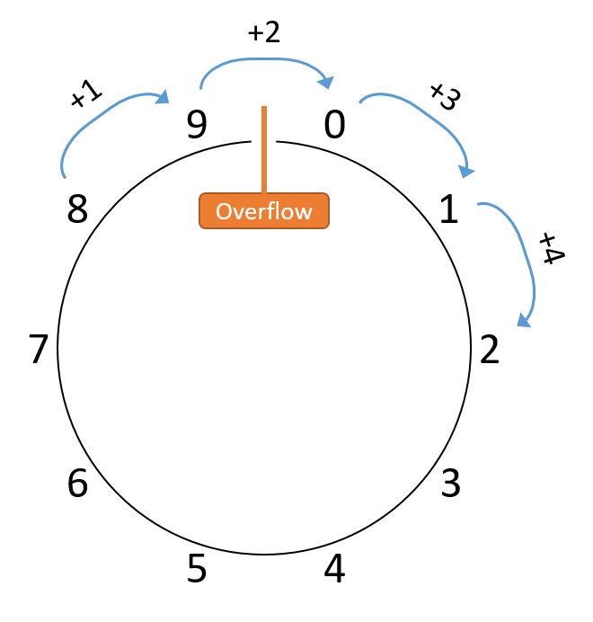
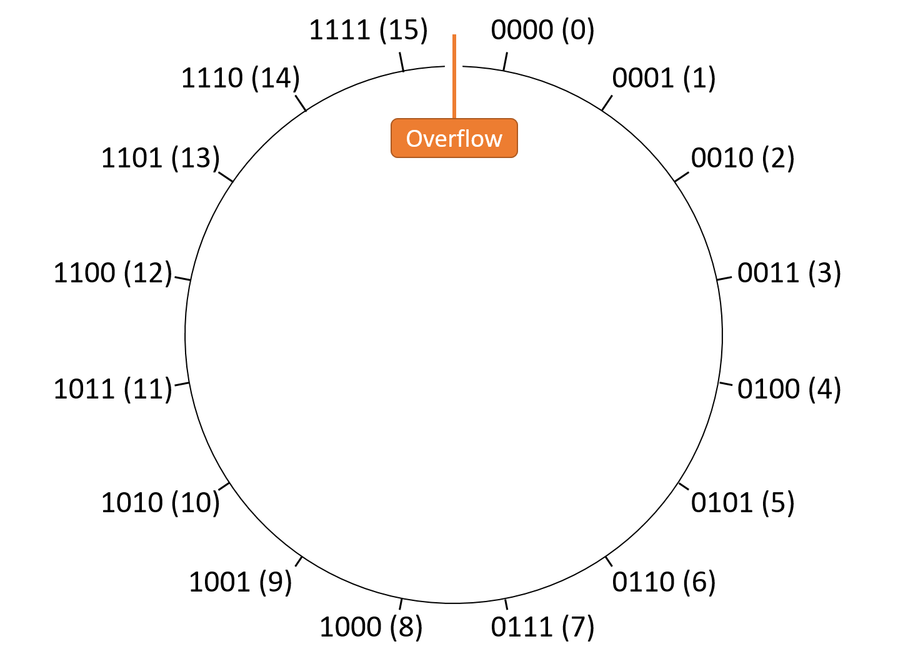
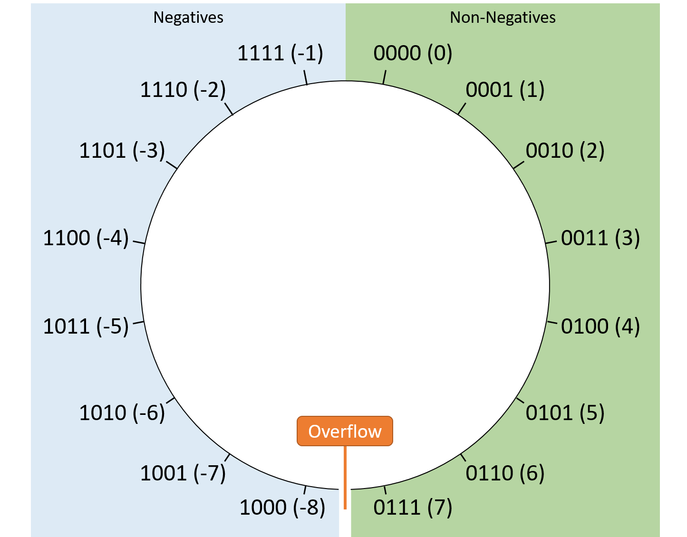
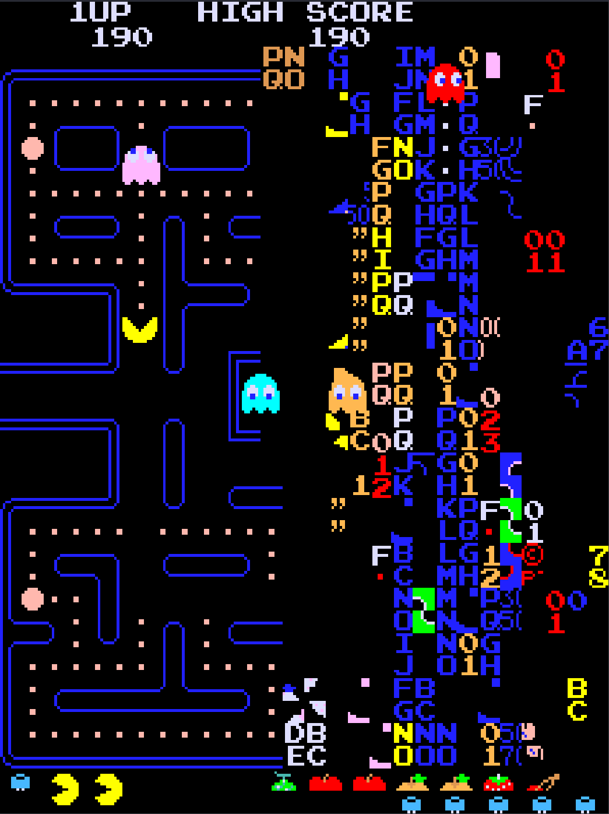

> [!WARNING] 说明
> 本文是个人学习用的**非官方**中英对照译文，原文：<https://diveintosystems.org/book/C4-Binary/overflow.html>。
> 原书采用 CC BY-NC-ND 4.0 许可（禁止演绎），**请勿公开传播本译文**。
> 标为「译注」「现代更新」的内容是译者补充，不代表原书作者观点；代码与原文逐字一致，未作改动。


*4.5. Integer Overflow*

虽然整数在数学上有无穷多个，但实际上，计算机内存中的数值类型[只占固定的位数](4.1-bases.html)。正如我们在本章中一再暗示的，使用固定的位数意味着程序可能无法表示它们想存储的值。例如，在讨论加法时我们看到，两个合法的值相加可能产生[无法表示的结果](4.4.1-arithmetic_addition.html)。缺少足够存储空间来表示其结果的计算，就发生了**溢出**（overflow）。

> Although the number of integers is mathematically infinite, in practice, numeric types in a computer’s memory [occupy a fixed number of bits](4.1-bases.html). As we’ve hinted throughout this chapter, using a fixed number of bits implies that programs might be unable to represent values that they’d like to store. For example, the discussion of addition showed that adding two legitimate values can produce [a result that can’t be represented](4.4.1-arithmetic_addition.html). A computation that lacks the storage to represent its result has **overflowed**.

### 4.5.1. 里程表的类比

*4.5.1. Odometer Analogy*

为了刻画溢出，考虑一个来自非计算领域的例子：汽车的里程表。里程表记录汽车行驶的英里数，无论是数字式还是机械式，它都只能显示有限个（十进制）数字。如果汽车行驶的里程超过了里程表能表示的范围，里程表就会「翻转」回零，因为真实的值无法表示出来。例如，对于标准的六位里程表，它能表示的最大值是 999999。再多开一英里，*本应*显示 1000000，但就像[溢出的加法示例](4.4.1-arithmetic_addition.html)那样，那个 1 进位到了六个可用数位之外，只剩下 000000。

> To characterize overflow, consider an example from the non-computing world: a car’s odometer. An odometer counts the number of miles a car has driven, and whether it’s digital or analog, it can display only so many (base 10) digits. If the car drives more miles than the odometer can represent, the odometer "rolls over" back to zero, since the true value can’t be expressed. For example, with a standard six-digit odometer, the maximum value it represents is 999999. Driving just one additional mile *should* display 1000000, but like the [overflowing addition example](4.4.1-arithmetic_addition.html), the 1 carries out from the six available digits, leaving only 000000.

为了简单起见，我们继续分析一个只有一位十进制数字的里程表。也就是说，这个里程表表示的范围是 [0, 9]，每行驶 10 英里就重置回零。把里程表的范围画出来，大概就是[图 1](4.5-overflow.html) 的样子。

> For simplicity, let’s continue analyzing an odometer that’s limited to just one decimal digit. That is, the odometer represents the range [0, 9], so after every 10 miles the odometer resets back to zero. Illustrating the odometer’s range visually, it might look like [Figure 1](4.5-overflow.html).


**图 1.** 一位里程表可能取值的示意图

*Figure 1. A visual depiction of a one-digit odometer’s potential values*

由于一位里程表到 10 就会翻转，画成圆形可以突出圆顶部的那处不连续（而且*只有*顶部有）。具体来说，对*除 9 以外*的任何值加一，结果都会落在预期的值上；而对 9 加一，则会跳到一个并不自然地跟在它后面的值（零）。更一般地说，执行*任何*跨越 9 和 0 之间这处不连续的算术运算，都会发生溢出。例如，考虑计算 8 + 4，如[图 2](4.5-overflow.html) 所示。

> Because a one-digit odometer rolls over upon reaching 10, drawing a circular shape emphasizes the discontinuity at the top of the circle (and *only* at the top). Specifically, by adding one to any value *other than nine*, the result lands on the expected value. On the other hand, adding one to nine jumps to a value that doesn’t naturally follow it (zero). More generally, when performing *any* arithmetic that crosses the discontinuity between nine and zero, the computation will overflow. For example, consider adding 8 + 4, as in [Figure 2](4.5-overflow.html).



**图 2.** 只用一位十进制数字计算 8 + 4 的结果。跨越 0 和 9 之间的不连续处，表明发生了溢出。

*Figure 2. The result of adding 8 + 4 with only one decimal digit. Crossing the discontinuity between 0 and 9 indicates that an overflow has occurred.*

> [!NOTE] 译注 · 图中内容
> 0 到 9 排成一圈，0 和 9 之间的空隙标注为可能发生溢出的位置；箭头表示 8 加 4 时运算跳过了这个溢出位置。

这里求和得到的是 2，而不是预期的 12。注意，8 加上许多其他的值（例如 8 + 14）也会落在 2 上，区别只在于计算会多绕圆圈几圈。因此，无论汽车开了 2、12 还是 152 英里，最终里程表的读数都是 2。

> Here, the sum yields 2 instead of the expected 12. Note that many other values added to 8 (for example, 8 + 14) would also land on two, with the only difference being that the computations would take additional trips around the circle. Consequently, it doesn’t matter whether the car drives 2, 12, or 152 miles — in the end, the odometer will read 2 regardless.

任何行为类似里程表的装置执行的都是**模运算**（modular arithmetic）。在这个例子中，所有的运算都是以 10 为模的，因为一位十进制数字只能表示 10 个值。因此，对于任意的行驶里程，把距离除以 10 取余数，就能算出里程表的读数。如果里程表有两位而不是一位十进制数字，模就会变成 100，因为它可以表示更大范围的值：[0, 99]。类似地，时钟执行的是以 12 小时为模的模运算。

> Any device that behaves like an odometer performs **modular arithmetic**. In this case, all arithmetic is modular with respect to a modulus of 10, since one decimal digit represents only 10 values. Therefore, given any number of miles traveled, we can compute what the odometer will read by dividing the distance by 10 and taking the remainder as the result. If the odometer had two decimal digits instead of one, the modulus would change to 100, since it could represent a larger range of values: [0, 99]. Similarly, clocks perform modular arithmetic with an hour modulus of 12.

### 4.5.2. 二进制整数溢出

*4.5.2. Binary Integer Overflow*

看过了一种熟悉的溢出形式之后，我们转向二进制数的编码。回想一下，*N* 位存储可以表示 2<sup>N</sup> 个不同的位序列，而这些序列可以有不同的解释方式（*无符号*或*有符号*）。某些运算在一种解释下得出正确的结果，在另一种解释下却可能溢出，所以硬件需要针对每种解释分别识别溢出。

> Having seen a familiar form of overflow, let’s turn to binary number encodings. Recall that *N* bits of storage represent 2<sup>N</sup> unique bit sequences and that those sequences can be interpreted in different ways (as *unsigned* or *signed*). Some operations that yield correct results under one interpretation may exhibit overflow according to the other, so the hardware needs to recognize overflow differently for each.

例如，假设一台机器用四位序列计算 0b0010（2）- 0b0101（5）。按照[减法过程](4.4.2-arithmetic_subtraction.html)执行这个运算，得到的二进制结果是 0b1101。把这个结果解释为*有符号*值，得到 -3（-8 + 4 + 1），这正是 2 - 5 在没有溢出时的预期结果。而把它解释为*无符号*值，则得到 13（8 + 4 + 1），这是错误的，显然表明发生了溢出。进一步推敲这个例子，从直觉上讲也有道理——结果应该是负数，而有符号解释允许负数，无符号解释则不允许。

> For example, suppose that a machine is using four-bit sequences to compute 0b0010 (2) - 0b0101 (5). Running this operation through the [subtraction procedure](4.4.2-arithmetic_subtraction.html) produces a binary result of 0b1101. Interpreting this result as a *signed* value produces -3 (-8 + 4 + 1), the expected result for 2 - 5 without overflow. Alternatively, interpreting it as an *unsigned* value yields 13 (8 + 4 + 1), which is incorrect and clearly indicative of overflow. Scrutinizing this example further, it instinctively makes some sense — the result should be negative, and a signed interpretation allows for negatives, whereas unsigned does not.

#### 无符号溢出

*Unsigned Overflow*

*无符号*数的行为与前面十进制里程表的例子类似，因为两者都只表示非负值。*N* 位表示的无符号值范围是 [0, 2<sup>N</sup> - 1]，所有运算都是以 2<sup>N</sup> 为模的。[图 3](4.5-overflow.html) 展示了四位序列的无符号解释在模空间中的排列方式。

> *Unsigned* numbers behave similarly to the decimal odometer examples given that both represent only non-negative values. *N* bits represent unsigned values in the range [0, 2<sup>N</sup> - 1], making all arithmetic modular with respect to 2<sup>N</sup>. [Figure 3](4.5-overflow.html) illustrates an arrangement of the unsigned interpretations of four-bit sequences into a modular space.



**图 3.** 四位无符号值在模空间中的排列。所有运算都是以 2<sup>4</sup>（16）为模的。

*Figure 3. An arrangement of four-bit unsigned values into a modular space. All arithmetic is modular with respect to 2<sup>4</sup> (16).*

由于无符号解释不能容纳负值，不连续处同样位于最大值和零之间。因此，任何跨越 2<sup>N</sup>-1 和 0 之间分界的运算都会造成无符号溢出。说得更直白些：如果做加法（本应使结果*变大*）得到了更小的结果，这次加法就造成了无符号溢出；对称地，如果做减法（本应使结果*变小*）得到了更大的结果，这次减法就造成了无符号溢出。

> Given that unsigned interpretations can’t hold negative values, the discontinuity again sits between the maximum value and zero. Therefore, unsigned overflow results from any operation that crosses the divide between 2<sup>N</sup>-1 and 0. Stated more plainly, if performing addition (which should make the result *larger*) produces a smaller result, the addition caused unsigned overflow. Symmetrically, if performing subtraction (which should make the result *smaller*) produces a larger result, the subtraction caused unsigned overflow.

作为检测加法和减法无符号溢出的快捷方法，回想一下这些运算中的[进位输出](4.4.1-arithmetic_addition.html)位和[进位输入](4.4.2-arithmetic_subtraction.html)位。*进位输出*是计算结果中从最高有效位进出的位。*进位输入*被置位时，会向算术运算的最低有效位进一，使结果的值加一。只有减法才会把*进位输入*设为 1，作为取负过程的一部分。

> As a shortcut for detecting unsigned overflow for addition and subtraction, recall the [carry out](4.4.1-arithmetic_addition.html) and [carry in](4.4.2-arithmetic_subtraction.html) bits of those operations. A *carry out* is a carry from the most significant bit in the result of the computation. When set, a *carry in* increments the value of the result by carrying one into the least significant bit of the arithmetic operation. The *carry in* is only set to 1 for subtraction as part of the negation procedure.

**无符号运算的快捷判断方法**是：进位输出必须与进位输入相同，否则运算就发生了溢出。直观上，这个快捷方法之所以有效，是因为：

> The **shortcut for unsigned arithmetic** is: the carry out must match the carry in, otherwise the operation causes overflow. Intuitively, this shortcut works because:

- 对于加法（进位输入 = 0），结果应当大于（或等于）第一个操作数。然而，如果和需要多一位来存储（进位输出 = 1），把多出来的这一位从和中截断，就会得到一个更小的结果（溢出）。例如，在四位无符号数空间中，计算 0b1100（12）+ 0b1101（13）需要*五*位来存储结果 0b**1**1001（25）。截断到只剩四位后，结果表示的是 0b1001（9），比两个操作数都小（因此溢出）。

> - For addition (carry in = 0), the result should be larger than (or equal to) the first operand. However, if the sum requires an extra bit of storage (carry out = 1), truncating that extra bit from the sum yields a smaller result (overflow). For example, in the unsigned four-bit number space, adding 0b1100 (12) + 0b1101 (13) requires *five* bits to store the result 0b**1**1001 (25). When truncated to only four bits, the result represents 0b1001 (9), which is smaller than the operands (therefore, overflow).

- 对于减法（进位输入 = 1），结果应当小于（或等于）第一个操作数。由于减法是作为加法和取负的组合来执行的，其中的加法子问题应当产生一个更小的结果。加法要得到更小的值，唯一的途径就是截断它的和（进位输出 = 1）。如果不需要截断（进位输出 = 0），减法就会得出一个更大的结果（溢出）。

> - For subtraction (carry in = 1), the result should be smaller than (or equal to) the first operand. Because subtraction executes as a combination of addition and negation, the addition subproblem should produce a smaller result. The only way addition can end up with a smaller value is by truncating its sum (carry out = 1). If it doesn’t require truncation (carry out = 0), the subtraction yields a larger result (overflow).

我们来看两个四位减法的例子：一个溢出，一个不溢出。首先，考虑 0b0111（7）- 0b1001（9）。减法过程把这个计算当作：

> Let’s examine two examples of four-bit subtraction: one that overflows, and one that doesn’t. First, consider 0b0111 (7) - 0b1001 (9). The subtraction procedure treats this computation as:

**题目**

> **Problem Setup**

```
 
  0111
- 1001
```

**转换为加法**

> **Converted to Addition**

```
     1 (carry in)
  0111
+ 0110 (bits flipped)
```

**计算过程**

> **Worked Example**

```
                1 (carry in)
             0111
           + 0110 (bits flipped)

   Result:   1110
Carry out:  0
```

这次计算*没有*从 d<sub>3</sub> 进位输出，所以没有发生截断，进位输入（1）与进位输出（0）不相同。结果 0b1110（14）比两个操作数都大，显然不是 7 - 9 的正确结果（溢出）。

> The computation *did not* carry out of d<sub>3</sub>, so no truncation occurs and the carry in (1) fails to match the carry out (0). The result, 0b1110 (14), is larger than either operand and thus clearly incorrect for 7 - 9 (overflow).

接着，考虑 0b0111（7）- 0b0101（5）。减法过程把这个计算当作：

> Next, consider 0b0111 (7) - 0b0101 (5). The subtraction procedure treats this computation as:

**题目**

> **Problem Setup**

```
 
  0111
- 0101
```

**转换为加法**

> **Converted to Addition**

```
     1 (carry in)
  0111
+ 1010 (bits flipped)
```

**计算过程**

> **Worked Example**

```
                1 (carry in)
             0111
           + 1010 (bits flipped)

   Result:   0010
Carry out:  1
```

这次计算向 d<sub>4</sub> 进位输出了一位，使进位输入（1）与进位输出（1）相同。截断后的结果 0b0010（2）正确地表示了减法运算的预期结果（没有溢出）。

> The computation carries out a bit to d<sub>4</sub>, causing the carry in (1) to match the carry out (1). The truncated result, 0b0010 (2), correctly represents the expected outcome of the subtraction operation (no overflow).

#### 有符号溢出

*Signed Overflow*

溢出背后的同样直觉也适用于*有符号*二进制解释：模数空间中存在一处不连续。不过，由于有符号解释允许负数，这处不连续并不出现在 0 附近。回想一下，[补码](4.3-signed.html)从 -1（0b1111…111）到 0（0b0000…000）是平滑地「翻转」过去的。因此，不连续处位于数空间的*另一*端，即最大正值与最小负值相接的地方。

> The same intuition behind overflow applies to *signed* binary interpretations: there exists a discontinuity in the modular number space. However, because a signed interpretation allows for negatives, the discontinuity doesn’t occur around 0. Recall that [two’s complement](4.3-signed.html) "rolls over" cleanly from -1 (0b1111…​111) to 0 (0b0000…​000). Thus, the discontinuity exists at the *other* end of the number space, where the largest positive value and smallest negative value meet.

[图 4](4.5-overflow.html) 展示了四位序列的有符号解释在模空间中的排列方式。注意，一半的值是负数，另一半是非负数，而不连续处位于两者之间最小值与最大值的分界处。

> [Figure 4](4.5-overflow.html) shows an arrangement of the signed interpretations of four-bit sequences into a modular space. Note that half the values are negative, the other half are non-negative, and that the discontinuity lies at the min/max divide between them.



**图 4.** 四位有符号值在模空间中的排列。由于有符号解释允许负值，不连续处不再位于零。

*Figure 4. An arrangement of four-bit signed values into a modular space. Because a signed interpretation allows for negative values, the discontinuity no longer resides at zero.*

> [!NOTE] 译注 · 图中内容
> 0 到 7 排在圆的右半边，-1 到 -8 排在左半边；7 和 -8 之间的空隙（在圆的底部）标注为可能发生溢出的位置。

进行有符号运算时，产生一个更靠近零的结果总是安全的。也就是说，任何使结果的绝对值减小的运算都不会溢出，因为溢出的不连续处位于可表示值的绝对值最大的地方。

> When performing signed arithmetic, it’s always safe to generate a result that moves closer to zero. That is, any operation that reduces the absolute value of the result cannot overflow, because the overflow discontinuity resides where the magnitude of the representable values is the largest.

因此，系统通过比较操作数的最高有效位与结果的最高有效位，来检测有符号加法和减法中的溢出。对于减法，先把运算改写为加法（例如把 5 - 2 改写为 5 + -2）。

> Consequently, systems detect overflow in signed addition and subtraction by comparing the most significant bit of the operands with the most significant bit of the result. For subtraction, first rearrange the arithmetic in terms of addition (e.g., rewrite 5 - 2 as 5 + -2).

- 如果加法的两个操作数的高位值*不同*（即一个是负数、一个是正数），就不可能发生有符号溢出，因为结果的绝对值必然小于（或等于）任一操作数，结果是在*向*零靠近。

> - If the addition’s operands have *different* high-order bit values (i.e., one operand is negative and the other is positive), there can be no signed overflow, because the absolute value of the result must be smaller than (or equal to) either operand. The result is moving *toward* zero.

- 如果加法的两个操作数的高位值*相同*（即都是正数或都是负数），那么正确的结果也必然具有相同的高位值。因此，把两个符号相同的操作数相加时，如果结果的符号与操作数的符号不同，就发生了有符号溢出。

> - If the addition’s operands have the *same* high-order bit value (i.e., both are positive or both are negative), a correct result must also have the same high-order bit value. Thus, when adding two operands with the same sign, a signed overflow occurs if the result’s sign differs from that of the operands.

看看下面这些四位有符号二进制的例子：

> Consider the following four-bit signed binary examples:

- 5 - 4 等价于 5 + -4。第一个操作数（5）是正数，而第二个（-4）是负数，所以结果必然在向零靠近，*不可能溢出*。

> - 5 - 4 is equivalent to 5 + -4. The first operand (5) is positive, whereas the second (-4) is negative, so the result must be moving toward zero where *no overflow* is possible.

- 4 + 2（都是正数）得 6（也是正数），所以*没有溢出*。

> - 4 + 2 (both positive) yields 6 (also positive), so *no overflow* occurs.

- -5 - 1 等价于 -5 + -1（都是负数），得 -6（也是负数），所以*没有溢出*。

> - -5 - 1 is equivalent to -5 + -1 (both negative) and yields -6 (also negative), so *no overflow* occurs.

- 4 + 5（都是正数）得 -7（负数）。由于两个操作数符号相同，且与结果的符号不同，这次运算*发生了溢出*。

> - 4 + 5 (both positive) yields -7 (negative). Because the operands have the same sign and it doesn’t match the result’s sign, this operation *overflows*.

- -3 - 8 等价于 -3 + -8（都是负数），得 5（正数）。由于两个操作数符号相同，且与结果的符号不同，这次运算*发生了溢出*。

> - -3 - 8 is equivalent to -3 + -8 (both negative) and yields 5 (positive). Because the operands have the same sign and it doesn’t match the result’s sign, this operation *overflows*.

### 4.5.3. 溢出小结

*4.5.3. Overflow Summary*

一般来说，当算术运算在其结果所能表示的最小值和最大值之间穿越时，就会发生整数溢出。如果你对有符号与无符号溢出的规则拿不准，可以想一想 N 位序列的最小值和最大值：

> In general, integer overflow occurs when an arithmetic operation moves between the minimum and maximum values that its result can represent. If you’re ever in doubt about the rules for signed versus unsigned overflow, consider the minimum and maximum values of an N-bit sequence:

- *无符号*的最小值是 0（因为无符号编码不能表示负数），最大值是 2<sup>N</sup>-1（因为有一个位序列留给了零）。因此不连续处位于 2<sup>N</sup>-1 和 0 之间。

> - The minimum *unsigned* value is 0 (because unsigned encodings can’t represent negative numbers) and the maximum unsigned value is 2<sup>N</sup>-1 (because one bit sequence is reserved for zero). Therefore the discontinuity is between 2<sup>N</sup>-1 and 0.

- *有符号*的最小值是 -2<sup>N-1</sup>（因为一半的序列留给了负值），最大值是 2<sup>N-1</sup>-1（因为在另一半中，有一个值留给了零）。因此，不连续处位于 2<sup>N-1</sup>-1 和 -2<sup>N-1</sup> 之间。

> - The minimum *signed* value is -2<sup>N-1</sup> (because half of the sequences are reserved for negative values) and the maximum is 2<sup>N-1</sup>-1 (because in the other half, one value is reserved for zero). Therefore, the discontinuity is between 2<sup>N-1</sup>-1 and -2<sup>N-1</sup>.

> [!TIP] 现代更新（截至 2026-11）· 在 C 里安全地检测溢出
> 在 C 中，无符号整数的运算按模 2<sup>N</sup> 回绕，行为是确定的；而**有符号整数溢出是未定义行为**，编译器可以假定它不会发生并据此优化，所以不能靠「算完再检查符号」来判断溢出。C23 为此新增了头文件 `<stdckdint.h>`，提供 `ckd_add`、`ckd_sub`、`ckd_mul` 三个带检查的运算：它们把结果写入第一个参数，返回值为 `true` 表示发生了溢出。译者在 macOS 上用 `gcc -std=c23` 编译 `ckd_add(&r, INT_MAX, 1)`，返回 1（溢出），`r` 为回绕后的 -2147483648。[cppreference：&lt;stdckdint.h&gt;](https://en.cppreference.com/w/c/header/stdckdint) · [cppreference：Arithmetic operators](https://en.cppreference.com/w/c/language/operator_arithmetic)

### 4.5.4. 溢出的后果

*4.5.4. Overflow Consequences*

虽然你可能不会经常遇到整数溢出，但溢出有可能以引人注目（甚至可能是毁灭性）的方式破坏程序。

> While you may not run into integer overflow frequently, overflows have the potential to break programs in notable (and potentially devastating) ways.

例如，2014 年，PSY 大热的音乐视频《[江南 Style](https://en.wikipedia.org/wiki/Gangnam_Style)》的播放量眼看就要让 YouTube 用来统计视频播放次数的 32 位计数器溢出。于是，YouTube 改用了 64 位计数器。

> For example, in 2014, PSY’s popular [Gangnam Style](https://en.wikipedia.org/wiki/Gangnam_Style) music video threatened to overflow the 32-bit counter that YouTube used to track video hits. As a result, YouTube switched to using a 64-bit counter.

另一个相对无害的例子出现在 1980 年的街机游戏《吃豆人》（*Pac-Man*）中。游戏的开发者用一个无符号的八位值来记录玩家在游戏关卡中的进度。结果，如果高手玩家打过了第 255 关（八位无符号整数的最大值），游戏画面有一半就会出现严重的错乱，如[图 5](4.5-overflow.html) 所示。

> Another relatively harmless example shows up in the 1980 arcade game *Pac-Man*. The game’s developers used an unsigned eight-bit value to track the player’s progress through the game’s levels. As a result, if an expert player makes it beyond level 255 (the maximum value of an eight-bit unsigned integer), half of the board ends up glitching significantly, as shown in [Figure 5](4.5-overflow.html).



**图 5.** *Pac-Man* 的游戏画面在到达第 256 关时「抓狂」

*Figure 5. The *Pac-Man* game board "freaks out" upon reaching level 256*

> [!NOTE] 译注 · 图中内容
> 游戏画面的右半边完全被乱码破坏。

一个悲惨得多的溢出例子，出现在 1980 年代中期 [Therac-25](https://en.wikipedia.org/wiki/Therac-25) 放射治疗机的历史中。Therac-25 存在多个设计问题，其中之一是对一个表示真值的标志变量做递增，而不是把它设为一个常量。使用次数足够多之后，这个标志就会溢出，错误地翻转为零（假），从而绕过安全机制。Therac-25 最终对六名患者造成了严重伤害（其中一些患者因此死亡）。

> A much more tragic example of overflow appears in the history of the [Therac-25](https://en.wikipedia.org/wiki/Therac-25) radiation therapy machine of the mid 1980s. The Therac-25 suffered from several design problems, including one that incremented a truth flag variable rather than setting it to a constant. After enough uses, the flag overflowed, causing it to erroneously roll over to zero (false) and bypass safety mechanisms. The Therac-25 ultimately caused serious harm to (and in some cases killed) six patients.
