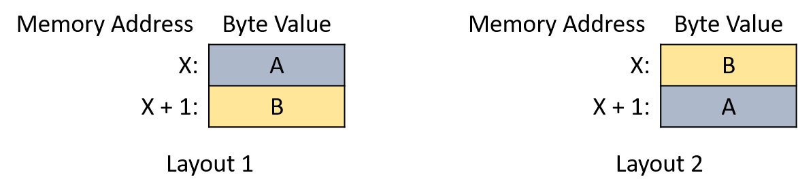
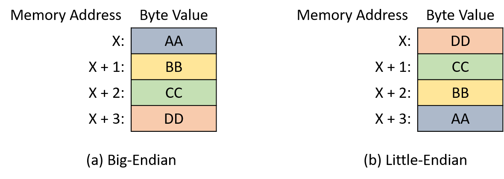

> [!WARNING] 说明
> 本文是个人学习用的**非官方**中英对照译文，原文：<https://diveintosystems.org/book/C4-Binary/byte_order.html>。
> 原书采用 CC BY-NC-ND 4.0 许可（禁止演绎），**请勿公开传播本译文**。
> 标为「译注」「现代更新」的内容是译者补充，不代表原书作者观点；代码与原文逐字一致，未作改动。


*4.7. Integer Byte Order*

到目前为止，本章介绍了几种用位来编码数的方案，但还没有提到这些值在内存中是如何组织的。在现代系统中，内存的最小可寻址单位是字节，一个字节由八位组成。因此，要从地址 *X* 开始存储一个单字节的值（例如 `char` 类型的变量），其实没有什么可选的——只需把这个字节存放在位置 *X* 即可。

> So far, this chapter has described several schemes for encoding numbers with bits, but it hasn’t mentioned how the values are organized in memory. For modern systems, the smallest addressable unit of memory is a byte, which consists of eight bits. Consequently, to store a one-byte value (e.g., a variable of type `char`) starting at address *X*, you don’t really have any options — just store the byte at location *X*.

然而，对于多字节的值（例如 `short` 或 `int` 类型的变量），硬件在把值的各个字节分配到内存地址时就有了更多的选择。例如，考虑一个两字节的 `short` 变量 `s`，它的两个字节分别标记为 A（含 `s` 的高位）和 B（含 `s` 的低位）。当系统要把 `s` 这样的 `short` 存放在地址 *X* 处（即地址 *X* 和 *X+1*）时，它必须规定变量的哪个字节（A 或 B）占据哪个地址（*X* 或 *X+1*）。[图 1](4.7-byte_order.html) 展示了在内存中存储 `s` 的两种方式。

> However, for multibyte values (e.g., variables of type `short` or `int`), the hardware has more options for assigning a value’s bytes to memory addresses. For example, consider a two-byte `short` variable `s` whose bytes are labeled A (containing the high-order bits of `s`) and B (containing the low-order bits of `s`). When a system is asked to store a `short` like `s` at address *X* (i.e., in addresses *X* and *X+1*), it must define which byte of the variable (A or B) should occupy which address (*X* or *X+1*). [Figure 1](4.7-byte_order.html) shows the two options for storing `s` in memory.



**图 1.** 从内存地址 X 开始存放一个两字节 short 的两种可能的内存布局

*Figure 1. Two potential memory layouts for a two-byte short starting at memory address X*

> [!NOTE] 译注 · 图中内容
> 第一种布局中，字节 A 占据地址 X，字节 B 占据地址 X+1；另一种布局中两者位置互换。

系统的**字节序**（byte order，又称**端序**，endianness）规定了硬件如何把多字节变量的各个字节分配到连续的内存地址上。尽管对于只在单个系统上运行的程序来说，字节序很少成为问题，但如果你的程序试图逐个打印字节，或者你在用调试器查看变量，它可能会让你感到意外。

> The **byte order** (or **endianness**) of a system defines how its hardware assigns the bytes of a multibyte variable to consecutive memory addresses. Although byte order is rarely an issue for programs that only run on a single system, it might appear surprising if one of your programs attempts to print bytes one at a time or if you’re examining variables with a debugger.

例如，考虑下面这个程序：

> For example, consider the following program:

```
#include <stdio.h>

int main(int argc, char **argv) {
    // Initialize a four-byte integer with easily distinguishable byte values
    int value = 0xAABBCCDD;

    // Initialize a character pointer to the address of the integer.
    char *p = (char *) &value;

    // For each byte in the integer, print its memory address and value.
    int i;
    for (i = 0; i < sizeof(value); i++) {
        printf("Address: %p, Value: %02hhX\n", p, *p);
        p += 1;
    }

    return 0;
}
```

这个程序分配了一个四字节的整数，并把它的各个字节按从最高有效到最低有效的顺序初始化为十六进制值 `0xAA`、`0xBB`、`0xCC` 和 `0xDD`。然后，它从这个整数的基地址开始逐个打印这些字节。如果你以为这些字节会按字母顺序打印出来，那也情有可原。然而，常用的 CPU 体系结构（即 x86 和大多数 ARM 硬件）在执行这个示例程序时，会以相反的顺序打印这些字节：

> This program allocates a four-byte integer and initializes the bytes, in order from most to least significant, to the hexadecimal values `0xAA`, `0xBB`, `0xCC`, and `0xDD`. It then prints the bytes one at a time starting from the base address of the integer. You’d be forgiven for expecting the bytes to print in alphabetical order. However, commonly used CPU architectures (i.e., x86 and most ARM hardware) print the bytes in reverse order when executing the example program:

```
$ ./a.out
Address: 0x7ffc0a234928, Value: DD
Address: 0x7ffc0a234929, Value: CC
Address: 0x7ffc0a23492a, Value: BB
Address: 0x7ffc0a23492b, Value: AA
```

x86 CPU 以**小端**（little-endian）格式存储整数——在连续的地址中，从最低有效字节（「小端」）存到最高有效字节。另一些**大端**（big-endian）CPU 体系结构则以相反的顺序存储多字节整数。[图 2](4.7-byte_order.html) 描绘了一个四字节整数的 (a) 大端布局和 (b) 小端布局。

> x86 CPUs store integers in a **little-endian** format — from the least-significant byte ("little end") to the most-significant byte in consecutive addresses. Other **big-endian** CPU architectures store multibyte integers in the opposite order. Figure [Figure 2](4.7-byte_order.html) depicts a four-byte integer in the (a) big-endian and (b) little-endian layouts.

> [!NOTE] 译注
> Apple Silicon（ARM64）的 Mac 也是小端。译者在 M 系列芯片的 Mac 上运行上面的程序，同样按 DD、CC、BB、AA 的顺序输出。



**图 2.** (a) 大端格式和 (b) 小端格式下四字节整数的内存布局

*Figure 2. The memory layout of a four-byte integer in the (a) big-endian and (b) little-endian formats*

> [!NOTE] 译注 · 图中内容
> 大端格式中，字节 AA 占据位置 X，其余字节按字母顺序依次占据后续地址；小端格式中，字节 DD 占据位置 X，其余字节按字母逆序排列。

「endian」这个看起来有点奇怪的术语，源自乔纳森·斯威夫特（Jonathan Swift）的讽刺小说《格列佛游记》（*Gulliver’s Travels*，1726 年）<sup>1</sup>。在故事中，格列佛来到了两个身高只有六英寸的小人国度，它们正在为打破鸡蛋的正确方法而开战。「大端派」的不来夫斯古（Blefuscu）帝国从大头敲开鸡蛋，而「小端派」的利立浦特（Lilliput）帝国的人则从小头敲开鸡蛋。

> The seemingly strange "endian" terminology originates from Jonathan Swift’s satirical novel *Gulliver’s Travels* (1726)<sup>1</sup>. In the story, Gulliver finds himself among two empires of six-inch-tall people who are fighting a war over the proper method for breaking eggs. The "big-endian" empire of Blefuscu cracks the large end of their eggs, whereas people in the "little-endian" empire of Lilliput crack the small end.

在计算领域，系统是*大端*还是*小端*，通常只影响跨机器通信（例如通过网络通信）的程序。在系统之间传递数据时，双方必须就字节序达成一致，接收方才能正确地解释收到的值。1980 年，Danny Cohen 向互联网工程任务组（IETF）提交了一篇题为《*论圣战并呼吁和平*》（*On Holy Wars and a Plea for Peace*）的文章<sup>2</sup>。在文中，Cohen 采用了斯威夫特的「endian」术语，并建议 IETF 为网络传输采用一种标准的字节序。IETF 最终采用了*大端*作为「网络字节序」（network byte order）标准。

> In the computing world, whether a system is *big-endian* or *little-endian* typically affects only programs that communicate across machines (e.g., over a network). When communicating data between systems, both systems must agree on the byte order for the receiver to properly interpret the value. In 1980, Danny Cohen authored a note to the Internet Engineering Task Force (IETF) titled *On Holy Wars and a Plea for Peace* <sup>2</sup>. In that note, Cohen adopts Swift’s "endian" terminology and suggests that the IETF adopts a standard byte order for network transmissions. The IETF eventually adopted *big-endian* as the "network byte order" standard.

> [!NOTE] 译注
> 时间上有个小出入：Cohen 的这篇文章是 1980 年 4 月 1 日发表的 IEN 137（Internet Experiment Note，互联网实验备忘录），而 IETF 是 1986 年才成立的，所以准确地说它不是「提交给 IETF」的。[IEN 137 原文](https://www.ietf.org/rfc/ien/ien137.txt) · [IETF 简介](https://www.ietf.org/about/introduction/)

C 语言提供了两个库，让程序可以为通信目的重新排列整数的字节<sup>3,4</sup>。

> The C language provides two libraries that allow a program to reorder an integer’s bytes<sup>3,4</sup> for communication purposes.

> [!NOTE] 译注
> 指的是 `htonl`/`htons`/`ntohl`/`ntohs`（在 `<arpa/inet.h>` 中，把主机字节序与网络字节序互相转换），以及 `htobe32`/`le32toh` 等（在 Linux 的 `<endian.h>` 中，按指定字节序转换）。

### 4.7.1. 参考文献

*4.7.1. References*

1.  Jonathan Swift. *Gulliver’s Travels*. <http://www.gutenberg.org/ebooks/829>

2.  Danny Cohen. *On Holy Wars and a Plea for Peace*. <https://www.ietf.org/rfc/ien/ien137.txt>

3.  <https://linux.die.net/man/3/byteorder>

4.  <https://linux.die.net/man/3/endian>
