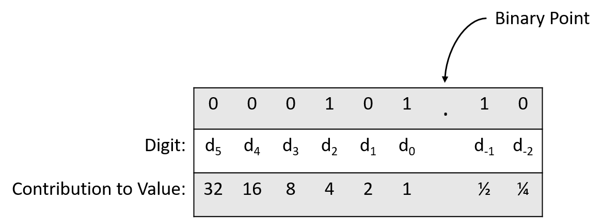
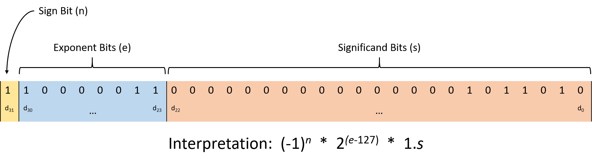

> **说明**
> 本文是个人学习用的**非官方**中英对照译文，原文：<https://diveintosystems.org/book/C4-Binary/floating_point.html>。
> 原书采用 CC BY-NC-ND 4.0 许可（禁止演绎），**请勿公开传播本译文**。
> 标为「译注」「现代更新」的内容是译者补充，不代表原书作者观点；代码与原文逐字一致，未作改动。

## 4.8. 实数的二进制表示

*4.8. Real Numbers in Binary*

虽然本章主要关注二进制整数的表示，但程序员也经常需要存储实数。存储实数本质上就很困难，没有哪种二进制编码能以完美的精度表示实数。也就是说，对于任何实数的二进制编码，总存在一些无法被*精确*表示的值。像 *pi* 这样的无理数显然无法被精确表示，因为它们的表示永远不会终止。在位数固定的情况下，二进制编码甚至无法表示其范围内的某些有理数。

> While this chapter mainly focuses on binary integer representations, programmers often need to store real numbers, too. Storing real numbers is inherently difficult, and no binary encoding represents real values with perfect precision. That is, for any binary encoding of real numbers, there exist values that cannot be represented *exactly*. Irrational values like *pi* clearly can’t be represented precisely, since their representation never terminates. Given a fixed number of bits, binary encodings still can’t represent some rational values within their range.

整数是[可数无穷](https://en.wikipedia.org/wiki/Countable_set)的，而实数集是[不可数](https://en.wikipedia.org/wiki/Uncountable_set)的。换句话说，即使是一个很窄的实数范围（例如零到一之间），其中的值也多到我们根本无从列举。因此，实数编码通常只存储截断到预定位数的近似值。只要位数足够，这些近似值通常对大多数用途来说已经足够精确，但在编写不能容忍舍入的应用程序时要小心。

> Unlike integers, which are [countably infinite](https://en.wikipedia.org/wiki/Countable_set), the set of real numbers is [uncountable](https://en.wikipedia.org/wiki/Uncountable_set). In other words, even for a narrow range of real values (e.g., between zero and one), the set of values within that range is so large that we can’t even begin to enumerate them. Thus, real number encodings typically store only approximations of values that have been truncated to a predetermined number of bits. Given enough bits, the approximations are typically precise enough for most purposes, but be careful when writing applications that cannot tolerate rounding.

本节其余部分简要介绍在二进制中表示实数的两种方法：*定点*（fixed-point），它扩展了二进制整数格式；以及*浮点*（floating-point），它以额外的复杂性为代价，能表示很大范围的值。

> The remainder of this section briefly describes two methods for representing real numbers in binary: *fixed-point*, which extends the binary integer format, and *floating-point*, which represents a large range of values at the cost of some extra complexity.

### 4.8.1. 定点表示

*4.8.1. Fixed-Point Representation*

在**定点表示**（fixed-point representation）中，值的*二进制小数点*（binary point）的位置固定不变。和十进制数中的*小数点*一样，二进制小数点表示数的小数部分从哪里开始。定点编码的规则与[无符号整数](4.1-bases.html)的表示类似，只有一个主要的例外：二进制小数点之后的各位表示 2 的*负*次幂。例如，考虑八位序列 0b000101.10，其中前六位表示整数部分，其余两位表示小数部分。[图 1](4.8-floating_point.html) 标出了各个数位的位置及其各自的含义。

> In a **fixed-point representation**, the position of a value’s *binary point* remains fixed and cannot be changed. Like a *decimal point* in a decimal number, the binary point indicates where the fractional portion of the number begins. The fixed-point encoding rules resemble the [unsigned integer](4.1-bases.html) representation, with one major exception: the digits after the binary point represent powers of two raised to a *negative* value. For example, consider the eight-bit sequence 0b000101.10 in which the first six bits represent whole numbers, and the remaining two bits represent the fractional part. [Figure 1](4.8-floating_point.html) labels the digit positions and their individual interpretations.



**图 1.** 二进制小数点后有两位的八位数中各数位的值

*Figure 1. The value of each digit in an eight-bit number with two bits after the fixed binary point*

> **译注 · 图中内容**
> 从高位到低位，各数位依次标为 d5、d4、d3、d2、d1、d0、d-1、d-2。d-1 对值的贡献是 0.5，d-2 的贡献是 0.25。

应用公式把 0b000101.10 转换为十进制，得到：

> Applying the formula for converting 0b000101.10 to decimal shows:

> **原书旁注**
> (0 × 2<sup>5</sup>)    +    (0 × 2<sup>4</sup>)    +    (0 × 2<sup>3</sup>)    +    (1 × 2<sup>2</sup>)    +    (0 × 2<sup>1</sup>)    +    (1 × 2<sup>0</sup>)    +    (1 × 2<sup>-1</sup>)    +    (0 × 2<sup>-2</sup>)
>
>   =    0 + 0 + 0 + 4 + 0 + 1 + 0.5 + 0    =    5.5

更一般地说，二进制小数点之后有两位时，数的小数部分只能是四种序列之一：00（.00）、01（.25）、10（.50）或 11（.75）。因此，两个小数位让定点数能表示精确到 0.25（2<sup>-2</sup>）的小数值。增加第三位会把精度提高到 0.125（2<sup>-3</sup>），以此类推，二进制小数点之后有 *N* 位时，精度为 2<sup>-N</sup>。

> More generally, with two bits after the binary point, the fractional portion of a number holds one of four sequences: 00 (.00), 01 (.25), 10 (.50), or 11 (.75). Thus, two fractional bits allow a fixed-point number to represent fractional values that are precise to 0.25 (2<sup>-2</sup>). Adding a third bit increases the precision to 0.125 (2<sup>-3</sup>), and the pattern continues similarly, with *N* bits after the binary point enabling 2<sup>-N</sup> precision.

由于二进制小数点之后的位数固定，一些操作数完全精确的计算，其结果可能需要截断（舍入）。考虑与上例相同的八位定点编码。它能精确地表示 0.75（0b000000.11）和 2（0b000010.00）。然而，它无法精确表示 0.75 除以 2 的结果：这个计算*本应*得到 0.375，但存储它需要二进制小数点后的第三位（0b000000.01**1**）。把最右边的 1 截断后，结果能放进规定的格式，但得到的是舍入后的结果 0.75 / 2 = 0.25。在这个例子中，由于涉及的位数太少，舍入误差大得离谱，但即使是更长的位序列，迟早也需要截断。

> Because the number of bits after the binary point remains fixed, some computations with fully precise operands may produce a result that requires truncation (rounding). Consider the same eight-bit fixed-point encoding from the previous example. It precisely represents both 0.75 (0b000000.11) and 2 (0b000010.00). However, it cannot precisely represent the result of dividing 0.75 by 2: the computation *should* produce 0.375, but storing it would require a third bit after the binary point (0b000000.01**1**). Truncating the rightmost 1 enables the result to fit within the specified format, but it yields a rounded result of 0.75 / 2 = 0.25. In this example, the rounding is egregious due to the small number of bits involved, but even longer bit sequences will require truncation at some point.

更糟的是，舍入误差会在中间计算的过程中不断累积，而且在某些情况下，一系列计算的结果可能因执行顺序的不同而不同。例如，考虑在前面描述的同一种八位定点编码下的两个算术序列：

> Even worse, rounding errors compound over the course of intermediate calculations, and in some cases the result of a sequence of computations might vary according to the order in which they’re performed. For example, consider two arithmetic sequences under the same eight-bit fixed-point encoding described earlier:

1. `(0.75 / 2) * 3    =    0.75`

> 1.  `(0.75 / 2) * 3    =    0.75`

2. `(0.75 * 3) / 2    =    1.00`

> 2.  `(0.75 * 3) / 2    =    1.00`

注意，两者唯一的区别是乘法和除法的顺序。如果不需要舍入，两个计算应当得出相同的结果（1.125）。然而，由于截断发生在运算的不同位置，它们得出了不同的结果：

> Note that the only difference between the two is the order of the multiplication and division operations. If no rounding were necessary, both computations should produce the same result (1.125). However, due to truncation occurring at different locations in the arithmetic, they produce different results:

1. 从左往右计算，中间结果（`0.75 / 2`）被舍入为 0.25，再乘以 3，最终得到 0.75。

> 1.  Proceeding from left to right, the intermediate result (`0.75 / 2`) gets rounded to 0.25 and ultimately produces 0.75 when multiplied by 3.

2. 从左往右计算，中间计算（`0.75 * 3`）精确地得到 2.25，没有任何舍入。2.25 除以 2 被舍入为最终结果 1。

> 2.  Proceeding from left to right, the intermediate computation (`0.75 * 3`) precisely yields 2.25 without any rounding. Dividing 2.25 by 2 rounds to a final result of 1.

在这个例子中，只要为 2<sup>-3</sup> 位多留一位，就能以完全的精度得出正确结果，但我们选择的定点位置只允许二进制小数点后有两位。与此同时，操作数的高位完全没有被用上（数位 d<sub>2</sub> 到 d<sub>5</sub> 从来没有被置为 1）。另一种表示方法（浮点）以额外的复杂性为代价，让所有的位都能为值作出贡献，而不管整数部分和小数部分是如何划分的。

> In this example, just one additional bit for the 2<sup>-3</sup> place allows the example to succeed with full precision, but the fixed-point position we chose only allowed for two bits after the binary point. All the while, the high-order bits of the operands went entirely unused (digits d<sub>2</sub> through d<sub>5</sub> were never set to 1). At the cost of extra complexity, an alternative representation (floating-point) allows the full range of bits to contribute to a value regardless of the split between whole and fractional parts.

### 4.8.2. 浮点表示

*4.8.2. Floating-Point Representation*

在**浮点表示**（floating-point representation）中，值的二进制小数点*不*固定在预先规定的位置上。也就是说，对二进制序列的解释必须编码它是如何划分值的整数部分和小数部分的。尽管二进制小数点的位置可以有很多种编码方式，本节只关注其中一种，即 [电气与电子工程师协会（IEEE）754 标准](https://en.wikipedia.org/wiki/IEEE_754)。几乎所有现代硬件都遵循 IEEE 754 标准来表示浮点值。

> In a **floating-point representation**, a value’s binary point is *not* fixed into a predefined position. That is, the interpretation of a binary sequence must encode how it’s representing the split between the whole and fractional parts of a value. While the position of the binary point could be encoded in many possible ways, this section focuses on just one, the [Institute of Electrical and Electronics Engineers (IEEE) standard 754](https://en.wikipedia.org/wiki/IEEE_754). Almost all modern hardware follows the IEEE 754 standard to represent floating-point values.

> **现代更新（截至 2026-11）· 新标准版本与 AI 的低精度浮点**
> - IEEE 754 目前的现行版本是 **IEEE 754-2019**（2019 年 7 月发布），取代了 2008 版；本节介绍的 32 位单精度格式在两版中没有变化。[IEEE SA：IEEE 754-2019](https://standards.ieee.org/ieee/754/6210/)
> - 为了让深度学习算得更快、更省内存，GPU 大量使用比 32 位更短的浮点格式：16 位的 FP16 和 BF16（bfloat16，与 `float` 指数位数相同、有效数更短），NVIDIA Hopper（H100）引入了 **FP8**，Blackwell 又借助细粒度的「微张量缩放」支持 **FP4**（4 位浮点）。位数越少，可表示的值越粗糙，所以这类格式通常要配合额外的缩放因子使用。[NVIDIA Hopper 架构详解](https://developer.nvidia.com/blog/nvidia-hopper-architecture-in-depth/) · [NVIDIA Blackwell 架构](https://www.nvidia.com/en-us/data-center/technologies/blackwell-architecture/)



**图 2.** 32 位 IEEE 754 浮点标准

*Figure 2. The 32-bit IEEE 754 floating-point standard*

> **译注 · 图中内容**
> 最左边一位是符号位，接下来的八位是指数，其余 23 位是有效数（significand）。

[图 2](4.8-floating_point.html) 展示了 32 位浮点数（C 的 `float` 类型）的 IEEE 754 解释。标准把这些位划分为三个区域：

> [Figure 2](4.8-floating_point.html) illustrates the IEEE 754 interpretation of a 32-bit floating-point number (C’s `float` type). The standard partitions the bits into three regions:

1. 低 23 位（数位 d<sub>22</sub> 到 d<sub>0</sub>）表示*有效数*（significand，有时也叫*尾数*，mantissa）。作为最大的一块位区域，有效数是值的基础，最终按照其他位区域的指示被乘以相应的倍数。解释有效数时，它的值隐含地跟在一个 1 和二进制小数点之后。其小数部分的行为与上一节介绍的定点表示相同。

    例如，如果有效数的各位是 0b110000…0000，第一位表示 0.5（1 × 2<sup>-1</sup>），第二位表示 0.25（1 × 2<sup>-2</sup>），其余各位都是零，不影响值。因此，有效数贡献的是 1.(0.5 + 0.25)，即 1.75。

> 1.  The low-order 23 bits (digits d<sub>22</sub> through d<sub>0</sub>) represent the *significand* (sometimes called the *mantissa*). As the largest region of bits, the significand serves as the foundation for the value, which ultimately gets altered by multiplying it according to the other bit regions. When interpreting the significand, its value implicitly follows a 1 and binary point. The fractional portion behaves like the fixed-point representation described in the previous section.
>
>     For example, if the bits of the significand contain 0b110000…​0000, the first bit represents 0.5 (1 × 2<sup>-1</sup>), the second bit represents 0.25 (1 × 2<sup>-2</sup>), and all the remaining bits are zeros, so they don’t affect the value. Thus, the significand contributes 1.(0.5 + 0.25), or 1.75.

2. 接下来的八位（数位 d<sub>30</sub> 到 d<sub>23</sub>）表示*指数*（exponent），它对有效数的值进行缩放，以提供很宽的可表示范围。有效数会被乘以 2<sup>exponent - 127</sup>，其中 127 是*偏置*（bias），它使 float 既能表示非常大的值，也能表示非常小的值。

> 2.  The next eight bits (digits d<sub>30</sub> through d<sub>23</sub>) represent the *exponent*, which scales the significand’s value to provide a wide representable range. The significand gets multiplied by 2<sup>exponent - 127</sup>, where the 127 is a *bias* that enables the float to represent both very large and very small values.

3. 最后的最高位（数位 d<sub>31</sub>）表示*符号位*（sign bit），它编码值是正（0）还是负（1）。

> 3.  The final high-order bit (digit d<sub>31</sub>) represents the *sign bit*, which encodes whether the value is positive (0) or negative (1).

> **译注 · 两个特殊的指数值**
> 上面的规则适用于指数位既不全为 0 也不全为 1 的「规格化数」。指数全为 0 时表示**非规格化数**（subnormal，有效数前面隐含的是 0 而不是 1，用来表示非常接近 0 的数，±0 也属于这一类）；指数全为 1 时表示**无穷大**（有效数全 0）或 **NaN**（非数，Not a Number，有效数非 0，例如 0.0/0.0 的结果）。64 位的 `double` 结构相同，只是有 11 位指数（偏置 1023）和 52 位有效数。

举个例子，考虑解码位序列 0b11000001101101000000000000000000。有效数部分是 01101000000000000000000，它表示 2<sup>-2</sup> + 2<sup>-3</sup> + 2<sup>-5</sup> = 0.40625，所以有效数区域贡献 1.40625。指数是 10000011，表示十进制值 131，所以指数贡献的因子是 2<sup>(131-127)</sup>（16）。最后，符号位是 1，所以这个序列表示一个负值。综合起来，这个位序列表示：

> As an example, consider decoding the bit sequence 0b11000001101101000000000000000000. The significand portion is 01101000000000000000000, which represents 2<sup>-2</sup> + 2<sup>-3</sup> + 2<sup>-5</sup> = 0.40625, so the signifcand region contributes 1.40625. The exponent is 10000011, which represents the decimal value 131, so the exponent contributes a factor of 2<sup>(131-127)</sup> (16). Finally, the sign bit is 1, so the sequence represents a negative value. Putting it all together, the bit sequence represents:

```
1.40625 × 16 × -1  = -22.5
```

虽然显然比前面介绍的定点方案复杂，但 IEEE 浮点标准为表示大范围的值提供了更多的灵活性。尽管如此，位数固定的浮点格式仍然无法精确表示每一个可能的值。也就是说，和定点一样，舍入问题同样影响浮点编码。

> While clearly more complex than the fixed-point scheme described earlier, the IEEE floating-point standard provides additional flexibility for representing a wide range of values. Despite the flexibility, a floating-point format with a constant number of bits still can’t precisely represent every possible value. That is, like fixed-point, rounding problems similarly affect floating-point encodings.

### 4.8.3. 舍入的后果

*4.8.3. Rounding Consequences*

虽然舍入不太可能毁掉你写的大多数程序，但实数的舍入误差偶尔也会导致一些引人注目的系统故障。1991 年海湾战争期间，一个舍入误差导致美国的一个爱国者导弹连[未能拦截一枚伊拉克导弹](http://www-users.math.umn.edu/~arnold/disasters/patriot.html)。这枚导弹造成 28 名士兵死亡，多人受伤。1996 年，欧洲航天局 Ariane 5 火箭的首次发射在[起飞 39 秒后爆炸](https://medium.com/@bishr_tabbaa/crash-and-burn-a-short-story-of-ariane-5-flight-501-3a3c50e0e284)。这枚火箭沿用了 Ariane 4 的大部分代码，在试图把一个浮点值转换为整数值时触发了溢出。

> While rounding isn’t likely to ruin most of the programs you write, real number rounding errors have occasionally caused some high-profile system failures. During the Gulf War in 1991, a rounding error caused an American Patriot missile battery to [fail to intercept an Iraqi missile](http://www-users.math.umn.edu/~arnold/disasters/patriot.html). The missile killed 28 soldiers and left many others wounded. In 1996, the European Space Agency’s first launch of the Ariane 5 rocket [exploded 39 seconds after taking off](https://medium.com/@bishr_tabbaa/crash-and-burn-a-short-story-of-ariane-5-flight-501-3a3c50e0e284). The rocket, which borrowed much of its code from the Ariane 4, triggered an overflow when attempting to convert a floating-point value into an integer value.
