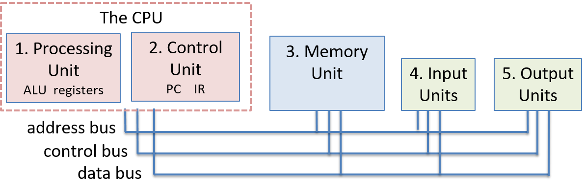
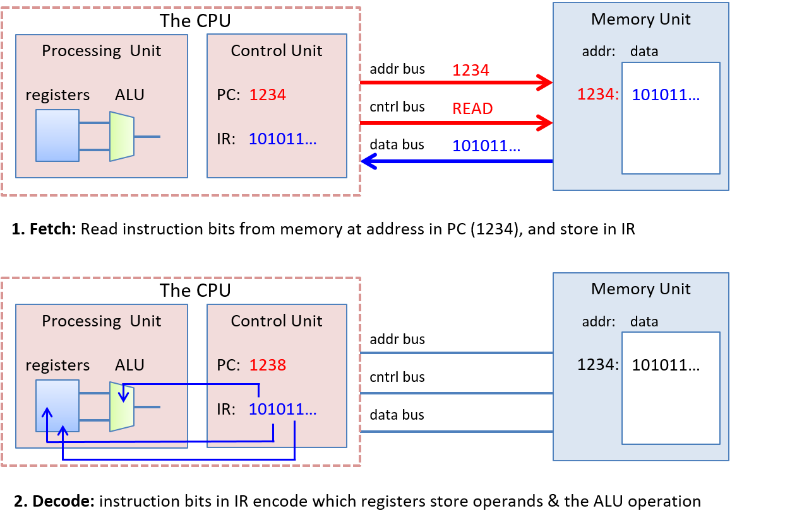
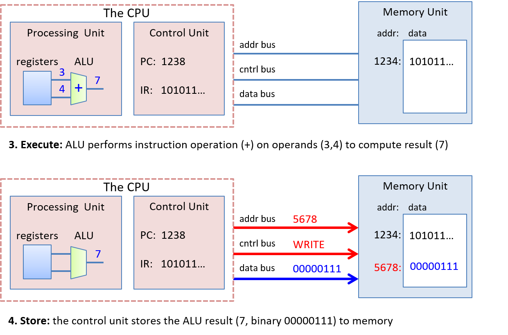

> **说明**
> 本文是个人学习用的**非官方**中英对照译文，原文：<https://diveintosystems.org/book/C5-Arch/von.html>。
> 原书采用 CC BY-NC-ND 4.0 许可（禁止演绎），**请勿公开传播本译文**。
> 标为「译注」「现代更新」的内容是译者补充，不代表原书作者观点；代码与原文逐字一致，未作改动。

## 5.2. 冯·诺依曼体系结构

*5.2. The von Neumann Architecture*

冯·诺依曼体系结构是大多数现代计算机的基础。本节简要刻画这种体系结构的主要组成部分。

> The von Neumann architecture serves as the foundation for most modern computers. In this section, we briefly characterize the architecture’s major components.

冯·诺依曼体系结构（如[图 1](5.2-von.html) 所示）由五个主要部件组成：

> The von Neumann architecture (depicted in [Figure 1](5.2-von.html)) consists of five main components:

1. **处理单元**（processing unit）执行程序指令。

> 1.  The **processing unit** executes program instructions.

2. **控制单元**（control unit）驱动处理单元执行程序指令。处理单元和控制单元一起构成 CPU。

> 2.  The **control unit** drives program instruction execution on the processing unit. Together, the processing and control units make up the CPU.

3. **存储单元**（memory unit）存储程序数据和指令。

> 3.  The **memory unit** stores program data and instructions.

4. **输入单元**（input unit）把程序数据和指令加载到计算机上，并启动程序的执行。

> 4.  The **input unit(s)** load program data and instructions on the computer and initiate program execution.

5. **输出单元**（output unit）存储或接收程序的结果。

> 5.  The **output unit(s)** store or receive program results.

各个单元之间由总线连接，单元之间用总线互相发送控制信息和数据信息。**总线**（bus）是在通信端点（值的发送方和接收方）之间传送二进制值的通信通道。例如，连接存储单元和 CPU 的数据总线可以用 32 根并行导线来实现，它们一起传送一个 4 字节的值，每根导线传送 1 位。通常，体系结构有各自独立的总线，用于在单元之间传送数据、内存地址和控制信息。各单元用控制总线发送控制信号，请求其他单元执行某个动作或通知其他单元某个动作；用地址总线向存储单元发送读或写请求的内存地址；用数据总线在单元之间传送数据。

> Buses connect the units, and are used by the units to send control and data information to one another. A **bus** is a communication channel that transfers binary values between communication endpoints (the senders and receivers of the values). For example, a data bus that connects the memory unit and the CPU could be implemented as 32 parallel wires that together transfer a 4-byte value, 1-bit transferred on each wire. Typically, architectures have separate buses for sending data, memory addresses, and control between units. The units use the control bus to send control signals that request or notify other units of actions, the address bus to send the memory address of a read or write request to the memory unit, and the data bus to transfer data between units.

**图 1.** 冯·诺依曼体系结构由处理单元、控制单元、存储单元、输入单元和输出单元组成。控制单元和处理单元构成 CPU，CPU 包含 ALU、通用 CPU 寄存器和一些专用寄存器（IR 和 PC）。各单元由总线连接，总线用于单元之间的数据传送和通信。

*Figure 1. The von Neumann architecture consists of the processing, control, memory, input, and output units. The control and processing units make up the CPU, which contains the ALU, the general-purpose CPU registers, and some special-purpose registers (IR and PC). The units are connected by buses used for data transfer and communication between the units.*

### 5.2.1. CPU

*5.2.1. The CPU*

控制单元和处理单元一起实现了 CPU，即计算机中在程序数据上执行程序指令的部分。

> The control and processing units together implement the CPU, which is the part of the computer that executes program instructions on program data.

### 5.2.2. 处理单元

*5.2.2. The Processing Unit*

冯·诺依曼机器的**处理单元**由两部分组成。第一部分是**算术逻辑单元**（arithmetic/logic unit，ALU），它执行加法、减法和逻辑或等数学运算。现代 ALU 通常能执行大量的算术运算。处理单元的第二部分是一组寄存器。**寄存器**（register）是一种小而快的存储单元，用来存放程序数据以及 ALU 正在执行的指令。关键在于，在冯·诺依曼体系结构中，指令和数据没有区别。从任何意义上讲，指令*就是*数据。因此，每个寄存器都能存放一个数据字。

> The **processing unit** of the von Neumann machine consists of two parts. The first is the **arithmetic/logic unit** (ALU), which performs mathematical operations such as addition, subtraction, and logical or, to name a few. Modern ALUs typically perform a large set of arithmetic operations. The second part of the processing unit is a set of registers. A **register** is a small, fast unit of storage used to hold program data and the instructions that are being executed by the ALU. Crucially, there is no distinction between instructions and data in the von Neumann architecture. For all intents and purposes, instructions *are* data. Each register is therefore capable of holding one data word.

### 5.2.3. 控制单元

*5.2.3. The Control Unit*

**控制单元**驱动程序指令的执行：它从存储器中加载指令，并把指令的操作数和操作送入处理单元。控制单元还包含一些存储空间，用于记录执行状态并确定下一步要采取的动作：**程序计数器**（program counter，PC）保存下一条要执行的指令的内存地址，**指令寄存器**（instruction register，IR）存放从存储器中加载的、当前正在执行的指令。

> The **control unit** drives the execution of program instructions by loading them from memory and feeding instruction operands and operations through the processing unit. The control unit also includes some storage to keep track of execution state and to determine its next action to take: the **program counter** (PC) keeps the memory address of the next instruction to execute, and the **instruction register** (IR) stores the instruction, loaded from memory, that is currently being executed.

### 5.2.4. 存储单元

*5.2.4. The Memory Unit*

内部存储器是冯·诺依曼体系结构的一项关键创新。它在靠近处理单元的地方提供程序数据存储，大大缩短了执行计算所需的时间。**存储单元**同时存储程序数据和程序指令——存储程序指令是冯·诺依曼体系结构存储程序模型的关键部分。

> Internal memory is a key innovation of the von Neumann architecture. It provides program data storage that is close to the processing unit, significantly reducing the amount of time to perform calculations. The **memory unit** stores both program data and program instructions — storing program instructions is a key part of the stored-program model of the von Neumann architecture.

不同系统的存储器大小各不相同。不过，系统的 ISA 限制了它能表示的地址范围。在现代系统中，内存的最小可寻址单位是一个字节（8 位），因此每个地址对应一个字节的唯一存储位置。于是，32 位体系结构通常支持的最大地址空间大小是 232，相当于 4 GB（GiB）的可寻址内存。

> The size of memory varies from system to system. However, a system’s ISA limits the range of addresses that it can express. In modern systems, the smallest addressable unit of memory is one byte (8 bits), and thus each address corresponds to a unique memory location for one byte of storage. As a result, 32-bit architectures typically support a maximum address space size of 232, which corresponds to 4 gigabytes (GiB) of addressable memory.

> **译注**
> 64 位体系结构理论上可寻址 264 字节，但实际的处理器并没有用满 64 位地址。例如在 x86-64 Linux 上，使用 4 级页表时每个进程的用户空间约为 128 TB（47 位地址），启用 5 级页表后扩大到 64 PB。[Linux 内核文档：x86_64 内存映射](https://www.kernel.org/doc/html/latest/arch/x86/x86_64/mm.html)

**存储器**（memory）这个术语有时指系统中整个存储层次结构，它可以包括处理单元中的寄存器，也可以包括硬盘驱动器（HDD）或固态硬盘（SSD）这样的辅助存储设备。在[存储与存储器层次结构](../C11-MemHierarchy/11.0-index.html)一章中，我们会详细讨论存储器层次结构。目前，我们把「存储器」（或「内存」）与内部的**随机存取存储器**（random access memory，RAM）当作同义词使用，即中央处理器可以访问的存储器。RAM 之所以是随机存取的，是因为所有 RAM 存储位置（地址）都可以被直接访问。把 RAM 想象成一个线性的地址数组会很有帮助，每个地址对应一个字节的内存。

> The term **memory** sometimes refers to an entire hierarchy of storage in the system. It can include registers in the processing unit as well as secondary storage devices like hard disk drives (HDD) or solid-state drives (SSD). In the [Storage and Memory Hierarchy Chapter](../C11-MemHierarchy/11.0-index.html), we discuss the memory hierarchy in detail. For now, we use the term "memory" interchangeably with internal **random access memory** (RAM) — memory that can be accessed by the central processing unit. RAM storage is random access because all RAM storage locations (addresses) can be accessed directly. It is useful to think of RAM as a linear array of addresses, where each address corresponds to one byte of memory.

> **原书旁注 · 历史上的字长（Word sizes through history）**
> **字长**（word size）由 ISA 定义，是处理器作为一个整体来处理的标准数据大小的位数。标准字长多年来几经变化。EDVAC 的字长被提议为 30 位。在 1950 年代，36 位字长很常见。随着 1960 年代 IBM 360 的问世，字长或多或少地标准化了，并开始从 16 位扩展到 32 位，再到今天的 64 位。如果你更仔细地研究 Intel 体系结构，可能会注意到其中一些早期决策的遗迹，因为 32 位和 64 位体系结构都是作为最初 16 位体系结构的扩展而加入的。
>
> > **Word size**, which is defined by an ISA, is the number of bits of the standard data size that a processor handles as a single unit. The standard word size has fluctuated over the years. For EDVAC, the word size was proposed at 30 bits. In the 1950s, 36-bit word sizes were common. With the innovation of the IBM 360 in the 1960s, word sizes became more or less standardized, and started to expand from 16 bits, to 32 bits, to today’s 64 bits. If you examine the Intel architecture in more detail, you may notice the remnants of some of these old decisions, as 32-bit and 64-bit architectures were added as extensions of the original 16-bit architecture.

### 5.2.5. 输入和输出（I/O）单元

*5.2.5. The Input and Output (I/O) Units*

控制单元、处理单元和存储单元构成了计算机的基础，而输入和输出单元使计算机能够与外部世界交互。具体来说，它们提供了把程序的指令和数据加载到存储器中、把数据存储到存储器之外，以及向用户显示结果的机制。

> While the control, processing, and memory units form the foundation of the computer, the input and output units enable it to interact with the outside world. In particular, they provide mechanisms for loading a program’s instructions and data into memory, storing its data outside of memory, and displaying its results to users.

**输入单元**由一组设备构成，使用户或程序能把外部世界的数据送入计算机。如今最常见的输入设备是键盘和鼠标。摄像头和麦克风也是例子。

> The **input unit** consists of the set of devices that enable a user or program to get data from the outside world into the computer. The most common forms of input devices today are the keyboard and mouse. Cameras and microphones are other examples.

**输出单元**由一组设备构成，它们把计算结果从计算机传回外部世界，或者把结果存储到内部存储器之外。例如，显示器就是一种常见的输出设备。其他输出设备包括扬声器和触觉反馈装置。

> The **output unit** consists of the set of devices that relay results of computation from the computer back to the outside world or that store results outside internal memory. For example, the monitor is a common output device. Other output devices include speakers and haptics.

一些现代设备，例如触摸屏，同时充当输入和输出设备，让用户可以通过同一个设备既输入数据又接收数据。

> Some modern devices, such as the touchscreen, act as both input and output, enabling users to both input and receive data from a single unified device.

固态硬盘和硬盘是另一类同时充当输入和输出设备的例子。当它们存储着由操作系统加载到计算机内存中运行的程序可执行文件时，它们充当输入设备；当它们存储着写入了程序结果的文件时，它们充当输出设备。

> Solid-state and hard drives are another example of devices that act as both input and output devices. These storage devices act as input devices when they store program executable files that the operating system loads into computer memory to run, and they act as output devices when they store files to which program results are written.

### 5.2.6. 冯·诺依曼机器的运转：执行一个程序

*5.2.6. The von Neumann Machine in Action: Executing a Program*

构成冯·诺依曼体系结构的五个单元协同工作，实现一个由**取指—译码—执行—存储**（fetch-decode-execute-store）组成的动作循环，共同执行程序指令。这个循环从程序的第一条指令开始，不断重复，直到程序退出：

> The five units that make up the von Neumann architecture work together to implement a **fetch-decode-execute-store** cycle of actions that together execute program instructions. This cycle starts with a program’s first instruction, and is repeated until the program exits:

1. **控制单元从存储器中*取出*下一条指令**。控制单元有一个特殊的寄存器——程序计数器（PC），其中存放着下一条要取出的指令的地址。它把这个地址放到*地址总线*上，并在*控制总线*上向存储单元发出一个*读*命令。存储单元随后读取指定地址处存放的字节，并通过*数据总线*把它们发送给控制单元。指令寄存器（IR）存放从存储单元收到的指令字节。控制单元还会增加 PC 的值，使它存放下一条要取的新指令的地址。

> 1.  **The control unit *fetches* the next instruction from memory**. The control unit has a special register, the program counter (PC), that contains the address of the next instruction to fetch. It places that address on the *address bus* and places a *read* command on the *control bus* to the memory unit. The memory unit then reads the bytes stored at the specified address and sends them to the control unit on the *data bus*. The instruction register (IR) stores the bytes of the instruction received from the memory unit. The control unit also increments the PC’s value to store the address of the new next instruction to fetch.

2. **控制单元对存储在 IR 中的指令进行*译码*（decode）**。它对编码了要执行哪种操作的指令位、以及编码了操作数位置的指令位进行译码。指令位是根据 ISA 对其指令编码的定义来译码的。控制单元还会从操作数所在的位置（CPU 寄存器、存储器，或编码在指令位中）取出数据操作数的值，作为处理单元的输入。

> 2.  **The control unit *decodes* the instruction stored in the IR**. It decodes the instruction bits that encode which operation to perform and the bits that encode where the operands are located. The instruction bits are decoded based on the ISA’s definition of the encoding of its instructions. The control unit also fetches the data operand values from their locations (from CPU registers, memory, or encoded in the instruction bits), as input to the processing unit.

3. **处理单元*执行*指令**。ALU 在指令的数据操作数上执行指令的操作。

> 3.  **The processing unit *executes* the instruction**. The ALU performs the instruction operation on instruction data operands.

4. **控制单元把结果*存储*到存储器中**。处理单元执行指令的结果被存储到存储器中。控制单元把结果值放到*数据总线*上，把存储位置的地址放到*地址总线*上，并在*控制总线*上发出一个*写*命令，从而把结果写入存储器。存储单元收到后，就把这个值写入存储器的指定地址处。

> 4.  **The control unit *stores* the result to memory**. The result of the processing unit’s execution of the instruction is stored to memory. The control unit writes the result to memory by placing the result value on the *data bus*, placing the address of the storage location on the *address bus*, and placing a *write* command on the *control bus*. When received, the memory unit writes the value to memory at the specified address.

输入和输出单元并不直接参与程序指令的执行。它们参与程序执行的方式，是加载程序的指令和数据，以及存储或显示程序的计算结果。

> The input and output units are not directly involved in the execution of program instructions. Instead, they participate in the program’s execution by loading a program’s instructions and data and by storing or displaying the results of the program’s computation.

[图 2](5.2-von.html) 和[图 3](5.2-von.html) 以一条操作数存放在 CPU 寄存器中的示例加法指令为例，展示了冯·诺依曼体系结构执行指令的四个阶段。在*取指*阶段，控制单元读取存放在 PC 中的内存地址（1234）处的指令。它把地址发送到地址总线上，并在控制总线上发出 READ 命令。存储单元收到请求后，读取地址 1234 处的值，并通过数据总线把它发送给控制单元。控制单元把指令字节放进 IR 寄存器，并用下一条指令的地址（本例中是 1238）更新 PC。在*译码*阶段，控制单元把指令中指定要执行哪种操作的位送入处理单元的 ALU，并利用指定哪些寄存器存放操作数的指令位，把操作数的值从处理单元的寄存器读入 ALU（本例中操作数的值是 3 和 4）。在*执行*阶段，处理单元中的 ALU 对操作数执行运算，得出结果（3 + 4 等于 7）。最后，在*存储*阶段，控制单元把处理单元得出的结果（7）写入存储单元：内存地址（5678）通过地址总线发送，WRITE 命令通过控制总线发送，要存储的数据值（7）通过数据总线发送。存储单元收到这个请求后，把 7 存放到内存地址 5678 处。在这个例子中，我们假定存放结果的内存地址编码在指令位中。

> [Figure 2](5.2-von.html) and [Figure 3](5.2-von.html) show the four phases of instruction execution by the von Neumann architecture for an example addition instruction whose operands are stored in CPU registers. In the *fetch* phase, the control unit reads the instruction at the memory address stored in the PC (1234). It sends the address on the address bus, and a READ command on the control bus. The memory unit receives the request, reads the value at address 1234, and sends it to the control unit on the data bus. The control unit places the instruction bytes in the IR register and updates the PC with the address of the next instruction (1238 in this example). In the *decode* phase, the control unit feeds bits from the instruction that specify which operation to perform to the processing unit’s ALU, and uses instruction bits that specify which registers store operands to read operand values from the processing unit’s registers into the ALU (the operand values are 3 and 4 in this example). In the *execute* phase, the ALU part of the processing unit executes the operation on the operands to produce the result (3 + 4 is 7). Finally, in the *store* phase the control unit writes the result (7) from the processing unit to the memory unit. The memory address (5678) is sent on the address bus, a WRITE command is sent on the control bus, and the data value to store (7) is sent on the data bus. The memory unit receives this request and stores 7 at memory address 5678. In this example, we assume that the memory address to store the result is encoded in the instruction bits.

**图 2.** 以一条示例加法指令为例，冯·诺依曼体系结构执行指令的取指和译码阶段。操作数、结果和内存地址以十进制值表示，存储器内容以二进制值表示。

*Figure 2. The fetch and decode stages of execution of the von Neumann architecture for an example addition instruction. Operand, result, and memory addresses are shown as decimal values, memory contents are shown as binary values.*

**图 3.** 以一条示例加法指令为例，冯·诺依曼体系结构执行指令的执行和存储阶段。操作数、结果和内存地址以十进制值表示，存储器内容以二进制值表示。

*Figure 3. The execute and store stages of execution of the von Neumann architecture for an example addition instruction. Operand, result, and memory addresses are shown as decimal values, memory contents are shown as binary values.*
