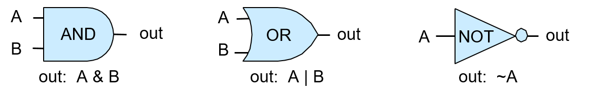
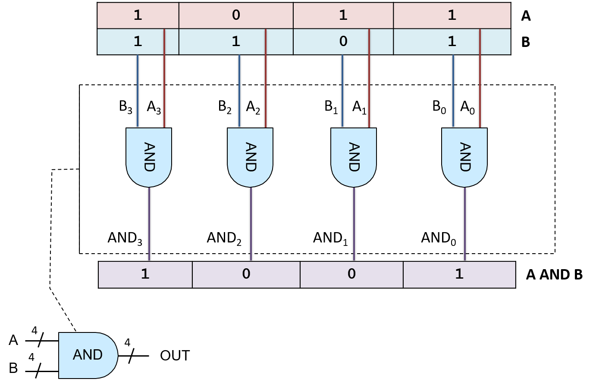
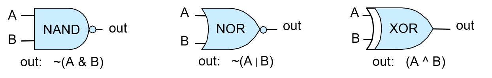

> **说明**
> 本文是个人学习用的**非官方**中英对照译文，原文：<https://diveintosystems.org/book/C5-Arch/gates.html>。
> 原书采用 CC BY-NC-ND 4.0 许可（禁止演绎），**请勿公开传播本译文**。
> 标为「译注」「现代更新」的内容是译者补充，不代表原书作者观点；代码与原文逐字一致，未作改动。

## 5.3. 逻辑门

*5.3. Logic Gates*

**逻辑门**（logic gate）是数字电路的基本构件，数字计算机中的算术、控制和存储功能都由数字电路实现。设计复杂的数字电路需要高度的抽象：设计者先用一小组基本逻辑门搭建出实现基本功能的简单电路；这些简单电路在抽象掉其实现细节之后，被用作构建更复杂电路的构件（把简单电路组合起来，形成功能更复杂的新电路）；这些更复杂的电路又可以进一步抽象，用作实现更复杂功能的构件；如此层层构建，直到搭建出处理器完整的处理、存储和控制部件。

> **Logic gates** are the building blocks of the digital circuitry that implements arithmetic, control, and storage functionality in a digital computer. Designing complicated digital circuits involves employing a high degree of abstraction: a designer creates simple circuits that implement basic functionality from a small set of basic logic gates; these simple circuits, abstracted from their implementation, are used as the building blocks for creating more complicated circuits (simple circuits are combined together to create new circuits with more complicated functionality); these more complicated circuits may be further abstracted and used as a building block for creating even more complicated functionality; and so on to build complete processing, storage, and control components of a processor.

> **原书旁注 · 晶体管（Transistors）**
> 逻辑门由蚀刻在半导体材料（例如硅芯片）中的晶体管构成。晶体管就像开关一样，控制电流在芯片中的流动。晶体管可以在开和关两种状态之间切换（即输出高电压或低电压）。它的输出状态取决于它的当前状态加上它的输入状态（高电压或低电压）。二进制值用这种高（1）、低（0）电压来编码，而逻辑门则由几个晶体管的特定排列来实现，它们对输入执行开关动作，产生逻辑门的输出。一个集成电路（芯片）上能容纳的晶体管数量是衡量其能力的粗略指标：每块芯片上的晶体管越多，就有越多的构件来实现更多的功能或存储。
>
> > Logic gates are created from transistors that are etched into a semiconductor material (e.g. silicon chips). Transistors act as switches that control electrical flow through the chip. A transistor can switch its state between on or off (between a high or low voltage output). Its output state depends on its current state plus its input state (high or low voltage). Binary values are encoded with these high (1) and low (0) voltages, and logic gates are implemented by arrangements of a few transistors that perform switching actions on the inputs to produce the logic gate’s output. The number of transistors that can fit on an integrated circuit (a chip) is a rough measure of its power; with more transistors per chip, there are more building blocks to implement more functionality or storage.

> **现代更新（截至 2026-11）· 一块芯片上有多少晶体管**
> 举个当下的数字：NVIDIA 的 Blackwell 架构 GPU 集成了 **2080 亿**个晶体管，采用定制的台积电 4NP 工艺；由于单个硅片的面积已接近光刻机一次曝光所能覆盖的上限，它由两块这样的硅片（die）通过 10 TB/s 的片间互连拼接而成。[NVIDIA Blackwell 架构](https://www.nvidia.com/en-us/data-center/technologies/blackwell-architecture/)

### 5.3.1. 基本逻辑门

*5.3.1. Basic Logic Gates*

在最底层，所有电路都是由逻辑门连接起来构成的。逻辑门对布尔操作数（0 或 1）执行布尔运算。**AND**（与）、**OR**（或）和 **NOT**（非）构成了一个完备的逻辑门集合，用它们可以构造出任何电路。一个逻辑门有一个（NOT）或两个（AND 和 OR）二进制输入值，产生一个二进制输出值，即对输入进行按位逻辑运算的结果。例如，向 NOT 门输入 0，输出为 1（1 即 NOT(0)）。逻辑运算的**真值表**（truth table）列出了该运算对每一种输入组合的值。[表 1](5.3-gates.html) 给出了 AND、OR 和 NOT 逻辑门的真值表。

> At the lowest level, all circuits are built from linking logic gates together. Logic gates implement boolean operations on boolean operands (0 or 1). **AND**, **OR**, and **NOT** form a complete set of logic gates from which any circuit can be constructed. A logic gate has one (NOT) or two (AND and OR) binary input values and produces a binary output value that is the bitwise logical operation on its input. For example, an input value of 0 to a NOT gate outputs 1 (1 is NOT(0)). A **truth table** for a logical operation lists the operation’s value for each permutation of inputs. [Table 1](5.3-gates.html) shows the truth tables for the AND, OR, and NOT logic gates.

**表 1.** 基本逻辑运算的真值表

*Table 1. Truth Tables for Basic Logic Operations.*

| A   | B   | A AND B | A OR B | NOT A |
|-----|-----|---------|--------|-------|
| 0   | 0   | 0       | 0      | 1     |
| 0   | 1   | 0       | 1      | 1     |
| 1   | 0   | 0       | 1      | 0     |
| 1   | 1   | 1       | 1      | 0     |

[图 1](5.3-gates.html) 展示了计算机体系结构设计者在电路图中如何表示这些门。

> [Figure 1](5.3-gates.html) shows how computer architects represent these gates in circuit drawings.

**图 1.** 单位输入的 AND、OR 和 NOT 逻辑门产生单位输出。

*Figure 1. The AND, OR, and NOT logic gates for single-bit inputs produce a single-bit output.*

逻辑门的多位版本（*M* 位输入和输出）是一种非常简单的电路，由 *M* 个一位逻辑门构成。*M* 位输入值的各个位分别输入到不同的一位门中，每个一位门产生 *M* 位结果中对应的输出位。例如，[图 2](5.3-gates.html) 展示了一个由四个 1 位 AND 门构成的 4 位 AND 电路。

> A multi-bit version of a logic gate (for *M*-bit input and output) is a very simple circuit constructed using *M* one-bit logic gates. Individual bits of the *M*-bit input value are each input into a different one-bit gate that produces the corresponding output bit of the *M*-bit result. For example, [Figure 2](5.3-gates.html) shows a 4-bit AND circuit built from four 1-bit AND gates.

**图 2.** 由四个 1 位 AND 门构成的 4 位 AND 电路。

*Figure 2. A 4-bit AND circuit built from four 1-bit AND gates.*

这种只是扩展逻辑门输入输出位宽的非常简单的电路，通常被称为 *M* 位门，*M* 取某个具体的值，指定输入和输出的位宽（位数）。

> This type of very simple circuit, one that just expands input and output bit width for a logic gate, is often referred to as an *M*-bit gate for a particular value of *M* specifying the input and output bit width (number of bits).

### 5.3.2. 其他逻辑门

*5.3.2. Other Logic Gates*

尽管由 AND、OR 和 NOT 组成的逻辑门集合足以实现任何电路，但还有其他一些基本逻辑门也常用来构建数字电路。这些额外的逻辑门包括 NAND（与非，A AND B 的否定）、NOR（或非，A OR B 的否定）和 XOR（异或）。它们的真值表如[表 2](5.3-gates.html) 所示。

> Even though the set of logic gates consisting of AND, OR, and NOT is sufficient for implementing any circuit, there are other basic logic gates that are often used to construct digital circuits. These additional logic gates include NAND (the negation of A AND B), NOR (the negation of A OR B), and XOR (exclusive OR). Their truth tables are shown in [Table 2](5.3-gates.html).

**表 2.** NAND、NOR、XOR 真值表

*Table 2. NAND, NOR, XOR truth tables.*

| A   | B   | A NAND B | A NOR B | A XOR B |
|-----|-----|----------|---------|---------|
| 0   | 0   | 1        | 1       | 0       |
| 0   | 1   | 1        | 0       | 1       |
| 1   | 0   | 1        | 0       | 1       |
| 1   | 1   | 0        | 0       | 0       |

NAND、NOR 和 XOR 门在电路图中的画法如[图 3](5.3-gates.html) 所示。

> The NAND, NOR, and XOR gates appear in circuit drawings, as shown in [Figure 3](5.3-gates.html).

**图 3.** NAND、NOR 和 XOR 逻辑门。

*Figure 3. The NAND, NOR, and XOR logic gates.*

NAND 门和 NOR 门末端的小圆圈表示取反，即 NOT。例如，NOR 门看起来就像一个末端带小圆圈的 OR 门，表示 NOR 是 OR 的否定。

> The circle on the end of the NAND and NOR gates represents negation or NOT. For example, the NOR gate looks like an OR gate with a circle on the end, representing the fact that NOR is the negation of OR.

> **原书旁注 · 逻辑门的最小子集（Minimal subsets of logic gates）**
> NAND、NOR 和 XOR 并不是构建电路所必需的，它们是在 {AND, OR, NOT} 集合之外额外增加的、在电路设计中常用的门。这些门中的任何一个，既可以由晶体管（逻辑门的构件）实现，也可以由其他门的组合来实现。
>
> 在更大的集合 {AND, OR, NOT, NAND, NOR, XOR} 中，存在几个逻辑门的最小子集，单靠它们就足以构建任何电路。例如，子集 {AND, NOT} 就是一个最小子集：(A OR B) 等价于 NOT(NOT(A) AND NOT(B))。我们没有使用最小的门子集，而是使用 {AND, OR, NOT} 集合，因为它最容易理解。
>
> 由于 NAND、NOR 和 XOR 不是必需的，它们的功能可以通过把 AND、OR 和 NOT 门组合成实现 NAND、NOR 和 XOR 功能的电路来实现。例如，NOR 可以用一个 NOT 门和一个 OR 门组合构建，`(A NOR B) ≡ NOT(A OR B)`），如[图 4](5.3-gates.html) 所示。
>
> 
>
> *图示：NOR 门可以用一个 OR 门和一个 NOT 门实现。输入 A 和 B 先经过一个 OR 门，OR 门的输出再输入一个 NOT 门（NOR 就是 OR 的 NOT）。*
>
> 如今的集成电路芯片是用 CMOS 技术制造的，它以 NAND 作为芯片上电路的基本构件。NAND 门本身就构成了另一个完备逻辑门的最小子集。
>
> > NAND, NOR, and XOR are not necessary for building circuits, but they are additional gates added to the set {AND, OR, NOT} that are commonly used in circuit design. Any of these gates can be implemented from transistors (the building block of logic gates), or can be implemented from combinations of other gates.
> >
> > Of the larger set {AND, OR, NOT, NAND, NOR, XOR}, there exist several minimal subsets of logic gates that alone are sufficient for building any circuit. For example, the subset {AND, NOT} is one minimal subset: (A OR B) is equivalent to NOT(NOT(A) AND NOT(B)). Rather than using a minimal subset of gates, we we use the set {AND, OR, NOT} because it is the easiest set to understand.
> >
> > Because NAND, NOR, and XOR are not necessary, their functionality can be implemented by combining AND, OR, and NOT gates into circuits that implement NAND, NOR, and XOR functions. For example, NOR can be built using a NOT combined with an OR gate, `(A NOR B) ≡ NOT(A OR B)`), as shown in [Figure 4](5.3-gates.html).
> >
> >
> >
> > *Figure 4. The NOR gate can be implemented using an OR and a NOT gate. The inputs, A and B, are first fed through an OR gate, and the OR gate’s output is input to a NOT gate (NOR is the NOT of OR).*
> >
> > Today’s integrated circuits chips are built using CMOS technology, which uses NAND as the basic building block of circuits on the chip. The NAND gate by itself makes up another minimal subset of complete logic gates.
