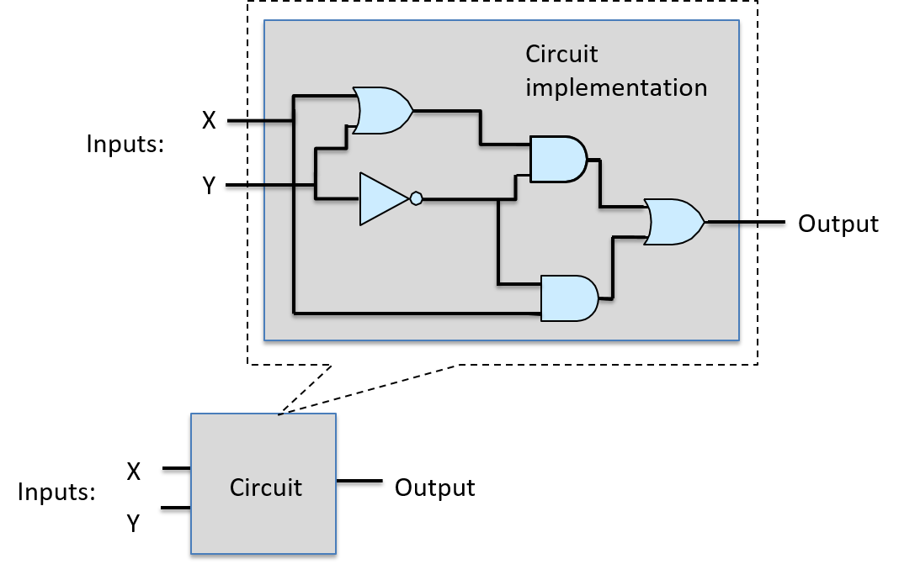

> [!WARNING] 说明
> 本文是个人学习用的**非官方**中英对照译文，原文：<https://diveintosystems.org/book/C5-Arch/circuits.html>。
> 原书采用 CC BY-NC-ND 4.0 许可（禁止演绎），**请勿公开传播本译文**。
> 标为「译注」「现代更新」的内容是译者补充，不代表原书作者观点；代码与原文逐字一致，未作改动。

*5.4. Circuits*

数字电路实现了体系结构的核心功能。它们在硬件中实现**指令集架构**（ISA），也实现整个系统中的存储和控制功能。设计数字电路需要运用多层抽象：实现复杂功能的电路由实现部分功能的较小电路构成，这些较小电路又由更简单的电路构成，如此层层向下，直到所有数字电路的基本构件——逻辑门。[图 1](5.4-circuits.html) 展示了一个抽象掉实现细节的电路。这个电路被表示为一个*黑盒*，上面标着它的功能或名称，只画出它的输入和输出，隐藏了内部实现的细节。

> Digital circuits implement core functionality of the architecture. They implement the **Instruction Set Architecture** (ISA) in hardware, and also implement storage and control functionality throughout the system. Designing digital circuits involves applying multiple levels of abstraction: circuits implementing complex functionality are built from smaller circuits that implement partial functionality, which are built from even simpler circuits, and so on down to the basic logic gate building blocks of all digital circuits. [Figure 1](5.4-circuits.html) illustrates a circuit abstracted from its implementation. The circuit is represented as a *black box* labeled with its functionality or name and with only its input and output shown, hiding the details of its internal implementation.

**图 1.** 电路由子电路和逻辑门连接而成。它的功能被从实现细节中抽象出来，可以用作构建其他电路的构件。

*Figure 1. A circuit is implemented by linking together subcircuits and logic gates. Its functionality is abstracted from the details of its implementation and can be used as a building block for creating other circuits.*

电路构件主要有三类：算术/逻辑电路、控制电路和存储电路。例如，一块处理器集成电路就包含全部三类子电路：它的寄存器组使用存储电路；它实现算术和逻辑功能的核心部分使用算术和逻辑电路；而控制电路遍布整个处理器，用来驱动指令的执行，并控制寄存器中值的加载和存储。

> There are three main categories of circuit building blocks: arithmetic/logic, control, and storage circuits. A processor integrated circuit, for example, contains all three types of subcircuits: its register set uses storage circuits; its core functionality for implementing arithmetic and logic functions uses arithmetic and logic circuits; and control circuits are used throughout the processor to drive the execution of instructions and to control loading and storing values in its registers.

本节讨论这三类电路，先介绍如何用逻辑门设计一个基本电路，再介绍如何用基本电路和逻辑门构建更大的电路。

> In this section, we discuss these three types of circuit, showing how to design a basic circuit from logic gates, and then how to build larger circuits from basic circuits and logic gates.

- [算术/逻辑电路](5.4.1-arithlogiccircs.html)

> - [Arithmetic / Logic Circuits](5.4.1-arithlogiccircs.html)

- [控制电路](5.4.2-controlcircs.html)

> - [Control Circuits](5.4.2-controlcircs.html)

- [存储电路](5.4.3-storagecircs.html)

> - [Storage Circuits](5.4.3-storagecircs.html)
