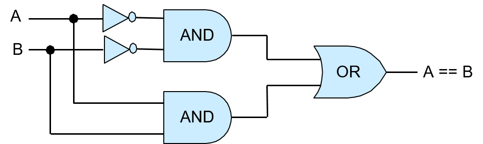
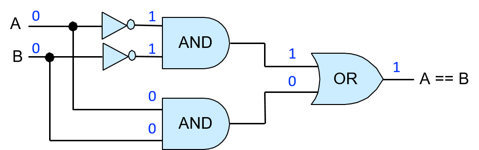
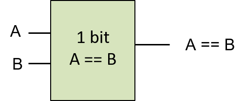
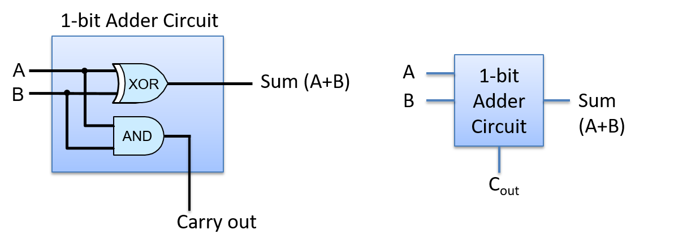
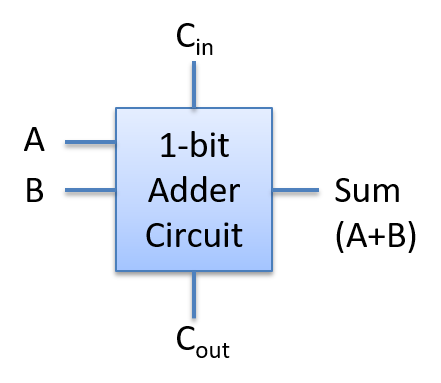
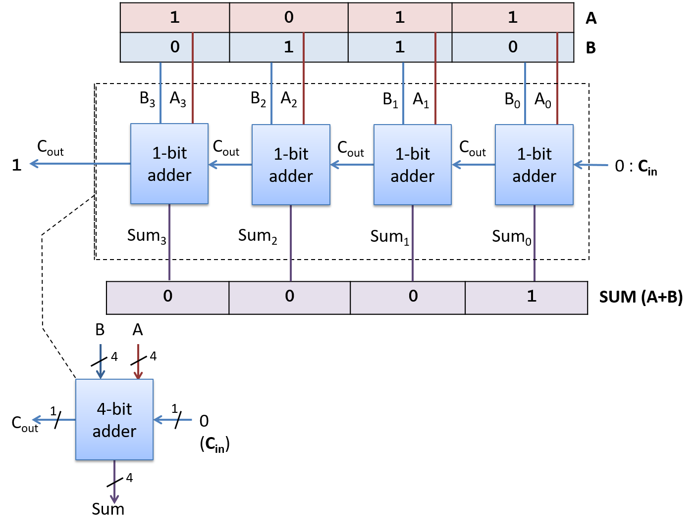

> [!WARNING] 说明
> 本文是个人学习用的**非官方**中英对照译文，原文：<https://diveintosystems.org/book/C5-Arch/arithlogiccircs.html>。
> 原书采用 CC BY-NC-ND 4.0 许可（禁止演绎），**请勿公开传播本译文**。
> 标为「译注」「现代更新」的内容是译者补充，不代表原书作者观点；代码与原文逐字一致，未作改动。


*5.4.1. Arithmetic and Logic Circuits*

算术与逻辑电路实现了 ISA 的算术和逻辑指令，它们一起构成了处理器的**算术逻辑单元**（arithmetic logic unit，ALU）。算术与逻辑电路也实现了 CPU 中其他功能的一部分。例如，算术电路被用来在指令执行的第一步中增加程序计数器（PC）的值，也被用来把指令操作数位与寄存器值组合起来计算内存地址。

> Arithmetic and Logic circuits implement the arithmetic and logic instructions of an ISA that together make up the **arithmetic logic unit** (ALU) of the processor. Arithmetic and logic circuits also implement parts of other functionality in the CPU. For example, arithmetic circuits are used to increment the program counter (PC) as part of the first step of instruction execution, and they are used to calculate memory addresses by combining instruction operand bits and register values.

电路设计通常从用逻辑门实现某个简单电路的 1 位版本开始。然后用这个 1 位电路作为构件，实现该电路的 *M* 位版本。用基本逻辑门设计 1 位电路的步骤是：

> Circuit design often starts with implementing a 1-bit version of a simple circuit from logic gates. This 1-bit circuit is then used as a building block for implementing *M*-bit versions of the circuit. The steps for designing a 1-bit circuit from basic logic gates are:

1. 设计电路的真值表：确定输入和输出的个数，并为输入位的每一种组合添加一个表项，指定输出位的值。

> 1.  Design the truth table for the circuit: determine the number of inputs and outputs, and add a table entry for every permutation of input bit(s) that specifies the value of the output bit(s).

2. 根据真值表，用 AND、OR、NOT 组合输入值，写出每个电路输出为 1 时的表达式。

> 2.  Using the truth table, write an expression for when each circuit output is 1 in terms of its input values combined with AND, OR, NOT.

3. 把表达式翻译成一系列逻辑门，每个门的输入要么来自电路的输入，要么来自前面某个逻辑门的输出。

> 3.  Translate the expression into a sequence of logic gates, where each gate gets its inputs from either an input to the circuit or from the output of a preceding logic gate.

我们按照这些步骤实现一个单位的*相等*电路：按位相等（`A == B`）在 `A` 和 `B` 的值相同时输出 1，否则输出 0。

> We follow these steps to implement a single-bit *equals* circuit: bitwise equals (`A == B`) outputs 1 when the values of `A` and `B` are the same, and it outputs 0 otherwise.

首先，设计电路的真值表：

> First, design the truth table for the circuit:

**表 1.** 简单相等电路的真值表

*Table 1. Truth table for a simple equality circuit*

| A | B | A == B 的输出 |
|-----|-----|---------------|
| 0 | 0 | 1 |
| 0 | 1 | 0 |
| 1 | 0 | 0 |
| 1 | 1 | 1 |

> | A   | B   | A == B output |
> |-----|-----|---------------|
> | 0   | 0   | 1             |
> | 0   | 1   | 0             |
> | 1   | 0   | 0             |
> | 1   | 1   | 1             |

接着，用 AND、OR 和 NOT 组合 `A` 和 `B`，写出 `A == B` 为 1 时的表达式。首先，分别考虑输出为 1 的每一行，从真值表的第一行开始：

> Next, write expressions for when `A == B` is 1 in terms of `A` and `B` combined with AND, OR, and NOT. First, consider each row whose output is 1 separately, starting with the first row in the truth table:

| A   | B   | A == B |
|-----|-----|--------|
| 0   | 0   | 1      |

对于这一行的输入值，构造一个由求值为 1 的输入表达式组成的*合取式*。**合取**（conjunction）用 AND 把求值为 0 或 1 的子表达式组合起来，只有当它的两个子表达式都求值为 1 时，它本身才为 1。先写出每个输入在何时求值为 1：

> For the input values in this row, construct a *conjunction* of expressions of its inputs that evaluate to 1. A **conjunction** combines subexpressions that evaluate to 0 or 1 with AND, and is itself 1 only when both of its subexpressions evaluate to 1. Start by expressing when each input evaluates to 1:

```
NOT(A)    # is 1 when A is 0
NOT(B)    # is 1 when B is 0
```

然后，构造它们的合取（用 AND 组合起来），得到真值表这一行求值为 1 时的表达式：

> Then, create their conjunction (combine them with AND) to yield an expression for when this row of the truth table evaluates to 1:

```
NOT(A) AND NOT(B)    # is 1 when A and B are both 0
```

对真值表的最后一行（其输出也是 1）做同样的处理：

> We do the same thing for the last row in the truth table, whose output is also 1:

| A   | B   | A == B |
|-----|-----|--------|
| 1   | 1   | 1      |

```
A AND B   # is 1 when A and B are both 1
```

最后，把真值表中求值为 1 的各行所对应的合取式组合成一个**析取**（disjunction，即 OR）：

> Finally, create a **disjunction** (an OR) of each conjunction corresponding to a row in the truth table that evaluates to 1:

```
(NOT(A) AND NOT(B)) OR (A AND B)  # is 1 when A and B are both 0 or both 1
```

到这里，我们得到了一个可以翻译成电路的 `A == B` 表达式。在这一步，电路设计者会运用一些技术来化简表达式，得到一个最简的等价表达式（即运算符最少和/或电路中门的路径最短的表达式）。设计者在最小化电路设计时必须格外小心，确保翻译后的表达式与原式等价。有一些用于电路最小化的形式化方法，超出了本书的范围，不过我们在设计电路时会用到一些启发式方法。

> At this point we have an expression for `A == B` that can be translated to a circuit. At this step, circuit designers employ techniques to simplify the expression to create a minimal equivalent expression (one that corresponds to the fewest operators and/or shortest path length of gates through the circuit). Designers must take great care when minimizing a circuit design to ensure the equivalence of the translated expression. There are formal methods for circuit minimization that are beyond the scope of our coverage, but we will employ a few heuristics as we develop circuits.

在我们的例子中，直接把上面的表达式翻译成电路。我们可能会想把 (NOT(A) AND NOT(B)) 替换成 (A NAND B)，但要注意这两个表达式**并不**等价：对于 A 和 B 的所有组合，它们的求值结果并不完全相同。例如，当 A 为 1、B 为 0 时，(A == B) 为 0，而 (A NAND B) 为 1。

> For our example, we directly translate the preceding expression to a circuit. We may be tempted to replace (NOT(A) AND NOT(B)) with (A NAND B), but note that these two expressions **are not** equivalent: they do not evaluate the same for all permutations of A and B. For example, when A is 1 and B is 0, (A == B) is 0 and (A NAND B) is 1.

要把表达式翻译成电路，从最内层的表达式开始向外进行（最内层的会成为最前面的门，它们的输出将作为后续门的输入）。第一组门对应于对输入值的取反（对输入 A 和 B 的 NOT 门）。接着，对每个合取式，构造把输入值送入一个 AND 门的那部分电路。然后，AND 门的输出被送入表示析取的 OR 门。得到的电路如[图 1](5.4.1-arithlogiccircs.html) 所示。

> To translate the expression to a circuit, start from the innermost expression and work outward (the innermost will be the first gates, whose outputs will be inputs to subsequent gates). The first set of gates correspond to any negation of input values (NOT gates of inputs A and B). Next, for each conjunction, create parts of the circuit feeding input values into an AND gate. The AND gate outputs are then fed into OR gate(s) representing the disjunction. The resulting circuit is shown in [Figure 1](5.4.1-arithlogiccircs.html).



**图 1.** 由 AND、OR 和 NOT 逻辑门构成的 1 位相等电路（A == B）。

*Figure 1. The 1-bit equality circuit (A == B) constructed from AND, OR, and NOT logic gates.*

要验证这个电路的正确性，可以让输入值 A 和 B 的所有可能组合在电路中模拟运行一遍，验证电路的输出与 (A == B) 真值表中对应的行相符。例如，如果 A 为 0、B 为 0，两个 NOT 门先对它们取反，再送入上面的 AND 门，所以这个 AND 门的输入是 (1, 1)，输出为 1，这就是 OR 门上面的输入值。A 和 B 的值 (0, 0) 直接送入下面的 AND 门，下面的 AND 门输出 0，这就是 OR 门下面的输入。于是 OR 门收到输入值 (1, 0)，输出值 1。所以，当 A 和 B 都为 0 时，电路正确地输出 1。[图 2](5.4.1-arithlogiccircs.html) 展示了这个例子。

> To verify the correctness of this circuit, simulate all possible permutations of input values A and B through the circuit and verify that the output of the circuit matches its corresponding row in the truth table for (A == B). For example, if A is 0 and B is 0, the two NOT gates negate their values before being fed through the top AND gate, so the input to this AND gate is (1, 1), resulting in an output of 1, which is the top input value to the OR gate. The values of A and B (0, 0) are fed directly though the bottom AND gate, resulting in output of 0 from the bottom AND gate, which is the lower input to the OR gate. The OR gate thus receives input values (1, 0) and outputs the value 1. So, when A and B are both 0, the circuit correctly outputs 1. [Figure 2](5.4.1-arithlogiccircs.html) illustrates this example.



**图 2.** 1 位相等电路如何计算 (A == B) 的示例。从 A 输入 0、B 输入 0 开始，各个值在构成电路的门之间传播，最终算出 A == B 的正确输出值 1。

*Figure 2. An example showing how the 1-bit equality circuit computes (A == B). Starting with input values 0 for A and 0 for B, the values propagate through the gates making up the circuit to compute the correct output value of 1 for A == B.*

把 1 位相等电路的实现看作一个整体，就可以把它从实现细节中抽象出来，从而更方便地用作其他电路的构件。我们把 1 位相等电路的这种抽象（如[图 3](5.4.1-arithlogiccircs.html) 所示）表示为一个方框，它的两个输入标为 *A* 和 *B*，唯一的输出标为 *A == B*。在电路的这种抽象视图中，实现 1 位相等电路的内部门都被隐藏了起来。

> Viewing the implementation of a 1-bit equality circuit as a unit allows it to be abstracted from its implementation, and thus it can be more easily used as a building block for other circuits. We represent this abstraction of the 1-bit equality circuit (shown in [Figure 3](5.4.1-arithlogiccircs.html)) as a box with its two inputs labeled *A* and *B* and its single output labeled *A == B*. The internal gates that implement the 1-bit equality circuit are hidden in this abstracted view of the circuit.



**图 3.** 1 位相等电路的抽象。这个电路可以用作其他电路的构件。

*Figure 3. The 1-bit equality circuit abstraction. This circuit can be used as a building block in other circuits.*

从 NAND、NOR 和 XOR 电路的真值表（[表 2](5.4.1-arithlogiccircs.html)）出发，按照与 1 位相等电路相同的步骤，也可以只用 AND、OR 和 NOT 门构造出它们的单位版本。

> Single-bit versions of NAND, NOR, and XOR circuits can be constructed similarly, using only AND, OR, and NOT gates, starting with their truth tables ([Table 2](5.4.1-arithlogiccircs.html)) and applying the same steps as the 1-bit equality circuit.

**表 2.** NAND、NOR 和 XOR 电路的真值表

*Table 2. Truth table for the NAND, NOR, and XOR circuits.*

| A   | B   | A NAND B | A NOR B | A XOR B |
|-----|-----|----------|---------|---------|
| 0   | 0   | 1        | 1       | 0       |
| 0   | 1   | 1        | 0       | 1       |
| 1   | 0   | 1        | 0       | 1       |
| 1   | 1   | 0        | 0       | 0       |

这些电路的多位版本，由多个单位版本的电路构成，方式与用四个 1 位 AND 门构造 [4 位 AND](5.3-gates.html) 门类似。

> Multibit versions of these circuits are constructed from multiple single-bit versions of the circuits in a similar way to how the [4-bit AND](5.3-gates.html) gate was constructed from four 1-bit AND gates.

#### 算术电路

*Arithmetic Circuits*

算术电路的构造方法与我们构造逻辑电路的方法完全相同。例如，要构造一个 1 位加法器电路，就从单位加法的真值表开始，它有两个输入值 A 和 B，以及两个输出值：一个是 A 与 B 的和（SUM），另一个是溢出，即进位输出（CARRY OUT）。[表 3](5.4.1-arithlogiccircs.html) 给出了得到的 1 位加法真值表。

> Arithmetic circuits are constructed using exactly the same method as we used for constructing the logic circuits. For example, to construct a 1-bit adder circuit, start with the truth table for single-bit addition, which has two input values, A and B, and two output values, one for the SUM of A and B, and another output for overflow or CARRY OUT. [Table 3](5.4.1-arithlogiccircs.html) shows the resulting truth table for 1-bit add.

**表 3.** 1 位加法器电路的真值表

*Table 3. Truth table for a 1-bit adder circuit.*

| A   | B   | SUM | CARRY OUT |
|-----|-----|-----|-----------|
| 0   | 0   | 0   | 0         |
| 0   | 1   | 1   | 0         |
| 1   | 0   | 1   | 0         |
| 1   | 1   | 0   | 1         |

下一步，对每个输出 SUM 和 CARRY OUT，写出输出值为 1 时的逻辑表达式。这些表达式表示为各行输入值合取式的析取：

> In the next step, for each output, SUM and CARRY OUT, create logical expressions of when the output value is 1. These expressions are expressed as disjunctions of per-row conjunctions of input values:

```
SUM: (NOT(A) AND B) OR (A AND NOT(B))     # 1 when exactly one of A or B is 1
CARRY OUT:  A AND B                       # 1 when both A and B are 1
```

CARRY OUT 的表达式无法再化简。而 SUM 的表达式比较复杂，可以化简，从而得到更简单的电路设计。首先要注意的是，SUM 输出也可以表示为 (A XOR B)。如果有 XOR 门或 XOR 电路可用，把 SUM 表示为 (A XOR B) 就能得到更简单的加法器电路设计；如果没有，就使用由 AND、OR 和 NOT 组成的表达式，并用 AND、OR 和 NOT 门来实现。

> The expression for CARRY OUT cannot be simplified. However, the expression for SUM is more complicated and can be simplified, leading to a simpler circuit design. The first thing to note is that the SUM output can also be expressed as (A XOR B). If we have an XOR gate or circuit, expressing SUM as (A XOR B) results in a simpler adder circuit design. If not, the expression using AND, OR, and NOT is used and implemented using AND, OR, and NOT gates.

假设我们有一个 XOR 门可以用来实现 1 位加法器电路。得到的电路如[图 4](5.4.1-arithlogiccircs.html) 所示。

> Let’s assume that we have an XOR gate that we can use for implementing the 1-bit adder circuit. The resulting circuit is shown in [Figure 4](5.4.1-arithlogiccircs.html).



**图 4.** 1 位加法器电路有两个输入 A 和 B，以及两个输出 SUM 和 CARRY OUT。

*Figure 4. The 1-bit adder circuit has two inputs, A and B, and two outputs, SUM and CARRY OUT.*

1 位加法器电路可以用作更复杂电路的构件。例如，我们可能想构造 *N* 位加法器电路，对不同大小的值进行加法（例如 1 字节、2 字节或 4 字节加法器电路）。然而，用 *N* 个 1 位加法器电路构造一个 *N* 位加法器电路，要比用 *N* 个 1 位逻辑电路构造 *N* 位逻辑电路更费心思。

> The 1-bit adder circuit can be used as a building block for more complicated circuits. For example, we may want to create *N*-bit adder circuits for performing addition on values of different sizes (e.g. 1-byte, 2-byte, or 4-byte adder circuits). However, creating an *N*-bit adder circuit from *N* 1-bit adder circuits requires more care than creating an *N*-bit logic circuits from *N* 1-bit logic circuits.

进行多位加法（或减法）时，各个位是按从最低有效位到最高有效位的顺序依次求和的。在这种逐位相加的过程中，如果第 *i* 位相加产生了值为 1 的进位输出，那么在第 *(i+1)* 位的两个位相加时就要再加上一个 1。换句话说，第 *i* 位加法器电路的进位输出，是第 *(i+1)* 位加法器电路的一个输入值。

> When performing a multibit addition (or subtraction), individual bits are summed in order from the least significant bit to the most significant bit. As this bitwise addition proceeds, if the sum of the *ith* bits results in a carry out value of 1, then an additional 1 is added with the two *(i+1)st* bits. In other words, the carry out of the *ith* bit adder circuit is an input value to the *(i+1)st* bit adder circuit.

因此，要实现多位加法器电路，我们需要一个新的 1 位加法器电路，它有三个输入：A、B 和 CARRY IN（进位输入）。为此，按照上面构造 1 位加法器电路的步骤，从三个输入所有可能组合的真值表出发，构造一个有三个输入（A、B、CARRY IN）和两个输出（SUM 和 CARRY OUT）的电路。我们把这个电路的设计留作练习，但在[图 5](5.4.1-arithlogiccircs.html) 中给出了它作为 1 位加法器电路的抽象。

> Thus, to implement a multibit adder circuit, we need a new 1-bit adder circuit that has three inputs: A, B, and CARRY IN. To do this, follow the steps above for creating a 1-bit adder circuit, with three inputs (A, B, CARRY IN) and two outputs (SUM and CARRY OUT), starting with the truth table for all possible permutations of its three inputs. We leave the design of this circuit as an exercise for the reader, but we show its abstraction as a 1-bit adder circuit in [Figure 5](5.4.1-arithlogiccircs.html).



**图 5.** 有三个输入（A、B 和 CARRY IN）和两个输出（SUM 和 CARRY OUT）的 1 位加法器电路。

*Figure 5. The 1-bit adder circuit with three inputs (A, B, and CARRY IN) and two outputs (SUM and CARRY OUT).*

以这个版本的 1 位加法器电路为构件，我们就可以构造一个 *N* 位加法器电路：把对应的操作数位分别送入各个 1 位加法器电路，并把第 *i* 个 1 位加法器电路的 CARRY OUT 值送入第 *(i+1)* 个 1 位加法器电路的 CARRY IN。第 0 位的 1 位加法器电路，从 CPU 中对 ADD 指令进行译码的另一部分电路那里获得值为 0 的 CARRY IN。

> Using this version of a 1-bit adder circuit as a building block, we can construct an *N*-bit adder circuit by feeding corresponding operand bits through individual 1-bit adder circuits, feeding the CARRY OUT value from the *ith* 1-bit adder circuit into the CARRY IN value of the *(i+1)st* 1-bit adder circuit. The 1-bit adder circuit for the 0th bits receives a value of 0 for its CARRY IN from another part of the CPU circuitry that decodes the ADD instruction.

这种由 *N* 个 1 位加法器电路构成的 *N* 位加法器电路称为**行波进位加法器**（ripple carry adder），如[图 6](5.4.1-arithlogiccircs.html) 所示。SUM 结果在电路中从低位向高位*逐级传递*（ripple，即传播）。只有在第 0 位的 SUM 和 CARRY OUT 值算出之后，第 1 位的 SUM 和 CARRY OUT 才能被正确算出。这是因为第 1 位的 CARRY IN 的值来自第 0 位的 CARRY OUT，结果中后续更高位的情况也依此类推。

> This type of *N*-bit adder circuit, built from *N* 1-bit adder circuits, is called a **ripple carry adder**, shown in [Figure 6](5.4.1-arithlogiccircs.html). The SUM result *ripples* or propagates through the circuit from the low-order to the high-order bits. Only after bit 0 of the SUM and CARRY OUT values are computed will the bit 1 of the SUM and CARRY OUT be correctly computed. This is because the 1st bit’s CARRY IN gets its value from the 0th bit’s CARRY OUT, and so on for subsequent higher-order bits of the result.

> [!NOTE] 译注
> 行波进位加法器的延迟随位数线性增长（最高位要等所有低位的进位依次传过来）。实际处理器中的加法器通常采用**超前进位加法器**（carry-lookahead adder）等结构，用额外的逻辑并行地算出各位的进位，以更多的门换取更短的延迟。



**图 6.** 由四个 1 位加法器电路构成的 4 位行波进位加法器电路。

*Figure 6. A 4-bit ripple adder circuit created from four 1-bit adder circuits.*

> [!NOTE] 译注 · 图中内容
> 第 i 位加法器输出的 CARRY OUT，就是第 i+1 位加法器的 CARRY IN 输入。

其他算术和逻辑功能的电路，也是用类似的方式组合电路和逻辑门构造出来的。例如，计算 (A - B) 的减法电路，可以由加法器电路和取负电路构成，把减法计算为 (A + (-B))。

> Circuits for other arithmetic and logic functions are constructed in similar ways by combining circuits and logic gates. For example, a subtraction circuit that computes (A - B) can be built from adder and negation circuits that compute subtraction as (A + (-B)).
