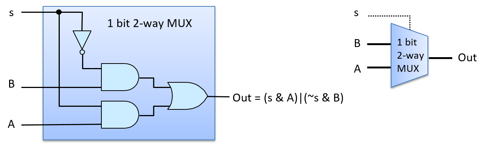
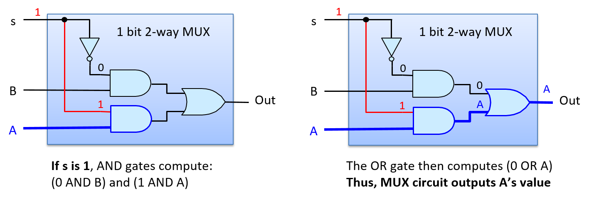
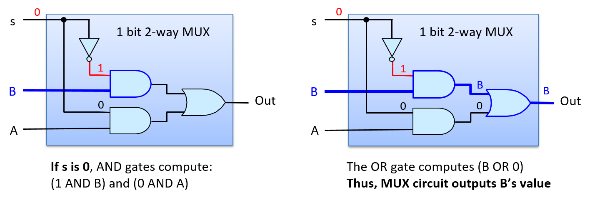
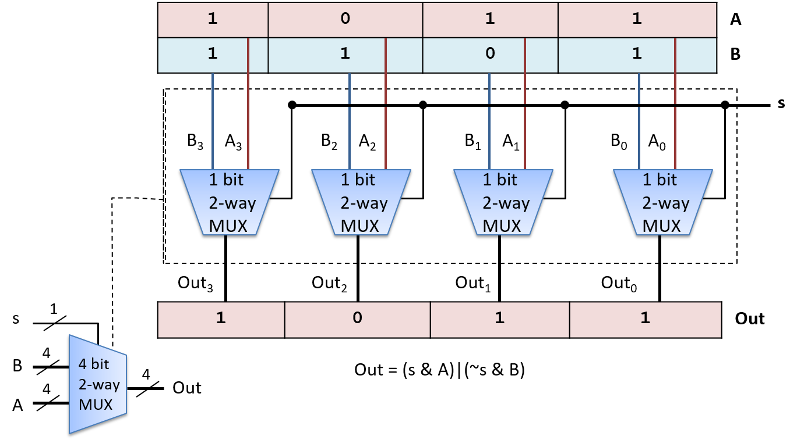
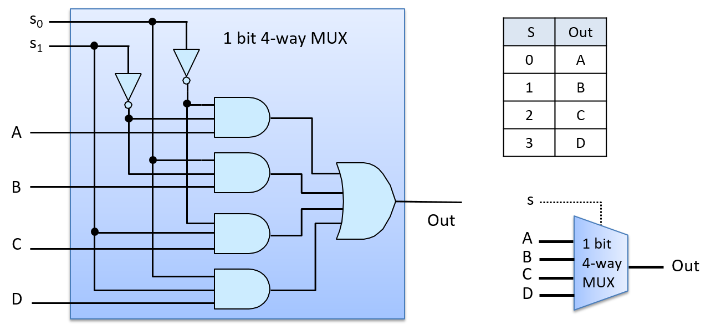
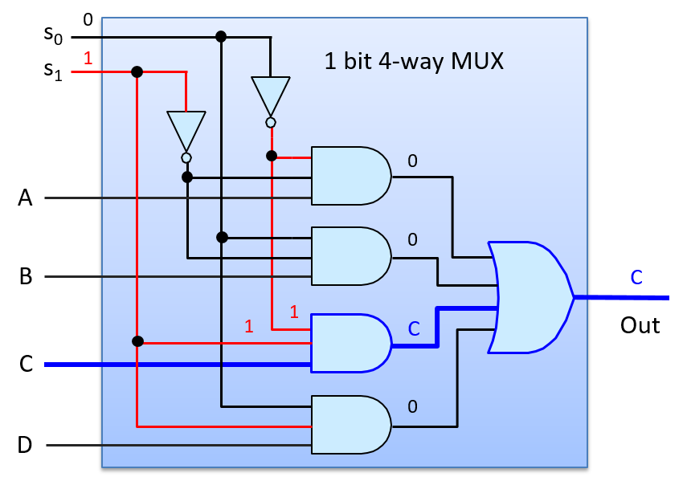
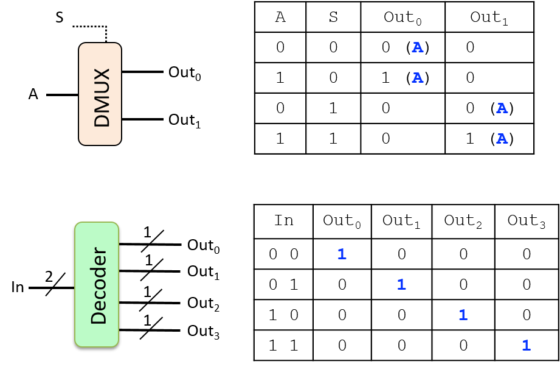

> **说明**
> 本文是个人学习用的**非官方**中英对照译文，原文：<https://diveintosystems.org/book/C5-Arch/controlcircs.html>。
> 原书采用 CC BY-NC-ND 4.0 许可（禁止演绎），**请勿公开传播本译文**。
> 标为「译注」「现代更新」的内容是译者补充，不代表原书作者观点；代码与原文逐字一致，未作改动。

### 5.4.2. 控制电路

*5.4.2. Control Circuits*

控制电路遍布整个系统。在处理器上，它们驱动程序指令在程序数据上的执行。它们还控制值在不同存储层级之间（在寄存器、缓存和 RAM 之间）的加载和存储，并控制系统中的硬件设备。与算术和逻辑电路一样，实现复杂功能的控制电路也是由更简单的电路和逻辑门组合而成的。

> Control circuits are used throughout a system. On the processor, they drive the execution of program instructions on program data. They also control loading and storing values to different levels of storage (between registers, cache, and RAM), and control hardware devices in the system. Just like arithmetic and logic circuits, control circuits that implement complicated functionality are built by combining simpler circuits and logic gates.

**多路复用器**（multiplexer，MUX）是控制电路的一个例子，它从若干个值中选出一个。CPU 可能会用多路复用器电路来选择从哪个 CPU 寄存器读取指令的操作数值。

> A **multiplexer** (MUX) is an example of a control circuit that selects, or chooses, one of several values. The CPU may use a multiplexer circuit to select from which CPU register to read an instruction operand value.

*N* 路多路复用器有一组 *N* 个输入值，以及一个从其输入中选出的输出值。另外还有一个输入值 **Select**（选择，S），它编码了从 *N* 个输入中选择哪一个作为输出。

> An *N*-way multiplexer has a set of *N* input values and a single output value selected from one of its inputs. An additional input value, **Select** (S), encodes which of its *N* inputs is chosen for its output.

最基本的二路 MUX 在两个 1 位输入 A 和 B 之间进行选择。二路多路复用器的选择输入只有一位：如果 S 输入为 1，就选择 A 作为输出；如果为 0，就选择 B 作为输出。二路 1 位多路复用器的真值表如下。选择位（S）的值决定选择 A 还是 B 的值作为 MUX 的输出值。

> The most basic two-way MUX selects between two 1-bit inputs, A and B. The select input for a two-way multiplexer is a single bit: if the S input is 1, it will select A for output; if it is 0 it will select B for output. The truth table for a two-way 1-bit multiplexer is shown below. The value of the selection bit (S) chooses either the value of A or B as the MUX output value.

**表 1.** 1 位多路复用器的真值表

*Table 1. Truth table for 1 bit multiplexer*

| A | B | S | 输出 |
|-----|-----|-----|---------------|
| 0 | 0 | 0 | 0（B 的值） |
| 0 | 1 | 0 | 1（B 的值） |
| 1 | 0 | 0 | 0（B 的值） |
| 1 | 1 | 0 | 1（B 的值） |
| 0 | 0 | 1 | 0（A 的值） |
| 0 | 1 | 1 | 0（A 的值） |
| 1 | 0 | 1 | 1（A 的值） |
| 1 | 1 | 1 | 1（A 的值） |

> | A   | B   | S   | out           |
> |-----|-----|-----|---------------|
> | 0   | 0   | 0   | 0 (B’s value) |
> | 0   | 1   | 0   | 1 (B’s value) |
> | 1   | 0   | 0   | 0 (B’s value) |
> | 1   | 1   | 0   | 1 (B’s value) |
> | 0   | 0   | 1   | 0 (A’s value) |
> | 0   | 1   | 1   | 0 (A’s value) |
> | 1   | 0   | 1   | 1 (A’s value) |
> | 1   | 1   | 1   | 1 (A’s value) |

[图 1](5.4.2-controlcircs.html) 展示了单位输入的二路多路复用器电路。

> [Figure 1](5.4.2-controlcircs.html) shows the two-way multiplexer circuit for single-bit input.

**图 1.** 二路 1 位多路复用器电路。信号输入（S）的值用来选出它的两个输入（A 或 B）中的哪一个作为电路的输出值：S 为 1 时选择 A，S 为 0 时选择 B。

*Figure 1. A two-way 1-bit multiplexer circuit. The value of the signal input (S) is used to pick which of its two inputs (A or B) will be the circuit’s output value: when S is 1, A is chosen; when S is 0, B is chosen.*

[图 2](5.4.2-controlcircs.html) 展示了 S 输入值为 1 时多路复用器如何选择 A 作为输出。例如，假设输入值为 A 为 1、B 为 0、S 为 1。S 先取反，再与 B 一起送入上面的 AND 门（0 AND B），上面的 AND 门输出 0。S 与 A 一起送入下面的 AND 门，得到 (1 AND A)，其值就是下面的 AND 门输出的 A 的值。A 的值（本例中为 1）和上面 AND 门输出的 0 作为 OR 门的输入，输出 (0 OR A)。换句话说，S 为 1 时，MUX 选择 A 的值作为输出（本例中 A 的值为 1）。B 的值不影响 MUX 的最终输出，因为 S 为 1 时上面的 AND 门总是输出 0。

> [Figure 2](5.4.2-controlcircs.html) shows how the multiplexer chooses A’s output with an S input value of 1. For example, suppose that the input values are 1 for A, 0 for B, and 1 for S. S is negated before being sent to the top AND gate with B (0 AND B), resulting in a 0 output value from the top AND gate. S feeds into the bottom AND gate with A, resulting in (1 AND A), which evaluates to the value of A being output from the bottom AND gate. The value of A (1 in our example) and 0 from the top AND gate feed as input to the OR gate, resulting in (0 OR A) being output. In other words, when S is 1, the MUX chooses the value of A as its output (A’s value being 1 in our example). The value of B does not affect the final output of the MUX, because 0 will always be the output of the top AND gate when S is 1.

**图 2.** S 为 1 时，二路 1 位多路复用器电路选择（输出）A。

*Figure 2. A two-way 1-bit multiplexer circuit chooses (outputs) A when S is 1.*

[图 3](5.4.2-controlcircs.html) 展示了 S 输入值为 0、选择 B 作为输出时信号在多路复用器中的路径。如果 A 和 B 的输入与上例相同，但把 S 改为 0，那么 0 取反后输入上面的 AND 门，得到 (1 AND B)，即上面的 AND 门输出 B 的值。下面 AND 门的输入是 (0 AND A)，下面的 AND 门输出 0。于是 OR 门的输入值是 (B OR 0)，其值就是作为 MUX 输出的 B 的值（本例中 B 的值为 0）。

> [Figure 3](5.4.2-controlcircs.html) shows the path through the multiplexer when the S input value 0 chooses B’s output. If we consider the same input for A and B as the example above, but change S to 0, then the negation of 0 is input to the top AND gate resulting in (1 AND B), or B’s value, output from the top AND gate. The input to the bottom AND gate is (0 AND A), resulting in 0 from the bottom AND gate. Thus, the input values to the OR gate are (B OR 0), which evaluates to B’s value as the MUX’s output (B’s value being 0 in our example).

**图 3.** S 为 0 时，二路 1 位多路复用器电路选择（输出）B。

*Figure 3. A two-way 1-bit multiplexer circuit chooses (outputs) B when S is 0.*

二路 1 位 MUX 电路是构造二路 *N* 位 MUX 电路的构件。例如，[图 4](5.4.2-controlcircs.html) 展示了一个由四个 1 位二路 MUX 电路构成的二路 4 位 MUX。

> A two-way 1- bit MUX circuit is a building block for constructing two-way *N*-bit MUX circuits. For example, [Figure 4](5.4.2-controlcircs.html) shows a two-way 4-bit MUX built from four 1-bit two-way MUX circuits.

**图 4.** 由四个二路 1 位多路复用器电路构成的二路 4 位多路复用器电路。单个信号位 S 选择 A 或 B 作为输出。

*Figure 4. A two-way 4-bit multiplexer circuit built from four two-way 1-bit multiplexer circuits. A single signal bit, S, chooses either A or B as output.*

*N* 路多路复用器从 *N* 个输入中选出一个作为输出。它需要的 MUX 电路与二路 MUX 略有不同，其 Select 输入需要 log2(*N*) 位。之所以需要额外的选择位，是因为 log2(*N*) 位可以编码 *N* 个不同的值，每个值用于选择 *N* 个输入中的一个。log2(*N*) 个 Select 位的每一种不同组合，都与 *N* 个输入值之一一起送入一个 AND 门，从而恰好选出一个 MUX 输入值作为 MUX 的输出。[图 5](5.4.2-controlcircs.html) 展示了一个 1 位四路 MUX 电路的例子。

> An *N*-way multiplexer chooses one of *N* inputs as output. It requires a slightly different MUX circuit than a two-way MUX, and needs log2(*N*) bits for its Select input. The additional selection bits are needed because with log2(*N*) bits, *N* distinct values can be encoded, one for selecting each of the *N* inputs. Each distinct permutation of the log2(*N*) Select bits is input with one of the *N* input values to an AND gate, resulting in exactly one MUX input value selected as the MUX output. [Figure 5](5.4.2-controlcircs.html) shows an example of a 1-bit four-way MUX circuit.

**图 5.** 四路多路复用器电路有四个输入和两个（log(4)）选择位，选择位编码了多路复用器应当输出四个输入中的哪一个。

*Figure 5. A four-way multiplexer circuit has four inputs and two (log(4)) select bits that encode which of the four inputs should be output by the multiplexer.*

四路 MUX 电路使用了四个三输入 AND 门和一个四输入 OR 门。多输入版本的门可以通过把多个两输入 AND（以及 OR）门串联起来构建。例如，三输入 AND 门由两个两输入 AND 门构成，第一个 AND 门接收两个输入值，第二个 AND 门接收第三个输入值和第一个 AND 门的输出：(x AND y AND z) 等价于 ((x AND y) AND z)。

> The four-way MUX circuit uses four three-input AND gates and one four-input OR gate. Multi-input versions of gates can be built by chaining together multiple two-input AND (and OR) gates. For example, a three-input AND gate is built from two two-input AND gates, where the first AND gate takes two of the input values and the second AND gate takes the third input value and the output from the first AND gate: (x AND y AND z) is equivalent to ((x AND y) AND z).

为了看清四路 MUX 电路如何工作，考虑 S 输入值为 2（二进制 0b10）的情况，如[图 6](5.4.2-controlcircs.html) 所示。最上面的 AND 门的输入是 (NOT(S0) AND NOT(S1) AND A)，即 (1 AND 0 AND A)，输出 0。第二个 AND 门的输入值是 (0 AND 0 AND B)，输出 0。第三个 AND 门的输入值是 (1 AND 1 AND C)，输出 C 的值。最后一个 AND 门得到 (0 AND 1 AND D)，输出 0。OR 门的输入是 (0 OR 0 OR C OR 0)，于是 MUX 输出 C 的值（S 值为 2 时选择 C）。

> To see how the four-way MUX circuit works, consider an S input value of 2 (0b10 in binary), as shown in [Figure 6](5.4.2-controlcircs.html). The top AND gate gets as input (NOT(S0) AND NOT(S1) AND A), or (1 AND 0 AND A), resulting in 0 output from the top AND gate. The second AND gate gets input values (0 AND 0 AND B), resulting in 0 output. The third AND gate gets input values (1 AND 1 AND C), resulting in the value of C output. The last AND gate gets (0 AND 1 AND D), resulting in 0 output. The OR gate has inputs (0 OR 0 OR C OR 0), resulting in the value of C output by the MUX (an S value of 2 chooses C).

**图 6.** 当 Select 输入 S 为 2（0b10）时，四路多路复用器电路选择 C 作为输出。

*Figure 6. A four-way multiplexer circuit chooses C as output when the Select input, S, is 2 (0b10).*

多路分配器和译码器是控制电路的另外两个例子。**多路分配器**（demultiplexer，DMUX）是多路复用器的逆。多路复用器从 *N* 个输入中选择一个，而多路分配器从 *N* 个输出中选择一个。DMUX 接收单个输入值和一个选择输入，有 *N* 个输出。根据 S 的值，它把输入值恰好送到 *N* 个输出中的一个（输入的值被路由到 *N* 条输出线中的一条上）。DMUX 电路常用来从 *N* 个电路中选择一个来传递某个值。**译码器**（decoder）电路接收一个编码后的输入，并根据输入值使能若干输出中的一个。例如，一个有 *N* 位输入值的译码器电路，用这个值使能（置为 1）它的 2N 条输出线中恰好一条（与该 *N* 位值的编码对应的那一条）。[图 7](5.4.2-controlcircs.html) 展示了一个二路 1 位 DMUX 电路的例子，它的选择输入值（s）决定两个输出中的哪一个得到输入值 A。图中还展示了一个 2 位译码器电路的例子，它的输入位决定四个输出中的哪一个被置为 1。图中也给出了两个电路的真值表。

> Demultiplexers and decoders are two other examples of control circuits. A **demultiplexer** (DMUX) is the inverse of a multiplexer. Whereas a multiplexer chooses one of *N* inputs, a demultiplexer chooses one of *N* outputs. A DMUX takes a single input value and a selection input, and has *N* outputs. Based on the value of S, it sends the input value to exactly one of its *N* outputs (the value of the input is routed on to one of *N* output lines). A DMUX circuit is often used to select one of *N* circuits to pass a value. A **decoder** circuit takes an encoded input and enables one of several outputs based on the input value. For example, a decoder circuit that has an *N*-bit input value, uses the value to enable (to set to 1) exactly one of its 2N output lines (the one corresponding to the encoding of the *N*-bit value). [Figure 7](5.4.2-controlcircs.html) Shows an example of a two-way 1-bit DMUX circuit, whose selection input value (s) chooses which of its two outputs gets the input value A. It also shows an example of a 2-bit decoder circuit, whose input bits determine which of four outputs get set to 1. The truth tables for both circuits are also shown.

**图 7.** 二路 1 位多路分配器和 2 位译码器，以及它们的真值表。

*Figure 7. A two-way 1-bit demultiplexer, and a 2-bit decoder, along with their truth tables.*
