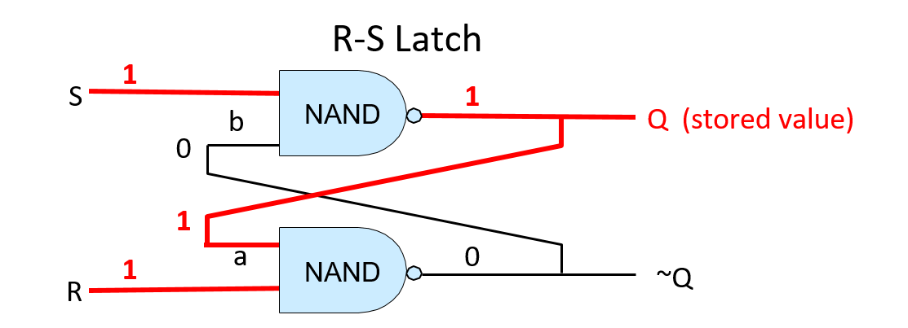
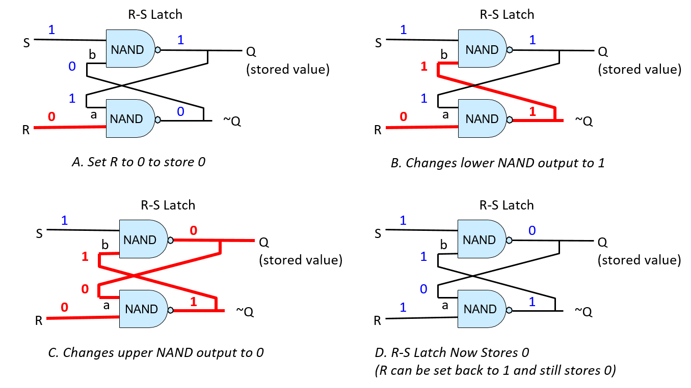
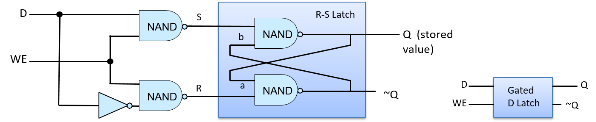
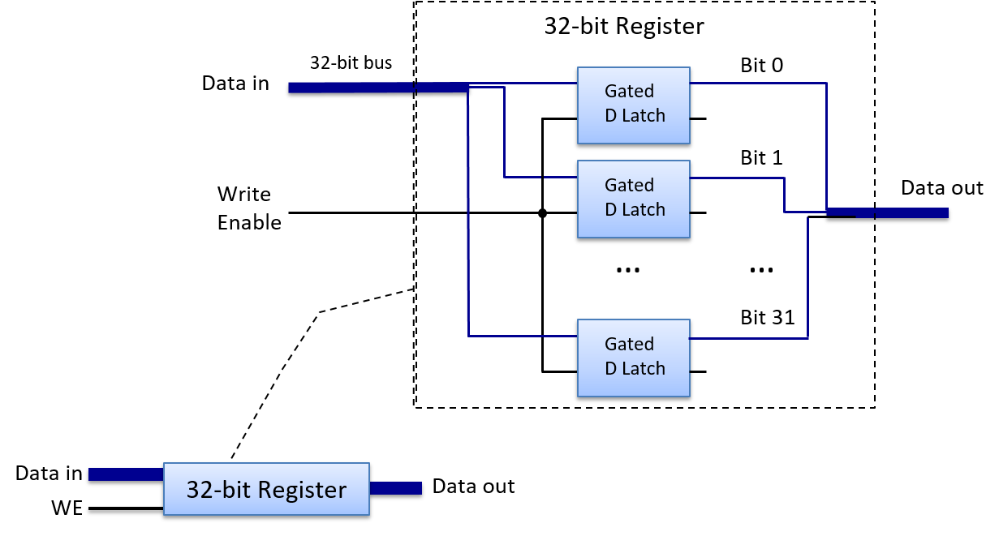

> **说明**
> 本文是个人学习用的**非官方**中英对照译文，原文：<https://diveintosystems.org/book/C5-Arch/storagecircs.html>。
> 原书采用 CC BY-NC-ND 4.0 许可（禁止演绎），**请勿公开传播本译文**。
> 标为「译注」「现代更新」的内容是译者补充，不代表原书作者观点；代码与原文逐字一致，未作改动。

### 5.4.3. 存储电路

*5.4.3. Storage Circuits*

**存储电路**（storage circuit）用来构建存储二进制值的计算机存储器。用存储电路构建的这类计算机存储器称为**静态 RAM**（static RAM，SRAM），它被用来构建 CPU 的寄存器存储和片上缓存。系统通常用**动态 RAM**（dynamic RAM，DRAM）作为主存（RAM）。DRAM 基于电容的设计要求周期性地刷新它所存储的值，「动态」这个名字由此而来。SRAM 是基于电路的存储，不需要刷新它的值，因此称为静态 RAM。基于电路的存储器比基于电容的存储器更快，但也更贵。因此，SRAM 往往用于[存储器层次结构](../C11-MemHierarchy/11.1-mem_hierarchy.html)顶端的存储（CPU 寄存器和片上缓存），而 DRAM 用于主存（RAM）存储。本章重点关注像 SRAM 这样基于电路的存储器。

> **Storage circuits** are used to construct computer memory for storing binary values. The type of computer memory built from storage circuits is called **static RAM** (SRAM). It is used to build CPU register storage and on-chip cache memory. Systems typically use **dynamic RAM** (DRAM) for main memory (RAM) storage. The capacitor-based design of DRAM requires that it be periodically refreshed with the value it stores, hence the "dynamic" moniker. SRAM is circuit-based storage that does not need to have its values refreshed, thus it is referred to as static RAM. Circuit-based memory is faster but more expensive than capacitor-based memory. As a result, SRAM tends to be used for storage at the top of the [memory hierarchy](../C11-MemHierarchy/11.1-mem_hierarchy.html) (CPU registers and on-chip cache memory), and DRAM for main memory (RAM) storage. In this chapter, we focus on circuit-based memory like SRAM.

要存储一个值，电路必须包含一个反馈回路，使这个值被电路保持住。换句话说，存储电路的值既取决于它的输入值，也取决于它当前存储的值。当电路存储着一个值时，它当前存储的值和它的输入一起，产生一个与当前存储值相同的输出（即电路继续存储同一个值）。当一个新值被写入存储电路时，电路的输入值会短暂地改变，从而改变电路的行为，使一个新值被写入并存储在电路中。一旦写入完成，电路就恢复到稳定状态，存储着新写入的值，直到下一次写入该电路为止。

> To store a value, a circuit must contain a feedback loop so that the value is retained by the circuit. In other words, a storage circuit’s value depends on its input values and also its currently stored value. When the circuit stores a value, its currently stored value and its inputs together produce an output that matches the currently stored value (i.e. the circuit continues to store the same value). When a new value is written into a storage circuit, the circuit’s input values change momentarily to modify the behavior of the circuit, which results in a new value being written into and stored in the circuit. Once written, the circuit resumes a steady state of storing the newly written value until the next write to the circuit occurs.

#### RS 锁存器

*RS Latch*

锁存器（latch）是一种存储（或者说记住）一位值的数字电路。一个例子是**复位—置位锁存器**（reset-set latch，即 RS 锁存器）。RS 锁存器有两个输入值 S 和 R，以及一个输出值 Q，Q 也就是锁存器中存储的值。RS 锁存器还可以额外输出 NOT(Q)，即存储值的反。[图 1](5.4.3-storagecircs.html) 展示了一个存储单个位的 RS 锁存器电路。

> A latch is a digital circuit that stores (or remembers) a 1-bit value. One example is a **reset-set latch** (or RS latch). An RS latch has two input values, S and R, and one output value, Q, which is also the value stored in the latch. An RS latch may additionally output NOT(Q), the negation of the stored value. [Figure 1](5.4.3-storagecircs.html) shows an RS latch circuit for storing a single bit.

**图 1.** RS 锁存器电路存储一位值。

*Figure 1. An RS latch circuit stores a 1-bit value.*

关于 RS 锁存器，首先要注意的是从输出到输入的反馈回路：上面 NAND 门的输出（Q）是下面 NAND 门的输入（a），而下面 NAND 门的输出（~Q）是上面 NAND 门的输入（b）。当输入 S 和 R 都为 1 时，RS 锁存器存储着值 Q。换句话说，当 S 和 R 都为 1 时，RS 锁存器的输出值 Q 是稳定的。为了看清这一行为，参见[图 2](5.4.3-storagecircs.html)，它展示了一个存储着值 1 的 RS 锁存器（Q 为 1）。当 R 和 S 都为 1 时，下面 NAND 门的反馈输入值（a）是 Q 的值，即 1，所以下面 NAND 门的输出为 0（1 NAND 1 为 0）。上面 NAND 门的反馈输入值（b）是下面 NAND 门的输出，即 0。上面 NAND 门的另一个输入是 S 的值 1。上面门的输出为 1（1 NAND 0 为 1）。因此，当 S 和 R 都为 1 时，这个电路持续存储着 Q 的值（本例中为 1）。

> The first thing to note about the RS latch is the feedback loop from its outputs to its inputs: the output of the top NAND gate (Q) is input (a) to the bottom NAND gate, and the output of the bottom NAND gate (~Q) is input (b) to the top NAND gate. When inputs S and R are both 1, the RS latch stores the value Q. In other words, when S and R are both 1, the RS latch output value Q is stable. To see this behavior, consider [Figure 2](5.4.3-storagecircs.html); this shows an RS latch that stores the value 1 (Q is 1). When R and S are both 1, the feedback input value (a) to the bottom NAND gate is the value of Q, which is 1, so the output of the bottom NAND gate is 0 (1 NAND 1 is 0). The feedback input value (b) to the top NAND gate is the output of the bottom NAND gate, which is 0. The other input to the top NAND gate is 1, the value of S. The output of the top gate is 1 (1 NAND 0 is 1). Thus, when S and R are both 1, this circuit continuously stores the value of Q (1 in this example).

**图 2.** 存储一位值的 RS 锁存器。锁存器存储一个值时，R 和 S 都为 1。存储的值就是输出 Q。

*Figure 2. An RS latch that stores a 1-bit value. R and S are both 1 when the latch stores a value. The stored value is output Q.*

要改变 RS 锁存器中存储的值，就把 R 或 S 中恰好一个的值设为 0。锁存器存储了新值之后，R 和 S 再恢复为 1。RS 锁存器周围的控制电路确保 R 和 S 永远不会同时为 0：它们中最多只有一个的值为 0，而 R 或 S 中有一个为 0，就意味着正在向 RS 锁存器写入一个值。要在 RS 锁存器中存储值 0，就把输入 R 设为 0（S 的值保持为 1）。要在 RS 锁存器中存储值 1，就把输入 S 设为 0（R 的值保持为 1）。例如，假设 RS 锁存器当前存储着 1。要把 0 写入锁存器，就把 R 的值设为 0。这意味着值 0 和 1 被输入下面的 NAND 门，它计算 (0 NAND 1) 的结果，即 1。这个输出值 1 同时也是上面 NAND 门的输入 b（如[图 3](5.4.3-storagecircs.html) B 所示）。有了新的输入值 b = 1 和输入值 S = 1，上面的 NAND 门为 Q 算出新的输出值 0，它也作为输入 a 送入下面的 NAND 门（如[图 3](5.4.3-storagecircs.html) C 所示）。a 的值为 0、b 的值为 1，锁存器现在存储着 0。当 R 最终恢复为 1 时，RS 锁存器继续存储值 0（如[图 3](5.4.3-storagecircs.html) D 所示）。

> To change the value stored in an RS latch, the value of exactly one of R or S is set to 0. When the latch stores the new value, R and S are set back to 1. Control circuitry around the RS latch ensures that R and S can never simultaneously be 0: at most one of them will have a value 0, and a value of 0 for one of R or S means that a value is being written into the RS latch. To store the value 0 in an RS latch, input R is set to 0 (and the value of S stays at 1). To store the value 1 in an RS latch, input S is set to 0 (and the value of R stays at 1). For example, assume that the RS latch currently stores 1. To write 0 into the latch, R’s value is set to 0. This means that the values 0 and 1 are input to the lower NAND gate which computes the result of (0 NAND 1), or is 1. This output value of 1 is also input b to the top NAND gate (shown in [Figure 3](5.4.3-storagecircs.html) B). With a new b input value of 1 and the S input value 1, the upper NAND gate computes a new output value 0 for Q, which is also fed as input a into the lower NAND gate (shown in [Figure 3](5.4.3-storagecircs.html) C). With a’s value 0 and b’s value 1, the latch now stores 0. When R is eventually set back to 1 the RS latch continues to store the value 0 (shown in [Figure 3](5.4.3-storagecircs.html) D).

**图 3.** 要向 RS 锁存器写入 0，就暂时把 R 设为 0。

*Figure 3. To write 0 to an RS latch, momentarily set R to 0.*

#### 门控 D 锁存器

*Gated D Latch*

**门控 D 锁存器**（gated D latch）在 RS 锁存器之外增加了一些电路，确保它永远不会同时在 R 和 S 上收到 0。[图 4](5.4.3-storagecircs.html) 展示了门控 D 锁存器的构造。

> A **gated D latch** adds circuitry to an RS latch to ensure that it never receives an input of 0 to both R and S simultaneously. [Figure 4](5.4.3-storagecircs.html) shows the construction of a gated D latch.

**图 4.** 门控 D 锁存器存储一位值。它的第一组 NAND 门控制对 RS 锁存器的写入，确保 R 和 S 的值永远不会同时为 0。

*Figure 4. A gated D latch stores a 1-bit value. Its first set of NAND gates control writes to the RS latch and ensure that the values of R and S are never both simultaneously 0.*

门控 D 锁存器的数据输入（D）是要存入电路的值（0 或 1）。写使能（Write Enable，WE）输入控制向 RS 锁存器写入值。当 WE 为 0 时，两个 NAND 门的输出都是 1，使 RS 锁存器的 S 和 R 输入值都为 1（RS 锁存器保存着一个值）。只有当 WE 为 1 时，门控 D 锁存器才会把 D 的值写入 RS 锁存器。由于数据输入（D）的值在送入下面的 NAND 门之前被取反，上下两个 NAND 门中只有一个的输入为 1。这意味着当 WE 位为 1 时，R 和 S 中恰好有一个为 0。例如，当 D 为 1、WE 为 1 时，上面的 NAND 门计算 (1 NAND 1)，下面的 NAND 门计算 (0 NAND 1)。于是，上面 NAND 门给 S 的输入为 0，下面 NAND 门给 R 的输入为 1，结果就把值 1 写入了 RS 锁存器。当 WE 输入为 0 时，两个 NAND 门都输出 1，使 R 和 S 保持为 1。换句话说，当 WE 为 0 时，D 的值对 RS 锁存器中存储的值没有影响；只有当 WE 为 1 时，D 的值才会被写入锁存器。要向门控 D 锁存器写入另一个值，就把 D 设为要存储的值，并把 WE 设为 1。

> The data input (D) to the gated D latch is the value to store into the circuit (either 0 or 1). The Write Enable (WE) input controls writing a value into the RS latch. When WE is 0, the output from both NAND gates is 1, resulting in S and R input values of 1 to the RS latch (the RS latch stores a value). The gated D latch writes the value of D into the RS latch only when WE is 1. Because the data input (D) value is inverted before it is sent to the bottom NAND gate, the input of only one of the top or bottom NAND gates input is 1. This means that when the WE bit is 1, exactly one of R or S is 0. For example, when D is 1 and WE is 1, the top NAND computes (1 NAND 1) and the bottom NAND gate computes (O NAND 1). As a result, the input to S from the top NAND gate is 0 and the input to R from the bottom NAND gate is 1, resulting in writing the value 1 into the RS latch. When the WE input is 0, both NAND gates output 1, keeping R and S at 1. In other words, when WE is 0, the value of D has no effect on the value stored in the RS latch; only when WE is 1 is the value of D written into the latch. To write another value into the gated D latch, set D to the value to store and WE to 1.

#### CPU 寄存器

*CPU Register*

多位存储电路是由几个 1 位存储电路连接在一起构成的。例如，把 32 个 1 位 D 锁存器组合在一起，就得到一个可以用作 32 位 CPU 寄存器的 32 位存储电路，如[图 5](5.4.3-storagecircs.html) 所示。寄存器电路有两个输入值：一个 32 位数据值和一个 1 位写使能信号。在内部，每个 1 位 D 锁存器以寄存器 32 位 *Data in*（数据输入）中的一位作为它的 D 输入，并以寄存器的 WE 输入作为它的 WE 输入。寄存器的输出就是存储在构成寄存器电路的 32 个 1 位 D 锁存器中的 32 位值。

> Multibit storage circuits are built by linking several 1-bit storage circuits together. For example, combining 32 1-bit D latches together yields a 32-bit storage circuit that could be used as a 32-bit CPU register, as shown in [Figure 5](5.4.3-storagecircs.html). The register circuit has two input values: a 32-bit data value and a 1-bit Write Enable signal. Internally, each 1-bit D latch takes as its D input one bit of the register’s 32-bit *Data in* input, and each 1-bit D latch takes the register’s WE input as its WE input. The register’s output is the 32-bit value stored across the 32 1-bit D latches that make up the register circuit.

**图 5.** CPU 寄存器由多个门控 D 锁存器构成（32 位寄存器由 32 个构成）。当它的 WE 输入为 1 时，Data 输入被写入寄存器。它的 Data 输出就是存储的值。

*Figure 5. A CPU register is built from multiple gated D latches (32 of them for a 32-bit register). When its WE input is 1, the Data input is written into the register. Its Data output is the stored value.*
