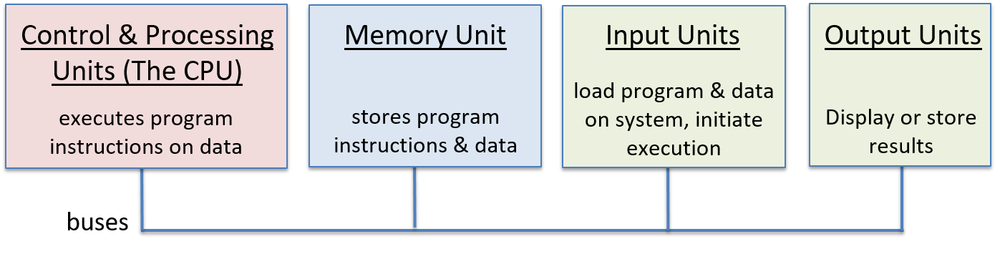
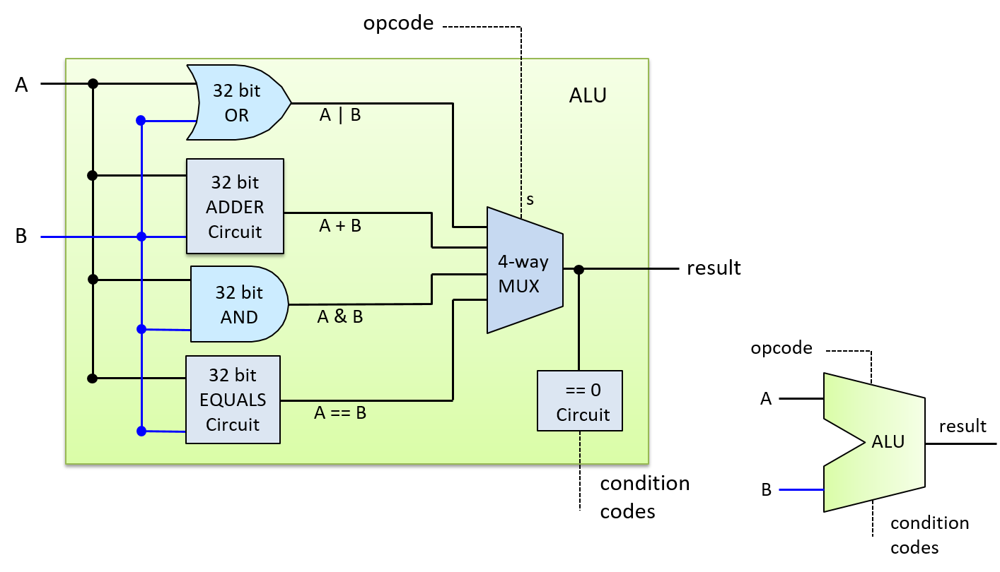
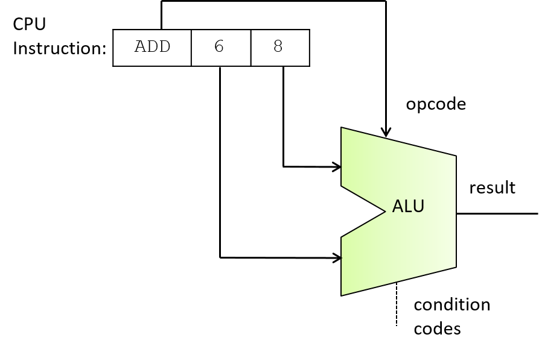
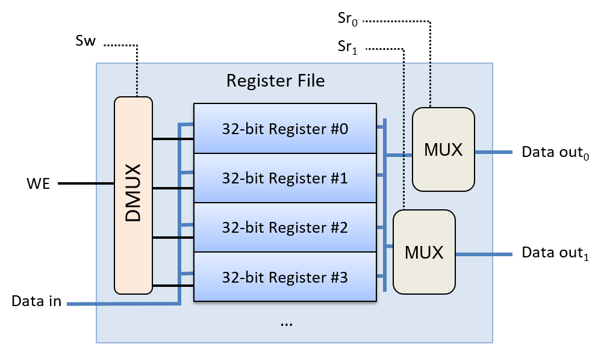
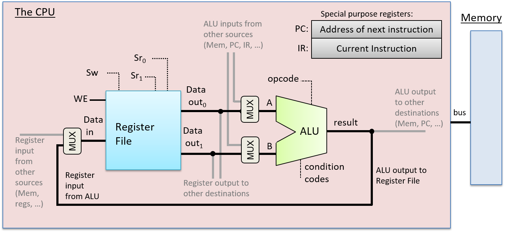

> **说明**
> 本文是个人学习用的**非官方**中英对照译文，原文：<https://diveintosystems.org/book/C5-Arch/cpu.html>。
> 原书采用 CC BY-NC-ND 4.0 许可（禁止演绎），**请勿公开传播本译文**。
> 标为「译注」「现代更新」的内容是译者补充，不代表原书作者观点；代码与原文逐字一致，未作改动。

## 5.5. 构建处理器：把一切组合起来

*5.5. Building a Processor: Putting It All Together*

**中央处理器**（CPU）实现了冯·诺依曼体系结构中的处理单元和控制单元，即驱动程序指令在程序数据上执行的那些部分（见[图 1](5.5-cpu.html)）。

> The **central processing unit** (CPU) implements the processing and control units of the von Neumann architecture, the parts that drive the execution of program instructions on program data (see [Figure 1](5.5-cpu.html)).



**图 1.** CPU 实现了冯·诺依曼体系结构中的处理单元和控制单元部分。

*Figure 1. The CPU implements the processing and control unit parts of the von Neumann architecture.*

CPU 由基本的算术/逻辑电路、存储电路和控制电路构件组成。它的主要功能部件包括：执行算术和逻辑运算的**算术逻辑单元**（ALU）；用于存储程序数据的一组通用**寄存器**；实现指令执行时用到的一些控制电路和专用寄存器；以及驱动 CPU 电路执行程序指令的**时钟**（clock）。

> The CPU is constructed from basic arithmetic/logic, storage, and control circuit building blocks. Its main functional components are the **arithmetic logic unit** (ALU), which performs arithmetic and logic operations; a set of general-purpose **registers** for storing program data; some control circuitry and special-purpose registers that are used in the implementation of instruction execution; and a **clock** that drives the circuitry of the CPU to execute program instructions.

本节介绍 CPU 的主要组成部分，包括 ALU 和寄存器文件，并说明如何把它们组合起来实现一个 CPU。下一节讨论 CPU 如何执行程序指令，以及如何用时钟驱动程序指令的执行。

> In this section, we present the main parts of the CPU, including the ALU and register file, and show how they are combined to implement a CPU. In the next section, we discuss how the CPU executes program instructions and how the clock is used to drive the execution of program instructions.

### 5.5.1. ALU

*5.5.1. The ALU*

ALU 是一个复杂的电路，它实现对有符号整数和无符号整数的所有算术和逻辑运算。另有一个单独的浮点单元对浮点值执行算术运算。ALU 接收整数操作数值和一个**操作码**（opcode）值，操作码指定要执行的运算（例如加法）。ALU 输出在操作数输入上执行指定运算得到的结果值，以及编码了运算结果相关信息的**条件码**（condition code）值。常见的条件码表示 ALU 的结果是否为负、是否为零，或者运算是否产生了进位输出位。例如，对于 C 语句

> The ALU is a complex circuit that implements all arithmetic and logic operations on signed and unsigned integers. A separate floating-point unit performs arithmetic operations on floating-point values. The ALU takes integer operand values and an **opcode** value that specifies the operation to perform (e.g. addition). The ALU outputs the resulting value of performing the specified operation on the operand inputs and **condition code** values that encode information about the result of the operation. Common condition codes specify whether the ALU result is negative, zero, or if there is a carry-out bit from the operation. For example, given the C statement

```
x = 6 + 8;
```

CPU 开始执行这次加法时，把操作数值（6 和 8）以及编码了 ADD 运算的位送入 ALU 电路。ALU 算出结果并输出，同时输出条件码，表示结果非负、非零，且没有产生进位输出。每个条件码用一个位编码。位值为 1 表示条件成立，位值为 0 表示 ALU 的结果不满足该条件。在我们的例子中，位模式 000 表示执行 6+8 对应的三个条件：结果不为负（0）、不为零（0），进位输出值为零（0）。

> the CPU begins executing the addition by feeding the operand values (6 and 8) and the bits that encode an ADD operation to the ALU circuit. The ALU computes the result and outputs it along with condition codes to indicate that the result is nonnegative, is nonzero, and causes no carry-out. Each condition code is encoded in a single bit. A bit value of 1 indicates that the condition holds, and a bit value of 0 indicates that it does not hold for the ALU result. In our example, the bit pattern 000 specifies the set of three conditions associated with executing 6+8: the result is not negative (0), is not zero (0), and the carry-out value is zero (0).

ALU 在执行运算时设置的条件码，有时会被后续根据特定条件选择动作的指令使用。例如，一条 ADD 指令可以计算下面这个 `if` 语句中的 (x + 8) 部分：

> Condition codes, set by the ALU as part of its execution of an operation, are sometimes used by subsequent instructions that choose an action based on a particular condition. For example, an ADD instruction can compute the (x + 8) part of the following `if` statement:

```
if( (x + 8) != 0 ) {
    x++;
}
```

ALU 执行 ADD 指令时，会根据 `(x + 8)` 相加的结果设置条件码。在 ADD 指令之后执行的条件跳转指令会检测 ADD 指令设置的条件码位，并根据它们的值决定是否跳转（跳过 `if` 语句体中的指令）。例如，如果 ADD 指令把零条件码设为 0，条件跳转指令就不会跳过 `if` 语句体对应的指令（零条件码为 0 表示 ADD 的结果不为零）。如果零条件码为 1，它就会跳过 `if` 语句体的指令。为了实现跳过一组指令，CPU 会把 `if` 语句体指令之后第一条指令的内存地址写入**程序计数器**（PC），PC 中存放的是下一条要执行的指令的地址。

> The ALU’s execution of the ADD instruction sets condition codes based on the result of adding `(x + 8)`. A conditional jump instruction executed after the ADD instruction tests the condition code bits set by the ADD instruction and either jumps (skips over executing the instructions in the `if` body) or not based on their value. For example, if the ADD instruction sets the zero condition code to 0, the conditional jump instruction will not jump past the instructions associated with the `if` body (0 for the zero condition code means that the result of the ADD was not zero). If the zero condition code is 1, it will jump past the `if` body instructions. To implement a jump past a set of instructions, the CPU writes the memory address of the first instruction after the `if` body instructions into the **program counter** (PC), which contains the address of the next instruction to execute.

ALU 电路把几个算术和逻辑电路（用于实现它的运算集合）与一个多路复用器电路组合起来，由多路复用器选出 ALU 的输出。一个简单的 ALU 并不试图只选择性地激活与特定运算对应的那个算术电路，而是把它的操作数输入值送入它内部所有的算术和逻辑电路。ALU 内部所有算术和逻辑电路的输出都被输入到它的多路复用器电路，由多路复用器选出 ALU 的输出。ALU 的操作码输入被用作多路复用器的信号输入，以选择哪个算术/逻辑运算的结果作为 ALU 的输出。条件码输出则基于 MUX 的输出，再配合检测输出值的电路来确定每个条件码位。

> An ALU circuit combines several arithmetic and logic circuits (for implementing its set of operations) with a multiplexer circuit to pick the ALU’s output. Rather than trying to selectively activate only the arithmetic circuit associated with the specific operation, a simple ALU sends its operand input values to all of its internal arithmetic and logic circuits. The output from all of the ALU’s internal arithmetic and logic circuits are input to its multiplexer circuit, which chooses the ALU’s output. The opcode input to the ALU is used as the signal input to the multiplexer to select which arithmetic/logic operation to select as the ALU’s output. Condition code output is based on the MUX output combined with circuitry to test the output’s value to determine each condition code bit.

[图 2](5.5-cpu.html) 展示了一个示例 ALU 电路，它对两个 32 位操作数执行四种不同的运算（ADD、OR、AND 和 EQUALS）。它还产生一个条件码输出，表示运算结果是否为零。注意，ALU 把操作码送到一个多路复用器，由它选择输出 ALU 的四个运算结果中的哪一个。

> [Figure 2](5.5-cpu.html) shows an example ALU circuit that performs four different operations (ADD, OR, AND, and EQUALS) on two 32-bit operands. It also produces a single condition code output that indicates whether the result of the operation is zero. Notice that the ALU directs the opcode to a multiplexer that selects which of the ALU’s four arithmetic results it outputs.



**图 2.** 一个对两个 32 位操作数执行 ADD、OR、AND 和 EQUALS 的四功能 ALU。它有一个条件码输出位，表示结果是否为 0。

*Figure 2. A four-function ALU that performs ADD, OR, AND, and EQUALS on two 32-bit operands. It has one condition code output bit that specifies whether the result is 0.*

ALU 的操作码输入来自 CPU 正在执行的指令中的某些位。例如，一条 ADD 指令的二进制编码可能由四部分组成：

> The opcode input to the ALU comes from bits in the instruction that the CPU is executing. For example, the binary encoding for an ADD instruction might consist of four parts:

```
  | OPCODE BITS | OPERAND A SOURCE | OPERAND B SOURCE | RESULT DESTINATION |
```

根据 CPU 体系结构的不同，操作数来源位可能编码一个 CPU 寄存器、存放操作数值的内存地址，或者字面操作数值。例如，在执行 6 + 8 的指令中，字面值 6 和 8 可以直接编码在指令的操作数说明位中。

> Depending on the CPU architecture, operand source bits might encode a CPU register, the memory address storing the operand value, or literal operand values. For example, in an instruction to perform 6 + 8, the literal values 6 and 8 could be encoded directly into the operand specifier bits of the instruction.

对于我们的 ALU，由于它支持四种运算，操作码需要两位，因为两位可以编码四个不同的值（00、01、10、11），每个值对应一种运算。一般来说，执行 *N* 种不同运算的 ALU 需要 log<sub>2</sub>(*N*) 个操作码位，来指定从 ALU 输出哪个运算的结果。

> For our ALU, the opcode requires two bits because the ALU supports four operations, and two bits can encode four distinct values (00, 01, 10, 11), one for each operation. In general, an ALU that performs *N* distinct operations, needs log<sub>2</sub>(*N*) opcode bits to specify which operation result to output from the ALU.

[图 3](5.5-cpu.html) 展示了 ADD 指令的操作码位和操作数位如何作为我们这个 ALU 的输入。

> [Figure 3](5.5-cpu.html) shows an example of how the opcode and operand bits of an ADD instruction are used as input into our ALU.



**图 3.** ALU 用指令中的操作码位来选择输出哪个运算的结果。在这个例子中，ADD 指令的不同位被分别送入 ALU 的操作数输入和操作码输入，执行 6 与 8 的加法。

*Figure 3. Opcode bits from an instruction are used by the ALU to choose which operation to output. In this example, different bits from an ADD instruction are fed into the ALU operand and opcode inputs to perform addition of 6 and 8.*

### 5.5.2. 寄存器文件

*5.5.2. The Register File*

在存储器层次结构的顶端，CPU 的一组通用寄存器存放临时值。CPU 提供的寄存器数量非常少，通常为 8–32 个（例如，IA32 体系结构提供 8 个，MIPS 提供 16 个，ARM 提供 13 个）。指令常常从通用寄存器中获取操作数值，或者把结果存入通用寄存器。例如，一条 ADD 指令可能编码为*「把寄存器 1 中的值与寄存器 2 中的值相加，并把结果存入寄存器 3」*。

> At the top of the memory hierarchy, the CPU’s set of general-purpose registers store temporary values. CPUs provide a very small number of registers, commonly 8-32 (e.g., the IA32 architecture provides 8, MIPS provides 16, and ARM provides 13). Instructions often get their operand values from, or store their results to, general-purpose registers. For example, an ADD instruction may be encoded as *"add the value from Register 1 to the value from Register 2 and store the result in Register 3"*.

> **译注**
> 这里列出的寄存器数目只是举例，而且与具体的体系结构版本有关：本书第 7 章会讲到 x86-64 有 16 个通用寄存器，第 9 章会讲到 ARM64（AArch64）有 31 个通用寄存器（x0–x30）；原书说的「ARM 13 个」指的是 32 位 ARM 中 r0–r12 这 13 个寄存器（另有 SP、LR、PC 三个专用寄存器）。

CPU 的一组通用寄存器被组织成一个**寄存器文件**（register file）电路。寄存器文件由一组用于存储数据值的[寄存器电路](5.4.3-storagecircs.html)，以及一些控制对其寄存器进行读写的[控制电路](5.4.2-controlcircs.html)组成。这个电路通常有一条数据输入线，用于写入其某个寄存器的值；还有两条数据输出线，用于同时从其寄存器中读出两个值。

> The CPU’s set of general-purpose registers is organized into a **register file** circuit. A register file consists of a set of [register circuits](5.4.3-storagecircs.html) for storing data values and some [control circuits](5.4.2-controlcircs.html) for controlling reads and writes to its registers. The circuit typically has a single data input line for the value to write into one of its registers, and two data output lines for simultaneously reading two values from its registers.

[图 4](5.5-cpu.html) 展示了一个含四个寄存器的寄存器文件电路的例子。它的两个输出值（Data out<sub>0</sub> 和 Data out<sub>1</sub>）由两个多路复用器电路控制。它的每个读选择输入（Sr<sub>0</sub> 和 Sr<sub>1</sub>）分别送入其中一个 MUX，为相应的输出选出寄存器的值。寄存器文件的数据输入（Data in 线）被送到每个寄存器电路，而它的写使能（WE）输入先经过一个多路分配器（DMUX）电路，再送到各个寄存器电路。DMUX 电路接收一个输入值，选择把这个值送到 *N* 个输出中的哪一个，其余 *N-1* 个输出都为 0。寄存器文件的写选择输入（S<sub>w</sub>）被送到 DMUX 电路，用来选择 WE 值的目标寄存器。当寄存器文件的 WE 输入值为 0 时，不会有值被写入任何寄存器，因为每个寄存器的 WE 位也都是 0（因此 Data in 对寄存器中存储的值没有影响）。当 WE 位为 1 时，DMUX 只向写选择输入（S<sub>w</sub>）指定的那个寄存器输出值为 1 的 WE 位，从而只把 Data in 的值写入被选中的寄存器。

> [Figure 4](5.5-cpu.html) shows an example of a register file circuit with four registers. Its two output values (Data out<sub>0</sub> and Data out<sub>1</sub>) are controlled by two multiplexer circuits. Each of its read selection inputs (Sr<sub>0</sub> and Sr<sub>1</sub>) is fed into one of the MUXs to pick the register value for the corresponding output. The data input to the register file (the Data in line) is sent to every register circuit, and its write enable (WE) input is fed through a demultiplexer (DMUX) circuit first before being sent to each register circuit. A DMUX circuit takes one input value and chooses which of *N* outputs to send the value to, sending the remaining *N-1* outputs 0. The write selection input (S<sub>w</sub>) to the register file is sent to the DMUX circuit to choose the WE value’s destination register. When the register file’s WE input value is 0, no value is written into a register because each register’s WE bit also gets 0 (thus, Data in has no effect on the values stored in the registers). When the WE bit is 1, the DMUX outputs a WE bit value of 1 to only the register specified by the write selection input (S<sub>w</sub>), resulting in the Data in value being written to the selected register only.



**图 4.** 寄存器文件：一组 CPU 通用寄存器，用于存储指令的操作数和结果值。

*Figure 4. The register file: the set of CPU general-purpose registers used to store instruction operand and result values.*

#### 专用寄存器

*Special-Purpose Registers*

除了寄存器文件中的通用寄存器之外，CPU 还包含一些专用寄存器，用于存储指令的地址和内容。**程序计数器**（PC）存放下一条要执行的指令的内存地址，**指令寄存器**（IR）存放 CPU 当前正在执行的指令的各个位。在指令执行过程中，IR 中存放的指令位被用作 CPU 不同部分的输入。我们会在下一节[指令执行](5.6-instrexec.html)中更详细地讨论这些寄存器。

> In addition to the set of general-purpose registers in the register file, a CPU contains special-purpose registers that store the address and content of instructions. The **program counter** (PC) stores the memory address of the next instruction to execute, and the **instruction register** (IR) stores the bits of the current instruction being executed by the CPU. The bits of the instruction stored in the IR are used as input into different parts of the CPU during the instruction’s execution. We discuss these registers in more detail in the next section on [instruction execution](5.6-instrexec.html).

### 5.5.3. CPU

*5.5.3. The CPU*

有了 ALU 和寄存器文件电路，我们就可以构建 CPU 的主要部分，如[图 5](5.5-cpu.html) 所示。由于指令的操作数常常来自通用寄存器中存储的值，寄存器文件的输出把数据送到 ALU 的输入。类似地，由于指令的结果常常存入寄存器，ALU 的结果输出被作为输入送到寄存器文件。CPU 还有额外的电路，用于在 ALU、寄存器文件和其他部件（例如主存）之间移动数据。

> With the ALU and register file circuits, we can build the main parts of the CPU, as shown in [Figure 5](5.5-cpu.html). Because instruction operands often come from values stored in general-purpose registers, the register file’s outputs send data to the ALU’s inputs. Similarly, because instruction results are often stored in registers, the ALU’s result output is sent as input to the register file. The CPU has additional circuitry to move data between the ALU, register file, and other components (e.g., main memory).



**图 5.** ALU 和寄存器文件构成了 CPU 的主要部分。ALU 执行运算，寄存器文件存储操作数和结果值。另外的专用寄存器存储指令的地址（PC）和内容（IR）。注意，指令可能从寄存器文件以外的位置（例如主存）获取操作数或存储结果。

*Figure 5. The ALU and register file make up the main parts of the CPU. The ALU performs operations, and the register file stores operand and result values. Additional special-purpose registers store instruction addresses (PC) and contents (IR). Note that instructions might retrieve operands from or store results to locations other than the register file (e.g., main memory).*

CPU 的这些主要部分构成了它的**数据通路**（data path）。数据通路由 CPU 中执行算术和逻辑运算的部分（ALU）、存储数据的部分（寄存器）以及连接这些部分的总线组成。CPU 还实现了一条**控制通路**（control path），驱动 ALU 在寄存器文件中存储的操作数上执行程序指令。此外，控制通路还根据指令的需要向 I/O 设备发出命令并协调内存访问。例如，有些指令可能直接从内存位置获取操作数值（或者直接把结果存入内存位置），而不是通用寄存器。在下一节中，我们对 CPU 指令执行的讨论集中在从寄存器文件获取操作数值并把结果存入寄存器文件的指令上。CPU 需要额外的控制电路来从其他位置读取操作数值或向其他位置写入指令结果，但无论来源和目标位置是什么，指令执行的主要步骤都是相同的。

> These main parts of the CPU make up its **data path**. The data path consists of the parts of the CPU that perform arithmetic and logic operations (the ALU) and store data (registers), and the buses that connect these parts. The CPU also implements a **control path** that drives the execution of program instructions by the ALU on operands stored in the register file. Additionally, the control path issues commands to I/O devices and coordinates memory accesses as needed by instructions. For example, some instructions may get their operand values directly from (or store their results directly to) memory locations rather than general-purpose registers. In the next section, we focus our discussion of CPU instruction execution on instructions that get operand values and store results to the register file. The CPU requires additional control circuitry to read operand values or to write instruction results to other locations, but the main instruction execution steps behave the same regardless of the source and destination locations.
